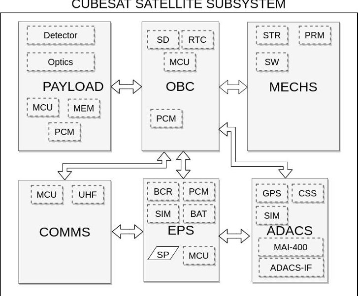
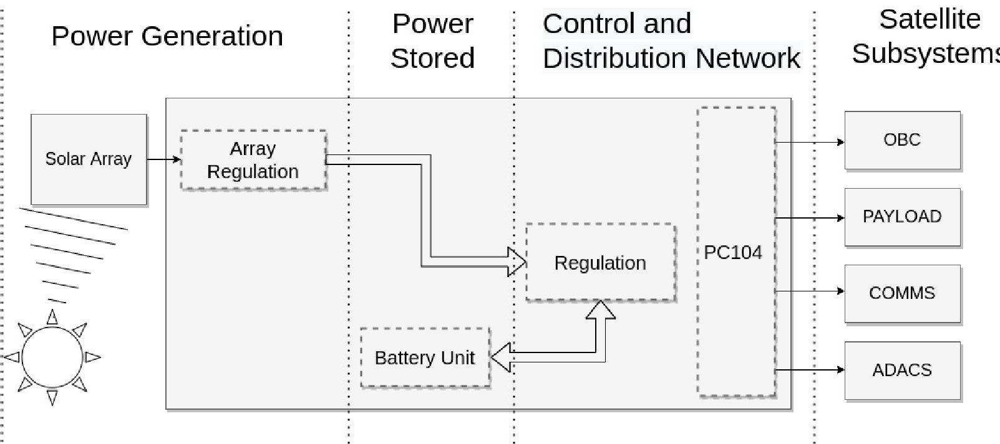
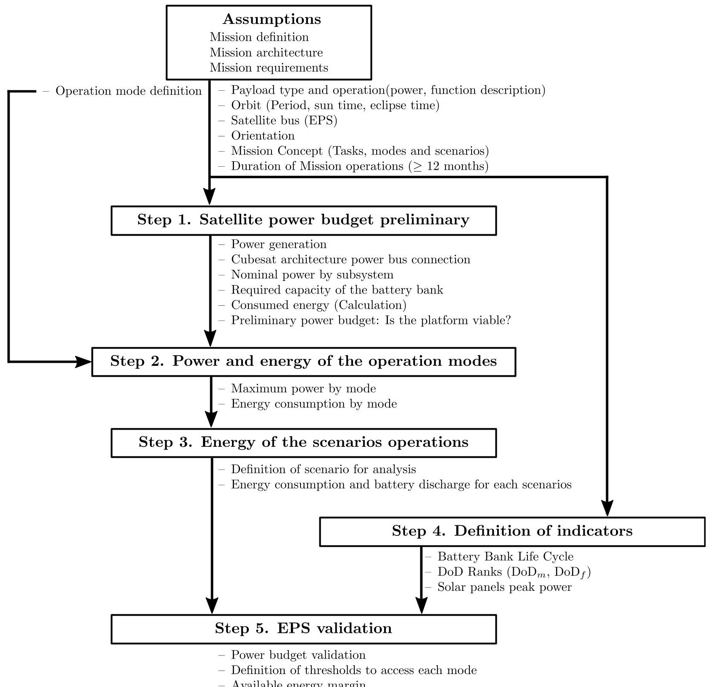
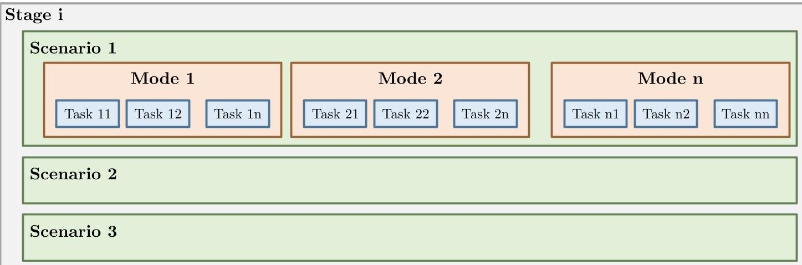
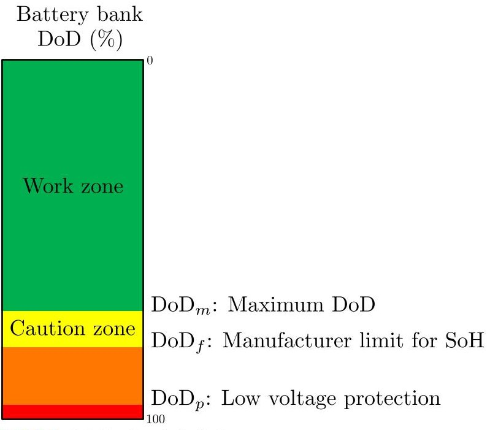
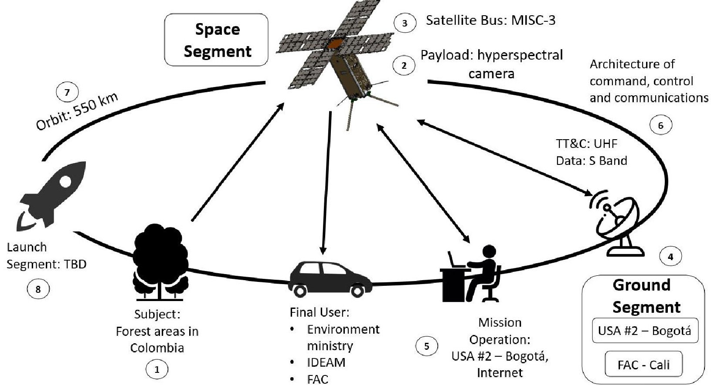
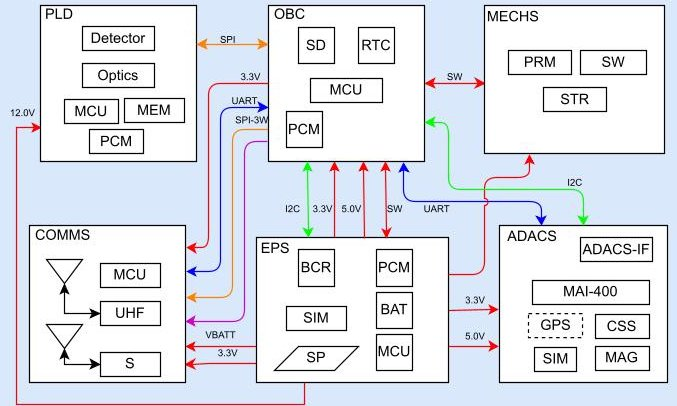
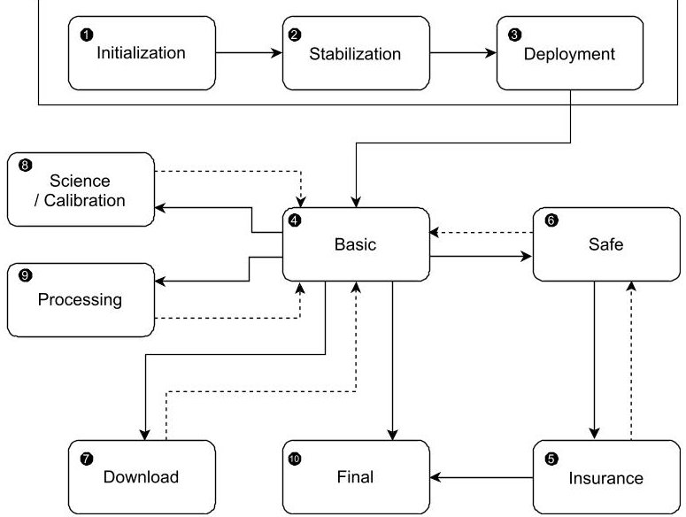
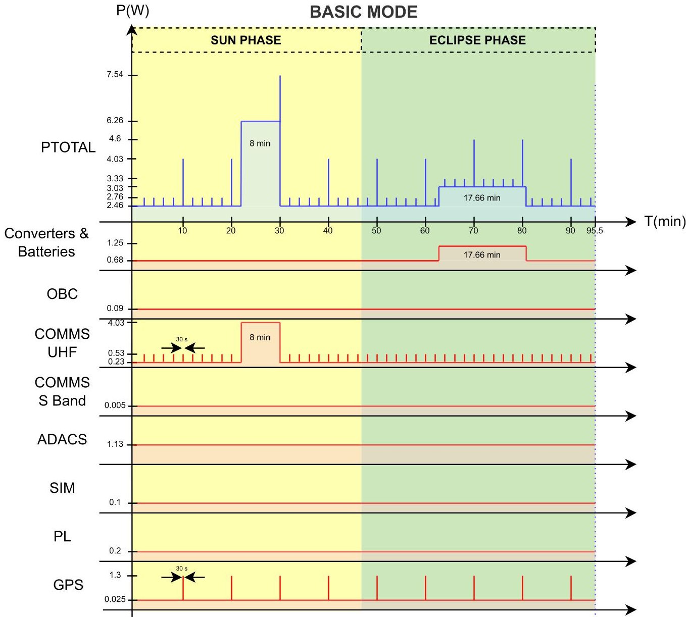
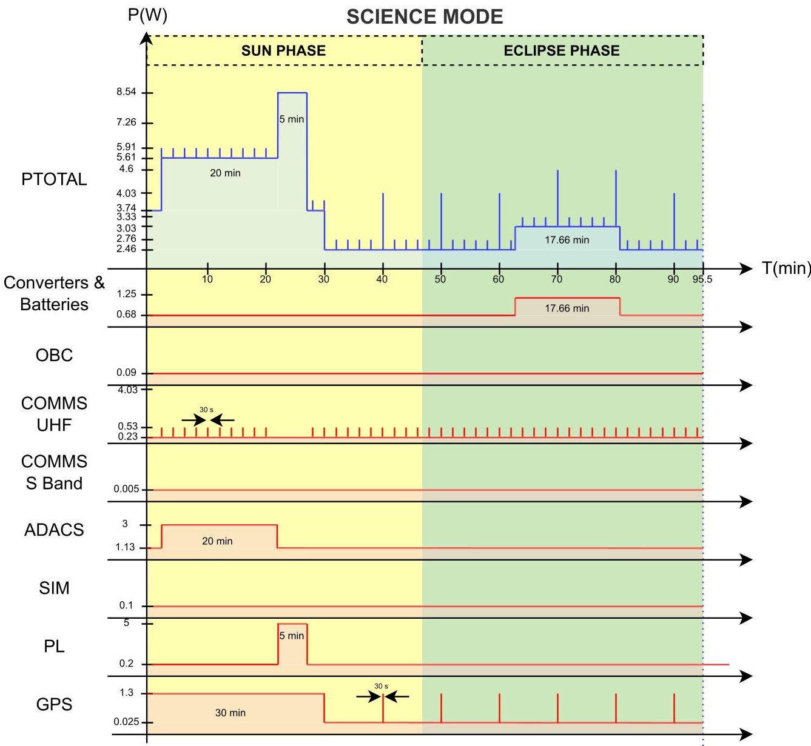

<!-- PDF_PAGE: 1 -->

Received 24 February 2023, accepted 20 April 2023, date of publication 28 April 2023, date of current version 8 May 2023. Digital Object Identifier 10.1109/ACCESS.2023.3271596

METHODS

# A Method for Validating CubeSat Satellite EPS Through Power Budget Analysis Aligned With Mission Requirements

IGNACIO F. ACERO $ ^{1} $ , JONATHAN DIAZ $ ^{1} $ , RONALD HURTADO-VELASCO $ ^{1} $ ,

SERGIO RAMIRO GONZALEZ BAUTISTA $ ^{1} $ , SONIA RINCÓN $ ^{2,3} $ , FRANCISCO L. HERNÁNDEZ $ ^{4} $ ,

JULIAN RODRIGUEZ-FERREIRA $ ^{5} $ , (Member, IEEE),

AND IFSUS GONZALEZ-LLORENTE $ ^{2} $ (Senior Member IEEE)

$ ^{1} $Ingeniería Electrónica, Escuela de Ciencias Exactas e Ingeniería, Universidad Sergio Arboleda, Bogota 110221, Colombia

$ ^{2} $Centro de Investigación en Tecnologías Aeroespaciales (CITAE), Cali 760011, Colombia

$ ^{3} $Fuerza Aérea Colombiana (FAC), Cali 760011, Colombia

$ ^{4} $Escuela de Ingeniería Civil y Geomática, Universidad del Valle, Ciudad Universitaria Meléndez, Cali 760042, Colombia

$ ^{5} $Escuela de Ingenierías Eléctrica, Electrónica y de Telecomunicaciones, Universidad Industrial de Santander, Bucaramanga 680002, Colombia

Corresponding author: Ignacio F. Acero (ignacio.acero@usa.edu.co)

This work was supported in part by the Government of Colombia through the Ministry of Science, Technology and Innovation (MINCIENCIAS); and in part by the Colombian Air Force (COLAF) under Grant 75079.

ABSTRACT The use of commercial off-the-shelf (COTS) components in CubeSat design offers flexibility, scalability, reduced power budget, and reduced development time. For these reasons, many space missions have adopted COTS platforms, owing to their advantages and limitations. An electrical power system (EPS) is a critical subsystem of COTS platforms that must meet mission requirements for the satellite to operate and guarantee mission success, including support for the operation modes and meeting the required lifetime. However, EPS validation is necessary to identify EPS characteristics such as energy generation, storage, consumption, and management modes. The power budget is a crucial aspect in the validation, design, and correct selection of an EPS, which can reduce costs and ensure compliance with EPS requirements. In this paper, a method is proposed to validate the EPS characteristics of COTS platforms by analyzing the power budget according to mission specifications. The approach determines the power and energy for the operational modes and scenarios and evaluates the battery depth of discharge (DoD) and charge/discharge cycles. The effectiveness of the proposed method is demonstrated through a case study of the LEOPAR mission, a 3U CubeSat satellite. The results show that the EPS can meet the power demands of the satellite subsystems during the mission. Our method provides a systematic and easy-to-follow process for validating CubeSat satellite EPS and can significantly enhance the development process for these satellites. It also contributes to the small-satellite community by providing a valuable tool to ensure the success of CubeSat missions.

INDEX TERMS Electrical power system (EPS), CubeSat, commercial off-the-shelf (COTS), power budget, satellite mission, small satellites, low-earth-orbit (LEO), depth of discharge (DoD).

## I. INTRODUCTION

During the last few years, small satellites have become increasingly popular due to their cost-effectiveness and ability to the meet mission requirements [1]. CubeSats,

The associate editor coordinating the review of this manuscript and approving it for publication was Yuh-Shyan Hwang $ ^{ID} $ .

in particular, are standardized nanosatellites weighing between 1 and 15 kg that have been developed for a variety of purposes. By following a specific design philosophy, CubeSats offer a cheaper alternative to traditional satellites. One of the primary advantages of CubeSats is their low weight, which require less fuel to be launched compared to larger satellites. In most cases, they share a ride ride on the same

<!-- PDF_PAGE: 2 -->

rocket as larger satellites, allowing them to piggyback on the heavier payloads and reduce launch costs.

CubeSat satellite is a square-shaped miniature satellite based on a standard CubeSat unit "1U," that corresponds to a 10 cm $ \times $ 10 cm $ \times $ 10 cm—roughly the size of a Rubik's cube. Other larger versions have become popular and use the same base unit, such as 1.5U, 2U, 3U and 6U, but different configurations can be performed [1]. CubeSats have become a widely used resource in space communities.

CubeSats have been used exclusively in Low Earth Orbit (LEO) for 15 years and are now being used for interplanetary missions. In the case of LEO CubeSat for 5G coverage, the altitude must fall below 600 km to achieve the require performance [2]. The most important variables that determine changes in different orbits are the eclipse period and eclipse percentage. The eclipse period is the eclipse time per orbit, and the eclipse percentage is the percentage of the eclipse period to the orbit period. The eclipse percentage varies greatly throughout the year, rising as high as 39 percent and low as no eclipse at all during certain times of the year.

To achieve the desired project cost reduction, the use of commercial off-the-shelf (COTS) components was encouraged, along with a reduction in the number of tests. Depending on the application for which a CubeSat mission is designed, its cost can range from a few tens of thousands to a few million dollars, with a development time spanning from approximately a year to a couple of years [1].

CubeSats with COTS components are playing an increasingly significant role in small satellites, depending on the requirements and specifications identified. This approach reduces the development time because testing and verification requirements can be skipped in most cases, when the subsystems have already been verified and demonstrated in an orbit environment. In the case of COTS structures, they have several predefined attachment points that provide freedom when mounting the internal subassembly. Some of these COTS structures are made of several modular frames or plates that can be easily expanded to other CubeSat form factors. This standardization allows companies to mass-produce components and reduce costs. In addition, standard shapes and sizes help reduce the cost associated with transporting and deploying them to space. One of the advantages of the open and standardized CubeSat architecture is that it provides opportunities for developers to produce space systems rapidly. However, their fixed designs impose limitations on flexibility in defining the placement of mission payloads that are unique in size. Common CubeSat COTS vendors, such as Gomspace, Pumpkin, ISIS, and Complex Systems and Small Satellites (C3S) offer several standard design options for satellite structures [3].

For a CubeSat-type COTS platform to successfully carry out different missions such as scientific, technology demonstration, communication, or observation, it is essential to equip it with key subsystems that meet the mission's requirements. These subsystems include the Electrical Power System (EPS), On-Board Computer (OBC), Control and Data

FIGURE 1. CubeSat type COTS platform including main subsystems.

Handling (C&DH), payload, Attitude Determination and Control (ADACS), communication (COMMS), and structure (MECHS). Among these, the provision of electrical power by the EPS is perhaps the most fundamental requirement for any satellite, as the failure of the power system necessarily results in the failure of the space mission [4]. Fig. 1 shows the CubeSat subsystems mentioned above.

CubeSats rely on a highly integrated Electrical Power System (EPS) to ensure optimal power generation and distribution. The EPS is responsible for supplying power to all satellite subsystems while effectively managing energy processes. In this regard, the EPS must convert solar radiation into electrical energy and then store, regulate, and convert the electrical energy to meet the spacecraft's specifications and requirements.

The EPS plays a critical role in the overall operation of any CubeSat satellite platform. It generates energy using its solar panels and stores it in the battery. DC-DC switching voltage regulators are used to convert stored energy to final voltage levels of +3.3 V and +5 V, which are then supplied to the other subsystems on the satellite. As a result, the EPS is responsible for providing a reliable and safe supply of electrical energy to all other on-board systems. To accomplish this, the EPS is equipped with all the necessary hardware and software components required to generate, store, convert, condition, and distribute electrical energy in a manner that meets the needs of the entire satellite system.

Usually, an EPS typically comprises three main components: a primary energy source for power generation, a secondary energy source for power storage, and a power control and distribution network system, as shown in Fig. 2. The primary energy source is usually a solar array, which harvests the Sun's radiant energy to generate power when the CubeSat is in direct sunlight. When the Sun is eclipsed, the secondary energy source, typically consisting of Lithium-Ion batteries, is used to provide stored power. The amount of power

<!-- PDF_PAGE: 3 -->

generated by the solar arrays depends on the duration and incidence angle of sunlight, which varies with the CubeSat orbit and attitude.

The secondary energy source is required to store energy and to power the satellite systems and payload when the primary energy source is not available. The power storage capacity of the battery is also dictated by the power needs in the eclipse region of the orbit, where the solar panels do not generate power. The batteries are charged by solar panels through battery charge regulators (BCR) from the control and distribution elements, which independently optimize the solar array voltage for maximum power transfer. The secondary power source is essential for the mission, as it enables the CubeSat to continue operating when the solar arrays are unable to produce electrical energy, such as during eclipses.

The lifetime and health of the battery are crucial factors to consider when selecting a secondary energy source. Rechargeable batteries have a finite life and gradually lose their ability to hold charges over time, which is an irreversible process. As the battery capacity decreases, so does the amount of time it can power the product, also known as the run time. Lithium-Ion-rechargeable batteries should be stored at 50% to 60% state-of-charge (SOC). According to Mallon [5], the SOC indicates the instantaneous charge of the battery as a percentage of its maximum capacity, given by

$$
S O C (t) = \frac {Q (t)}{Q _ {m a x}} 100 \%
$$

where, the instantaneous maximum capacity is denoted by $ Q_{max} $ and the instantaneous stored charge, $ Q(t) $ , is obtained using the Coulomb counting method, where $ Q_{0} $ is the initial battery charge

$$
Q (t) = Q _ {0} - \int_ {0} ^ {t} I _ {b a t t} (t) d t
$$

Similarly, the depth of discharge (DoD) is an indicator of the percentage of the total capacity discharged:

$$
DoD (t) = \frac {Q _ {m a x} - Q (t)}{Q _ {m a x}} 100 \%
$$

The maximum capacity of a battery typically fades to 80% of its original value before it is considered to have reached the end of its life, according to the literature [5]. Therefore, routine maintenance and proper handling of batteries are essential to prolong their lifespan. To accurately predict the long-term performance and health of batteries, modeling battery degradation is necessary.

The power control distribution network is a critical component of the EPS, responsible for delivering appropriate voltage and current levels to all spacecraft loads as needed. It is designed to power all other satellite subsystems through multiple power buses, including unregulated voltage lines at 3.3, 5.0, and 8.4 V, and must communicate with other subsystems over the Internal Communication Protocol (ICP). It is important to note that the power distribution network must be able to operate with both primary and secondary

energy sources, whose characteristics change over time, and is responsible for charging and discharging the battery. Therefore, careful design and consideration of the power distribution network system is crucial for the proper functioning and longevity of the EPS.

EPS can be developed through either custom design or procured from the CubeSat market as a commercial off-the-shelf (COTS) design. Custom design of EPS involves selecting an appropriate CubeSat architecture by comparing the overall efficiency, battery size, and reliability for the given mission-specific requirements. Custom design addresses interface limitations by developing an EPS tailored to the specific satellite mission requirements. However, this process requires longer time for development and design verification. The decision to invest in custom design is based primarily on the available budget and time constraints. On the other hand, COTS EPS designs offer a simpler and faster solution with a lower cost. COTS EPS can be procured from the CubeSat market and modified to suit specific requirements, although some interface limitations may arise.

The decision to procure a COTS design is mainly based on the mission requirements, budget, and timeline constraints. However, verification is a mandatory requirement for custom EPS designs to conduct rigorous screening and reliability tests/inspections. For the EPS COTS design, the operational modes must be verified for the entire mission duration to check whether the photovoltaic (PV) panel arrangement and battery size are sufficient to satisfy the energy requirements. If there is any scenario where the load consumption exceeds both the generation and storage energy, the following options exist: 1) change the PV panel arrangement to increase the power generation, 2) increase the battery size in case of the availability of free space, and 3) change the load profile based on the energy management to balance the energy generation and load consumption.

For both options, the starting point is to define the electrical consumption of the satellite. According to [6], the power consumption is calculated in terms of energy for each part of the orbit, daylight, and eclipse. In general, this is not constant during a mission or a single orbit. Therefore, a mission analysis must consider the mission profile and, consequently, the power demand. The three critical issues that need to be considered are the orbit parameters, the nature of the mission (whether it is communications, data extraction, or other), and the duration of the mission. Orbit selection influences the eclipse time and available energy. The nature of the mission has an impact on the components that must be on or can be off during some periods and the energy consumption from components that are required for the mission; the mission duration has an impact on the degradation of the components over time. The nature of the mission determines the appropriate EPS in terms of performance, lifetime, volume, mass, and efficiency. In this sense, the capabilities, restrictions, and limitations of the EPS and the requirements of the satellite to carry out the mission are considered. It is necessary to define how the satellite will operate, considering the management of

<!-- PDF_PAGE: 4 -->

FIGURE 2. EPS breakdown with its three main elements(Power generation, power stored, and control and distribution network).

electrical energy in the different scenarios that the fulfillment of the mission implies, and the platform requirements for each of its subsystems and payload. The power generated and consumed can vary depending on the operating mode.

When designing a satellite, it is crucial to determine the power required to support all subsystems onboard. This calculation of the amount of power that needs to be generated depends on the parameters of the solar panel. Both hardware and software must be considered to manage the amount of energy available during the mission. The software monitors and manages the amount of energy available when the different actions planned for the completion of the mission come into operation. First, the power budget is the power utilization and consumption calculation associated with the system. The power budget involves calculating power utilization and consumption for each subsystem, as well as power generated by solar cells and stored in batteries. The power budget represents the net power balance of the system during operation and can only be accurately calculated once the entire design of all electrical components is known. However, a tentative budget calculation can be started at the beginning to estimate the power consumption and generation during an orbit. If the power generated is greater than or equal to the power consumed during the orbit, a positive power budget is obtained. If the power consumed is greater than the power generated, a negative power budget will result, and the battery will be gradually drained until it is empty. Therefore, adhering to the power budget during the CubeSat design and construction process is essential for mission success. A thorough power budget analysis can determine the operating time of a payload from a given battery capacity (amp-hours) without recharging. Moreover, the size of the solar panel or charging source should be considered to sustain the battery.

The EPS must be efficient and flexible, capable of meeting the power requirements for any specific mission, and reusable for different mission scenarios without requiring a complete redesign [7]. The EPS choice depends on the mission's functionality requirements, and the EPS influences the payload options based on these requirements (e.g., camera directionality and, antennae position).

In conclusion, the EPS directly dictates the generated solar panels and stored power, which defines the CubeSat's maximum power budget. The power budget enables a quick calculation of the maximum available operational time for a CubeSat's payloads based on the solar panels'power production and the batteries'energy reserves. Using this information, designers can quickly select appropriate launch opportunities or redesign their system to meet mission requirements based on the orbital pattern of the launch opportunity [8]. The EPS design process was iterative and highly dependent on each variable (eclipse period and eclipse percentage). These variables are important because they have a direct influence on how large the battery should store enough energy to be used during the eclipse period [9]. This makes it particularly difficult to allocate the power budget, because the power input changes every orbit. The final selection of the EPS depends on several factors because different power systems have different properties and the one that best fits the project must be selected [9].

In this study, we developed a power budget method for CubeSat satellites. The method starts with an overview of the constraints and assumptions that impact the power budget analysis. It then proceeds to calculate the power requirements for each subsystem during an orbit to estimate power consumption and determine the power generated by the solar panels. This allows for an estimation of the energy consumption

<!-- PDF_PAGE: 5 -->

for each operational mode proposed for the satellite in orbit, as well as the electrical power available per orbit. Based on the analyses conducted, it has been determined that if the power consumption exceeds 80% of the battery capacity, the satellite will enter safe mode, and no further tasks will be carried out.

The power budget analysis allows for the identification of essential EPS characteristics, such as generation, consumption, and energy management, for the subsystems of a CubeSat platform. This process is based on the analysis of various operating scenarios, including Satellite Release, Standby, Earth Image, and Energy Recharge. Within each scenario, up to 10 operating modes can be selected, including Initialization, Stabilization, Deployment, Basic, Insurance, Safe, Download, Science/Calibration, Processing, and Final, each with its unique set of tasks that the satellite can perform, depending on its subsystems. The power gain by the panels and the energy consumption of each subsystem, by operation mode, is also considered during these scenarios. By evaluating these requirements and the limitations of the EPS, it is possible to determine if the EPS can fulfill the operations requested by the subsystems. The proposed method allows designers to verify if the EPS parameters satisfy the mission requirements.

This article is organized as follows: In Section II, we review related research works on power budget analysis for CubeSats. Section III presents the proposed method for CubeSat power budget analysis in detail, including the key steps involved. In Section IV, we apply the proposed method to a case study to demonstrate its effectiveness. Finally, Section V summarizes the study's findings and contributions.

## II. RELATED WORKS

Previous studies have investigated the development of power budget analysis and addressed different challenges in designing concerns on CubeSat EPS validation. Generally, 1U, 2U, and 3U CubeSats maximum power budgets range from 1 W to 2.5 W, 2 W to 5 W, and 7 W to 20 W [2], [6], [7], [8], [10], [11], [12]. For example, Sanae Dahbi et al. [6] proposed a power budget analysis for a 1U CubeSat satellite. The author's method begins with an overview of the constraints and assumptions (orbital parameters, subsystem power required, and other constraints) that influence power budget analysis. Subsequently, power generation is described thoroughly. The operational modes (Pre-Launch Mode (PM), Launch Mode (LM), Separation Mode (SM), Initialization Mode (IM), Safe Mode (SM), Nominal Mode (NM)) and power consumption are described and analyzed to establish the appropriate consumption scenario of the satellite, sizing the battery capacity, and selecting the design of the power system. This method has been used in many 1U CubeSat implementations, such as OUFTI [13], SwissCube [14], and IGOsat [15], to validate the operational mode of the space segment given the modes of operation of the satellite, its orbital parameters, and the power consumption of the satellite subsystems.

Suryanti et al. [10] analyzed the power budget of CubeSat satellites to determine the number of panels and batteries required to perform their missions. This research method began by calculating the power requirements of each mission per orbit period to estimate the power consumption and calculate the power generated by solar panels. The results of these calculations can be implemented in power system design to determine the arrangement of satellite solar cells/panels and the allocation of battery capacity. To minimize the development time and cost, the solar array design in this study considers the utilization of the previous solar panel design of the LAPAN-A series satellites as a design constraint.

A combination of issues may affect power budgeting. For example, to determine the generated power for CubeSats, it is crucial to study the relationship between the received solar irradiance and the side of the satellite. Hence, the orientation scenarios play a key role in defining the amount of solar irradiance. In the literature, only a few papers have highlighted the effect of orientation scenarios on CubeSat performance [16], [17]. In this sense, the authors of [16] focused on the design of Solar Module Integrated Converters (SMIC); where, they were able to reduce the number of solar cells by analyzing the energy balance according to orientation scenarios. In [17], the main orientation scenarios were introduced, taking into account the attitude of the satellite and orbital parameters to evaluate the energy generation. However, when the power consumption was analyzed to estimate the battery recharging time, only the standby mode was considered.

Orientation and orbit are also considered to achieve a balance between a broad coverage area of the satellite network while maintaining low latency values, but this may influence the power generation period [2], [11]. In this sense, an important consideration for planning CubeSat missions is the power budget required by the radio communication subsystem, which enables a CubeSat to exchange information with ground stations and/or other CubeSats in orbit [11].

Park et al. [18] proposed a design process for an EPS system that included a power budget analysis considering the mission orbit and various mission modes of the satellite. A power budget analysis was developed for one unit (1U) CubeSat considering the mission orbit and various mission modes (initial separation mode, normal mode, communication mode, emergency mode, and payload verification mode) of the satellite. In this study, the power budget estimation was performed with respect to the communication mode because, according to the author, this is the worst-case mode of power consumption.

Few studies have investigated the capacity requirements for 5G applications. Ali et al. [2] analyzed the EPS characteristics of LEO CubeSat satellites for 5G missions. To this end, the CubeSat subsystems are defined, so the satellite's energy requirements can be specified. The modeling, analysis, and measurements of the EPS system are presented. Several solar cells were simulated and the simulation results of the available solar cells were validated. This mean they are related to the orbit altitude, coverage area, CubeSat

<!-- PDF_PAGE: 6 -->

high-speed movement, limited generated power under the significantly constrained size and volume resources, and 5G latency requirements [2].

The preliminary design method of the power analysis of the electrical subsystem of a satellite mission was presented in the book Space Mission and Design (SMAD) [19]. This study contemplates a 5-step iterative process with the objective of defining the most relevant aspects of the EPS subsystem. However, it is possible to show that this method is designed mainly for missions such as Fire Sat or SCS, that is, missions with large and expensive satellites (e.g., 150 kg), which are designed from scratch by the work team and are ideally designed for a single mission. Now, what happens when a mission is being developed complying with the CubeSat standard, where its weight is less than 4 kg for 1, 2 or 3U platforms and where it is ensured that all its elements are COTS (Commercial off-the-shelf).

Therefore, what alternatives exist to efficiently manage energy in missions where there is a previous design of the electric power system, as in the case of missions with satellite platforms acquired in the market? Scott et al. [8] evaluated the power budget using one unit (1U) and a three-unit (3U) CubeSat for an image processing mission using a Canny filter. Tadanki et al. [7] evaluated the power budget using a one unit (1U) CubeSat implementing four potential power modes (Peak power mode, active control power mode, transmit mode, low power mode). The Peak Power mode assumes that all components consume their peak power, the Active Control Power mode assumes peak power on the reaction wheel and magnetorquers, the transmit mode assumes peak power on the CPU and communication system, and the low power mode assumes that all components consume as little power as possible while still maintaining spacecraft functioning. The goal of the 1U CubeSat framework is to establish a low-cost and repeatable design that can be customized according to the mission objectives. Kerrouche et al. [12] evaluated the power budget by using a one unit (1U) CubeSat unit. The authors proposed three mission power modes (common, mission, and communication mode). The EPS is supposed to consume, at minimum and the maximum in each communication mode, 300 mW during the eclipse period and 400 mW during the sunlight period.

In the next section, the EPS validation method is proposed. This section outlines some of the key considerations that may arise when using various steps in the power budget analysis.

## III. PROPOSED METHOD OF EPS VALIDATION

The proposed method is centered on the power budget and takes into account the different modes of operation. It defines several indicators that allow for the validation of the Electric Power Subsystem (EPS) of a Commercial Off-The-Shelf (COTS) platform. The method is comprised of five steps, which are illustrated in Fig. 3.

1) Satellite power budget preliminary

2) Power and energy of the operation modes

3) Energy of the scenario operations

## 4) Definition of indicators

## 5) EPS validation

Figure 3 shows the sequence of steps to develop the method, and as an a priori condition, it is necessary to get the following assumptions:

- The mission definition is a paragraph that describes the function that the mission will fulfill and that is understandable to anyone.

- The mission architecture presents the different elements that constitute the mission and the way in which they are articulated. Elements such as: subject, payload, satellite bus (COST type platform), ground segment, communications, orbit, and concept of operations.

- The mission requirements are precise specifications that must be met, such as, duration of mission operations, payload and product specifications.

## A. STEP 1. SATELLITE POWER BUDGET PRELIMINARY

This step involves identifying the power connections between the EPS and the different subsystems or modules, as well as calculating the energy generation, nominal power demand for each subsystem, required battery bank capacity, and energy consumption during eclipse. These calculations are crucial in determining whether the platform can be used effectively.

First, the most relevant parameters of the EPS of the COTS-type platform must be identified, in relation to generation, storage, distribution and consumption of the electrical power of the satellite platform, including the payload, as described below:

## 1) POWER GENERATION

To calculate the power generation per orbit, orbital parameters that provide information on satellite height, inclination, eccentricity, RAAN, etc. must first be identified. In addition, the orbital period (T) , eclipse time $ ( T_{e} ) $ , and sun time $ ( T_{s} ) $ , are related as follows: $ T=T_{e}+T_{s} $

Likewise, the technical information of the satellite platform and its photovoltaic solar system must be available, i.e., size and shape of the platform, arrangement type and arrangement of the cells, behavior of the satellite in orbit (attitude), peak power, voltages, and currents. With this technical information, we proceeded to estimate the value of the energy generated per orbit (for an orbital period T) either theoretically or by simulation tools.

## 2) DISTRIBUTION

The following must be identified for each power bus: name, voltage, maximum current, type (regulated or not), and load. It is convenient to create a diagram that identifies the bus or buses that feed each subsystem, including the payload. Likewise, the measurement points for telemetry and control must be identified to enable or disable a bus or a subsystem.

## 3) POWER DEMAND

There must be technical information on the voltages, currents, and power for each of the subsystems of the platform

<!-- PDF_PAGE: 7 -->

FIGURE 3. Method proposal to validate the EPS by analyzing the power budget of the CubeSat satellite according to the mission requirements.

(including the payload) for each of its operating tasks. For example, for the communications subsystem, COMMS, there must be information on electrical power consumption when information is transmitted or received and when it is on standby. Using this information, a table of the percentage of the nominal power of the satellite is elaborated.

## 4) STORAGE

The technical information of the battery bank is the chemical composition, storage capacity (C), useful life cycles

associated with the depth of discharge (DoD), configuration voltage, current, protection, and charge and discharge behavior for different current values as a function of time.

To calculate the required capacity of batteries C, the equation is used:

$$
C = \frac {P e T e}{D o D N \eta}
$$

where $ P_{e} $ is the power required during the eclipse, $ T_{e} $ is the eclipse time duration, DoD is the percentage of the battery's depth of discharge, N is the number of batteries in the bank,

<!-- PDF_PAGE: 8 -->

and $ \eta $ is the energy transfer efficiency between the batteries and load.

Using these parameters, a preliminary analysis of the satellite power budget, generation, storage, and consumption of energy per orbit was conducted. This involves performing calculations for an orbital period, both in solar time and eclipse time. As expected, the energy balance should be positive, with an available energy margin (this energy margin will be evaluated in step 5, for methods IV-F). If the power margin is negative, other options for EPS or other COTS type platforms should be considered, and the analyses should be performed again. A negative power budget is when more power than is used than is available per orbit. A positive power budget means that you have power left over.

## B. STEP 2. POWER AND ENERGY OF THE OPERATION MODES

In this step, a description of the tasks and modes of operation is presented to calculate the maximum power and energy consumed in each mode.

Initially, the different modes of operation of the satellite must be identified along with their corresponding tasks, considering the following:

## 1) TASK

Tasks (operations) are activities that a subsystem perform, either autonomously or by an instruction from the OBC. For example, reaction wheels are activated to orient the satellite or send telemetry. Tasks exist only within the modes of operation and are not exclusive to one mode, they can be in multiple modes, such as sending telemetry.

## 2) OPERATION MODES

An operation mode is a state in which the satellite may be at some point in its operating life and perform a certain number of tasks. There can be as many modes of operation as the mission requires to achieve its objective. One mode can perform one or more tasks. The modes may or may not exist for the entire life of the satellite, acting repeatedly or only once. In this study, the duration of each mode could be one or several orbital periods, which is aligned with the operation of the satellite.

Subsequently, for each mode of operation, the behavior and energy consumption of each subsystem must be identified for a time interval of one or several orbital periods. With this information, a power-time diagram is created for each subsystem, and these are added to obtain a total power-time diagram for each operation mode. With these power diagrams, the maximum power and energy consumed by the mode are obtained, in both the sun and eclipse phases.

## C. STEP 3. ENERGY OF THE SCENARIO OPERATIONS

In this step, a description of the operation stages is made, and then the scenarios that will be analyzed are built to obtain the discharge percentage of the battery bank, for each stage.

In a satellite mission, the operation concept refers to the satellite operation stages and one or more operation modes can be executed in each stage. An additional scenario can be defined for each stage. The structure is presented in Fig. 4. The concepts of the stage and scenario are then explained.

## 1) OPERATION STAGES

In the operation stages, we refer to the individual states of the satellite, from its launch, and the development of nominal operations until the end of its operation (reentry). At each stage, one or more operation modes can exist.

## 2) OPERATION SCENARIOS

In the context of this study, the scenarios are critical or nominal satellite operation situations that can occur at each stage of satellite operation and comprise one or several operation modes, therefore, they have a duration of one or several orbital periods.

To define the scenarios, the transition from eclipse to sun was taken as a reference point, and here it will be t=0 and the beginning of the orbit. With this reference, the modes of operation involved in each scenario were organized. Then for each mode the discharge percentage of the battery bank is calculated by considering the energy consumed in the eclipse,

Thus, for example, it can be defined as a scenario that involves different modes while the satellite is waiting to receive commands to use the payload; another scenario involves the use of the payload with its information processing and downloading, another for emergency conditions in which the important fact is the energy capture and another for possible cases that may arise where it is considered a critical situation or high demand for power and energy for the EPS.

## D. STEP 4. IDENTIFICATION OF INDICATORS

To validate the performance of the satellite's EPS, the following three indicators are identified: life cycles of the battery bank, peak power of the array of solar panels, and range of depth of discharge of the battery bank.

- Battery bank life cycles. The minimum number of life cycles required for satellite operation is given by

$$
\# C y c l e s = \frac {2 4}{T} M
$$

where T is the orbital period in hours and M is the number of mission days.

- Peak power of the solar array. The amount of energy generated per orbital period that will allow the satellite to operate while the battery bank is being recharged is determined.

- Depth of Discharge (DoD) range for the battery bank

The technical information provided by the manufacturers of battery banks includes the chemical composition and the relationship between the number of life cycles and the depth of discharge of the DoD. The corresponding DoD value can then be obtained for the calculated battery bank life cycle

<!-- PDF_PAGE: 9 -->

FIGURE 4. Description of the operation scenarios and how it s related with the modes and task.

FIGURE 5. %DoD values in batteries.

indicator, which is defined as DoDm. In other words, according to the number of life cycles necessary for the operation of the satellites, the DoDm is obtained.

Other DoD values given by the manufacturer are the maximum value at which the state of health (SoH) of the battery bank is not affected by $ Do D_{f} $ , and the value at which the low voltage protection is activated and the battery bank is disconnected $ Do D_{p}. $

The DoD values are shown in Fig. 5. For the range of 0 to $ DoD_{m} $ we have the desired working zone. Between $ DoD_{m} $ and $ DoD_{f} $ is a caution zone so as not to affect the operating time of the mission. Between $ DoD_{f} $ and $ DoD_{p} $ is the undesirable working zone. For values higher than $ DoD_{p} $ , the satellite is switched off because the batteries are disconnected by activating low voltage protection.

With the technical information we proceed to a tabulation of the depth of discharge between 0 and 100%, usually in 5% or 10% intervals, related to life cycles, years of battery bank life, battery bank voltage and corresponding amount of energy. The battery bank voltage is the discharge current value that most closely matches the operating conditions.

## E. STEP 5. EPS VALIDATION

To validate the EPS, the following three analyses are carried out

1) Power and Energy Budget Analyses. Each operating scenario and its modes were examined to determine the maximum power required and amount of energy generated and consumed. The maximum power should not exceed that provided by the power buses, and the energy generated should be greater than that consumed during both the sun and eclipse phases. If this is not the case, the power of the solar array and/or the capacity of the battery bank should be checked.

2) Definition of DoD thresholds for each satellite operating mode, that is the maximum DoD value that allows the mode to be executed. Initially, a DoD ranging from 0% to DoD $ m $ was obtained. For this DoD value, the percentage of discharge of the battery bank in this mode was subtracted and the threshold of the mode was obtained. This procedure is repeated for the different DoD values taken in the range from 0% to DoD $ m $ .

Therefore, for the selected DoD, there are thresholds for accessing each mode of operation. These results can be tabulated by relating the mode and the threshold for each selected DoD. It should be noted that DoD values close to 0% imply longer life cycles of the battery bank and, therefore, longer duration of mission operations.

3) Energy margin available in the battery bank. The tabulated thresholds for accessing the modes were repeated and the lowest values were identified. These represent the available or remaining energy in the battery bank. Taking into account these aspects, such as backup or safety energy, or extra energy for possible secondary payloads, it is evaluated whether this margin is very small, adequate or very large. Depending on the case, the battery bank is either accepted or modified.

## IV. RESULTS

To test the proposed method, the LEOPAR mission was selected as a case study [20], which is an initiative to develop a satellite mission with the participation of the Colombian Air

<!-- PDF_PAGE: 10 -->

Force (COLAF), Universidad Sergio Arboleda, Universidad Industrial de Santander and Universidad del Valle.

## A. ASSUMPTIONS

## 1) MISSION DEFINITION

Detection of deforestation in Colombian territory through satellite images obtained by ANFA (the first optical system for CubeSats developed in Colombia) [20], [21], which will be analyzed by trained professionals in the institutions to which they are delivered.

## 2) MISSION ARCHITECTURE

The architecture of the satellite system was defined by eight elements according to the method for space missions proposed in the SMAD book [19]. These elements were reorganized and defined for the LEOPAR mission, as shown in Fig. 6 and listed in Table 1.

In general, the subject of the mission is the forested areas of Colombia. The orbit was 550 km. Several launch vehicles are available for the launch segment, with a launch schedule for the coming years. The payload is a hyperspectral camera that captures images at wavelengths ranging from 450 to 900 nm. The satellite bus was CubeSat 3U MISC-3 manufactured by Pumpkin [22]. The ground segment and operation of the mission will be performed from the ground station of the Sergio Arboleda University in Bogota [23] and from the COLAF ground station in Cali. Telemetry and telecommand links are in the UHF band and for image download there is a downlink in the S-band.

## 3) HIGH LEVEL REQUIREMENTS

- R-MIS-010. The LEOPAR mission must provide satellite images of Colombian territory for the monitoring of forest areas with a minimum of four bands, GSD 30 m/pix.

- R-MIS-030. The operational phase of the LEOPAR mission in orbit must last for at least 12 months.

- R-MIS-040. The LEOpar mission must provide users with georeferenced and radiometrically corrected images.

## B. STEP 1. SATELLITE POWER BUDGET PRELIMINARY

1) ENERGY GENERATION

- Orbit altitude: 550 km

- Orbit inclination: $ 9 7^{\circ} $

- Orbit parameters: For MISC-3, a sun-synchronous orbit at an altitude of 550 km (eccentricity of zero, inclination of $ 97.58^{\circ} $ , RAAN of $ 103^{\circ} $ , perigee argument of $ 0^{\circ} $ mean anomaly of $ 0^{\circ} $ and epoch of 01/01/2021-17:00:00 UTC).

- In the MISC-3 Propeller platform of 3U, the solar array is umbrella-shaped [22]

- Solar array configuration: 4 arrays in 12S1P configuration [24]

- Number of cells per array: 12

- Features per array: 30 Voc, 12 Wp

- Characteristics per cell: Voc=2.5 V, $ I_{sc}=4 0 0 $ mA, $ P_{p}= $ 1 Wp

- The satellite faced a nadir for the entire orbit. This means that for half of the orbit, the solar panels are eclipsed and do not generate power.

- For these orbit characteristics, the total time in one orbit is: $ T=9 5. 5 0 \mathrm{~ m i n} $ (1.59 h), which is the sum of the solar phase time $ T_{s}=4 7. 7 5 \mathrm{~ m i n} $ (0.795 h) and the eclipse time $ T_{e}=4 7. 7 5 \mathrm{~ m i n} $ (0.795 h).

Based on the listed parameters, the simulation is performed in MATLAB with the satellite pathway facing the nadir, obtaining an energy generation of 26.19 Wh/orbit [17]. Similarly, the simulation was performed for the panels facing the sun, obtaining an energy generation of 48.01 Wh/orbit.

## 2) DISTRIBUTION

The buses used to power the subsystems are listed in Table 2 [25], [26].

Figure 7 shows the electrical connections of various subsystems or modules in the satellite architecture diagram.

## 3) POWER DEMAND

Based on the technical information provided by the MISC-3 platform manufacturers, the nominal power for each satellite subsystem is listed in Table 3.

## 4) STORAGE

- Chemical composition of Li-Ion batteries

- Maximum voltage of the battery bank: 8.26 V

- Battery bank configuration: 2S3P

- Platform battery bank capacity: 3.8 Ah (30 Wh)

The following values are used to calculate the required capacity of the battery bank C

- DoD = 0.2 (20%) for a lifetime of 5.4 years, which is longer than the mission operating time

- Transfer efficiency between battery and load: 0.9 (90%)

- $ T_{e}=4 5. 5 \mathrm{~ m i n} (0. 7 9 5 \mathrm{~ h}) $ Eclipse time of the solar panels

- $ P_{e} $ : Power required during the eclipse

The value of $ P_{e} $ was estimated based on the consumption data from Table 4 and the subsystems that are active during the eclipse.

Using these values and (4), a battery bank with a minimum capacity of C = 23.89 Wh is required, i.e. an energy consumption that discharges the battery bank up to 20%.

Based on all of the above calculations:

1) The energy generation per orbit is 26.19 Wh at the nadir or 48 Wh with the panels facing the sun.

2) During the solar phase, $ T_{s}=0. 7 9 5 $ h, the nominal power required by the satellite was 13.83 W for energy consumption of 11 Wh. During the eclipse phase, $ T_{e}= 0. 7 9 5 $ h, the power demand is 5.41 W for an energy consumption of 4.29 Wh. Therefore, the power consumption per orbit was 15.29 Wh.

<!-- PDF_PAGE: 11 -->

FIGURE 6. LEOPAR satellite mission architecture.

TABLE 1. Description of the 8 elements of the LEOPARD mission.

<table border="1"><tr><td>Element</td><td>LEOPAR Mission</td><td>Detail</td></tr><tr><td>1. Subject</td><td>Forest areas of Colombia</td><td>It is a passive object, it is what is expected to be observed with the satellite payload.</td></tr><tr><td>2. Payload</td><td>Hyperspectral camera-Mantis HS</td><td>Proprietary design of optics and camera electronics to image between 400 nm and 900 nm.Swath:32km.Spatial resolution:32m.Image format:8 or 16 bits.Compression:J2KMemory:128GB,Mass:0.5kg,Size:100mm×100mm×65mm,Power:5VDC,Temperature:+10to+30℃/-20to+70℃,Protocols:SPI,I2C,CAN,RS422,LVDS</td></tr><tr><td>3. Satellite bus</td><td>CubeSat3U</td><td>MISC-3 Propeller pumpkin platform&lt;4kg</td></tr><tr><td>4. Ground segment</td><td>COLAF and USA ground station</td><td>Can operate in UHF,VHF and S-Band.Located in Cali and Bogota,Colombia.</td></tr><tr><td>5. Concept of operation</td><td>Developed in 5 stages and 10 operation modes.</td><td>Stage1:Launch. Phase2:Bus commissioning. Phase3:Payload commissioning. Phase4:Nominal operations. Stage5:Mission completion.</td></tr><tr><td>6. Command, control and communications architecture</td><td>VHF,UHF and S-Band links.</td><td>-UHF for sending and receiving commands-S-band for image transmission</td></tr><tr><td>7. Orbit</td><td>LEO</td><td>97°inclination-550km</td></tr><tr><td>8. Launch segment</td><td>Launchers available</td><td>The launch vehicle is contracted before the launch phase.</td></tr></table>

3) The power generation is higher than the consumption indicating a positive margin, and the power requirements can be met by satellite power buses.

This allows the validity of the preliminary power budget to be verified, indicating that the EPS meet the power requirements of the satellite; therefore the method can be continued.

## C. STEP 2. POWER AND ENERGY OF THE OPERATION MODES

For our test case, the mission team defined the following 10 modes of operation:

1) Initialization

2) Stabilization

3) Deployment

<!-- PDF_PAGE: 12 -->

TABLE 2. Description of power distribution buses.

<table border="1"><tr><td>Bus</td><td>Type</td><td>Voltage(V)</td><td>Current(A)</td><td>Power(W)</td></tr><tr><td>VCC_SYS</td><td>Regulated</td><td>3.3</td><td>4.0</td><td>13.2</td></tr><tr><td>+5V_SYS</td><td>Regulated</td><td>5.0</td><td>4.0</td><td>20.0</td></tr><tr><td>+12V_SYS</td><td>Regulated</td><td>12</td><td>1.1</td><td>13.2</td></tr><tr><td>VBATT</td><td>No Regulated</td><td>6 to 8.2</td><td>4.0</td><td>30.0</td></tr></table>

FIGURE 7. Electrical connections of the subsystems or modules in the satellite architecture.

TABLE 3. Orbital nominal power for each subsystem.

<table border="1"><tr><td>Subsystem</td><td>Nominal power(W)</td><td>Power(%)</td></tr><tr><td>OBC[27],[28]</td><td>0.09</td><td>0.67</td></tr><tr><td>Converters and Batteries[25],[26]</td><td>0.68</td><td>4.92</td></tr><tr><td>COMMS UHF[29]</td><td>0.53</td><td>3.83</td></tr><tr><td>COMMS S-Band[30]</td><td>5.00</td><td>36.15</td></tr><tr><td>GPS[31]</td><td>1.30</td><td>9.40</td></tr><tr><td>ADACS SIM[32]</td><td>1.23</td><td>8.89</td></tr><tr><td>Payload[33]</td><td>5.00</td><td>36.15</td></tr><tr><td>TOTAL</td><td>13.83</td><td>100</td></tr></table>

TABLE 4. Power required by each subsystem during the eclipse.

<table border="1"><tr><td>Subsystem</td><td>Power(W)</td><td>Power(%)</td></tr><tr><td>OBC</td><td>0.09</td><td>1.72</td></tr><tr><td>Converters and Batteries</td><td>1.25</td><td>23.11</td></tr><tr><td>COMMS UHF</td><td>0.53</td><td>9.80</td></tr><tr><td>COMMS S-Band</td><td>0.01</td><td>0.09</td></tr><tr><td>GPS</td><td>1.30</td><td>24.04</td></tr><tr><td>ADACS_SIM</td><td>1.23</td><td>22.74</td></tr><tr><td>Payload</td><td>1.00</td><td>18.49</td></tr><tr><td>TOTAL</td><td>5.41</td><td>100</td></tr></table>

4) Basic

5) Insurance

6) Safe

7) Download

8) Science/Calibration

9) Processing

The manner in which the modes are interrelated is illustrated in Fig. 8. The first three modes are executed only once.

10) Final

Now, using the basic and science modes as an example, the power profile for each subsystem is elaborated and the maximum power required in each mode and the energy consumed in both the solar and eclipse phases is determined. The duration of each mode is one orbital period.

FIGURE 8. CubeSat operation modes.

## 1) BASIC MODE

The following considerations apply to this mode.

- Converters and batteries subsystem: It operates in nominal mode, and when the satellite is in the eclipse zone, it turns on its heaters to keep the batteries from going below freezing

- COMMS subsystem: It operates in three ways: reception, beacon transmission and telemetry transmission. The beacon operated every 2 min, 1.5 minutes in standby or reception and 0.5 min in beacon transmission. Telemetry has a duration of 8 min.

- OBC subsystem: Runs continuously in processing

- GPS subsystem: This works every 10 min, 9.5 min in standby and 0.5 min in operation to determine the position and store it in the logbook.

- ADACS subsystem: Works all the time, pointing to the nadir. This subsystem includes a Solar Interface Module (SIM)

- Payload and S-band subsystem: On standby

Figure 9 shows the power profiles for each subsystem and mode. According to the power profiles, the maximum power is 7.5 W and a total mode energy consumption is 4.8 Wh.

## 2) SCIENCE MODE

As in the previous mode, the considerations are presented.

- Converters and Batteries Subsystem: It operates in nominal mode, and when in the satellite eclipse zone, it turns on its heaters to keep the batteries from going below freezing

- COMMS subsystem: It operates in two ways, reception and beacon transmission. The beacon runs every 2 min, 1.5 min in standby or reception and 0.5 min in beacon transmission. There was no beacon during image capture to avoid interference

- OBC subsystem: Runs continuously in processing

- GPS subsystem: This works every 10 min, 9.5 min in standby and 0.5 min in operation to determine the position and store it in the logbook. It works continuously for

<!-- PDF_PAGE: 13 -->

FIGURE 9. Total power and power of each cubesat subsystem for the basic mode.

30 min (20 min before taking the picture, 5 min taking the picture and 5 min after taking the picture).

- ADACS subsystem: It works all the time pointing to the nadir. This subsystem includes a the SIM (Solar Interface Module). It was activated 20 min before the image was captured.

- Payload subsystem: The instrument images the Earth's surface for up to 5 min, which is the case for covering Colombian territory from north to south.

- S-band: It is in standby

Figure 10 shows the power profile for each subsystem and mode. According to the power profiles, the maximum power is 8.5 W and a total mode energy consumption is 5.9 Wh.

Proceeding in the same way for the other modes, their maximum power and energy consumptions are obtained. The results are presented in Table 5.

## D. STEP 3. ENERGY OF THE SCENARIO OPERATIONS

To define satellite operation scenarios, five operation stages must be considered. The first stage is based on three initial satellite modes (initialization, stabilization, and deployment). The second stage is commissioning of the satellite in orbit. The third stage is the calibration and verification of payload

TABLE 5. Maximum power and power consumption by mode in sun and eclipse.

<table border="1"><tr><td rowspan="2">Mode</td><td rowspan="2">P Max(W)</td><td colspan="3">Energy consumed(Wh)</td></tr><tr><td>Sun</td><td>Eclipse</td><td>Total</td></tr><tr><td>Basic</td><td>7.54</td><td>2.57</td><td>2.23</td><td>4.80</td></tr><tr><td>Science</td><td>8.54</td><td>3.69</td><td>2.23</td><td>5.92</td></tr><tr><td>Download</td><td>10.60</td><td>3.41</td><td>2.23</td><td>5.63</td></tr><tr><td>Processing</td><td>4.61</td><td>3.21</td><td>2.86</td><td>6.07</td></tr><tr><td>Safe</td><td>7.43</td><td>4.13</td><td>1.77</td><td>5.90</td></tr><tr><td>Survival</td><td>4.61</td><td>2.07</td><td>2.23</td><td>4.30</td></tr><tr><td>Initialization</td><td>2.72</td><td>0.00</td><td>3.59</td><td>3.59</td></tr><tr><td>Stabilization</td><td>2.72</td><td>0.00</td><td>5.32</td><td>5.32</td></tr><tr><td>Deployment</td><td>18.36</td><td>0.00</td><td>4.37</td><td>4.37</td></tr></table>

performance. The fourth stage comprises the nominal operations to be performed by the satellite during its lifetime, such as image acquisition and download. Finally, the fifth stage comprises the operations that must be performed to terminate the satellite's operations. Stages one, two and five are executed only once. Stages three and four are performed during the mission.

Based on the above, one scenario is proposed for the first stage and three scenarios are proposed for the operations stage, considering that each satellite operation mode lasts

<!-- PDF_PAGE: 14 -->

FIGURE 10. Total power and power of each cubesat subsystem for scientific mode.

for an orbital period T=95.5 min. These scenarios are as follows:

1) Satellite release. This is the first stage and includes the first three operation modes. During these three modes there is no power generation until the solar panels are deployed.

2) Standby. The satellite transmits beacons and collects telemetry from the subsystems and waits for commands from the ground station, that is, it is in basic mode.

3) Earth image. The satellite receives the command to capture an image, orients itself, acquires, stores, processes and downloads the information. The modes are Science, Processing and Download.

4) Energy recharge. The battery voltage is below the allowed thresholds and it will not run in any mode until it recharges the batteries with the panels facing the sun. This is the Safe mode.

Table 6, shows the energy consumption during the eclipse time and the percentage of discharge of the battery bank when providing the missing energy for each scenario. In the case of the 3U MISC-3 Propeller CubeSat platform, the battery bank capacity available is 30 Wh, which implies an energy

TABLE 6. Energy consumed during the eclipse and discharge percentage of the battery bank in each scenario.

<table border="1"><tr><td>Scenario</td><td>Operation mode</td><td>Energy consumption in eclipse(Wh)</td><td>Battery discharge(%)</td></tr><tr><td rowspan="3">Satellite release orbit</td><td>Initialization</td><td>3.59</td><td>13.30</td></tr><tr><td>Stabilization</td><td>5.32</td><td>19.72</td></tr><tr><td>Deployment</td><td>4.37</td><td>16.17</td></tr><tr><td>Standby</td><td>Basic</td><td>2.23</td><td>8.25</td></tr><tr><td rowspan="3">Earth image</td><td>Science</td><td>2.23</td><td>8.25</td></tr><tr><td>Processing</td><td>2.86</td><td>10.61</td></tr><tr><td>Download</td><td>2.23</td><td>8.25</td></tr><tr><td>Energy recharge</td><td>Safe</td><td>1.77</td><td>6.56</td></tr></table>

of 27 Wh, assuming an energy transfer efficiency between batteries and loads of 90%.

## E. STEP 4. IDENTIFICATION OF INDICATORS

The three indicators are as follows:

- Battery bank life cycles. For an orbital period of $ T= $ 1.59 h and M=365 days, the number of cycles required according to (5) is #Cycles=5509.4.

<!-- PDF_PAGE: 15 -->

TABLE 7. Characteristics of the battery bank depending on the DoD.

<table border="1"><tr><td>DoD(%)</td><td>Useful life cycles</td><td>Years of life</td><td>Discharge voltage at C/5-2S1P(V)</td><td>Energy(Wh)</td></tr><tr><td>0</td><td>—</td><td>—</td><td>8.40</td><td>0</td></tr><tr><td>5</td><td>96000</td><td>17.40</td><td>8.14</td><td>1.35</td></tr><tr><td>10</td><td>55000</td><td>9.98</td><td>8.06</td><td>2.70</td></tr><tr><td>15</td><td>38000</td><td>6.89</td><td>7.98</td><td>4.05</td></tr><tr><td>20</td><td>30000</td><td>5.40</td><td>7.82</td><td>5.40</td></tr><tr><td>50</td><td>9500</td><td>1.70</td><td>7.50</td><td>13.50</td></tr><tr><td>70</td><td>5600</td><td>1.01</td><td>7.40</td><td>18.90</td></tr><tr><td>80</td><td>4300</td><td>0.78</td><td>7.34</td><td>21.60</td></tr><tr><td>90</td><td>3400</td><td>0.61</td><td>7.25</td><td>24.30</td></tr><tr><td>95</td><td>3000</td><td>0.54</td><td>7.16</td><td>25.65</td></tr><tr><td>100</td><td>2700</td><td>0.49</td><td>6.00</td><td>27.00</td></tr></table>

- Peak power of the solar array. According to the manufacturer's technical information, the platform's peak power is 48 Wp, and under operating conditions, it will have a power generation of 26.19 Wh/orbit when pointed at the nadir and 48.01 Wh/orbit when the panels are pointed toward the sun.

- Depth of Discharge (DoD) range for the battery bank. In the case of the lithium battery bank of the 3U MISC-3 Propeller CubeSat platform, according to the graph of life cycles versus DoD [5], it is observed that for a number of cycles of 5510, the DoD is 70% , i.e. with $ Do D_{m}=70\% $ , the battery life allows to fulfillment the 12 months of mission operations duration.

For the battery bank, according to the manufacturer's specifications, DoD $ f=80\% $ and DoD $ p=96\% $ . With these reference values, we proceed to make Table 7, which relates the DoD, life cycles, years of life, voltage and energy. To estimate the voltage value, we consider the configuration of the battery bank, which is 2S1P, and from the discharge current options we take C/5, an approximate value of the currents at which the battery bank would operate.

Following Fig. 5, the operating range or desirable working zone for a DoD is between 0% and 70% （DoDm）. The caution zone is set to a values between 70% and 80% （DoDf）. Between 80% and 96% （DoDp） the battery life is compromised, above 96% the low-voltage protection is activated, which disconnects the battery, i.e. the satellite is without energy.

## F. STEP 5. EPS VALIDATION

For each scenario, the modes operation were analysed and it was verified that the maximum power required did not exceed the power supplied by the power buses and that the energy consumed was less than the energy stored or generated. Therefore, the maximum power required in these operating modes is 18.36 W and is supplied by the VBATT bus, which supports up to 30 W. The other powers, between 2.72 W and 10.6 W, are supplied by the power buses, which support between 13.3 W and 20.2 W.

In terms of energy, for the satellite release scenario. The power generation is not available. Therefore, the energy stored is only 27 Wh in the battery bank (assuming that

TABLE 8. Access thresholds for each operating mode.

<table border="1"><tr><td rowspan="2">Mode</td><td rowspan="2">Battery discharge(%)</td><td colspan="2">DoD thresholds</td></tr><tr><td>20%</td><td>50%</td></tr><tr><td>Basic</td><td>8.25</td><td>11.75</td><td>41.75</td></tr><tr><td>Science</td><td>8.25</td><td>11.75</td><td>41.75</td></tr><tr><td>Download</td><td>8.25</td><td>11.75</td><td>41.75</td></tr><tr><td>Processing</td><td>10.61</td><td>9.39</td><td>39.39</td></tr><tr><td>Safe</td><td>6.56</td><td>13.44</td><td>43.44</td></tr><tr><td>Survival</td><td>8.25</td><td>11.75</td><td>41.75</td></tr></table>

it is initially fully charged). The consumption of the three modes is cumulative for a total of 13.28 Wh, which corresponds to a discharge of 49.19% (the percentage of battery discharge should be monitored when the satellite enters the initialization mode in case it is necessary to deploy the panels immediately).

From the following scenarios, the energy obtained was 26.19 Wh/orbit when the satellite was pointed at nadir. when the solar panels was pointed at the sun, the energy obtained was 48 Wh/orbit.

For the Earth image scenario, the highest consumption per orbit in this case was 6.07 Wh from the processing mode, resulting in a battery bank discharge of 10.61% during the eclipse phase.

For the Standby scenario, the energy consumption per orbit was 4.8 Wh. This results in a battery bank discharge of 8.25% during the eclipse phase.

For the Energy recharge scenario, the energy consumption per orbit is 5.8 Wh. This resulted in a discharge of the battery bank of 6.56% during the eclipse phase.

The above calculations show that the MISC-3 ESP satisfactorily satisfies the power and energy requirements, as well as the required energy generation.

Two values in the range of 0% to 70% were selected to define the DoD thresholds for each of the operation modes.

A first value is DoD = 20% . Then, the threshold for the base mode is 20%-8.25% = 11.75% discharge of the battery bank in this mode. This procedure is the same as that used for the other operation modes.

Now, assuming a DoD of 50%, we proceed in the same way to obtain the thresholds. Table 8 presents the results.

It should be noted that at a DoD of 20% the battery bank life is 5.44 years, while at a DoD of 50% it is 1.72 years. So, both DODs accomplished for the 1 year mission operating time.

In terms of the energy margin available in the battery bank, Table 8 shows that there is a margin of up to 9.39% or 39.39% for a DoD of 20% or 50%, respectively.

Following the three previous analyses, the EPS of the COTS CubeSat 3U Propeller platform was validated and a DoD of 20% was defined. This leaves an energy margin of 9% for a mission lifetime of 5.4 years. The access thresholds for each modes are presented in Table 8.

## V. CONCLUSION

In this study, we proposed a five-step method to validate the electrical power system (EPS) of CubeSats. The method begins by calculating the power requirements of each mode of

<!-- PDF_PAGE: 16 -->

operation per orbital period to estimate the power consumption and calculate the power generated by solar panels. Our approach then identifies EPS characteristics such as power generation, consumption, and management of the satellite's subsystems. Given these characteristics and the results of the power estimation, the results of these calculations can be used to validate the EPS hardware, including the powerconditioning unit, battery, and solar panel.

This method provides a systematic approach to validate the EPS demonstrated by the LEOPAR mission, considering aspects such as generation, distribution, storage, power, and energy consumed by the different subsystems, in addition to operating modes and mission requirements. A power budget analysis was presented, and the depth of discharge of the battery was obtained for different scenarios.

By providing a systematic and easy-to-follow process for validating CubeSat satellite EPS, our method has the potential to significantly improve the development process of these satellites and ensure mission success. This method can be applied to various CubeSat missions. Further research could extend the method to include modeling of the EPS, and the development of energy management software for the EPS will be the next step in this project.

## ACKNOWLEDGMENT

The authors would like to thank all the members of the LEOPAR mission team who contributed to the mission design and also would like to thank the universities involved in the project, Universidad Sergio Arboleda, Universidad Industrial de Santander, Universidad del Valle, and the Centro de Investigacion en Tecnologias Aeroespaciales (CITAE) for their research and infrastructure contributions.

## REFERENCES

[1] T. Villela, C. A. Costa, A. M. Brandao, F. T. Bueno, and R. Leonardi, "Towards the thousandth CubeSat: A statistical overview," Int. J. Aerosp. Eng., vol. 2019, pp. 1-13, Jan. 2019, doi: 10.1155/2019/5063145.

[2] A. J. Ali, M. Khalily, A. Sattarzadeh, A. Massoud, M. Hasna, T. Khattab, O. Yurduseven, and R. Tafazolli, "Power budgeting of LEO satellites: An electrical power system design for 5G missions," IEEE Access, vol. 9, pp. 113258-113269, 2021, doi: 10.1109/ACCESS.2021.3104098.

[3] E. E. Areda, J. R. Cordova-Alarcon, H. Masui, and M. Cho, "Development of innovative CubeSat platform for mass production," Appl. Sci., vol. 12, no. 18, p. 9087, Sep. 2022, doi: 10.3390/app12189087.

[4] J. Bester, B. Groenewald, and R. Wilkinson, "Electrical power system for a 3U CubeSat nanosatellite incorporating peak power tracking with dual redundant control," Przeglad Elektrotechniczny, vol. 88, no. 4a, pp. 300-304, Jan. 2012.

[5] K. Mallon, F. Assadian, and B. Fu, "Analysis of on-board photovoltaics for a battery electric bus and their impact on battery lifespan," Energies, vol. 10, no. 7, p. 943, Jul. 2017, doi: 10.3390/en10070943.

[6] S. Dahbi, A. Aziz, S. Zouggar, M. E. Hafyani, O. Morocco, A. Hanafi, M. Karim, I. Latachi, and T. Rachidi, "Power budget analysis for a LEO polar orbiting nano-satellite," in Proc. Int. Conf. Adv. Technol. Signal Image Process. (ATSIP), Fez, Morocco, May 2017, pp. 1-6, doi: 10.1109/atsip.2017.8075580.

[7] A. Tadanki and E. Lightsey, "Closing the power budget architecture for a 1U CubeSat framework," Georgia Inst. Technol., Atlanta, GA, USA, Tech. Rep., May 2019.

[8] S. S. Arnold, R. Nuzzaci, and A. Gordon-Ross, "Energy budgeting for CubeSats with an integrated FPGA," in Proc. IEEE Aerosp. Conf., Big Sky, MT, USA, Mar. 2012, pp. 1-14, doi: 10.1109/AERO.2012.6187240.

[9] A. Sirin, "Power system analysis of J3 CubeSat and RATEX-J high voltage power supply calibration," M.S. thesis, Dept. Comput. Sci. Electr. Space Eng., Luleå Univ. Technol., Luleå, Sweden, 2015. [Online]. Available: http://ltu.diva-portal.org/smash/get/diva2:1020892/FULLTEXT02.pdf

[10] D. Suryanti, S. Ramayanti, and M. Mukhayadi, "Preliminary power budget analysis for equatorial low Earth orbit (LEO) communication satellite," J. Teknologi Dirgantara, vol. 19, no. 1, pp. 67-78, 2021.

[11] O. Popescu, "Power budgets for cubesat radios to support ground communications and inter-satellite links," IEEE Access, vol. 5, pp. 12618-12625, 2017, doi: 10.1109/ACCESS.2017.2721948.

[12] K. D. E. Kerrouche, A. Seddjar, N. Khorchef, S. A. Bendoukha, L. Wang, and A. Aoudeche, "CubeSat project: Experience gained and design methodology adopted for a low-cost electrical power system," Automatika, vol. 63, no. 4, pp. 695-717, Apr. 2022, doi: 10.1080/00051144.2022.2065420.

[13] J. Pisane, "OUFTI-1, the first student nanosatellite of Belgium," Odissea Award, Brussels, Belgium, Tech. Rep., 2008.

[14] S. Rossi, A. Ivanov, M. Richards, and V. Gass, "The SwissCube's technologies results after four years of flight," in Proc. 13th Int. Astron. Conf., Beijing, China, 2013, pp. 23-27.

[15] P. Lopes, "Preliminary design and thermal study of the IGOSat project," M.S. thesis, Univ. Paris Diderot, Observatoire de Paris, Paris, France, 2014.

[16] J. Gonzalez-Llorente, A. A. Lidtke, K. Hatanaka, R. Kawauchi, and K.-I. Okuyama, "Solar module integrated converters as power generator in small spacecrafts: Design and verification approach," Aerospace, vol. 6, no. 5, p. 61, May 2019, doi: 10.3390/aerospace6050061.

[17] S. Sanchez-Sanjuan, J. Gonzalez-Llorente, and R. Hurtado-Velasco, "Comparison of the incident solar energy and battery storage in a 3U CubeSat satellite for different orientation scenarios," J. Aerosp. Technol. Manage., vol. 8, no. 1, pp. 91-102, Mar. 2016, doi: 10.5028/jatm.v8i1.531.

[18] T.-Y. Park, B.-G. Chae, and H.-U. Oh, "Development of electrical power subsystem of cube satellite STEP cube lab for verification of space-relevant technologies," Int. J. Aerosp. Syst. Eng., vol. 3, no. 2, pp. 31-37, Dec. 2016, doi: 10.20910/ijase.2016.3.2.31.

[19] J. Wertz, D. Everett, and J. Puschell, Space Mission Engineering: The New SMAD. Portland, OR, USA: Microcosm Press, 2011.

[20] J. Rodriguez-Ferreira et al., "MISC-3 a Colombian CubeSat 3U for Earth observing applications," in Proc. 72nd Int. Astron. Congr. (IAC), Dubai, United Arab Emirates, 2021, pp. 1-10.

[21] C. Salazar, J. Gonzalez-Llorente, L. Cardenas, J. Mendez, S. Rincon, J. Rodriguez-Ferreira, and I. F. Acero, "Cloud detection autonomous system based on machine learning and COTS components on-board small satellites," Remote Sens., vol. 14, no. 21, p. 5597, Nov. 2022.

[22] MISC 3 CubeSat-class Payload Carrier Nanosatellite Assembly User Manual Revision B, Pumpkin, San Francisco, CA, USA, 2013.

[23] M. H. Salazar and I. A. Niño, "Manual de operación de estación terrena: Centro de control y monitoreo rodrigo noguera laborde," Escuela de Ciencia Exactas e Ingeniería, Univ. Sergio Arboleda, Bogotá, Colombia, 2019.

[24] Custom PMDSAS Panel, Deployable, Per Cell, Pumpkin, San Francisco, CA, USA. Accessed: May 5, 2022. [Online]. Available: https://www pumpkinspace.com/store/p166/Custom_PMDSAS_panel%2C_deployable %2C_per_cell.html

[25] User Manual CS-XUEPS2-60: FleXU CubeSat Electronic Power System Part #: 01-00732 and 01-01120, USM-01-00732; Issue C, Clyde Space, Uppsala, Sweden, 2013.

[26] User Manual: Standalone 30 Wh Battery, Clyde Space, Uppsala, Sweden, 2013.

[27] Pluggable Processor Module (PPM) D1, Pumpkin, San Francisco, CA, USA, 2010.

[28] Motherboard (MB), Pumpkin, San Francisco, CA, USA, 2009.

[29] Radio Host Module 1 (RHM 1) With Globalstar Simplex and/or AstroDev Lithium-2—UM34 User Manual, Pumpkin, San Francisco, CA, USA, 2020.

[30] HiSPiCO S Band Transmitter for Small Satellites Highly Integrated S Band Transmitter, IQ Wireless, Berlin, Germany, 2015.

[31] GPSRM 1 GNSS Receiver Module, Pumpkin, San Francisco, CA, USA, 2022.

[32] MAI-400, 1/2U CubeSat ADACS, Maryland Aerosp., Crofton, MD, USA, 2016.

<!-- PDF_PAGE: 17 -->

[33] Dragonfly Aerospace. MANTIS IMAGER, High-Performance Mantis Camera Systems for CubeSats. Accessed: Feb. 17, 2022. [Online]. Available: https://dragonflyaerospace.com/products/mantis/

IGNACIO F. ACERO received the degree in electrical engineering from UN, Universidad Nacional de Colombia, in 1998, and the master's degree in electrical engineering from Universidad de los Andes in Colombia, in 2000. Since 2007, he has been a Professor with the Electronic Engineering Program, Universidad Sergio Arboleda, Bogota, Colombia. He is a member of the SIKU Research Group, working in the line of satellite design and testing. He is also an Internal Auditor of

ISO 9001-2015, an Academic Peer of the Ministry of National Education, and a consultant in electrical energy management.

JONATHAN DIAZ received the degree in electronic engineering from Sergio Arboleda University, Bogotá, Colombia, in 2018.

Currently, he is the CEO and the Co-Founder of VIT Sensors, a startup focused on developing innovative technologies to improve agricultural production in Colombia through effective crop monitoring, where he has received recognition from the Ministry of Science and the Ministry of Agriculture of Colombia to improve agricultural

production in Colombia through effective crop monitoring. His research interests include the development of projects and/or entrepreneurship involving the IoT, robotics, and satellites to provide disruptive solutions in areas that require innovation.

RONALD HURTADO-VELASCO received the B.S. degree in physical engineering from the University of Cauca, Colombia, in 2006, and the M.S. degree in mechatronic systems from the University of Brasilia, Brazil, in 2010. Since 2011, he has been a Professor with Sergio Arboleda University Bogota, Colombia.

received the bachelor's degree in electronic engineering from Universidad Pedagógica y Tecnológica de Colombia (UPTC) and the master's degree in electronic engineering from Pontificia Universidad Javeriana (PUJ). He is currently pursuing the Doctor of Philosophy (Ph.D.) degree. His research interests include automatic maintenance management systems, cyber-physical architectures for Industry 4.0, and automated guided vehicles (AGVs).

SONIA RINCÓN graduated from UIS as a metallurgical engineer.

She was only 24 years old when she was with the Air Maintenance Command, where she remained for 12 years. For her good performance, she won the opportunity for a Colfturo-Mindefensa scholarship to do a master's degree in aerospace manufacturing for two years at Cranfield University, Bedford, U.K. Upon her return, already as a Major in the Air Force, she was appointed the Head of

the Center for Research in Aerospace Technologies, CITAE, Colombian Air Force, Cali, where, since 2018, she has been leading the technical-scientific aspects of space programs, such as the monitoring and operation of FACSAT-1, the first satellite of the institution.

FRANCISCO L. HERNÁNDEZ received the Specialist degrees from the University of Quindio, and the Systems Specialist and master's (engineering) degrees from Universidad del Valle.

He is currently a Professor with Universidad del Valle in the chairs of space remote sensing, digital photogrammetry and principles and applications of RADAR images. He also directs the GIPER Remote Sensing Research Group and the LASER Remote Sensing Laboratory and advises a large

number of degree projects in the area of remote sensing. His research interest includes the study of natural phenomena from satellite images.

JULIAN RODRIGUEZ-FERREIRA (Member, IEEE) received the degree in electronic engineering from Universidad Industrial de Santander (with mention "Laureate thesis") the master's degrees in astronomy and astrophysics and in space engineering from Paris Observatory and Paris-Diderot University, France, respectively, and the Ph.D. degree in astrophysics from Paris Observatory and the University of Paris-Saclay.

He is currently a Professor with the School of

Electrical, Electronics and Telecommunications Engineering, Universidad Industrial de Santander (UIS), the Head of the CEMOS Research Group, and the Head of the Aerospace Student's Group "Semillero de Coheteria UIS Aeroespacial SCUA." He is also an Instrumentation Specialist for astrophysics at Instituto de Astrofisica de Canarias, Spain. As a Scientist, he has worked on the preparation of the satellite for earth climatology "SMOS," the "BepiColombo" mission to the planet Mercury and the "Euclid" space telescope of the European Space Agency (ESA). He has been a Postdoctoral Fellow with Centre de Physique des Particules de Marseille, France, and a Postdoctoral Researcher with the Relativity and Gravitation Research Group, UIS. His current research interests include radio astronomy and the development of scientific instruments and platforms to observe the earth from the atmosphere and space. He held the Chair of the Colombian Government Space Council "Comisión Colombiana del Espacio" as a Representative of the Colombian Academy. He is also a Colombian Antarctic Scientist and explorer, in 2023, from the Colombian Antarctic Program. He has been awarded with public distinctions and won international contest in aerospace engineering has the Latin American Space Challenge, in 2022, and NASA's Deep Space Food Challenge, in 2021.

JESUS GONZALEZ-LLORENTE (Senior Member, IEEE) received the degree in electronics engineering from Universidad Nacional de Colombia, in 2003, the Diploma degree in software engineering from Francisco Jose de Caldas District University, in 2005, the M.S. degree in electrical engineering from the University of Puerto Rico at Mayagüez, in 2009, and the Ph.D. degree in engineering from the Kyushu Institute of Technology at Kitakyushu, Japan, in 2019.

He was a Researcher with the National Astronomy and Ionosphere Center—Arecibo Observatory under Cornell University operation, in 2010. He was also an Adjunct Professor with the University of Puerto Rico at Mayaguez and a Visiting Scholar with the University of Arkansas, Fayetteville, USA. He led the electrical team of the Ten-Koh satellite launched by JAXA, in 2018. He was an IEEE AESS Distinguished Lecturer (2023-2024). His research interests include power converters, solar photovoltaic systems, electrical power systems, small satellites, and space systems engineering.

Dr. Gonzalez-Llorente received the Emerging Space Leader Grant from the International Astronautical Federation (IAF), in 2015. He also received the United Nations/Japan Long-Term Fellowship, from 2016 to 2019, to participate in the Space Engineering International Course with the Department of Applied Science for Integrated Systems Engineering, Kyutech, Japan, as a part of the Postgraduate Study on Nanosatellite Technology in Collaboration with the United Nations Office for Outer Space Affairs (UNOOSA). He has been recognized as an Associate Researcher by the Ministry of Science Technology and Innovation of Colombia, since 2022.