<!-- PDF_PAGE: 1 -->

# A Methodology for Estimating Reliability of SmallSat Computers in Radiation Environments

Christopher Wilson, Alan George NSF CHREC, ECE Department University of Florida 327 Larsen Hall, 968 Center Dr. Gainesville, FL 32611-6200 352-392-5225 {wilson,george}@chrec.org

Ben Klamm

NASA ARC

N202:200 NASA ARC

Moffett Field, CA, 94035-1000

650-604-6347

benjamin.a.klamm@nasa.gov

Abstract—High-performance computing is becoming a requirement for space computing due to the rapid advancement of technology in instruments and sensors and increasing demand for sensor and autonomous processing. The mentality for building spacecraft has seen a gradual transition from large, completely radiation-hardened spacecraft electronics to smaller spacecraft that incorporate more commercial components for higher performance. Designers for these smaller spacecraft systems face the challenge of building reliable systems that could have both radiation-hardened and commercial components on the same system while incorporating fault-tolerant computing techniques. Frequently, designers are pressured with impending deadlines and, in an effort to reduce budget, accept having more commercial parts and designate lower requirements for assessing reliability of the design. This paper presents a new methodology for estimating reliability of space computers for small satellites from the system-level perspective, especially in scenarios where funding, time, or experience for radiation testing are scarce. These computed values can then be used to build a first-order estimate on how well the system performs given specific mission-environment conditions. These measures can be used to assist in making component or device selections by comparing the reliability of the same design with certain components replaced, comparing the reliability of different space computers, and comparing hardware and software fault tolerance within the board design.

## TABLE OF CONTENTS

<table border="1"><tr><td>1. INTRODUCTION</td><td>1</td></tr><tr><td>2. BACKGROUND</td><td>2</td></tr><tr><td>3. APPROACH</td><td>4</td></tr><tr><td>4. RESULTS AND ANALYSIS</td><td>9</td></tr><tr><td>5. CONCLUSION</td><td>10</td></tr><tr><td>ACKNOWLEDGEMENTS</td><td>11</td></tr><tr><td>REFERENCES</td><td>11</td></tr><tr><td>BIOGRAPHY</td><td>12</td></tr></table>

## 1. INTRODUCTION

Space-system engineers are constantly faced with evermore challenges to provide solutions for a wide spectrum of space missions using innovative science and advanced technology. Space is a hazardous environment for electronic components due to radiation effects, and consequently forces developers to make tradeoffs and compromises on key aspects of the system including speed, power, size, weight, cost, and reliability. Due to restrictive launch costs and increasing

demands in computational performance, many organizations are looking beyond traditionally larger, entirely radiation hardened systems in favor of smaller spacecraft featuring more commercial technology on higher-risk missions with less-stringent standards. Organizations are exploring options of having a small satellite or a constellation of satellites to perform missions that in the past would have required a costly monolithic flagship mission.

Developers may overlook an in-depth radiation reliability assessment for a variety of reasons when designing new systems for smaller spacecraft on high-risk, low-class missions. These small satellite missions benefit from having a host of ready-made commercial devices to choose from, however, they are inhibited by little, if any, radiation-test data on these devices. In a recent publication, Swartwout describes recent trends in CubeSat missions and reports that in addition to contractors or large government organizations, hobbyists and universities are responsible for significant CubeSat development [1]. These hobbyists, universities, and small contractors may not have teams, or even a single person, dedicated to understanding radiation analysis. Even for large organizations that do have radiation branches, in order to maintain a low-cost budget and reasonable delivery timeline, resources may preclude performing radiation testing on commercial devices, and therefore, the mission itself is frequently the radiation test.

Spacecraft designers can study the radiation environment and propose components that will perform adequately. To meet requirements, designers choose from a broad selection of commercial-off-the-shelf (COTS) and radiation-hardened (rad-hard) Electrical, Electronic and Electromechanical (EEE) parts, and will inevitably create designs that consist of both. Even for those experienced in radiation analysis, traditional techniques such as failure mode and effects analysis (FMEA) focus solely on individual parts analysis, and may not take into account the reliability of the system as a whole.

With these issues in mind, this paper presents a four-stage methodology for deriving an estimate of reliability metrics based on radiation effects for a space computer from a system-level perspective. This research uses previously established and widely accepted reliability methods and tools (including CREME96, SPENVIS, RHA, SEECA) in combination with probabilistic risk-assessment (PRA) techniques (fault-tree analysis) to create a flexible, yet

<!-- PDF_PAGE: 2 -->

robust, radiation model of the system design. This paper uses this new methodology to model a configurable space computer and analyze it for radiation concerns.

The remainder of this paper is organized as follows. In Section 2, we cover some basic background about space hazards, successful CubeSat missions, current programs that study radiation, and lastly, an overview of PRA and its tools: fault trees and dynamic fault trees. In Section 3, we discuss the four main stages of our methodology. Section 4 presents a case-study using a hybrid space-processing board. Finally, in Section 5 we have some concluding remarks and plans for future research.

## 2. BACKGROUND

To understand the problem space of this methodology, brief descriptions of the challenges faced in the space environment and the common usages of small spacecraft and commercial technology have been included in the first few subsections. Our methodology leverages previous research in radiation mitigation with the Radiation Hardness Assurance (RHA) process, Single-Event Effects Criticality Analysis (SEECA), and the NASA Electronic Parts and Packaging (NEPP) program. Previous research in system reliability with probabilistic risk assessment is presented, as well as the design of models for computer reliability with fault trees.

## Space Radiation Environment

Space is a harsh environment for sensitive high-performance computing devices. Unlike a majority of terrestrial environments, space presents devices with a host of challenges for computational reliability due to radiation effects. The typical space environment consists of trapped particles found in Earth's magnetic fields (electrons, protons, heavy ions), solar weather events (solar winds, flares, coronal mass ejections), and finally galactic cosmic rays (protons, heavy ions).

The effects these particles have on components generally fall into two categories: long-term cumulative effects and shortterm single-event effects (SEE). Cumulative effects include a buildup of total ionizing dose (TID) levels, ionization of circuits, enhanced low-dose-rate sensitivity (ELDRS), and displacement damage dose (DDD). The single-event effects category includes single-event upsets (SEUs), single-event transients (SET), single-event latch ups (SEL), single-event burnouts (SEB), single-event functional interrupts (SEFI), and lastly single-event gate ruptures (SEGR). The specific impact of these effects can have a varying severity of outcomes for different components and circuits, and is not the focus of this paper. These effects are covered in great detail in [2]-[9]. Space processor and single-board computer designers must consider these effects carefully when designing a system to operate within a hazardous space environment.

## Small Spacecraft, CubeSats, and COTS Technology

Due primarily to rising launch costs of new vehicles and satellites, NASA has increasingly turned to small spacecraft

including CubeSats for cost-effective technology validation, science missions for Earth science, and even deep-space exploration. Small spacecraft have many benefits including enabling new technologies and experimentation methods without risk to larger, more expensive spacecraft [10]-[12]. NASA has displayed its willingness to support this technology through the CubeSat Launch Initiative [13] and the NASA Small Spacecraft Technology Program [14].

CubeSats follow a general mechanical specification for construction to a specific form factor. However, when it comes to electronics, each CubeSat can vary dramatically with regards to the payload and communication bus [15]. When building small experimental systems like CubeSats mission designers can choose different strategies for selecting EEE parts. These selection strategies include: all COTS build-and-buy; all automotive or higher component- grade selection; and ad-hoc part selection. [16].

There are many challenges for COTS technology in space. Most of the time, the parts selected have not been through any degree of qualification or radiation-reliability selection scheme, and even more rarely has the behavior been confirmed and tested in a radiation-beam environment. COTS technology is especially vulnerable to the space-radiation effects referenced in the previous section. Despite the potential unknown behavior in a space environment, board designers choose COTS components for a variety of reasons. For these missions, it may not be possible to acquire rad-hard parts due to long procurement times, or prohibitive costs. Occasionally, COTS technology is flown with the intent of studying its behavior in space.

Designers face difficult decisions, especially when budget is taken into consideration. For many of these lower-cost missions, it may not be possible to perform radiation testing due to lack of funds. Designers on lower-class missions may not even do radiation testing, or any sort of radiation reliability analysis, before the system is flown, due to tight schedules and budgets.

While there is risk in flying commercial components, there are a host of recent, successful small-spacecraft missions and processing boards featuring COTS technology and systems. For brevity we have listed several popular and successful ones here: The Intelligent Payload Experiment (IPEX) [17]; NASA Ames PhoneSat [18]; and the NASA Goddard SpaceCube depicted in Figure 1 [19].

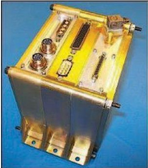

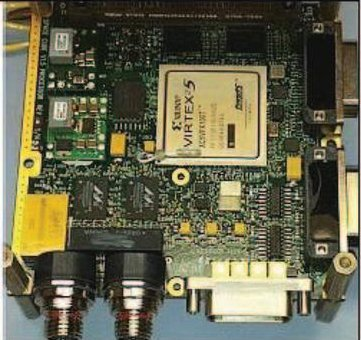

Figure 1. NASA Goddard Space Flight Center SpaceCubev1.5 in CubeSat-like form factor featuring commercial Xilinx technology [19]

<!-- PDF_PAGE: 3 -->

## Radiation Hardness Assurance (RHA)

Due to the complex response of emerging COTS technologies to radiation, NASA has developed an approach to developing reliable space systems which strive to address critical arising issues, including displacement damage dose (DDD), enhanced low dose rate sensitivity (ELDRS), proton damage enhancement (PDE), linear transients, and other catastrophic single-event effects. This methodology is referred to as Radiation Hardness Assurance (RHA) for Space Flight Systems [20]. NASA's definition is presented:

"RHA consists of all activities undertaken to ensure that the electronics and materials of a space system perform to their design specifications after exposure to the space environment."

RHA encompasses mission systems, subsystems, environmental definitions, part selection, testing, shielding, and fault-tolerant design. This paper builds upon key stages of the programmatic methodology presented by RHA.

The main stages of the RHA process include:

1. Defining the hazard

2. Evaluating the hazard component

3. Defining requirements

4. Evaluating device usage

5. "Engineering" with designers

6. Iterate the process throughout mission lifetime

One of the goals in the RHA process is to enable a small work group to address radiation reliability issues related to COTS and emerging technology while supporting a large number of projects. The RHA process is also significant because it addresses major issues with risk-assessment approaches including pitfalls, limitations, and recommendations. This process also addresses the realities of risk assessment and offers some key guidelines to provide an analysis when there are so many unknowns and so much knowledge involved with radiation effects [20]-[23].

## Single-Event Effects Criticality Analysis (SEECA)

SEECA is a NASA document that offers a methodology to identify the severity of an SEE in a mission, system, or subsystem, and provides guidelines for assessing failure modes. The document pulls together key descriptive elements of single-event effects in microelectronics and the applicable concepts to help in risk analysis and planning. SEECA is one of the key components of RHA described above. SEECA is a specialized Failure Modes and Effects Criticality Analysis (FMECA) study. FMECA offers valuable analysis and insight through inductive analysis, which can be used to enhance models and techniques used in Probabilistic Risk Assessment (PRA) [22].

## NASA Electronic Parts and Packaging (NEPP) Program

NASA has a group dedicated to studying any EEE parts for space use including COTS components. NEPP and its subgroup, the NASA Electronic Parts Assurance Group (NEPAG), provide agency-wide infrastructure for guidance on EEE parts for space usage. Their domains of expertise

encompass qualification guidance (both manufacturer and parts), technology evaluations, standards, risk analysis, and information sharing. The entire program is covered in [23]. Our presented methodology is complementary to NEPP methods. This paper describes a complete methodology that adds methods for system-level analysis, whereas NEPP analysis is primarily focused on individual parts qualification and does not account for board- or systemlevel, fault-tolerant analysis.

## Example NASA CubeSat Part Selection Process

This section describes an example part-selection process when designing and selecting components for a CubeSat processor. Initial component selection is an important prestage to the methodology presented in this paper, which already assumes a bill-of-materials and component list has been established. This section describes an agnostic approach to part selection with respect to performance requirements found in programs at both NASA Ames and NASA Goddard centers and relayed by NASA engineers through personal communication.

The following is a list of general recommendations to follow while keeping both schedule and budget in close consideration:

- Maintain a mass and volume budget margin for spot/sector shielding directly proportional to both the expected dose and electronic system mass.

- Select parts from a reference board design that has successfully flown in a previous mission of equivalent mission duration.

- Select components in the following general flow: radiation hardened by design > radiation hardened > radiation tolerant > military > automotive > industrial > commercial.

- If commercial components are selected, choose the components that have radiation hardened or tolerant equivalents. These components typically have lower burn-in failure rates, and can be swapped for their radiation-hardened counterparts if necessary.

- Select commercial components that have the same dies as radiation-hardened or tolerant products.

- Use components built on wider band gap substrates (including resistors) and/or with wider band gap active regions.

- Use MRAM instead of Flash memory architectures.

- Use p-type MOSFETs instead of n-type.

- Use BJTs instead of MOSFETs if allowable.

- Select components with a higher gate voltage and lower operational voltage.

- Embed watchdog features, filters, and reset capability into each subsystem.

It should also be noted that components have other issues to consider not related to radiation. An extensive requirements document is described in [24].

## Probabilistic Risk Assessment and Fault-Tree Analysis

A key component of this paper is based around Probabilistic Risk Assessment (PRA). PRA is a systematic methodology

<!-- PDF_PAGE: 4 -->

for evaluating risks associated with a complex engineering technological entity. PRA is typically used to determine what can go wrong with the studied technological entity and what are the initiating events, how severe and what are the consequences of the initiating event, and how likely are the consequences to occur. Over the past few decades, PRA and its included techniques have become both respected and widespread for safety assessment [25].

Fault-Tree Analysis (FTA) is a logic and probabilistic technique used in PRA for system-reliability assessment. FTA is an analytical approach in nature. It works by specifying an undesired or failure state, and then analyzing the system to find all the possible ways the failure state might occur. The usefulness of this approach is that the fault/error events can be represented as hardware failures, human errors, software errors, or any related events. Graphically, a fault tree has a single top event which is a specific failure mode; below it are events that may occur, and logic gates are included which show the relationships of lower-level events that form higher events that will eventually lead to the top failure event. A simple example fault tree is presented in Figure 2, where D failing represents the top failure event, and A, B, and C failings represent component failures. FTA became more prevalent in usage around the space community after the 1986 space shuttle Challenger disaster, when the importance of reliability- analysis tools like PRA and FTA were realized.

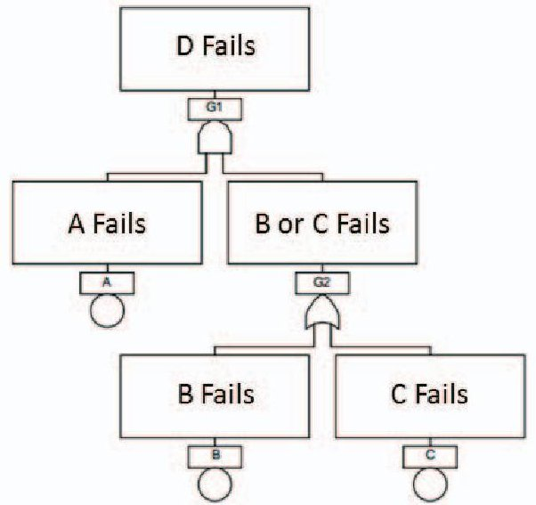

Figure 2. Simplified fault-tree example [26]

## Dynamic Computer Fault Tree and Markov Models

The standard fault-tree approach is not robust enough to properly reflect more complex computer systems, where the failure mode is highly dependent on the order of failures in the system (e.g., cold spare swaps). To enhance the FTA approach, the Dynamic Fault Tree (DFT) methodology has been specifically developed for the analysis of these complex computer-based systems. The DFT methodology provides a means to combine FTA with Markov modeling analysis which is commonly used in reliability modeling for fault-tolerant computer systems. Markov models can easily reflect sequence-dependent behavior that is associated with fault-tolerant systems. There are disadvantages of using Markov models alone, as they can be tedious to create, error prone, and suffer from drastic size increases as more states

are added known as state explosion. Figure 3 displays a DFT for a road trip failing and its equivalent Markov model that has become needlessly complex due to state explosion.

In the NASA fault-tree handbook [26], it is demonstrated that a large system-level fault tree can be segmented off into smaller, independent modules solved separately, and then recombined for a complete analysis. Certain trees can be solved faster as a DFT than as a Markov model, but for some complex component interactions, the Markov model may be more appropriate. In this case, a Markov model can be created and re-integrated into the fault tree.

DFT and FTA have other uses; the most significant of these can be calculating different importance measures. These can help identify the contribution a specific element makes to the top-event probability, the amount of reduced risk if an event is assured not to occur, the probability of a top gate failure if a lower gate was assured not to occur, and finally the rate of change in the top event if there is a rate of change in a lower event. These significance measures can greatly aid the part selection process and expose potential weaknesses in a design.

There are limitations, however, to the fault-tree model. The fault-tree model is not exhaustive, and can only cover the faults that have been considered by the analyst [28]-[33].

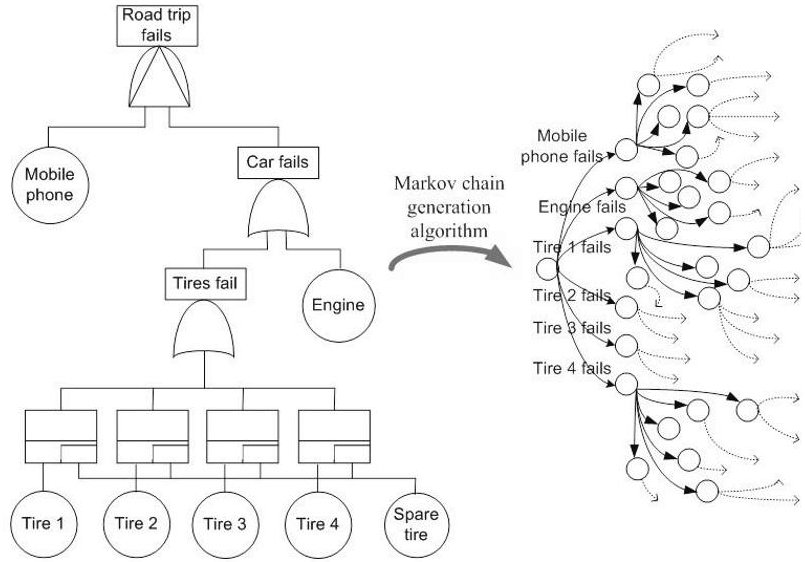

Figure 3. Simple DFT and its equivalent, complex, and large Markov model representation [27]

## 3. APPROACH

We have developed a new methodology built upon established reliability techniques and including PRA concepts to reflect overall reliability (and other measures) of the space-computer system due to radiation effects as quantifiable values. Figure 4 depicts an overview of the methodology, which consists of four key stages:

1. Component Analysis

2. Radiation Data Collection

3. Mission and Model Parameter Entry

4. Fault-Tree Construction, Iteration, & Modification

<!-- PDF_PAGE: 5 -->

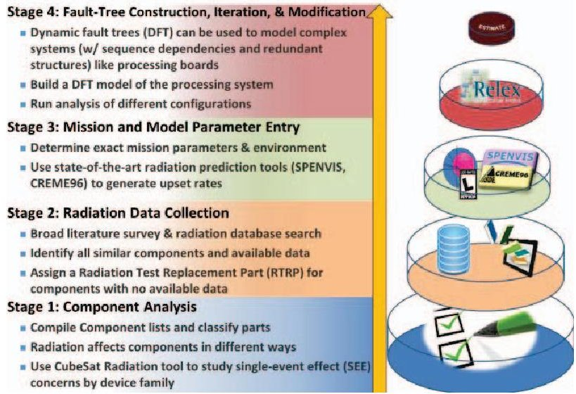

Figure 4. Reliability methodology stages

To provide step-by-step examples of the methodology in use, a configurable space-computer board was selected and analysis was performed as a case study. This board is a multi-faceted, hybrid computer called the CHREC Space Processor (CSP) that was developed by the NSF Center for High-Performance Reconfigurable Computing (CHREC) at the University of Florida, working closely with NASA Goddard. This section describes the methodology, using several case-study examples to illustrate the process.

## Stage 1: Component Analysis

The first stage of the methodology is to compile a list of all EEE components that constitute the current or proposed board design. This stage is relatively simple, but sets the foundation for the rest of the analysis, because the engineer should become familiar with different characteristics of the components. Once the list of EEE components is collected, each component should be then classified into device family (Processor, Memory, Analog, Digital, Power, Mixed Signal, etc.), feature size, process type, and function. It is important to have this information in advance of the analysis, since each of these characteristics helps define a component's response to radiation. Several resources and tools are available to help examine radiation effects by component. One prominent tool is the NASA CubeSat Radiation tool [29] which compiles a list of families of each device and their susceptible SEE effects. Finally, the reliability engineer should consider the depth of the analysis to be performed for the mission, and select components for the final analysis. For example, in some missions it may not be necessary to include analysis for passive components (resistors, capacitors, etc.) or some simple analog components, and analysis is only performed on active components.

## Stage 2: Radiation Data Collection

Once the list of key components is formulated, a broad search must be conducted to collect all available radiation data for each component, focusing on data relating to effects specified by the device family. This radiation data can be acquired from many sources including manufacturer datasheets, independent testing publications, IEEE Nuclear and Space Radiation Effects Conference (NSREC)

proceedings, or most commonly the NASA Goddard Radiation Database [34].

The key focus in this stage is to examine each desired component in the design and determine if it should be used in the final mission or design. In this stage, we can employ RHA and SEECA to examine the component's risk. Due to the expansive number of existing EEE components compared with the number of EEE components that have been flown or have radiation data, it is unlikely that the exact desired component exists in any publically available database. Without access to internal databases from large organizations, it is difficult to acquire actual mission data, so the next best data is from archived radiation testing.

If a part has radiation test data that is valid for the given mission parameters, then there is no more work to be done in this stage. If a part has no radiation data, or responds poorly to radiation effects, then the system designers will have to decide if the part should still be used. If it is decided that the part will be used in the design, but has no radiation test data (accepting risk), then for the purposes of the system-level analysis, suitable data will need to be input. This suitable data will typically be previous archival radiation-test data that comes from similar components to the original device that have already been tested. LaBel et al. [20] offers guidance and commentary on how representative the data pulled from archives can be to the real data, as well as several recommendations for this type of procedure. Ladbury's presentation in [32] gives several suggestions on how to pick the next best data to use for the analysis and is illustrated in Figure 5. In the ideal best-case scenario, there will be representative flight-lot specific data. Since this scenario is unlikely with newer COTS components, the next closest representative data should be selected as illustrated in Figure 5. Once a device has been selected, we refer to the device data that is used in the analysis as the Radiation Tested Replacement Part (RTRP).

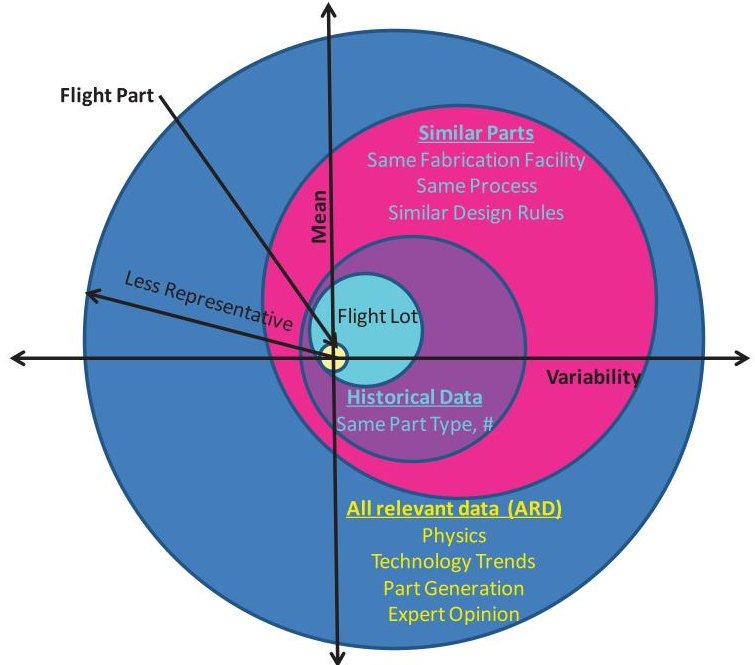

Figure 5. Statistical structure of representative data [32]

<!-- PDF_PAGE: 6 -->

There are two main goals from this stage of the data collection. The first is to obtain a Weibull curve describing the Cross Section vs. Effective Linear Energy Transform (LET) curves for every component's relevant SEEs. Figure 6 shows example points that will be used to generate a Weibull curve for a non-volatile memory component used in the case study. These curves serve as inputs into a mission simulator (like CREME96 or SPENVIS) to predict error rates for each type of SEE. In some scenarios, the actual data values may not be provided and the reference may only provide a chart. In these scenarios, MATLAB is used to generate a best estimation for the Weibull curve. The best Weibull model fit is calculated by estimating key points on the chart visually and having MATLAB perform an automated least squares regression. The second goal of this stage is to acquire a TID value for each component, which will typically be recorded in krads. This number will help in the future stages to determine component survivability in the mission environment.

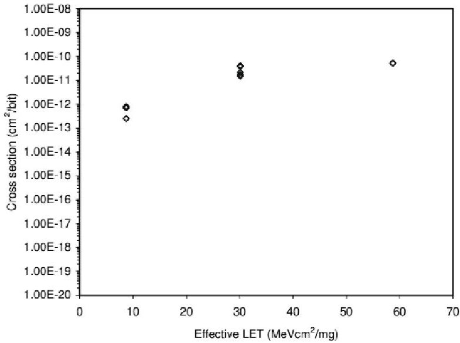

Figure 6. Example cross section vs. LET graph [30]

Stage 3: Mission and Model Parameter Entry

For the third stage of the methodology, the data collected in the first and second stages is used with specific mission characteristics (such as orbit) that define the mission environment and is entered into tools used for SEE and TID prediction rates for that environment. Key tools for this type of analysis include CREME96 [35] and SPENVIS [36], which can be used to estimate the expected SEE and TID respectively for the components within the mission specifications. Table 1 provides an example of expected output results from CREME96. This table displays the specific SEU upset rates for a non-volatile memory used in the CSP case study. Table 2 displays a subset of outputs for SPENVIS, with the specific values for a year in the same low-Earth orbit (LEO) used in the case study. Here, SPENVIS is used to calculate TID because CREME96 does not take into account the additional fault rate from trapped protons, while CREME96 is used to calculate SEEs. A detailed description of CREME96 functionality (including a walkthrough for configuring it) is presented in [37].

Table 1. SEU upset rates for non-volatile memory reported by CREME96

<table border="1"><tr><td>Type</td><td>Rate</td></tr><tr><td>SEEs/bit/second</td><td>1.08E-24</td></tr><tr><td>/bit/day</td><td>9.30E-20</td></tr><tr><td>/device/second</td><td>8.61422E-15</td></tr><tr><td>/device/day</td><td>7.44268E-10</td></tr></table>

Table 2. Typical TID amounts for LEO with 1-year mission reported by SPENVIS

<table border="1"><tr><td>Al(mils)</td><td>Total(rads)</td><td>TrappedElectrons(rads)</td><td>Brems-Strahlung(rads)</td><td>TrappedProtons(rads)</td></tr><tr><td>1.968</td><td>6.140E4</td><td>5.850E4</td><td>1.070E2</td><td>2.800E3</td></tr><tr><td>98.425</td><td>2.906E2</td><td>1.963E2</td><td>1.778E0</td><td>9.255E1</td></tr><tr><td>196.850</td><td>9.858E1</td><td>2.711E1</td><td>8.719E-1</td><td>7.059E1</td></tr><tr><td>787.400</td><td>4.146E1</td><td>0.000E0</td><td>2.771E-1</td><td>4.119E1</td></tr></table>

Certain components may only have results from proton testing, or only have heavy-ion data and need results for protons (in LEO, upsets are dominated by trapped proton upsets). In this scenario, we consult the method presented in [39] and [40]. These papers explain how to use the Figure of Merit (FOM) approach to estimate the missing SEU rates based on known data from a particular cross section. More concisely, FOM explains how to predict the heavy-ion upset rate if the cross section for protons is known and vice versa. Once the missing rates have been calculated, such information is also entered into the tools.

## Stage 4: Fault-Tree Construction, Iteration, & Modification

The final stage is to construct the DFT from a study of the computer architecture as well as component interactions, board schematic, and layout. The main goal is to devise a DFT that represents the failure sequences of the system (as mentioned previously, the accuracy of this model is dependent on the competency of the designer). As described in the second stage, there should be a basic fault event for each of the applicable SEE types to the component. A basic fault event is pictured in Figure 8, and is where the SEE fault rates from CREME are entered. In Figure 8, the heavy-ion upset rate (HUP) and proton upset rate (PUP) are basic events for the non-volatile memory we have been using as an example. Windchill Predictions displays unreliability (Q) of the component at a fixed point in time, which is set to 24 hours for this study. The fault rate must be converted from faults/upsets per day as provided by CREME to faults/upsets per billion hours $ (10^{9}) $ known as Failures in Time (FIT). This fault tree is constructed with the PTC Windchill Predictions (formerly Relex Reliability Prediction) software, a recommended tool for NASA reliability calculations, for both computation and analysis. This methodology is not limited to this specific software and can be used with any fault-tree tool as long as the system design can be accurately reflected. Windchill Predictions is relatively easy-to-use and includes several DFT gates in the toolset [38].

<!-- PDF_PAGE: 7 -->

Some key modules that could have extended fault trees depending on the board are listed below:

- Microprocessor Failure

- Passive Component Failure (Resistors etc.)

- Programming Circuitry Failure

- Supervisory Circuit Failure

- Timing Reference Failure

- Memory Failure

- Transmitter / Receiver Failure

In this methodology, each of these key design modules should be considered. Figure 7 illustrates the top-level hierarchy of the CSP case study with transfer gates to each of the described modules, which are expanded into their own fault trees. In our case study, we have elected to focus on the microprocessor (Zynq), memory, and power regulation modules. For reference, parts of the case-study memory module are illustrated in figures here. The memory module transfer gate (shown in dashed box) in Figure 7 is expanded in Figure 9. Figure 9 shows that a memory failure can result from volatile or non-volatile memory. Within that memory module, the non-volatile memory transfer gate (shown in dashed box) is expanded in Figure 10. Figure 10 is the fault tree for the NAND flash memory used in the case study. The fault tree illustrates a particle strike causing a SEFI or SEU (as shown in Figure 8) and the NAND flash failing due to usage (wear). Some parts of the fault tree are specific to the case-study design. Calculations for an upset in the boot partition of the NAND flash are evaluated in a different fault tree. Additionally, there is an inhibit gate entry to reflect that, in this design, a failure of the NAND flash will not cause the board to fail unless the processor restarts. If the processor is currently running, it would just note that the NAND flash was disabled and continue nominal operation.

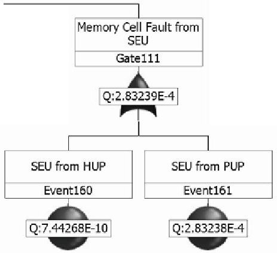

Figure 8. Basic event for a SEU to memory cell in nonvolatile memory from heavy ions or trapped protons

This fault-tree structure can have variable granularity, expanding into a more full-detailed analysis (by having a more complex fault tree or Markov model), as necessary. This structure allows designers to modify the tree if more data becomes available, or add in more intricate fault-tolerant techniques to test the effects on the system. This constructed DFT would represent the basic system design and is the baseline for comparison to other modifications.

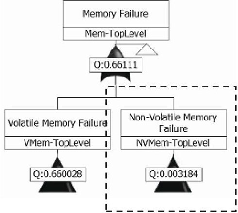

Figure 9. Expanded memory module

The final step is to refine the DFT based on hardware or software fault-tolerant computing techniques selected for the system. For particularly complex processor or component interaction, a Markov model can be constructed in its place if necessary and the PTC tool can dynamically link the Markov model into the fault tree. This DFT gives the total board design failure as quantifiable values which reflect the overall reliability of the system including added fault-tolerant capabilities to combat radiation effects. Figure 11 shows the same non-volatile memory module structure in Figure 10, but enhanced with error-correcting code (ECC) with an inhibit gate (shown in dashed box).

Windchill Predictions can calculate different reliability measures for the top-level gate (processor failure) once the system fault tree has been constructed and all fault rates have been entered as basic events. The calculator takes time and number of data points as inputs and can calculate unreliability, failure rate, frequency, and number of failures. From these calculated metrics other reliability measures can be derived, such as mean time to failure and upset rate per day. Lastly, the tool can export all its results to a Microsoft Excel spreadsheet to be used in any other analysis as desired. Figure 12 shows a graph generated by the Windchill Predictions tool of board failure from the case study, in terms of unreliability vs. a 24-hour timeframe.

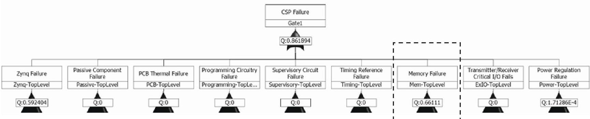

Figure 7. System-level fault tree with key modules for analysis

<!-- PDF_PAGE: 8 -->

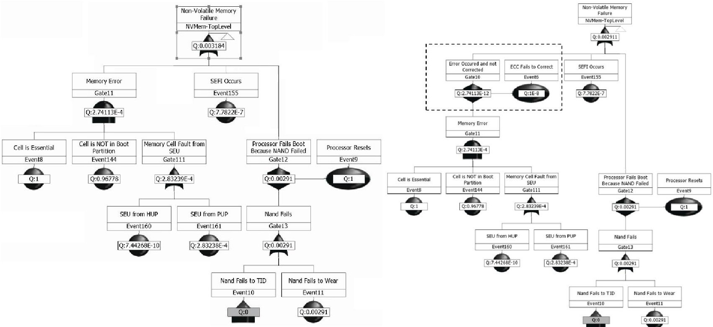

Figure 10. Expanded non-volatile memory section

Reliability measures are important for building a baseline to allow comparisons of the same board with modified parts or fault-tolerance strategies or with other space-computer hardware and software configurations. These values allow us to specifically compare different component configurations (all-commercial, hybrid, all-rad-hard design) to determine the amount of reliability gained from additional fault-tolerant components, as well as the associated monetary cost for extra reliability. This same strategy can be deployed across the same board with different software fault-tolerance strategies through appropriate fault tree or Markov model additions. The fault tree can only account for SEE effects and is plotted in an unreliability vs. time graph, which will be referenced when accounting for TID.

TID cannot be properly reflected in the fault tree due to configuration limitations in Windchill Predictions. After obtaining the TID information by entering mission specific parameters into SPENVIS, the survival duration for each component is calculated. Using the fault-tree structure to determine which component failures are survivable, the time until failure due to TID can be calculated. In the simplest scenario, if no components can fail without causing the entire computer to fail, the survival time due to TID is the time until failure for the component with the lowest TID. This calculated time to fail due to TID is then assumed to be the maximum time for the analysis so the unreliability vs. time graph for SEEs ends at this calculated time.

A modified approach is required in a more complex scenario where, due to fault tolerance, a system can survive certain component TID failures. When a component fails and is removed from the system, this changes the fault-tree structure of the system and by extension its reliability. To properly account for this change, a new fault tree is created with the component removed. This change creates a discontinuity in the original graph, so the new graph will look like a piecewise function, where the original fault tree is used up to the time where the component should fail, then

Figure 11. Non-volatile memory module with ECC

the new fault tree is used from this point onward to reflect the changes in the system.

While this research is not encompassing of all radiation analysis techniques, it still provides the reliability engineer with a practical method to model and compare different space-computer designs and study the tradeoffs. Eventually, we hope to expand this model to reflect other metrics including performance and availability, and other forms of radiation analysis.

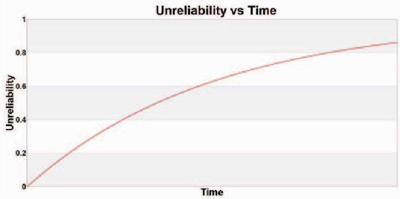

Figure 12. Graph generated by Windchill Predictions for case studv board failure

## Mitigation Guidelines

The methodology expresses an iterative process where the design is analyzed then modified, repeatedly. This paper does not cover different mitigation strategies or how to model them in a fault tree or Markov model, however, some suggestions are provided with additional methods described in [41]. For failures due to TID, spot/sector shielding can be used to provide some protection. If unacceptable fault rates are generated from SEEs, then components can be up-selected to a higher-grade component or more system redundancy can be included.

<!-- PDF_PAGE: 9 -->

## 4. RESULTS AND ANALYSIS

This section provides more detail about the CSP, the particulars of the case study, and results with analysis.

## CHREC Space Processor (CSP)

CSP provides a unique example of a design that is configurable, and it also serves as a useful case study for deploying the new methodology. The design is multifaceted because it has both a hybrid-processor and hybrid-system architecture. Details on the CSP are provided in [42]. The most useful feature of this processor for this analysis is that it has a selective population scheme for several components. This scheme allows certain components of the board to have both commercial and radiation-hardened footprints to populate the design. This approach allows the user to scale reliability and cost by selecting different components. For the case study, an all-commercial variant of the CSPv1 is compared with a CSPv1 that has all the available rad-hard footprints populated (hybrid CSPv1).

## Case Study: Description and Assumptions

For this case study, the methodology steps were completed for the two CSP designs. DFT models were constructed for the COTS variant and hybrid variant that included the radhard components. The full DFT diagram is too large to be reasonably and coherently displayed in this paper, but the general structure for a module has already been illustrated with Figure 7 to 10. Each component of the CSPv1 was analyzed and the fault rates by SEE type were entered as basic events in the DFT as described by Figure 8. Finally, these fault rates and relevant data were collected for analysis for both boards in two different orbits: Low-Earth Orbit (LEO) and Geostationary-Earth Orbit (GEO).

This study assumes 98.425 mils of aluminum shielding. The representative LEO orbit for this study is the International Space Station orbit, while the representative GEO orbit is the AMC-18 satellite orbit. The DFT models were constructed without any additional fault tolerance and represent the basic system. Finally, it should be noted that there was no available radiation test data for several commercial components. In these cases, the best estimate was based on available data and the RTRP selections as described in the methodology section.

Lastly, it should be noted that there is a discrepancy between vendors' provided radiation data and commercial component data. In studying this issue, engineers discovered that a commercial NAND flash obtained better results than reported by vendors for the radiation-hardened counterpart. One reason for this discrepancy could be vendors reporting lower numbers to keep within acceptable manufacturer-guaranteed ranges, which may be below the actual capability. In these situations, the radiation-hardened variant is expected to perform better than the reported data suggests. Therefore, for this case study, if the COTS fault rates were lower than the radiation-hardened fault rates, then the radiation-hardened numbers used for the analysis were increased to be at least equivalent to the COTS numbers.

## Case Study: Results and Analysis

For survivability and lifetime results, mission-specific parameters were placed into SPENVIS for both LEO and GEO environments, and the overall expected TID was generated for a year (Table 3). For the design, no components are able to fail without causing a complete board failure, therefore the lowest TID of the available components is compared to the overall expected TID and a simple ratio calculation gives the amount of time until the component fails. These results are reflected in Table 4.

Table 3. Yearly TID by orbit

<table border="1"><tr><td>Orbit</td><td>Expected TID</td></tr><tr><td>LEO</td><td>0.29 krad/year</td></tr><tr><td>GEO</td><td>71.3 krad/year</td></tr></table>

Table 4. Estimated board lifetime

<table border="1"><tr><td>Configuration</td><td>Orbit</td><td>Lifetime</td></tr><tr><td>CSP(Either Configuration)</td><td>LEO</td><td>~10+ Years</td></tr><tr><td>CSP-COTS</td><td>GEO</td><td>~100 Days</td></tr><tr><td>CSP-Hybrid</td><td>GEO</td><td>~200 Days</td></tr></table>

For SEE and transient upset results, DFTs were constructed for both configurations of the board and reliability measures were generated by Windchill Predictions. Windchill Predictions also has the capability to calculate results for all intermediate gates within the system fault tree, so certain modules can be explored. The most interesting module for this comparison is the power-system module, since this module varies the most between our two case-study boards (i.e., the hybrid CSPv1 has rad-hard power regulation components).

Several main observations can be drawn from this study, which demonstrate the usefulness of the methodology. First, after examining the upset rates of the submodules of the fault tree, the system upset rate is primarily dominated by common components (Zynq, DDR) in both the COTS and hybrid variations, so both boards will have similar upset rates reported in any orbit. Since the results are similar between both boards, Table 5 shows the expected upset rate for each of the studied orbits without differentiating between configurations. This finding is displayed in Figure 13, which contains the reliability curves in both orbits for the boards, as well as the Zynq and DDR components for comparison.

While the overall system reliabilities are similar, Figure 14 shows the reliability of the power modules in both GEO and LEO orbits. These results show differences between the COTS and rad-hard components in both LEO and GEO. A comparison of the failure rates of these components is provided in Table 6.

<!-- PDF_PAGE: 10 -->

Table 5. CSPv1 board upset rate

<table border="1"><tr><td>Computer</td><td>Orbit</td><td>Upsets/Day</td></tr><tr><td>CSP(Either Configuration)</td><td>LEO</td><td>1.9797</td></tr><tr><td>CSP(Either Configuration)</td><td>GEO</td><td>16.235</td></tr></table>

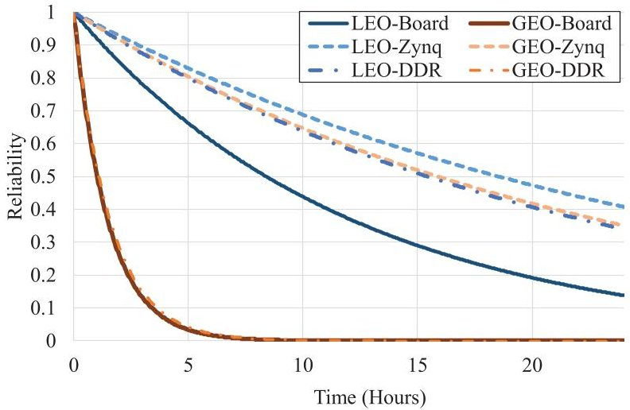

Figure 13. LEO & GEO reliability curves

Key findings show that SEE upset rates for each board configuration were dominated by the same COTS components between the board configurations. The rad-hard components, however, are still useful because they are more resilient to cumulative radiation effects, which improves the system's lifetime, even though they have only a minor contribution to improving SEE upset rate.

We can observe several significant observations while employing the defined methodology. The results show that since Zynq and DDR components of the board have the highest upset rates, therefore SEE upset rates between configurations is minimal. This finding shows weaknesses in the design that can be improved by adding fault-tolerant computing techniques. In this example, the Zynq can be further mitigated using well known techniques such as configuration scrubbing and triple-modular redundancy structures. The DDR could be further mitigated with ECC. This analysis shows the designer which components to focus on to improve reliability. This analysis also shows that in LEO the rad-hard parts may not be necessary and a commercial board can be deployed, thereby reducing costs. Lastly, the process in the methodology highlights information about the environment with which a newer designer may be unaware, such as the much harsher lifetime and upset rates found in GEO, when compared to the relatively benign LEO.

Table 6. Power system upset/day

<table border="1"><tr><td>Orbit</td><td>CSP-COTS</td><td>CSP-Hybrid</td></tr><tr><td>LEO</td><td>1.713E-03</td><td>9.0147E-06</td></tr><tr><td>GEO</td><td>0.0014</td><td>2.6104E-06</td></tr></table>

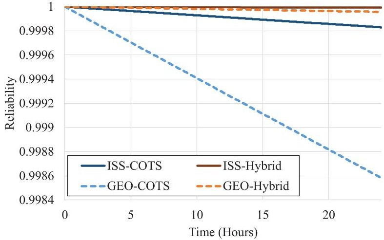

Figure 14. Power module reliability

## 5. CONCLUSION

This paper presents a practical methodology to determine and evaluate radiation-oriented reliability characteristics for space computers from a system-level SmallSat perspective. This methodology can help designers in gauging the general level of reliability of their design, comparing its reliability against other designs, deciding on component selection during the development phase, and evaluating effectiveness of hardware and software fault-tolerance mechanisms in the design. Our methodology is relevant, even though it has not been validated by a multitude of radiation tests and comparisons, because it builds on established and widely accepted methods and techniques, and it combines them to provide an initial analysis of a design. Additionally, the soundness of this approach has been reviewed with radiation experts at NASA Goddard and has been approved, noting that assumptions should be clearly stated and limitations expressed to prevent any unintentional misuse. In this paper, we explored different configurations of the CSPv1 space computer and evaluated configurations under different environmental conditions. This methodology has illustrated potential issues in the board design that can be addressed with fault tolerance. Finally, this study has provided an initial first-order estimation of both the survivability and expected upset rates of these board configurations.

The methodology established in this paper can be further expanded to cover more advanced types of analysis and provide even more accurate predictions. CSPv1 has already been exposed to neutron-beam testing in both commercial and hybrid configurations. Preliminary impressions of the neutron test results are expected to confirm predictions examined in this paper. Further analysis will be performed when the results of those tests are finalized. Additional topics for future study are listed below:

- Include explicit instructions and descriptions for analysis within a spacecraft using ray tracing in conjunction with University of Wisconsin-Madison's Direct Accelerated Geometry Monte Carlo Toolkit (DAGMC). This method would allow exploration of modeling of components related to physical location within the board and within the spacecraft.

- Provide further examples with different fault-tolerant computing techniques employed within the DFT model.

<!-- PDF_PAGE: 11 -->

- Expand the methodology and provide example models to add performance and availability metrics.

## ACKNOWLEDGEMENTS

This work was supported by the I/UCRC Program of the National Science Foundation under Grant Nos. EEC 0642422 and IIP-1161022. The authors would like to thank Jacob Stewart, Ed Carlisle, and Pete Sparacino for their expertise and input toward developing this methodology. In addition, we would like to thank Nick Wulf, Dr. Ann Gordon-Ross, Dr. Michael Wirthlin, Alex Wilson, Dan Espinosa, and Dave Petrick for their support and review. Finally, we would like to thank Mike Campola, Ray Ladbury, and Ken LaBel of NASA Goddard Code 561 for input, feedback, and review of this methodology.

## REFERENCES

[1] M. Swartwout, "CubeSat Mission Success (or Not): Trends and Recommendations," in $ 6^{th} $ Annu. NASA Electronics Parts and Packaging Program Electronic Technology Workshop (NEPP), Greenbelt, MD, June 23-26, 2015.

[2] D. M. Fleetwood, P. S. Winokur, and N. Stojadinovic "Radiation Effects in the Space Telecommunications Environment", Microelectronics (MIEL) Proc., 1999.

[3] E. Normand, "Single event effects in avionics", IEEE Trans. Nucl. Sci., vol. 43, no. 2, pp.461-474, 1996.

[4] F. W. Sexton, "Destructive single-event effects in semiconductor devices and ICs", IEEE Trans. Nucl. Sci., vol. 50, no. 3, pp.603-621 2003.

[5] R. H. Maurer, M. E. Fraeman, M. N. Martin, and D. R. Roth, "Harsh environments: Space radiation environment, effects, and mitigation." J. Hopkins APL Tech. Dig., vol 28, no 1, pp. 17-29, 2008.

[6] J. Bekkeng, "Radiation Effects on Space Electronics." [Online]. Available: http://www.uio.no/studier/emner/ matnat/fys/FYS4220/h11/undervisningsmateriale/forelesninger-vhdl/Radiation%20effects%20on%20space%20 electronics.pdf

[7] S. Sayil, "Space Radiation Effects on Technology and Human Biology and Proper Mitigation Techniques." [Online]. Available: http://ee.lamar.edu/sayil/rad-eff.pdf

[8] W. Harkins, "Space Radiation Effects on Electronic Components in Low-Earth Orbit." [Online]. Available: http://www.nasa.gov/offices/oce/llis/0824.html

[9] R. Ladbury, "Radiation hardening at the system level", Proc. IEEE Nuclear and Space Radiation Effects Conf., Section IV-6-4, pp.IV-79 2007.

[10] JPL's Origins and Small Spacecraft, April 4, 2013. [Online]. Available: http://cubesat.jpl.nasa.gov/

[11] M. Swartwout, "CubeSat Database," [Online] Available: https://sites.google.com/a/slu.edu/swartwout/home/cubesat-database

[12] M. Swartwout, "Cheaper by the Dozen: The Avalanche of Rideshares in the 21st Century." In Proc. of the 2013 IEEE Aerospace Conf., Big Sky, MT, USA, 2-9 March 2013; pp. 1-12.

[13] CubeSat Launch Initiative. [Online]. Available: http://www.nasa.gov/directorates/heo/home/CubeSats_i initiative.html

[14] Small Spacecraft Technology. [Online]. Available: http://www.nasa.gov/offices/oct/crosscutting_capability/ edison/smallsat tech.html

[15] D. Sheldon, "JPL CubeSat Database," Presented at $ 5^{th} $ Annu. NASA Electronics Parts and Packaging Program Electronic Technology Workshop (NEPP), Greenbelt, MD, June 17-19, 2014.

[16] S. Guertin, "CubeSat Small Mission Tasks: Mobile Processors/ Microcontrollers," Presented at $ 5^{th} $ Annu. NASA Electronics Parts and Packaging Program Electronic Technology Workshop (NEPP), Greenbelt, MD, June 17-19, 2014.

[17] S. Chien, J. Doubleday, D. Thompson, K. Wagstaff, J. Bellardo, C. Francis, E. Baumgarten, A. Williams, E. Yee, D. Fluitt, E. Stanton, and J. Piug-Suari, "Flight Validating the Proposed HyspIRI Intelligent Payload Module: Results from Intelligent Payload Experiment (IPEX)," presented at HyspIRI Data Product Symp., Greenbelt, MD, June 4-6, 2014.

[18] Phonesat: Smart, Small and Sassy, [Online]. Available: http://www.nasa.gov/offices/oct/home/PhoneSat.html

[19] D. Petrick, D. Espinosa, R. Ripley, G. Crum, and T. Flatley, "Adapting the reconfigurable spacecube processing system for multiple mission applications," in IEEE Aerospace Conf., 2014, pp. 1-20, 2014.

[20] K. LaBel, A. H. Johnston, J. L. Barth, R. A. Reed, and C. E. Barnes, "Emerging radiation hardness assurance issues: A NASA approach for space flight programs," IEEE Trans. Nucl. Sci., vol. 45, pp.2727 -2736 1998.

[21] K. LaBel et al, "Radiation Evaluation Method of Commercial Off-the-Shelf (COTS) Electronic Printed Circuit Boards (PCBs)", 5th European Conf. on Radiation and its Effects on Components and Systems (RADECS 1999), pp 528-534 (1999).

[22] NASA HQ/Code QW, 'Single Event Effect Criticality Analysis 431-REF-000273,' 1996.

[23] M. Sampson and K. LaBel. "The NASA Electronic Parts and Packaging (NEPP) Program - Overview for FY14." Space Parts Working Group (SPWG), Torrance, CA, April 21-22, 2015.

[24] K. Sahu, "EEE-INST-002: Instructions for EEE Parts Selection, Screening, Qualification, and Derating," April, 2008.

[25] M. Stamatelatos, "Probabilistic Risk Assessment: What is it and why is it worth performing it?" [Online]. Available: http://www.hq.nasa.gov/office/codeq/qnews/pra.pdf

[26] Vesely, W., Stamatelatos, M., Dugan, J., Fragola, J., Minarick, J., and J. Railsback, "Fault Tree Handbook with Aerospace Applications," NASA Office of Safety and Mission Assurance, August, 2002. [Online]. Available: http://www.hq nasa.gov/office/codeq/doctree/ fthb pdf

http://www.hq.nasa.gov/office/codeq/doctree/ fthb.pdf

[27] H. Boudali, P. Crouzen, and M. Stoelinga, "Dynamic Fault Tree analysis using Input/Output Interactive Markov Chains," Formal Methods and Tools group. [Online]. http://boemund.dagstuhl.de/Materials//Files/ 07/07101/07101.BoudaliHichem.Slides.pps

[28] J. Dugan, "Dynamic Fault Tree Analysis for Software-Based Systems." [Online]. Available: http://www.faulttree.net/papers/dugan-dynamic-fta.pdf

<!-- PDF_PAGE: 12 -->

[29] M. Campola, "CubeSat Radiation Tool," [Online]. Available: http://radhome.gsfc.nasa.gov/iradapp/

[30] T. Oldham et al., "HI SEE Report for the Hynix Micron, and Samsung 4Gbit NAND Flash Memories," NASA Goddard Space Flight Center, Aug. 2007. [Online]. Available: http://radhome.gsfc.nasa.gov/ radhome/papers/T052207_Hynix_Micron_Samsung.pdf

[31] R. Manian, J.B. Dugan, D. Coppit and K.J. Sullivan, "Combining Various Solution Techniques for Dynamic Fault Tree Analysis of Computer Systems," Proc. IEEE Int',l High-Assurance Systems Eng. Symp., vol. 3, pp. 21-28, 1998.

[32] R. Ladbury, "Statistical Modeling for Radiation Hardness Assurance," in 2014 Hardened Electronics and Radiation Technology (HEART) Conf., Huntsville, AL, March, 2014.

[33] R. Gulati and J. B. Dugan, "A modular approach for analyzing static and dynamic fault trees", Proc. Ann. Reliability and Maintainability Symp., pp.57 -63 1997.

[34] NASA/GSFC Radiation Effects and Analysis. [Online]. Available: http://radhome.gsfc.nasa.gov/

[35] CREME96. [Online]. Available: https://creme.isde.vanderbilt.edu/CREME-MC

[36] Space Environment Information System (SPENVIS). [Online]. Available: https://www.spenvis.oma.be/

[37] J. Engel, M. Wirthlin, K. Morgan, and P. Graham, "Predicting On-Orbit Static Single Event Upset Rates in Xilinx Virtex FPGAs," Proc. of Military and Aerospace Programmable Logic Devices Conf. (MAPLD), Washington, D.C., September 26-28, 2006.

[38] Windchill Prediction. [Online]. Available: http://www.ptc.com/WCMS/files/106775/en/6469_Wind chill_Prediction_DS_EN.pdf

[39] J. Barak, R. A. Reed, and K. A. LaBel, "On the figure of merit model for SEU rate calculations," IEEE Trans. Nucl. Sci., vol. 46, no. 6, pp. 1504-1510, 1999.

[40] E. Petersen, "The SEU figure of merit and proton upset rate calculations," IEEE Trans. Nucl. Sci., vol. 45, no. 6, pp. 2550-2562, 1998.

[41] G. Foucard, "Handbook of Mitigation techniques against Radiation Effects for ASICs and FPGAs." [Online]. Jan. 2012, Available: http://indico.cern.ch/event/169035/contribution/4/attachments/208507/292405/Presentation_CERN.pdf

[42] D. Rudolf et al., "CSP: A Multifaceted Hybrid System for Space Computing," Proc. of 28th Annual AIAA/USU Conference on Small Satellites, Logan, UT, August 2-7, 2014.

## BIOGRAPHY

Christopher Wilson is a doctoral student in ECE at the University of Florida. He is a research assistant and team leader of the hybrid space computing group in the NSF CHREC Center at Florida. His research interests include fault-tolerant techniques on hybrid architectures and

radiation effects on commercial devices.

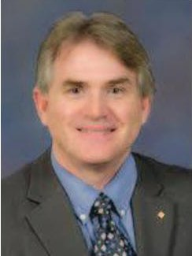

Alan George is Professor of ECE at the University of Florida, where he serves as Director of the NSF Center for High-performance Reconfigurable Computing (CHREC). He received the B.S. degree in CS and M.S. in ECE from the University of Central Florida, and the Ph.D. in CS from the Florida State University. Dr. George's

research interests focus upon high-performance architectures, networks, systems, services, and apps for reconfigurable, parallel, distributed, and fault-tolerant computing. He is a Fellow of the IEEE.

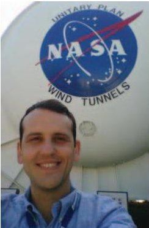

Benjamin Klamm is a doctoral student in Aerospace/Nuclear Engineering within NASA Ames Research Center's Mission Design Center, serving as the radiation environment analyst and mitigation and control engineer. His research interests include active and passive radiation shielding methodology and technology, space environment modeling and prediction, and advanced radiation modeling and

mitigation techniques for small spacecraft