<!-- PDF_PAGE: 1 -->

# A Model-Based Approach to Engineering Behavior of Complex Aerospace Systems

Michel Ingham $ ^{*} $ , John Day $ ^{\dagger} $ , Kenneth Donahue $ ^{\ddagger} $ , Alex Kadesch $ ^{\S} $ Andrew Kennedy $ ^{**} $ , Mohammed Omair Khan $ ^{\dagger\dagger} $ , Ethan Post $ ^{\ddagger\ddagger} $ , and Shaun Standley $ ^{\S\S} $ Jet Propulsion Laboratory, California Institute of Technology, Pasadena, CA, 91105

One of the most challenging yet poorly defined aspects of engineering a complex aerospace system is behavior engineering, including definition, specification, design implementation, and verification and validation of the system's behaviors. This is especially true for behaviors of highly autonomous and intelligent systems. Behavior engineering is more of an art than a science. As a process it is generally ad-hoc, poorly specified, and inconsistently applied from one project to the next. It uses largely informal representations, and results in system behavior being documented in a wide variety of disparate documents. To address this problem, JPL has undertaken a pilot project to apply its institutional capabilities in Model-Based Systems Engineering to the challenge of specifying complex spacecraft system behavior. This paper describes the results of the work in progress on this project. In particular, we discuss (1) our approach to modeling spacecraft behavior, (2) the content of the system model, including patterns for representing system structure, requirements, behavior and V&V-related information, (3) a trade study exploration of a few different patterns for allocating behavior to components in the system decomposition, (4) a revised modeling pattern for behavior specification that we have developed based on the experience acquired on this project, and (5) additional uses of the system model for the purposes of document generation and analysis.

## I. Introduction

BEHAVIOR engineering is the engineering discipline that works to define and describe the set of ways in which a system can act, including both nominal (intended) behavior and off-nominal (unintended) behavior. Behavior engineering processes are generally implemented differently from project to project, and furthermore, there is a lack of formalism in the specification of system behavior on most projects. Consequently, behavior-related information is presently captured in a variety of disparate source documents, including requirements documents, functional design descriptions (FDDs), mission plans, scenario descriptions, interface control documents (ICDs), software design descriptions, technical memoranda, verification and validation plans and test descriptions. This multitude of sources is a problem because it introduces the potential for conflicting or outdated information.

JPL is applying its institutional capabilities in model-based systems engineering (MBSE) to tackle the problems associated with current behavior engineering practices. Our motivation for adopting a model-based approach to behavior engineering is threefold:

<!-- PDF_PAGE: 2 -->

1) to provide flight system engineers with a common and consistent methodology and repository for capturing behavior-related information (requirements and design) at the flight system level,

2) to provide a starting point for the functional requirements and design flowdown to the subsystems, and

3) to provide a rigorous framework for V&V of the designed and implemented system behaviors.

We have initiated a pilot project to apply an MBSE approach to formalize behavior engineering, bringing consistency and rigor to this field. The high-level goals of this project are to demonstrate (i) how to fold MBSE into JPL's current systems engineering practice; and (ii) how to develop better products and processes, and improve organizational and lifecycle handoffs, by leveraging MBSE for system behavior specification. MBSE provides a way to represent different behavioral elements and their relationships to one another, and through our exploration on this project, we have found patterns that are useful for capturing behavior.

For this pilot project, we are modeling a subset of the behavior of the Soil Moisture Active-Passive (SMAP) mission, an Earth-orbiting satellite mission that is currently under development at JPL. The purpose of the SMAP mission is to determine the moisture content of the Earth's upper soil and its freeze/thaw state. This is accomplished using the Instrument, which is composed of a radar, radiometer, and a rotating reflector antenna. During launch the Instrument is folded up inside the launch vehicle. After separation from the launch vehicle, the Flight System, which is composed of the Instrument and the Spacecraft Bus, must deploy the Instrument and spin up the antenna to the correct spin rate. In order to limit the scope of this small pilot project, our work has focused on modeling the SMAP antenna spin-up behavior, which is one of the most interesting and complex behaviors executed in the mission. **** This spin-up behavior occurs in a sequence of steps that includes communication between the Flight System and the Ground System, changing the antenna spin rate and correcting the attitude of the Spacecraft Bus.

Although the project is still a work in progress, this paper aims to capture our results to date. In particular, we discuss: (1) our approach to modeling spacecraft behavior (Section II); (2) the content of the system model, including patterns for representing system structure, requirements, behavior and V&V-related information (Section III); (3) a trade study exploration of a few different patterns for allocating behavior to components in the system decomposition (Section IV); (4) a revised modeling pattern for behavior specification that we have developed based on the experience acquired on this project (Section V); and (5) additional uses of the system model for the purposes of document generation and analysis (Section VI). Finally, in Section VII we discuss conclusions and future work.

## II. System Modeling Approach

For our project, we have selected the System Modeling Language (SysML), $ ^{3} $ which is an extension of the Unified Modeling Language (UML) $ ^{4} $ targeting the needs of systems engineers. We are using NoMagic's MagicDraw tool $ ^{5} $ as our primary modeling environment. Our approach to modeling the SMAP antenna spin-up behavior leverages previous work, including:

- the Object-Oriented Systems Engineering Method (OOSEM), $ ^{3} $ a top-down, scenario-driven process to analyze, specify, design, and verify a system;

- the State Analysis methodology, $ ^{6} $ a JPL-developed MBSE methodology for state-based behavioral modeling, state-based control system design, and goal-directed operations engineering; and

- the control system design for the European Southern Observatory's Extremely Large Telescope (E-ELT), $ ^{7,8} $ which embeds concepts from State Analysis into SysML and defines a clear, intuitive structure for the system model.

In addition, we are building on JPL's institutional capabilities and expertise in Integrated Model-Centric Engineering (IMCE). $ ^{9,10} $ The IMCE framework includes JPL-developed tools that enable systems engineers to use SysML to develop system models, integrate them with discipline-specific models captured in other languages or tools (e.g., spacecraft dynamics models expressed in MATLAB $ ^{11} $ ), and then transform these system models into OWL2 $ ^{12} $ ontological specifications in order to perform analyses and prove properties about the modeled systems. We are extending the set of core system modeling ontologies in the IMCE framework to include additional concepts and relationships pertaining to functional behavior and V&V.

## III. System Model

Our system model is organized using SysML packages. The packages are where the system model elements reside, including blocks, connectors and diagrams. As a model increases in size and complexity it becomes more challenging to quickly traverse the model, so it becomes particularly important to define an appropriate package

<!-- PDF_PAGE: 3 -->

structure. For our project, we adopted a package structure hierarchy mimicking the structural decomposition of the SMAP system model. This package structure follows a pattern similar to that in Ref. 8. In addition to the package structure, we created hyperlinks between diagrams and their parent diagrams so that users could navigate easily throughout the model. Similarly, we created hyperlinks between blocks and their respective child diagrams.

The structural decomposition that the package structure follows begins with the Mission at the topmost level. The Mission is an aggregation of every element that is of interest to the project; these structural elements are called components. We decompose the Mission component into the following (sub-)components: Flight System, Ground System, Launch System, Science System and Environment. Each of these components is in turn decomposed to its immediate constituent components, and each of those components is further decomposed in a similar manner, and so on. For example, the Flight System is decomposed into the Spacecraft Bus and the Instrument. The Spacecraft Bus is further decomposed into "subsystem" components such as Propulsion, Command & Data Handling, and Thermal. This decomposition is shown in the SysML Block Definition Diagram (BDD) in Figure 1.

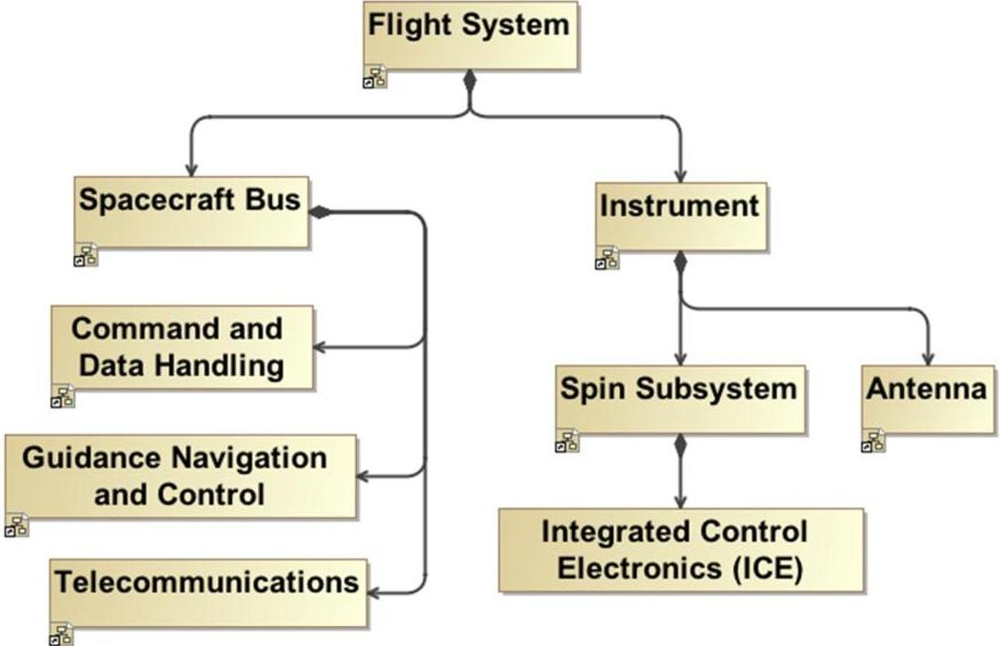

Figure 1. SysML Block Definition Diagram showing the structural decomposition of the SMAP flight system.

In addition to structural elements, our system model also includes information about system functional behavior and requirements. These additional system model elements are also decomposed into increasing levels of specificity. For example, requirements are decomposed starting from Level 1 to Level 2, and so on. Each functional requirement is associated with one or more functional behavior elements in the model. Similarly, each functional behavior is allocated to the element in the structural decomposition that is responsible for performing this function. In our SMAP example, the behavior "Perform Spin-up And Orient" is allocated to the Flight System because it is completely realized by the Flight System and its sub-components but does not involve any of its peer components such as the Mission System. This allocation of behavior to components in the structural decomposition is shown in Figure 2, by placing the execution of each functional behavior in the appropriate "swimlane" in the Activity Diagram. The requirement and behavior elements are located in the package structure at the same level as the associated structural components.

The following subsections describe patterns and views that we have developed for representing system structure (III.A), requirements (III.B), behavior (III.C) and V&V (III.D).

<!-- PDF_PAGE: 4 -->

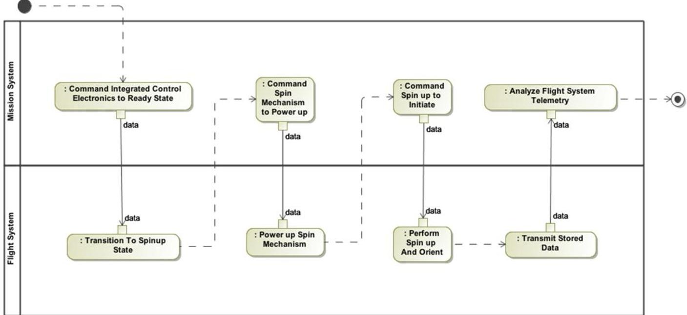

Figure 2. Activity diagram showing the execution of SMAP's "Complete Antenna Spinup" behavior. The "swimlanes" show the allocation of behaviors to physical elements in the model.

## A. Structural patterns and views

The structural decomposition is structured such that each block represents a physical or logical component of the mission, as defined by the SMAP project in their system breakdown (discussion of the distinction between physical and logical components is deferred to Section V). For example, the block labeled as "Spacecraft Bus" represents the SMAP-specific component that is called the Spacecraft Bus. This block can have property information attributed to it that is specific to the SMAP Spacecraft Bus, such as its dry mass and its drawing number. Any other property of interest can be included in this manner. As shown in Figure 1, the structural decomposition of the system is captured in a set of SysML BDDs, with each diagram describing one or more layers of decomposition.

One additional structural pattern that we found useful depicts how to represent multiples of components in our system, for example multiple similar Heaters. Instead of using SysML's built-in multiplicity feature, we found it more useful to represent components that appeared more than once using a generic template element with associated singleton elements. This pattern is shown in Figure 3. Multiplicities in SysML are limiting because when using them it is impossible to allocate behavior to a specific Heater component (e.g. Heater2), and all Heaters must be exactly the same, having the same default values for each property. Our template/singleton pattern fixes these issues. For example, we create a single generic Heater component template and then create four specializations of Heater to generate our specific Heater1 through Heater4. The advantage of modeling this way is that we can give the Heater template a set of common properties (e.g., power rating, mass, dimensions, etc.) and have the specialized singleton Heater components inherit these common properties. Each specialized singleton Heater component can also define its own specific properties (e.g., part number). If each Heater were its own separate component and did not inherit from a common element, it would not be as easy to show the properties' traceability. We would also have to maintain four separate sets of properties on each Heater instead of just one single set on the generalized Heater.

Another structural pattern of note is how we incorporate software into the system. In our model, each component that has software controlling its functionality has a reference relationship to this software. Software, like hardware, follows a hierarchical decomposition. Combining those two concepts, we end up with the lattice pattern shown in Figure 4. This pattern is useful early in the system design process, because when we attempt to allocate behavior to a component we do not have to prescribe whether that behavior will be accomplished in software (the component's referenced software) or in hardware (the component's sub-components). Furthermore, early in the software design process (before we have completely fleshed out the software element decomposition) we can aggregate behaviors and associate them with higher-level software elements in the decomposition. Then as the software design matures and gets decomposed into a complete set of elements, this pattern enables us to allocate the behavior to the system, subsystem, assembly, or device level, as appropriate.

<!-- PDF_PAGE: 5 -->

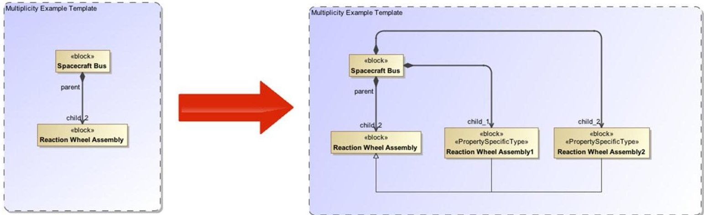

Figure 3. Multiplicity Pattern - We create singletons for each of our components in the system instead of using SysML's built in multiplicity feature to give us more flexibility 1) when assigning behaviors and 2) when differentiating parts (if properties are slightly different).

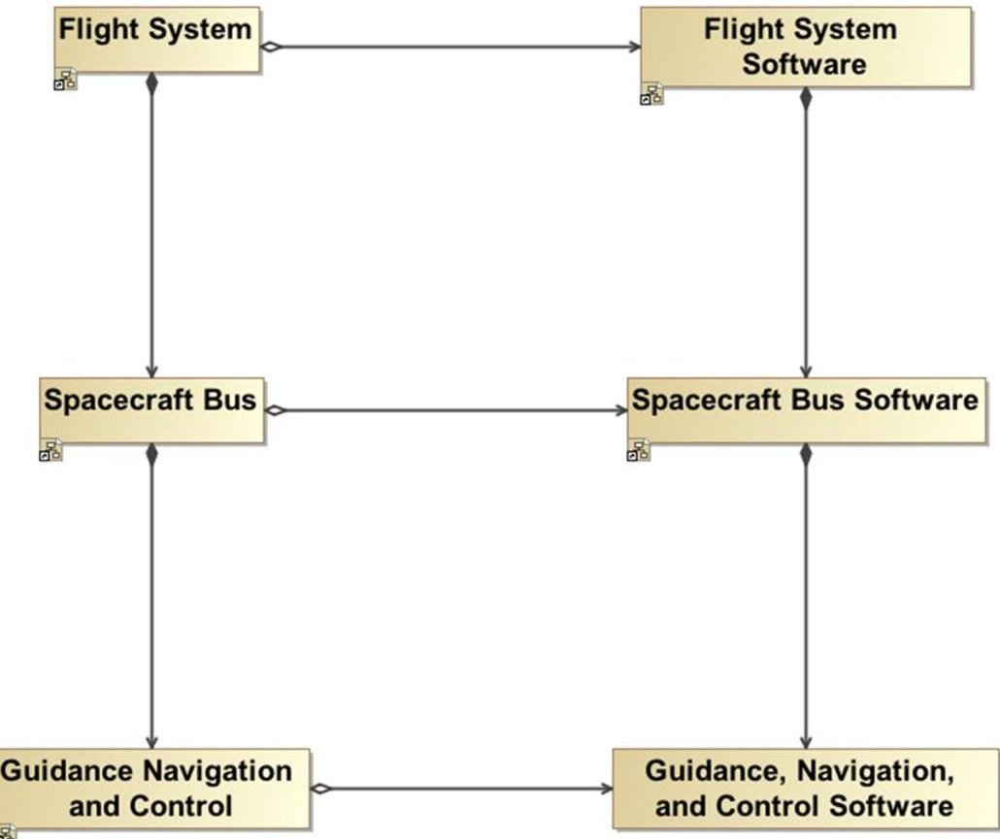

Figure 4. Software Decomposition Pattern - Each component in the system has a reference to its software, creating this lattice pattern.

## B. Requirement patterns and views

Part of our effort was to capture requirements in our model and show how they were related not only to each other but also to other system model elements. In our model ontology, a Requirement is related to other elements as follows:

- A Requirement "specifies" a SpecifiedElement (e.g., a Component, Interface, or Function), where "specifies" means that the properties of the SpecifiedElement are bound (constrained) by the Requirement.

- A Requirement "refines" (zero or one) Requirement, where "refines" means that satisfaction of the first Requirement implies partial satisfaction of the latter Requirement.

<!-- PDF_PAGE: 6 -->

- A Requirement "isrefinedby" (zero or more) Requirements, where "isrefinedby" is the inverse of the "refines" relationship.

- A VerificationActivity "verifies" (one or more) Requirements, where "verifies" means that the VerificationActivity performs a check that the Requirement(s) is(are) satisfied.

A Requirement additionally has many properties, like an identifier, a text description, and other metadata. A VerificationActivity also has other properties, like an identifier, an overview, a venue, and other metadata.

Using this ontology, we can create the various elements in our model and show their interrelations. Figure 5 shows an example application of the ontology.

The SMAP project uses the DOORS tool $ ^{13} $ for requirements management. For our pilot project, we needed to import the requirements and verification activities for SMAP from the DOORS repository into our SysML system model. We adapted an existing Jython script to use the ontological constructs discussed above. The result of the import process was a system model that was synchronized with DOORS and that conformed to our ontologies.

The next step was to represent relationships that are only implied textually in DOORS (e.g., the "specifies" relationship) and so we linked a set of the requirements to their specified elements. This information can be displayed in two main views in SysML: Requirements Diagrams and Matrices. Figure 5 shows a Requirements Diagram that indicates how Requirements are interrelated. Figure 6 is an example of a SysML Table that captures the "specifies" relationship between Requirements and SpecifiedElements.

## C. Behavioral patterns and views

In our system model, we have several different views that reflect Behavior. In SysML, the views that are commonly considered for representing behavior are the Activity, State Machine, Sequence and Parametric Diagrams. Because each of these diagrams can be used to represent behavior, it is necessary to have conventions for when to use which diagram and to explicitly state what each diagram represents. For the SMAP system model, the system behavior was represented via typical SysML diagrams in the following way:

- Activity Diagram - We are using the Activity Diagram to represent an execution of a behavior, i.e., the Activity Diagram can represent either a nominal or off-nominal sequence of actions. An execution is a single flow through the behavior space. Consequently, we are not using the conditional branching constructs that are available in SysML Activity Diagrams. As executions are not limited to behavior during Operations, we are also using the Activity Diagram to diagram the execution of various V&V tests on our system. An example of an Activity Diagram that represents the execution of the "Complete Antenna Spinup" behavior is given in Figure 2. As mentioned above, swimlanes are used to indicate which components have been allocated the specified behaviors.

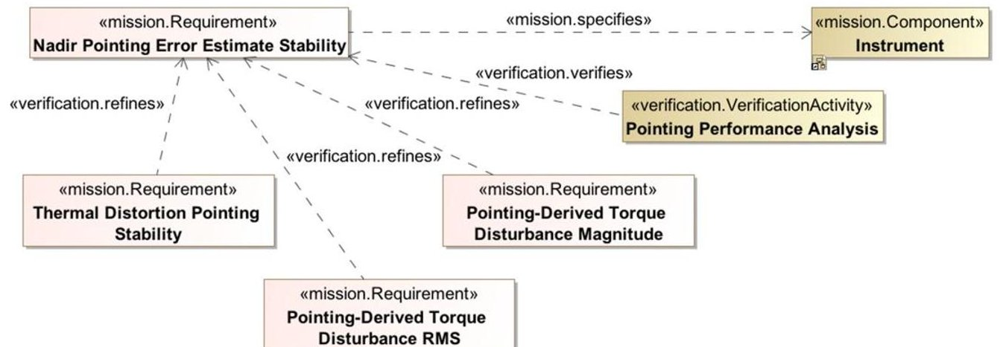

Figure 5. Application of the Requirement-related Ontology - Requirements can be linked together via "refines" relationships to create a Requirement Tree. Requirements can also be related to SpecifiedElements (e.g., Components) and VerificationActivities, via the "specifies" and "verifies" relationships, respectively.

<!-- PDF_PAGE: 7 -->

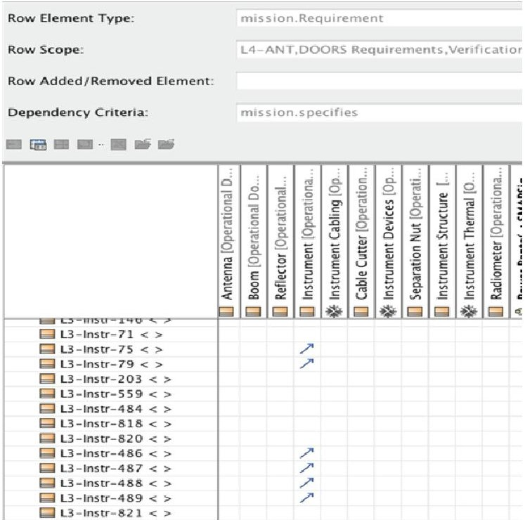

Figure 6. Requirement "Specifies" Matrix - This shows a snippet of the matrix that captures the "specifies" relationship between Requirements (rows) and SpecifiedElements (columns). It can be used as-is or exported to other tools for analysis.

- State Machine Diagram - We are using the State Machine Diagram to capture a behavior specification of a component. A behavior specification is the set of all possible ways the component can act. Consistent with the system decompositions defined previously, a system's behavior specification may be captured as a set of many small State Machines that run in parallel. Figure 7 shows an example State Machine describing the behavior of a simple low-level switch component. Note that we may also use State Machine Diagrams to capture behavior of components at a higher level in the structural decomposition hierarchy. For example, we are also using State Machine Diagrams to capture the system modes for the Guidance, Navigation and Control Subsystem, and, at an even higher level, modes for the full Flight System. Using descriptions of behavior at different levels in the system decomposition suggests the existence of formal mappings between states at different levels of abstraction. However, developing such mappings is beyond the scope of our pilot project.

- Sequence Diagram - In our work to date, we have not used Sequence Diagrams significantly, though they may be used as an alternative to Activity Diagrams for capturing executions of behaviors. They will likely become more useful as we progress into capturing complex software behavior.

- Parametric Diagram - Parametrics allow the modeler to couple properties to create complete behavior specifications. We use Parametric Diagrams to capture behavior of components that cannot be represented by discrete states in a State Machine Diagram, for example to describe the dynamic equations governing how the

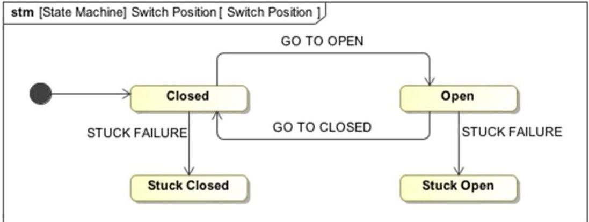

Figure 7. Example State Machine Diagram - This diagram represents a Behavior Specification which shows all possible ways the component "Switch" can act.

<!-- PDF_PAGE: 8 -->

## D. V&V patterns and views

Behavioral models of the spacecraft tend to focus, quite properly, on the as-built, on-orbit spacecraft exhibiting the behaviors expected from the design. V&V engineers rarely work with the as-built flight system despite their much quoted desire to "test as we fly," and "fly as we test" - an impossible ideal as spacecraft become more complex and capable. During assembly, test, and launch operations (ATLO), as spacecraft integration proceeds through multiple hardware, flight software, and support equipment configurations, the V&V process is carried out using simulations, testbeds (consisting of flight-like hardware, simulations, and support equipment to emulate flight conditions), and the spacecraft hardware.

We have sought to provide a consistent V&V modeling framework and ontology by providing best practice methods and V&V-related modeling stereotypes and abstractions. These constructs enable us to capture common test products such as configuration diagrams, test plans, and procedures in reference to a consistent system model. Modeling patterns were developed for linking requirements and their respective verification activities (as discussed above in subsection B). An initial ontology profile was created to represent vital V&V relationships in SysML diagrams (as shown in Figure 8). The profile requires that a verification item (VI), which is a more general name for things like system requirements, is verified by one or more verification activities (VA). VAs are conducted in test instances, or verification events (VE), and result in test data, which is subsequently analyzed to determine whether or not a VA verifies its linked VIs.

Adding to the V&V modeling framework, a catalog of test articles and support equipment were also established. The catalog contains reusable, abstract SysML blocks and activities for use in structural and behavioral diagrams. Maintaining such a catalog is helpful so that each project can pull from a configuration controlled source, rather than each having to recreate its own support equipment catalogs. Projects could either use the catalog items as-is or specialize test components from these general item definitions.

Besides establishing a modeling framework, we also sought to facilitate the creation of testing diagrams and documentation by setting best practices for V&V modeling. A test family description consists of a test domain and one or more test contexts. The test domain, which is essentially the VA, is a logical grouping of mission system tests based on test type, support equipment required, requirements being verified, schedule constraints, etc. The test context, however, is a single manifestation of the test domain; it is captured in SysML as a BDD, which describes all elements (e.g., equipment, people, facilities, etc) involved in the test. It is essentially the "world" of a particular system V&V test, because the test context BDD (as shown in Figure 9) provides the background for all other test-related diagrams, which convey more detailed information. From the test context BDD, we are able to derive more detailed structural representations in the form of Internal Block Diagrams (IBD) that capture various test-setup configurations, such as physical/electrical setup, data flow, etc. Additionally, the test context BDD sets the context for detailed behavior descriptions in the form of "swim lanes" within Activity Diagrams. These Activity Diagrams can depict high-level activity flow (e.g., test plan) or a detailed order of events (e.g., test procedures). This paradigm

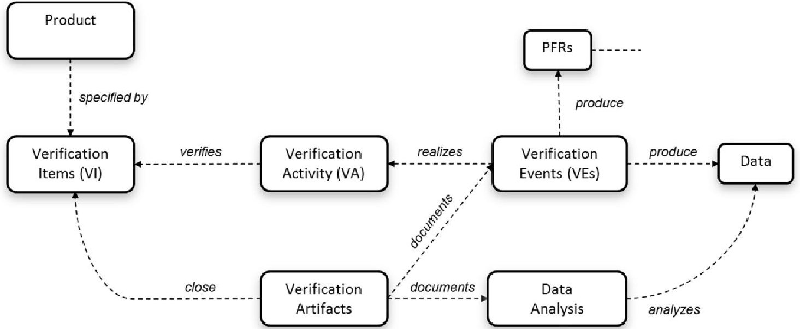

Figure 8. V&V ontology

<!-- PDF_PAGE: 9 -->

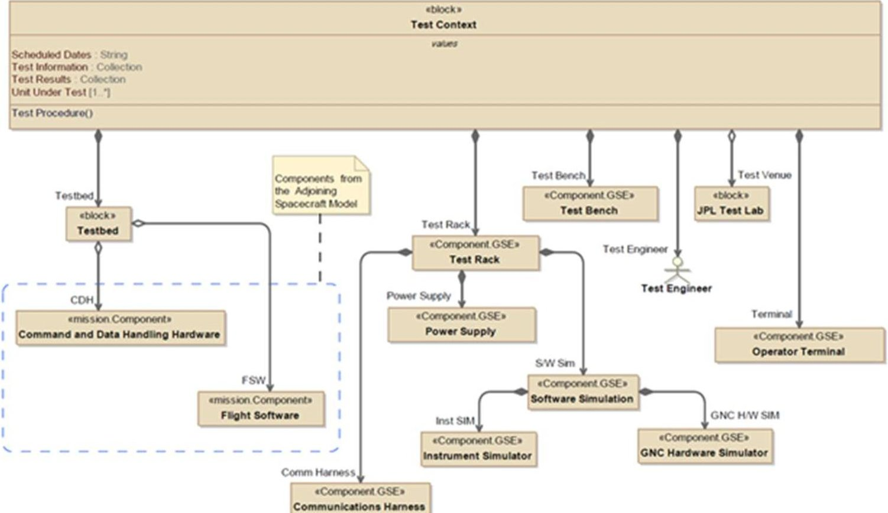

Figure 9. The test context BDD conveys all elements involved in a V&V test. The test context is an instance of a Verification Activity, or test domain.

of capturing both test domain and test context enables us to represent V&V system tests at all levels of detail. Examples of a test-context derived IBD and Activity Diagram are shown in Figures 10 and 11.

In an effort to keep model-based V&V practical and user-friendly, all elements in the V&V framework and ontology (e.g., ontology profile, support equipment catalog, etc.) will be configuration controlled and provided to users as completely reusable elements. The only mission-specific V&V elements will be the individual VA, or test domain, definitions. These will be created using reusable elements from the support equipment catalog and the spacecraft system model. Relationships between the elements will be based on the V&V ontology. An example of a system V&V package within a model, which consists of mission-specific and reusable elements, is shown in Figure

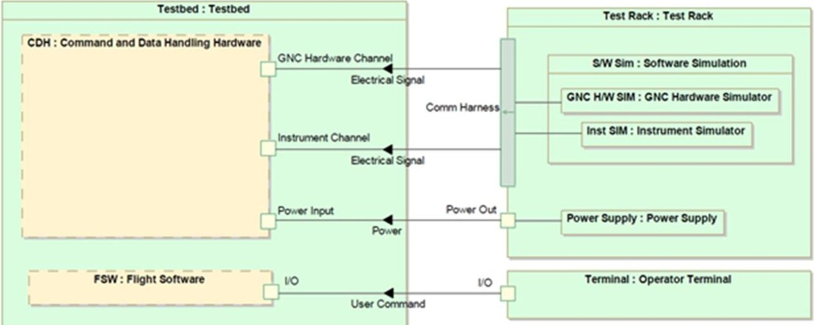

Figure 10. This example IBD, which depicts data flow, is derived from the test context BDD shown in Figure 9.

<!-- PDF_PAGE: 10 -->

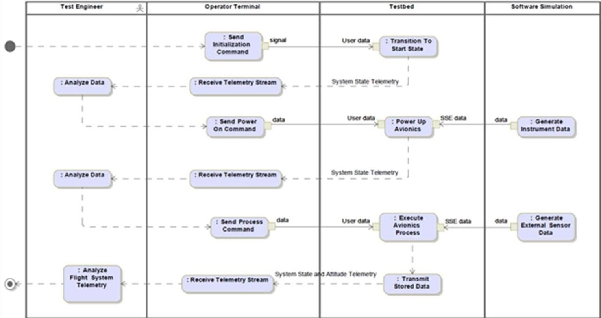

Figure 11. Example test plan Activity Diagram that is derived from the test context BDD shown in Figure 9.

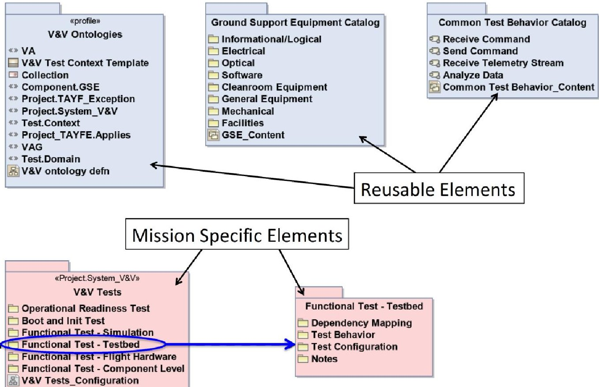

Figure 12. The contents of a system V&V package. Mission specific elements leverage wherever possible the reusable elements.

12. Even though each test domain and test context is mission-specific, the practical incorporation of this paradigm is greatly facilitated due to the encouraged utilization of reusable V&V-related elements.

In addition to having static views of the system behavior and V&V tests, it is also highly desired to be able to execute the system model via simulation. This capability is beneficial since it would allow early design validation by

<!-- PDF_PAGE: 11 -->

demonstrating that systems and subsystems perform in their expected manner. Accurately validating the design early in development is crucial since it prevents problems when actual hardware is being tested (at which point correcting a design flaw may result in major project cost increase and schedule delays). Executable models have been researched and demonstrated to date, $ ^{14} $ and we are applying this capability to our system model to perform operational procedure validation and spacecraft power analysis - this work is currently underway.

## IV. Options for Allocating Behavior to System Components

The primary decomposition used in our model was provided to us by the SMAP project. Using that as our structural decomposition, we sought to find behavior allocation patterns that not only complemented that structural decomposition but also accurately conveyed the expected executed behavior of the system. This proved to be a challenge for two reasons. First, while SysML offers the language and means for expressing behaviors, there is little documentation on what the best practices are on how to express those behaviors. Second, the structural decomposition given to us by the project contained not only physical components (like the Flight System, the Instrument, or the antenna), but also "logical"/"functional" components (like "Guidance, Navigation and Control", and the other subsystems). To address the first issue, we decided to use a subset of the existing SysML language to capture behavior. In this section, we describe the results of a trade study examining three alternative patterns for capturing behaviors and allocating them to components in the structural decomposition. In each of the following three subsections, we describe one of these patterns and discuss the pros and cons of using it. The second issue could only be remedied by restructuring the model; this will be discussed in greater detail in Section V.

## A. Cross-Cutting Allocation Option

Figure 13 depicts the "Perform Low Rate Spin-Up" behavior that must be performed by the Flight System. In this diagram, there are 4 swimlanes which are used to assert which component is responsible for performing specific actions. In this diagram, swimlanes exist for Telecommunications (Telecom), Command and Data Handling (CDH), Integrated Control Electronics (ICE), and Guidance, Navigation and Control (GN&C). This diagram treats these 4 components as functional peers, meaning that they are at the same level of abstraction. Looking back at our physical decomposition in Figure 1, it is clear that these components are not only at different levels of abstraction, but also parts of different structural branches; the ICE is part of the Instrument while the others are parts of the Bus. This diagram basically has created an artificial construct, the "Perform Low Rate Spin-Up Subsystem", which consists of these 4 components as peers.

There is a benefit to creating these artificial elements that cut across abstraction boundaries: using this crosscutting method makes that possible to point to a single element in the model and say that that element is responsible for performing a particular function. It might not be possible to allocate responsibility for a behavior to a single element in the model otherwise (except possibly at the very top of the structural decomposition), especially if the behavior is very distributed or involves components in many different branches of the structural tree.

While this cross-cutting allocation pattern makes it clear which elements are responsible for performing which actions in this activity, it allows a behavior to be allocated to a low-level component without visibility from its parent component. For example, in the case above, we are assigning responsibility to the ICE without assigning responsibility to the Spin Subsystem or the Instrument, which are both ancestors of that assembly in the structural decomposition. This could lead to confusion as functionality allocated to low-level components in the system are not exposed to the project team members responsible for the corresponding higher-level components in the hierarchy.

<!-- PDF_PAGE: 12 -->

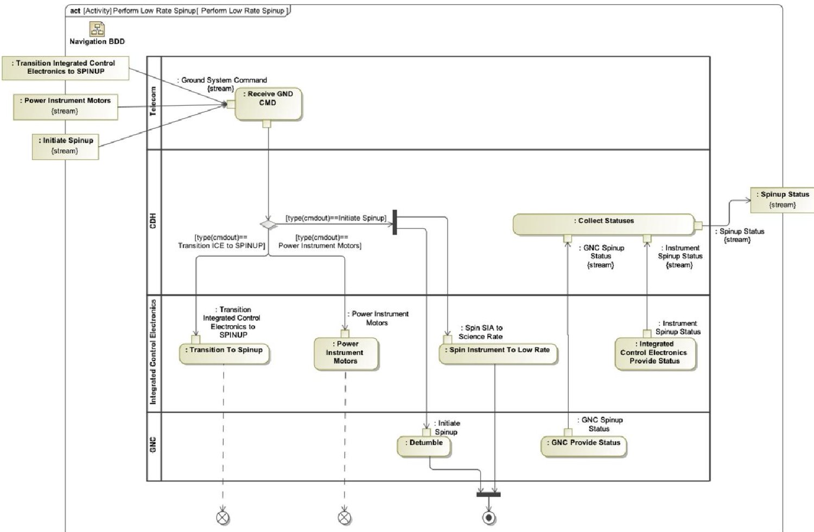

Figure 13. Cross-Cutting Allocation Pattern - In this diagram, the impression is that the Flight System (the component responsible for the "Perform Low Rate Spinup" activity) is the parent of the 4 components represented by the swimlanes (Telecom, CDH, ICE, and GN&C). However, the ICE is not a peer of the other components, based on our structural decomposition. The ICE is a part in the Spin Subsystem of the Instrument, see Figure 1.

## B. Hierarchical Allocation Option

A second option for behavior allocation is to conform to the structural relationships between components. Rather than allocating behavior directly to a component, a behavior can be allocated to each structural parent of an component until the desired component is indirectly allocated as well. This approach respects the structural decomposition that was previously agreed upon and improves upon the option discussed in Section A in that it does not create artificial elements for each activity. Additionally, instead of manifesting as a single allocation in the model, it manifests as an allocation at each structural level. This option is depicted in Figure 14.

There is a drawback to this approach. If you have a behavior that involves an interaction between two leaf-level components down different branches of your structural tree, like the ICE and Ground System, applying this pattern results with each action for ICE also being allocated to all ancestor components all the way up to the Flight System. In general, responsibility will be allocated all the way up to the point where the branches are peers (Flight System and Ground System are both children of the Mission). However, a high-level element like Flight System should probably not be responsible for a low-level action, like "Power Instrument Motor". Some responsibility should have been allocated to the Flight System and that responsibility should trickle down the structural decomposition to the ICE. The next option discussed in subsection C addresses this concern.

## C. Enforced Abstraction (Top-down Allocation) Option

A third option for behavior allocation is to conform even more rigidly to the structural decomposition and create appropriately abstracted behaviors allocated to each level in the structural decomposition. The SMAP source materials (functional design description documents) we were provided largely used subsection A's cross-cutting approach, which would require us to create similar higher-level activities in order to resolve into the lower-level activities. For example, our source materials had the ground commanding the ICE to "Power Instrument Motor". We changed this to better match our structural decomposition by creating some intermediate behaviors: the ground

<!-- PDF_PAGE: 13 -->

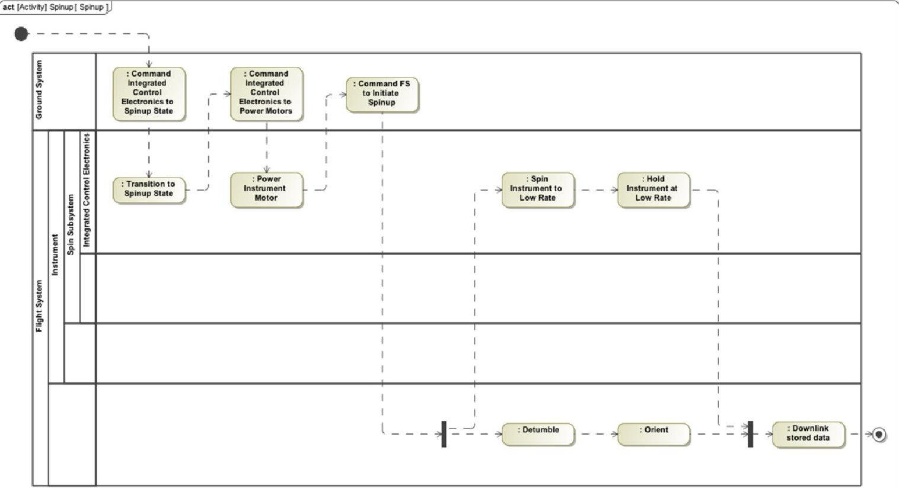

Figure 14. Hierarchical Allocation Pattern - This pattern causes low-level behaviors to be allocated to all ancestor components in the structural decomposition. In this case, a low-level behavior "Power Instrument Motor" is allocated to the "Integrated Control Electronics", but it is also allocated to the "Spin Subsystem", "Instrument" and "Flight System".

commands the flight system which then delegates to the Instrument subsystem, which then delegates to its Spin Subsystem, which ultimately delegates to the ICE. This pattern has the benefit that each behavior can be viewed as a black box $ ^{\dagger\dagger\dagger} $ allocated to a specific component, meaning that it relies solely on the actions of that component's children for the completion of that action. An example is shown in Figure 15. If this behavior allocation approach is applied carefully, we found this option to be the least confusing and cumbersome of the three presented. It maps directly to the type of functional decomposition that is performed during the design of a system, and can be applied incrementally as the system structure and functionality is elaborated over the development lifecycle.

## V. Revised Pattern for Capturing System Behavior

As mentioned in Section IV above, the structural decomposition we started with (which was based on the decomposition adopted by the SMAP project) contained not only physical components, but also "logical" or "functional" components (e.g., subsystems). Such a heterogeneous pattern can provide unwieldy and impractical, from the standpoint of behavior allocation. Consequently, we propose a modification to the decomposition approach. We propose a physical decomposition that solely contains physical components, and a distinct logical decomposition that contains the functional components (see Figure 16). What this means is that the physical decomposition of the Spacecraft Bus will not include the "logical" subsystems like the GN&C subsystem or the Thermal subsystem; instead, it will include the physical components (and physical assemblies thereof) in each of those systems, like N distinct Heaters, M distinct Reaction Wheel Assemblies, etc. Given this cleaner separation between physical and logical concepts, we have teased apart the concepts of behavior specification and function execution, which we previously were essentially using interchangeably. In the following subsections, we discuss each of these concepts in greater detail.

<!-- PDF_PAGE: 14 -->

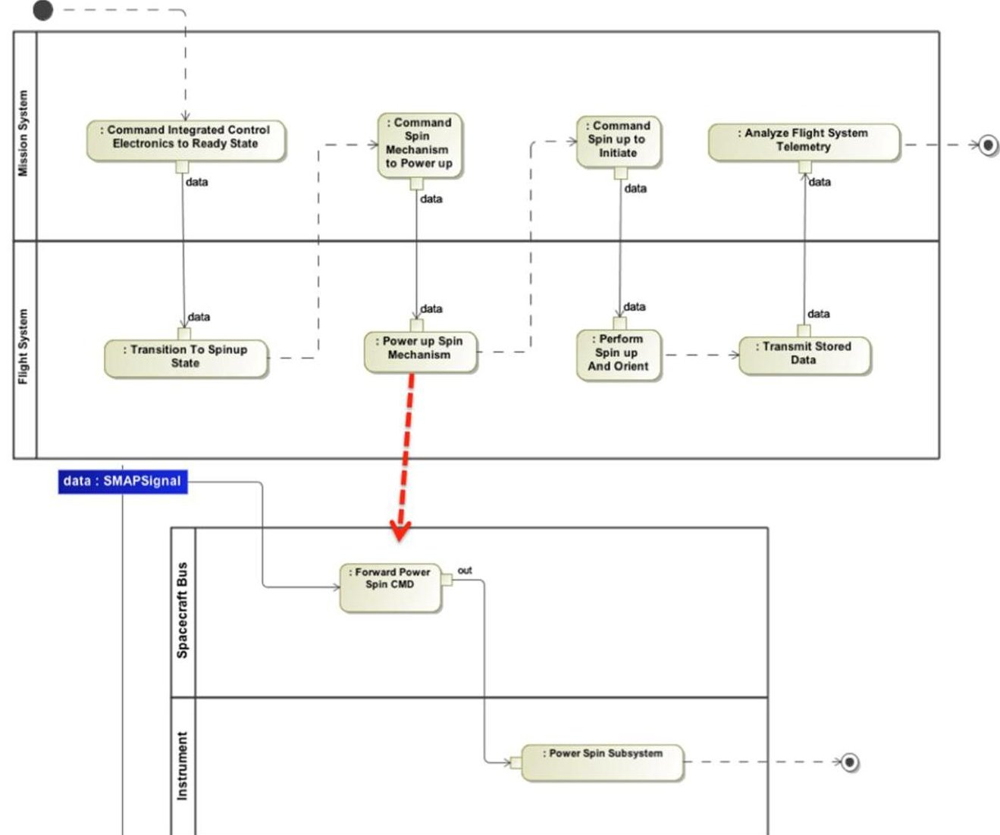

Figure 15. Enforced Abstraction Pattern - In this pattern, each behavior is a black box. For example, the Flight System's "Power Up Spin Mechanism" behavior decomposes into the "Forward Power Spin CMD" and "Power Spin Subsystem" behaviors allocated to sub-components of the Flight System, Spacecraft Bus and Instrument, respectively. Each behavior is completely specified through decomposition into behaviors allocated to sub-components, with inputs from peer component behaviors provided via data flows.

## A. Physical and Logical Decompositions

By adopting a physical decomposition, we end up with a flatter view of our system. One benefit is that we can more easily explain how different components interact with one another. There is no need to create "artificial" interfaces or interactions to mesh with a decomposition that has artificial or logical constructs.

Another benefit to this approach is that we can then tease out the logical decomposition. Logical components are containers for a set of functions that some part of the system is expected to perform. They have a reference to physical components (and other logical components). These functions are black box descriptions of what the logical component is expected to do.

## B. Functional Decomposition/Elaboration

Although functions can be considered black box descriptions of intent, it is possible to say that performing a function, like "Determine Attitude" in Figure 17, may also require the performance of other functions, such as "Produce Attitude Measurements" and "Produce Attitude Rate Measurements". Note that this functional decomposition says nothing about order or sequence of functions. This functional decomposition pattern is analogous to the notion of Goal Elaboration in the State Analysis methodology. $ ^{6} $

<!-- PDF_PAGE: 15 -->

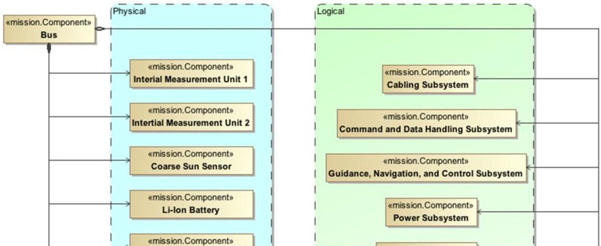

Figure 16. Physical and Logical Decompositions - We show a snippet from a proposed decomposition of our system, in which we separate out the physical components from the logical components. Note that the physical components are defined as parts of the Bus ("black diamond" relationship) while the logical components are references ("white diamond" relationship).

Figure 17 also indicates the mapping between physical elements and functions. The relationships show that the GN&C Software is responsible for performing "Determine Attitude" and in order for "Determine Attitude" to be completed successfully, the Coarse Sun Sensor must perform "Produce Attitude Measurements" and the IMUs must perform "Produce Attitude Rate Measurements". This mapping between physical elements and functions formalizes the functional allocation via swimlanes as shown in previous sections.

## C. Behavior Specification

A Behavior Specification is a description of all the possible ways that a component can act. There may be multiple different aspects that characterize the behavior of the component; we represent these different characterization aspects using State Variables. For example, given a heater component, we may be interested in its power state (on, off, etc), its temperature (in degrees Kelvin), and perhaps its health state (healthy, failed closed-

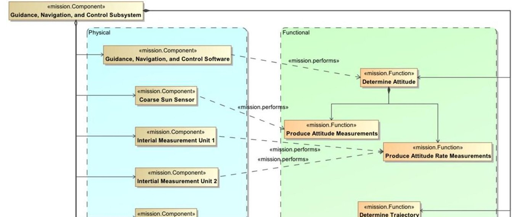

Figure 17. Logical and Functional Decomposition - A logical component, such as the GN&C subsystem, can have references to physical components as well as an aggregation of functions as parts. The functions can be decomposed further in a functional decomposition. There is a mapping between physical components and functions (a physical component performs a function).

<!-- PDF_PAGE: 16 -->

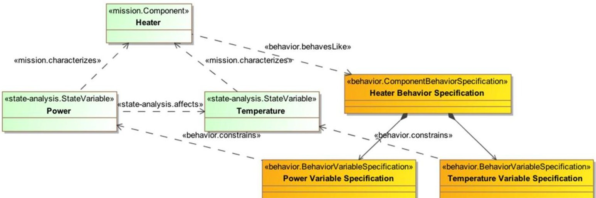

Figure 18. Behavior Specification - This diagram shows how a component's Behavior Specification can be represented as a collection of descriptions of how its State Variables can change, as given in Behavior Variable Specifications.

circuit, failed open-circuit, etc); each of these aspects can be represented by a State Variable. $ ^{+ + + } $ A Behavior Specification models the component's behavior space as a collection of Behavior Variable Specifications, one per State Variable that characterizes the component. A Behavior Variable Specification is a description of how a single State Variable can change. In SysML, these Behavior Variable Specifications may be represented in one of two ways:

- A State Machine with an associated State Machine Diagram for variables that change in a discrete manner, or

- A Constraint Block with an associated Parametric Diagram for variables that change in a continuous manner.

By defining the Behavior Specification as the set of all Behavior Variable Specifications for a specific component, we can specify the entire behavior space for that component. Figure 18 shows an example of how Behavior Variable Specifications can be used to create the entire Behavior Specification for a component.

## D. Functional Executions

A Functional Execution shows a single trace through a component's behavior space, as determined by its Behavioral Specification. This is really a runtime description of how the associated function is performed. As a Functional Execution is a representation of a function, each Functional Execution is a subclass of a function, meaning that it must conform to the function's specification (inputs, outputs, and required sub-functions). This pattern allows for multiple Functional Executions for a single function, as shown in Figure 19. This is beneficial for two reasons. First, this pattern allows us to capture areas of functional redundancy (when there are multiple ways to accomplish a function), which is helpful for risk management. Second, this pattern also allows us to capture both nominal executions and off-nominal executions. $ ^{16} $

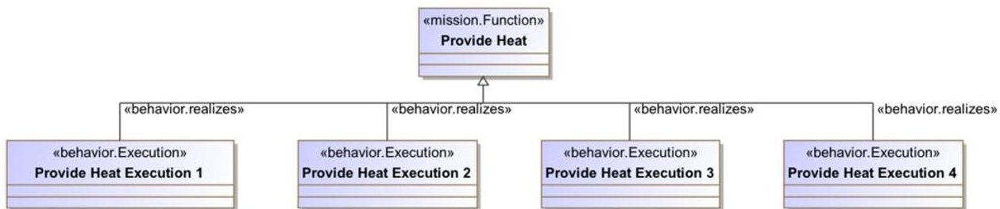

Figure 19. Functional Execution - This diagram shows that many executions are possible for a single function, allowing for capturing of functional redundancies as well as nominal and off-nominal executions.

<!-- PDF_PAGE: 17 -->

## VI. Uses of the System Model

The main reason for aggregating behavior-related information into our system model was so that we could extract that information to generate behavior-related products, beyond the views SysML offers as part of the language (as discussed in previous sections). Through various plugins to our modeling environment, we were able to generate documentation about specific parts of the model and extract information from the model for use in external analyses. Two of these uses are described further in the following two subsections.

## A. Automated Document Generation

A group at JPL has created a framework for generating documentation about models created in MagicDraw. This MagicDraw plugin is known as DocGen. $ ^{17} $ Using DocGen's profile we were able to create a model of the document we wanted to generate, and using DocGen's scripts, we could generate a DocBook $ ^{18} $ version of the document, which could then be transformed into HTML, PDF, and other formats.

For this task, we wanted to generate our own version of the SMAP Antenna Spin-Up functional design description (FDD) document. Using DocGen to model the desired output document, our document has the advantage over the original FDD that products that feed the document can be queried when the document is compiled. This means that if someone changes any part of the system model, say a State Machine Diagram, that appears in the DocGen model, then when the user requests the most up-to-date version of the document, DocGen queries the model for an image of that diagram and puts that in the document. The result is that the compiled document reflects the current state of the model at all times.

Instead of having documents live statically in repositories and updated infrequently, they can be generated instantly, reviewed, and archived. Documents living in the archive then become versioning artifacts; the current version should always be pulled directly from the model to limit the amount of information that is out of date. This capability has also allowed for documentation in areas where there is traditionally a lack of organization, such as mission V&V test plans. By using the DocGen capabilities and a well-constructed system model, we are able to generate up-to-date and consistent documentation of anything from a single functional test to the entire project's V&V testing flow.

After we were able to generate a simplified version of the FDD as a proof of concept, we began extending the DocGen profiles to include custom elements for meta-documenting (documenting about documenting), creating stereotypes for sections that needed to be re-worked and elements that needed values for their properties, for example. This allowed us to have a query in the document model for elements with those stereotypes that we could put into a table. The result was a document that automatically populated its own TBD/TBS/TBR ("to be determined", "to be supplied", "to be revised") tables. DocGen allows for arbitrarily complicated queries, so we were also able to generate tables showing which Requirements did not have corresponding Verification Activities, for example.

## B. Connection to External Analysis Tools

Creating formal representations of behavior forced the information in our model to have a well-defined structure. Using that well-defined structure, we developed a plugin to our modeling environment that allows us to use scripts to perform operations on the model. One of these scripts allows us to extract information from the model in the form of an XML file. This export option enables us to decouple our model and our analysis tools. The only requirement on the analysis tool side is that the tool be able to read an XML file.

As an example application of this approach, we wrote a MATLAB program to ingest an XML file containing key model elements and parameters pertinent to the antenna spinning dynamics, and used that information to perform a dynamic simulation of the spin-up behavior, producing a plot of the spin-up profile. This resultant plot can be fed back into the SysML model. Figure 20 shows a description of the information flow between our modeling environment and MATLAB, though the pattern applies to any external analysis tool.

In addition to this decoupled interaction between the model and external tools, we created a direct interface from MagicDraw to certain tools using their Java APIs. The tools we focused on were Maple, $ ^{19} $ MATLAB, $ ^{11} $ and Mathematica. $ ^{20} $ Using the Java APIs for these tools, we have created a tight coupling between the model and these external tools, enabling us to invoke functions of the external tools directly from our modeling environment. These interfaces allow for round-trip calculations, meaning that the result of the external function call can be written back into the model.

<!-- PDF_PAGE: 18 -->

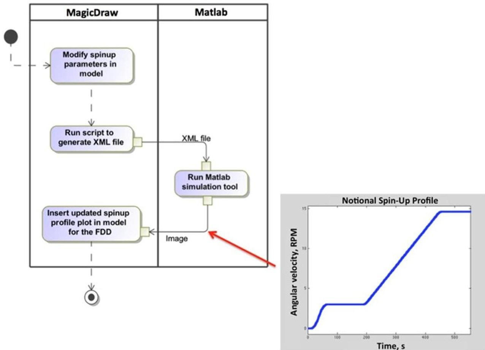

Figure 20. Pattern used to interface the SysML system model with external analysis tools.

## VII. Conclusions and Future Work

Through this pilot project, JPL is applying its institutional capabilities in model-based systems engineering (MBSE) to tackle the problems associated with current ad-hoc and informal behavior engineering practices. In this project, we are developing and exercising an MBSE approach to formalize behavior engineering, with the aim of bringing consistency and rigor to this field. In this paper, we described our initial approach to modeling spacecraft behavior and we presented the patterns we used for representing system structure, requirements, behavior and V&V-related information. We discussed a few different pattern options that we have considered for allocating behavior to components in the system decomposition, and we proposed an "enforced abstraction" approach enabling us to develop a clear top-down allocation of functions/behavior across the system decomposition. Based on experience gleaned from modeling a representative complex spacecraft system, we presented a revised modeling pattern for behavior specification that we are documenting for future use on JPL projects. Finally, we described additional ways to derive value from the system model beyond just capturing the design in diagrammatic views. These included automatic document generation and interfacing the system model with external analysis tools.

Future work will involve applying the discussed patterns (in particular the proposed pattern for capturing system behavior discussed in Section V) to more areas of the SMAP project, to explore in greater depth their benefits and limitations. In particular, the interface between the flight system- and subsystem-level designs will be further specified. The automatic document generation capability will be explored further to create more systems engineering artifacts. Finally, we intend to further develop the executable system model capability for early system design validation.

## Acknowledgments

The work described in this paper was performed at the Jet Propulsion Laboratory, California Institute of Technology, under a contract with the National Aeronautics and Space Administration.

Our team would like to recognize a few people and groups at JPL who helped made this work possible: Steve Jenkins, Nicolas Rouquette, and the Integrated Model-Centric Engineering (IMCE) task for their aid in ontology development and general project direction; Marcus Wilkerson for his Jython script allowing synchronization

<!-- PDF_PAGE: 19 -->

between a DOORS requirements repository and our modeling environment; and the Operations Revitalization (OpsRev) group for their tools, specifically DocGen, which helped immensely for extracting information from the model into a more digestible format.

## References

$ ^{1} $ NASA Jet Propulsion Laboratory, California Institute of Technology, Soil Moisture Active-Passive Mission website, URL: http://smap.jpl.nasa.gov

$ ^{2} $ McKelvin, M. and Jimenez, A., "Specification and Design of Electrical Flight System Architectures with SysML", Proceedings of the AIAA Infotech@Aerospace 2012 Conference, Garden Grove, CA, June 1012.

$ ^{3} $ Friedenthal, S., Moore, A., and Steiner, R., A Practical Guide to SysML: The Systems Modeling Language, Morgan Kaufmann Publishers / OMG Press, 2008.

$ ^{4} $ Object Management Group, Unified Modeling Language Specification, Version 2.4.1, Released August 2011, URL: http://www.uml.org

$ ^{5} $ No Magic, Inc., MagicDraw User Manual, Version 17.0.1, 2011, URL:

http://www.nomagic.com/files/manuals/MagicDraw%20UserManual.pdf

$ ^{6} $ Ingham, M., Rasmussen, R., Bennett, M., and Moncada, A., "Engineering Complex Embedded Systems with State Analysis and the Mission Data System", AIAA Journal of Aerospace Computing, Information and Communication, Vol. 2, No. 12, Dec. 2005, pp. 507-536.

$ ^{7} $ Karban, R., Kornweibel, N., Dvorak, D., Ingham, M., and Wagner, D., "Towards a State Based Control Architecture for Large Telescopes: Laying a Foundation at the VLT", Proceedings of the International Conference on Accelerator and Large Experimental Physics Control Systems 2011, October 2011.

$ ^{8} $ Karban, R., et al., "Cookbook for MBSE with SysML", Report from the INCOSE Telescope Modeling Challenge Team, 2011, http://iweb.dl.sourceforge.net/project/mbse4md/Cookbook%20for%20MBSE%20with%20SysML.pdf

$ ^{9} $ Bayer, T., Cooney, L., Delp, C., Dutenhoffer, C., Gostelow, R., Ingham, M., Jenkins, J.S., and Smith, B., "An Operations Concept for Integrated Model-Centric Engineering at JPL", Proceedings of the IEEE Aerospace Conference 2010, Big Sky, MT, March 2010, IEEEAC Paper #1120.

$ ^{10} $ Bayer, T., Bennett, M., Delp, C., Dvorak, D., Jenkins, J.S., and Mandutianu, S., "Update - concept of operations for Integrated Model-Centric Engineering at JPL", Proceedings of the IEEE Aerospace Conference 2011, Big Sky, MT, March 2011.

$ ^{11} $ The MathWorks, Inc., MATLAB User's Guide, Release 2012a, URL:

http://www.mathworks.com/help/techdoc/matlab_product_page.html

$ ^{12} $ Pascal Hitzler, P., Krötzsch, M., Parsia, B., Patel-Schneider, P., and Rudolph, S., eds., OWL 2 Web Ontology Language: Primer, October 2009, URL: http://www.w3.org/TR/owl2-primer/

$ ^{13} $ IBM Corp., IBM Rational DOORS API Manual, Release 9.3, 2010, URL:

http://publib.boulder.ibm.com/infocenter/doorshlp/v9/index.jsp?topic=/com.ibm.doors.requirements.doc/topics/door s_api_manual.pdf

$ ^{14} $ Khan, M.O., Sievers, M., and Standley, S., "Model-Based Verification and Validation of Spacecraft Avionics", Proceedings of the AIAA Infotech@Aerospace 2012 Conference, Garden Grove, CA, June 1012.

$ ^{15} $ Wagner, D., Bennett, M., Karban, R., Rouquette, N., Jenkins, S., and Ingham, M., "An ontology for State Analysis: Formalizing the mapping to SysML", Proceedings of the IEEE Aerospace Conference 2012, Big Sky, MT, March 2012.

$ ^{16} $ Day, J., Donahue, K., Ingham, M., Kadesch, A., Kennedy, A., and Post, E., "Modeling Off-Nominal Behavior in SysML", Proceedings of the AIAA Infotech@Aerospace 2012 Conference, Garden Grove, CA, June 1012.

$ ^{17} $ Jackson, M., Delp, C., Bindschadler, D., Sarrel, M., Wollaeger, R., and Lam, D., "Dynamic Gate Product and Artifact Generation from System Models", Proceedings of the IEEE Aerospace 2011 Conference, Big Sky MT, March 2011.

$ ^{18} $ Walsh, N., DocBook 5: The Definitive Guide, O'Reilly Media, April 2010.

$ ^{19} $ Maplesoft, a division of Waterloo Maple Inc., Maple User Guide, 2012, URL:

http://www.maplesoft.com/view.aspx?SF=131922/432650/UserManual.pdf.

$ ^{20} $ Wolfram Research, Inc., Mathematica User Guide, URL:

http://reference.wolfram.com/mathematica/guide/Mathematica.html