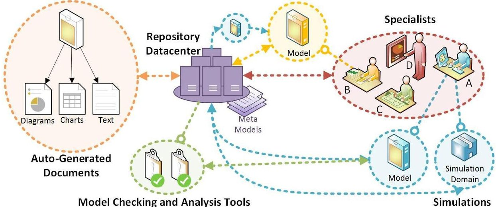
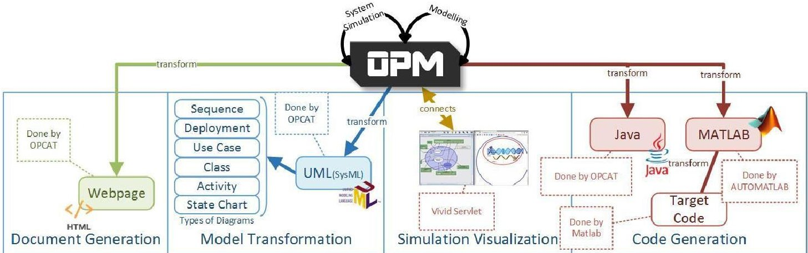
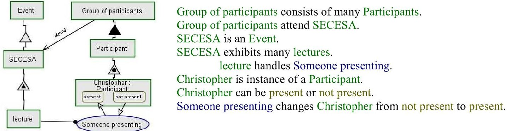
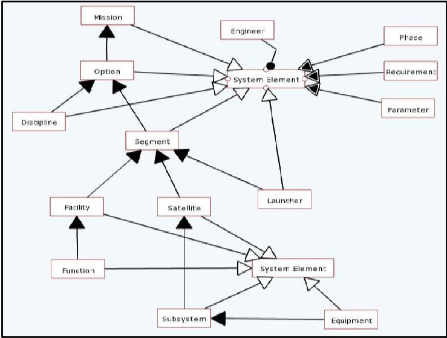
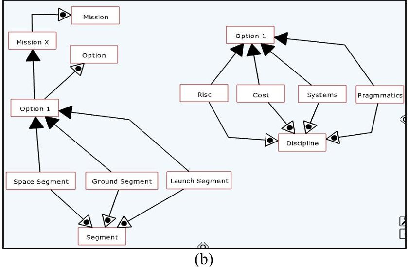
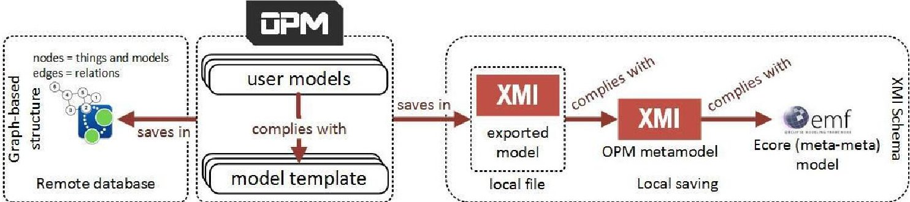
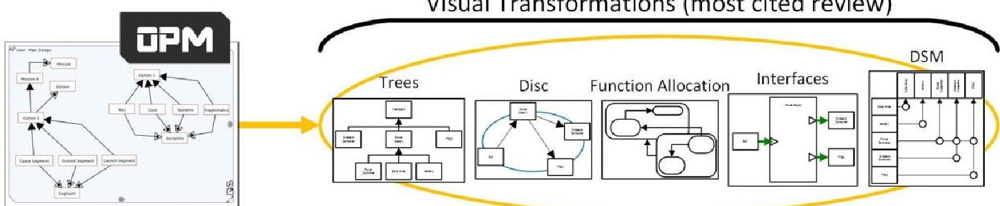
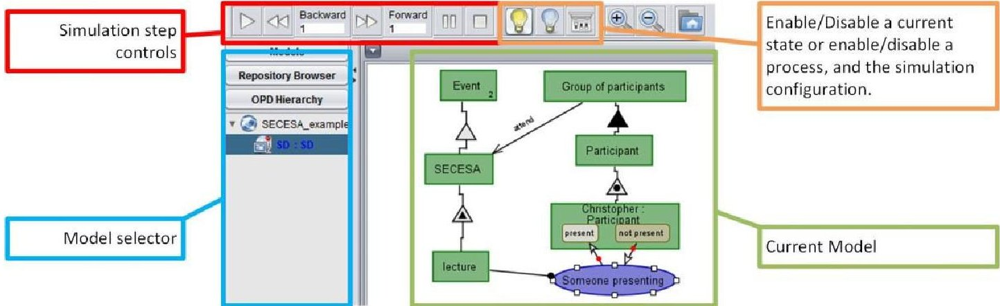

<!-- PDF_PAGE: 1 -->

# A Model Based Concurrent Engineering Framework using ISO-19450 Standard 7th International Conference on Systems & Concurrent Engineering for Space Applications

5-7 October 2016

Universidad Politécnica de Madrid (UPM) Spain

Christopher Shneider Cerqueira $ ^{(1)} $ , Ana Maria Ambrosio $ ^{(2)} $ , Claudio Kirner $ ^{(3)} $

$ ^{(1(2)} $ Brazilian National Institute for Space Research - INPE $ ^{(1)} $ Space Engineering and Technology Post Graduation Program Course (PG-ETE-CSE) $ ^{(2)} $ Space Engineering and Technology (ETE) - Space Systems Division (DSE) Av. dos Astronautas, 1758. São José dos Campos - SP - Brazil Email:christophercerqueira@gmail.com, ana.ambrosio@inpe.br

(3) Federal University of Itajubá - UNIFEI Institute of Mathematics and Computer Science (IMC) Av. BPS, 1303. Itajubá-MG-Brazil Email: ckirner@gmail.com

## INTRODUCTION

The engineering of complex systems increasingly involves interconnected elements that are not necessarily from the same domain. Generally, those "engineered systems" takes into account more than one nature of knowledge, as: electrical, mechanical, chemical, logical, computing, etc. and they are known as Coupled Multidisciplinary Complex Systems. The Space Engineering, in special, deal with a highly coupled interdisciplinary complex system to achieve the needs of the stakeholders, using knowledge from disciplines as: electrical and electronics, mechanical, propulsion, programmatic, electronics, software, communication, aerodynamics, space dynamics, control, data distribution. [1]

In order to organize the development of Space Systems, space agencies divide the life-cycle in phases, from the elicitation and understanding of the stakeholder's needs to the satellite disposal, passing through the development, integration and operation phases. [1] [2] [3]

The system design choices made during the life-cycle in first phases have a strong impact into the design, cost, and schedule of the system to be developed. The first architectural choices must have a certain level of preciseness in order to avoid further design changes and bigger impact on the next developing phases. In this sense, the first conceptual decisions used to take several months because of the several meetings and the excess of required reports. Each discipline specialist (engineer or not) propose their concepts (in reports), which in later meetings will be turned in the designs of alternatives solutions [1]. The System Engineering Handbook of NASA $ ^{1} $ says that the first phase can take years, and the information required to the architecture alternatives are pointed through several loosely connected papers that investigate design options to meet certain mission criteria [2]. To speed-up the conceptual decisions, two approaches can be found in the literature: System Engineering and Concurrent Engineering.

System Engineering can be summarized as an organization of engineering practices added with management practices to improve the traceability, reuse, organization and collaboration of systemic data. These practices have several branches of possible approaches; one of them is the Model Based System Engineering (MBSE). The essential and common element of the MBSE's life-cycle activities and processes are the virtual (or physical) models. Models are a formal specification of a function, structure or behaviour that mimics an application of a system [4]; models have to

<!-- PDF_PAGE: 2 -->

agree with the following three criteria [5]：(i) mapping - model is a representation of something, (ii) reduction - models have less attributes that what it maps, (ii) and pragmatic -model needs a purpose to be conceived and used.

Concurrent Engineering (CE), or as it can be found in literature: Concurrent Design, Simultaneous Engineering/Design or Integrated Design, states that the Concept Studies can be done in shorter time if the team is well-integrated (specialists and stakeholders) in a single design facility, with a well-defined process and using software tools that help to describe systems elements and perceive these data through the iterations, and further studies. Literature also shows [6] [7] [8] that CE is moving toward a highly intensive use of explicit coupled models, instead of loose system elements descriptions. The CE initiatives based, or not, in already defined MBSE Methodologies as SysML $ ^{2} $ -based, OPM-Based, Pattern-Based, and so on, reveal challenges to build and maintain the computational framework to support them.

At the Brazilian National Institute for Space Research (INPE) $ ^{3} $ we structured a MBSE concept into a conceptual system design environment called HICEE - Hybrid Interactive Concurrent Engineering Environment. In the context of this Ph.D. research project, this paper aims to present the method used to integrate Model-based methodologies with the Concurrent Engineering concept, which we called: MBCE (Model Based Concurrent Engineering). This MBCE framework initiative is based into the recently available $ \mathrm{ISO}^{4} $ -19450 - Automation Systems and Integration - (OPM) Object Process Methodology standards [9], and this choice drives some implementation decisions to create the software design infrastructure. This paper is organized to describe some design decisions of an OPM-Based MBCE framework answering the following questions: (i) what are the models definitions and its meanings? (ii) how structured data should be stored and distributed? (iii) which diagrammatic representations are commonly used? (iv) how to handle legacy tools? and (v) how should be the simulation over the models?

## CONCURRENT ENGINEERING

Concurrent Engineering (CE) can be defined as: "systematic approach to integrated product development that emphasises the response to customer expectations. It embodies team values of co-operation, trust and sharing in such a manner that decision making is by consensus, involving all perspectives in parallel, from the beginning of the product life-cycle". [10]

Traditionally, CE has five main researchable topics: (i) the team - human resources and how effectively they cooperate, (ii) the process - preparation studies, parallelization and sequencing of the disciplines, and meeting sessions; (iii) the integrate design model (IDM) - the way the data will be structured, used, and saved, (iv) the facility - physical environment where the team conduct de studies, and (v) the software infrastructure - domain specific tools to each specialist. [10] [11]

Since the beginning of CE [10], the CE teams foreseen model-driven activities and processes. For such models' natures we propose a classification in four categories: (i) free - free descriptions of the systems with have no formalism in it, (ii) loose - free descriptions of the systems with a fair formalism in software interfaces, (iii) domain specific - described using a certain domain specific language, using the symbols and grammar available by the domains software used by the specialist; and (iv) tool independent - described using a certain domain specific language that is a specialization of a higher-level meta language, and it is easily accessible by other tools. Note that a category does not exclude the use of other, they are just different strategies to deal with models.

The growing demand for CE that explicitly uses modelling and requires a computational apparatus to support the activities in a transparent way for the specialists [12], will drive the use of more domain specific and tool independent than free and loose models.

## THE BENEFITS OF MODEL BASED APPROACHES TO CE

MBSE improves CE in the term of collected data handling (models of everything that is used in the systems), so it is directly related with the IDM and the software infrastructure, and more or less related with the process. On choosing a MBSE Methodology, it will drive: (i) the model which the team will used, (ii) the way to save and connect models, and how to translate between specific domains and (iii) (slight or not) changes in the process.

<!-- PDF_PAGE: 3 -->

The main characteristics and some raised questions from MBSE approaches that greatly impact on CE are: (i) readiness of information: how easily the specialists will find the information during the meeting session? (ii) standardized saving format: how easily the computational search tools will retrieve/save/couple models, or parts of it to the specialists? [13] (iii) reusability: can the specialists reuse models as is, or they need to be adapted with extra information? (iv) data transformation capacity: can the specialist work with the model and transform it to create a better interpretation of it, or view with other domains' symbols, generate its documentation, etc.? (v) simulatability: can the specialist use simulation tools to verify/validate the design? and (vi) collaboration capacity: can the specialists share their designs to its disciplines interfaces pair or to final solution integrations?

Fig.1 generically illustrates a desired arrangement of elements to create a Model Based Infrastructure to the CE's software infrastructure and IDM. This infrastructure concept is built around a repository (or set of repositories), which contains all the models of the IDM. The models, as well as other information, stored in the repository must comply with a meta-model, which describes the allowed model's syllabus and semantics. The meta-model must also comply with a meta-meta model, which describes how the meta-model must be formalised. The specialists handle the models and can: (i) realize domain specific simulations with them - with its own domain software, (ii) save and retrieve information in the repository, and/or (iii) use tools to check-up model completion and realize some analyses. In the figure, specialist A commits a model (drawn in blue), which can be verified by a simulation and/or with a set of model testing tools. Specialist B, which needs the model interfaces from specialist A's model to finish his model (drawn in yellow), have to transform pieces of the model from specialist A, so his tool set recognize the required information. Finally, the architecture can do a model transformation which will auto-generate documentation and/or reverse engineering the documents into models.

Model Checking and Analysis Tools

Fig. 1. Conceptual generic infrastructure to a Model Based System Engineering Approach

## MODEL BASED CONCURRENT ENGINEERING (MBCE)

The explicit-model based CE, or MBCE, changes slightly the CE definition. It still strongly relies in a team integration, into a single working facility, that uses computation interactivity, exchange of information and procedures of a model based methodology to perform system concept studies. The references [14] [15] [16] also explore the idea of MBCE to different fields.

The CE based in a model approach requires new roles (model specialists, domain language transformation specialists, model tool specialists, etc.), more team training and an understanding of the: (i) model definitions, (ii) saving and distribution methods, (iii) diagrammatic representations, (iv) legacy tools, and (v) simulation.

## What are the model definitions and its meanings?

For modelling at system level we propose a tool independent model based in OPM. In December of 2015, ISO published one of INCOSE's $ ^{5} $ suggestions of Model Based Methodologies [17] as a standard with the following description: "ISO/PAS 19450:2015 specifies Object-Process Methodology (OPM) with detail sufficient for enabling

<!-- PDF_PAGE: 4 -->

practitioners to utilize the concepts, semantics, and syntax of Object-Process Methodology as a modelling paradigm and language for producing conceptual models at various extents of detail, and for enabling tool vendors to provide application modelling products to aid those practitioners." [9]

OPM, designed by Prof. Dori Dov from the Israel Institute of Technology, has been around since 2002 [18]. The main available CASE $ ^{6} $ tool to model in OPM is the OPCAT [19]. It started as tool specific modelling, but its ecosystem of tools is growing, as illustrated in Fig.2, where four groups of tools can be found: (i) Document Generation generation of textual and diagrammatic descriptions of the models (in $ \mathrm{H T M L}^{7} $ ), (ii) Model Transformation transform in other model type $ (\mathrm{U M L}^{8} $ or SysML), to further refinement or use in other tool (in $ \mathrm{X M I}^{9} $ standard), (iii) Simulation Visualization visualize the simulation with objects of the domain described in the model, and (iv) Code Generation generation of code to be executed by other tool as Java code or Matlab code[20], the Matlab allows further transformation to C++ and to embeddable code. [21]

Fig. 2. OPM Ecosystem (researched by the time this paper was written)

OPM methodology defines how to describe systems using simple ontological metaphors with diagrammatic symbols of boxes and ellipses to represent, respectively, objects and processes (things) in the system; lines with "line heads" represent how they interact (links) (Fig.3). OPM also describes ways to increase complexity details by: (i) recursive zooms into objects and processes, (ii) adjacent views, and (iii) how to unfold the complete system into a macro view. A very interesting characteristic in OPM is its dual cognitive channel of the OPD (Object Process Diagram) and OPL (Object Process Language). The OPL is generated by interpretation of the diagram, and it helps to understand the meaning of the diagram as you draw it [22]. The last is to build in simulation capabilities. OPM model execution is an event-driven simulation.

Fig.3. OPM Example of the OPD - Object Process Diagram (left) and OPL - Object Process Language (right). Example created using the OPCAT Tool.

How structured data is stored and distributed?

<!-- PDF_PAGE: 5 -->

A MBCE Framework, as proposed, requires a centralized saving methods to store the models using a repository element. There are several forms to save data into a repository, two of them are: (i) transferring files using version control systems, and (ii) manipulating databases using a DBMS (Database Management Systems). Focusing in DBMS, models can be stored via two main approaches: relational and non-relational. The relational databases use the table metaphor and are intended to fixed designed structures, each modality of object or relation would have to be saved in a different table. Non-relational databases do not use a table metaphor to organize data, but instead use graph-based, text, and other approaches. In a graph-based database, each atomic information is saved in nodes that have edges to other nodes.

OPM, as SysML (and UML), is a graph based model, with nodes and edges. The OPM nodes are things that the model has (objects, process and states), and the edges are the relations among things (links). OPM also allows relations among models, as zooms and adjacent views, which also requires a form to map these relations. So, the authors suggest a nonrelational database, more specifically a graph-based database as a more appropriated approach to save data of a OPM based MBCE. Observation: to use a relational database as a graph you must make sure that the DBMS allows recursive queries.

To organize a framework, every model must comply with a higher defined model template or metamodel (a model of a model). Metamodeling helps in the discoverability and the passage of pre-set proprieties and behaviours. OPM do not explicitly use stereotypes, instead it uses the classification-instantiation link [9] concept which mimics the stereotype role of UML-based languages. For instance, Fig.6a shows a metamodel to a product tree for a space mission definition, the main object is a System Element, which is specialized (white triangle) into the other possible objects to create a product tree, with the aggregation (black triangle) it is possible to map a templated relation among the specialized system elements, and with the exhibition (triangle with a triangle inside) it is possible to map things (parameters, phase names, engineers responsible, or requirements) that the system element exhibits. The Fig.6b shows an example mission model with instantiated objects (triangle with a circle inside) that will have the same elements of the source templated object.

(a)

Fig.6. (a) Example of model template - a design tree metamodel. (b) Example of user model - implemented elements using the metamodels. Example created using authors' HICEE OPM Editor Tool.

The same concept of metamodels have to be created to define the different types of model, discipline's information mission definition, different application views, etc. Everyone using OPM as the meta-meta model.

So, our approach has different levels of metamodeling: (i) the user model - has the definition of the model itself in OPM; (ii) the model template - has the group of "things" that the user model can describe in OPM; (iii) OPM as the meta-meta model of the available symbols and relations to represent the elements; (iv) the exported model in XMI - has the description of the OPM project in XMI; (v) the exportation OPM meta-model - has the descriptions of how the model has to be exported; (vi) the Ecore model - the meta-meta model which contains the language constructs of both the exported model and the exportation metamodel [23]; (vi) the database model - has the graph-based content from the OPM (almost a 1 to 1 representations, as OPM is already a graph-based model). Fig.7 exemplifies those relations.

<!-- PDF_PAGE: 6 -->

Fig.7. Relations among models, its metamodels, and the ways to save the information.

This proposal allows that one knowing the OPM metamodel, the modelling tools, as $ \mathrm{ATL}^{1 0} $ [24], to be able to transform the exported model to different tools, and vice-versa.

## What are the commonly used diagrammatic representations?

The MBCE Framework also propose diagrammatic transformations to enhance the understanding of the model. As much as OPD helps to visually represent the system and its parts, common diagrams format are easily recognized by the specialists and improve their perceptions of what has been modelled. A review from the last four SECESA event papers, eighty-one of them indicated possible preferences of diagram formats. The five most cited diagrams are: (i) trees, (ii) disc relations, (iii) function allocation, (iv) interfaces, and (v) influence/dependence relations using N2 or DSMs $ ^{11} $ . Fig.8 illustrates these possible visual transformations.

Visual Transformations (most cited review)

Fig.8. Possible Visual Transformations.

The algorithms to do visual transformation must find the necessary relation among the things, for example: tree views query for aggregations; interface view: query for environmental things inside a model; and DSM view: query and relate all environmental things of a group of models, etc. This also corroborates with the importance of the metamodel, describing earlier the modelling rules and possibilities easies the search algorithms.

## How to handle legacy tools?

In this framework, it is expected that the specialists describe their information diagrammatically using the modelling tools, however, in the MBCE Framework developers can build, if necessary, transformation and/or communication adapters with the already existent tools. For example: a common front-end tool used to formalize the information is the MS. Excel $ ^{\circ} $ , so in order to keep this (or other) front-end tool, the data-base access must be adapted so the way the data is retrieved and saved complies with the chosen data-base and the model use strategy. Other way is creating metamodels of the file formats in order to every communication it parses and transforms the information to/from the data-base. [23]

## How should be the simulation?

The model simulatability is a highly desired characteristic because it enables to check if the model is correctly designed, both in the specialities models level as in the systemic models level. OPM indicates that the model is gradually described, in layers, or zooms. OPM simulation can also be done in layers, which allows to gradually validate the design within what it should be supposed to do. OPCAT (Fig.9.) provides a fixed step simulation and it allows to (i)

<!-- PDF_PAGE: 7 -->

control the step backward, forward, stop, pause, play; (ii) enable/disable object state or enable/disable a process; (iii) inspect the models in the hierarchy, and (iv) visualize the interactions of the model elements and observe the changes/effects of the events.

Fig.9. Example simulation using the OPCAT tool.

There was not found in the literature model checking tools that verifies the OPM model correctness. The model is only checked by the user, using the OPD-OPL correlation, and the simulation observation.

## THE BENEFITS OF A OPM-BASED MODEL BASED CONCURRENT ENGINEERING

Some benefits of the proposed MBCE framework are: (i) team integration - specialists work more integrated as they work into a single centralized model, the system elements are described in recursive rounds of "zoom ins", from a more abstract context to a mode detailed description, enriching the model details in layers and keeping macro views; (ii) fast convergence - the discipline's products converge faster as the models have explicit metamodels (structure and behavior), which allows automatic algorithms to identify: system elements interfaces, its internal elements, its requirements and related parameters, also helping in automatic document generation, etc.; (iii) manageability and reuse - providing a centralized source to save, retrieve, reuse and update models allows to maintain the history of developments and reuse system element models; and (iv) continuous verification - providing a simulation capability to the modelling language allows the verification each time the design increases complexity. Each abstraction can be extensively verified through simulation and/or external testing procedures.

## FINAL CONSIDERATIONS

The choice for the OPM was made based on the momentum gaining OPM methodology has had for a while, and because OPM has recently become a standard (ISO-19450), therefore, in future it might became industrially common to design concept models with it. Additionally, SECESA's publications had already referenced it, and this indicates that it deserves to be researched in order to be a part of the already existing infrastructures or drive a new infrastructure around of its modelling concepts.

The use of OPM instead of the traditional loose models definition showed to be a strong addition to Concurrent Engineering Frameworks mainly because: (i) OPM is not difficult to learn, (ii) if required, the tools are easy to develop (standard has about 130 pages), (iii) if required a centralized IDM repository, a graph-based database is almost a one-to-one representation association, (iv) already have documented conversion methods to SysML - to send to other design phases, (v) is backed by a ISO seal, (vi) with some programming work it is possible compatibility with legacy tools, and (vii) the methodology was designed to conceptual design, which is the focus of Concurrent Engineering activities specially into space domain application.

OPM is still poor in supporting software tools, resting only into the CASE tool OPCAT, which the public version is not updated since 2010. Several extensions and model transformations found in the literature are not available into the tool, leaving gaps of the cited possibilities and the real tool use. The authors are developing an alternative Java open source tool, with a documented XMI exportation, and connection to a non-relational database, which will be public available at a GitHub (https://github.com/bodusb) in the scope of a Ph.D. work. This implementation intends to: (i) allow to draw the barebones of an OPM Model - at least in this first version will not have OPL, (ii) export it with a proper Ecore metamodel compatibility, enabling EMF modelling transformation methodologies, (iii) sockets connection, and (iv) an innovative touch based user interface approach.

<!-- PDF_PAGE: 8 -->

Adopting MBSE Methodologies as a de facto approach in CE provokes a concept aggregation of the five researchable fields (team, process, facility, software infrastructure and IDM) to three fields: team, facility and MBSE. Where the model-based approach concatenates the process, the software infrastructure, and IDM into one single researchable field. Such transformation demands several other studies until a mature definition achieve community acceptance of how to proceed with explicit coupled modelling and its use abroad the concept team, stakeholders and suppliers.

This is a researching project within INPE's post-graduate program course. It will contribute with the CPRIME environment (INPE's Concurrent Design Facility) indicating directions to define a MBCE in terms of: database, modelling language and transformations of model from concept model to other domains.

## REFERENCES

[1] J. R. Wertz, D. F. Everett, J. J. Puschell, "Space Mission Engineering: The New SMAD", Microcorsm Press, Hawthorne, CA, 2011.

[2] S. J. Kapurch, "NASA Systems Engineering Handbook", DIANE Publishing, 2010.

[3] ECSS Secreatariat, "ECSS-M-ST-10C Space Project Management - Project planning and implementation", Requirements & Standards Division, Noordwijk, 2009.

[4] OMG, "Model Driven Architecture (MDA)", Information Society Technologies, Available at: http://www.omg.org/mda, 2014. Accessed in 07/07/2016.

[5] H. Stachowiak, "Allgemeine Modelltheorie", Springer-Verlag, 1973.

[6] H. Schumann, et al, "A Concurrent Systems Engineering in Aerospace: From Excel-based to Model Driven Design", 8th CSER - Conference on Systems Engineering Research, 2010.

[7] A. Braukhane, T. Bieler, "A Store of Improvisations, Workarounds, Nonsense and Success", Systems Engineering and Concurrent Engineering for Space Applications, ESA, 2014.

[8] H. P. Koning, et al, "Standardization of Semantic Data Models - Vision to Support Interoperable Model Based System Engineering", Systems Engineering and Concurrent Engineering for Space Applications, ESA, 2012.

[9] ISO/PAS stage 19450:2015, "Automation Systems and Integration - Object-Process Methodology", International Organization for Standardization, Geneva, Switzerland.2015.

[10] M. Bandecci, B. Meldon, B. Gardini, "The ESA/ESTEC Concurrent Design Facility", European Systems Engineering Conference, EuSEC, 2000

[11] A. Golkar, "Concurrent Engineering Design Laboratory: Pioneering Concurrent Engineering in the Russian Federation", Systems Engineering and Concurrent Engineering for Space Applications, ESA, 2014.

[12] A. Braukhane, et al, "Statistics and Evaluation of 30+ Concurrent Engineering Studies at DLR", Systems Engineering and Concurrent Engineering for Space Applications, ESA, 2012.

[13] J. Groß, S. Rudolph, "Generating Simulation Models from UML - A FireSat Example", Symposium on Theory of Modeling and Simulation - DEVS Integrative M&S Symposium, ISBN: 978-1-61839-786-7, 2012.

[14] C. Pancerella, A. J. Hazelton, H. R. Frost, "An Autonomous Agent for on-Machine Acceptance of Machined Components", Proceedings of SPIE - The International Society for Optical Engineering, 1996.

[14] N. T. Bugtai, "Fixturing System in an Information Model Based Concurrent Engineering Environment", DLSU Engineering e-Journal, 2007.

[16] M. Sun, G. Aouad, "Control Mechanism for Information Sharing in an Integrated Construction Environment", Proceeding of The 2nd International Conference on Concurrent Engineering, 1999.

[17] J. Watson, et al., "MBSE Wiki - Methodologies and Metrics", INCOSE, Available at: http://www.omgwiki.org/MBSE/doku.php?id=mbse:methodology, accessed in 07/07/2016. 2015

[18] D. Dori, "Object-Process Methodology - A Holistic Systems Paradigm", Springer, 2002.

[19] D. Dori, et al, "Developing Complex Systems with Object-Process Methodology Using OPCAT", Conceptual Modeling - ER 2003: 22nd International Conference on Conceptual Modeling, Springer, 2003.

[20] D. Dori, A. Renich, N. Wengrowicz, "When quantitative meets qualitative: enhancing OPM conceptual systems modeling with MATLAB computational capabilities", "Research in Engineering Design", 2015.

[21] D. Dori, "Model-Based System Engineering with OPM and SysML", Springer, 2016.

[22] S. Bolshchikov, et al, "Cognition-Based Visualization of the Dynamics of Conceptual Models: The Vivid OPM Scene Player", Journal Systems Engineering, 2015

[23] Eclipse, "Eclipse Modeling Framework (EMF), The Eclipse Foundation, Available at: https://eclipse.org/modeling/emf/, accessed in 07/07/2016, 2016

[24] Eclipse, "ATL - a model transformation technology, The Eclipse Foundation, Available at: https://eclipse.org/atl/, accessed in 07/07/2016, 2016