<!-- PDF_PAGE: 1 -->

## University of Cincinnati

Date: 3/9/2023

I. Elizabeth Rochford, hereby submit this original work as part of the requirements for the degree of Master of Science in Aerospace Engineering.

It is entitled:

A Model-Based Systems Engineering Approach to Refueling Satellites

Student's name:

Elizabeth Rochford

This work and its defense approved by:

Committee chair: Kelly Cohen, Ph.D.

UNIVERSITY OF

Cincinnati

Committee member: Donghoon Kim, Ph.D.

Committee member: Manish Kumar, Ph.D.

Committee member: Ou Ma, Ph.D.

44425

<!-- PDF_PAGE: 2 -->

# A Model-Based Systems Engineering Approach to Refueling Satellites

ELIZABETH ROCHFORD

B.S. University of Cincinnati April 2022

# A Thesis submitted to the Graduate School of the University of Cincinnati in partial fulfillment of the requirements for the degree of

# Master of Science

# in the Department of Aerospace Engineering and Engineering Mechanics of the College of Engineering and Applied Science

March 9, 2023 Committee Chair: Dr. Kelly Cohen

<!-- PDF_PAGE: 3 -->

## ABSTRACT

Refueling satellites is a relatively new concept that will only be first operational in the coming years. Aerial refueling of aircraft has taken place for decades. However, refueling satellites has one big challenge that refueling aircraft does not. Due to the stringent requirements, refueling satellites requires the use of intelligent autonomous systems which leads to the question of trust in the system. Trust needs to be built upon a comprehensive understanding of the system which in turn need to be integrated into the development of the system requirements. Model-based systems engineering (MBSE) is a proven solution to best capture the systems engineering approach increasing understandability. Furthermore, by providing a visual representation of a system, model-based systems engineering allows for better understanding, traceability, earlier detection of errors, and more. In this research, a model-based system engineering approach is used to show the process of refueling vehicles. The MBSE tool used in this thesis is the Capella workbench developed by Thales, a world leader in mission-critical aerospace systems. Capella, an open-source solution for MBSE provides the ability to graphically model systems, hardware and software architectures based on the Arcadia method. In addition, a comprehensive risk and cost benefit analysis is completed to show the benefits of refueling satellites compared to replacing satellites. The systems engineering approach used in this research helps to provide understandability with the goal of increasing trust in the system and its processes. In addition, mean-time between failures, maintenance levels, and space trusted autonomy readiness levels are discussed to show the accepted risks, what the system will do if a failure occurs, and other expectations of the system. The thesis identifies the life cycle of refueling satellites and provides an insight into the system level challenges.

<!-- PDF_PAGE: 4 -->

THIS PAGE INTENTIONALLY LEFT BLANK

<!-- PDF_PAGE: 5 -->

## ACKNOWLEDGEMENTS

I would first like to thank my advisor and defense committee chair, Dr. Kelly Cohen. Your support and encouragement have greatly contributed to my success at UC and to my passion for systems engineering. I would also like to thank the SRIDE Fellowship program for the financial support for this project that allowed me to fully focus on my work. Thank you to all my professors and mentors throughout my time at UC, including my defense committee, Dr. Ou Ma, Dr. Donghoon Kim, and Dr. Manish Kumar. Thank you to BlueHalo and all my co-workers for giving me such a great co-op experience during my three semesters. I can’t wait to join full time this summer!

A special thank you to my parents and sister who showed so much love, encouragement and support every day, I wouldn’t be where I am without you! Thank you to my fiancé, Evan, for being there for every day, good and bad, and supporting me through it all. To all my friends who not only helped me through my undergrad and graduate degrees but provided me with the best college experience and relationships that will last a lifetime. Lastly, thank you to all of the clubs and organizations that made UC feel like home. CHAARG for giving me amazing friendships and empowering me every day. UC 4 Paws and 4 Paws for Ability for being such a meaningful part of my college experience, showing me what it means to be a part of something bigger than myself, and giving me some of my best friends and the best dogs.

There are too many people who have contributed to my success to thank in one

There are too many people who have contributed to my success to thank in one acknowledgement page, but I am forever grateful to everyone who helped me along the way.

<!-- PDF_PAGE: 6 -->

## Table of Contents

# Chapter 1: Introduction...1

1.1 Motivation...1

1.2 Main Objectives...2

1.3 Thesis Outline...3

# Chapter 2: Literature Review...5

2.1 Space Trusted Autonomy Readiness Levels...5

2.2 Sparse Requirements Systems Engineering...7

2.3 Model-Based Systems Engineering...8

2.4 Concept of Refueling Aerospace Vehicles...10

2.5 Trustworthy AI...12

2.6 Mean Time Between Failures...15

# Chapter 3: Methodology...17

3.1 Systems Engineering...17

3.1.1 Requirements...18

3.1.2 System Life Cycle...22

3.2 Model-Based Systems Engineering...23

3.2.1 Tool Introduction...24

3.2.2 Applications of Capella in the Industry...26

# Chapter 4: Results and Discussion...29

4.1 Benefits of Refueling...29

4.1.1 Risk...29

4.1.2 Cost...30

4.2 System Requirements...32

4.2.1 System Life Cycle...36

4.2.2 Maintenance Levels...40

4.3 MBSE Models...42

<!-- PDF_PAGE: 7 -->

Chapter 5: Main Observations, Discussion and Lessons Learned ... 52

Chapter 6: Conclusion ... 55

6.1 Future Work and Recommendations... 56

References... 58

<!-- PDF_PAGE: 8 -->

## List of Figures

Figure 1 Work Breakdown...3

Figure 2 Technology Readiness versus Trust Levels [2]...6

Figure 3 MBSE gains compared to traditional SE [8]...10

Figure 4 Fixing Satellites in Space [21]...15

Figure 5 INCOSE Systems Engineering Principles diagram depicting where this project fits into the whole process [25]...18

Figure 6 System Structure Breakdown ...22

Figure 7 Capella Model Levels...24

Figure 8 Capella layout with example system [35] ...25

Figure 9 Capella color coding [35] ...26

Figure 10 CNES Capella Model Example [39] ...28

Figure 11 Launch Vehicle Failure Rates by year [3]...30

Figure 12 Cost Analysis of Replacing Landsat7 versus creating a Refueling Vehicle taken from [18]...32

Figure 13 Life Cycle Diagram for Refueling Vehicle ...38

Figure 14 Mission Cycle Diagram for Refueling Vehicle ...39

Figure 15 System Decision Making Process Flow Chat...40

Figure 16 MTBF rates of BDS Satellites taken from [49]...42

Figure 17 Capella Operational Capabilities Diagram for Refueling Vehicle ...44

Figure 18 Capella Operational Architecture Diagram for Refueling Vehicle ...46

Figure 19 Operational Process Description diagram: Monitor Radiation Levels...47

Figure 20 Operational Process Description diagram: Travel to Given Location...47

Figure 21 Operational Process Description diagram: Transfer Fuel ...47

Figure 22 Operational Process Description diagram: Provide Continuous Feedback...47

Figure 23 Operational Process Description diagram: Control Speed and Direction of Movements ...48

Figure 24 Operational Process Description diagram: Self-Monitor and Diagnose System Failures ...48

Figure 25 Operational Process Description diagram: Monitor Proximity to Other Objects...48

Figure 26 Operational Process Description diagram: Connect to Necessary Vehicles ...48

<!-- PDF_PAGE: 9 -->

Figure 27 Operational Process Description diagram: Measure Fuel Level ... 48

Figure 28 Capella Systems Capability Diagram for Refueling Vehicles ... 49

Figure 29 Capella System Architecture Diagram for Refueling Vehicle ... 50

<!-- PDF_PAGE: 10 -->

## List of Tables

Table 1 Requirement Verification Method Key ... 33

Table 2 System Requirements for Refueling Vehicle... 34

<!-- PDF_PAGE: 11 -->

## Chapter 1: Introduction

## 1.1 Motivation

Refueling of aerospace vehicles is a concept that has been proven time and time again to be a force multiplier, operationally essential, safe, and cost effective. By not having to land, in air refueling extends the mission time of each aircraft that can be refueled in air. Transferring the concept to a satellite application, being able to refuel satellites in space will extend the operational lifetime of each satellite. In-orbit refueling of satellites is referred to as the "Holy Grail" of servicing satellites [1]. This will save research and development time and money, as well as save on launch costs and reduce associated launch risks, because now satellites won't need to be replaced after they run out of fuel. It is acknowledged that technology is constantly evolving, and new satellites are made to reflect that new technology but increasing the lifespan of satellites through refueling can also provide "flexibility in fleet planning [1]." Most satellites are able to continue operating well past the time they run out of fuel. According to Dr. Bryan L. Benedict, from the perspective of a client, they would save 28 million dollars each year per satellite that can be refueled rather than replaced [1].

When discussing refueling, we begin to think of aerial aircraft refueling, which is a similar concept to satellite refueling. The biggest difference between in-air refueling of military aircraft and satellites in space is the human aspect. When refueling military aircraft, the pilots of both vehicles have trust in the other which is based on elaborate training, certification and a welldefined operational doctrine. When that human interaction is replaced with AI technology, that trust needs to be re-established. Before satellites will ever be refueled in space, there will need to be trust in the autonomous systems. To have trust in an AI enabled system, there needs to be an

<!-- PDF_PAGE: 12 -->

understanding of the AI model based on explainability, transparency coupled with verification and validation.

## 1.2 Main Objectives

This research focuses on a variety of categories to prove the feasibility of refueling satellites as well as the benefits of a model-based systems engineering approach to solving engineering problems. To prove feasibility of refueling satellites, a cost and risk benefit analysis is discussed. One of the biggest challenges in creating a refueling vehicle is proving trust in the system. By using artificial intelligence, the system lacks the human component which causes a lack of trust in the system. Using AI requires engineers to prove that the system is trustworthy. A big reason there is a lack of trust is the complexity of the system which makes it hard to understand as well as the high level of autonomy required. The systems engineering approach used in this research helps to provide understandability with the goal of increasing trust in the system and its processes. In addition, mean-time between failures, maintenance levels, and space trusted autonomy readiness levels are discussed to show the accepted risks, what the system will do if a failure occurs, and other expectations of the system. Figure 1 illustrates the salient features of refueling satellites that have been addressed in this thesis. The following are the specific objectives of this M.S. research thesis;

Objective 1: Defining the operational need for refueling of satellites

Objective 2: Writing up the high-level systems requirements for a system that enables refueling satellites

Objective 3: MBSE modeling based on an open, and well documented, software package of the system which enables refueling satellites

<!-- PDF_PAGE: 13 -->

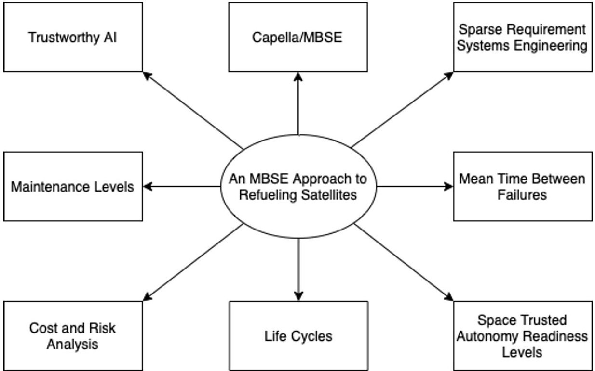

Figure 1 Work Breakdown

## 1.3 Thesis Outline

Chapter 2 of this document discusses a variety of literature regarding space trusted autonomy readiness levels, sparse requirement systems engineering, model-based systems engineering, refueling vehicles, trustworthy AI, and mean time between failures. Chapter 3 goes into detail on the systems engineering and model-based systems engineering approach that was taken to prove feasibility of refueling satellites. In the systems engineering approach section there is discussion of the approach taken to create requirements and life cycle diagrams. The model-based systems engineering section is a discussion of the tool used for this research, including an introduction to Capella, how to go about learning to use the tool, and the current application of the tool in various industries. Chapter 4 presents results of the research. These results include a risk and cost benefit analysis, a table of top-level requirements, life cycle diagrams, maintenance levels for a refueling vehicle, and Capella models for the system. Chapter

<!-- PDF_PAGE: 14 -->

4 also includes a discussion of the result and what was learned in each section. Chapter 5 includes a detailed discussion of the main observations, lessons learned, and my growth in appreciating systems engineering/MBSE. Finally, Chapter 6 concluded the work done in this paper as well as provides recommendations for future work and considerations.

<!-- PDF_PAGE: 15 -->

## Chapter 2: Literature Review

This section summarizes the research completed for this thesis regarding space trusted autonomy readiness levels, sparse requirements systems engineering (SRSE), model-based systems engineering (MBSE), and refueling vehicles. Refueling vehicles is a broad topic, so this paper focuses on current challenges and opportunities in space refueling efforts in the industry.

## 2.1 Space Trusted Autonomy Readiness Levels

Space trusted autonomy readiness levels are a new concept. A ground-breaking article was published in October 2022 [2]. In the past, technology readiness levels (TRLs) have been used to evaluate the state of maturity of space technologies. There are many issues with TRLs when it comes to space autonomy. First, TRLs were initially designed for non-autonomous systems which may have included certain aspects which involved temporal automation (e.g. landing sequence and deployment of a Mars rover). Traditional TRLs don't necessarily focus on information processing but rather size and weight of the system. The quintessential issue is trust[2]. Humans are assumed to be trustworthy. As a result, traditional TRLs don't discuss what it means to be trustworthy. When responsibilities are passed from a human to an autonomous system, there is a lack of trust. TRLs assume that humans are in control, which is not always the case, leading to an autonomous system not being appropriately assessed. Another issue is that an autonomous system will rarely be able to be tested in the exact operating conditions. Humans cannot perfectly replicate the space environment on Earth, and it is seldom feasible to send a prototype into space for testing [3].

Space Trusted Autonomy Readiness (STAR) levels were produced to account for "autonomous capability and trust" [2]. It is important to note that STAR levels are not meant to

<!-- PDF_PAGE: 16 -->

replace TRLs but compliment them. There are 9 STAR levels that all have a defined maturity in regard to assurance, context, implementation, and operation [2]. The authors state "the need to balance readiness levels becomes acute in this two-dimensional representation of readiness" shown in Figure 2 [2]. From this figure, we can see that high trust and low technology readiness leads to overconfidence, while low trust and high technology readiness leads to under confidence. Both are undesirable outcomes.

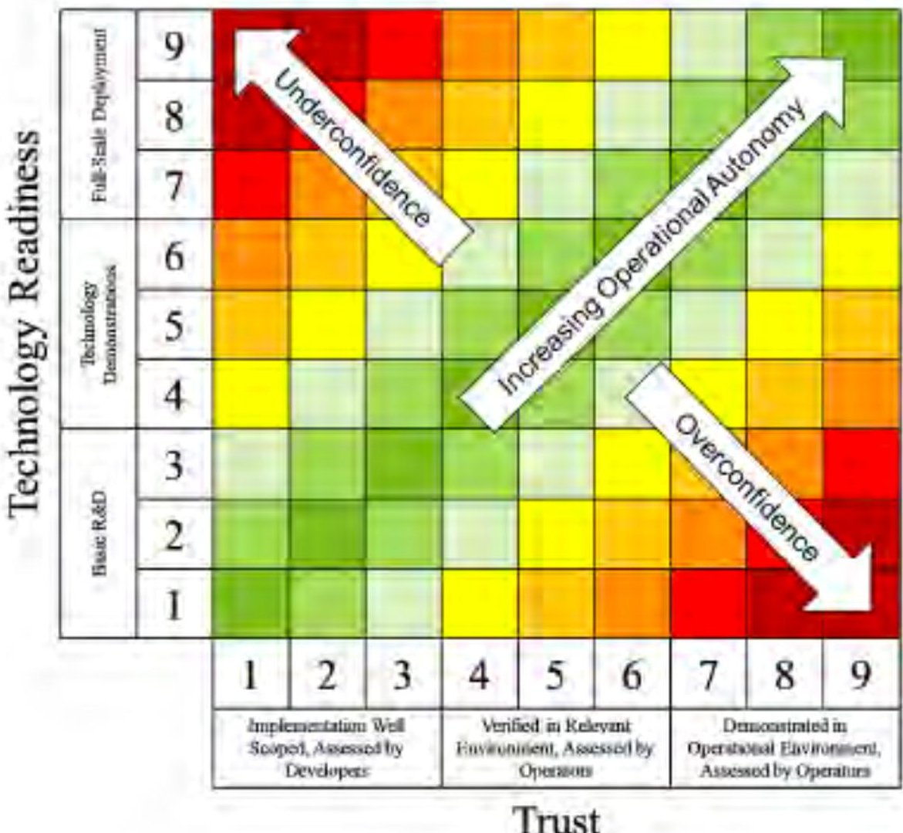

Figure 2 Technology Readiness versus Trust Levels [2]

<!-- PDF_PAGE: 17 -->

## 2.2 Sparse Requirements Systems Engineering

Systems engineering is turning customer needs into system requirements. Those requirements must incorporate cost, performance, and schedule, in addition to how the system will be built and operate. There must be requirements for how the team will verify and validate the system readiness. What happens when the system is not yet fully defined? Waiting for the system to be fully defined might never happen, and waiting will cost the project time and money. Frequently systems engineers are forced to make decisions on projects that are not fully defined. It is important to note that not being fully defined does not mean the systems engineering approach will be inadequate.

Systems engineers must decide how to handle these situations, and frequently they move forward using an SRSE approach [4]. Systems engineering is all about managing risk. SRSE is the "conscious decision to proceed toward system definition, design and procurement before all requirements are fully defined" [4]. This approach moves forward while accepting the risk of potential additional time and costs. In addition to potential time and cost risks, the risk of the fact that the product might not fully meet the design requirements is also accepted. The design is still expected to be sufficient for the project.

When it comes to using SRSE for assured autonomy, there are implications that must be considered. For assured autonomy, in order to train and test the system, you must have a complete set of input data. However, it is impossible to have a fully defined set of input data without having a fully defined system. In addition, there cannot be a set of outputs without a set of inputs. Therefore, using the SRSE approach, there will not be a fully defined set of inputs and outputs. For assured autonomy in learning systems there are even more challenges. The 2015- 2018 Technology Investment Strategy report discusses four challenges concerning assured

<!-- PDF_PAGE: 18 -->

autonomy in learning systems [5]. The state-space explosion, unpredictable environments, emergent behavior, and human-machine interfacing and communication are these four challenges [4].

In a space use case, such as refueling satellites, the four challenges listed above will be prominent. In space, the system will learn continuously and the data it learns will not be filtered or chosen data, leading to state-space explosion. The environment will be very unpredictable. With solar weather events and the various objects the system will encounter, the system will never be able to be tested for every situation. These two challenges lead to the third challenge. As the system encounters more and more situations it wasn't originally tested on, and explores more of a minimally defined environment, unexpected behaviors will emerge that were not seen during testing phases. Lastly, is trust in the system. Since the autonomous system is not fully defined, there will be a lack of human trust. Trust in autonomy is a common theme and one of the more prominent challenges that AI faces today.

## 2.3 Model-Based Systems Engineering

Model-Based Systems Engineering (MBSE) is the "formalized application of modeling to support system requirements, design, analysis, verification and validation activities beginning in the conceptual design phase and continuing throughout development and later life cycles" [6]. The model will typically analyze the life cycle of the system by looking at behavior and performance analysis, simulations and testing, and requirements traceability. The goal of MBSE is to provide traceability, full system understanding, and to automate the design process. MBSE allows for early detection of errors in the system as well as an understanding of how a design change will impact the system.

<!-- PDF_PAGE: 19 -->

Compared to the traditional document-based systems engineering, MBSE can be easily understood by all stakeholders. As with other modeling tools, there is a standard way of doing this within the model which eliminates multiple voices that are commonly seen in document-based systems engineering. Multiple voices leaves room for miscommunication and misinterpretation. Documents can be written by anyone, and everyone has their own voice, their own way of saying things. In MBSE, there is one way to go about modeling a system. MBSE is a language of its own that can be understood by anyone without misinterpretation. Human error is a common reason projects lose time and money. MBSE can help to decrease the risk of human error in systems engineering which will save time and money [7]. The benefits of MBSE can be visualized in Figure 3 [8]. The upfront cost of MBSE compared to traditional systems engineering is greater. This greater cost is due to additional resources being put towards defining the process, infrastructure and training costs, and model development, verification, and curation. However, over time and the course of a full project, MBSE proves to be lower in cost than traditional systems engineering. MBSE allows for early error detections, reuse of the model, overall reduction of risks, improved communication among the team, and more. These are all benefits of MBSE that help to save costs over the course of a project when compared to traditional systems engineering [9].

<!-- PDF_PAGE: 20 -->

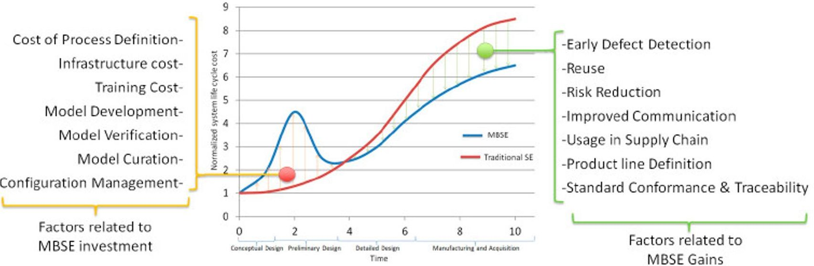

Figure 3 MBSE gains compared to traditional SE [8]

MBSE is considered the future of systems engineering. As systems are becoming more and more complex, systems engineers must seek ways to understand and evaluate the whole system. MBSE is the way to do that. By combining modeling, systems thinking, and systems engineering [6] MBSE allows for recognition of issues that might not have been seen otherwise, provides traceability, understanding, and consistency. In addition, MBSE forces improved communication amongst all stakeholders. All of these benefits that MBSE provides as underscored by Figure 3, will decrease risk and increase trust in autonomous systems.

## 2.4 Concept of Refueling Aerospace Vehicles

Refueling vehicles has been a concept for a long time with the earliest in-air refueling experiment occurring in the 1920s [10]. The concept of in-air refueling has been well known among the aerospace industry, especially with the military applications. With in-air refueling of aircraft, both the aircraft providing the fuel and the aircraft receiving the fuel are flown by

<!-- PDF_PAGE: 21 -->

humans. As discussed above, having that human element allows for an automatic trust in the system. When discussing refueling satellites, both the refueling vehicle and the satellite are not directly controlled by humans which leads to a lack of trust. When humans lack trust, they tend to choose alternative methods that are trustworthy. The goal is to prove trust so that AI can be used for refueling vehicles.

Currently, Lockheed Martin, Northrop Grumman, and Orbit Fab have teamed up to design a refueling vehicle [11, 12]. Together, they are focused on sending a refueling vehicle into Geosynchronous orbit (GEO) [11]. This will be a commercially available design and would cost customers $20 million to refuel their satellites just once [11]. This project is still in the process of being designed but is expected to be launched in 2025 [11].

The Space Force is also designing a system to test on-orbit refueling and servicing [13]. Tetra-5 is a prototype system consisting of up to three spacecraft that will work together to carry out the system missions [13]. The Space Force is using Tetra-5 as a proof of concept [13]. The system will be launched in GEO with the intention to show rendezvous and docking capabilities [13]. The lifespan of the system will only be two years [13].

While refueling satellites is not currently being done, many companies and governments see the benefits of the process. Being able to trust the systems is one of the biggest challenges and will continue to be an issue until the process becomes more understandable. There is a larger focus on the application of GEO orbit refueling vehicles than LEO orbit, but both are being investigated.

Besides trust, there are many challenges to refueling satellites. Safe and successful rendezvous and docking is a big challenge [14]. Each satellite will be different and will need to be connected to in a different way requiring a different approach. A variety of sensors and

<!-- PDF_PAGE: 22 -->

connection points will be needed to ensure safe connection to each satellite. In addition, the space environment is a challenge in itself. Radiation, space debris, drag, and more are all threats to the system [14]. The system needs to be prepared for the hard space environment as well as be able to ensure it maintains a safe distance from other objects. When we are refueling our cars, we rely on a combination of pumps and gravity. In space, we will not be able to rely on gravity to refueling satellites. The simple answer is higher power pumps. These pumps are extremely expensive, so research is still being done to create a lower cost solution [15]. Lastly, as with all new aerospace systems, an issue with refueling satellites is going to be finding a common ground (e.g. finding the standard fuel composition, the standard interface for the connection points, and standards for information security) [14]. Information security will be a big issue when refueling government satellites.

## 2.5 Trustworthy AI

The definition of trustworthy is worthy of confidence [16]. Synonyms for trustworthy are reliable, calculable, responsible, and safe. All words that will describe trustworthy artificial intelligence. There are many definitions for artificial intelligence, but the U.S. Department of State defines AI as "a machine-based system that can, for a given set of human defined objects, make predictions, recommendations, or decisions influencing real or virtual environments" [17]. Trustworthy AI is an important part of refueling satellites. AI will be used to monitor system surroundings to ensure safety of the system, to self-diagnose and heal if anything goes wrong with the system, and so much more. In addition to this, trustworthy AI will allow for more operational flexibility, superior performance, and to be more fault tolerant and continue to operate if the system can guarantee safe and effective operations.

<!-- PDF_PAGE: 23 -->

For all AI systems, having a large, good quality data set to train the AI is crucial [18]. The training data sets the foundation for every decision the system will make for its whole life cycle. Trustworthy AI is accurate, reliable, understandable, and ethical [17]. Understandability is a key component to having trustworthy AI. The algorithm needs to be transparent or, in other words, inspectable [19]. This will allow the user to have confidence in the system, adding to the trust in the AI. One analogy to explain understandable AI is making pizza. To the average person, a pizza shop takes the necessary ingredients and magically your pizza will come out of the oven. There all these unknown variables and processes that aren't understandable. However, with some instructions and a team of experienced people, it is easy to understand how to make the dough, add sauce and toppings, put the pizza in the oven for 15 minutes at 400 degrees Fahrenheit, and then the pizza is done. It is necessary to uncover all these "hidden" connections in order to fully understand the system. Synonymous to the "hidden" connections when making a pizza, AI tends to have hidden neural networks that make the system hard to understand and trust. Just like with the pizza, AI can become understandable, and trustworthy, with a transparent algorithm and a knowledgeable team. When we can create understandable AI, trust will follow close behind.

Bias is one of the biggest challenges in creating trustworthy AI [19]. Bias is present in every human made thing, including AI algorithms. Typically, bias is introduced in the training data [18]. As mentioned above, AI needs a large data set to train from. In order to get a large data set, values are typically created by humans which can unconsciously add bias to the system. While bias is still an ongoing issue, one way to help mitigate harmful biases is to have a very diverse team working with the system [19]. A team of all different educational, cultural, and

<!-- PDF_PAGE: 24 -->

political backgrounds can help to minimize bias. Trustworthy AI will also allow for more people to be able to modify and work with the algorithms, opening the door for a diverse team.

AI is the future of so many industries, including aerospace. AI will help cure cancer, allow for better protection of our country, allow for safer travel, and so much more. However, until the challenges of creating understandable AI are addressed, there will be hesitation to using AI [20].

The natural step after refueling satellites is fixing satellites in space as detailed in Figure 4 [21]. While fuel typically is the limiting factor for a satellite's lifespan, there are many other reasons satellites retire early. Repairing satellites in space would be beneficial in similar ways as refueling. There will be challenges to repairing satellites in space. Current satellites are not built with the intention of being repaired which could prove to be difficult for servicing vehicles to access necessary systems needing repair. Future satellites will need to be designed with in orbit servicing and refueling in mind.

<!-- PDF_PAGE: 25 -->

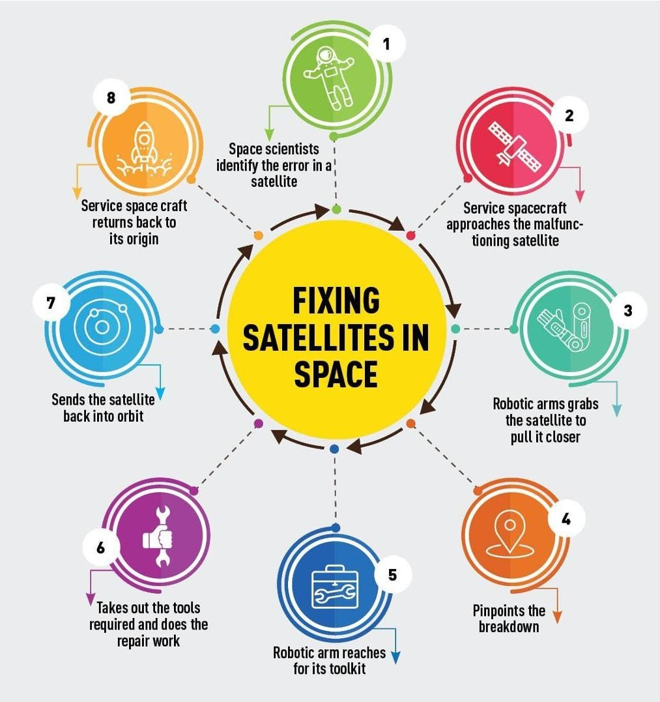

Figure 4 Fixing Satellites in Space [21]

## 2.6 Mean Time Between Failures

Mean Time Between Failures (MTBF) is "the average time between system breakdowns" [22]. MTBF is critical in assessing the reliability of a system [22]. Since this is a measurement of failures, MTBF does not take regularly scheduled maintenance into account.

(1) 

MTBF is calculated based on historical data of the part [22]. To get the most accurate MTBF, it is recommended to test parts rather than relying on the manufacturers MTBF values [22] Calculating MTBF allows for engineers to anticipate failures before they happen. This also helps to determine when subsystems need replaced or software updates need to be done. This

<!-- PDF_PAGE: 26 -->

anticipation of failures will help to reduce unanticipated failures which will save time and money.

MTBF can be calculated for a whole system, individual subsystems, all the way down to individual parts [22]. By doing this, it can be easier to determine weak links in the system. MTBF analysis can also help to make decisions. For example, if a team is deciding between two parts, one expensive and one cheaper, MTBF can help determine if the cheaper one will actually save money. If the cheaper part needs replaced very frequently, it will most likely cost more to continuously buy a new part and replace it.

MTBF is the combination of mean time to failure (MTTF) and mean time to repair (MTTR) [23]. MTTF is the time leading up to the first failure of the system. It is not uncommon for some systems to have a MTTF greater than the replacement rate [23]. This means that for a certain system, that part is not expected to fail before the typical lifespan of the system is complete. MTTR on the other hand is from the time the system fails to the time it is fixed and working again. It is important to understand that MTBF assumes that the systems will continue to operate as if it is in its useful lifespan [24]. MTBF calculations do not take into account failures outside of the system lifespan, so it is the responsibility of the engineer to understand that this is the case [24].

<!-- PDF_PAGE: 27 -->

## Chapter 3: Methodology

This chapter discusses the approach taken to obtain requirements and models for this project. The thought process behind developing requirements and system life cycle diagrams as well as how each MBSE model was developed from those requirements. The analysis for this system only focuses on the high-level requirements and systems and does not go into detail on each subsystem.

## 3.1 Systems Engineering

Refueling vehicles and satellites are systems that are in the process of or are already designed. The subsections below will discuss how requirements were developed from initial design to disposal, and how requirements and life cycle research was done to determine safety constraints as well as typical timelines for projects. It is important to note that requirements will need to be adjusted as customer needs change. The full systems engineering process in shown in Figure 5 [25]. Circled in red are the area of the systems engineering process that this work is focused on.

<!-- PDF_PAGE: 28 -->

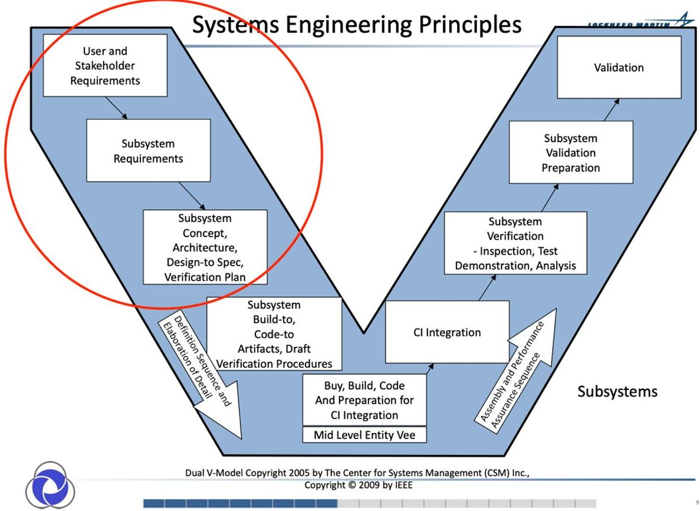

Figure 5 INCOSE Systems Engineering Principles diagram depicting where this project fits into the whole process [25]

## 3.1.1 Requirements

Before developing a set of requirements, the stakeholders must be defined. For this system the stakeholders are listed below.

- Customer: In this case, it is assumed that the customer will be a private company (not the government). This customer will want its project to be successful.

- Government: While the government isn't the direct customer, the success of this project is important for future government projects and designs. Refueling satellites will have numerous government/defense/military applications.

<!-- PDF_PAGE: 29 -->

- Manufacturers: The companies that manufacture and assemble the system will want the system to be successful and perform as expected. They will want to ensure the parts and assembly meet expectations and do not fail.

- Control Center: The engineers and scientists on Earth that are responsible for communicating to the system. The control center will also be responsible for intermediate level maintenance.

- International Space Station: The engineers and scientists on the ISS are responsible for depot-level maintenance.

The first step was determining expected cost, timeline, lifespan, and weight. These values were estimated through research on average costs and timelines for developing satellites. The system design cost, launch cost, and system weight were estimated based on the OSAM 1 on- orbit servicing vehicle concept [26]. OSAM 1 is a refueling vehicle that would launch to low earth orbit (LEO) [26].

In order to create system requirements, it was important to consider what type of things could threaten the system. The design must account for the environment that the system will operate in. The main threats to the system in its operational environment are radiation, charged particles, collision with other objects in space, and gravity. These threats along with customer defined needs are what drive the capabilities of the system. However, not all requirements are made to account for potential threats. A lot of requirements are written to simply meet customer needs. The customer determined that this system needs to be able to safely connect with satellites, to be able to travel in any direction, to transfer fuel from its own fuel tank to the fuel tank of the satellite, etc.

<!-- PDF_PAGE: 30 -->

After determining capabilities, subsystems were identified to meet necessary capabilities. These subsystems include a tether to connect to satellites, a propulsive system to control speed and direction, an AI control system to monitor proximity to other objects, radiation levels, the ability to communicate with the control center, to self-diagnose any issues based on an elaborate prognostics and heath management system, and a fuel tank to store fuel as well as transfer the fuel from the tank to the satellite. Note that transfer of fuel in a zero-gravity environment has its own unique set of challenges. The goal of the requirements for this utilization phase was ensuring safety, to make sure that if the system senses danger, it can protect itself.

The proximity awareness is an important subsystem for ensuring safety. If the system is within one kilometer of another object, the system will slow down and either wait for the object to return to a safe distance away or the system will change its velocity to move away from the object [27]. This is similar to how a turtle reacts to danger. If a turtle senses danger, it will go into its shell and wait for danger to pass or it will move in the opposite direction of the danger. This proximity awareness will not only be important during travel to satellites but will also be important while ensuring safe connection to satellites. This proximity awareness is also important to ensure the system can safely connect with satellites. A run time assurance system may be utilized to provide this additional layer of safety [28].

Radiation in space can be extremely dangerous to spacecraft. Unsafe radiation levels can cause electronic failures or single event effects [29, 30]. To protect against radiation levels in the atmosphere, solar weather probes are used to measure radiation levels in the systems surrounding environments. If these probes detect an increased amount of radiation, the electronics will enter a safe mode. This safe mode will protect our electronics from single event effects as well as any other damage from radiation. In addition, the system electronics will be radiation hardened to

<!-- PDF_PAGE: 31 -->

protect from the normal amount of radiation the system will encounter day to day [30]. It is useful to note that LEO satellites tend to experience less radiation than satellites in MEO or GEO orbits [31]. For a refueling vehicle in GEO, different parameters may need to be considered.

Another important feature that needed to be incorporated into this system is self-diagnostic and healing capabilities. The system is expected to run diagnostic tests frequently and report any errors back to the control center. This is a necessary feature because if something goes wrong, it is crucial to understand and mitigate the problem immediately. If the system cannot solve the problem itself, it must rely on the control center or the ISS to fix the problem. In present times, cybersecurity is also a huge problem for every system. The regular diagnostic tests will be able to identify changes in the software which could indicate a cyber-attack to the system. This change would be reported to the control center for further investigation.

All of the above necessary capabilities interact with the AI control system. In order to set an expectation for the system AI, a STAR level and TR level was chosen [32]. These levels were chosen based on customer needs and expectations for the design and testing stages. As discussed in the literature review, space trusted autonomy readiness levels and technology readiness levels help to define the understandability and trust of the system AI as well as the expected role of the AI. These levels define how much control the AI will have over the system and the extent of human involvement.

Lastly, the system will eventually reach the end of its lifespan. There must be a plan in place for what happens to the system when it has reached this end. The system will return to the International Space Station where the system parts will be recycled. At this point, it is possible for the system parts to be upcycled into a new refueling vehicle to be sent out to continue the mission. This concept will be discussed more in the future work section.

<!-- PDF_PAGE: 32 -->

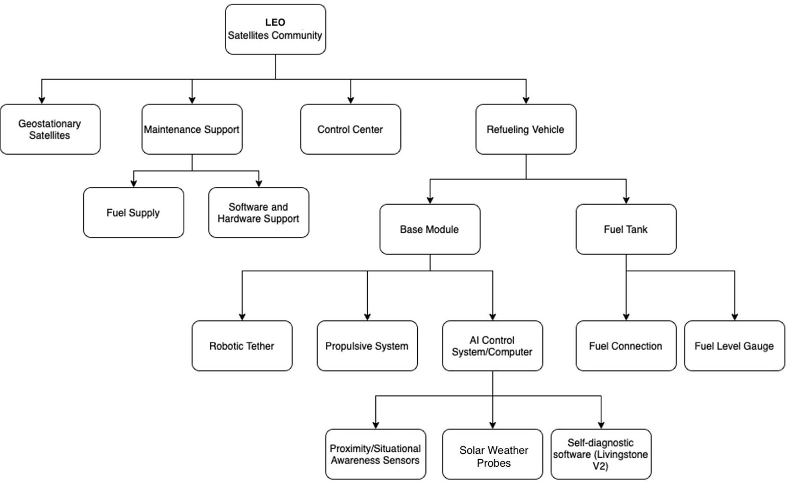

Figure 6 System Structure Breakdown

## 3.1.2 System Life Cycle

The system life cycle can be broken down into 4 areas discussed further below. These 4 areas help to break down and organize requirements.

- Design: From initial concept to prototype testing and iterative design processes

- Production, Verification, and Test: Prototype testing is complete. The system is being manufactured and assembled. The system is going through verification and validation testing. Launch preparation and testing are also done during this part of the life cycle.

<!-- PDF_PAGE: 33 -->

- Utilization: The system is assembled and is ready to be launched. Once the system is launched, it will enter its intended orbit. This phase is the main day to day mission of the system, including all of its necessary functions objectives.

- Disposal: After the system mission is complete, or the system has reached the end of its lifespan. This is how to system will be retired.

Defining the system life cycle allows for the stakeholders to have clear expectations of the mission from initial design to the retirement of the system. A life cycle diagram is a clear and understandable way to present this information. Most people tend to focus on their part of a specific project. Life cycle diagrams allow the team to see how each part of the life cycle of the system plays into the bigger picture.

While the system will have a full life cycle, it is important to discuss the day to day cycle the system will complete. This cycle is from the time the system receives a satellite location that needs to be refueled to the time that the refueling process is over and the system returns to the base module. The cycle will be much shorter and repeated frequently until the system reaches the end of its lifespan.

## 3.2 Model-Based Systems Engineering

There are a variety of tools that can be used for model-based systems engineering. However, the goal is the same, to create an understandable, comprehensive model of the system. This model will provide traceability as well as a visual representation of how all the subsystems work together. Often, engineers focus on their specific part of a project, but in order to design an efficient system that meets all customer needs, it is necessary to look at the bigger picture.

<!-- PDF_PAGE: 34 -->

Looking at how each design change will impact the whole system is also critical for the safety of the system.

## 3.2.1 Tool Introduction

For this project, Eclipse Capella $ ^{\mathrm{TM}} $ was used to create models [33]. Capella was created by Thales in 2007 and is an open-source program that provides a user-friendly way to utilize MBSE [33]. The organization and architecture of Capella allows for the user to work on multiple diagrams at once while still maintaining that connectivity of a single component. For this project, the system description and requirements were very high level. In the Capella models, the organizational and systems level diagrams were utilized. When transitioning from the organizational level down to the systems level, all the capabilities, activities, and actors were transitioned allowing for a connection. If a change is made in one diagram, that change is automatically applied to all diagrams the entity is involved in. MBSE allows for consistency which minimizes error.

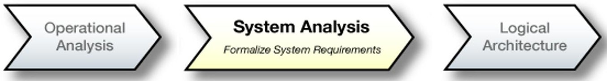

Figure 7 Capella Model Levels

There are several benefits to using Eclipse Capella $ ^{\mathrm{T M}} $ . While it was mentioned above, it is a huge benefit that Capella is open source. Many MBSE tools are expensive to use, making it hard for companies to implement on a large scale. Open-source programs, such as Capella, also have forums and lots of tools to help people learn the software [34]. Eclipse Capella $ ^{\mathrm{T M}} $ has numerous training materials to help users learn and feel confident in using the software [34]. The

<!-- PDF_PAGE: 35 -->

training material courses that Capella offers are free and very informative. These courses, along with the general layout of Capella, make this program a user-friendly software that even beginners can use. Figure 8 shows the general layout of Capella [35]. The layout is organized and well thought out, making it very user friendly and easy to learn. Capella using color coding to further the user-friendly interface. The color code is shown in Figure 9 which shows that with a simple glance, the user can determine what they are looking at [35]. This user focused software is why so many companies are using Capella MBSE solutions [36].

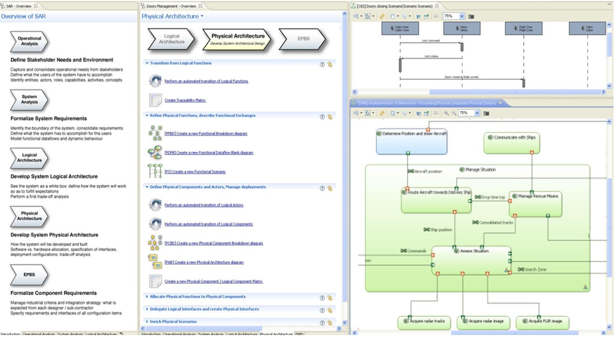

Figure 8 Capella layout with example system [35]

<!-- PDF_PAGE: 36 -->

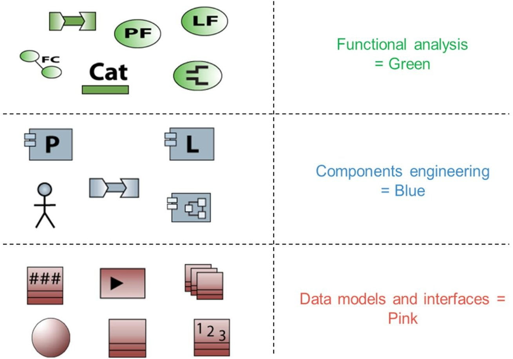

Figure 9 Capella color coding [35]

## 3.2.2 Applications of Capella in the Industry

Due to the many benefits, many organizations use the Capella MBSE software. Some of these organizations include, ThermoFisher Scientific, Siemens, Embraer, and Rolls Royce [36]. Capella has a prominent impact on the aerospace engineering industry and the engineering profession as a whole. A variety of universities across the world also use Capella [36]. The Capella website highlights over 50 companies and universities currently using its MBSE solutions [36].

Capella highlights case studies of companies using its software, many of which focus on the uses of Capella in the aerospace or AI industries. Rolls Royce is one company that is highlighted for its use of Capella. Rolls Royce used Capella to integrate requirements, define

<!-- PDF_PAGE: 37 -->

system architecture, and integrate the safety process of a power gearbox[37]. Originally, Rolls Royce wanted to only model the power gearbox, but ended up modeling the whole engine [37]. While modeling the whole engine would be very complex, Capella allowed for the system to be brown down into layers, from the oil system all the way up to the whole aircraft [37]. The software made this complex system manageable and understandable to all stakeholders.

Another case study was done on Train Autonome - Service Voyageurs, an autonomous passenger train project [38]. This project is a combination of work done by Bombardier, Robert Bosch, Railenium, SNCF, SPIROPS, and Thales [38]. This project has a lot of the same challenges as refueling satellites does. A few of similar challenges are proving safety of AI, cybersecurity, collision avoidance, and communications [38]. In this project, Capella was used to create a system that met the needs of all involved companies, defined the responsibilities of each stakeholder, and was later used to justify design decisions [38]. The model is still largely being used for validation and verification as well as safety analysis [38].

The last case study that will be discussed in this thesis is a Space Variable Object Monitor (SVOM) that is being developed by CNES, the French space agency [39]. Capella was used for this project to fully understand and incorporate the system architecture and how the system would be validated. Part of the model as well as the system is shown in Figure 10 [39]. CNES concluded that MBSE and Capella were worth the investment by providing numerous benefits to the project [39].

<!-- PDF_PAGE: 38 -->

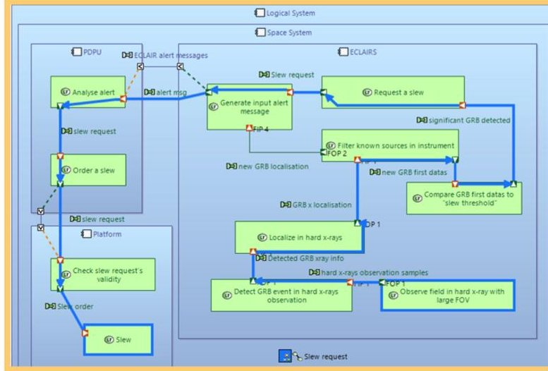

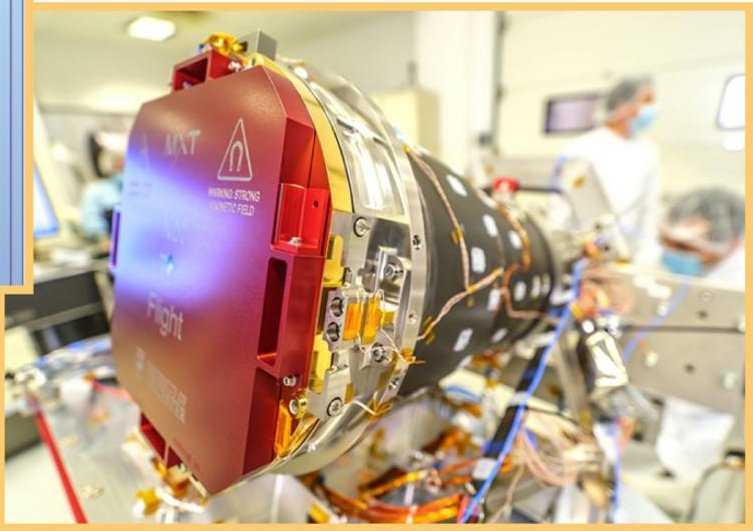

Figure 10 CNES Capella Model Example [39]

<!-- PDF_PAGE: 39 -->

## Chapter 4: Results and Discussion

This chapter presents results based on research of refueling vehicles. These results include cost and risk analysis, top-level requirements, life cycle diagrams, logic diagrams, and MBSE models. These results are meant to show the benefits of refueling vehicles as well as the systems engineering approach to designing and utilizing the system. A discussion of the results is also included in each section.

## 4.1 Benefits of Refueling

When a car runs out of gas, does the driver leave it on the side of the road and go buy a new car? No, the driver brings the car to the gas station, fills it up with gas, and continues to drive the car. While refueling satellites is not as simple as putting gas in a car, the benefits are very similar, extending lifespan and saving time and money.

For years, engineers have been designing and launching satellites into space. Typically, once the satellite is up in space, it stays up there. The limiting factor of a satellite's lifespan is frequently fuel. Most satellites are in great condition and in working order aside from the fact that they have ran out of fuel. After a satellite runs out of fuel, engineers send up a new satellite to replace it. Launching a new satellite is a risky and expensive process. Rather than spending time and money to send a new satellite, why not refuel a perfectly good satellite that is already there?

## 4.1.1 Risk

Refueling satellites reduces the riskiest part of a satellite life cycle, launch. The average failure rate for launching satellites is 6.1% [3]. While launch isn't the only risk that a

<!-- PDF_PAGE: 40 -->

satellite encounters, it does impose a great risk as well as potential loss of money. Engineers design satellites and launch them to space. For every 100 satellites launched, more than 6 of those won't even survive the trip to space. A refueling and servicing vehicle will greatly reduce the number of satellites needing to be launched into orbit. Rather than risking a launch of a new satellite, current satellites already in orbit can be refueled, extending their lifespans. In 2017, there were 91 space vehicles launched and 7 of those were failures [3]. Trends show that this rate isn't getting better. The rate has been pretty steady since the early 2000s.

% Launch Vehicle Failure

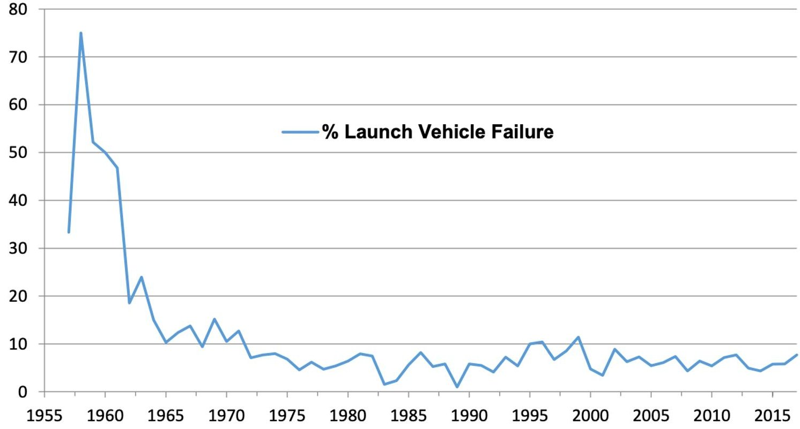

Figure 11 Launch Vehicle Failure Rates by year [3]

## 4.1.2 Cost

While designing, manufacturing, and launching a refueling vehicle is expensive, the system will save money in the long run. Intuitively speaking, a refueling vehicle will mean fewer satellites need to be launched each year. Minimizing launches by itself saves money. This also

<!-- PDF_PAGE: 41 -->

reduces the risk of failures, which was discussed above. When a satellite launch vehicle fails and a satellite is lost, all the time and money that went into designing, manufacturing, and launching that satellite is now wasted. The stakeholders will need to start all over and spend more money to design, build, and launch a whole new system.

Fuel is typically the limiting factor for a satellite's lifespan [40]. As a result, satellites will be launched with as much fuel as it can fit. Once the satellite runs out of fuel, the mission is over. However, with a refueling vehicle, satellites will be able to be launched with a lot less fuel. There would no longer be a worry of running out of fuel because the satellite will be able to get more when fuel levels get low. Being able to launch with less fuel will lower launch weight. Lowering launch weight will significantly decrease costs. According to NASA, launch costs are $10,000 per pound of payload [41]. While NASA and other launch vehicle agencies are trying to lower this cost, payload weight will continue to be a major factor in launch costs.

A study, published in the Journal of Space Safety Engineering, was done to analyze the benefits of a refueling vehicle versus sending up a new satellite to replace the Landsat 7 [18]. Landsat 7 is an observation satellite in low earth orbit (LEO) [18]. Originally the satellite had a lifespan of only 5 years, but 22 years later Landsat 7 is still operational and waiting for either a replacement or to be refueled. After a cost analysis of a replacement satellite and a refueling vehicle, the authors determined that a refueling vehicle would save over $260 million [18]. Most of this cost difference comes from the cost to manufacture the satellite versus the refueling vehicle. The cost breakdown from the article is shown in Figure 12 [18].

<!-- PDF_PAGE: 42 -->

<table border="1"><tr><td></td><td>Replace</td><td>Refuel</td><td>Δ Cost</td></tr><tr><td>CManu</td><td>$517M</td><td>$227M</td><td>$290M</td></tr><tr><td>MLaunch(kg)</td><td>2623</td><td>6500</td><td>-</td></tr><tr><td>CLaunch</td><td>$19.01M</td><td>$47.10M</td><td>$28.09M</td></tr><tr><td>CTotal</td><td>$536.01M</td><td>$274.10M</td><td>$261.91M</td></tr><tr><td>Benefits</td><td>Improved satellite technology</td><td>Current Landsat 7 technology &amp; additional OSAM 1 operations</td><td>-</td></tr></table>

Figure 12 Cost Analysis of Replacing Landsat7 versus creating a Refueling Vehicle taken from [18]

While this above cost benefit analysis is only one study, it shows that there is a significant cost benefit to refueling satellites rather than continuously replacing perfectly good satellites that are already in orbit. New satellites will continue to be produced. Technology will advance, and engineers will want to incorporate that new technology onto new satellites. The goal is for new satellites to be launched because they are significantly more advanced, not because a perfectly good satellite ran out of fuel and can no longer perform its mission.

## 4.2 System Requirements

Below are top level requirements for a refueling vehicle. The requirements are organized into phases. The utilization phase is further broken down into system capabilities. These requirements would need adaptation for each refueling vehicle as every project has different needs as well as timelines. For this application, it was assumed that the system would be launched into low-earth orbit (LEO) and is to be used for nonfederal applications. If the system

<!-- PDF_PAGE: 43 -->

were to be adapted for federal or government applications, security specifications would need to be adapted accordingly. This use case is a system that will refuel satellites in LEO. The system needs to utilize trustworthy AI, maintain communication with the control center located on Earth, maintain safety in its operating environment, transfer fuel from itself to a satellite, travel through space and rendezvous with other systems, have self-diagnostic and healing capabilities, and follow proper disposal instructions. Various requirements were made based on standard design processes in the aerospace industry and other companies also creating refueling vehicles. OrbitFab started their refueling vehicle in 2018 and expect to launch in 2025 [42]. This 7-year timeline was assumed to be a reasonable timeline for the use case discussed in this thesis.

The template for the requirements derived for this system was self-designed. This format was the best way to organize the information and results. The "Phase" column follows the phases in the life cycle diagram discussed directly after this in Chapter 4.2.1. The "Number" column is a value given to each requirement for traceability purposes. The "Requirement" column states the requirement corresponding to the number given. Lastly, the "Validation" column shows how each requirement will be validated. A key, shown in Table 1, provides a description of each validation method. Verification and validation is a challenge with autonomous space vehicles. It is hard to replicate the operating conditions of space. One way to help mitigate this challenge, a digital twin can be used [43]. A digital twin allows testing of the system without having to actually use the system. Using digital twins allows for engineering to perform V&V on the system before it is launch into space.

Table 1 Requirement Verification Method Key

<table border="1"><tr><td>Validation Method</td><td>Description</td></tr><tr><td>Demonstration</td><td>A physical meeting or test run by humans to show information or processes meets requirements</td></tr></table>

<!-- PDF_PAGE: 44 -->

<table border="1"><tr><td>Flight Test</td><td>A physical test done in a zero-gravity artificial environment on Earth</td></tr><tr><td>Ground Test</td><td>A physical test done on Earth, not necessarily in an environment simulated to be like operating conditions</td></tr><tr><td>Simulation</td><td>A computer run test that cannot be physically tested in an artificial environment</td></tr></table>

Table 2 System Requirements for Refueling Vehicle

<table border="1"><tr><td>Phase</td><td>Number</td><td>Requirement</td><td>Validation</td></tr><tr><td>Design</td><td>1.1</td><td>The design team shall have a PDR and SRR presentation and meeting before starting any testing or construction</td><td>Demonstration</td></tr><tr><td></td><td>1.2</td><td>The team shall have a CDR presentation and meeting before final design is decided upon</td><td>Demonstration</td></tr><tr><td></td><td>1.3</td><td>The system shall be designed and built in 7 years</td><td>Demonstration</td></tr><tr><td></td><td>1.4</td><td>The system shall have a digital twin for testing and simulation purposes</td><td>Demonstration</td></tr><tr><td></td><td>1.5</td><td>The design team shall consist of experts in the AI field</td><td>Demonstration</td></tr><tr><td>Production and Testing</td><td>2.1</td><td>The system shall cost no more than $230 million to manufacture</td><td>Demonstration</td></tr><tr><td></td><td>2.2</td><td>The system shall weigh no more than 6500kg[18]</td><td>Ground test</td></tr><tr><td></td><td>2.3</td><td>The system shall cost no more than $50 million to launch to LEO[18]</td><td>Demonstration</td></tr><tr><td></td><td>2.4</td><td>The system shall be designed and tested to a STAR Level 7[2]</td><td>Simulation</td></tr><tr><td></td><td>2.5</td><td>The system shall be designed and tested to TrRL Level 8[2]</td><td>Simulation</td></tr><tr><td>Utilization</td><td>3.1</td><td>The system shall be able to provide service to all satellites as requested by the mission control center</td><td>Simulation</td></tr></table>

<!-- PDF_PAGE: 45 -->

<table border="1"><tr><td></td><td>3.2</td><td>The system shall be able to locate given satellites and navigate to the satellite in a fuel-efficient manner</td><td>Simulation</td></tr><tr><td></td><td>3.3</td><td>The system shall provide continuous feedback to control center during and after fueling</td><td>Ground Test</td></tr><tr><td>AI</td><td>3.4</td><td>The system will have a human centered AI system to enable it locate or refuel satellite and perform all tasks until intermediate level maintenance and astronauts in ISS for depot maintenance</td><td>Simulation</td></tr><tr><td></td><td>3.4.1</td><td>The system shall utilize trustworthy AI to enable fault tolerance</td><td>Ground Test</td></tr><tr><td></td><td>3.5</td><td>System software updates shall be applied to the system immediately after verification and validation testing is deemed complete</td><td>Ground Test</td></tr><tr><td>Safe connection</td><td>3.6</td><td>The system shall be able to safely connect with given satellite and conduct refueling operation</td><td>Simulation</td></tr><tr><td></td><td>3.6.1</td><td>The system shall have 8 thrusters to provide 6 DOF [44]</td><td>Flight Test</td></tr><tr><td></td><td>3.6.2</td><td>The system shall provide continuous feedback to control center during and after fueling</td><td>Ground Test</td></tr><tr><td>Proximity Awareness</td><td>3.7</td><td>The system shall continuously use proximity sensors and a run-time assurance system to determine if objects are less than 1 kilometer away [27]</td><td>Flight Test</td></tr><tr><td></td><td>3.7.1</td><td>The control center shall monitor space object locations and give coordinates to system</td><td>Simulation</td></tr><tr><td>Space Weather</td><td>3.8</td><td>Solar weather probes shall constantly monitor space weather conditions and radiation levels</td><td>Flight Test</td></tr><tr><td>Space Weather</td><td>3.9</td><td>The system shall put electronics into “safe mode” when there is increased radiation in the environment</td><td>Ground Test</td></tr><tr><td>Space Weather</td><td>3.10</td><td>The system electronics shall be radiation hardened to protect against radiation levels</td><td>Ground Test</td></tr><tr><td>Space Weather</td><td>3.11</td><td>The system shall perform a reboost maneuver if there are increased drag forces</td><td>Flight Test</td></tr><tr><td>Cyber Attacks</td><td>3.12</td><td>System shall be compliant to NIST 800-171: Protecting Controlled Unclassified Information in Nonfederal Systems and Organizations [45]</td><td>Ground Test</td></tr></table>

<!-- PDF_PAGE: 46 -->

<table border="1"><tr><td>Self-Diagnostic Capabilities</td><td>3.13</td><td>The system shall continuously self-monitor and diagnose any failures and decide on operating at a fault tolerant mode if it can guarantee safe and effective operations</td><td>Ground Test</td></tr><tr><td></td><td>3.13.1</td><td>The control center shall be available to respond to any failure in less than an hour from detection</td><td>Demonstration</td></tr><tr><td></td><td>3.14</td><td>The system shall travel at a velocity of no more than 6 cm/second while docking with satellites[46]</td><td>Flight Test</td></tr><tr><td></td><td>3.15</td><td>The system shall be able to transfer fuel to a satellite</td><td>Simulation</td></tr><tr><td></td><td>3.15.1</td><td>The system shall utilize a nozzle tool to transfer fuel to satellite[47]</td><td>Simulation</td></tr><tr><td></td><td>3.15.2</td><td>The system shall calculate the amount of fuel and fueling time for each satellite given fuel tank size given by the control center</td><td>Ground Test</td></tr><tr><td>Disposal</td><td>4.1</td><td>The system lifespan shall be 10 years[48]</td><td>Simulation</td></tr><tr><td></td><td>4.2</td><td>At completion of the mission,the system shall return to the International Space Station</td><td>Simulation</td></tr><tr><td></td><td>4.3</td><td>Scientists on the ISS shall recycle parts from the system</td><td>Demonstration</td></tr><tr><td></td><td>4.3.1</td><td>Recycled system parts shall be upcycled to create a new refueling vehicle</td><td>Simulation</td></tr><tr><td></td><td>4.3.2</td><td>Any parts that cannot be upcycled shall be replaced with new parts sent from Earth</td><td>Simulation</td></tr></table>

## 4.2.1 System Life Cycle

Below there are two cycle diagrams. The first diagram is a life cycle diagram that is broken up into four sections: "Design", "Production, Verification, and Test", "Utilization", and "Disposal". This life cycle diagram is helpful is showing the start to finish of the refueling system. The diagram allows for stakeholders to see where their parts fit into the overall plan. The life cycle diagram is also helpful in making sure everyone is on the same page with how the system will operate.

<!-- PDF_PAGE: 47 -->

In this diagram, the stakeholders can see the order of events. Starting with preliminary research and moving through the major design phases of preliminary design reviews (PDR), systems readiness reviews (SRR), conceptual design review (CDR), and finally to testing the approved design. It is important to note that this design phase is an iterative process itself. After PDR, it is common to have to go back to preliminary research and design phases. It is not uncommon to have to make revisions and have a second CDR. While this iterative process is not shown in this life cycle diagram, it is expected to have to make revisions and have setbacks throughout the initial design phase.

The next phase of this diagram is production, verification and testing. In this phase, the project is going through production. As the system is being produced and assembled, the parts must be tested to ensure they are of expected quality. During this phase, launch preparations are also being conducted.

Utilization is the next phase of the diagram. This is where the system is launched into space and enters its intended orbit. After the system is in orbit, it can begin carrying out its mission. The day to day operation of the system will be a cycle of itself. This cycle is also broken down in a separate diagram, shown in Figure 14. This day to day cycle will consist of a variety of tasks. First, the control center will communicate to the system a location of a satellite that needs refueled. After receiving this location, the system will begin to travel to the given location, making sure to monitor its surroundings for other objects and increased radiation. The system will perform a rendezvous maneuver and then connect with the satellite. After a successful connection, the system will transfer fuel to the satellite and then disconnect. The satellite will then travel back to its "home" orbit or location and wait for another location to be assigned. While traveling back, the system will continue to monitor its surrounding for other

<!-- PDF_PAGE: 48 -->

objects and increased radiation. This process will continue to repeat for the entirety of the system lifespan. When the end of the system lifespan is near, the system will prepare for disposal.

Finally, the system will reach the disposal phase. This is when the system's lifespan is reaching the end. The system will return to the International Space Station (ISS) where engineers onboard the ISS will recycle the system parts.

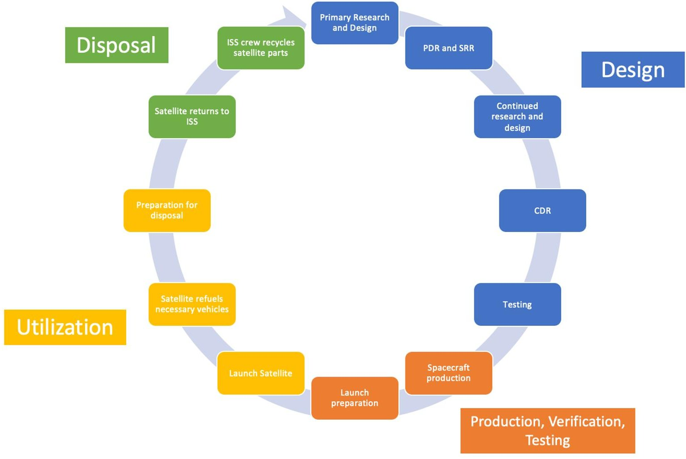

Figure 13 Life Cycle Diagram for Refueling Vehicle

<!-- PDF_PAGE: 49 -->

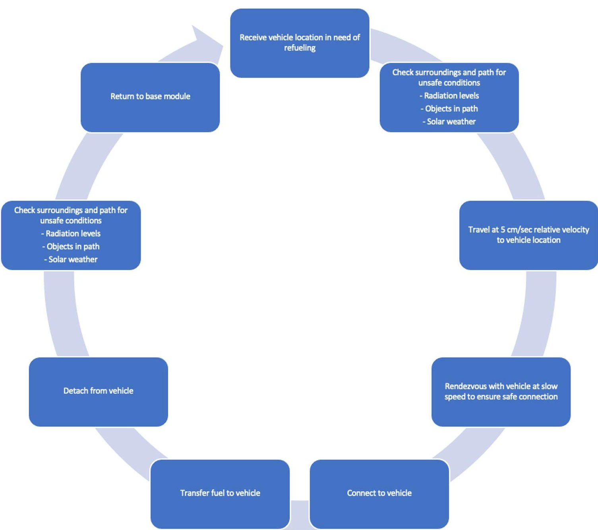

Figure 14 Mission Cycle Diagram for Refueling Vehicle

In addition to life cycle diagrams, a flow chart was created to show the decision-making process of the system. This flow chart is helpful in seeing how the system will respond to danger, whether these is a risk of a possible collision or an increased amount of radiation. The chart also shows the communication processes of the system to the control center. The diagram helps to show the decision-making process that the system will go through during the utilization phase of its life cycle.

<!-- PDF_PAGE: 50 -->

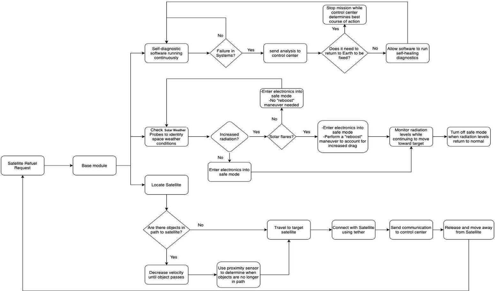

Figure 15 System Decision Making Process Flow Chat

## 4.2.2 Maintenance Levels

As with any system, a refueling vehicle will require maintenance occasionally throughout its life cycle. Maintenance levels discuss the expectation for the system depending on the maintenance needs. The three levels are operational, intermediate, and depot-level [49] Operational level maintenance is typically for routine maintenance, software updates, and for small issues found during flight [49]. Intermediate level maintenance is slightly more serious. This level is more involved and requires additional inspections and repair [49]. The final level is depot-level maintenance. This level is when extensive repairs are needed or when whole subsystems need to be replaced [49].

<!-- PDF_PAGE: 51 -->

These maintenance levels will have different specifications and required actions for each system. However, the following recommendations are just for the system discussed in this paper. If an organizational level of maintenance is required, the system will use its self-diagnosis and self-healing capabilities and will happen autonomously. This will include situations such as scheduled software updates, inspections, and potential cyber-attacks. For an intermediate level of maintenance, humans at the control center located on Earth will need to take partial or potentially full control of the system to repair any problems. This could include cyber-attacks that impact major subsystems or radiation damage to parts of the electronic system. Lastly, for a depot-level of maintenance, the system will return to the International Space Station for repairs. Engineers and scientists on the ISS will be trained and equipped with necessary materials in order to complete depot maintenance. This level of maintenance will include much more serious issues with the system including the loss of a booster or subsystem that sustained damage from a collision.

Mean Time Between Failure was discussed above. For the purposes of this research, MTBF values are being estimated for the system as a whole but not individual subsystems or parts. A paper from the Journal of Navigation estimates the MTBF values which are shown in the figure below [50]. The chart characterizes different types of failures for a variety of GEO satellites. This paper noted that GEO satellites had more failures than MEO orbit satellites, so using GEO MTBF values is a safe option [50]. The first type of failure is short-term failure which is defined as repairable failures [50]. The second type is maintenance failure which is defined as satellite maneuvering failures [50]. The third type of failure is long-term failure which is defined as a failure that won't occur for twice the satellite's lifespan [50]. The paper also discusses equivalent failures of '1' and '0'. An equivalent failure of 1 is a failure that is a

<!-- PDF_PAGE: 52 -->

combination of short-term and maintenance failures [50]. On the other hand, an equivalent failure of 0 is a failure that is a combination of all three types: short-term, long-term, and maintenance [50]. Figure 16 below shows the MTBF values for the various satellites researched in that paper.

LIHONG FAN AND OTHERS

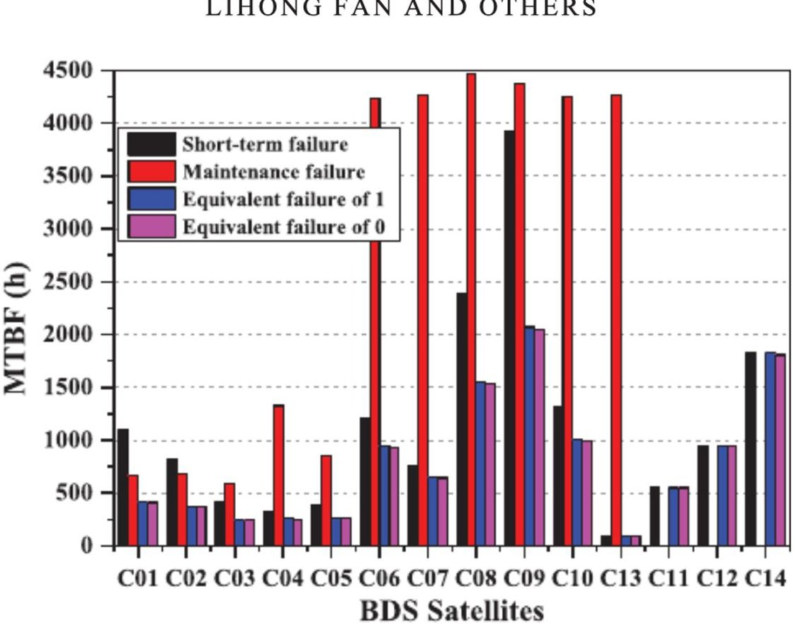

Figure 16 MTBF rates of BDS Satellites taken from [50]

## 4.3 MBSE Models

Eclipse Capella was used to create MBSE models. These models were kept high-level and focused on requirements. Organizational and Systems models were created. This section will explain and discuss the meaning of each model as well as how the models were created. To start, the system was broken down into its major subsystems: solar weather probe, proximity sensor, propulsion system, computer with trustworthy AI, fuel tank, and a robotic arm. Next, the control

<!-- PDF_PAGE: 53 -->

center and external systems that the refueling vehicle would frequently interact with were identified. Then, the customer needs were broken down into major capabilities. The models show how the subsystems, external systems, and major capabilities are connected and the involvement that each have with a variety of functions.

The first diagram, shown in Figure 17, is an operational capabilities diagram. It breaks down those external systems, subsystems, and capabilities. The arrows that go in between the capabilities and the subsystem blocks show involvement. Looking at the "transfer fuel" capability, the user can see that the fuel tank subsystem is involved in this process. It is also shown that the external satellite system is also involved in the "transfer fuel" capability.

<!-- PDF_PAGE: 54 -->

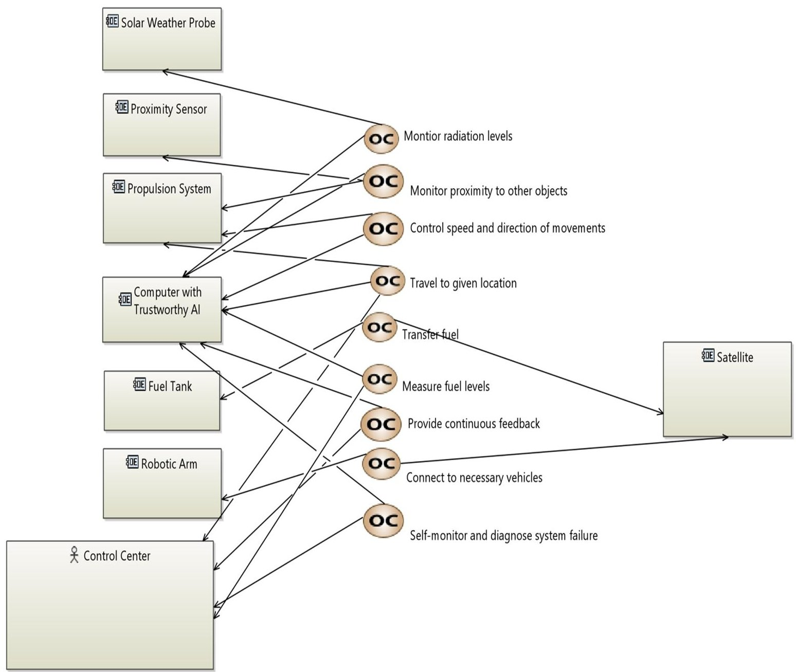

Figure 17 Capella Operational Capabilities Diagram for Refueling Vehicle

<!-- PDF_PAGE: 55 -->

The capabilities diagram shows basic involvement but does not show how these capabilities are achieved. The Operational Architecture diagram, shown in Figure 18, gives more insight into how the capabilities are performed as well as how the subsystems work together. This diagram is more in depth and gives the user much more information. We can see that the subsystems are now boxes containing operational activities. Operational activities show actions that will be performed by the subsystem it is contained in. Most of the operational activities are bordered with a colored line and have a colored arrow coming in and out of them. These colors represent different functional chains. Each functional chain is representative of a capability and is made up of functional exchanges which are the connections between different activities. This diagram shows what information is being passed between each operational activity. For example, looking at the blue functional exchange between the "Dispense fuel" and "Accept Fuel", we can see that "Fuel" is transferred between those two actions.

In this diagram, the user can actually start to see how subsystems will work together. While still on the Organizational level, the model is already becoming more detailed. This diagram also shows what type of information the system will expect from the external systems. For example, the refueling vehicle will expect fuel tank size information from the control center in order to calculate how much fuel to transfer to each satellite.

<!-- PDF_PAGE: 56 -->

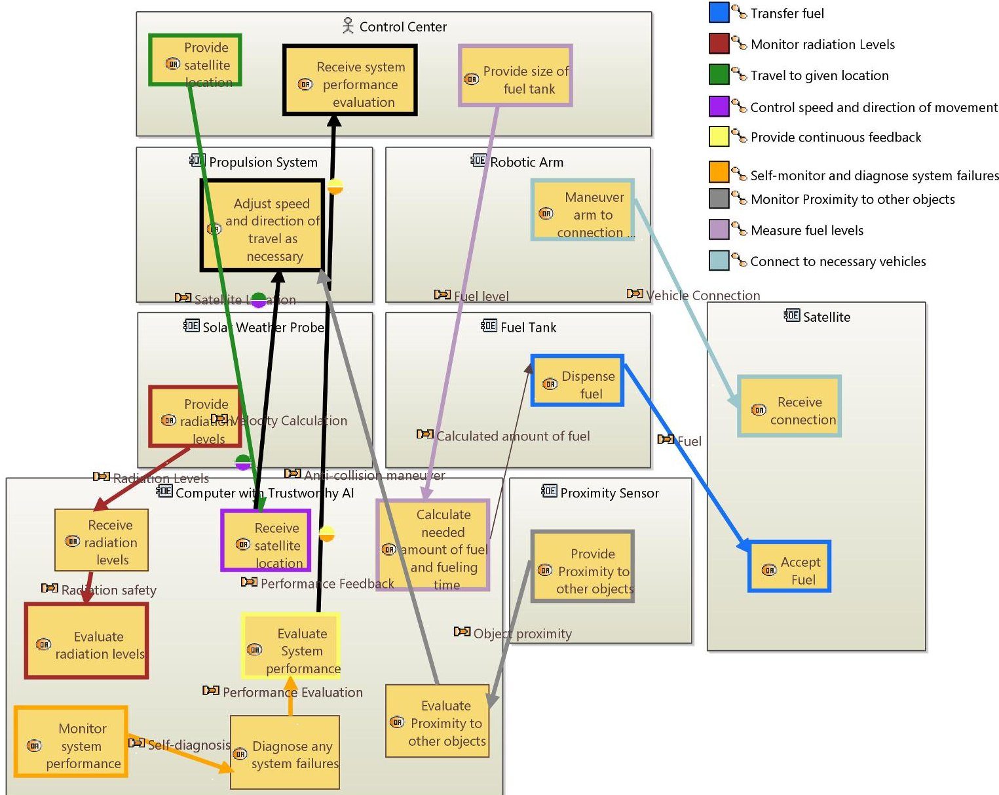

Figure 18 Capella Operational Architecture Diagram for Refueling Vehicle

<!-- PDF_PAGE: 57 -->

We can look further into the Operational Architecture diagram by looking at each individual functional chain in an Operational Process Description diagram. The Operational Architecture diagram can appear cluttered and confusing at times. By diving deeper into each functional chain, we can more easily see how the capabilities are accomplished. These Operational Process Description diagrams are an organized representation of each individual functional chain. Below will show each functional chain. The first Operational Process Description diagram is for the "Monitor Radiation Levels" capability and functional chain. Each of these diagrams will be laid out in the same way. The diagram will have the activity boxed and arrows connecting them to show the flow of the process. Above those arrows will describe what type of information or material is being passed between the two corresponding activities.

Figure 19 Operational Process Description diagram: Monitor Radiation Levels

Figure 20 Operational Process Description diagram: Travel to Given Location

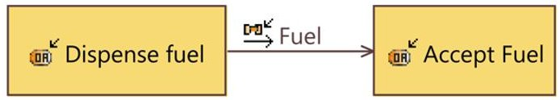

Figure 21 Operational Process Description diagram: Transfer Fuel

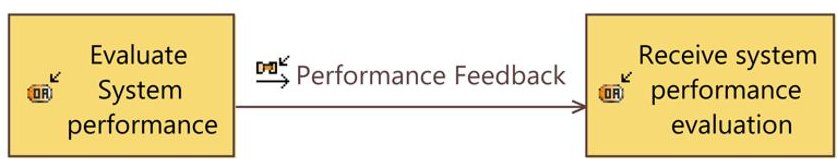

Figure 22 Operational Process Description diagram: Provide Continuous Feedback

<!-- PDF_PAGE: 58 -->

Figure 23 Operational Process Description diagram: Control Speed and Direction of Movements

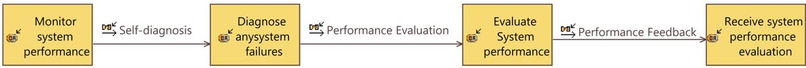

Figure 24 Operational Process Description diagram: Self-Monitor and Diagnose System Failures

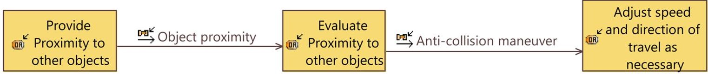

Figure 25 Operational Process Description diagram: Monitor Proximity to Other Objects

Figure 26 Operational Process Description diagram: Connect to Necessary Vehicles

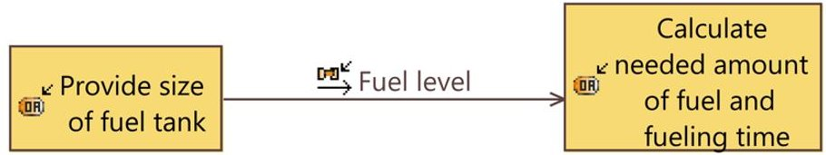

Figure 27 Operational Process Description diagram: Measure Fuel Level

<!-- PDF_PAGE: 59 -->

The model now makes the transition from the Operational level down to the Systems level. Each operational entity is transitioned to a systems entity. The Systems Capability diagram, shown in Figure 28, is very similar to the Operational Capability diagram. That is because for this system the capabilities are constant. This step is necessary in successfully modeling the system, although it may seem redundant.

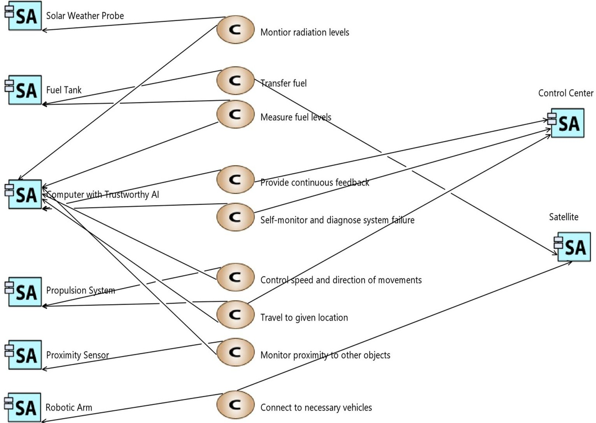

Figure 28 Capella Systems Capability Diagram for Refueling Vehicles

<!-- PDF_PAGE: 60 -->

The next diagram is a System Architecture diagram, shown in Figure 29. This diagram has a lot of similarities to the Operational Architecture diagram. The activities in the Operational Architecture diagram have been transitioned to system functions. The diagram also transitioned the functional chains and functional exchanges from the Operational Architecture diagram to the System Architecture diagram. Some of the functional chain descriptions as well as the activity descriptions are lightly more in depth but have the same base functions and meanings. This System Architecture diagram takes the information a step further. The model is much more specific and detailed. In addition to the added detail, the diagram also highlights constraints of the system. These constraints allow stakeholders to gain more information into the system. For this model, the user can see that the vehicle should not exceed a relative velocity of 6 centimeters per second. The model also shows expectations for control center response times, NIST compliance requirements, and STAR and TrRL levels. All of the constraints are "assigned" to a system function or system component/actor. An example of this is the STAR and TrRL level constraint is assigned to the Computer with Trustworthy AI component.

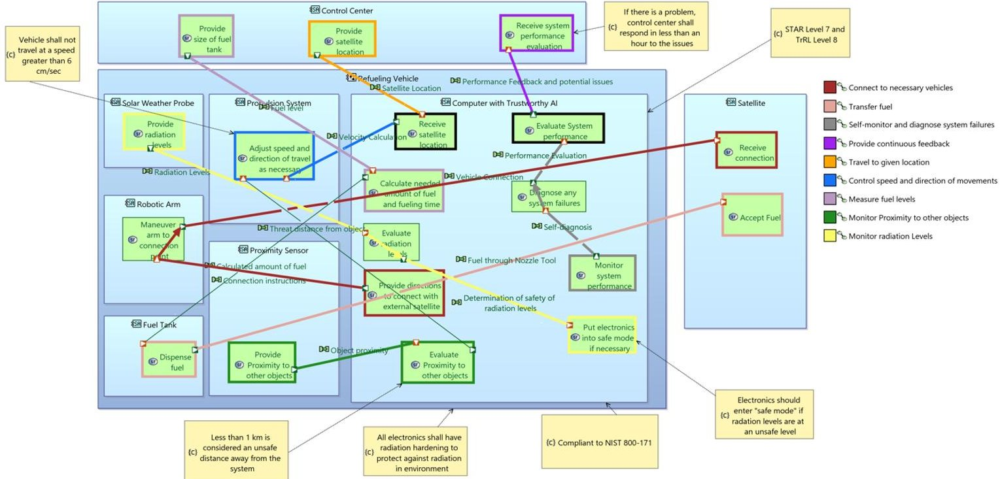

Figure 29 Capella System Architecture Diagram for Refueling Vehicle

<!-- PDF_PAGE: 61 -->

The MBSE models above allowed for a visual representation of the system before the system has even been built. For most people, it is easier to understand something when they can physically see the connections and processes in action. Models, like the ones discussed above, allow for that physical representation. In addition, the models allow for traceability. If a change is made to one of the initial constraints, that change will automatically be carried through to all models the constraint is in. Overall, the MBSE models allow for a greater understanding which leads to greater trust in the processes occurring.

<!-- PDF_PAGE: 62 -->

## Chapter 5: Main Observations, Discussion, and Lessons Learned

Using MBSE for refueling satellites made a very complex process much simpler to understand. MBSE gave all the benefits I expected it to. It kept the project organized and cohesive. The models provided a visual representation of the system which allows for a better understanding and ensured all the requirements were considered. Traditional systems engineering is a great way to approach a design, however MBSE brings this approach to the next level, providing a visual model that all stakeholders can look at. The models provide traceability and are connected through their various diagrams and levels. If a change is made in one diagram, that change is automatically incorporated through all repetitions of that element. This is an important feature when developing my model. In addition, MBSE software, including Capella, provide a validation tool which allows for the user to know if their model is fully incorporated and consistent across all diagrams. This validation tool allows for trust in the model. While MBSE does take more time up front, the benefits appeared to be worth the extra time. When taking this project to a deeper level, MBSE will continue to be a useful tool. Capella allows for integration of physical part and connection descriptions. As the design progresses and parts and systems are decided on, those parts can be described in the model with the name of the part, a picture of what the part looks like, and links for where to buy the parts. This provides even more visualization and traceability of the design.

Capella was a software I had never learned before. I had previous experience with a different MBSE tool but decided to use Capella because it is open source and has been used for projects similar to this thesis. Just like all software, Capella had a learning curve. Being an opensource program, there were various online resources to help learn. Capella also provides a

<!-- PDF_PAGE: 63 -->

YouTube course that helps users learn to use the software and create their own models. I dedicated 3 weeks to learning the software before I began creating models for this thesis. In that time, I used practice models to learn the software and how to create models for my own needs. It was a challenge to learn a new software, but Capella provided me with everything needed to learn. Using their practice models, I was able to learn to create new models and modify existing models. The YouTube course walks you through all the modifications and explains each step as well as how to take your work a step further than the videos. I struggled with the transition from a premade training model that Capella provided to creating my own models. It took some trial and error and research of the Capella tutorials to finish my models for this project, but overall Capella was a very user-friendly tool. I created a variety of models that were useful for the use case discussed in this project, but Capella has a large variety of tools that would allow for it to be used for almost any project.

Overall, I learned a lot about the MBSE design approach. For the refueling satellites use case, there are a lot of unknowns. It was a challenge to create requirements with the number of unknowns as well as tackling the issue of trustworthy AI. I used historical satellite data and other peoples' research to base my requirements off. Using this data that I found, I was able to make estimates for the system discussed in this thesis. I used customer needs to create requirements and then translated those requirements into a MBSE model. The MBSE models were validated using the Capella validation software to ensure consistency between diagrams. To take this research a step further, I would do a deeper dive into each subsystem by creating subsystem requirements and MBSE models. This would allow for a deeper understanding of each system.

Trust was a topic that keeps coming up throughout this paper and throughout the entire course of my research. Humans are skeptical to trust new systems that they don't understand.

<!-- PDF_PAGE: 64 -->

This is a big reason drone deliveries and self-driving cars aren't more widely used. For AI to be more widely used in our everyday lives, we have to prove that people can trust these systems. A big way to instill trust is to help people understand. Failure is inevitable. However, that failure can be managed and reduced. By using MTBF, cohesive requirements, and setting specific maintenance levels this failure can be mitigated. Engineers can start to predict failure before it happens to avoid injury or loss of a system. Being able to say a system will fail after X number of hours, maintenance can be scheduled to replace parts or update the system to stop failure from happening.

## 5.1 Unique Contributions

This thesis provides significant unique contributions to the engineering industry and the refueling of satellites use case. First is the development of system requirements through research of other low-earth orbit satellites. While creating these requirements, it was important to have the MBSE framework in mind. This thesis is the first time Capella is being used to model a refueling vehicle system. Capella has been used for autonomous systems and space systems but has not been used for this use case. The previously developed requirements were used to create comprehensive, high-level Capella MBSE models. Using the Capella verification tool, there is confidence in the accuracy and completeness of the models.

<!-- PDF_PAGE: 65 -->

## Chapter 6: Conclusion

In this research, a model-based systems engineering to refueling satellites was presented. The models presented were formed based on requirements written. The requirements were based on various research of satellite safety, behavior, and design processes. Trustworthy AI is a major challenge with proving feasibility of refueling satellites. Space trusted autonomy readiness levels as well as trust readiness levels were evaluated and chosen for the project. These safety and trust levels will help provide a standard to design the system to.

An initial cost and risk benefit analysis was completed. There is risk with every satellite, but launch is one of the greatest risks to a satellite with a significant number of satellites not making it to orbit due to failures during launch. By refueling satellites, the number of new satellites that will need to be launched will be reduced greatly. Fuel is typically the limiting factor to a satellite's lifespan. Once a satellite reaches the end of its lifespan, a replacement is launched. By refueling satellites, fewer replacements will be needed over time. Launch is also expensive. Fewer launches equal less cost. So, by decreasing risk, cost is also being decreased. Cost is also decreased because satellites will no longer need to be launched with a full tank of fuel. Lower weight means more cost savings.

The MBSE models that were created show that a complicated system can be broken down into less complicated parts that are easier to understand. The models also help to show the connection between subsystems and how the system will interact with its surroundings. The models help to provide a greater understanding of the system and its processes. By providing a way to understand the system, it will be more trustworthy. In addition, the MBSE models will provide traceability and early detection of errors. The also allow for all stakeholders to be on the same page.

<!-- PDF_PAGE: 66 -->

## 6.1 Future Work and Recommendations

There are many ways this work could be continued. First, the requirements and models for this project were kept at a high level. The requirements and models will need to be looked at in much more detail. Creating requirements for subsystems and creating models for those subsystems will be an important next step. Choosing parts will also be part of this. Decisions will need to be made of specific sensors, boosters, and other parts that will be used to create the refueling vehicle. All of these specific part decisions are able to be put into the MBSE models. Capella allows for images to be loaded into the model to give more information on what each subsystem will look like.

The second recommendation is to find a qualitative way to evaluate the STAR and TrRL levels. Currently, the STAR and TrRL levels are qualitative descriptions of what is expected for a system that is designed to each level. A qualitative definition is hard to validate to. An important part of systems engineering is creating measurable requirements. STAR and TrRL levels are very new concepts. In the future, these definitions will provide more guidance on how to validate to those levels. This could include quantitative values or examples, or a more measurable qualitative definition.

Next, this work focused mostly on low-earth orbit applications. A more in depth look into applications in other orbits would be of great value. There are satellites throughout LEO, MEO, GEO, and beyond that have run out of fuel. Being able to refuel all of those satellites will provide all the same benefits as described in this paper. Each orbit will provide its own challenges and therefore must be considered individually.

<!-- PDF_PAGE: 67 -->

As with all new technologies, there are laws that must be considered before going about a new process. There are laws that deal with space debris and satellites no longer working but still existing in space. Space salvage laws are in place that say that retired satellites, such as satellites that have run out of fuel and are no longer being used, are considered abandoned and can be taken or destroyed by the first person to get it [51]. Space is not governed by one country. Space similar to international waters in terms of ownership and who makes the laws for that space. With refueling satellites, there will need to be a discussion as to what satellites can and can't be worked on. There are also military application considerations that will need to be considered. Information sensitivity and protection is something that needs to be considered.

Lastly, there are a significant number of satellites where the lifespan was cut short due to failures that cannot be fixed on Earth. If there are going to be refueling vehicles, engineers and scientist should consider taking this idea one step further and consider an in-space servicing hub. This servicing hub would be similar to a car mechanic shop with a robot to fix the satellites. This idea could be a whole project on its own and would be extremely valuable in extending the lifespan of satellites and other space vehicles.

<!-- PDF_PAGE: 68 -->

## References

[1] Benedict, Bryan L. "Investing in Satellite Life Extension - Fleet Planning Options for Spacecraft Owner/Operators." AIAA SPACE 2014 Conference and Exposition, 2014, https://doi.org/10.2514/6.2014-4445.

[2] Hobbs, Karianne L, et al. "Space Trusted Autonomy Readiness Levels." 24 Oct. 2022.

[3] Jacklin, Stephen A. NASA Ames Research Center, Moffett Field, California, 2018, Small-Satellite Mission Failure Rates.

[4] Gosian, Gregory, and Kelly Cohen. "Sparse Requirements Systems Engineering and Implications for Assured Autonomy." Journal of Defense Management, 17 Dec. 2021.

[5] United States, Congress, Research and Engineering. Autonomy Community of Interest (COI) Test and Evaluation, Verification and Validation (TEVV) Working Group: Technology Investment Strategy 2015-2018, Office of the Assistant Secretary of Defense, 2015.

[6] Hart, Laura E. "Introduction To Model-Based System Engineering (MBSE) and SysML." INCOSE. Delaware Valley INCOSE Chapter Meeting, https://www.incose.org/docs/default-source/delaware-valley/mbse-overview-incose-30-july-2015.pdf. Accessed 15 Feb. 2023.

[7] Shevchenko, Nataliya. "An Introduction to Model-Based Systems Engineering (MBSE)." Software Engineering Institute Blog, Carnegie Mellon University, 21 Dec. 2020, https://insights.sei.cmu.edu/blog/introduction-model-based-systems-engineeringmbse/. Accessed 15 Feb. 2023.

[8] Els, Peter. "Model-Based Systems Save Development Time and Money." Automotive IQ, 5 Oct. 2022, https://www.automotive-iq.com/autonomous-drive/columns/model-based systems-save-development-time-and-money.

[9] Madni, Azad, and Shatad Purohit. "Economic Analysis of Model-Based Systems Engineering." Systems, vol. 7, no. 1, 2019, p. 12., https://doi.org/10.3390/systems7010012.

[10] "Aerial Refueling." Wikipedia, Wikimedia Foundation, 31 Jan. 2023 https://en.wikipedia.org/wiki/Aerial_refueling.

[11] Foust, Jeff. "Orbit Fab Secures New Investor to Support Satellite Refueling Efforts." SpaceNews, 23 Jan. 2023, https://spacenews.com/orbit-fab-secures-new-investor-to-support-satellite-refueling-efforts/.

<!-- PDF_PAGE: 69 -->

[12] "Refueling Satellites in Space." Lockheed Martin, 13 Sept. 2021 https://www.lockheedmartin.com/en-us/news/features/2021/refueling-satellites-inspace.html.

[13] United States, Congress, Office of Public Affairs. Space Systems Command Selects Orion Space Solutions for Tetra-5 Other Transaction Agreement, 26 July 2022. https://www.ssc.spaceforce.mil/Portals/3/Documents/PRESS%20RELEASES/Tetra- 5.pdf?ver=otxbrmw6mqtW5c3d4v084w%3D%3D. Accessed 15 Feb. 2023.

[14] O'Callaghan, Jonathan. "Docking, Rendezvous and Newton's Third Law - the Challenge of Servicing Satellites in Space." Horizon, 10 Mar. 2020, https://ec.europa.eu/research-and-innovation/en/horizon-magazine/docking-rendezvous-and-newtons-third-law-challenge-servicing-satellites-space. Accessed 4 Mar. 2023.

[15] Chato, David J. "Low Gravity Issues of Deep Space Refueling." NASA Glenn Research Center, 10 Jan. 2005.

[16] "Trustworthy Definition & Meaning." Merriam-Webster, Merriam-Webster, https://www.merriam-webster.com/dictionary/trustworthy.

[17] "Artificial Intelligence (AI) - United States Department of State." U.S. Department of State, U.S. Department of State, 15 Sept. 2021, https://www.state.gov/artificial intelligence/.

[18] Matthews, Sky. "Challenges in Systems Engineering of Intelligent and Autonomous Systems." IBM Engineering, 2019.

[19] Felderer, Michael, and Rudolf Ramler. "An Overview of Systems Engineering Challenges for Designing AI-Enabled Aerospace Systems." 2020, https://doi.org/10.2514/6.2021-0564.vid.

[20] U.S. Department of Defense Responsible Artificial Intelligence Strategy and Implementation Pathway, 2022.

[21] Choudhary, Mahashreveta. "On-Orbit Satellite Servicing: Process, Benefits and Challenges." Geospatial World, 12 May 2020, https://www.geospatialworld.net/article/on-orbit-satellite-servicing-process-benefits-and challenges-2/.

[22] "Mean Time between Failures (MTBF): MTBF Calculation." Fiix, 2 Feb. 2023, https://www.fiixsoftware.com/maintenance-metrics/mean-time-between-fail maintenance/.

[23] Foskett, Stephen. "Defining Failure: What Is MTTR, MTTF, and MTBF?" Stephen Foskett, Pack Rat, 6 July 2011, https://blog.fosketts.net/2011/07/06/defining-failure-mtttr- mttf-mtbf/. Accessed 4 Mar. 2023.

<!-- PDF_PAGE: 70 -->

[24] Torell, Wendy, and Victor Avelar. "Mean Time Between Failure: Explanation and Standards." Schneider Electric, 22 Dec. 2017.

[25] Bijan, Yvonne, and Rick Landers. "Practical Implementation of Model Based Systems Development." INCOSE, Feb. 2016.

[26] Hatty, Isabella. "Viability of on-Orbit Servicing Spacecraft to Prolong the Operational Life of Satellites." Journal of Space Safety Engineering, vol. 9, no. 2, 2022, pp. 263268., https://doi.org/10.1016/j.jsse.2022.02.011.

[27] Lea, Robert. "What Is a Geosynchronous Orbit?" Space.com, Space, 24 Apr. 2015 https://www.space.com/29222-geosynchronous-orbit.html.

[28] Dunlap, Kyle. Run Time Assurance for Intelligent Aerospace Control Systems. 2022. University of Cincinnati, Master's thesis. OhioLINK Electronic Theses and Dissertations Center, http://rave.ohiolink.edu/etdc/view?acc_num=ucin1649768916078616.

[29] "Llis." NASA, NASA, https://llis.nasa.gov/lesson/824.

[30] Martines, Luz Maria. "Analysis of Leo Radiation Environment and Its Effects on Spacecraft's Critical Electronic Devices." Embry-Riddle Aeronautical University, 2012.

[31] Media, OpenSystems. "Military Embedded Systems." Radiation-Tolerance Screening for Missions of All Sizes, https://militaryembedded.com/avionics/safety-certification/radiation-tolerance-screening-missions-all-sizes.

[32] "Adopters." Capella MBSE Tool - Adopters, https://www.eclipse.org/capella/adopters.html.

[33] "Discover Capella in 2 Minutes." YouTube, Eclipse Capella, 21 Sept. 2020 https://www.youtube.com/watch?v=WSzlN4YT3gM. Accessed 15 Feb. 2023.

[34] Guindon, Christopher. "Why Capella? Taking on the Challenges of Complex Systems Engineering." The Eclipse Foundation, https://www.eclipse.org/community/eclipse_newsletter/2017/december/article1.php.

[35] "Features and Benefits." Capella MBSE Tool - Features, Eclipse Capella, https://www.eclipse.org/capella/features.html.

[36] "Adopters." Capella MBSE Tool - Adopters, https://www.eclipse.org/capella/adopters.html.

[37] Arcadia and Capella for a Large Complex Mechanical System. Eclipse Capella https://www.eclipse.org/capella/resources/pdf/Case_Study_Rolls_Royce.pdf.

<!-- PDF_PAGE: 71 -->

[38] "Autonomous Train Collaborative Work in a Consortium with Capella." Eclipse, https://www.eclipse.org/capella/resources/pdf/Case_Study_AutonomousTrain.pdf.

[39] "Successful Capella Landing on a CNES Operational Use Case." Eclipse Capella. https://www.eclipse.org/capella/resources/pdf/Case_Study_CNES.pdf

[40] White, Wayne N. "ENGINEERING, CONSTRUCTION, AND OPERATIONS IN SPACE III, SPACE '92, PROCEEDINGS OF THE THIRD INTERNATIONAL CONFERENCE." Salvage Law for Outer Space.

[41] Dunbar, Brian. "Advanced Space Transportation Program Fact Sheet." NASA, NASA https://www.nasa.gov/centers/marshall/news/background/facts/astp.html.

[42] "Hydrazine Fuel Price - Orbit Fab: Gas Stations in Space $ ^{\mathrm{TM}} $." Orbit Fab | Gas Stations in $ Space^{\mathrm{TM}} $ , https://www.orbitfab.com/hydrazine-fuel-price.

[43] Madni AM, Madni CC, Lucero SD. Leveraging Digital Twin Technology in ModelBased Systems Engineering. Systems. 2019; 7(1):7. https://doi.org/10.3390/systems7010007

[44] "Space Technology 7." NASA, NASA Jet Propulsion Laboratory, https://www.jpl.nasa.gov/nmp/st7/TECHNOLOGY/thrusters.html.

[45] United States, Congress, Ross, Ron, et al. Protecting Controlled Unclassified Information in Nonfederal Systems and Organizations, National Institute of Standards and Technology, 2016.

[46] "TRACK AND CAPTURE OF THE ORBITER WITH THE SPACE STATION REMOTE MANIPULATOR SYSTEM" (PDF). NASA. Archived (PDF) from the original on August 7, 2020. Retrieved July 7, 2017.

[47] "NASA's Exploration & in-Space Services." NASA, NASA https://nexis.gsfc.nasa.gov/rrm_refueling_task.html.

[48] Borthomieu, Yannick, and Gianfranco Pistoia. "14 - Satellite Lithium-Ion Batteries." Lithium-Ion Batteries: Advances and Applications, Elsevier, Amsterdam, 2014, pp. 311- 344.

[49] Benzel, Aaron. "Maintenance." NASA, NASA, 30 Mar. 2017 https://www.nasa.gov/feature/aircraft-maintenance/.

[50] Fan, Lihong, et al. "Evaluation of Signal-in-Space Continuity and Availability for Beidou Satellite Considering Failures." Journal of Navigation, vol. 73, no. 2, 2019, pp. 312-323., https://doi.org/10.1017/s0373463319000602.

<!-- PDF_PAGE: 72 -->

