<!-- PDF_PAGE: 1 -->

# A Model-Based Systems Engineering Framework for Concept Development

by Brian London

B.S., Electrical and Computer Engineering, Lafayette College, 2002 M.S., Electrical Engineering, Stevens Institute of Technology, 2004

Submitted to the System Design and Management Program in Partial Fulfillment of the Requirements for the Degree of

Master of Science in Engineering and Management

at the Massachusetts Institute of Technology 2012 [February 2012] $ \textcircled{c} $ 2012 Brian Nathaniel London. All rights reserved

ARCHIVES

The author hereby grants to MIT permission to reproduce and to distribute publicly paper and electronic copies of this thesis document in whole or in part in any medium now known or hereafter created.

Signature of Author ___

Brian N. London

System Design and Management Program January 2010

Certified by

Donna H. Rhodes

Thesis Supervisor

Senior Lecturer, Engineering System Division

Accepted by

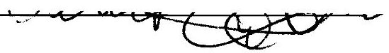

Patrick Hale Director

System Design and Management Program

<!-- PDF_PAGE: 2 -->

## Abstract

The development of increasingly complex, innovative systems under greater constraints has been the trend over the past several decades. In order to be successful, organizations must develop products that meet customer needs more effectively than the competitors' alternatives. The development of these concepts is based on a broad set of stakeholder objectives, from which alternative designs are developed and compared. When properly performed, this process helps those involved understand the benefits and drawbacks of each option. This is crucial as firms need to effectively and quickly explore many concepts, and easily determine those most likely to succeed.

It is generally accepted that a methodical design approach leads to the reduction in design flaws and cost over a product's life cycle. Several techniques have been developed to facilitate these efforts. However, the traditional tools and work products are isolated, and require diligent manual inspection. It is expected that the effectiveness of the high-level product design and development will improve dramatically through the adoption of computer based modeling and simulation. This emerging capability can mitigate the challenges and risks imposed by complex systems by enforcing rigor and precision.

Model-based systems engineering (MBSE) is a methodology for designing systems using interconnected computer models. The recent proliferation of MBSE is evidence of its ability to improve the design fidelity and enhance communication among development teams. Existing descriptions of leveraging MBSE for deriving requirements and system design are prevalent. However, very few descriptions of model-based concept development have been presented. This may be due to the lack of MBSE methodologies for performing concept development. Teams that attempt a model-based approach without well defined, structured strategy are often unsuccessful. However, when MBSE is combined with a clear methodology, designs can be more efficiently generated and evaluated.

While it may not be feasible to provide a "standard" methodology for concept development, a framework is envisioned that incorporates a variety of methods and techniques. This thesis proposes such a framework and presents an example based on a simulated concept development effort.

Thesis Supervisor: Dr. Donna H. Rhodes, Senior Lecturer, Engineering System Division

<!-- PDF_PAGE: 3 -->

## Acknowledgments

It is with utmost sincerity that I extend this thanks to all those who have contributed to my incredible experience with the SDM program. I would like to thank my thesis advisor, Donna Rhodes, for her invaluable guidance. Donna's input and expertise were essential in helping me focus my attention on a topic that truly interested me, and helping me to find the resources required to complete this thesis. I'd like to thank Pat Hale, and the rest of my SDM friends. I enjoyed getting to know and learning from each of you.

My thanks goes out to all those who participated in the interviews. Your insights and experience helped sculpt and reinforce the theories discussed herein. I'd also like to thank Bog, Nick, and the rest of my coworkers who constantly challenge me to be a better engineer.

This achievement would not be possible without the inspiration, motivation, and constant support of my family. Without you, I would not be who I am. I'd especially like to thank my wonderful wife, Anne, who gave me all the love and support needed to accomplish this goal. Thank you for your patience. I couldn't have done this without you.

<!-- PDF_PAGE: 4 -->

## Table of Contents

Abstract...2

Acknowledgments...3

List of Figures...6

1. Introduction...9

1.1 Research Objectives...13

1.2 Approach and Research Overview...13

1.3 Thesis Contents...14

2. Background...15

2.1 Systems Engineering...15

2.1.1 Life-Cycle Stages...16

2.1.2 Systems Engineering Process...18

2.1.3 Concept Development...21

2.1.4 Decision Analysis...25

2.2 Model-Based Systems Engineering...31

2.2.1 Benefits...32

2.2.2 Tools...42

2.2.3 Views and Viewpoints...43

2.2.4 Languages...44

2.2.5 Methodology...62

2.3 DODAF...71

3. MBSE Framework for Concept Development...74

3.1 Problem Identification...78

3.2 Problem Definition...82

<!-- PDF_PAGE: 5 -->

3.2.1 Glossary Creation ... 84

3.2.2 Stakeholder Analysis ... 85

3.2.3 Context Definition ... 89

3.2.4 Use Case Development ... 92

3.2.5 Requirements Development ... 100

3.2.6 Requirement Prioritization ... 104

3.2.7 Verification Methods ... 106

3.2.8 Requirements and Design Reviews ... 108

3.3 Architecture Definition ... 108

3.3.1 Functionality Analysis ... 111

3.3.2 Structural Analysis ... 118

3.3.3 Allocation of Behavior to Structure ... 125

3.3.4 Constraint and Relationship Definition ... 126

3.3.5 Domain Expert Collaboration ... 129

3.4 Generation of Alternatives ... 131

3.5 Decision Analysis ... 137

3.5.1 Priority Assessment ... 138

3.5.2 Effectiveness Determination ... 140

3.5.3 Concept Selection ... 141

4. Conclusions and Recommendations ... 143

5. Future Work ... 147

Work Cited ... 148

<!-- PDF_PAGE: 6 -->

## List of Figures

Figure 1: Ability to Influence Construction Cost over Time ...10

Figure 2; DoD Project Lifecycles ...17

Figure 3: NASA Project Lifecycles ...18

Figure 4: Waterfall Method ...19

Figure 5: Systems Engineering Vee Model ...20

Figure 6: General Spiral Development Model ...21

Figure 7: House of Quality ...28

Figure 8: Sample Utility Curve ...29

Figure 9: Sample DSM ...31

Figure 10: Changing the Paradigm ...33

Figure 11: Interdisciplinary Model Based Environment ...40

Figure 12: Example OPM Elements ...46

Figure 13: Functional Flow Block Diagram Example ...47

Figure 14: Example of an EFFBD ...48

Figure 15: Relationship between SysML and UML ...49

Figure 16: The Four Pillars of SysML ...50

Figure 17: SysML Diagram Types ...50

Figure 18: Example of Use Case Diagram ...51

Figure 19: Example of an Activity Diagram ...52

Figure 20: Example of a Sequence Diagram (Add One with timing) ...54

Figure 21: Example of State Diagram ...55

<!-- PDF_PAGE: 7 -->

Figure 22: Example of Block Definition Diagram ... 56

Figure 23: Example of Internal Block Diagram ... 57

Figure 24: Example of Requirements in Diagram ... 58

Figure 25: Example of Parametric Constructs and Diagram ... 59

Figure 26: Example of MOE Definition ... 60

Figure 27: Example of Block Properties ... 61

Figure 28: Vitech MBSE Activities Performed at Each Layer ... 64

Figure 29: OOSEM Methodology ... 68

Figure 30: Rational Harmony Integrated Systems / Embedded Software Development Process ... 69

Figure 31: Rational Harmony for MBSE ... 70

Figure 32: DODAF Views ... 72

Figure 33: Concept Development Methodology ... 76

Figure 34: Problem Identification ... 78

Figure 35: Example of a UAV’s Most Important Requirements ... 81

Figure 36: Allocating Requirements to MOE ... 82

Figure 37: Problem Definition ... 83

Figure 38: Stakeholder Need Identification ... 88

Figure 39: Example of Actor Decomposition ... 89

Figure 40: UAV Context ... 91

Figure 41: Additional Interface Information ... 92

Figure 42: UAV CONOPS ... 93

Figure 43: Use Case Diagram for UAV Operations ... 95

Figure 44: Example of Scenario for UAV Launch ... 99

<!-- PDF_PAGE: 8 -->

Figure 45: Capturing Requirements as Use Case Attributes...103

Figure 46: Static Requirement Prioritization ...106

Figure 47: Verification Methods and Test Cases ...107

Figure 48: Architecture Definition Process...110

Figure 49: Example of an Activity Diagram...113

Figure 50: Alternative Methods for Depicting Cyclic Activities ...115

Figure 51: Example of UAV Sequence Diagram ...116

Figure 52: Example of a UAV State Diagram...117

Figure 53: Conceptual UAV Decomposition...121

Figure 54: Example of an Implementation Specific Structural Decomposition...122

Figure 55: Example of UAV Subsystem Interfaces...124

Figure 56: Parametric Diagram Relating Weight to Propulsion Power ...127

Figure 57: Parametric Model of UAV Coverage Analysis...128

Figure 58: Generation of Alternatives ...132

Figure 59: Controlled Convergence ...133

Figure 60: Alternative Lift Supplier Techniques...136

Figure 61: Decision Analysis...137

Figure 62: Example of Parametric Trade Study Calculation...142

<!-- PDF_PAGE: 9 -->

## 1. Introduction

Since the beginning of civilization, humans have sought to develop new products in order to better themselves and their communities. As society progressed technically, so did the complexity of the products created. The current rapid technical expansion and current global competitive environment is producing more demanding, sophisticated customers in every market. Many companies struggle with anticipating future customers' needs. This is partially due to customers not always knowing what they want. When this uncertainty is coupled with the existing ease of communication, markets change rapidly. Capabilities initially thought to be frivolous may quickly become essential. Assessing the customers' needs to deliver the most valuable options has always been the key to success, but products now need to get to market faster and more efficiently.

Speed in development is rooted in the ability to adapt to changing requirements and rapidly solve problems. Building the wrong features is a costly form of waste in engineering development. To identify the functionality that will maximize value over the product lifetime, a rigorous requirement capture process is necessary. Some organizations charge ahead without realizing that the original statement of the problem may not be the best, or even the right one (Karban et al., 2011).

When the needs are identified, organizations sometimes struggle with setting clear objectives and sharing the project's intent throughout the organization. Complex system development usually requires the collaboration of multidisciplinary teams, who must have a common understanding of the design and customer needs. Each participant must be able to efficiently capture and communicate their needs, feasibility assessments, and designs to other teams. However, the standard practice is for domain

<!-- PDF_PAGE: 10 -->

specialists to operate in functional "chimneys" communicating primarily through requirement documents and occasional integrated product team meetings. The lack of a closely coordinated design can lead to integration issues. An extreme example of this is the development of an aircraft component factory. As the factory completion neared, it was determined that the doors were not large enough to accommodate the wings it assembled (Wheelwright and Clark, 1992). This gross oversight demonstrates how crucial it is to understand the impact of design decisions. The relationships between requirements, elements, and functions must be communicated in order to develop realistic, effective concepts.

The largest degree of freedom and greatest number of possible solutions exist when a problem is first defined. As design decisions are made, the number of possible solutions diminishes, establishing the life-cycle costs. Figure 1 shows the relationship between life-cycles costs and the design stages. This commitment to life-cycle costs and loss of design freedom make the early stages of concept design among the most important of a program (Wheelwright and Clark, 1992). This emphasizes the necessity of efficient processes for defining large, complex systems. However, effective, systematic techniques to develop conceptual systems and operations are not well known (Shadrick et al., 2005).

<!-- PDF_PAGE: 11 -->

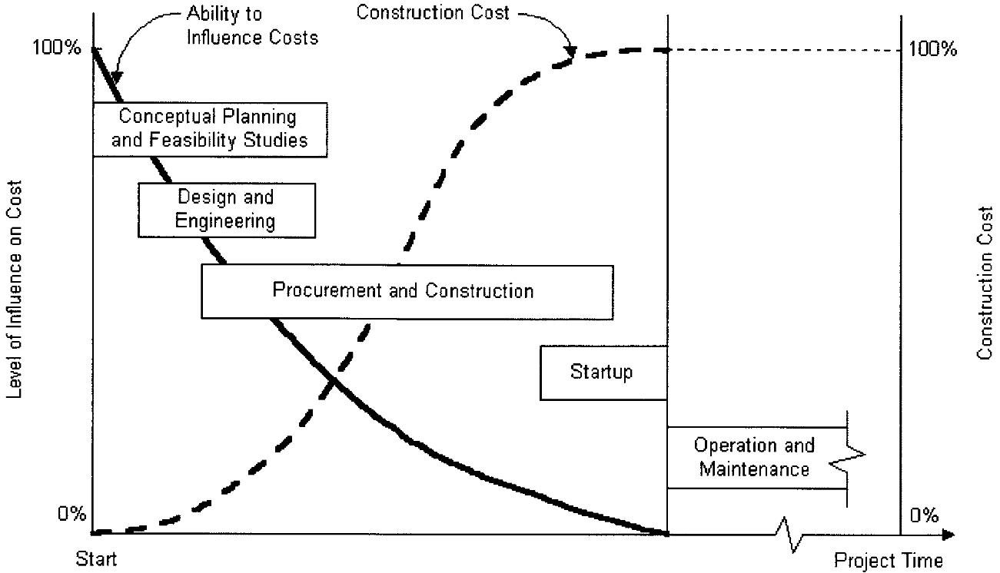

Figure 1: Ability to Influence Construction Cost over Time (Hendrickson, 1998)

Effective concept development presents a dilemma. While exploring a large number of options is difficult, innovation is best achieved by exploring as broad a set of concepts as possible. If concepts are selected too quickly, a sufficient number of perspectives may not have been considered.

Organizations require methodologies to quickly explore many concepts, and easily determine those most likely to succeed. A framework is presented in this thesis to increase concept development effectiveness by employing the most suitable, established concept generation tools and processes. It provides the structure to converge on a solution that answers the stakeholder needs with a high degree of confidence by system influences. A standard process is not advocated. Instead, the framework provides the organizational structure and guidance for a number of processes, regardless of concept domain. A number of potential processes are suggested, but developers can select their own. This is crucial as every problem and team is unique and will require different tools and processes.

<!-- PDF_PAGE: 12 -->

The methodology merges the best practices of system engineering with the use of rigorous modeling and automation. Models are used to identify the requirements, develop candidate solutions, and assess the options. They provide a cohesive source for all project information, improving communication and system understanding. This helps identify errors and poor assumptions earlier in the development cycle, saving time and money as fewer errors have to be corrected in later stages.

Design is also greatly improved by enforcing consistency between design elements. As an analogy, consider the state of engineering drawings before the onset of parametric computer-aided design (CAD). In the past, engineering solutions were documented through hand-written or isolated computer drawings. A slight change to one schematic could have a cascade throughout multiple others. Whenever a change was required, each drawing had to be closely reviewed and updated to maintain consistency. With the advent of parametric CAD, components could be linked to each other, allowing component changes to cascade through the design, easily identifying any inconsistencies.

The adoption of integrated model-based systems engineering (MBSE) is expected to provide similar improvements for system concept development. Optimizing speed, cost, and quality requires a revolutionary change in product development, and this outcome is expected from MBSE (Paredis, 2011).

Early uses of MBSE are showing evidence of reduced development time and lower error rates. This can be partially attributed to better understanding of the problem. "With a traditional functional requirements decomposition approach, we estimate that we would have only captured 50% of the problem understanding. Using operational concepts with use cases and scenarios, we caught more than 90% of the problem understanding the first time through" (Jorgensen, 2011). Hard numbers for the development time reductions are hard to come by, early survey results indicate that up to 40% fewer

<!-- PDF_PAGE: 13 -->

requirement defects were found on MBSE programs (Long, 2011). While, most current MBSE performance data is collected heuristically, quantitative metrics are being collected to provide more conclusive evidence (Estefan et al., 2011).

## 1.1 Research Objectives

The primary research objective of this thesis is to investigate and propose a methodology for the development of system concepts using an MBSE approach, specifically using the SysML language. The goal is propose generic processes that could apply to different organizations and efforts, but the results may be biased by the application of this methodology in the selected case studies. The specific questions that this thesis will seek to answer include:

1. Can MBSE support concept generation, refinement, and evaluation?

2. How can the best practices of systems engineering and concept development be integrated?

3. Does MBSE improve the efficiency and effectiveness of concept development teams?

4. What processes and external tools facilitate or enhance the development process?

5. What views, elements, and constructs are useful to improve communication?

## 1.2 Approach and Research Overview

The interview method was used to compare the methodology proposed in this thesis against traditional, non-model-based approaches. Two rounds of one-on-one interviews were conducted. The first rounded consist of questions to identify the unmet needs, best practices, and hindrances to concept development. The interviewees were selected based on their availability and experience developing advanced solutions to extremely challenging problems. While primarily Draper Laboratory systems engineers were interviewed, their backgrounds represented a range of engineering domains.

<!-- PDF_PAGE: 14 -->

Data collected from the first set of interviews was compared against the documented systems engineer best practices. In addition, concept development techniques from engineering, marketing, and other creative domains were examined. As a result of the literature survey, the MBSE framework for concept development was developed. It was designed using Sparx System's Enterprise Architect to produce the views described in the thesis. Enterprise Architect was selected based on availability, and is not specifically advocated by MIT.

The second round of interviews began after the initial establishment of the framework. In addition to experienced systems engineers, widely recognized leaders in the field of MBSE were interviewed. The focus was on the MBSE methodology, existing systems best practices, and their integration.

During these interviews the framework was reviewed and compared to traditional development practices. Examples of good and bad execution were shared to obtain a better assessment of the benefits, with a focus on:

- Visualization and clarity

- Impact on known best practices

- Ability to assess design errors or inconsistencies

- Traceability and knowledge capture

- Ease of use and expected learning curve

- Productivity impact

- Ability to support design decisions

## 1.3 Thesis Contents

Chapter Two summarizes the concept development methods, traditional system engineering practices, and model-based tools, methodologies, and languages. This chapter provides pertinent background information to introduce the techniques that are leveraged in this proposed framework. It does not contain sufficient details to teach them, but sources are cited that can provide additional information.

<!-- PDF_PAGE: 15 -->

Chapter Three introduces a framework to leverage the advantages of MBSE for concept development. The chapter introduced the framework that uses commercially available tools and SysML. Examples are provided to demonstrate the proposed methodology from the requirement definition, system architecture development, and UAV design selection. The examples are based from 1998 report describing the use of Unmanned Aerial Vehicles (UAV) for a proposed notional UAV force structure.

The Fourth chapter describes the conclusions of the proposed framework regarding its benefits and applicability across various programs. These conclusions are based on the feedback from experienced systems engineers and architects after reviewing the framework and the UAV example application. Chapter Five concludes with recommendations for future work.

## 2. Background

## 2.1 Systems Engineering

Systems engineering is an interdisciplinary field that emerged as an effective way to manage complexity and change. It focuses on defining customer needs and required functionality early in the development cycle, and proceeding through design synthesis to system validation while considering the complete problem (INCOSE). Systems engineering is based on a holistic perspective of problems and design. Practitioners consider how systems fit into the larger context, how they impact it, and how they are influenced. Just as importantly, they consider how the interacting system components relate to each other.

The objective of systems engineering is to ensure that the stakeholder's needs are satisfied in a cost effective, timely manner. These needs are translated into requirements and drive the selection of the

<!-- PDF_PAGE: 16 -->

best, implementable design from a number of alternatives. In order to accomplish this decision making, systems engineers use a disciplined approach to collaborate with interdisciplinary teams.

Systems engineering can be traced back to the early 1800's, but experienced rapid advancement in the 1950's and 60's (Oliver et al.). Since then several methodologies and processes emerged to emphasize and improve complex system optimization and trade-offs. Among these are architecture frameworks, systems engineering process standards, new tools, modeling standards, and data exchange standards.

A methodology can be defined as a collection of related processes, methods, and tools. Moreover, it provides the underling rules used in an approach. For example, Harvard Business School uses a casebased methodology for teaching in lieu of a lecture based one. Frameworks provide the underlying structure for a methodology. Processes are logical sequences of tasks performed to achieve a particular objective. A process for building a house could include laying the foundation, erecting the frame, etc. It defines what is to be done, without specifying how. The specific techniques are defined in methods. The method could describe the steps for installing a specific type of appliance. Tools are instruments that can enhance the efficiency of a method when properly used. Most processes and methods use several tools to simplify or improve their efficiency.

A variety of methodologies, processes, and tools are used by engineers to develop complex systems. A system is defined by International Council of Systems Engineers (INCOSE) as a combination of interacting elements organized to achieve one or more stated purposes (SE Handbook Working Group, 2011). It can also be thought of as a collection of different components exhibiting emergent properties.

## 2.1.1 Life-Cycle Stages

<!-- PDF_PAGE: 17 -->

Every system has life cycles stages even if they are not formerly defined. They encompass the sequential phases of requirements identification, development, production, use, and retirement. One could argue that even natural systems stem from an identification of requirements as biological advantages and environmental changes induce the emergence of natural systems.

The United States Department of Defense (DoD) has rigidly defined life-cycle stages to facilitate system acquisitions, graphically described in Figure 2. This life-cycle model exists to assist in the management of billions of dollars of system development efforts. In accordance with DoD standards, the management process is structured into discrete phases separated by major decision points known as milestones.

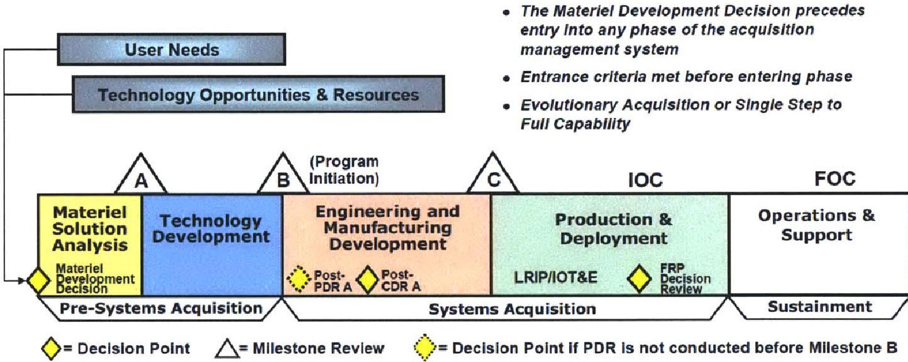

Figure 2: DoD Project Lifecycles (Under Secretary of Defense, 2008)

The materiel solution analysis, which leads to Milestone A, is the initial development phase in the Defense Acquisition Management System. It contains a robust analysis of alternatives to identify the potential solutions, assess their benefits and drawbacks, identify key technologies, and examine operational concepts. This is equivalent to the concept development described in this thesis.

<!-- PDF_PAGE: 18 -->

The National Aeronautics and Space Administration (NASA) also oversees budgets totaling several billion dollars and has its own lifecycle model and milestones, known as key decision points. Figure 3 illustrates the NASA development phases. Projects in the Pre-Phase A stage generate and evaluate a wide range of ideas and mission alternatives. The purpose of this phase is to determine system feasibility, develop initial mission concepts, identify the preliminary system requirements, and identify potential technology needs (Kapurch and et al, 2007). Phase A projects undergo more through feasibility and need assessments than those in Pre-Phase A. Through the Phase A activities, final mission concepts, system requirements, and technology development plans are developed. The concept development framework described herein could be applied to either NASA development stages as the primary differentiator between the two are the range of alternatives considered or the amount of information available for each one.

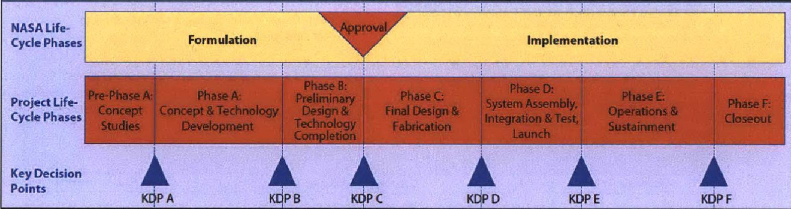

Figure 3: NASA Project Lifecycles (Kapurch and et al)

## 2.1.2 Systems Engineering Process

In each life-cycle stage, systems engineering teams follow processes to define complex systems. They generally begin with the development of requirements and culminate in verification and validation. As the design of complex system always includes a number of unknown unknowns, failure to use a disciplined, holistic approach can result in project failure. Several alternative processes exist for

<!-- PDF_PAGE: 19 -->

organized systems engineering development and management. They describe the engineering process across a system's life-cycle. The most common are the Waterfall, Vee, and Spiral models.

## 2.1.2.1. Waterfall Model

The Waterfall model breaks the development process into a series of sequential phases as Figure 4. As the name implies, the Waterfall model assumes a one-way cascading progression of tasks from requirements development to use (shown as maintenance in Figure 4). It assumes each phase is complete before moving to the next one. For example, it assumes that all requirements are fully defined before moving on to design.

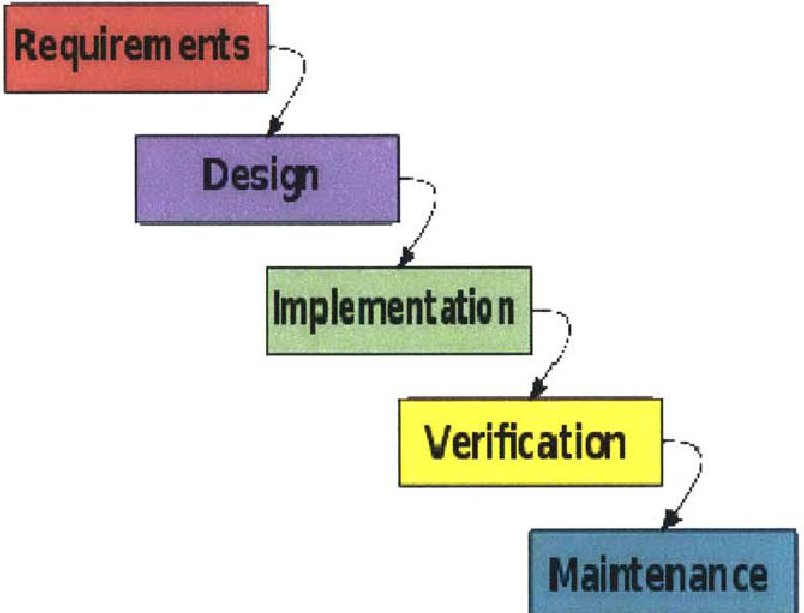

Figure 4: Waterfall Method (Wikipedia, 2011b)

The major shortcoming with the model is that it cannot handle downstream changes or incomplete stages. The development process is simplified to present an orderly progression of phases, but problems will always surface downstream, inducing change to the requirements or design. Therefore, it poorly reflects complex or length projects, and is widely acknowledged as a flawed model.

<!-- PDF_PAGE: 20 -->

## 2.1.2.2. Vee Model

The Vee model depicts the system evolution from concept of operations (CONOPS) and user requirement identification, through detailed design and verification to final system validation. In the Vee model, time and system maturity proceed from left to right, as shown in Figure 5. The left side of the Vee model indicates the development activities while the right side depicts the integration and verification activities. Each level on the horizontal axis is associated indicating the relationship between a development and verification (or validation at the CONOPS) level. It is not feasible to go backwards in the model so if any iterations are required, the project stays at the same point on the vertical axis.

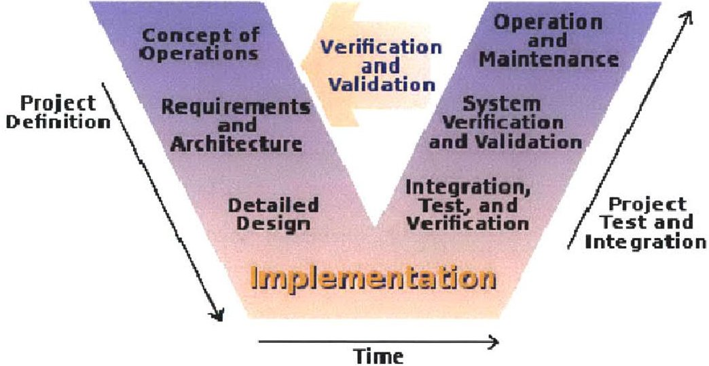

Figure 5: Systems Engineering Vee Model (Wikipedia, 2011a)

## 2.1.2.3. Spiral Model

The Spiral model can have the same phases as the Vee model, but explicitly accounts for risk and reevaluation. Software developers have long understood that most projects are not well suited to a sequential process and require a number of iterations (Maier, 2009). In the spiral model, shown in

<!-- PDF_PAGE: 21 -->

Figure 6, the angular sections represent progress, and the radius of the spiral represents maturity. Developers work through each phase (e.g., requirement development, design, test) in each iteration.

The first cycle is often focused on assessing the aspects of the design with the most risk. This is useful in situations where requirements cannot be fully defined prior to system design, or if immature technology is required. The model assumes that missing requirements or technology viability will be revealed after each spiral iteration. At the completion of the first loop, initial prototypes are used to assess risk allowing the customer to evaluate the project future with minimal cost investment. If the project continues, it iterates through each phase again. Each subsequent spiral builds upon the baseline.

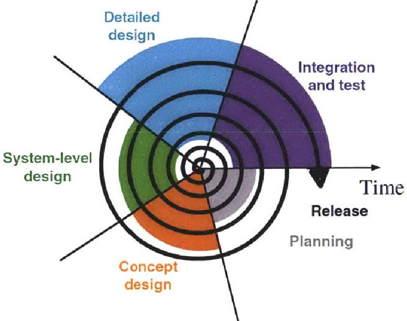

Figure 6: General Spiral Development Model (Ulrich and Eppinger, 2004)

## 2.1.3 Concept Development

Concept development is focused on identifying a design to maximize stakeholder value over the system lifetime. Effective concept development considers the needs of each stakeholder and develops requirements that do not overly constrain the design space. Failure to do so can result in systems that

<!-- PDF_PAGE: 22 -->

do not meet a need or are poorly designed. These efforts thoroughly, yet effectively, explore a wide range of solutions by identifying options and how they will meet the specified needs.

Concept development is not new. A number of different mechanisms exist today to help engineers determine the best solutions. A variety of mockups, models, simulations, and prototypes are used to better understand problems, develop candidate solutions, and validate their decisions. They are dependent on the type of problem (e.g., latent or explicit need), available resources and information, and development team experience. Like with the possible solutions, there are benefits and drawbacks to each tool and method. A subset is discussed herein.

## 2.1.3.1. Lead User Observation

As the name suggests, this method involves the observation or recording of experts performing specific tasks. It is based on the premise that asking them to actually perform tasks generates more valid knowledge than asking them to simply describe the required steps (Wright & Ayton, 1987). The experts are asked to "think out loud" while performing an assignment so their thought process is understood. These experts are often lead users who are unusually accurate, skillful, and reliable in their domain (von Hippel, 1986). While this technique is often conducted to identify needs, these lead users may also disclose innovative solutions, developed to address their personal needs. This information can significantly simplify the alternative generation activities.

## 2.1.3.2. Knowledge Elicitation

Knowledge elicitation uses interviews to understand the needs and habits of subject matter experts. The method can be used to identify future concepts by asking experts to generate best-guess estimates

<!-- PDF_PAGE: 23 -->

based on an anticipated set of new capabilities (Shadrick et al., 2005). A series of direct and indirect questions are posed to determine how domain-specific tasks are performed in a case dependent interview technique. Once the information is collected, other subject matter experts are guided through the thought process to collect other insight and needs. The responses aggregate into a single representation of need (Shadrick et al., 2005).

Knowledge elicitation can be used to assess how valuable a set attributes are to individuals and groups. However, it must be used carefully when interviewing lead users in that they may have a different outlook than the majority of the population (von Hippel, 2005).

## 2.1.3.3. Technological Forecasting

Technology is often a key driver in the development of any new product or system. The ability to accurately predict the availability of a given technology will have a critical impact on the success of a given program, project, or system. Technological forecasting, as the name suggests, is interested in forecasting the types of technologies that will be available in a future time period, the characteristics of those technologies, and a realistic estimate of their availability. Technological forecasting considers the innovations due to scientific and technical advancement and those pulled by environmental factors (i.e., social, economic, political) (Shadrick et al., 2005). Alternatively, teams can identify how a desired future should look, and "backcast" to determine how to get there (Shadrick et al., 2005).

This tool is dangerous as it makes concept development dependent on the invention of new technology or processes. As the results of invention are unpredictable, this reliance invariably causes delays in the concept development. When used, a thorough risk mitigation plan is required.

<!-- PDF_PAGE: 24 -->

## 2.1.3.4. Brainstorming

Brainstorming is a problem solving method where solutions are spontaneously generated by team or group members. This method seeks to address specific questions by collecting as many options as possible. Therefore, the quality of each contribution is not addressed or criticized during the session. "Bad" or "wild" ideas are welcomed and encouraged as they may promote to better suggestions. Variations of Brainstorming require members to arrive at the session with a short list of ideas. This can be useful to help jumpstarts discussions.

## 2.1.3.5. TRIZ

TRIZ, an acronym for the method's Russian name, is a systematic approach for identifying solutions to a specific problem. It was developed by Genrich Altshuller, who observed patterns of invention. Based on the theory that most problems reflect a need to overcome contradictions between two elements, TRIZ provides 40 principles to identify ways to overcome the tension (Altshuller et al., 1998). Examples of TRIZ principles include "segmentation", such as creating modular couches, and "preliminary action", used to create pre-glued wallpaper. This is an extremely powerful method, and can be combined with other such as Brainstorming or Synectics, a similar method based on metaphors.

## 2.1.3.6. Morphological Analysis

Morphological analysis is a solution identification method. It is generally applied to multi-dimensional complex problems where quantifiable analyses are not possible or desired. Morphological analysis identifies possible solutions by creating a matrix. It lists the problem or solution attributes (e.g. are subsystems, properties, qualities) as row headings and adds the possible alternatives in each row. New

<!-- PDF_PAGE: 25 -->

combinations and poorly conceived concepts can be discovered using this method by varying the combinations (Ritchey, 2009).

## 2.1.4 Decision Analysis

Engineering decisions often require systematic evaluations of multiple options, based on a set of criteria. Numerous techniques for conducting trade studies are available, and a subset of which are discussed below. Each one seeks to answer the same basic questions: what are the potential solutions to the problem, how do they perform, and which is the best one (Borer et al., 2009)?

The objectives or requirements for the selection must be clearly and accurately defined. When possible, the criteria are prioritized. Not all methods require this step. Care must be taken to properly select the evaluation criteria weights as they can lead to incorrect ranking. The credible alternatives are then enumerated. Some techniques eliminate alternatives incapable of meeting the basic needs. This is useful as the number of alternatives that can be evaluated is constrained by human information processing abilities. Finally, the remaining alternatives are compared and ranked. The diverse tools and analysis fidelities are available to meet the specific needs of the development team.

## 2.1.4.1. Decision Tree

A decision tree graphically illustrates the alternatives and their attributes. These attributes can be possible consequences, costs, probabilities, or utilities. Decision trees decompose large trade studies into several smaller trade studies to reduce the total number of required comparison. For example, in lieu of performing a trade study to select the best meal from a menu, independently compare the

<!-- PDF_PAGE: 26 -->

different appetizers, main dishes, and drinks. These techniques can be useful to visually assess the available options.

## 2.1.4.2. Delphi Method

The Delphi method was originally developed to elicit expert knowledge and develop group consensus, while avoiding the groupthink bias of interactive groups (Shadrick et al., 2005). In traditional implementations, group members interact solely with the facilitator, not each other. The facilitator gathers responses, and provides them to the group anonymously. After reviewing the responses provided by other members, each participant submits a revised response. The process is repeated as many times as necessary.

The Delphi method can also be used to assess available options. Individuals are individually presented with the alternatives and asked to assess them. The facilitator again gathers responses, and provides them to the group anonymously. Again, the individuals have an opportunity to revive their assessment. This is an effective technique for identifying stakeholder requirement preferences.

## 2.1.4.3. Pugh Method or Pugh Decision Matrix

Pugh method is a quantitative tool used to rank and compare options. It uses a simple matrix and preestablished criteria to compare options. This approach uses subjective opinions to compare alternative against a baseline, which may be one of the alternatives or the current product or service. The key attributes are enumerated and used to compare against a baseline. Often, simple scores of worse $ (-1) $ same (0), or better $ (+1) $ are used. Alternatively, numerical scales can be used (e.g., 2,1,0,-1,-2). The

<!-- PDF_PAGE: 27 -->

options are rated by multiplying each option by the weight. The relative scores are the used to identify if an option is better, equivalent, or worse than the baseline.

## 2.1.4.4. Analytic Hierarchy Process

The Analytic Hierarchy Process (AHP) is a multicriteria, pairwise comparison technique that can combine qualitative and quantitative factors for ranking and evaluating alternatives (Saaty, 1983). AHP is used when subjective verbal expressions (e.g., insufficient, undesirable, satisfactory, good, great) are easier to provide than numerical (i.e., 1 to 10) assessments. Values are then ascribed to the words in order to develop a score for each of the options. The requirements or measures of effectiveness (MOE) are also evaluated two at a time (Saaty, 1983). A scale for assigning importance is provided by the method. This approach allows for delineation of the facts and rationale that go into the subjective assessment of each of the options (Goldberg et al., 1994).

## 2.1.4.5. House of Quality/QFD

The House of Quality (HoQ) is a tool used for decision analysis by transforming user needs into design quality attributes in order to rank alternatives. Through a series of matrices, the HoQ maps originating requirements to engineering characteristics. Starting with the customer's most important requirements, the tool decomposes these attributes into lower level requirements (Hauser and Clausing, 1988).

This format, based on Quality Function Deployment (QFD), is often used to evaluate and qualitatively rank each design option to enable multi-criteria decision analysis. The HoQ is named after its structure, shown in Figure 7, which resembles that of a house.

<!-- PDF_PAGE: 28 -->

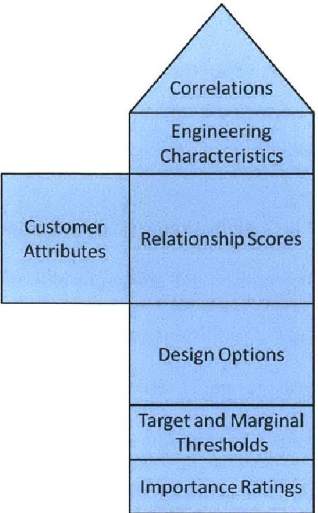

Figure 7: House of Quality

The relative importance of these customer attributes is identified to calculate the importance of each engineering characteristic. The engineering characteristics are the controllable, measurable parameters that are provide the major design tradeoffs. An assessment is made of how well each alternative meets the engineering characteristics and is numerically scored. Often an absolute scale is used to identify the scores. Using these scores and the calculated importance weightings, the alternatives are ranked.

## 2.1.4.6. Multi-Attribute Utility Analysis

Multi-attribute utility (MAU) is a powerful tool for evaluating alternatives and selecting the "best" option (Ross, 2003). It uses explicit value functions to perform direct comparison of many diverse measures. Like HoQ method, MAU provides a numerical score, but some feel it does so more explicitly (The Research Foundation of SUNY, 2009). The structured approach requires and clearly shows the

<!-- PDF_PAGE: 29 -->

numerical importance values placed on each parameter, often using 0-1 scale with 0 representing the worst preference and 1 the best. While this explicit definition of relative importance is required for MAU, it can be difficult to obtain as the tool is predominantly used in group decision making situations where several perspectives must be considered (The Research Foundation of SUNY, 2009). However, discussing the attributes' overall importance and the concept's ability to achieve them with potential users or customers can be a great learning experience.

The stakeholder value proposition, what they want from the system, can be defined using utility curves. Utility curves define the function relating the specific desired capabilities or attributes in terms of its range of values. Often graphs or mathematic functions are used to capture the benefit of an attribute using a dimensionless plot (Ross and Rhodes, 2009). When concepts are evaluated, the scores of each alternative can be independently determined using utility curves, such as the one shown in Figure 8, and combined using the relative importance weights.

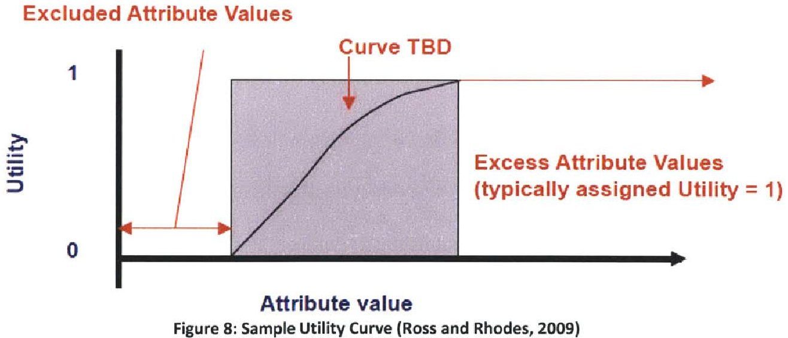

## 2.1.4.7. Multi-Attribute Tradespace Exploration

<!-- PDF_PAGE: 30 -->

Multi-attribute tradespace exploration (MATE) is method for fully exploring tradespaces of possible solutions rather than settling quickly on an optimum. It highlights the important trade-offs possibly overlooked by traditional methods to help identify compromise solutions that may be a better solution for the multiple stakeholders. MATE can be used to evaluate sets of design options, not just point solutions (Ross and Rhodes, 2009). Using this method the feasibility of large numbers of design choices can be quantitatively assessed early in the concept development process. It is also useful in identifying the stakeholder preferences.

MATE broadly scopes the mission objectives to avoid excluding creative solutions. It compares the alternatives based on the key, independent attributes, their lowest acceptable value, and highest meaningful value. These attributes are refined into utility curves, and aggregated into a single function for the trade study execution. Using design and constants vectors, the attributes values that cover the range of realistic possible solutions, and the design vector quantities, respectively, the performance of each option can be calculated in terms of attributes, costs, and utilities (Ross, 2003).

## 2.1.4.8. DSM

Unlike the other decision analysis tools, a design structure matrix (DSM) is not traditionally considered a trade study tool. However, it does assist in the evaluation of complex structures and behaviors. This matrix assists in the visualization of the relationships and dependencies between elements, interfaces, and data flows. DSMs can be useful in identifying less complicated physical architectures and sequences (Ulrich and Eppinger, 2004). One of the best heuristics in architecture is "Keep It Simple Stupid" often called KISS. KISS can increase system reliability while decreasing lifecycle costs and development time.

<!-- PDF_PAGE: 31 -->

To adhere to this principle, it is advisable to (1) have clear subsystem partitions, (2) maintain low external complexity, and (3) minimize interdependencies.

As shown in Figure 9, if DSM were to be used to evaluate a process for example, the tasks would be placed in a sequential order along the rows and corresponding columns of the matrix. Dependencies among the tasks are labeled by ones in the matrix, corresponding to the directed arcs in the graph.

<table border="1"><tr><td></td><td></td><td>A</td><td>B</td><td>C</td><td>D</td><td>E</td><td>F</td><td>G</td><td>H</td><td>I</td><td>J</td><td>K</td><td>L</td><td>M</td><td>N</td></tr><tr><td>Receive specification</td><td>A</td><td></td><td>X</td><td>X</td><td></td><td>X</td><td></td><td>X</td><td>X</td><td></td><td></td><td></td><td></td><td></td><td></td></tr><tr><td>generate/select concept</td><td>B</td><td></td><td></td><td>X</td><td></td><td>X</td><td></td><td>X</td><td>X</td><td></td><td></td><td></td><td></td><td></td><td></td></tr><tr><td>Design beta cartridges</td><td>C</td><td></td><td></td><td></td><td>X</td><td>X</td><td>X</td><td>X</td><td></td><td></td><td></td><td></td><td></td><td></td><td></td></tr><tr><td>Produce beta cartridges</td><td>D</td><td></td><td></td><td></td><td></td><td>X</td><td></td><td></td><td></td><td></td><td></td><td></td><td></td><td></td><td></td></tr><tr><td>Develop testing program</td><td>E</td><td></td><td></td><td></td><td></td><td>X</td><td></td><td></td><td></td><td>X</td><td></td><td></td><td>X</td><td></td><td></td></tr><tr><td>Test beta cartridges</td><td>F</td><td></td><td></td><td></td><td></td><td></td><td>X</td><td>X</td><td></td><td></td><td></td><td></td><td></td><td></td><td></td></tr><tr><td>Design prod'n cartridge</td><td>G</td><td></td><td></td><td></td><td></td><td></td><td></td><td>X</td><td>X</td><td>X</td><td></td><td>X</td><td></td><td></td><td></td></tr><tr><td>Design mold</td><td>H</td><td></td><td></td><td></td><td></td><td></td><td>X</td><td></td><td>X</td><td></td><td>X</td><td>X</td><td></td><td></td><td></td></tr><tr><td>Design assembly tooling</td><td>I</td><td></td><td></td><td></td><td></td><td></td><td>X</td><td>X</td><td></td><td>X</td><td></td><td></td><td></td><td></td><td></td></tr><tr><td>Purchase MFG equipment</td><td>J</td><td></td><td></td><td></td><td></td><td></td><td></td><td></td><td></td><td></td><td></td><td></td><td></td><td></td><td>X</td></tr><tr><td>Fabricate molds</td><td>K</td><td></td><td></td><td></td><td></td><td></td><td></td><td></td><td></td><td></td><td></td><td>X</td><td>X</td><td></td><td></td></tr><tr><td>Debug molds</td><td>L</td><td></td><td></td><td></td><td></td><td></td><td></td><td></td><td></td><td></td><td></td><td></td><td></td><td></td><td>X</td></tr><tr><td>Certify cartridge</td><td>M</td><td></td><td></td><td></td><td></td><td></td><td></td><td></td><td></td><td></td><td></td><td></td><td></td><td></td><td>X</td></tr><tr><td>Initial production run</td><td>N</td><td></td><td></td><td></td><td></td><td></td><td></td><td></td><td></td><td></td><td></td><td></td><td></td><td></td><td></td></tr></table>

Figure 9: Sample DSM (Ulrich and Eppinger, 2004)

## 2.2 Model-Based Systems Engineering

Systems engineering is one of the last engineering domains to embrace model-based development. In engineering and the sciences, models emphasize certain properties of interest in order to efficiently and practically communicate or identify results. In this context, models are digital expressions of designs.

Used in the mechanical and electrical domains for decades, model-based engineering is a methodology in which electronic abstractions are used to develop and capture designs. Computer-aided design (CAD)

<!-- PDF_PAGE: 32 -->

programs are now standard tools for the creation and manipulation of digital models. By using the tools and methodologies, increasingly detailed models are created and integrated. The use of electronic models has been shown to greatly improve development efficiently.

Model-based systems engineering (MBSE) uses a graphical language to generate and record details pertaining to a system's requirements, design, analysis, verification, and validation. This is not novel. Systems engineers have generated design abstractions for years. However, these descriptions were uncoupled static drawings. When new depictions were created or others modified, the drawings became out of date. Maintaining these separated system descriptions is an expensive, manual task. Complex descriptions were difficult to evaluate, as consistency was not enforced. As a result, errors were not apparent until much later in the development cycle. With advances in technology over the past decade, computer applications were developed to apply object-oriented software concepts to systems engineering to support high-level complex systems development.

MBSE implies that the models are composed of an integrated set of representations. All leading MBSE tools and methodologies assume that the representations of behavior and structure are interconnected in a central repository. Each descriptive element can be represented in many forms to create a variety of design and architectural representations. Expanding upon the INCOSE definition, MBSE is a methodology where models are central to the specification, design, integration, verification, and validation of systems (Estefan, 2008). The representations of system behavior and structure are captured along with statements of needs and verification methods.

## 2.2.1 Benefits

<!-- PDF_PAGE: 33 -->

MBSE promises to be a more rigorous and effective means of developing complex systems (Tepper, 2010). The methodologies are intended to make the complete systems engineering efforts as efficient as possible. The value of a model-based engineering emerges from the collection of the all system information in a central repository. This enables the interconnection of model elements and the ability to effectively retrieve any desired information. This interconnectivity enables the automatic propagation of design changes, consistency checking, error identification, which in turn provide the major primary benefits.

## 2.2.1.1. Reduction of Costs and Schedule

Substantial efforts and costs are incurred in the development of complex systems. As shown in Figure 10, while most development costs are incurred later in the development efforts, early design decisions commit the program to these expenses. Therefore the overall system value is determined at the beginning of a program, and must be considered as part of concept evaluations. Better life-cycle cost assessments can be determined by understanding the design implications, risks, and dependencies. MBSE provides the means of obtaining this information to enable stakeholders to make more informed decisions in as indicated in Figure 10.

<!-- PDF_PAGE: 34 -->

100%

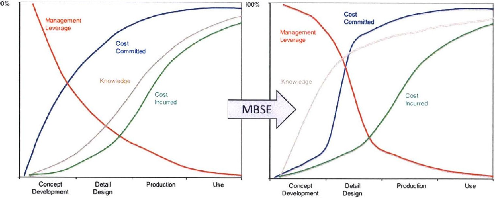

Figure 10: Changing the Paradigm (Ross and Rhodes, 2009)

Development costs are expected to be substantially reduced through the use of MBSE as they can obtain a better understanding of the system needs and implications. Programs can proceed more quickly and efficiently if there is a complete understanding about the way the design elements move together. Document-based approaches can be time consuming as information is often spread across several documents. Through its complete description of system behavior and structure, the model becomes an effective prototype. This can lead to dramatic gains in productivity and product quality.

By more thoroughly defining the stakeholder needs and assessing designs, the risks and uncertainties can be more accurately captured and reduced. Issues can be discovered early through the enforced consistency and relationship visibility (Baker et al.). Moreover, the early discovery of errors will reduce the cost and duration of the expensive integration and test phase.

In some situations, identifying stakeholder needs and priorities is a major challenge. The resulting ambiguity often delays decision making. MBSE methodologies and tools facilitate the elucidation of these requirements and priorities. When system requirements are more effectively translated from the stakeholders needs, the projects are more likely to succeed.

<!-- PDF_PAGE: 35 -->

Creating models is expensive, but this happens regardless of the MBSE approach. However, with MBSE less effort is extorted to maintain dependencies between views, or recreating the same information (e.g., different diagrams, requirements documents, design documents). As a result, the time spent identifying, accessing, and performing analyses is reduced.

## 2.2.1.2. Communication

One of the greatest benefits of MBSE is the improvement in communications among a diverse group of stakeholders (e.g. customers, users, management, and specialty engineering disciplines). Systems engineers must be able to easily and clearly communicate the problem, potential solutions, and rationales. Failure to do so leads to inconsistent system designs and ambiguity. In turn this leads to design flaws, resulting in urgent corrective actions, delaying schedules, and raising costs. This could instead result in program cancelations or unsuccessful product launches.

Traditionally, system engineering processes are "document centric", focusing on the generation of text requirements, specifications, and descriptions (Cole et al., 2010). However, standalone requirements documents are known to have gaps, conflicts, and provide an inadequate understanding of the actual requirements (Oliver et al., 1997). They are isolated from the actual system design and defined with ambiguous, natural language.

As MBSE tools and languages express each design element using constructs with a single, defined meaning, they provide an unambiguous and precise description that can be evaluated for consistency, correctness, and completeness. As the designs can be created from multiple perspectives, engineers can manage the complexity of each view. Developers can trade off clarity and completeness. Views can be created to provide a complete description of one aspect of a system design. Alternatively, views can

<!-- PDF_PAGE: 36 -->

hide some details to clearly present one aspect of a design. Using several complimentary, focused views to express the system structure, behavior, and interfaces is a much more effective way to communicate complex systems (Tepper, 2010).

Through the expressiveness and rigor of models, the relationship between the requirements and design can be more clearly conveyed. This traceability is traditionally performed manually. An emerging standard is to use requirements management tools (e.g., IBM DOORS) to link requirements to each other, verification methods, and design. While such tools are helpful, they cannot provide a digital connection enabling browsing between requirements and design.

Integrated models allow developers and reviewers to navigate through views to assess design impact or to inspect previous decisions. They mitigate ambiguity and promote consistency across the entire program and team (Tepper, 2010). Not only can elements be linked from one view to a dependent element in another, but the model provides traceability to previous decisions, issues, requirements, or risks. This may involve traversing through different levels of abstraction, several components, or external sources. Through these connections, the system objectives can be traced to the system components that implement it.

While the views alone can greatly enhance communication, MBSE tools provide the capability to greatly improve system understanding. Ideally, all models should be readily understood, without extensive education or experience. However, stakeholders have different experiences and backgrounds. Not all of them are interested or able to read modeling languages. Using the views to review the model with these stakeholders is ineffective and the desired information will not be ascertained. This is troubling

<!-- PDF_PAGE: 37 -->

because as George Bernard Shaw said, "The single biggest problem in communication is the illusion that it has taken place." (Wikiquote, 2011a)

Executing the model can prevent this communication breakdown. The understanding obtained through the dynamic visualization is one of the key benefits of MBSE. Consider trying to learn about the human heart. If depictions of the four chambers and flow of blood was presented, a fundamental comprehension of its architecture could be gained. However, if an animation of the beating and exchange of blood in slow motion was used, a much deeper understanding would be retained.

## 2.2.1.3. Knowledge Capture

Complex system development efforts, especially those designed for the military, can exceed ten years. Over that time the rationale for design decisions are often lost. This is unavoidable when traditional systems engineering approaches are used. Maintaining isolated documents often results in lost knowledge leading to effort duplication and increased costs.

MBSE provides and effective means for capturing, assimilating, and retaining design decisions and details. In an electronic repository, the information is portable, and can be reused if modifications are required in later lifecycles. The models serve as the project memory, preventing information from being lost due to staff turnover. Significant time can be spent recreating or discovering lost knowledge.

## 2.2.1.4. Decision-Making

The primary means of capturing and communication designs is currently through static drawing tools such as Microsoft PowerPoint and Visio. This is problematic as change is unavoidable in complex system

<!-- PDF_PAGE: 38 -->

designs. Currently, a careful review of static drawings and documents is required to manually update each one to capture and analyze design changes. Obviously, this can be a slow, arduous process.

In comparison, changes in MBSE tools are instantly reflected across the entire design. This allows developers to more efficiently and accurate assess the impact of potential changes and reduces the document maintenance burden. Increased knowledge, including apparent uncertainties, allows better decisions. While the sum of information stored in the model may be too much for humans to take into account at one time, by storing and relating the data across the model, it can be effectively accessed when needed. This can be useful in design or requirement reviews. Most requirement reviews are isolated from the information about previous design decisions or future implications. Reviews leveraging information in the model can facilitate the exposure of this information and improve team endorsement.

Executable models support improved decision analysis by conducting system design trade-offs based on a set of requirements. By assessing how well the system design meets them, designers can make better decisions. Design risks and cost can also be incorporated into the model to enhance the decision making process with trade study tools. The repository can provide the basis for the technical decisions, and the means of recording them.

## 2.2.1.5. Error Checking and Design Verification

In traditional systems engineering methodologies, the requirements and design validity are reviewed almost independently. Requirements are inspected individually and through their tractability to other requirements. Designs are primarily reviewed after reading the requirements. With integrated models, designs and requirements can be explicitly traced to each other, enabling more complete reviews.

<!-- PDF_PAGE: 39 -->

As discussed briefly, models can be checked for correctness by engineers and tools. Similar to a software compiler performing syntax checking, MBSE tools can validate the model consistency and conformance to standards. Successful model execution indicates the lack of "grammatical" errors. Moreover, by reviewing the model execution, developers can affirm that the right system is being built (Baker et al.). Using this capability, the design completeness and accuracy can be assessed, a formidable task using traditional techniques. The identification of inconsistencies indicates design flaws. Regular design inspection allows developers to be more effective and consistent right from the start. The expense of correcting an error is minor in a program's earliest stages, but becomes significant in later stages.

Simulating the model can verify the logical, consistent behavioral flow, interfaces, and triggers. Some permit system analysis though a discrete event simulator. The integration of performance models aid in the analysis of alternatives to determine the optimum design within the given constraints.

An emerging capability is the integration of MBSE tools with those used by other engineering domains. When data is automatically exchanged, programs will experience a significant reduction in errors, development times, and costs. As shown in Figure 11, an interface tool or translator could be used to create a cross-discipline model based development approach. This would enhance the entire product development lifecycle, by enhancing of the benefits of model based engineering. Design parameters would be exchanged automatically, eliminating simple errors. Trade studies could include more variables or be more detailed to find better solutions or find the solutions faster.

Tool independent translators can convert systems engineering models into formats required by other disciplines with minimal customization. Once the interface tool adds the capability to read or write data

<!-- PDF_PAGE: 40 -->

to a new tool, that data can be exchanged with all other tools. This minimizes the number of customized interfaces and plug-ins required to achieve a fully integrated development environment.

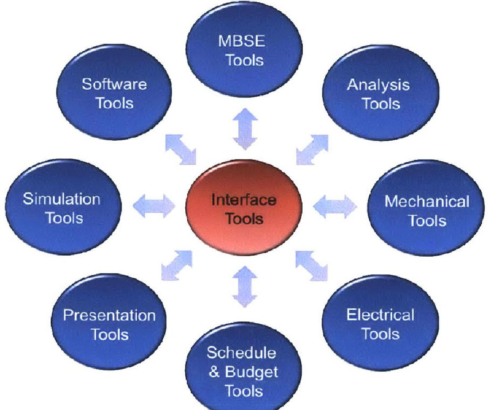

Figure 11: Interdisciplinary Model Based Environment

## 2.2.1.6. Documentation

Documents are expected to remain an essential part of MBSE (Logan and Harvey, 2011). Considered by many to be a "source of truth", documents will remain the primary means for most stakeholders to examine the model's contents. As it is unlikely that many non-specialist reviewers will be able navigate systems engineering model, document generation will continue to be important to support information exchange, reviews, and contractual obligations.

MBSE tools allow for the development of templates that automatically generate formatted documents from the repository. Using the templates, developers can automatically generate documentation based

<!-- PDF_PAGE: 41 -->

on the current design status. Unlike the traditional practices where documents generally capture the design status at the completion of the program, they can now be regularly created with very little effort. When combined with model reviews, developers can generate complete, up-to-date design descriptions and requirement documentation to keep the stakeholders informed.

## 2.2.1.7. Reuse

The reuse of model elements is one of the major advantages of a MBSE methodology. From a single repository, multiple consistent views can be produced to communicate and analyze designs. Manually maintaining diagrams and attempting to maintain consistency from uncorrelated elements is error prone and wastes resources. MBSE allows for the creation of alternative views while reusing common elements. Moreover, portions of system models can be reused for alternative designs. This supports trade studies and insures consistency, while providing traceability with minimal additional work.

Reusing of data items allows for the efficient creation and refining of data dictionaries or Interface Control Documents. As these are refined they can be reused across different programs by creating element libraries, domain specific constructs, and generic conceptual patterns. This has been shown to greatly reduce the time needed to develop similar system models and documentation (London, 2011).

Reduced development and maintenance costs can be achieved through the use of consistent design patterns to capture information and by leveraging multiple levels of abstraction. Consider the benefits of electric CAD packages. These tools have reusable parts in a local repository, and can organize them in any (accepted) fashion to design schematics. Some part properties are specified, while others are customizable. Commercial parts are provided by their vendors to promote reuse and design efficiency. Perhaps, this will be available for systems engineering models in the future.

<!-- PDF_PAGE: 42 -->

Some tools allow for elements to be created and analyzed in one graphical language, and to be reused in another (Wilson, 2011). This powerful capability can be used to reduce the risk of miscommunication by creating stakeholder specific views in order.

## 2.2.2 Tools

Generically, tools are things used by people to simplify or make their work more efficient. Tools help people automate what they already know how to do by hand (Maier, 2009). MBSE tools are developed to automate portions of a process, but they must be properly utilized. If used incorrectly, MBSE tools will only exacerbate the situation. An investment in methodology and tool use training is required to make MBSE adoption effective and can be the most expensive investment (Oliver et al.).

MBSE tools are available across a range of cost and capabilities. Using an interconnected central repository, most tools provide the capability to manage requirements, develop architectures, insure traceability, and specify verification methods. However, the features they provide to support these activities vary. Some MBSE tools can easily support large distributed teams, and others are more suited for smaller groups. While most tools are integrating technologies for trade studies, others provide interfaces to external analysis tools. The range of supported processes and methodologies provides developers with several options for MBSE implementation.

OPCAT, short for Object-Process CASE Tool, is intended to support the OPM MBSE language. Primarily an architecture development tool, trade study support or model execution is not currently available. However, the tool automatically generates natural language text from the graphic input and vice versa (Dori, 2008).

<!-- PDF_PAGE: 43 -->

Sparx Systems Enterprise Architect is a MBSE tool supporting software, systems and business processes modeling. Based on an open standard, several third-party extensions provide a wide range of features to expand the integrated tool capabilities. Almost completely unconstrained, Enterprise Architect supports any MBSE methodology.

Vitech CORE Spectrum and GENESYS tools integrate multiple languages and representations to improve communication and analyze designs. While these tools can simulate designs to validate the model using simulation, they have yet to include features that support integrated trade studies. However, this feature is expected shortly.

One of the most expensive and powerful options, IBM Rational Rhapsody product suite provides MBSE support for systems and software engineers. While several modeling languages are supported, the IBM tools are intended to be used with specific methodologies to leverage the benefits of its integrated functionality.

The MagicDraw System Engineering solution developed by No Magic, supports the full range MBSE capabilities through third-party plug-ins. While multiple languages are supported, MagicDraw provides specific perspectives for modelers based on their role and experience.

## 2.2.3 Views and Viewpoints

In each MBSE tool, methodologies and frameworks are organized by "views". Views are diagrams or descriptions that display a subset of the model in order to convey a specific set of information. To insure there are no misunderstandings, views should be developed to capture a specific aspect of a design.

<!-- PDF_PAGE: 44 -->

As incomplete technical messages focus on one message, they can communicate the point more effectively (Long, 2011). Often these views are created to meet the needs of a specific stakeholder. An analogy proposed by Jim Cunningham in a recent discussion was of a model of a house (Cunningham, 2011). Views of the front, back and each floor must be used to convey the architecture. One view is insufficient. Furthermore, specific views must be used to convey the design to the customer, electrician, plumber, etc. Each stakeholder has a different perspective and concern, known as a viewpoint. When developing these views, modelers should consider the recipient of the information. What is their background and expectations? What information must be communicated?

## 2.2.4 Languages

The selection of a language is critical to the MBSE effort as complex systems cannot be effectively modeled using unnecessarily complex or ambiguous languages. Most systems engineers use graphical representations to communicate, selecting the language based on their education and experience.

There are various modeling languages available to the systems engineers, including: Object Process Methodology (OPM), the Unified Modeling Language (UML), Enhanced Functional Flow Block Diagrams (EFFBD), and the Systems Modeling Language (SysML). These modeling languages, like any other language, are composed of semantics and syntax. Semantics are the meaning behind words and symbols. Syntax is the rules for representing semantics and their relationships. The language dictates how elements are created and manipulated within a tool.

MBSE languages must have formal, unambiguous semantics and syntax to eliminate the chance for miscommunication. The languages should support the full characterization of the static and time- dependant system characteristics, their hierarchy, and use. Relationships between elements should be

<!-- PDF_PAGE: 45 -->

explicitly represented to insure traceability. Effective languages should be clear and intuitive, so they can be quickly taught and easily understood.

## 2.2.4.1. Object-Process Methodology

Developed by Dr. Dov Dori, OPM is a generic language that integrates system's structure and behavior in one view by simultaneously representing structure and behavior using a relatively small alphabet. OPM is based on three types of entities: objects, processes, and states, with objects and processes being the higher-level building blocks (Dori, 2002). For OPM, they are defined as:

- Objects are the things that exist or have the potential of existence, physically or conceptually

- Processes transform objects by creating, consuming, or changing their state

- States are the situations that objects can be in

The symbols for objects and processes are depicted as rectangles and ellipses, respectively as shown in Figure 12. Objects and processes are connected with structural relations (i.e., aggregation, generalization) and procedural links (i.e., enabling, transformation, and events). Complexity is managed through three refinement/abstraction mechanisms: (1) Unfolding/ folding, which refines or abstracts the structural hierarchy of an object (2) In-zooming/ out-zooming, which exposes or hides the inner details of a object, and (3) state expressing/ suppressing, which exposes or hides an object's state (Estefan, 2008).

<!-- PDF_PAGE: 46 -->

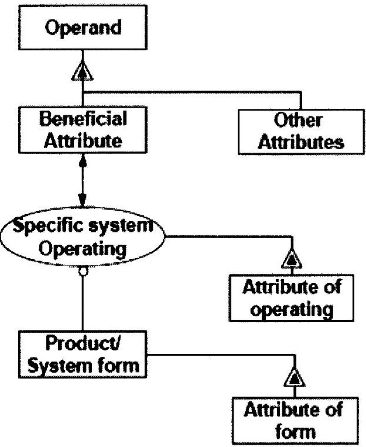

Figure 12: Example OPM Elements (Dori, 2008)

## 2.2.4.2. Functional Flow Block Diagrams

Functional flow block diagrams (FFBD) provide a chronological, sequential description of behavior. One of the oldest systems engineering modeling languages, FFBDs describe an object's functions in the order in which they are to be performed. Sequences are described using arrows from predecessors to their successors. Function completion criterion can be appended to arrows to further specify behavior. As depicted in Figure 13, FFBDs are represented as rectangles labeled with the function names. Conditional constructs (i.e., AND, OR) are shown in text contained in small circles. Using these constructs, concurrent and iterative behaviors can be defined. One of the major drawbacks of FFBDs is the inability to express any information relating to the triggers or flow of data between functions.

<!-- PDF_PAGE: 47 -->

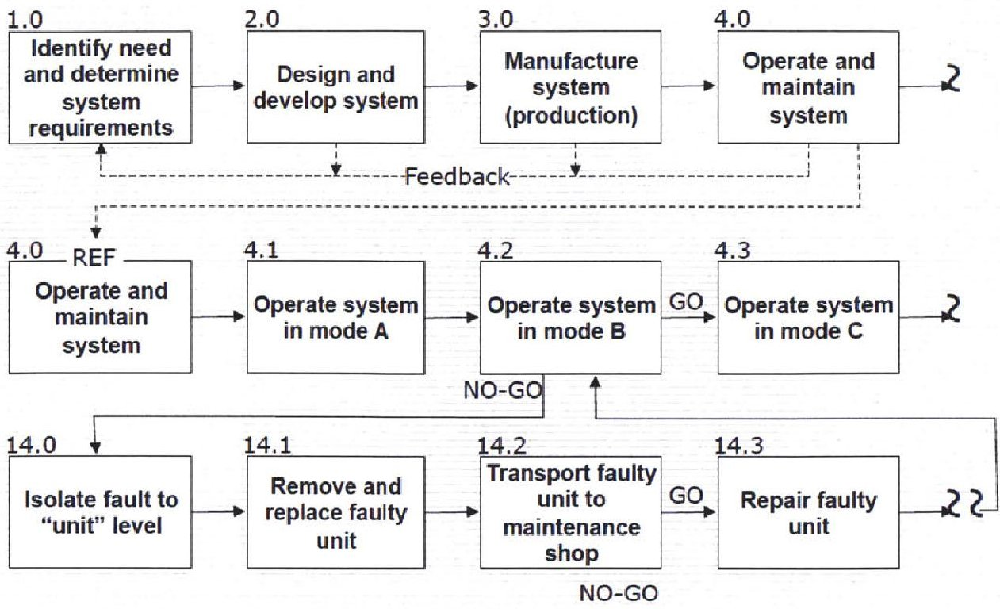

Figure 13: Functional Flow Block Diagram Example (Hale and Quayle, 2009)

## 2.2.4.3. Enhanced Functional Flow Block Diagrams

Enhanced Functional flow block diagrams (EFFBD) overlay the control structure and sequencing of FFBD, with the data exchanges, as shown in Figure 14. EFFBDs were one of the first diagrams to represents functions, control flows, data flows, and their dependencies (Long, 2009). The language provides constructs that graphically distinguish triggering and non-triggering data inputs.

One of the drawbacks of EFFBDs is the number of elements required to communicate the design. Edward Tufte, one of the most influential authorities on the visual communication of information, contends that non-informative and information-obscuring elements reduce the accuracy and clarity of the information conveyed (Tufte, 2001). The conditional constructs used in FFBDs and EFFBDs may reduce the clarity of design descriptions. However, these diagrams are thought to be more easily understood by military trained personal than other modeling languages (Wilson, 2011).

<!-- PDF_PAGE: 48 -->

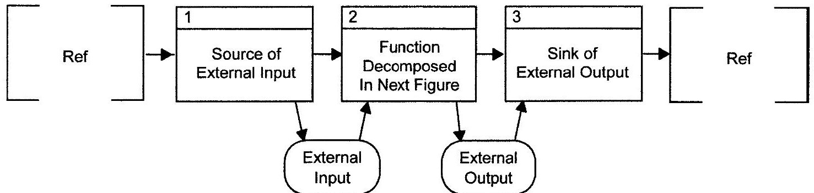

Figure 14: Example of an EFFBD (Bock, 2005)

## 2.2.4.4. Unified Modeling Language

Unified Modeling Language (UML) is a general purpose, graphical modeling language for object-oriented software engineering. It was developed in 1997 by the Object Management Group (OMG), an open membership, not-for-profit consortium. Now widely taught and used for software design, UML is a robust, flexible modeling language. UML defines several semantics for specifying software designs, but it is not necessarily to use each one.

The language describes the interactions between systems and external objects using use cases. Several structure diagrams are used to describe the system components, classes, and objects. State charts describe the conditions that classes assume over time. Activity diagrams describe the system workflows. Several interaction diagrams, describe the flow of control and data among system components. Additional information can be found via the UML standard (Object Management Group, 2011b).

## 2.2.4.5. Systems Modeling Language

Systems Modeling Language (SysML) is a graphical modeling language used to specifying requirements, structure, behavior, and allocations across a system's lifecycle. The language enables the design,

<!-- PDF_PAGE: 49 -->

analysis, and verification of complex systems. It was also developed under the auspices of the OMG in response to an initiative sponsored by INCOSE. SysML is considered by many to be a young language although it is based on the established UML, well known requirement constructs, and other standard systems engineering elements (Cole et al., 2010). SysML reuses and extends many UML diagrams as shown in the Venn diagram in Figure 15.

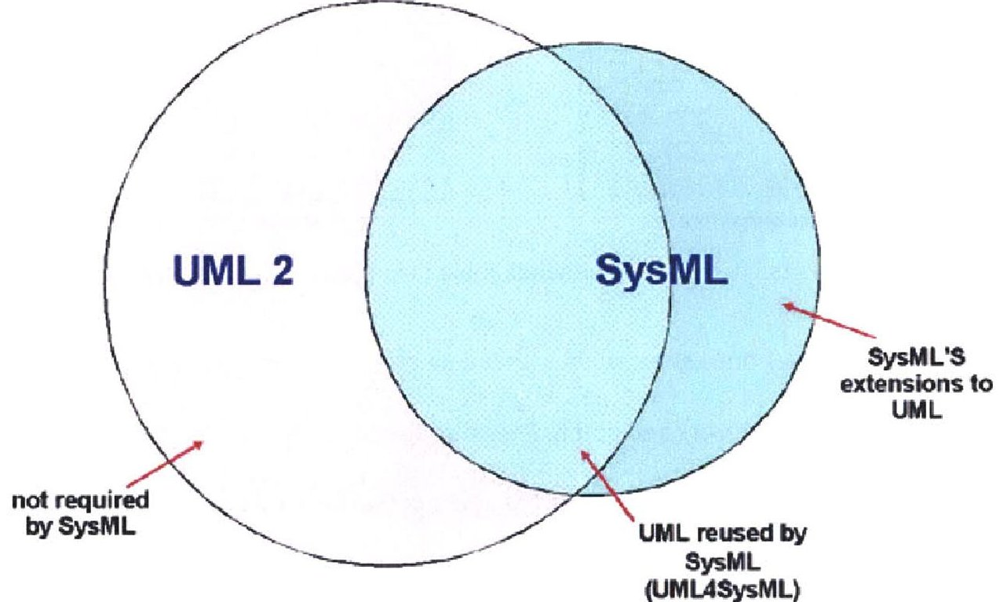

Figure 15: Relationship between SysML and UML (Object Management Group, 2011a)

Many envision SysML becoming the standard systems engineering language (Friedenthal, 2009). While other languages support aspects of MBSE, SysML can be applied to each systems engineering activity. This is achieved by providing diagrams for modeling system requirements, behavior, structure, and parametrics. These categories, known as the "four pillars of SysML", are shown in Figure 16.

<!-- PDF_PAGE: 50 -->

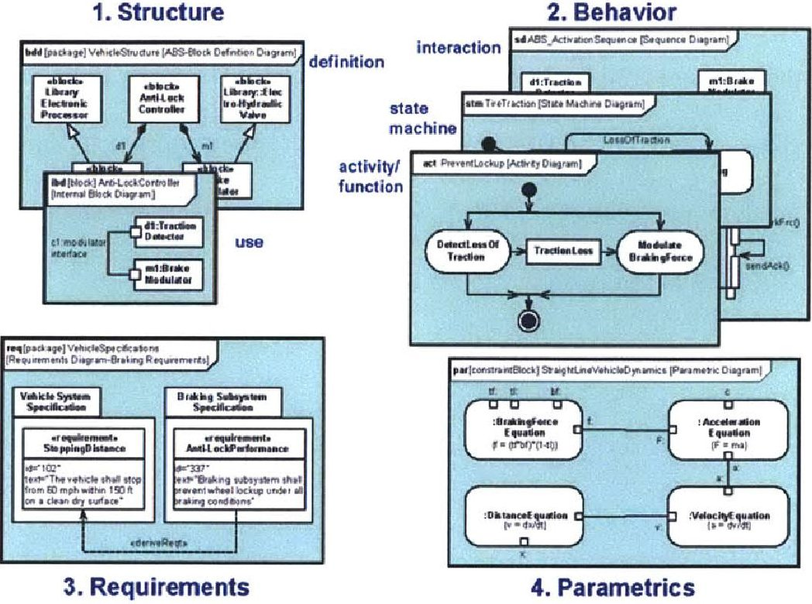

Figure 16: The Four Pillars of SysML (Object Management Group, 2011a)

Each graphical view expresses one aspect of the design. By offering a more complete representation of systems, SysML helps reducing errors and ambiguities during system development processes. When used properly, the language can greatly improve the value of system model, compared to pure textual system descriptions. The SysML diagram types are identified in Figure 17 and summarized below.

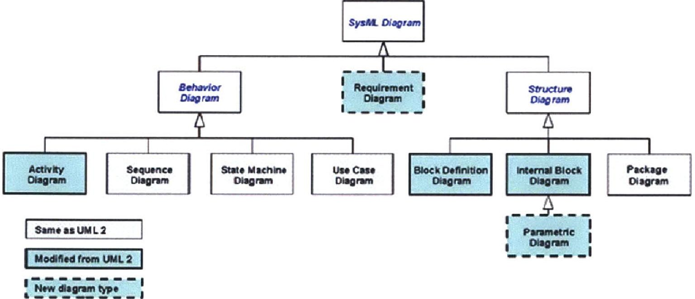

Figure 17: SysML Diagram Types (Object Management Group, 2011a)

<!-- PDF_PAGE: 51 -->

One of the most beneficial features of SysML is the variety of constructs it provides to describe behavior. However, SysML diagrams can also complete describe the system structure, depicting its hierarchy, interconnection, and properties. The language also provides specific constructs for specifying requirements and their relationships.

## 2.2.4.5.1. Use Case Diagrams

The use case diagram, shown in Figure 18, depicts the high-level system functionality in terms of its usage by external entities known as actors. Actors can represent any external elements, such as other systems, environmental conditions, or people. Use case diagrams provide basic behavioral descriptions through the interactions to each actor and must be elaborated via other behavior representations.

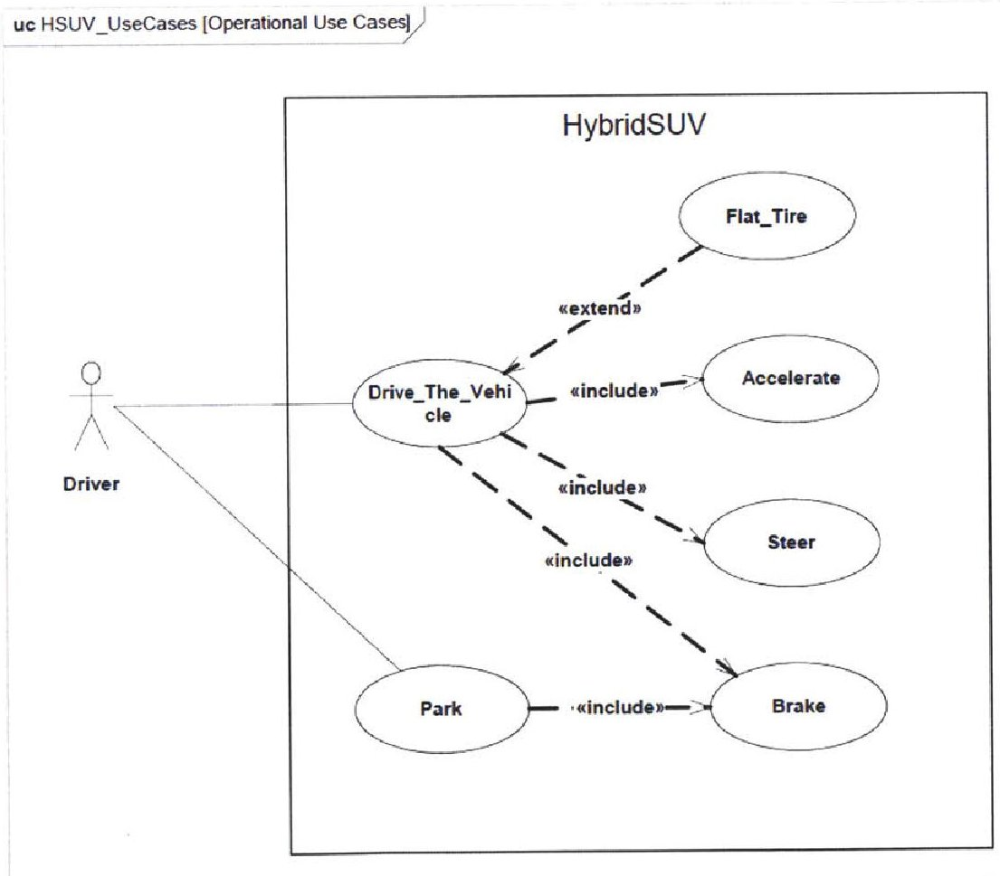

Figure 18: Example of Use Case Diagram (Friedenthal et al., 2009)

<!-- PDF_PAGE: 52 -->

Use cases are further defined through scenarios, specific paths of execution that list system interaction with the actors. Scenarios can fully describe the system functionality using a primary and several secondary scenarios. Secondary scenarios describe alternative paths and error conditions. These scenarios are sometimes captured using sequence or activity diagrams. Other MBSE tools automatically generate these diagrams from text based scenarios.

## 2.2.4.5.2. Activity Diagrams

Activity diagrams, shown in Figure 19, depict the complete flow of system operations. They are one of the most powerful and comprehensive depictions of behavior. The diagrams describe all of the possible paths of behavior and the order in which they must precede. Forks and joins, the solid black horizontal lines, on the activity diagram are used to show concurrent paths. Guard conditions on the control flows can stipulate alternative paths and when they are to be used. The diagrams also represent the flow of data (e.g., messages, commands), physical elements (e.g., fluid) or energy (e.g., force) between activities. These exchanges can be shown using rectangular constructs as shown in Figure 19.

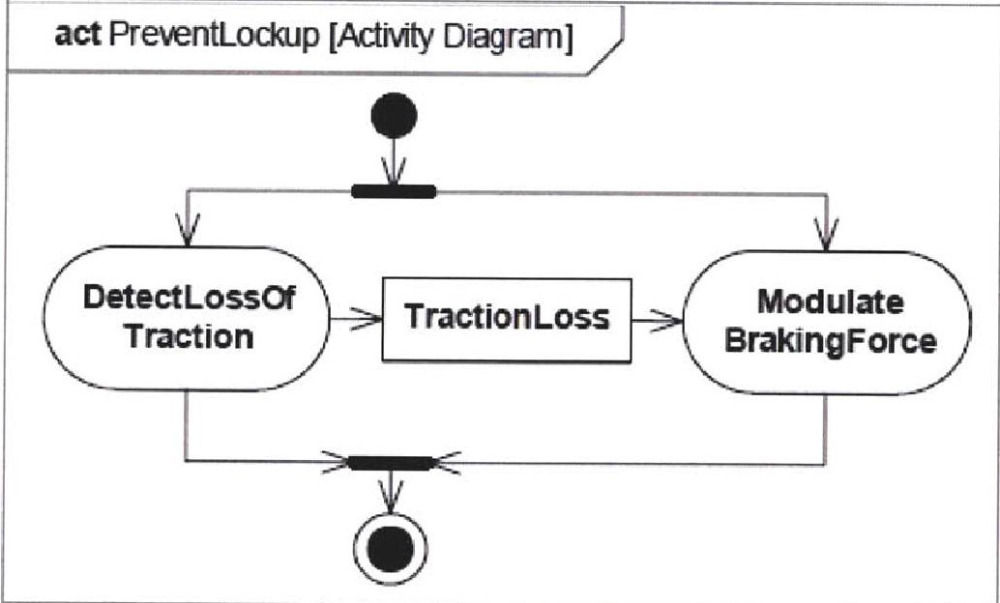

Figure 19: Example of an Activity Diagram (Friedenthal et al., 2009)

<!-- PDF_PAGE: 53 -->

The richness of this description also has a drawback. The views can contain too much information and therefore be hard to read. Care must be taken to clearly convey the intended message, and insure that the diagram meets the needs of its readers. Several comparisons of EFFBDs and activity diagrams have been made (Bock, 2005; Herzog, 2005) to identify the most intuitive language, however the results indicate very different conclusions. Therefore, it appears that reader's background and education impact their abilities to efficiently read the different languages. SysML seems to be natural for software and systems engineers, but may be difficult for those with military or mechanical engineering backgrounds, who may have a more natural affinity for EFFBDs. It appears that those with software and systems engineering backgrounds have a tendency to easily comprehend activity diagrams, while those with military or other domain expertise may prefer EEBDs (Cole, 2010; Long, 2011; Wilson, 2011).

## 2.2.4.5.3. Sequence Diagrams

Sequence diagrams describe the interaction between system elements and external entities as shown in Figure 20. They capture individual threads of behavior, timing, and exchange of messages. These diagrams do not have the capability to characterize control (Karban, 2011), and therefore several sequence diagram may be required to enhance the a single activity diagram. These messages are displayed as arrows and can be specified as synchronous or asynchronous, a call or return, and a specific type. The duration of an action can be important for some behavior flows. Sequence diagrams can explicitly capture these durations as shown in Figure 20.

<!-- PDF_PAGE: 54 -->

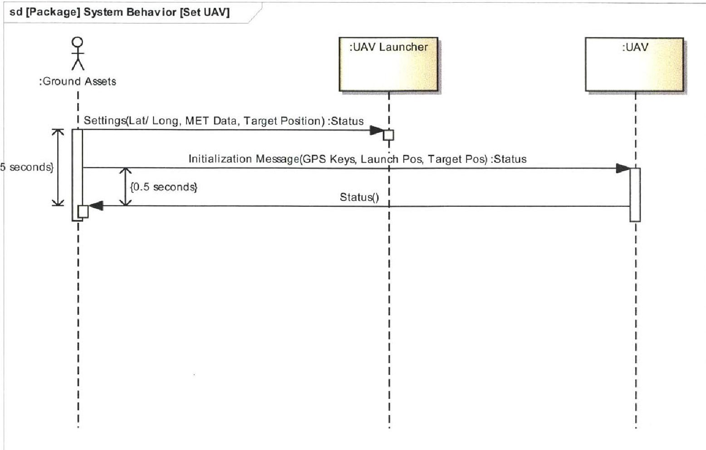

Figure 20: Example of a Sequence Diagram

## 2.2.4.5.4. State Diagrams

State or state machine diagrams are used to group similar behavior, describing a period of time with an invariant condition. As shown in Figure 21, they depict the trigger initiating the transition from one state to another, and the actions performed in response to events. State diagrams are frequently used to show the life cycle of a block (Friedenthal, 2009b). They can be leveraged with other states to act as "modes".

<!-- PDF_PAGE: 55 -->

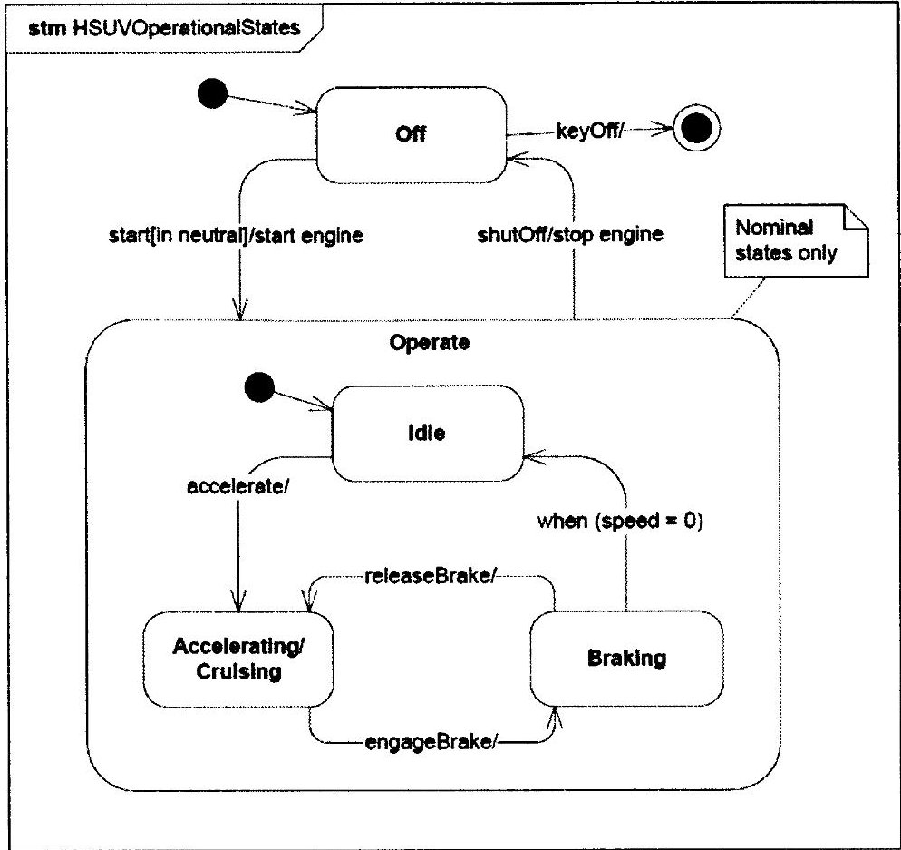

Figure 21: Example of State Diagram (Object Management Group, 2010)

## 2.2.4.5.5. Block Definition Diagrams

Block definition diagrams, such as the one shown in Figure 22, are used to describe how elements relate to each other. These views are primarily used to statically decompose elements. By breaking systems down through multiple levels of abstraction, simplified representations can be used to clearly convey and characterize the elements. While the diagrams generally capture the physical hierarchy and classifications, they can be used to decompose activities as well. Other common relations such as associations, generalizations, and multiplicity can be specified in block definition diagrams. The diagrams can also be used to specify the relationship between blocks and other constructs (e.g., requirements, activities, and actors).

<!-- PDF_PAGE: 56 -->

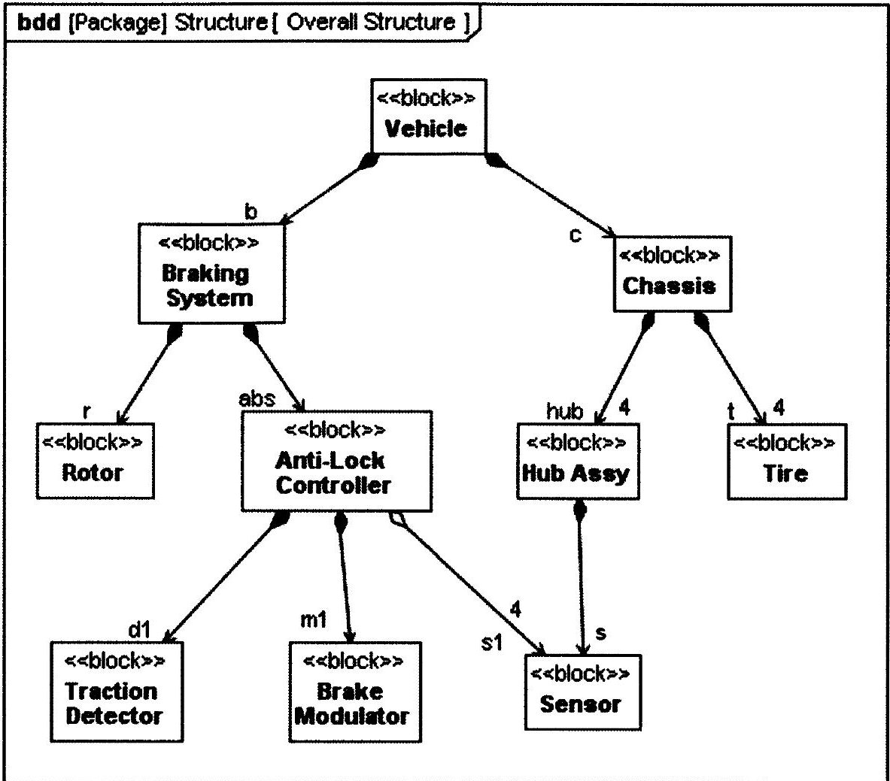

Figure 22: Example of Block Definition Diagram (Friedenthal, 2009b)

Blocks are the primary unit of structure in SysML and can represent hardware, software, people, or any other element (Object Management Group, 2011a). Other descriptive characteristics can be assigned to the blocks such interfaces, parts, values, and attributes. Ports and flow ports represent the inputs to and outputs from blocks. Interfaces are defined using standard ports and flow ports, which specify required operations or signals, and what can flow in or out of the block respectively. Constraints and attributes are the block's properties. They may have default values, or could be selected later in the design.

## 2.2.4.5.6. Internal Block Diagrams

<!-- PDF_PAGE: 57 -->

Internal block diagrams are used to describe the Blocks' internal structure in terms of its parts, ports, and connectors. As shown in Figure 23, they specify how the internal elements and ports are connected as well as the objects that flow between them. Internal block diagrams generally show a frame representing the enclosing block and specifying its external interfaces. All internal elements are instances of block components specified in block definition diagrams.

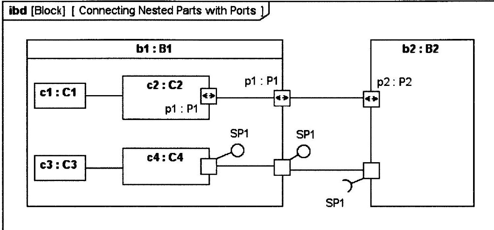

Figure 23: Example of Internal Block Diagram (Friedenthal, 2011)

## 2.2.4.5.7. Requirements Diagrams

Requirement diagrams are used to graphically depict the hierarchy between requirements and their relationships to other model elements. Using graphical construct to capture text based requirements, these diagrams can clearly convey the elements that satisfy, refine, and verify the requirements. They can also provide a bridge between the traditional requirements management tools and SysML models (Object Management Group, 2011a).

<!-- PDF_PAGE: 58 -->

As shown in Figure 24, requirements derivations and rationales can also be expressed. SysML defines seven constructs to capture the relationships between requirements, such as (e.g., containment, derive) and other model elements (e.g., satisfy, trace) (2009; Rosenberg and Mancarella, 2010).

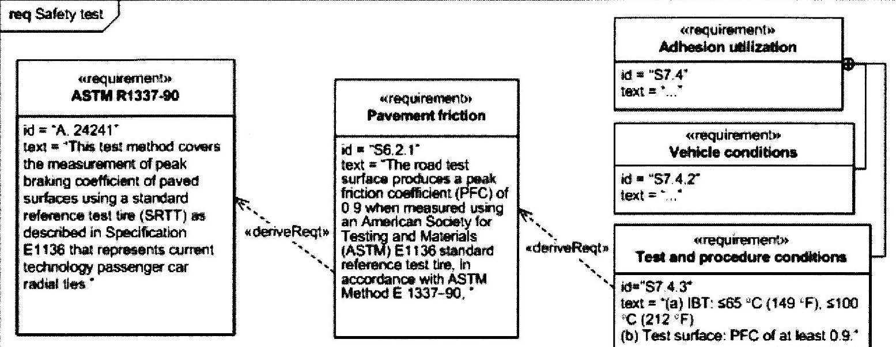

Figure 24: Example of Requirements in Diagram (Object Management Group, 2010)

## 2.2.4.5.8. Parametric Diagrams

Parametrics can support trade studies and analysis of non-functional requirements (e.g., cost, weight, performance, quality, flexibility). Using constructs such as those shown in Figure 25, parametric diagrams can perform calculations based on the block's value properties. In addition to trade studies, they can be used to compute technical performance metrics or other critical budgets based on the attributes of lower level components.

<!-- PDF_PAGE: 59 -->

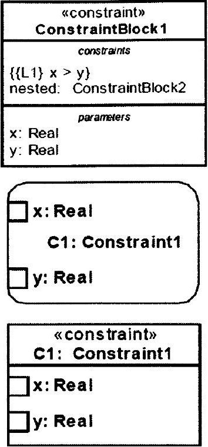

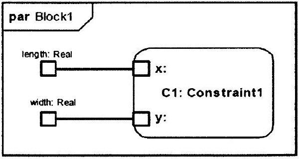

Figure 25: Example of Parametric Constructs and Diagram (Object Management Group, 2010)

Parametric diagrams use constructs that express equations, parameters, and logical relationships to constrain or calculate block properties. The constraint blocks and constraints are shown in Figure 25 with a constraint instance. The figure also specifies the parameters, x and y, and their value properties, "real". A constraint block is a generic definition of a constraint that can be reused to form organized equation networks. Constraints are equations such as $ F=m^{*}a $ . In constraint blocks, the equation variables (e.g., force, mass, acceleration) known as parameters, are not specified as inputs or outputs. Parameters are specified as variables or products of the equation using constraint properties, the instances of constraint block. Constraint properties explicitly define the quantifiable characteristic, such as force or mass. The parameters known as value properties are typically defined with value types such as units, quantities, or probability distributions (Peak et al., 2007a).

<!-- PDF_PAGE: 60 -->

Once the input and output parameters of each constraint block are captured, the constraint equations can be explicitly defined. This is generally achieved using a scripting language providing the mathematical basis for execution. While tools can accommodate a number of different scripting languages, they must be consistent throughout the model.

Parametrics can support trade studies and analysis of non-functional requirements (e.g., cost, weight, performance, and the "ilities"). This can be performed by specifying the relationship between a system's measures of effectiveness (MOEs) and each implementation. By formally specifying the relationship, robustness analyses can be performed. An example of a parametric diagram specifying MOEs can be seen in Figure 26. For additional information, refer to (Peak et al., 2007a; Peak et al., 2007b).

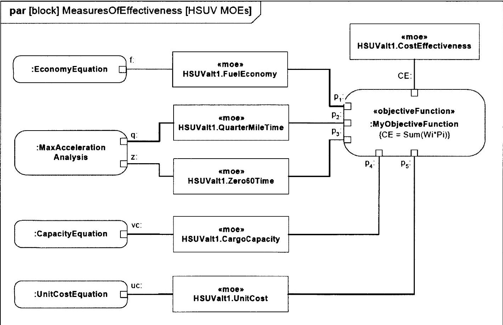

Figure 26: Example of MOE Definition (Object Management Group, 2010)

<!-- PDF_PAGE: 61 -->

## 2.2.4.5.9. Element Attributes

SysML elements are often defined through the explicit specification of their attributes. These descriptors provide an effective way of describing system properties and managing critical parameters. Attributes can capture the operations, values, assumptions, constraints, characteristics, or qualities of any element. Figure 27 demonstrates the definition of a block using a variety of attributes. Qualities such as security, response time, or reliability can be associated with these constructs and refined at lower levels. Most tools enable the direct inheritance of attributes so that they can be identified in conceptual elements and specified in the implementations. The specification can also be performed using parametric diagrams.

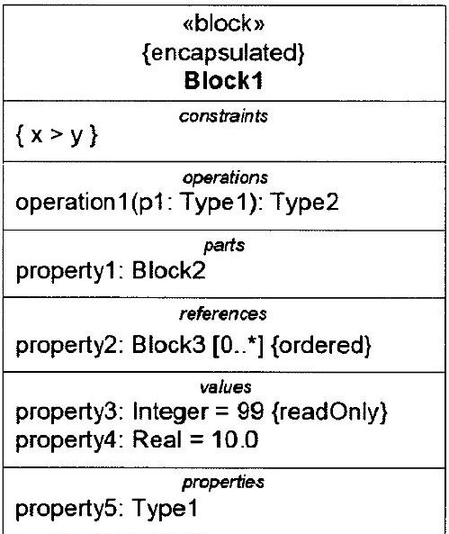

Figure 27: Example of Block Properties (Object Management Group, 2010)

While almost infinite descriptions can be added to the constructs, it is important to select only the quality attributes that add value. They should be key and relevant to the application and model. Each attribute should be clearly named and have a well defined type and value. In addition, it is also beneficial to add a rationale statement or link to source describing the need for the attribute.

<!-- PDF_PAGE: 62 -->

## 2.2.5 Methodology

Formal methodologies insure that consistent approaches are used to meet the expectations of all stakeholders. They provide structure to standardize the development process and deliverables, and essential practice for large projects to communicate effectively and efficiently perform design activities (Oliver et al.). While there are several existing systems engineering and MBSE methodologies, each one follows similar processes for requirements definition, design, and verification. Each MBSE methodology starts with the reception of defined customer requirements. Based on these needs, a variety of processes are used to guide teams from requirement analysis through detailed design, and finally system verification. A description of the established MBSE methodologies is maintained by OMG and INCOSE within the MBSE Wiki (Estefan et al., 2011). The leading MBSE methodologies are discussed herein.

Prior to the establishment of MBSE methodologies, numerous organizations developed systems engineering process standards to improve requirement development and multi-disciplinary development efforts. One of the original and most well known processes was MIL-STD-499.

After several decades, a significantly updated version, MIL-STD-449B, was poised to be released. However, many military standards were canceled in 1994, including MIL-STD-449B. It should be noted that the Air Force and other organizations continued to use the unratified MIL-STD-449B. Shortly after the intended release, the Electronic Industries Alliance (EIA) released a commercial version, which became American National Standard (ANSI/EIA 632). The standard describes an integrated fundamental process to guide systems engineering efforts (Estefan, 2008). ANSI/EIA 632 provided many of the

<!-- PDF_PAGE: 63 -->

guiding principles for the international standard ISO/IEC 15288 and the INCOSE Systems Engineering Handbook (SE Handbook Working Group, 2011).

Other organizations have developed or formalized their own methodologies or processes. NASA, which has recognized the value of the formal processes since its inception, has its own standard, NASA NPR 7123.1A (NASA, 2009). NPR 7123.1A describes a required set of internal technical and managerial processes for performing, supporting, and evaluating systems engineering efforts. In addition, it specifies the roles, tools, and lifecycle reviews for system development.

Capability Maturity Model Integration for Development (CMMI-DEV) is part of one the largest nongovernment design methodologies. It contains a comprehensive, integrated set of best practices and guidelines that can be applied to any product or service development domain (Product Team CMMI, 2011). CMMI-DEV is divided into five engineering processes, and follows an iterative approach through development to verification and validation.

The Aerospace System Engineering Process (ASEP) is an example of a corporate systems engineering methodology. Systems, Inc., Draper Laboratory, and many other large companies have defined internal methodologies. ASEP is focused on defense systems development (Maier, 2009), starting with an analysis of the potential system value. ASEP is one of the few methodologies to have disparate steps for candidate conceptual and implementation solution development. Like the other established systems engineering methodologies, ASEP does not suggest processes for detailed design and verification. Instead it focuses on concept development, culminating with a selection and formal architecture or concept definition.

<!-- PDF_PAGE: 64 -->

MBSE methodologies, tools, and languages are separate entities that in theory could be combined in any way. However, the trend at the time of this thesis is towards their customization. The only tool currently supporting the OPM language is OPCAT. The Rational Harmony methodology is heavily focused on SysML and has been tailored for IBM Rational Rhapsody software. Vitech MBSE tools, which historically supported non-SysML languages, are tied to the homegrown STRATA methodology.

## 2.2.5.1. Vitech STRATA Methodology

STRATA, an abbreviation of strategic layers, is a design methodology based on a layered process of analysis and design decisions. Initially developed by Jim Long, Marge Dyer, and Mack Alford, this MBSE approach has been continually updated by Vitech Corporation. The methodology follows the systems engineering onion model, stepping through the design in increasingly granularity. At every design level, STRATA seeks to remove ambiguity and make design decisions. Starting at the most general level, requirements, functional behavior, and architecture are developed, verified, and validated as shown in Figure 28 (Vitech Corporation, 2011).

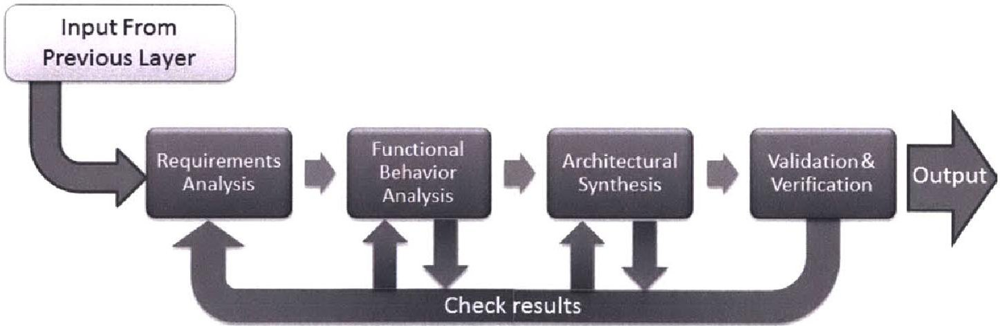

Figure 28: Vitech MBSE Activities Performed at Each Layer (Vitech Corporation, 2011)

<!-- PDF_PAGE: 65 -->

The Vitech MBSE methodology is based on the four concurrent activities, labeled as "domains". The methodology assumes that the work products are linked and maintained through a model repository. The requirements domain takes descriptions of the intended system use and purpose in order to create "child" requirements. The domain culminates in an agreed upon set of acceptance criteria and the "verification requirements" required to assess them.

The functional behavior analysis identifies the characteristics, object flow, and the stimuli response behaviors for the system. It is focused on decomposing the problem into solvable pieces, insuring that the complete logical flow is defined.

The architecture synthesis domain starts by examining the system and the elements that transition the system boundary. These design activities are strongly influenced by behavior domain models, which guide the physical partitioning and allocation. At leach layer of development, the partition is assessed and compared to the products of the other domains.

STRATA uses both graphical and textual language to define the architecture. It stresses a well organized syntax and semantics to support behavior model execution (Vitech Corporation, 2011). At the conclusion of this domain, an executable model is created with physical partitions, clearly defined object flows, and explicit behavioral allocation. The execution ensures that the assumptions, interfaces, functions, and architectures are convergent, consistent, and complete.

STRATA enforces the system verification and validation throughout the development of the other domains. The methodology insures that at each level the requirements trace to system components, and that the layer's model is consistent with the others. At the conclusion of the verification and validation, automatically generated documentation is used to communicate the layer's designs. At the

<!-- PDF_PAGE: 66 -->

highest level, the domain also insures that the design meets the acceptance criteria based on the verification requirements.

The methodology assumes it is used in conjunction with a tool automating many functions. By enforcing reuse and integration, it lets tools to do the "perspiration stuff" and human brains to do the "inspiration stuff." (Vitech Corporation, 2011).

STRATA is based on the fundamental Onion Model principles of completely and consistently addressing the design activities at each layer. As the development team completes a system design level, they "peel off a layer of the onion" and develop the design at the next level of decomposition. The methodology seeks to avoid the cycle of rework and fixing errors by insuring that constraints are discovered early in design process. Vitech claims it makes the design process "virtually fail safe" (Vitech Corporation, 2011). To use this approach, it is crucial to discover the constraints early in system design process. STRATA stipulates that developers should never iterate between more than one layer. Changes across several layers can significantly impact cost and schedule.

## 2.2.5.2. INCOSE Object-Oriented Systems Engineering Method

The INCOSE Object-Oriented Systems Engineering Method (OOSEM) is a top-down systems engineering development approach intended to be applied in conjunction with SysML and tools supporting object-oriented modeling. While OOSEM is based on the Vee development model, it uses a recursive, spiral like approach to design and system decomposition. The methodology was developed in 1998 and refined under a joint Lockheed Martin Corporation and Systems and Software Consortium endeavor. OOSEM uses a Use Case and scenario-driven design strategy to support requirements analysis as well as

<!-- PDF_PAGE: 67 -->

the development, evaluation, and verification of complex systems (Wolfrom, 2011). It advocates element reuse to accommodate design evolution and requirement modifications.

One of the greatest differentiators of this methodology is the system analysis from the viewpoint of structure, in lieu of the more common behavior (Ryder, 2006). Advocates of the methodology claim that structural decomposition, and hence designs based on structure, can be grasped more clearly. These objects, abstract or specific implementations, are refined by allocating activity and state descriptions.

As shown in Figure 29, OOSEM is divided into four primary phases. The pink boxes in Figure 29 identify the major systems engineering activities, while the green boxes indicate common tasks performed throughout the process. The methodology begins with a stakeholder needs analysis using use cases to scope and define the problem. Using these use cases, requirements and measures of effectiveness are then developed. Processes are suggested to insure that requirements are necessary, concise, feasible, complete, unambiguous, consistent, and verifiable. Through the system requirement development, the system scenarios, states, and interfaces are defined (Wolfrom, 2011).

<!-- PDF_PAGE: 68 -->

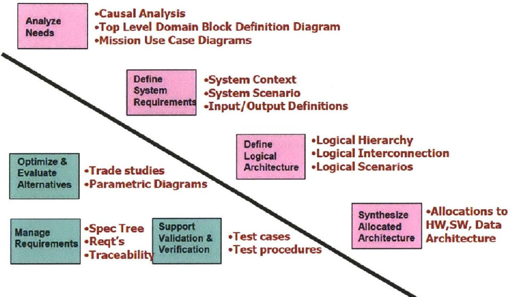

Figure 29: OOSEM Methodology (Wolfrom, 2011)

Once the requirements are documented, the abstract, or logical, structural architecture is developed.

The abstract structural architecture specifies the subsystem interfaces required to realize the scenarios. To fully define each subsystem, their states and activity flows are specified. Next, each object is traced to the driving requirement.

In the final phase, specific hardware, software, and data implementations are specified based on the abstract physical architectures. The particular physical components are linked to the logical one and further defined though the specification of the critical component properties. As a result of the subsystem design implementation, requirements are generated and the process is repeated. Alternative designs are assumed to be developed and evaluated in parallel to the requirement and architecture analyses. OOSEM assumes the analysis is performed using SysML parametric diagrams and constraints.

## 2.2.5.3. Rational Harmony for Systems Engineering

<!-- PDF_PAGE: 69 -->

Rational Harmony for systems engineering is a subset of the overall Rational Harmony development methodology shown in Figure 30. By looking at the figure, it is apparent that the methodology mirrors the classical "Vee" lifecycle development model. Rational Harmony for Systems Engineering, hereafter called simply Harmony, originated at I-Logix, Inc., which became part of IBM through a series of acquisitions. When used in conjunction with the IBM Rhapsody tool suite, the methodology defines specifies the specific processes that should be followed. However, Harmony can be applied to any MBSE effort, and is not Rhapsody specific.

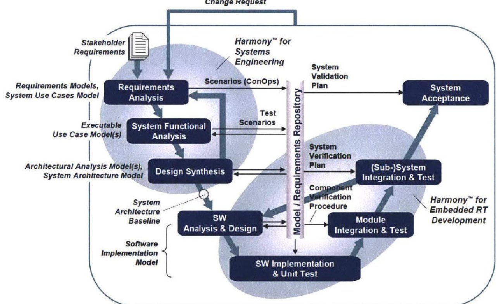

Figure 30: Rational Harmony Integrated Systems / Embedded Software Development Process (Hoffmann, 2011b)

As the focus here is on concept development, the phases following the system architecture baseline shown in Figure 30 will be ignored. The key systems engineering objectives in Harmony are to derive the required system functions, identify the system states, and allocate these behaviors to subsystem

<!-- PDF_PAGE: 70 -->

structure. The methodology is divided into three high level activities; requirements analysis, functional analysis, and design synthesis. They are depicted in more detail in Figure 31.

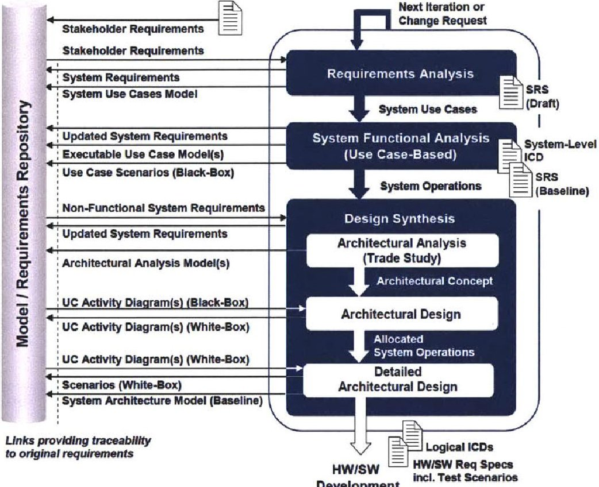

Figure 31: Rational Harmony for MBSE (Hoffmann, 2011b)

The process assumes that model and requirements artifacts are maintained in a central model repository. Like other leading MBSE methodologies, Harmony considers the model is the primary work product of the development. All resulting documentation is generated as a means of distributing information on a segment of the design.

Requirements analysis, the first stage in the methodology, assumes that stakeholder requirements are provided. As highlighted in Figure 31, the emphasis of this phase is to derive system requirements based on these stakeholder requirements and other documents. Once the system requirements are

<!-- PDF_PAGE: 71 -->

identified, each one is allocated to a use case. Several alternative, but detailed processes are defined for each Harmony stage. They can be selected based on the tool and development team experience.

The focus of the system functional analysis is to define the scenarios that describe each use case. Alternate processes exist within the Harmony methodologies. One process suggests that use cases be developed as if they were the sections in the user guide, and that approximately 20 scenarios should be defined for each one (Hoffmann, 2001). An alternate, more flexible process allows activity, sequence, or state diagrams to be developed in any order. This "Hoffmannized" process specifies that activity diagrams must be created first and that sequence diagrams are generated automatically by the tool. There are more similarities than differences. Each process stresses the definition of ports and data flows in this phase. Harmony uses states as the means of capturing and coalescing system behavior. The model is verified through execution based on these states.

The objective of the design synthesis is to select a concept and refine the design. As shown in Figure 31, the stage starts by developing candidate solutions and performs a trade study to select one of them. The selected concept is refined by allocating the system and subsystem behaviors to the appropriate physical models. Like the other MBSE methodologies, Harmony results in a number of deliverables to other domains. These include several requirement documents, interface control documents, models for integrated software or firmware development, and test scenarios.

## 2.3 DODAF

In addition, to the development methodologies, a number of frameworks exist to guide the developing common architectures representations. One such framework is the United States Department of Defense Architecture Framework (DODAF). It specifies common presentations of information in order

<!-- PDF_PAGE: 72 -->

to improve the communication, integration, and evaluation of architectures across organizational and national boundaries. Currently focused on describing data, DODAF establishes data element definitions, rules, and relationships for consistent description of systems and architectures (United States Department of Defense, 2007). As shown in Figure 32, DODAF provides four basic views:

- All view (AV) with two work products

- Operational view (OV) with seven work products

- Systems and services view (SV) with 11 work products

- Technical standards view (TV) with two work products

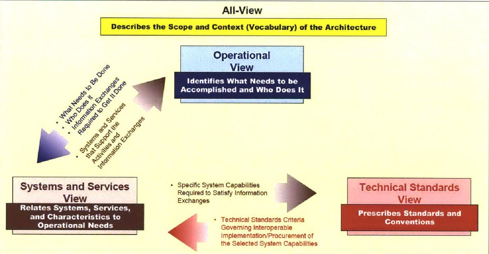

Figure 32: DODAF Views (United States Department of Defense, 2007)

Each view has a specific purpose. Given the wide range of possible designs and architectures that can be developed, DODAF provides 22 possible views communicate the necessary descriptions. However, it is not necessary to develop each one, as many of these will not provide new information.

<!-- PDF_PAGE: 73 -->

DODAF seeks to provide an integrated description with unique elements that are consistently used across all views within the architecture (United States Department of Defense, 2007). One of the ways to accomplish this goal is to combine DODAF with a MBSE tool and language, such as SysML. DODAF and SysML are already well aligned, as the language can be used to implement most views. The Object Management Group, the developers of the UML and SysML modeling languages, are looking to develop a modeling standard supporting DODAF. The standard, known as UPDM, an acronym for Unified Profile for DODAF/MODAF, is looking to formally specify this relationship (Okon and Hause, 2009). As indicated by the name, UPDM would include the UK Ministry of Defence Architecture Framework (MODAF), one of many similar military architecture frameworks.

When developing documentation for stakeholders who expect DODAF views, it is crucial to discuss the specific views that are useful. Once these are established, they can be developed using SysML diagrams using any other the tools and methodologies described in this chapter.

<!-- PDF_PAGE: 74 -->

## 3. MBSE Framework for Concept Development

This chapter presents a Model-Based System Engineering (MBSE) Framework for Concept Development. This framework specifically addresses the needs of the early stage systems engineering projects. While the established MBSE methodologies provide structured strategies, they start from a defined set of requirements. However, most concept development efforts do not start with a well-defined set of statements encompassing the complete set of required functions, interfaces, and performance. These requirements must be identified as part of the development process.

The framework integrates traditional systems engineering techniques and tools with the MBSE. The fundamental problem solving activities are followed, but in an integrated electronic environment. It provides flexible, yet robust methodology to insure that not only the right design is identified, but it solves the right problem. By leveraging the benefits of MBSE, the dynamic interactions between system alternatives and users can be understood. This insight provides a more thorough assessment of design features. Using SysML models, a methodology is described to obtain an understanding of the problem, identify and develop potential solutions, analyze them, and suggest the best alternative.

The framework integrates existing concept development tools with model-based development methods to execute projects more effectively. Systems engineers have developed a rich collection of tools, as described in Chapter 2. The framework allows development teams to select the right tools for their needs. Consider a carpenter with a large tool collection. While one could use a reciprocating saw to cut 2x4s, the carpenter may prefer to use a circular saw. A methodology should not constrain developers from using their preferred tools.

<!-- PDF_PAGE: 75 -->

Alternative processes are presented to accommodate diverse development efforts. While an ideal process is identified, alternatives can be tailored to meet the specific development team and program needs. Leveraging MBSE will not automate the concept development process, but it will enable more efficient analysis and communication. Developers will likely go through the same thought process, but the consistencies enforced by the processes will help identify errors earlier.

A high level view of the methodology is depicted in Figure 33. It starts by identifying the problem, which, as discussed in Chapter 2, could result from the reception of customer requirements or an active needs analysis. Once the problem is identified, it is suggested that the development team fully define the problem. However, if the problem is similar to previously defined problems, the team may seek to immediately evaluate the architecture. If the customer or team has a solution in mind, it may be prudent to start identifying other possible solutions. While the framework allows for any of these activities after the problem identification, it is best to follow the suggested process. If teams focus too early on defining the architecture or identifying alternative solutions, their efforts may be wasted.

<!-- PDF_PAGE: 76 -->

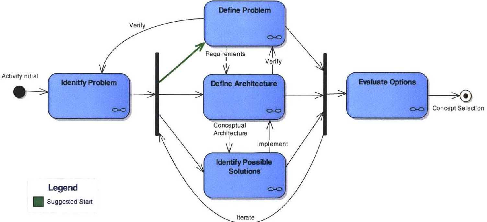

Figure 33: Concept Development Methodology

The problem definition is the most important step in the development process. If this is not done correctly, the team could develop a system without a market or customer base. All solutions must meet specific needs at an affordable cost and be available in an acceptable amount of time (Maier, 2009). The details of each of these criteria must be refined by working with the various stakeholders. By framing and decomposing the problem into its expected functionality and performance attributes, a set of requirements can be developed to guide the design process.

Creating system architectures involves the development of system concepts, specifying what they are and what they do. Architecture is not only about the system structure. The focus should actually be on the system functionality required to meet the stakeholder needs. Leveraging MBSE tools, executable behavior models are made to insure design consistency and accuracy. Alternative flows of behavior can be captured to support concept evaluation. Conceptual structures are created to implement the system at different levels of abstraction before defining specific ways to implement them. The allocation of behavior to structure is concept dependant and performed only after possible solutions are identified.

<!-- PDF_PAGE: 77 -->

This development activity should be supported by domain experts, in order to determine the best feasible solutions.

The identification of possible solutions is often performed in parallel to the system architecture definition. Developers and customer do not always know what they want until they consider what is feasible. Many tools and techniques have been developed to improve the effectiveness of this process, and this framework employs these methods. It does not seek to import the results into SysML models until the solution space is sufficiently focused. Using various tools, the full list of alternatives and results of each activity can be connected via hyperlinks. This facilitates the retention of information and the capture of design rationale.

Once the solution space is sufficiently focused and the alternative concepts sufficiently defined, trade studies can be conducted to select the best alternative, based on the measures of effectiveness. The selected concept must be assessed to be feasible and able to satisfy the high-level requirements. This evaluation is conducted at the system level, based on contributions from all necessary domain experts. If a feasible solution is not found among the alternatives, the team must cycle back to an earlier step. Iterations are often conducted prior to the final trade study. New information is discovered about the problem and alternative solutions are discovered as the team converges to a final design. No matter how much is known about a given problem, there are always unique aspects to new solutions that must be discovered. There are too many possible feedback loops to show in the example depicted in Figure 33. Teams will iterate through each step of the framework as designs are refined. Often new technologies are introduced in complex system development without understanding their actual performance and design impact. Designs that will not meet the stakeholder needs may then be

<!-- PDF_PAGE: 78 -->

selected. As the process is highly iterative, no criteria for moving to the next step are defined, but it is advised to spend as much time as possible on the problem definition activities.

## 3.1 Problem Identification

The first activity in this framework is to correctly identify the problem to provide the foundation for all design activities. Systems are developed in response to specific stakeholder needs and goals. Once a need is identified, the proposed system capabilities and performance must be specified, as expressed in Figure 34. These requirements serve to focus the development effort and facilitate discussion between the stakeholders and design team. Care must be taken to capture the problem in a solution neutral manner to avoid introducing artificial limitations.

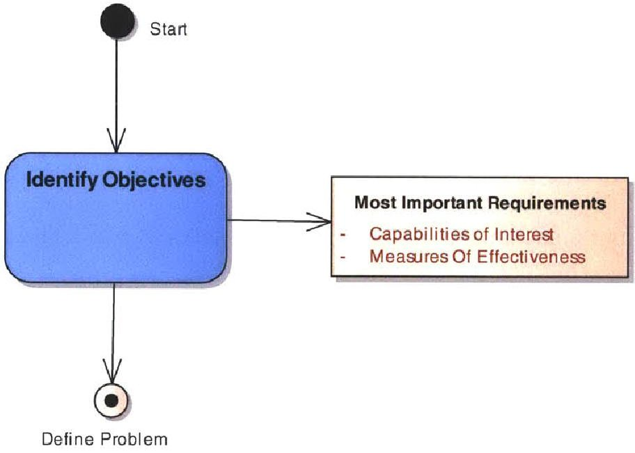

Figure 34: Problem Identification

There are several ways in which a problem can be identified. As with other MBSE methodologies, the problem definition can be performed by receiving a requirement document. If this is the case, the requirements can be imported to an electronic repository and analyzed. The team uses this material to

<!-- PDF_PAGE: 79 -->

easily identify the criteria necessary to properly scope the problem. Whenever adding a requirement or any other element to the model, a short text description should be included so future reviewers can understand its purpose. Hyperlinks can also be added to external sources for additional information.

It is important to question the provided requirements. They may not have correctly identified the problem. One of the best examples of poorly specified requirements involves the F-16 fighter (Maier, 2009). The "Father of the F-16", Harry Hillaker, questioned the original requirement of a high supersonic capability, which would necessitate difficult and expensive solutions. As result of the inquiry, It was determined that the real need was to provide a quick exit from combat. Therefore, the original requirement was replaced with those specifying rapid acceleration and exceptional maneuverability.

Other problems are much more loosely defined and are the focus of this framework. One such category is high-level problem statements. Examples of such challenges include President John F. Kennedy's speech to a Special Joint Session of Congress on May 25th, 1961. Here he stated the goal, "before this decade is out, of landing a man on the moon and returning him safely to the Earth"(2011b). Another more current example is President Barack Obama's challenge that the United States obtain 80 percent of its energy from "clean" sources in less than 25 years (RenewableEnergyWorld.com Editors, 2011). These problem definitions provide a large trade-space.

It is more challenging when the problem is not known. Development teams may seek a latent need to develop a new product or move into a new market. Existing operations may be examined to determine deficiencies and potential opportunities. In these cases identifying the need is a major challenge itself, as the users may not be aware of a need. Additional effort must be extorted to accurately capture and absorb the stakeholder feedback. This challenge is compounded when potential users have no

<!-- PDF_PAGE: 80 -->

foundation on which to provide opinions. In 1915, when David Sarnoff proposed that radio be used to broadcast information into people's homes, no one could have expressed a need for this type of product since they didn't know it was feasible (Leonard and Rayport, 1997). However, Sarnoff recognized that humans had a need for entertainment and enjoyed spending time at home.

Problem statements can be extracted from user observation data, interviews, focus groups, benchmarking, and survey. A clear and unmistakable statement of need must be developed. It is crucial that the development team does not pollute the value statement with their personal opinions. Only those of the external stakeholders should be captured in the problem statement. While David Sarnoff identified a solution before a need statement, he (perhaps subconsciously) verified that such a need existed by applying his knowledge of family behaviors within their homes.

Once the information has been collected to correctly characterize the problem, it should be explicitly stated. This can be achieved by defining the capabilities of interest (COI) and measures of effectiveness (MOE). COI are functional goals such as landing a man on the moon, obtaining energy, or being entertained at home. The value proposition specified by a COI is enhanced using MOE, to describe the critical, distinguishing problem attributes or constraints. The COI in President Kennedy's challenge was to get a man to the moon. The MOE provided the details such as the: (1) timeliness of less than 9 years, (2) human safety, and (3) distance to the moon and back.

MOE are synonymous with the "most important requirements." For example, when identifying the MOE for an Unmanned Aerial Vehicle (UAV), requirements such as range, endurance, and availability may be specified. An example of using SysML to capture the top requirements for a UAV is shown in Figure 35.

<!-- PDF_PAGE: 81 -->

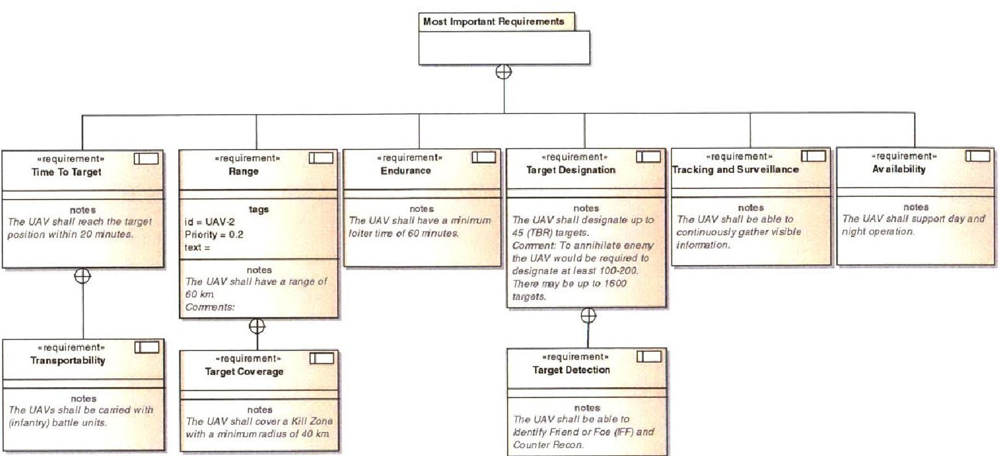

Figure 35: Example of a UAV's Most Important Requirements

In the cases when requirement documents are provided, the MOEs are the subset of the requirements providing the criteria for success or failure. Usually only a few are appropriate, less than a dozen even for large complex systems (Oliver et al., 1997). The MOEs will provide the criteria for selecting one of the concepts later in the project. They must truly capture the needs of customers and users. For commercial products they should reflect the criteria used in the decisions to buy a product and define the product placement in the marketplace (Green, 2001). It is crucial that customers, developers, and other decision makers agree on the MOE to avoid discrepancies in the design and trade study.

SysML now provides specific constructs to define the MOE. As shown in Figure 36, they can be linked directly to the most important requirements to maintain consistency. This provides an effective way of collecting rationales and other background information, while specifying the decision making criteria.

<!-- PDF_PAGE: 82 -->

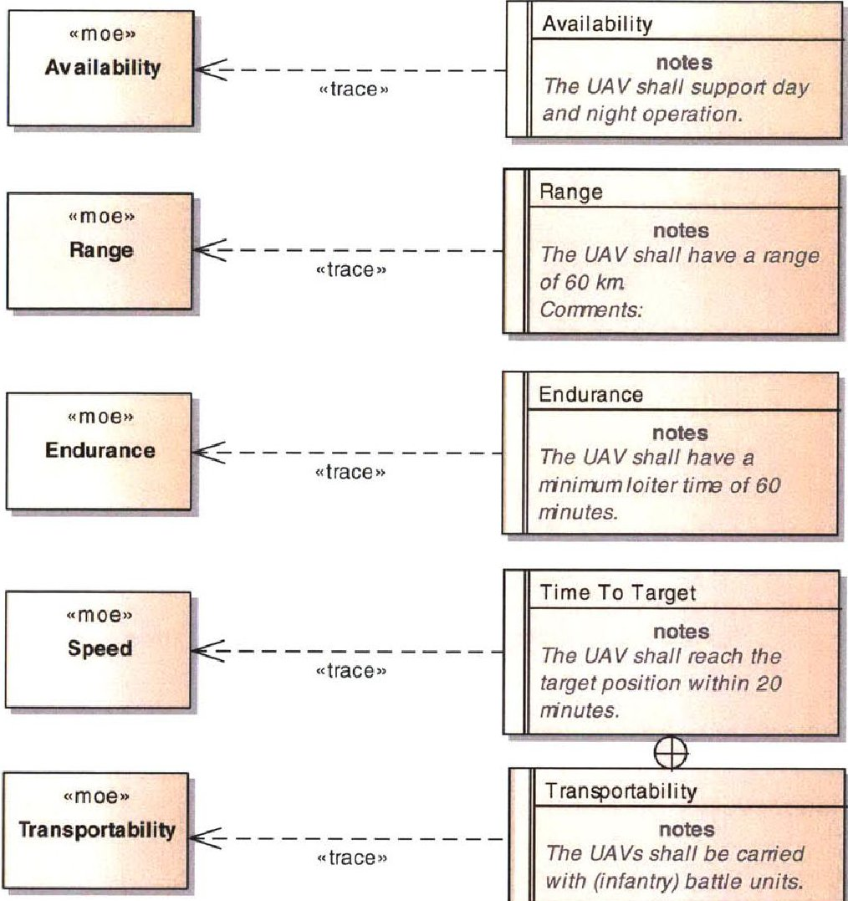

Figure 36: Allocating Requirements to MOE

## 3.2 Problem Definition

The primary goal of this phase is to communicate the problem understanding between system developers and stakeholders such as customers and management. The problem definition extends the problem identification to derive the required system functions and detailed system performance. It builds off the broad system objectives to develop verifiable requirements through the methodology depicted in Figure 37. The true benefits of MBSE tools and methodologies are leveraged here to identify the system context and refine the problem statement through the development of system concept of operations (CONOPS).

<!-- PDF_PAGE: 83 -->

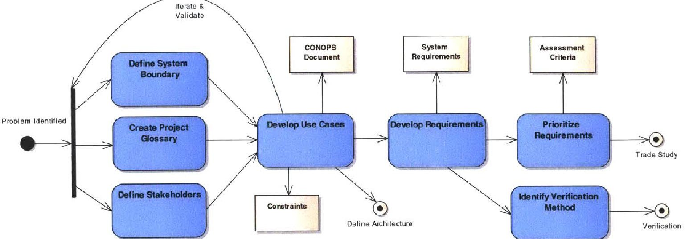

Figure 37: Problem Definition

Capturing the definition in a mode-based environment can prevent other developers from having to interpret isolated natural language specifications. Furthermore, the methodology helps engineers find errors in the complex details that are difficult to identity in loosely coupled models or documents. It helps developers apply their experience to find the "unknown-unknowns", and work with the stakeholders to resolve issues.

In this phase, the team should collect and review all available information to accurately capture the problem. Information can be directly imported or stored externally, but accessible from the model using hyperlinks. By tracing model elements to these sources, their rationale can be captured.

The Problem Definition activities are shown in Figure 37. The first three activities of the problem definition are concurrent and in general have no established order. Most likely these activities occur in an iterative cycle with the use case development. It should be assumed that developers are constantly iterating through these activities until the alternative concepts are evaluated. Capturing the problem and domain specific terminology in a glossary is a key activity of successful programs, as it reduces

<!-- PDF_PAGE: 84 -->

miscommunication and insures consistency. By specifying the system context, all stakeholders can obtain an explicit understanding of the problem and system scope. Each stakeholder and external system influence must be enumerated so their requirements can be addressed in future analyses. The external influences include the operational environment, external systems, and classes of users.

After identifying the desired system capabilities and MOEs, the development team must consider how the system is to be used. The missions, features, and functions must be refined to develop the system CONOPS. Each use case can be further defined to describe the iterations with each external entity.

A full description of the required system functionality and performance is required to guide the development effort. Traditional systems engineering methods create and maintain requirements that may be redundant, contradictory, unverifiable, or poorly written. Manual interpretation is error prone and can drive up development costs and delay schedules. Unless the requirements and specifications are captured in a precise and executable language, they will remain ambiguous and error prone (Oliver et al.). A MBSE approach provides techniques to help system engineers recognize these issues, and provides more robust systems requirements.

As one of the last problem definition activities, verification methods must be assigned to each requirement. This helps insure that they are well defined and may identify additional requirements to support test and integration activities. The requirement priorities must also be established to support trade studies. As discussed in Chapter 2, some tools do not require a ranking, and can skip this activity.

## 3.2.1 Glossary Creation

<!-- PDF_PAGE: 85 -->

Systems engineers collaborate with different disciplines to more effectively develop and design a concept. Working with different domain specialists can create potential communication challenges due to the variety of specialized vocabulary. In addition, design efforts tend to develop their own language over time as they find ways to communicate ideas more clearly and effectively. Capturing the language in a glossary and consistently abiding by its terminology insures design consistency. It is surprising how often teams can develop diverging definitions, potentially leading to major confusions.

While its contents will most likely be refined over the course of the development, by starting the collection early, a complete list can be developed and miscommunication can be prevented. Glossaries also help new team members unfamiliar with the lexicon become involved and effective more rapidly. It can also help developers search through the model. For example, if an engineer wanted to find information related to an automobile, but searched "car" he or she may assume that it had yet to be included in the design. Enforcing the terms and conventions can prevent such miscommunication.

Different terminology is common when working with different branches of the military or civilian applications. Organizations have completely different definitions for common elements or operations. An example of this is states and modes. Some software and systems engineers consider modes the higher-level construct. Others define it the opposite way. A glossary insures that all of the project's stakeholders use a consistent vocabulary.

A guide for the creation of a glossary is to capture each uncommon noun or acronym used in the development effort. Some MBSE tools provide features to collect and maintain the glossary.

## 3.2.2 Stakeholder Analysis

<!-- PDF_PAGE: 86 -->

An often overlooked step in many actual programs is the stakeholder identification. Stakeholders are those that have a say or interest in the development or outcome of a project. They may be directly or indirectly affected by the project. This analysis is intended to identify the needs and interests that can determine the project's success. Through this process, stakeholder needs are interpreted to develop system requirements.

Many efforts only focus on customers or users. While they may be one of the most important stakeholders, others may have specific requirements as well. The entire program's life cycle should be considered as developers, corporate management, testers, and maintenance personal are all stakeholders. By considering their needs, requirements can be specified early in the program, preventing omissions or expensive future modifications. Often overlooked requirements include special features to support diagnostic testing, units of measure (i.e., metric only), and maintenance constraints.

It should be simple to identify the initial stakeholders as it if difficult to develop products without someone in mind. However, this is not always true. For example, consider a group developing a new movie steaming service. While the developers may envision a customer, they may not understand the user's demographics or specific needs. In order to identify these stakeholders, developers should ask: "who benefits?", "who pays?", "who supplies?", "who loses?", and "when and where should their needs be met?" (Maier, 2009) The decision-makers should be identified. Developers should seek to understand how decisions will be made, and the type and extent of involvement the decision-makers will have in the development. It is also, important to identify how early and often the system will be evaluated, as it will guide the overall development process.

<!-- PDF_PAGE: 87 -->

During the process, it is necessary to reach out to the stakeholders so their inputs can be captured. As these opinions are likely to change, the team may have to repeat this process over the project duration. A perfect example of this is Iridium, the satellite phone company. One of the problems that contributed to the fall of the billion-dollar company was the disappearance of potential customers. With the advances in cellular technology, there was very little need for an expensive, global communication system (Finkelstein and Sanford, 2000). If the company had surveyed its expected client base, it might have discovered the problem and minimized its losses. Several techniques have developed to evaluate stakeholders, but they will not be summarized in this thesis. Refer to Lynda Bourne's book for more information (Bourne and Weaver, 2010).

It is also important to gauge the stakeholders' assessment of good, bad, and fair performance. As technology advances so does the expected performance. For example, consider the change in television resolution. Today's consumers will not accept a new technology or product that does not meet the current resolution standards. The stakeholder assessment can help identify other constraints, such as time to market, costs, or technical efficiently.

As stakeholder analysis can be slow and expensive, effort cannot be wasted in this process. Only the key stakeholders should be thoroughly examined. One way to accomplish this is to determine if each stakeholder is "important." If so, the resources should be exerted to assess their needs and expectations. If not, only the assumed influences and needs should be captured.

Stakeholders can be added to the model as actors. This provides a consistent mechanism to capture any information that can be useful in the requirements analysis. Once the stakeholders' concerns and interests have been identified, the information should be documented and linked to the applicable

<!-- PDF_PAGE: 88 -->

Actors, as shown in Figure 38. Requirement constructs, notes, or links to external documents can be used to accomplish this.

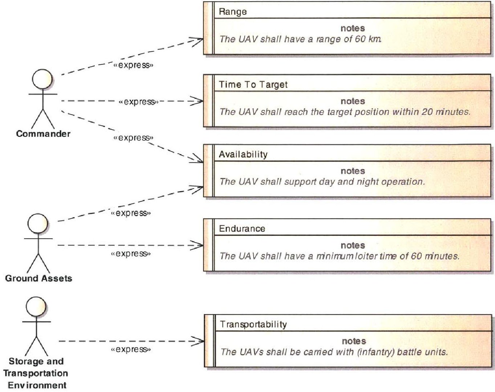

Figure 38: Stakeholder Need Identification

Some find it useful to specify these needs using either "customer requirement" or "stakeholder requirement" stereotypes. In these situations, it may be beneficial to document the need in their language and later refine it into a verifiable requirement. Others prefer to use attributes, as shown in Figure 39. For example, the view indicates the ground assets' need to use metric wrenches and wear gloves that limit their dexterity.

<!-- PDF_PAGE: 89 -->

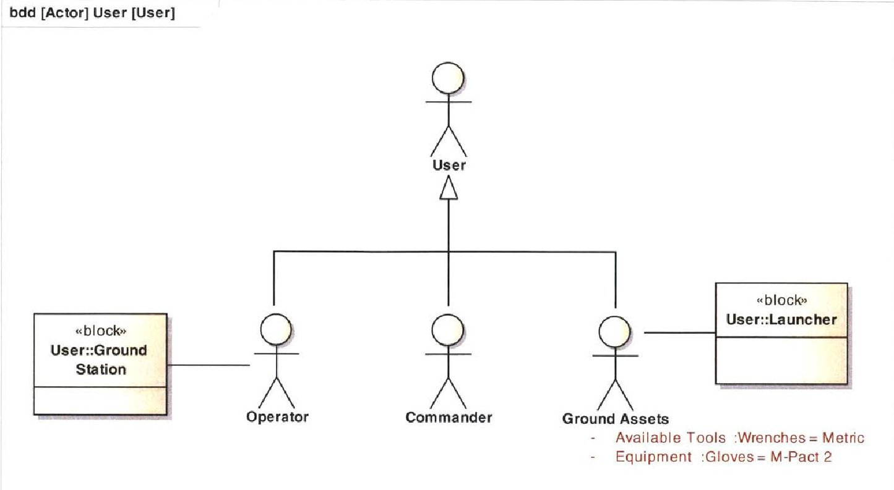

Figure 39: Example of Actor Decomposition

Also shown in Figure 39, views can be generated to explain the relationship between the Actors. This is useful to capture relationships such as military command structures, environmental conditions, and classes of users. This can be used to group categories of actors such as indicating that operators, commanders, and ground assets are all subtypes of users.

Stakeholders can be added to use case or context diagrams as Actors. As with all new elements, they should be characterized in the notes field or attributes. It is advisable to define the stakeholders in the Glossary, as they may not be known or constantly defined.

## 3.2.3 Context Definition

Many systems engineering methodologies use context diagrams to specify the system boundaries and interfaces. The selection of elements and behavior belonging in the system can be one of the most important factors in scoping the system cost, performance and market acceptance (Oliver et al.). It

<!-- PDF_PAGE: 90 -->

forces the team to think about all the possible external influences. If an external interface was improperly addressed or omitted until a future stage, it could drastically increase the development costs and schedule. Some of the most valuable discoveries occur during context analysis (Oliver et al., 1997).

To prevent omissions, it can be useful to identify the system, or system of systems, that would contain the item under development. By examining the interfaces and behaviors of connecting systems, developers can obtain a better understanding of the intended system context.

Context diagrams are not standard SysML views, but can be created using block definition diagrams (BDD) or internal block diagrams (IBD). Figure 40 is an example of a UAV context diagram created using a BDD. The figure also provides an example of using custom images in lieu of the standard SysML actors constructs. This practice has been found to more clearly express the external interfaces.

<!-- PDF_PAGE: 91 -->

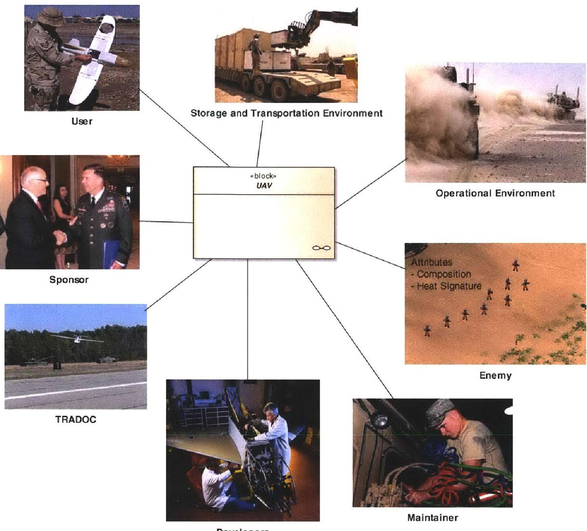

Figure 40: UAV Context

A simple way to create context diagrams is to add the system of interest as a block along with each actor that interacts with the system. Associations can then be used to identify the necessary interactions. While this initial model is rough and abstract, it serves a specific purpose. Developers should avoid cluttering diagrams by completely describing each interface. Instead, to capture the details, the interface descriptions and object flows can be captured in IBDs separately, as shown in Figure 41.

<!-- PDF_PAGE: 92 -->

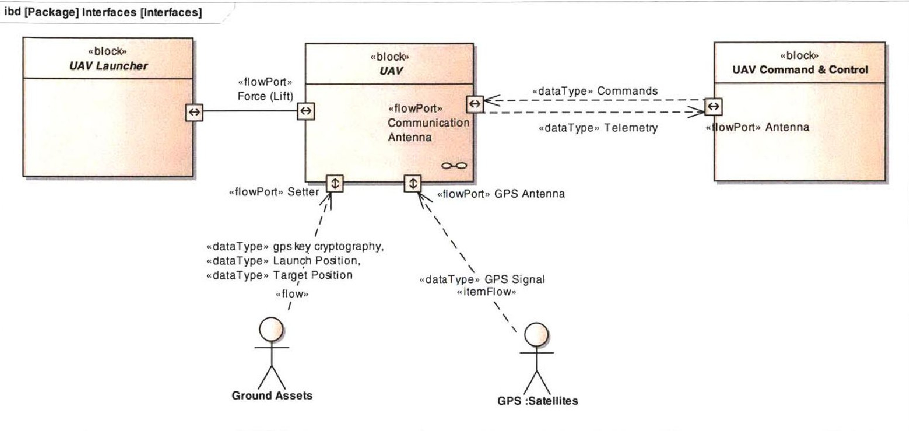

Figure 41: Additional Interface Information

## 3.2.4 Use Case Development

A key component of concept development is identifying how the intended system will be used over its entire life cycle. The DoD, NASA, and associated organizations define a system's behavior in concept of operations (CONOPS) documents. The DoD often summarizes the CONOPS using a DODAF view known as OV-1. An example of this view is shown in Figure 42. When well documented, CONOPS are an efficient method to communicate a system's operation to all stakeholders. They traditionally describe the key operational scenarios for all modes of operation, each system interface, and the primary constraints.

<!-- PDF_PAGE: 93 -->

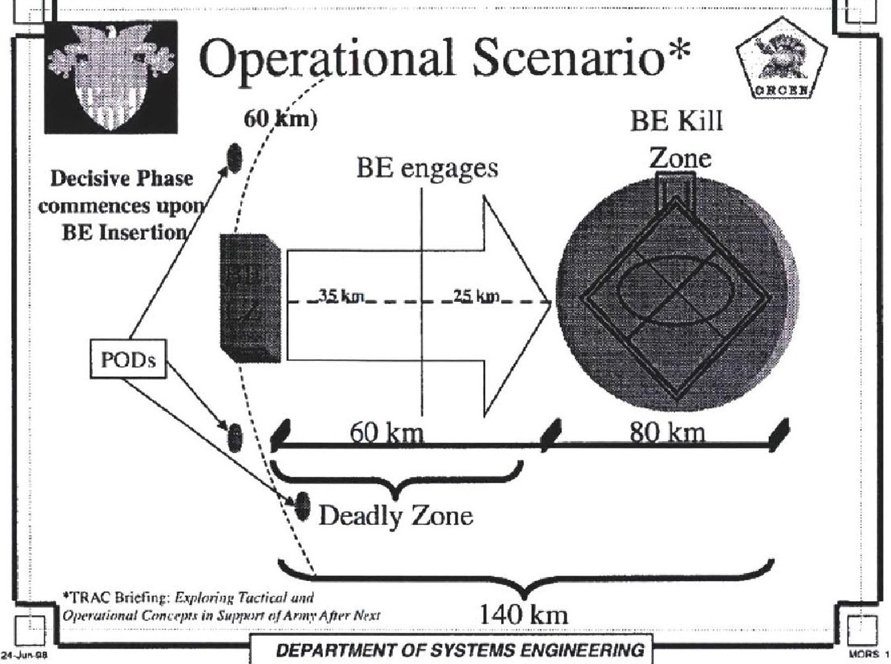

Figure 42: UAV CONOPS (Sullivan et al., 1998)

An effective way to synthesize, analyze, and refine these details is to develop use cases. Use cases graphically describe behavior from the actors' point of view, treating the system as a black box. As this view depicts the system boundaries and external relationships, it must be consistent with the context diagram. Using these SysML diagrams, designers can describe consistently capture the system interactions and responses.

Some conventions show the system as a boundary on the use case diagram. By depicting the use cases inside the system, these diagrams imply that use cases are functions. This is misleading as the system under development is only a participant in the use case (Lempia and Jorgensen, 2011).

<!-- PDF_PAGE: 94 -->

## 3.2.4.1. Use Case Identification

When developing systems without a well defined CONOPS, it is often helpful to consider the use of any current or similar systems. By creating use cases to define the capabilities, limitations, and potential improvement of similar systems, those for the proposed system can be developed.

For revolutionary systems, it may be difficult to know where to start developing use cases. Often, the first use cases can be identified by considering the operational capability and target actors. Other processes start by considering the most important actors and what they need from the system. For the example of getting a man to the moon and back, it may be best to start by considering the astronauts' mission. This process decomposes the capability of interest and works through examples until the uses cases are well defined. After considering the primary actors, consider the supporting actors (e.g., the environment) and their interaction with the system.

Figure 43 provides an example of use case diagrams developed to meet the CONOPS specified in Figure 42. A hyperlink to the source material is shown at the top of the diagram. The example also provides an example of specifying performance characteristics and constants using attributes on the associations. At the risk of cluttering the view and being inconsistent with those directly assigned to use cases, this helpful information is provided for reviewers. For example, it could help developers realize that the Operational Environment, shown on the top left, will not be constant across the four use cases. By specifying different environment conditions, design constraints can be reduced.

<!-- PDF_PAGE: 95 -->

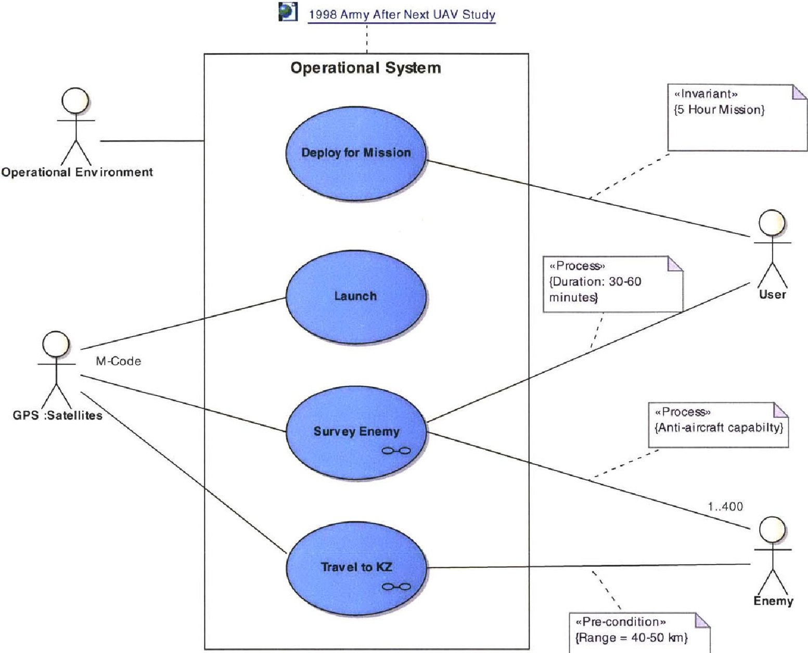

Figure 43: Use Case Diagram for UAV Operations

Use cases must be defined for each lifecycle phase, such as production, deployment, and maintenance. These SysML views provide the basis to answer high-level questions. While issues may be overlooked, they should be identified in future stages of the MBSE methodology.

## 3.2.4.2. Use Case Structure

<!-- PDF_PAGE: 96 -->

Use cases should have a descriptive name that clearly conveys their most important function and follows a verb-noun convention. It is best to avoid vague verbs like (e.g., do, process, and make) and low-level verbs (e.g., create, read, or update) (Karban et al., 2011).

Summarizing the use cases' purpose in a text-based format can be helpful in capturing its focus. The primary actor's reason for interacting with the system should be specified. As use cases are refined, more information should be added about the interaction including the stimuli that triggers it and the system's response.

It is important that use cases are complete as they are associated with system validation. Constraints from external systems, human expectations, logistical and maintenance realities, and organizational objectives should be captured. This transparency will help instill stakeholders with the confidence that the system will meet their needs.

## 3.2.4.3. Scenario Definition

Use cases provide only a high level description of system behavior. Precise descriptions must be added to refine them. For complex systems there are often a number of possible threads of interaction between the system and its actors. Most MBSE languages label these alternatives as "scenarios". Accurately and completely capturing the sets of scenarios is critical as they are direct linked the system internal behavior model (Oliver et al.).

Scenarios are composed of a number of functional steps for specific sequences of events. Each step should identify the performer (i.e., specific actor, system). The actors' knowledge, skills, and other characteristics should be considered. If the development team is unsure about the actor's ability to

<!-- PDF_PAGE: 97 -->

perform the function, questionnaires, subject-matter expert consultations, and direct observation can resolve the ambiguity.

Once scenarios are analyzed from the perspective of the primary actor, the secondary influences can be considered. The necessary conditions for each scenario should be defined, as well as any that could prevent them. The data and objects passed between systems and actors must also be specified, including the triggers that initiate the scenario, their frequency, and timing. Each scenario results in a specific outcome, an externally observable consequence. This should be documented as well as the environmental conditions and system state that exist after its completion. If any of these are not universally recognized, they should be defined in the glossary.

While several scenarios may be defined, developers should initially focus on capturing the behavior when everything goes right. This is colloquially called the "happy path". Next, the scenarios that exist when the actors perform alternative actions can be described. Finally, the "the rainy day paths" should be enumerated. These describe what might go wrong and facilitate the security, safety, and reliability analysis. The alternate and error paths are often branches from the primary scenarios, and several branches and merges may exist. It is advised to challenge constraints. Throughout this analysis, developers should ask "why" and "what if". When documenting the scenarios, nontechnical and easily understood terminology should be used.

Systems engineering teams can refine the use cases and scenarios ad infinitum. As this could violate the program schedules, teams must assess what is sufficient. A good heuristic is to only develop scenarios if they are expected to expose any additional functions, requirements, or interfaces (Cole et al., 2010). Start with the use cases containing the most uncertainty, and work towards the less interesting ones.

<!-- PDF_PAGE: 98 -->

Use cases should not be decomposed to the point at which they resemble activities. They should be classes of functionality, not hierarchies of behavior trees. Appropriate scenarios provide a solid model foundation with the right amount of flexibility to accommodate the architecture development. Activity diagrams can be used to fully define the use cases.

## 3.2.4.4. CONOPS Review

While many consider activity diagrams to be the best method for defining use cases (Hoffmann, 2011a; Kösters et al.), text-based descriptions can be more useful and easy to read. Capturing the CONOPS in narrative form can provide a clear depiction of the intended use. An example of such an application is shown in Figure 44. It is very valuable for those who will not immerse themselves in modeling. Some tools automatically generate activity diagrams from text scenarios. This can be useful in getting stakeholder buy-in. Once the flows are captured in SysML diagrams, they can be executed. This is a powerful way to specify and review the necessary system behavior.

The scenarios must be reviewed to build consensus with decision makers. It is generally advisable to involve relevant stakeholders and specialty engineers in each phase of the CONOPS development. Obtaining inputs from specialty engineers prior to the establishment of a system design can help identify key system functions or qualities, as they bring unique perspectives. When problems are identified, the issue should be documented along with the resolution.

To refine the required functionality and performance from the MOEs, it can be helpful to discuss specific examples of good and bad system behavior with the stakeholders (Maier, 2009) in that they may have a significantly different perspective than the development team.

<!-- PDF_PAGE: 99 -->

<table class="table table-bordered"><thead><tr><th>Step</th><th>Path Name</th><th>Type</th><th>Join</th></tr></thead><tbody><tr><td>0</td><td>Basic Path</td><td>Basic Path</td><td>-</td></tr><tr><td>2a</td><td>BIT Failed</td><td>Exception</td><td>1</td></tr><tr><td>4a</td><td>Communication Error</td><td>Exception</td><td>1</td></tr><tr><td>7a</td><td>Launch Canceled</td><td>Alternate</td><td>End</td></tr></tbody></table>

Figure 44: Example of Scenario for UAV Launch

While text CONOPS documents can be generated directly from the model, more animated visualizations based on the data captured in the tool can greatly facilitate the comprehension of complex data (Mostashari et al., 2011). Several tools are starting to integrate or connect to external software packages and can provide this capability.

Design reviews should be held regularly, at least one per concept development phase. This helps perform verification at each level. Unlike the verification steps shown in the traditional system engineering "Vee model", verification is not a single culminating event in MBSE efforts. Use case

<!-- PDF_PAGE: 100 -->

verification helps insure that the system will meet the stakeholder needs. By checking that each layer of abstraction is correct, complete, and consent with the others, models can be constantly verified. The intermediate work products become evidence of system integrity and the ability to meet the requirements.

## 3.2.5 Requirements Development

Requirements documents are easy to read and disseminate. They are also necessary components of development efforts due to their contractual use. For these reasons, it is unlikely that these traditional mediums will ever be replaced by MBSE (Logan and Harvey, 2011). Specifying requirements in this form is problematic however, because even the best documents are ambiguous and imprecise. Each statement is normally written as " [The system] shall [perform a task]." By itself, this statement is insufficient as several elements are omitted to make the statement easier to read. To truly understand the requirement, it must be associated with:

- The trigger(s) that can initiate a function and the conditions where it can be received

- The expected performance associated with the function

- Any other associated, parallel functions

- Any data or objects that will be transmitted during the process

- The trigger(s) or results that terminate the function

- The resulting system and external conditions

By connecting the requirements with other modeling elements these associations can be identified, reducing the ambiguity of the English language. To accommodate the needs of various programs, three processes will be discussed for integrating requirement management with system descriptive models.

<!-- PDF_PAGE: 101 -->

## 3.2.5.1. Traditional Requirements Analysis

As discussed earlier, text based requirements may be provided from customers in format such as Microsoft Word, PDF, IBM DOORS database, rigorous models, or "hard copies". Often, each statement is categorized as an interface, functional, or performance requirement. This source material should not be treated as system requirements, as it may be inconsistent, unclear, impractical, or not testable. To generate system requirements, the first step is to combine and assess all available information. All collected data should be categorized, loaded to repositories, and linked to applicable views. If the documents change, these should be explicitly tracked. It can be advantageous to name packages in the model browser with the same name as the documents, as it simplifies reviews and linking.

System requirements will be derived from all available source material, but may require additional information. This should be determined by reviewing use cases to determine the gaps. The desired information may be implicit knowledge, captured only in the minds of users or other domain experts. By reviewing the uses cases and assumptions, the knowledge may be extracted. Test, assembly, or production requirements are often overlooked at this stage of development. However, it can be useful to address these life-cycle needs to avoid solutions that are too expensive or not supportable.

Systems engineering teams should include hardware, software and problem specific domain experts to assess the available information. They can help identify conflicting requirements early in the project, preventing incompatible designs. Furthermore, these experts can identify unrealizable requirements or those that would negatively impact development costs and schedules.

<!-- PDF_PAGE: 102 -->

Once the system requirements are identified, they should be allocated to the applicable use cases. This practice assists in the allocation of requirements to behavior and makes it easier for developers and stakeholders to understand.

## 3.2.5.2. Use Case Based Requirement Analysis

Isolated requirements analysis can lead to a system that is technically correct, but does not meet the customer needs. This is problematic as there is often more payback in getting the requirements right than getting the design right (Ross, 2003). Using use cases and scenarios to generate the system requirements can be very effective. This process generates requirement statements that mimic the descriptive model elements. As the requirement statements and models contain the same basic information, the system requirements in essence become "derived requirements". In the context of use cases, requirements can be much easier for many stakeholders to understand. Capturing and maintaining requirements in this fashion facilitates the tracing and allocation.

This technique focuses on the user's perspective rather than isolated requirements. Interface requirements are generated for each actor in the context diagram. Functional requirement statements can be generated for each system focused scenario statement. The use case and context diagrams can also be used to determine the non-functional requirements, including the "ilities". Requirements such as "security" or "interoperability" should never be accepted without an understanding of the actual customer expectations (Maier, 2009). Each one should be applicable to specific use cases.

An example of capturing requirements per use case is shown in Figure 45. Performance requirements can be generated after considering the needs and attributes of each use case. By considering the needs of each actor, requirements for often ignored issues such as security, culture, political, and legal

<!-- PDF_PAGE: 103 -->

concerns can be identified. This also helps to insure that requirements are generated to address each phase of the system lifecycle.

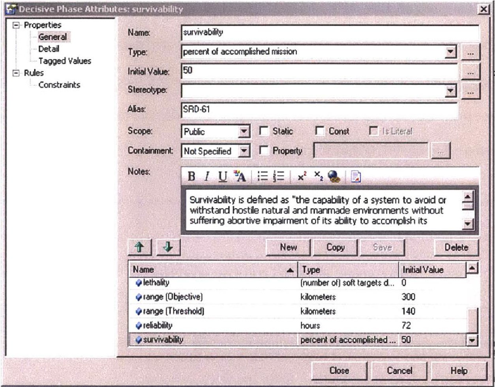

Figure 45: Capturing Requirements as Use Case Attributes

Requirements should express only what is not acceptable. Reviews should insure that no additional constrains have been levied and that all documented assumptions have been validated by the stakeholders. By developing the requirements though MBSE techniques, the labor required for this effort will be minimized (Oliver et al.).

If a separate requirements management database (e.g., DOORS) is used, the requirements must be updated after each iteration. Additional steps may be required to trace each requirement to the use case or interface.

<!-- PDF_PAGE: 104 -->

## 3.2.5.3. Strict Model-Based Requirements Analysis

While creating text-based requirements from use cases or other model elements produces requirements that accuracy capture the desired system operation, this translation can be error prone and requires additional maintenance. Emerging MBSE tools and methodologies enable the efficient communication of the system requirements while minimizing the text based requirements (London, 2011). These processes develop text requirement documents directly from the interface, functional, and performance descriptions in the model.

The key customer requirements, the MOE, can be refined with use case specific attributes (Brito et al.). They capture the performance requirements, defining the necessary characteristics in engineering terms. Each system focused scenario statement is in essence a black box functional requirement. The attributes and constraints can completely and accurately define the needs of each actor. By capturing the attributes of the actors, such as the environment, the interface requirement can be specified. If necessary, they can be decomposed further to the individual activities.

While there are obvious benefits to these techniques, there may be issues with crosscutting attributes, those associated with multiple use cases (Brito et al.). These may appear as redundant in the auto-generated documentation. Techniques to identify and remove duplicate requirements must be used.

## 3.2.6 Requirement Prioritization

Problem definition is performed properly only if the development team can objectively and rationally rank solution alternatives (Maier, 2009). The priorities are used in trade studies to select the system concept. Generally, a subset of the requirements is used; perhaps three to fifteen in number even for

<!-- PDF_PAGE: 105 -->

large complex systems (Oliver et al., 1997). They are the criteria that drive the project success or failure. If stakeholders cannot agree on what the most import requirements are, there will be future problems, because they form the criteria for the final concept selection.

To select the optimum concept, development teams should use the previously identified MOE. Using MOEs in this way helps mitigate the risk of artificially limiting the trade space. As the MOEs' relative values can be subjective, their values should be defined by the key stakeholders. However, most customers struggle with articulating their preferences (Ross and Rhodes, 2008).

If stakeholders are expected to be able to truthfully communicate their preferences, a number of techniques have been developed to elicit the requirement weights. The priorities can be obtained by surveying the preferences of owners, operators, or potential users. Once identified, the preferences can be recorded using the requirements' attributes or "tagged values" in MBSE tools, as shown in Figure 46. As the weights can be very subjective, it can be helpful to force stakeholders to make decisions about the comparative significance of the criteria by insuring that the weights must add up to a fixed number, normally 1 or 10.

It is difficult and sometimes impossible to know the actual requirements priorities until end-users have an opportunity to acquaint themselves with the final system or at least with a realistic representation (Ogren, 2000). Survey results from those shown the alternative designs are likely to be different. Therefore, it may be helpful to conduct or repeat the surveys once the final candidate solutions are identified. If the desired system is not well understood, the priorities may not be obtainable. Any trusted preferences information should be captured, but priorities should not be artificially created. Trade study techniques exist for such conditions, and will be discussed in Section 3.5.1.

<!-- PDF_PAGE: 106 -->

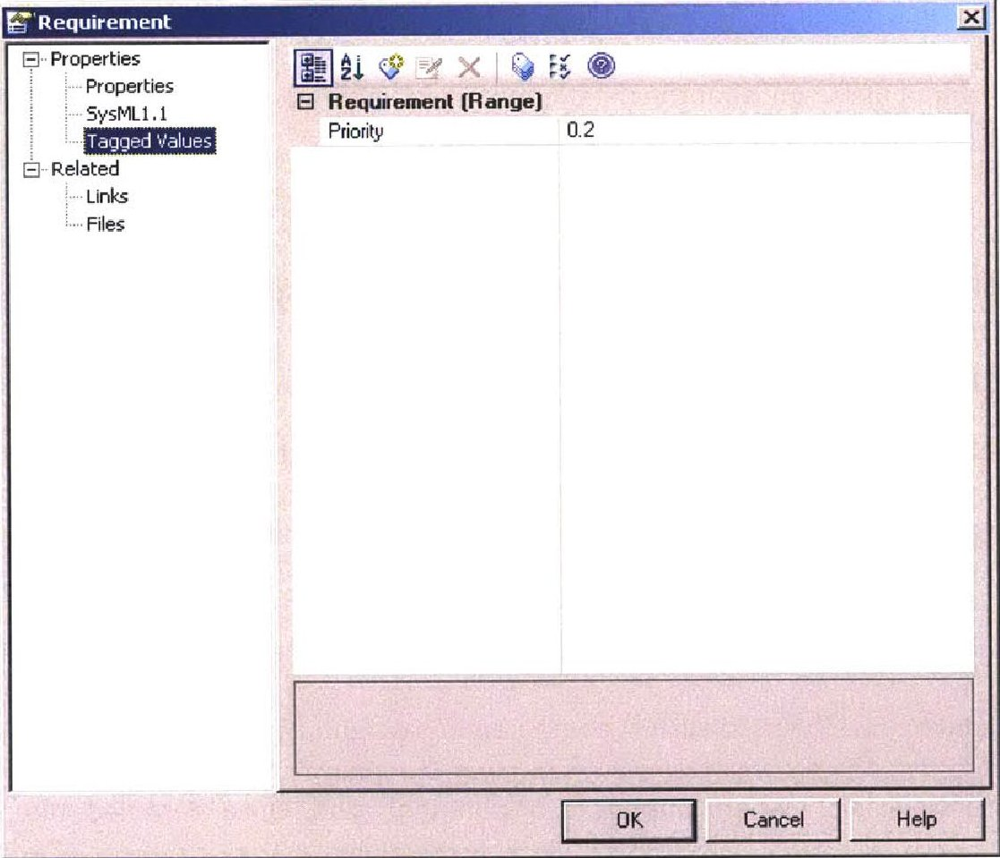

Figure 46: Static Requirement Prioritization

## 3.2.7 Verification Methods

Verification methods must be associated with each requirement. Before identifying how the verification will be performed, the fact that it is possible determined. Some MOEs are created at a high level, however they can be difficult to verify. For a requirement to be verifiable there must be a qualitative or quantitative measure that can assess if the design satisfies the requirement. Once the requirements are deemed to be verifiable, the method to achieve this must be designated. The possible verification methods are: (1) inspection, (2) analysis, (3) test, or (4) demonstration.

The verification methods can be decomposed to different "test cases". While the verification methods are useful, test cases provide more insight on the actual verification methods. Use cases, scenarios, and

<!-- PDF_PAGE: 107 -->

associated requirements can be duplicated and modified to develop the test cases and associated verification procedures as they are their primary sources. An example of this is shown in Figure 47.

Often the test cases are generated in parallel to the original design, but early test case development can identify additional capabilities that should be included in the system design to support integration and test activities. Test case details can be developed in a similar fashion to scenarios, using actors to represent the people and external equipment involved. These become the test plans and procedures. Developing tests and manufacturing processes before completing the design insure that all required functionality and features are included. To put it simply, this helps insure the system is designed right the first time.

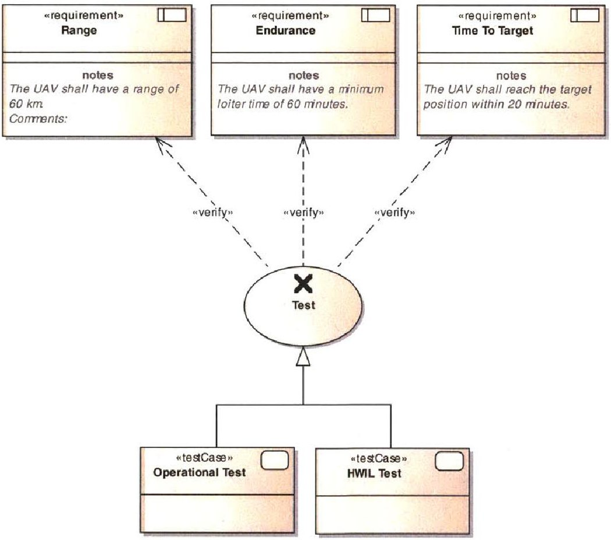

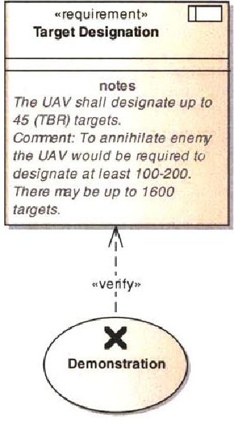

Figure 47: Verification Methods and Test Cases

<!-- PDF_PAGE: 108 -->

## 3.2.8 Requirements and Design Reviews

Once the requirement verification methods have been defined, the requirements and the verification methods should be reviewed. If the development methodology was followed, the use cases and scenarios should be generally accepted after having been previously reviewed. As the requirements should be based on the scenarios, fewer questions should be expected. The review should be focused on ensuring the requirements are correct, unambiguous, verifiable, and consistent with the MOE, use cases and other views.

The design should be evaluated at every level with informal reviews taking place regularly with the design team. It can also be beneficial to include other stakeholders on a monthly basis. As discussed earlier, model execution aids in this simulation and helps verify completeness, consistently, and accuracy. Specialized simulation tools can also be incorporated for these reviews as some stakeholders may struggle with SysML and navigation of the model.

## 3.3 Architecture Definition

Architecture can be a process or a description. Edward Crawley defines architecture as the mapping of function to form, or what the system does to what the system is (Crawley 2007). His definition of function is identical to the SysML's behavior. He defines function as the operations and transformations that cause, create, or contribute to performance. Professor Crawley's definition of form also translates well to the SysML structural constructs, capturing the physical and informational elements of a design. ISO/IEC 42010, the international standard for architecture descriptions of systems and software, defines architecture as "the fundamental organization of a system embodied in its components and their

<!-- PDF_PAGE: 109 -->

relationship to each other and the environment and the principles guiding its design and evolution." (Logan and Harvey, 2011)

The methodology used to generate these descriptions is analogous to the those performed by architects (Maier, 2009). An architect designing a building works with customers to identify their needs, and based on their intended uses and tastes, he or she will design a structure. The architect also works closely with builders, civil engineers, plumbers, electricians, and decorators to refine the design and see it realized. Over the past decade, CAD tools have emerged to improve this process.

The development of a complex system architecture using MBSE follows a similar process. It uses an integrated environment to capture designs and collaborate with other stakeholders. After identifying the indented uses and needs, the specific uses are identified (e.g., sleep 5 people, provide space for the family to watch TV, host 12 person dinners), conceptual designs are developed (two story colonial), and finally an implementation is developed through close collaboration with various domain experts.

Architectures define the invariant design aspects that enable the creation of product families (Oliver et al., 1997). Families of alternative concepts must be generated in a consistent manner to be compared against the stakeholder needs. To accomplish this efficiently, reference architectures can be developed by defining behavior separately from structure. It is generally advisable to start with behavioral modeling, as indicated in Figure 48. Form follows function because behavior usually captures the user needs better than structure (Crawley 2007). Once the conceptual system-level behavior is defined, the structural models must be developed.

Care must be taken to not make decisions prematurely that artificially constrain the design. The initial structural models should be free of any implementation-specific terminology that could subconsciously

<!-- PDF_PAGE: 110 -->

limit the tradespace (i.e., in lieu of "keyboard" use "data entry mechanism"). Using instances and aggregation of these abstractions rigorously, the effort to manipulate and design several alternatives is reduced. This is the essence of architecting. If the team does not start with a conceptual design, the alternative implementations will not share an architecture (Maier, 2009). Without a common platform, it may be difficult to compare the alternatives, and any modifications could require complete redesigns.

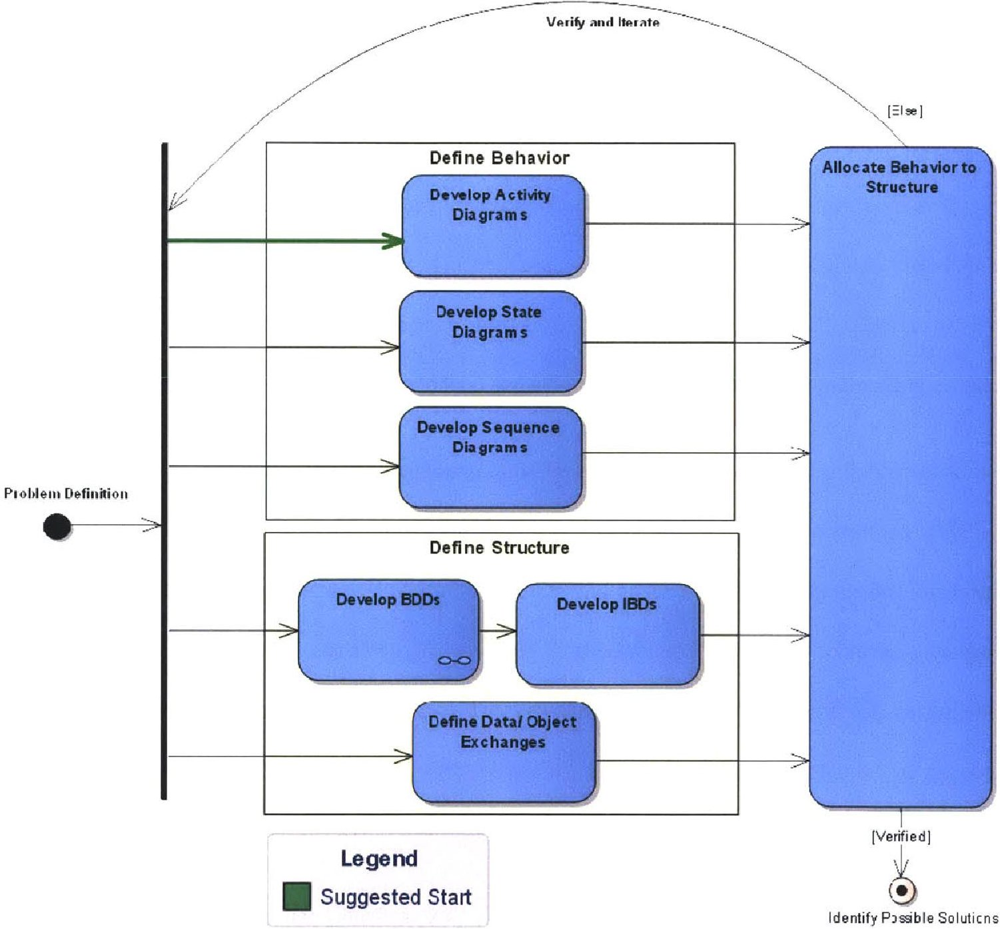

Figure 48: Architecture Definition Process

<!-- PDF_PAGE: 111 -->

Once the alternative physical implementations are identified, behavior can be partitioned and allocated to each structural element. In reality, most of the behavior and structural design is performed concurrently. This may be difficult to do without inferring or assuming a particular technical solution (Vitech Corporation, 2011). While it requires a surprising amount of discipline, adhering to conceptual modeling can yield truly innovative solutions, simplify the trade studies, and enable product platforms.

## 3.3.1 Functionality Analysis

Several different, but connected views are required to adequately define the system architecture (Maier, 2009). A single diagram cannot and should not try to capture all the necessary information. The system behavior can be completely defined by using a combination of SysML activity, state, and sequence diagrams. The suite of SysML diagrams can capture the behavior in a rigorous and executable form. This is crucial as a poor or incorrect functional analysis will lead to deficient physical implementations (Oliver et al., 1997). Depending on the application, teams may choose to start by developing any of the three behavior diagrams.

Activity diagrams describe all of the possible flows of behavior and the interactions between external actors and the system. This is a natural starting point after development of scenarios as indicated using the green arrow in Figure 48. Sequence diagrams describe the timing for specific threads of behavior. If timing is the crucial element of system behavior, the developers may choose to start by creating sequence diagrams. Alternatively, if the system is strongly state dependant, this may be a preferable starting point. While these states may have become apparent during the scenario development, it is likely that aggregating activity diagrams may be a more effective way to generate state diagrams.

<!-- PDF_PAGE: 112 -->

It is generally advisable to start defining the behavior that corresponds with the use cases that contain the most uncertainty or provide the most benefit to the user. Unresolved issues can be identified and researched. Multiple iterative cycles will be required, but capturing the team's understanding and assumptions will help identify the "unknown unknowns".

Each type of diagram is not required for every application. Engineers should only model what they need to capture. By navigating through the different views, development teams can assess the design, model maturity, and completeness.

## 3.3.1.1. Activity Diagrams

Activity diagrams are natural extensions of the scenarios. As discussed earlier, some tools use activities to describe scenarios, while others directly create them from text descriptions. Additional analyses of the auto-generated activities are usually required as the system logic is fully developed. One of the first required steps is to separate the activities performed by the system and the external actors, such as the environment. Some processes suggest capturing both the external behaviors that excite the system and those performed by the system in response. These diagrams allocate the activities to the appropriate element, (i.e., system, actors) as shown in Figure 49. Hans-Peter Hoffmann warns against this practice stating that three times more time is spent specifying the actor's behavior than on the system (Hoffmann, 2001). When any allocation is performed, it can be achieved using partitions, also known as swimlanes. The partitions should be linked to their associated elements to insure proper traceability. The activities must be decomposed to break up the problem into solvable pieces. The resulting level of detail must be sufficient to effectively partition the system behavior to its subsystems while preserving its performance characteristics.

<!-- PDF_PAGE: 113 -->

It is crucial to consider the functional order and flow. If alternative paths can be performed, this must be captured. Concurrent, parallel behavior should also be made explicit. Cyclic, also known as "looping" or "iterative", behaviors are common in complex systems. They too should be explicitly shown. Using activity decomposition and logic transitions, views can be created to clearly convey this critical behavior. An example of an activity diagram describing a UAV system interaction with multiple stakeholders is shown in Figure 49.

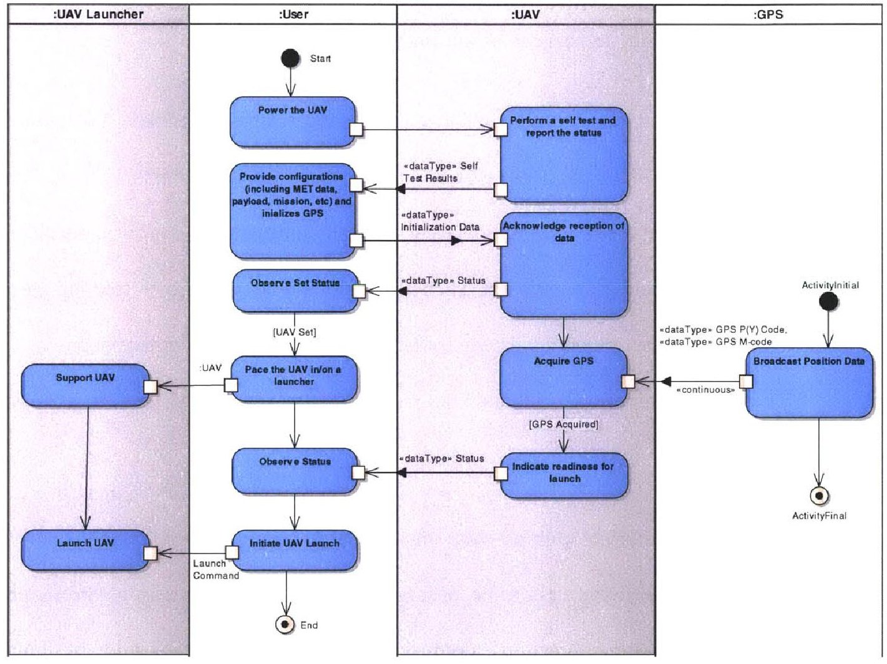

Figure 49: Example of an Activity Diagram

When developing the behavioral sequences, both the control and data flows must be considered. The items that trigger the initiation or termination of activities must be specified. Often more than one

<!-- PDF_PAGE: 114 -->

triggering item may be possible, so the appropriate level of abstraction should be considered. Every system input and output must be properly addressed, including those that are unintended or wanted. The response should be also identified and specified. Often customers and subject matter experts can provide the crucial information on the stimuli and response.

The exchanged information and object characteristics, including the range of possible values and units, must be considered. Instead of adding text descriptions of the data exchanged, "libraries" of units, interfaces, data-types, and specific messages can be created. Not only will consistency across the design be insured, but interface control documents can be automatically generated.

Once the initial control flows are developed, the exchange of data and objects can added. This can lead the team through a second cycle of discovery as new activities are identified and others modified. After the views are updated to reflect the new information, they should be reviewed. The error handling and fault recovery for the system should be questioned. Each activity should be named with solution neutral terms. For example, instead of "burn fuel" an activity should be named "transform potential energy to kinetic energy." This allows implementations that do not burn fuel, such as a glider, preventing the early exclusion of possible solutions.

At times it may be beneficial to generate multiple diagrams in order to clearly describe the behavior. Simple views also help focus the reader on a specific message. However, the distribution of information can result in the apparent duplication of functions. Confusion can result from the generation of similar functions with different names or functions with the same name that handle different types of information (Vitech Corporation, 2011). The adoption of modeling standards can minimize these issues.

<!-- PDF_PAGE: 115 -->

One of the benefits of SysML activity diagrams is being able to capture the cyclic behaviors without additional decision nodes. Figure 50 depicts two options. Both are grammatically correct, but Method 1 uses fewer constructs. This can significantly reduce the clutter present in complex behavior descriptions.

Figure 50: Alternative Methods for Depicting Cyclic Activities

## 3.3.1.2. Sequence Diagrams

Sequence diagrams are extremely useful in analyzing the exchange of information. They can be used to identify the duration of functions, the rate in which inputs are consumed, and the rate they are output. While sequence diagrams only show one potential thread through the activities, the important information can be captured with a subset of the flows. Like other forms of modeling, generating sequences is a discovery process which often leads to realizations of challenges with timing, bandwidth,

<!-- PDF_PAGE: 116 -->

or errors in activity diagrams. These views offer a means of early issue detection. An example of the sequence diagram describing UAV communication is shown in Figure 51.

Figure 51: Example of UAV Sequence Diagram

## 3.3.1.3. System State

State diagrams are most useful for aggregating similar behavior. Several activity diagrams can be combined and linked to state diagrams. The integration can be achieved by looking for common stimuli, interfaces, or functionality. The thought process required to aggregate the independent activities into a coherent behavior model is important. If scenarios and response threads cannot be coherently combined, they likely contain several errors. Independent descriptions of behavior must be combined to avoid integration problems when the system is built and assembled. The complexity of the state

<!-- PDF_PAGE: 117 -->

diagram can also indicate if the aggregation was properly performed. If the state diagram is too large or complicated, it may be beneficial to combine more activity diagrams. The opposite may be true for diagrams with only "On" and "Off" states. Many tools use states as the basis for model execution, which stresses the importance of state diagrams. An example state diagram capturing the UAV states is shown in Figure 52.

Figure 52: Example of a UAV State Diagram

## 3.3.1.4. Simulation and Analysis

<!-- PDF_PAGE: 118 -->

In MBSE, one of the key benefits is being able to produce an executable model. Nearly every MBSE tool has this functionality integrated or available via a plug-in. The fact that a model can be executed indicates that no "grammatical" errors were created by the development teams. The primary benefit of the execution is the understanding obtained through the dynamic visualization. Consider trying to learn about the human heart. If views of the four chambers and flow of blood were shown, a fundamental comprehension of its architecture could be gained. If instead, a video showed the beating and exchange of blood in slow motion, observers would obtain a much deeper understanding of the heart. By simulating the behavior based on a set of stimuli, the designs can be verified to be right and meet the needs of the stakeholders.

The systems engineering field has developed a number of tools to support effective design analysis and optimization. By exporting designs captured in modeling tools to Microsoft Excel or other commercial engineering tools, powerful, legacy tools can be used in conjunction with MBSE methodologies. By exporting model data, these tools can be applied to MBSE projects. As one example, design structure matrices (DSM) can be used to analyze the flow of behavior or data between elements in complex systems by helping visualize their relationships.

External simulation tools can be integrated with the MBSE tools to provide various triggers and messages for the simulation. Also, graphical packages can be integrated to create more powerful visualization simulations. This can be an effective capability for communicating with customers and other high level stakeholders.

## 3.3.2 Structural Analysis

<!-- PDF_PAGE: 119 -->

Structural analysis is performed to develop a system's physical hierarchy and to identify the interfaces between internal and external components. At each level of hierarchy, the system is represented using several views. The enumeration and description of the components is specified in block definition diagrams, while the component interfaces are defined using internal block diagrams.

## 3.3.2.1. System Decomposition

Structural model development begins by decomposing the system using BDDs. This hierarchy of parts is a fundamental systems engineering abstraction used to simplify analyses. Often many of these objects are identified during the behavioral analysis as most people can think more effectively by using examples. The decomposition must insure that each system component is captured. As humans cannot consider the complete set of components, levels of hierarchy are used to divide systems into subsystems and subsystems into lower-level components. The aggregation is often best achieved by decomposing into five to nine elements (Oliver et al., 1997).

Effective partitioning should be based on the criterion most applicable to the problem and design space. Options for the primary criterion include: interface complexity, functionality and performance implications, modularity (support for technology insertion or replacement), and component risk (Vitech Corporation, 2011).

BDDs provide the capability of representing dense amounts of data. Attributes used to capture the performance metrics can be shown in the hierarchy. While subsystem performance characteristics can be redefined (e.g., failure rate could be changed to mean time to failure) their relationship to the MOEs must be made apparent and preserved so they can later be evaluated against the trade criterion.

<!-- PDF_PAGE: 120 -->

Subsystem interfaces can be specified in the BDDs, but must be implemented in IBDs. If interfaces are added, care must be taken not to overwhelm the reader with too much information.

## 3.3.2.1.1. Conceptual Decomposition

It is advisable to maintain options as long as possible in the design and implementation of complex systems in that they will be needed in future design phases. Similarly, MBSE is most effective when elements can be reused as often as possible. Using multiple levels of abstraction can greatly enhance this. The options for each element can be collected in a catalogue for future reuse.

To accommodate this practice, the decomposition and interface definition should be performed using conceptual elements. The implementation of these elements can be specified later and linked to the existing views. Designs are moving targets and in the early phases there is little benefit to constraining the tradespace. As shown in Figure 53, conceptual names should be selected to avoid subconsciously focusing the design team (i.e., In lieu of "radio" name a block "communication device"). Structural models change rapidly if selected implementation and available technologies are in flux, but behavior and conceptual designs are relatively stable (Vitech Corporation, 2011). If an implementation must change it is relatively easy to determine the impact by reviewing the possible changes to the conceptual view through the model's traceability.

<!-- PDF_PAGE: 121 -->

Figure 53: Conceptual UAV Decomposition

This methodology supports the development of product families. Architectures and common components can be used for multiple products reducing the overall development time and lifecycle costs. Changes between model versions are explicit due to the model's native traceability.

## 3.3.2.1.2. Implementation

Based on the conceptual physical architectures, specific implementations can be developed. Several structural alternatives may need to be carried forward to tradeoff analysis. The choices under consideration can be expressed directly in the modeling. All of the important attributes must be captured (e.g., weight, volume, engine horsepower). Budgeted values for these attributes can be supplied to use as design targets for lower level design. Assumptions and descriptions of applicability can be added to the views (Paredis). This information assists domain specialists assess the implementations to determine their feasibility.

<!-- PDF_PAGE: 122 -->

Implementations can inherit features specified by the conceptual objects. Attributes and ports that are commonly created for conceptual designs are leveraged in design implementations. This reduces rework and insures consistency across a number of designs and views.

A physical decomposition for a specific UAV implementation, identified as FastLook, is shown in Figure 54. Each block indicates the conceptual object it implements. For example, the FastLook UAV uses a projectile as the "containment subsystem" specified in Figure 53.

Figure 54: Example of an Implementation Specific Structural Decomposition

As the number of alternatives under consideration can be quite large, traditional systems engineering tools should support the design optimization. One way to compactly represent the set of combinations from which options can be generated is a Morphological Matrix. These matrices can be generated from modeling tools once alternative technologies or implementations are identified.

<!-- PDF_PAGE: 123 -->

It may not be necessary to create SysML objects for each alternative concept or available technology. Some developers may prefer maintaining the full list in non-MBSE tools. Hyperlinks can be used to connect the complete list of options to conceptual views. When the team feels it is appropriate, the most likely candidates can be added and refined in the model.

Development teams may seek to perform risk reduction development or experiments based on the identification of candidate solutions. Depending on the number and type of alternativeness, systems engineers may choose to use design of experiments (DOE), a common statistical procedure for planning experiments to efficiently obtain data (Box et al., 1978). The variables, called factors in DOE, and their values, known as levels, can be generated based on alternative captured in the model. Any resulting data can be imported and attributed to a concept if desired. To generate these variables it may be useful to create instances in BDDs, not the standard IBDs to capture and organize the numerical quantities (Cole et al., 2010). Each instance can be copied to the IBDs as needed.

## 3.3.2.2. System Composition

Once the system structure is defined, the composition must be specified. This is generally performed using IBDs. While conceptual compositions can be created to define platform architectures, these views are often reserved for modeling of specific implementations. They describe the subsystems interfaces and relationships. The creation of these views normally leads to significant discoveries. Systems engineers should solicit information from subject matter experts regarding their biggest concerns (e.g., electromagnetic interference, self heating, packaging). These factors could then be added to views to specifically address each of these concerns.

<!-- PDF_PAGE: 124 -->

SysML provides three options for specifying interfaces: (1) standard ports, used to provide abstract interfaces representing provided or requested services (2) flow ports, used for combinations of mechanical and data interfaces, and (3) nested ports, used to decompose the structural and data descriptions. Nested ports provide for greater reuse and clarity as different levels of abstraction, and can fully describe the interface (Friedenthal, 2011).

Once the interfaces are defined, the flow of objects over each one can be identified. This may be information, materials, data, or energy. The data types and elements should be added to model libraries to increase their reuse across programs. This practice helps maintain consistency, as different terminology could be used if text was used to describe the flow of objects. The development of concept specific libraries also facilitates the automatic generation of interface control documents. Different levels of arbitrations should be used to capture the object categories, values, units, or other details. An example of the IBD showing the subsystem communication interfaces is shown in Figure 55.

Figure 55: Example of UAV Subsystem Interfaces

<!-- PDF_PAGE: 125 -->

Any of the inputs may be a trigger for activities or state transitions. Therefore, it is important to identify how long an exchange persists, and its impact to the ordering of functions. This is achieved by examining the allocation of behavior to structure.

## 3.3.3 Allocation of Behavior to Structure

To complete a concepts' architectural description, the manner in which behavior is allocated to structure must be explicitly defined. By specifying the relationship between the physical components and behavior, the design consistency can be verified. Developers can insure that the data and objects exchanged in the behavior models are consistently mapped to ports in the structural views. Any overlooked or incomplete designs can be detected through this process. The allocation completes the system traceability as the structure, behavior, data, and requirements are all connected.

As shown in Figure 49, partitions (swimlanes) are an effective way to perform this allocation. Some methodologies and tools require explicit SysML constructs to formally define the relationship. They also recommend partitioning the behavior diagrams, but the constructs are only used to visually convey the allocation. It is often beneficial to note the rationale behind the allotment as it may be questioned in the future.

The execution of allocated behavior models provides an excellent means of verifying the design. The execution identifies design flaws such as endless processing loops, elements waiting for a message from each other, and improper distribution or assessment of performance. Trial behavior allocation can be easily updated or discarded if the architectures are incapable of meeting the system requirements.

<!-- PDF_PAGE: 126 -->

The mapping of behavior to structure will also provide an assessment of the concepts' performance with respect to meet the MOEs. However, to obtain more a more detailed assessment, the performance metrics should be calculated directly.

## 3.3.4 Constraint and Relationship Definition

Each component contains a set of critical attributes that directly impacts the total system performance. These attributes are application specific, but may include parameters such as accuracy, weight, cost, power consumption, or reliability. When isolated drawings tools are used to capture the design, these parameters are defined in isolated documents and databases. In these situations, each design and analysis must separately maintain the attributes. However, by using parametrics to define the relationship at different levels of abstraction and by using elements from libraries, the attributes can be consistently defined, tracked, and reused. This provides an effective methodology for the definition of detailed characteristics, physical laws, and external systems constraints.

Figure 56 provides an example of a parametric diagram describing the relationship between the UAV subsystems' weight and propulsion power. The view indicates that the system weight is the sum of the subsystems' weights and the power balance drops as power is drawn by each subsystem. Other views can be created to calculate the UAV range based on factors such as total weight, force, and lift. By linking these attributes, the consistency of the values can be insured. As a result, the model can be used in conjunction with simulations to determine if concepts can meet their performance goals when constraints such as weight and available power are varied.

<!-- PDF_PAGE: 127 -->

Figure 56: Parametric Diagram Relating Weight to Propulsion Power (InterCAX LLC, 2011)

Parametrics can be used in conjunction with requirements constructs to flow down requirements to subsystems. If subsystem requirements are based on values or properties of system performance, MOEs, or other systems, it is more effective to dynamically link the values than to use requirement elements. By capturing the relationships between requirements and constraint blocks, a concept's ability to meet specific requirements can be verified. This capability will enable reviewers to insure consistency, validate assumptions, and assess tradeoffs.

Block attributes and parametrics also provide a means of exchanging values and value types to other model based tools. For example, the values for each subsystem in Figure 56 could be acquired from mechanical CAD models created in tools such as SolidWorks or ProEngineer.

<!-- PDF_PAGE: 128 -->

When creating parametric diagrams the inputs and outputs to attributes must be assigned. The views can also insure that the attributes are specified with the appropriate units (i.e., kg, KW), as shown in Figure 56. Values can then be assigned to the parameters and saved for later reference. Once the models are executed, the simulation input values and results should be stored to provide the documented rationale for the future decisions.

One of the primary purposes of these diagrams is to perform trade studies. Parametrics can be used to define and evaluate performance, reliability and other physical characteristics. An example of a parametric diagram created to compute the UAV coverage is shown in Figure 57. This diagram shows the constructs and relationships that evaluate how well a concept can meet the range and endurance requirements. Other views such as the one in Figure 26 can related the equations to the MOEs.

Figure 57: Parametric Model of UAV Coverage Analysis (InterCAX LLC, 2011)

Paramedics are an effective means of capturing executable constraints based on mathematical relationships and element attributes. However, MBSE tools may have processing and execution limitations. Dedicated analysis and optimization tools such as MathWorks MATLAB, Microsoft Excel, and Wolfram Research Mathematica will most likely continue to be the preferred trade study tools.

<!-- PDF_PAGE: 129 -->

Parametric diagrams can be used in conjunction with these tools to define and capture the relationships, but the calculations could be performed by external tools. For example, if utility curves are to be used for a trade study, they could be developed in parametric diagrams and externally executed in MATLAB.

## 3.3.5 Domain Expert Collaboration

A critical component of systems engineering is the collaboration with other domain experts, a necessary aspect of all large, complex programs. Each domain has different perspectives, concerns, and tools. While the MBSE tools do not, and should not, seek to replace the functionality of the domain specific views, a suitable "handoff" must be identified. These views must provide the information required by each teammate in a format that that can easily understand. When separately described, the views or "requirements" can be efficiently communicated to the respective engineering domains.

## 3.3.5.1. Collaboration with Software Domain Experts

The interface to software engineers is one of the simplest as SysML is an extension to UML and many MBSE tools include support for model-based software development. While systems and software teams can use the same development tools, a specific handoff should be established.

When decomposing the system, the software and hardware components and their interfaces must be specified. Systems engineers often decompose the software into its major components (e.g., operating system, web browser, word processor). The blocks should be the interface to software developers. They represent Computer Software Configuration Items (CSCI) and are traditionally developed based on a software requirement specification (SRS).

<!-- PDF_PAGE: 130 -->

If the software development team can access the MBSE repository, a standalone SRS may not be required. It also depends on the structure and formality of the development effort. If this is the case, the interfaces, data elements, and activities specified in the systems models form the requirements for the software team. They must insure that the software design is traced to each of these elements. Weekly software and systems reviews may be required to insure that this is done consistently, but these informal reviews also serve to improve the design quality. If an SRS is needed, it can be generated from the systems model like other requirement documents.

## 3.3.5.2. Collaboration with Electrical Domain Experts

The handoff to electrical engineers can be created using IBDs to specifically address their needs. The electrical perspective provides insight on all electrical connections in the system, such as boards, cables, connectors, and signal levels. The views can be limited to high-level designs or be very detailed like a wiring scheme. This depends on the application and design team. Systems engineers and MBSE tools should not replace domain engineers or their tools, but teams may choose to document the electrical engineer's design in SysML views in lieu of Visio or PowerPoint. However, many design teams may believe that this is not appropriate. It is dependent on the team experience and preferences.

Either approach can be supported using IDBs and reviews with electrical engineers. Flow or nested ports can be used as placeholders for connectors. Once the connectors are specified, they can be defined using one of the elements in a library. Connections between elements can be shown using associations with specifically assigned cables captured as blocks. Systems engineers will envision the high-level connections early in the development process. These views can be instrumental in allowing electrical engineers to verify any design decisions or raise concerns.

<!-- PDF_PAGE: 131 -->

## 3.3.5.3. Mechanical Domain Perspective

The mechanical engineering handoff is one of the simplest and most abstract. Initial mechanical depictions are often cartoons of the concepts identifying where the primary components are located. Even this high-level view should not be created in MBSE tools. The mechanical perspective shows how system elements are connected and interact mechanically. These views should be created in other modeling or drawing tools, and linked or copied to the MBSE views. As the designs mature, each system component should have a corresponding mechanical CAD model. Properties, like design, materials, and dimensions should be synchronized between MBSE and mechanical CAD tools.

In order to create these initial concepts, mechanical engineers must understand the constraints. Only external constraints may be identified initially, but internal constrains will be identified as concepts mature. For example, when developing UAV concepts, the size and form will initially be constrained by external entities such as the launch system. Once subsystems are identified, the internal constrains will emerge including expected component geometries (e.g., cylindrical, rectangular), connector position (e.g., top, bottom), or volume (e.g., battery will likely be about six cubic centimeters). These constraints should be provided as abstractly as possible to avoid unnecessarily constraining designers. The BDDs depicting the constraints provide an effective means of accomplishing this handoff.

## 3.4 Generation of Alternatives

Concept development trade studies require the establishment of distinct alternative solutions to a specified problem. A number of existing, non-domain specific methods have been developed by engineering, marketing, and other creative disciplines to generate these options. The technique

<!-- PDF_PAGE: 132 -->

selection is often dependant on the problem being solved and the amount of information available. Any of these can be used in conjunction of this framework.

The generation of alternatives is focused on identifying options that are expected to meet the stakeholder needs in order to compare them in a subsequent analysis. As shown in Figure 58, three activities generally take place during this phase. Alternatives are identified, assessed, and instigate risk mitigation activities. While they are shown as sequential activities, they are often performed iteratively.

Figure 58: Generation of Alternatives

Pugh advocated that product development teams engage in an iterative process of reducing and adding to the concepts under consideration (Hale and Quayle, 2009). This can be performed using a systematic downselection process known as "controlled convergence", depicted in Figure 59. By sequentially expanding and contracting the problem, a larger number of concepts can be considered without overwhelming the development team (Maier, 2009). The downselection process postpones making

<!-- PDF_PAGE: 133 -->

decisions until sufficient information is available to describe an option. It prevents making "bad" decisions, and helps focus the team on the key trade-offs.

Figure 59: Controlled Convergence

Some efforts seek to solve specific problems while others are looking for new opportunities. Either one can use the previously specified MOEs as the basis for generating alternatives. While some processes incrementally provide the requirements to those proposing alternatives, they should all be disclosed by the end of the exercise.

A number of existing techniques are known to facilitate the generation of alternatives. Some of these are discussed in Section 2.1.3. They include tools for collecting expert insight and ideas, identifying complete concepts, and cataloging representative solutions. Some are best for identifying potential solutions that can meet each requirement, while others are better for listing alternatives for each function. Most projects find it beneficial to collect as many diverse options as possible. Even wild ideas

<!-- PDF_PAGE: 134 -->

can lead to the identification of one that meet will meet the system goals. The technique should be selected based on the problem context and program phase. However, it is likely that the several techniques will be used as efforts proceed through sequential generation and assessment cycles. While it is important to document each generated idea, it is not required to capture the list in a MBSE language. Often, maintaining a list in its original form (e.g., flipboards, pictures) or in another tool (e.g., spreadsheets, word documents) is equally useful. Electronic copies can be stored to a repository and linked to the model.

After identifying the alternatives, developers must determine if they could yield a viable solution. Each candidate should be qualitatively compared to determine if it should be carried forward into the trade study. The criterion may include the MOEs, CONOPS, "the -ilities", development time, affordability, available technologies, and risk tolerance. Other situation dependant factors include environmental impact, failure modes, hazard analysis, or technical obsolescence. Based on these factors the strengths, weaknesses, opportunities, and threats of these alternatives can be determined. Some processes compare each alternative against each other, while others evaluate the concepts against a benchmark. An effective technique for the assessment is to rank the concepts, and to discard those that fall below a feasibility threshold.

The results of the analysis should be shared with the team and other decision makers. Involving all stakeholders to eliminate non-viable concepts early can reduce the potential for wasted effort. With each assessment and review, new information is revealed about the decision criteria. Teams can obtain a better understanding of what is feasible and truly important. New ideas may be generated as based on this information.

<!-- PDF_PAGE: 135 -->

If a subset of alternatives appears to satisfy constraints and achieve the stakeholder needs, then this subset can be carried through another cycle or to a more detailed evaluation. If feasible options cannot be identified to meet the specified system performance, then the requirements should be revisited and relaxed. This is less likely to occur with the MBSE Concept Development Framework as the requirements should not be unnecessarily constraining. However, customers may seek capabilities that are beyond the limits of technology given a certain risk and cost tolerance. The assessment should provide sufficient details to allow stakeholders to identify the constraints that may be relaxed, if any.

The evaluation will most likely be performed in an electronic medium. Whenever possible, tools, inputs, and results should be linked to the model to provide a common location for finding information as design decisions are revisited. The process ends with a fully defined catalog of alternatives, describing the parameters, ranges, and possible combinations. The results of each assessment should be imported to the SysML tool where they can be reused for current and future design efforts. Many tools can import data in spreadsheets or tables to minimize the manual data entry and prevent "copy and paste" errors. Figure 60 depicts several alternatives methods to create lift for a UAV concept. These options could have been the only ones that were imported to the model after an evaluation cycle deselected others such as balloon or rocket. Instances of each of option can be defined for each system concept. The values of each attributes could be defined in other tools, and imported to the model, further reducing possible error sources or inconsistencies.

<!-- PDF_PAGE: 136 -->

Figure 60: Alternative Lift Supplier Techniques

In complex system developments, the alternative feasibility is often evaluated through risk mitigation efforts. Issues with potential technologies or implementations should be identified and addressed early to minimize the likelihood that when integrated, they fall short of the required functionality or performance. This step may include prototyping, architecture modeling, technology development, experimentation, or detailed analysis. The MBSE methodology can reduce design risk by verifying designs at multiple levels of decomposition. While most risk mitigation efforts will be performed separately from model-based tools, integrating the results with structural and behavioral models further reduces system risks. If high risk elements are considered, contingency plans should be identified.

<!-- PDF_PAGE: 137 -->

The outcome of the generation of alternatives is an assessment of each candidate's performance and risk. The data, in the form of static numbers, distributions, numerical ranges, or qualitative statements, can be used for a trade study.

## 3.5 Decision Analysis

Decision analysis is focused on the methodical evaluation of compromises. No alterative can have ultra performance, ultra-quality, and be inexpensive. When each concept exceeds the stakeholder needs on different axis, tools must be used to effectively make unbiased decisions. The final concept development activity is to qualitatively evaluate the design options against the MOE, and select the best option. A variety of tools are available to perform this selection, and any of them can incorporate the methodology. The integration of SysML models and proven decision analysis techniques provides a robust approach to decision analysis as the previously defined MOE are used. Figure 61 describes the decision analysis methodology used to select a concept. It consists of the identification and allocation of weights, assessment of each alternative's effectiveness, and trade study execution.

Figure 61: Decision Analysis

<!-- PDF_PAGE: 138 -->

It is crucial in these evaluations that the MOE are evaluated at a system level. The objective is not to optimize the individual components, but the entire system. While attributes from multiple tiers of system decomposition are used in the analysis, they should be aggregated at the system level. It may be prudent to revise the MOE prior to performing a trade study. The needs of a key stakeholder may have been omitted when the MOE were defined.

Once the trade is executed, the results must be evaluated manually as the ranking cannot be accepted as truth. While the decision analysis is an optimization process, it is not strictly a computational one. These methods and tools provide data for human decision making.

## 3.5.1 Priority Assessment

One of the crucial steps any trade study is the prioritization of specific desirable attributes. The priorities are assigned to the key, differentiating requirements. This framework assumes that the MOE are used as the trade criteria. Depending on the level of access to stakeholders, it can be challenging to determine the MOE priorities as they may be in constant flux. Several effective methods exist to identify the stakeholders' preferences, a subset of which is highlighted in Section 3.2.6.

Although the MOE priorities may have been captured in earlier phases, the trade study weights must be determined. These weights could have been obtained by surveying the preferences of potential users or owners. If this is possible and consensus can be achieved, specifying explicit, numerical weights may be effective. It should be noted that the survey results from those who were shown the alternative designs is likely to be different. It could be helpful to conduct the surveys after the options are identified, or at least repeated. As the weights can be very subjective, it can be helpful to force stakeholders to make

<!-- PDF_PAGE: 139 -->

decisions about the comparative significance of each criterion by insuring that the weights must add up to a fixed number, normally 1 or 10.

Additional decomposition may be required to assign the stakeholder preferences to measurable attributes that can differentiate between the designs. This can be performed using the attributes that influence the MOE described in the parametric diagrams. This priority assessment can be carried out in a similar manner to the high-level priority determination, but must involve the applicable domain experts. Some attributes that can be listed or calculated may not be important for the decision analysis. They should be ignored during the trade study to avoid reducing the impact of crucial factors.

As discussed earlier, determining the MOE priorities through statistically valid methods of stakeholder interrogation is preferred. However, this is not always feasible. If the desired system is not well understood, or consensus cannot be achieved, specifying explicit, numerical weights may be impractical. As a result, some tools dynamically set weights using nondominated utility trade methods (Borer, 2006). The process sets the priorities based on the possible ranges or probability distributions to determine the concepts most often identified as the "best". These priorities can also be captured using attributes similar to those defined in Figure 46. Other methods discourage applying the weights to identify the "best" answer. Other techniques prioritize and combine the MOE into a single cost function. Such techniques would require additional parametric diagrams.

Regardless of the process selected, whenever modifications are made to the MOE, the impact to the trade study should be examined as it differs greatly based upon the specific criterion, magnitude of the change, and priority technique. For example, if the MOE were defined using utility curves, the impact of the weight would be highly dependent on the concept's assessed performance.

<!-- PDF_PAGE: 140 -->

## 3.5.2 Effectiveness Determination

To define how well each candidate solution performs with respect to the MOE, values must be assigned for each trade criterion. Using MBSE, these metrics can be obtained directly from the concept's previously established attributes. The performance assessment is achieved through measurement of actual components, simulations, or by estimation.

Obtaining values from product specification sheets, calculations, or risk mitigation test results is preferable. These measurements should be documented and collected from the blocks' attributes based on the aggregation equations captured in the model. Attributes related to the concepts' behavior and timing can be associated with activities and handled similarly.

When parts are not available or when the measurement process is expensive or time consuming attribute values can be calculated by simulation. Simulations are fundamental to decision analysis, and can be very effective if the right assumptions are made (Cole et al., 2010). These performance calculations must be based on the laws of physics, physiology, logic, and biology, but can be performed in either MBSE or external tools. When using simulations to determine concept effectiveness, the inputs, assumptions, and results should be linked to the appropriate constructs to support reviews and future analysis.

When neither measurement nor simulation is possible, developers can resort to estimation (Oliver et al.). When this technique is utilized, the values should be obtained by querying subject matter experts. To obtain a better assessment, it is helpful to obtain multiple estimates for the same attribute using surveys.

<!-- PDF_PAGE: 141 -->

## 3.5.3 Concept Selection

Once the trade criteria have been fully defined and the performance each concept has been established, trade study tools can rank the alternatives. Several processes for executing trade studies within SysML models and tools have been documented. Some tools, such as like InterCAX (InterCAX LLC, 2011) execute parametric models to automate trade studies. Figure 62 provides an example of the results from such an analysis. These tools are well suited for computing performance, reliability, and cost for several concepts based on performance equations and attributes.

Some trade studies require Monte Carlo or optimization calculations may not supported in MBSE tools. Intensive mathematical analyses may be best suited for external, specialized tools such as MATLAB, Excel, and open source engines Maxima. By exporting parameters and relationships from SysML models to computational tools, developers can leverage existing trade study capabilities such as optimization algorithms and Monte Carlo analyses. Several examples have been published describing the combination of MBSE with external tools (Hoffmann, 2011b) and advanced analysis such as mixed integer nonlinear programming (Paredis, 2011). The results of any of these can be recorded in the MBSE tools. To facilitate these advanced analyses, the tools should aim to integrate with other analytical programs (Cole et al., 2010). Fortunately, the apparent trend is for MBSE tools to support both SysML parametric execution and integration with external trade study tools.

<!-- PDF_PAGE: 142 -->

Figure 62: Example of Parametric Trade Study Calculation (InterCAX LLC, 2011)

<!-- PDF_PAGE: 143 -->

## 4. Conclusions and Recommendations

This thesis explores the feasibility of leveraging the rigorous design methodology for the development of system concepts using MBSE. Based on the UAV example and the responses of interview results, the specific questions were answered. Although the answers are discussed in detail throughout the document, they are summarized here.

## 1. Can MBSE support concept generation, refinement, and evaluation?

As shown by the examples scattered throughout Chapter 3, MBSE can be applied to concept development. The suggested methodology enables the development and design of different concepts, and the selection of an alternative to best meet the stakeholder needs. Consistent examples were provided to depict the development of a conceptual UAV model developed though simulated stakeholder interactions. The alternative structured processes discussed herein provide significant enhancements over the non-model-based concept development approaches. From the conceptual model, a design implementation was presented and carried through to the point of a trade study. Discussions of the behavior simulations and other external analysis techniques were presented to enhance the evaluation of the system architecture and design. By integrating SysML and the MBSE tools, not only can the traditional concept development activities be performed, but they can be made more efficient.

2. How can the best practices of systems engineering and concept development be integrated?

As discussed earlier, MBSE contains three critical elements: the language, tool, and methodology. The systems engineering principles and best practices developed over the past decades are integrated within the methodology, arguably the most critical element of MBSE. All

<!-- PDF_PAGE: 144 -->

MBSE tools enable element reuse, connect design elements, and provide an effective means of knowledge capture. These enable a number of best practices that must be followed by adopting an effective methodology. Error checking and verification can be greatly enhanced through powerful MBSE tools by providing capabilities such as simulation.

This thesis presents a number of consistent methods to clearly exchange information for design activities, reviews, and documentation. Throughout each phase of the methodology, advice was provided on how to follow systems engineering best practices. Requirements development is one of the fundamental system engineering tasks, and several alternative processes for generating them using MBSE are presented. Each one follows the best practices and leverages the benefits of model-based engineering.

One of interesting results of the research was the determination that concept identification activities did not have to be integrated into the MBSE tools. Traditional identification and documentation methods can be used and linked directly to model elements. While the tools provide many benefits, they must be used appropriately.

Some MBSE tool vendors may inhibit steps that could potentially violate the best practices. While this may limit advanced modelers, it reduces the learning curve and barriers of adoption for new practitioners.

3. Does MBSE improve the efficiency and effectiveness of concept development teams?

While this thesis did not qualitatively or heuristically yield any metrics on the benefits of a model-based approach to concept development, it is expected to greatly enhance the efficiency and effectiveness of development teams as indicated by the overwhelmingly positive survey

<!-- PDF_PAGE: 145 -->

responses. Some of the expected benefits of the framework can be determined by the observed by other MBSE life-cycle activities as summarized in Section 2.2.1.

4. What processes and external tools facilitate or enhance the development process?

A number of tools were mentioned as options within the concept development methodology.

Developers can select any tool that meet the needs of their team and problem space, as almost any tool can be integrated with the MBSE programs.

Surprisingly, each SysML view was found to be important for the concept development methodology. Use case and requirement views were important to capture the stakeholder needs. Activity, sequence, and state diagrams were each discovered to play key roles in the development of the system behavior. It was verified that block definition and internal block diagrams were essential to the concept definition descriptions. Parametric diagrams were also found to be essential to support the various trade study techniques. The MOE construct was identified as an efficient means of communicating the most important stakeholder needs and supporting trade studies. The traceability resulting from interconnected models proved to greatly improve the identification of complex relationships and the impact of design decisions and changes. Model execution was found to be a critical element of the MBSE methodology. In addition to improving the communication of the system model, execution enforces consistency and reveals design errors.

Overall, the framework was determined to provide a logical methodology for concept development. It is based on the systems engineering best practices proposed by the leaders of the systems engineering

<!-- PDF_PAGE: 146 -->

field. By incorporating the benefits of MBSE, the concept development project may see the same improvements as the early adopters of parametric computer aided design (CAD) in the mechanical and electrical engineering fields.

<!-- PDF_PAGE: 147 -->

## 5. Future Work

This framework appears to provide a significant advantage in concept development over traditional concept development methodologies. Future analysis of its benefits should be determined through its adoption on an actual program. Pilot programs without customers may not get the attention required to enforce the rigors of MBSE and systems engineering best practices. As a result, the effectiveness of the model-based methodology may be poorly assessed. If customers and problems can be identified to sponsor such a concept development effort, the methodology could be used to improve the efficiency of concept exploration. When such an effort is initiated, the specific processes and tools should be selected prior to the project commencement, based on the tool and management plan.

In addition, automated techniques to populate or create external trade study tools could be developed. The automatic generation of a design structure matrix (DSM), house of quality, or any other frequently used tool, could benefit multiple design efforts.

<!-- PDF_PAGE: 148 -->

## Work Cited

Altshuller, G., Shulyak, L., Rodman, S., 1998. 40 Principles: TRIZ Keys to Technical Innovation. Technical Innovation Center.

Baker, L., Clemente, P., Cohen, B., Permenter, L., Purves, B., Salmon, P., 2000. Foundational Concepts for Model Driven System Design. INCOSE, INCOSE Model Driven System Design Interest Group.

Bock, C., 2005. SysML and UML 2 Support for Activity Modeling, Systems Engineering. U.S. National Institute of Standards and Technology.

Borer, N.K., 2006. Decision Making Strategies for Probabilistic Aerospace Systems Design, School of Aerospace Engineering. Georgia Institute of Technology.

Borer, N.K., Schwartz, J.L., Odegard, R.G., Arruda, J.R., 2009. A Unified Framework for Capturing Concept Development Methods, IEEE Aerospace Conference, Big Sky, Montana.

Bourne, L., Weaver, P., 2010. Construction Stakeholder Management, in: Chinyio, E. (Ed.). Blackwell Publishing, London, UK.

Box, G.E.P., Hunter, W.G., Hunter, J.S., 1978. Statistics for Experimenters: An Introduction to Design, Data Analysis, and Model Building. John Wiley & Sons

Brito, I., Moreira, A., Araújo, J., 2002. A requirements model for quality attributes, Instituto Politécnico de Beja, Beja, Portugal.

Cole, B., Delp, C., Donahue, K., 2010. Piloting Model Based Engineering Techniques for Spacecraft Concepts in Early Formulation, INCOSE Los Angeles Meeting, Los Angeles.

Cunningham, J., 2011. MBSE Discussion, New England Chapter INCOSE MBSE Workshop.

Dori, D., 2002. Object-Process Methodology - A Holistic Systems Paradigm. Springer, New York.

Dori, D., 2008. Object-Process Methodology MIT ESD.36 Systems Engineering.

Estefan, J.A., 2008. Survey of Model-Based Systems Engineering (MBSE) Methodologies, B ed. ModelBased Systems Engineering (MBSE) Initiative.

Estefan, J.A., Sprecht, M., Friedenthal, S., Watson, J.C., Baker, J.D., 2011. MBSE Wiki.

Finkelstein, S., Sanford, S.H., 2000. Learning From Corporate Mistakes: The Rise and Fall of Iridium.

Friedenthal, S., 2009. Model Based Systems Engineering. INCOSE, INCOSE Central Florida Chapter.

Friedenthal, S., 2011. Modeling System Interfaces with SysML v1.3.

Friedenthal, S., Moore, A., Steiner, R., 2009. OMG Systems Modeling Language (OMG SysML $ ^{\mathrm{TM}} $)Tutorial

Goldberg, B.E., Everhart, K., Stevens, R., Babbitt, N.I., Clemens, P., Stout, L., 1994. System Engineering 'Toolbox' for Design-Oriented Engineers, NASA Reference Publication 1358. National Aeronautics and Space Administration, Marshall Space Flight Center, Alabama.

Green, J.M., 2001. Establishing System Measures of Effectiveness, AIAA 2nd Biennial National Forum on Weapon System Effectiveness. OSD Pentagon Washington, DC, John Hopkins University/ Applied Physics Laboratory.

Hale, P., Quayle, T., 2009. Session 6: Requirements Engineering, MIT ESD.33 Systems Engineering.

Hauser, J.R., Clausing, D., 1988. The House of Quality, Harvard Business Review, pp. 63-73.

Hendrickson, C., 1998 Organizing for Project Management, Project Management for Construction. Carnegie Mellon University, Pittsburgh, PA

Herzog, E., Pandikow, A., 2005. SysML-an Assessment.

Hoffmann, H.-P., 2001. Methodology Best Practices Discussion, in: London, B. (Ed.).

<!-- PDF_PAGE: 149 -->

Hoffmann, H.-P., 2011a. Deskbook Release 3.2 Extension Model Based Systems Engineering with Rational Rhapsody and Rational Harmony for Systems Engineering, Release 3.2 ed. IBM Corporation.

Hoffmann, H.-P., 2011b. IBM Rational Harmony Deskbook Model Based Systems Engineering with Rational Rhapsody and Rational Harmony for Systems Engineering, Release 3.1.2 ed. IBM Corporation.

INCOSE, 2004. What is Systems Engineering? International Council on Systems Engineering.

InterCAX LLC, 2011. Solvea - SysML Parametric Solver and Integator add-in for Enterprise Architect.

Jorgensen, R.W., 2011. Defining Operational Concepts using SysML: System Definition from the Human Perspective, in: Rockwell Collins, I. (Ed.), INCOSE International Symposium, Denver, CO.

Kapurch, S.J., et al, 2007. NASA Systems Engineering Handbook, in: Administration, N.A.a.S. (Ed.), 1 ed, Washington, D.C.

Karban, R., Weilkiens, T., Peukert, A., Hauber, R., Zamparelli, M., Diekmann, R., Hein, A., 2011. Cookbook for MBSE with SysML. MBSE Initiative - SE2 Challenge Team.

Kösters, G., Six, H.-W., Winter, M., 2000. Validation and Verification of Use Cases and Class Models.

La Trobe University, 2009. Practical Session 2: The Use Case and Requirements Model, La Trobe University Practical Sessions. La Trobe University, http://www.sparxsystems.com.

Lempia, D., Jorgensen, R.W., 2011. Practical SysML Applications: Methodology to Describe the Problem Space, INCOSE International Symposium. Rockwell Collins, Denver, CO.

Leonard, D., Rayport, J.F., 1997. Spark Innovation Through Emphatic Design, Management Science. Harvard Business School.

Logan, P.W., Harvey, D., 2011. Documents as Information Artefacts in a Model Based Systems

Engineering Methodology, 5th Asia-Pacific Conference on Systems Engineering, Seoul, Korea.

London, B., 2011. Specifying Customer Requirements in a Model Based Systems Engineering Environment, INCOSE New England Chapter MBSE Workshop, Burlington, MA.

Long, D., 2011. Representations and Models: SysML and Beyond, INCOSE New England Chapter MBSE Workshop, Burlington, MA.

Long, J., 2009. Relationships between Common Graphical Representations in Systems Engineering. Vitech Corporation.

Maier, M.W., 2009. Art and Science of Systems Architecting, Aerospace Corporation.

Mostashari, A., McComb, S.A., Kennedy, D.M., Cloutier, R., Korfiatis, P., 2011. Developing a Stakeholder- Assisted Agile CONOPS Development Process

NASA, 2009. NASA Systems Engineering Processes and Requirements, NPR 7123.1A.

Object Management Group, 2010. OMG Systems Modeling Language (OMG SysML $ ^{\mathrm{TM}} $ ). Object Management Group, Needham, MA.

Object Management Group, 2011a. OMG Systems Modeling Language, The Official OMG SysML site Object Management Group, 2011b. OMG Unified Modeling Language (OMG UML), Infrastructure.

Ogren, I., 2000. On principles for model-based systems engineering. Systems Engineering Journal 3 (1), 38-49.

Okon, W., Hause, M., 2009. DoD Unified Profile for DoDAF & MoDAF (UPDM), DoD Enterprise Architecture Conference, St. louis, MO.

Oliver, D.W., Kelliher, T.P., Keegan, J.G.J., 1997. Engineering Complex Systems with Models and Objects. McGraw-Hill.

Paredis, C., 2011. Model-Based Systems Engineering: A Roadmap for Academic Research. Georgia Tech, Model-Based Systems Engineering Center.

<!-- PDF_PAGE: 150 -->

Peak, R.S., Burkhart, R.M., Friedenthal, S.A., Wilson, M.W., Bajaj, M., Kim, I., 2007a. Simulation-Based Design Using SysML Part 1: A Parametrics Primer, INCOSE International Symposium, San Diego.

Peak, R.S., Burkhart, R.M., Friedenthal, S.A., Wilson, M.W., Bajaj, M., Kim, I., 2007b. Simulation-Based Design Using SysML Part 2: Celebrating Diversity by Example, INCOSE International Symposium San Diego.

Product Team CMMI, 2011. CMMI for Development, , Version 1.3 ed.

RenewableEnergyWorld.com Editors, 2011. Obama Calls for 80% "Clean Energy" by 2035, RenewableEnergyWorld.com.

Ritchey, T., 2009. Morphological Analysis. Ritchey Consulting AB, The Millennium Project.

Rosenberg, D., Mancarella, S., 2010. Embedded Systems Development Using SysML, An Illustrated Example using Enterprise Architect, Sparx Systems Pty Ltd.

Ross, A.M., 2003. Multi-Attribute Tradespace Exploration with Concurrent Design as a Value-Centric Framework for Space System Architecture and Design Engineering Systems Division. Massachusetts Institute of Technology.

Ross, A.M., Rhodes, D., 2009. Concept Design and Tradespace Exploration. MIT/ SEAri, ESD.33 Systems Engineering.

Ross, A.M., Rhodes, D.H., 2008. Using Attribute Classes to Uncover Latent Value during Conceptual Systems Design, IEEE International Systems Conference, Montreal, Canada.

Ryder, C., 2006. Introducing Object Oriented Systems Engineering Methods to University Systems Engineering Curricula. Johns Hopkins University Applied Physics Laboratory.

Saaty, T.L., 1983. Priority Setting in Complex Problems. IEEE Transactions on Engineering Management EM-30, 140-155.

SE Handbook Working Group, 2011. Systems Engineering Handbook, in: Haskins, C. (Ed.). International Council on Systems Engineering, San Diego, CA.

Shadrick, S.B., Lussier, J.W., Hinkle, R., 2005. Concept Development for Future Domains: A New Method of Knowledge Elicitation. United States Army Research Institute for the Behavioral and Social Sciences.

Sparks, G., 2010. Enterprise Architect User Guide. Sparx Systems.

Sullivan, L.J.F.J., Brouillette, M.G., Joles, M.J.K., 1998. 1998 Army After Next Unmanned Aerial Vehicle Studies, USMA Opertaions Research Center of Excellence. West Point, New York

Tepper, N., 2010. Explorinitg the use of Model-Based Systems Engineering (MBSE) to develop Systems Architectures in Naval Ship Design, Mechanical Engineering and the Systems Design and Management Program. Massachusetts Institute of Technology.

The Research Foundation of SUNY, 2009. Multi-Attribute Utility (MAU) Models, Center for Technology in Government.

Tufte, E.R., 2001. The Visual Display of Quantitative Information. Graphics Press, CT.

Ulrich, K.T., Eppinger, S.D., 2004. Product Design and Development. McGraw-Hill, New York, NY.

Under Secretary of Defense, 2008. Operation of the Defense Acquisition System, in: Defense, D.o. (Ed.).

United States Department of Defense, 2007. DoD Architecture Framework, Version 1.5.

Vitech Corporation, 2011. A Primer for Model-Based Systems Engineering, 2nd Edition ed. Vitech Corporation.

von Hippel, E., 1986. Lead Users: A Source Of Novel Product Concepts. Management Science 32 (7). von Hippel, E., 2005. Democratizing Innovation. MIT Press, Cambridge, MA.

Wheelwright, S.C., Clark, K.B., 1992. Revolutionizing Product Development: Quantum Leaps in Speed, Efficiency, and Quality. Free Press

<!-- PDF_PAGE: 151 -->

Wikipedia, 2011a. V-Model (software development).

Wikipedia, 2011b. Waterfall model.

Wikiquote, 2011a. George Bernard Shaw, Wikiquote.

Wikiquote, 2011b. John F. Kennedy, Wikiquote.

Wilson, S., 2011. MBSE and Concept Development Discussion.

Wolfrom, J., 2011. Model-Based Systems Engineering (MBSE) Using the Object-Oriented Systems

Engineering Method (OOSEM). The Johns Hopkins University Applied Physics Laboratory.