<!-- PDF_PAGE: 1 -->

# HILES DESIGNER: A MODELING TOOL FOR EMBEDDED SYSTEMS DESIGN VALIDATION

C.E. Gomez $ ^{1} $ J.F. Jimenez $ ^{2} $ J.C. Pascal $ ^{1,3} $ P. Esteban $ ^{1,3} $

$ ^{1} $ CNRS; LAAS; 7 avenue du Colonel Roche, F-31077 Toulouse, France

$ ^{2} $ Electrical and Electronics Eng. Dep. Universidad de los Andes, Bogota, Colombia

$ ^{3} $ Université de Toulouse; UPS, INSA, INP, ISAE; LAAS; F-31077 Toulouse, France

## Abstract

Verification and Validation (V&V) on embedded systems design is a crucial topic today. It is essential in systems design to create methods to measure the modeled behavior correctness in order to give more reliability to the design itself. Using formalisms such as Finite State Machine or Petri Nets, it is possible to verify formally or by simulation the design behavior. In this work, we present HiLeS Designer CAD tool to model and to verify systems formally and by simulation. This tool uses its own formalism that allows modeling heterogeneous systems in hierarchical levels, representing the logic behavior by Petri nets and the continuous behavior using VHDL-AMS. The Petri net part can be formally analyzed. The composed model can be transformed to a unique executable virtual prototype in VHDL-AMS. A remote keyless system is presented as an embedded system example.

Keywords:

Embedded system design, heterogeneous systems, Petri nets, validation, virtual prototype, VHDL-AMS.

## INTRODUCTION

Tools to design electronic based systems are increasingly demanded. Users need tools that could help to decrease time-to-market, to clearly establish economic feasibility, to early detect risk sources, to build realistic-complete virtual prototypes and to conduct error free designs. High level approaches are mainly empiric or non-formal. System architectures are based on designer background or on predefined architectures. Tools, which propose methodological approaches, are focused on particular segments like digital or/and software design. To decrease manufacturing delays in a world where most tools are highly specialized, users need CAD tools oriented to the highest-level model generation that could assure the system coherence all over the design flux. Indeed, few approaches propose validation and verification on the design flow steps; and most of the time this validation and verification is done at the lower step [1].

The design begins with the customer's requirements: Functional and non-functional requirements. Then designers have to define the functionality through models and the possible architecture where the system will be implemented. They map these models to find the best performance. In this step, designers decide which functionality will be implemented in hardware and which will be solved in software, to achieve the wished performance, before going to the implementation.

In the market, there are tools to model the functionality, the architecture and the mapping between them. Cofluent Studio [2], MLDesigner [3] and Visual Sim [4] are examples. These tools use models of computation to model the behavior in a specific domain. For instance, a sensor behavior model can be represented in a model of computation called Continuous Time. The architectural description is also represented in a model of computation where the functionality will be mapped to each component described in this model in order to evaluate the functional performance.

For most of the tools, the verification is based on simulation where test scenarios are necessary to verify the behavior of the modeled system. However, the simulation does not guarantee the correct functionality of the system

because the reproduction of every possible case would have to be necessary and, in many cases, this is impossible to reproduce [5].

Other type of computation models can be used to verify mathematically the designed system without needing test scenarios. These models of computation allow evaluating every possible test case and they can exactly identify where the problem is located. For that reason, tools such as Stateflow are in the market, because using Finite State Machine inside a Simulink model it is possible to formally verify the logic behavior of the system. However, this model of computation has a limitation to represent a true concurrency [6].

Petri net is a formalism to represent discrete events systems models where it is possible to represent the concurrency without using any extension. This formalism is currently used to model, to verify and to validate designs in many domains. Nevertheless, in its base it is not possible to represent hierarchy. There is an extension to represent hierarchy in Petri nets using the place father-son concept, where a place can contain a Petri net [7]. However, it is difficult to distinguish between a normal place and a hierarchical one using the same place representation. The continuous conception is also defined in other extensions such as continuous Petri Nets and Hybrid Petri Nets [8]. However, the graphical representation is conserved.

HiLeS formalism is based on the Petri net model. To this base model, extensions are created in order to represent the continuous behavior (functional blocks) and the hierarchy feature (structural blocks). HiLeS is not only based on a formal behavioral model, but also on a global system design methodology. HiLeS integrates formal models with hardware description languages and with systems engineering languages, enabling people to build virtual prototypes for system modeling that should permit technological independent analysis and operational verifications with both formal and simulation verification for production objectives. The HiLeS formalism was created to support designing processes with a formal behavioral model and to integrate novel features as a high-level graphic semantic, a formal representation of functional states and compatibility with multidisciplinary

<!-- PDF_PAGE: 2 -->

representation languages for digital, analog and mixed signal descriptions.

The chosen model of computation is Petri nets for its wide representation possibilities, mainly on the asynchrony present in electronics embedded systems and for its formal validation. HiLeS is based on interpreted Petri net to represent discrete event parts and it is connected to TINA tool [9] to analyze its formal properties. HiLeS uses VHDL-AMS to describe continuous time parts, making a formal hybrid model. This heterogeneous model is automatically translated to VHDL-AMS to obtain an executable virtual prototype. This virtual prototype can be simulated for dynamical analysis; and the code delivered is synthesizable.

This paper presents our work in three parts: our global methodological approach is presented in section II, our CAD tool, HiLeS Designer, is presented in section III and an illustrative example is presented in section IV.

## HILES: A GLOBAL APPROACH TO HETEROGENEOUS SYSTEMS DESIGN

We propose to build a methodological design platform to provide to the designers a global approach to integrate a formal model and to validate it as early as possible at each design step. The design is based on an abstraction where any information on the structure hardware/software is included. This will allow a later implementation of the system in different software/harware solutions. For that reason, we have created a data-processing tool oriented to high-level design that we called HiLeS Designer. A "Top-Down" design style is our first approach (figure 1). Aided by HiLeS Designer, the system architect represents the system specifications on a graphic format applying top-down methodological design.

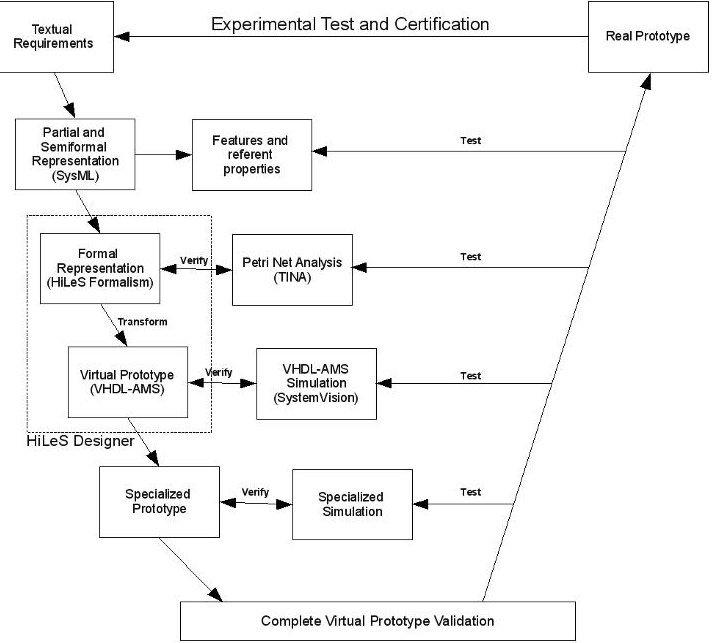

Figure 1: Top down design

Our global approach covers the system level design (without differencing Hardware/Software) to the virtual prototyping and then to the implementation.

At the high-level design, the goal is to convince the designer assuring the conformity of the functional specifications with its own initial textual specifications and to give to the project leader the elements for structuring the work flows for every suppliers. To fill these requirements we propose two principal aspects:

- The construction of a formal representation of operations sequences. Generated models that allow a validation of their correct operation sequence.

- Compatibility with a standardized description language of multi-field systems. The final system representation could be simulated and implemented. Thus, models generated by HiLeS should be compatible to this standard language. The open language and standard VHDL-AMS was chosen to write our virtual prototypes. The adoption of VHDL-AMS language is not a restriction to use other languages (SystemC [10], Verilog [11]).

The HiLeS formalism generates architectures where the control sequences and the functions carried out at each state are well differentiated. It comprises a set of structural and functional (atomic) blocks, a control network and a set of discrete-event and continuous channels.

## 1.1 Structural and Functional Blocks

Structural blocks allow the structural and hierarchical decomposition of the system and they are represented by rectangles (figure 2b). Structural blocks can contain other structural or functional blocks. The Functional blocks are atomic blocks that describe the system's behavior in differential, algebraic or logic equations. A functional block transforms or process signals. They are represented by round corner rectangles (figure 2c). Actually, the adopted syntax is VHDL-AMS according to the HiLeS specifications, but we envisage to adopt other syntax possibilities like SystemC or Verilog.

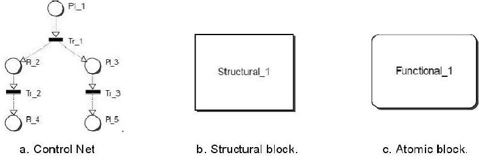

Figure 2: HiLeS formalism base elements and control model

## 1.2 Processing Network

Signal and/or processing and transforming data are represented by a processing network composed of exchanging data/signals between functional blocks and the environment. These signals/data are expressed by continuous channels connected to blocks at port points. Continuous channels transport signals/data continuous in time; such the case of analogical signals. They are represented by filled continuous arrows.

The ports are the channels input/output points of a block and they represent block exchanges on a given environment.

The right side of the figure 3 depicts a continuous flow between functional blocks. Two continuous signals, EA_0 and ED_0, go from the environment to Functional_1 functional block using continuous channels. Functional_1 transforms the input signals in a continuous signal using an equation. The resulted continuous signal goes to Functional_3 block and it is transformed to generate a new signal which goes out to the environment through SA_0.

## 1.3 Control Network

The control network of a system described by HiLeS is based on ordinary Petri nets (figure 2a). Under HiLeS, the Petri net represents the sequence of data/signals processing. The Petri net arcs are represented by dashed arrows.

Petri nets are a graphic and mathematical formalism that represent and describe systems in which concurrence and parallelism concepts are present.

<!-- PDF_PAGE: 3 -->

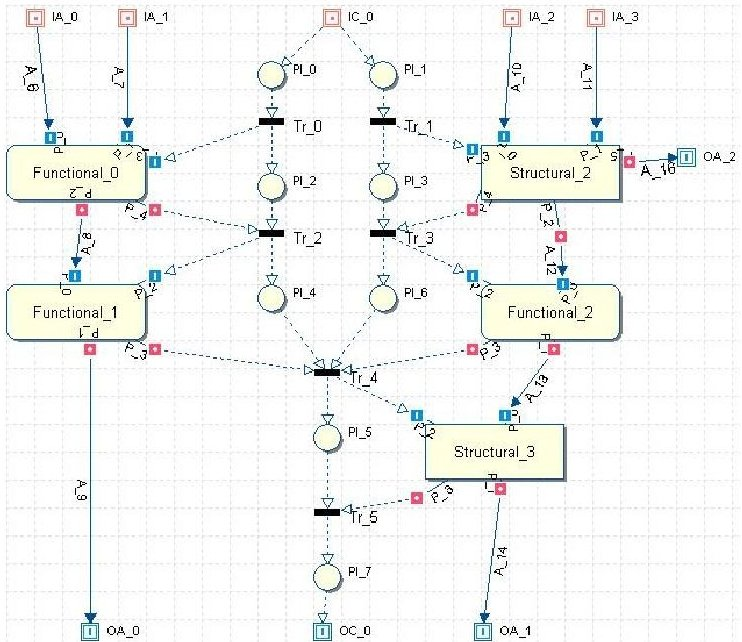

Figure 3: Control net and blocks interaction on HiLeS

Processing and Control flows are independent and concurrent. Petri net arcs are used to represent the interaction between control and data/signal processing.

At the lower level of description, Petri net is in interaction with functional blocks. A functional block is viewed as a place to which a function is associated. The marking of this place activates the processing of the function (the token is not available) and at the end of the processing, the token is released.

The center of the figure 3 depicts a control network example. When an event arrives through EC_0 port, the places PI_1A and PI_1B are marked by a token. The Tr_1 transition is fired and the PI_2 is marked. At the same time, the associated functional block to PI_2 (Functional_1) is activated to start the process execution. Once the Functional_1 process execution is finished, the Tr_3 transition is fired and the execution flow continues. On the other side, the Tr_2 is fired because of the marked PI_1B. The PI_3 place is marked and the Process_1 block is executed. The token from the PI_18 arrives to the internal control network of this structural block which executes the sequence of internal functional blocks or other internal structural blocks. Once the process execution is finished, the transition Tr_3 and Tr_4 are fired and the execution control flow continues.

## 1.4 Multiples Architectures

HiLeS approaches the structural construction of blocks using one or multiple architectures. It allows the designer to define different solutions for a given functionality without changing the interface. This principle is inherent to the classic VHDL entity-architecture construction and it has been already suggested by the "paradigm of reconfigurable models" [12] for the system conception. To better show the principle, the block Structural_1 (figure 4a) has 4 inputs In_01, In_02, In_03, In_04) and an output (Out_01). The icon at the top-right corner of the block indicates the presence of at least one architectural description. The block's Inputs/Outputs are kept, and we propose two possible solutions at figure 4b and 4c.

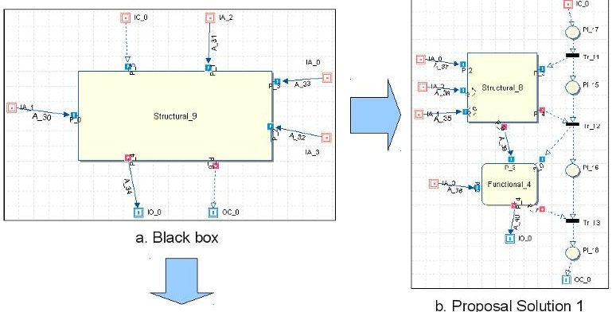

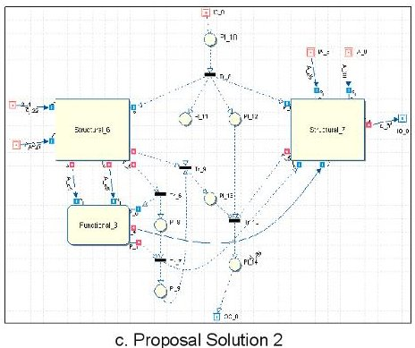

Figure 4: Example of multiples architectures for one interface

## HILES DESIGNER TOOL

## 1.5 HiLeS platform

HiLeS Designer platform is centered on a knowledge base data-processing allowing: a simple exchange of information between various designers of diverse knowledge disciplines, the integration of languages and the re-use of the previously validated models. This tool also supports project management with several designers working on various sites distant from each other.

HiLeS Designer 0

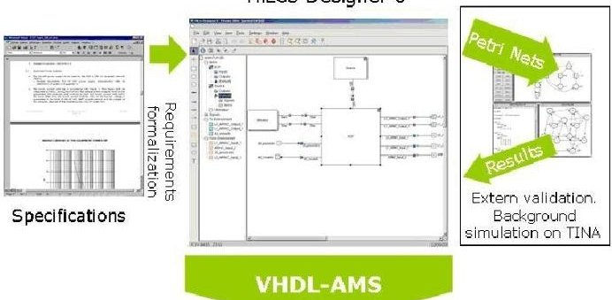

Figure 5: Systems design platform

Therefore, we take care to place our work within the framework of recently emergent technologies such as codeign and co-simulation and the use of extended mark-up languages for the management of the Intellectual properties and data bases. Our platform is resumed on figure 5. Our method takes the specifications written in natural language, interprets and translates them in interconnected functional models and control nets. This graphic functional model is validated by formal methods delivered by TINA tool. Then, the generated VHDL-AMS code is simulated in simulation tools like Systemvision [13]. It will be especially interpreted in order to carry out essential simulations in a behavioral and temporal way.

## 1.6 HiLeS -TINA software Footbridge

The footbridge data-processing, which was conceived by Hamon [14], is showed on figure 6. In [15], the footbridge was tested and developed with procedures and terminologies to lead the current footbridge. Figure 6 illustrates the coupling strategy of two data-processing tools: HiLeS and TINA. The files exchange is carried out by

<!-- PDF_PAGE: 4 -->

the two tools. In figure 6, it is also possible to find the functionalities implemented to make the exchange. The objective was to launch the TINA simulator on background starting from HiLeS designer, then to recover the results and to interpret them in order to provide to the designer the first elements for the project checking. This operation mode had already been envisaged by the TINA creators, as well as the possibility of using a textual networks representations entry [14].

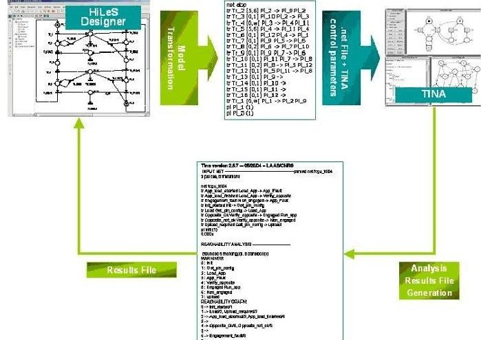

Figure 6: HiLeS-TINA passage procedure

## REMOTE KEYLESS ENTRY SYSTEM

We use our tool in the intelligent remote keyless entry system (IRKES) design. IRKES is a system used in some cars to lock and unlock the doors replacing the conventional key system. The particularity of this system is that the driver does not need to press any button on a remote control nor to put any key on the car to unlock it. The driver only needs to approach their hand to the door handle with a key card in their pocket in order to unlock the doors. The system detects and identifies the driver reading the key card remotely. When the driver moves in a certain distance away from the car, the system locks it. In this example we only model the embedded system inside the car so that the key card is considered as an environment part.

The IRKES model begins in the first abstraction level called Level 0. This level defines the interaction between the environment and the system, the services that the system offers to the environment and the system needs from the environment. In this case, approaching hand and pressing button events and the code transmitted by the key card (Tr_22, Tr_21 and D_2 respectively in the figure 7 - Level 0). The environment is also modeled using HiLeS formalism and the test scenario is defined and configured inside the environment's structural block that will be used to verify the virtual prototype described on VHDL-AMS.

Defined the Level 0, we descend in a more detailed abstraction level called Level 1 (figure 7 -Level 1). In this level, the system is split in its main subsystems (HiLeS Structural Blocks) according to the system functionality: Detector (user approaching detection), Identificator (user's key card identification), SleepingTimer (system's sleeping control mode) and LockControl (lock and unlocdoor control). The Detector structural block has a relationship with the Identification structural block which is the beginning of the identification process in order to valid or not the detected user. The event generated by Detector to Identificator is represented by the channel which goes out from the Presence_s port to the transition Tr_4 and it continues to the Presence_r port that belong to the Identificator block in the figure 7 - Level 1. In the Detection block, the logic behavior to generate the event in the Presence_s port is implemented by Petri nets. Signals

comming from the environment, can be defined in the same level. The ID code sent by the key card goes from the environment to the system using a continuous channel called ID_0. Other external signals, such as approaching hand event and pressing button event, are represented by ApproachHand port and PressButton port respectively transmitting the event through discrete-event channels. The behavior of this two last events are implemented in a Petri nets inside the Environment structural block.

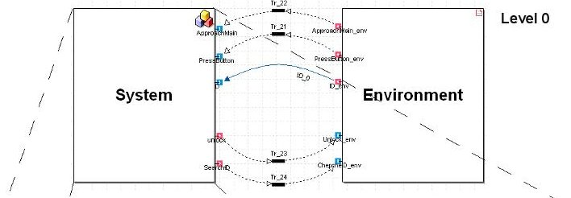

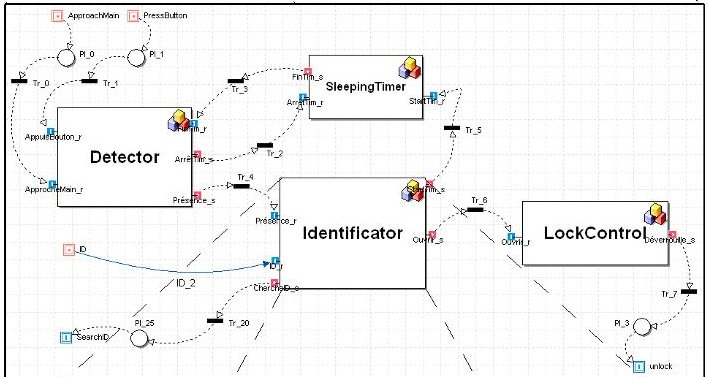

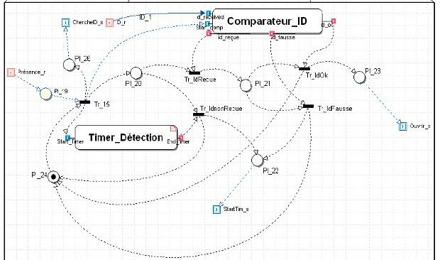

Figure 7: Remote Keyless Entry System model using HiLeS Designer.

In Level 1, we focus on the Identification block in order to define the first functional description. Inside the Identification block, we define two functional blocks Comparator_ID and Detection_Timer, so they receive the code from the key card, to valid the user and to manage the time to identify the key card. Comparator_ID block receives a continuous signal from the environment (key card ID) and this is internally processed to generate an event authorizing (Tr_IdOk) or rejecting (Tr_IdFausse) the received ID. Each functional block is controlled by the defined Petri net and the functional description written in VHDL-AMS.

Once the functional and architectural description is created in HiLeS, the logical behavior is verified formally extracting and transforming the Petri net from the HiLeS model to be analyzed in TINA.

In figure 8, the Identify block marking is depicted. This figure shows every possible marking in the Petri net defined in Identify block. For instance, on marking 4 (line 4), the places PI_22 and PI_24 have a token, this means that the Comparator_ID functional block finished its task, the code received from the card is not authorized or the code was not received and then an event is sent to SleepingTimer in order to start the time to change to sleeping mode.

<!-- PDF_PAGE: 5 -->

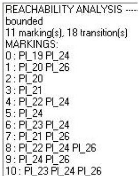

Figure 8: Marking analysis of IRKES model

The figure 9 shows Identify block reachability graph. This graph depicts the active transitions for each marking and the marking that each one of them accesses when a transition is fired. For instance,"0 $ \rightarrow $ Tr_15/1" occurs when an detection event arrives (marking 0), then following the Identify" block Petri net description, there is only one active transition, Tr_15. If this transition is fired, the next marking is the marking 1, that means an ID request event is sent to the key card, the identification waiting timer (DetectionTimer) is active and the Comparator_ID waits for the transmitted key card code. The Reachability graph also shows that the marking 5 is a dead marking (it also is depicted in the figure 9), because it is not possible to fire any transition until a new detection event arrives. Finally, figure 9 depicts that the Identify" block logic behavior is not alive, because of the block needs of extern events to execute its functionality. Every event that goes into the block, it is given to another block, so the block is extern event dependent.

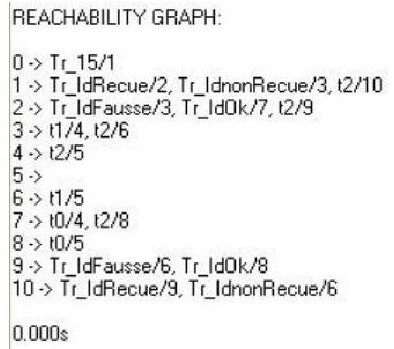

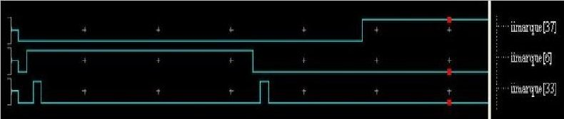

Figure 9: Reachability graph of IRKES model

Using HiLeS Designer, it is also possible to verify our model by simulation. In our example, HiLeS Designer transforms the IRKES model to VHDL-AMS, this includes the Petri net and the functional block description. The scenario is configured in the Environment block showed in the `level 0" which also is modeled using HiLeS formalism and HiLeS Designer generates the testbench for the simulation. The figure 10 depicts the Detect scenario simulation. This scenario shows that the system is in sleeping mode and the user presses the button twice to active the system and to open the doors. On the simulation, the system detects the door handle button event (third signal (1: pressed, 0: released) in the figure), thus it waits a second the door handle button event to active the system. When the user pressed for a second time, the system is activated (the sleeping mode is stopped, the second signal (1: active, 0: inactive) in the figure), the user is identified and it unlocks the doors (first signal (1: unlock, 0: lock) in the figure).

Figure 10: Detect scenario simulation

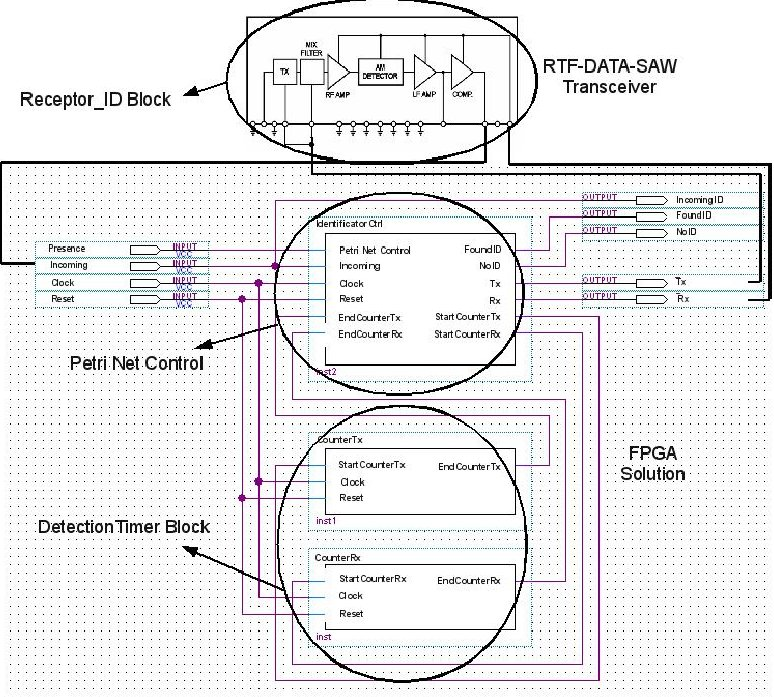

Figure 11: Identificator Block Physical Solution Representation.

The generated virtual prototype is used to implement on a physical solution using the generated code VHDL-AMS. Comparator_ID block (figure 7) is mapped on a transceiver and a FPGA solution. The transceiver represents the capturing and logic conversion of the transmitted card ID from the key card. This functionality is represented in the HiLeS model as Comparateur_ID block that receives the ID_1 continuous signal from the key card, which is the card ID code. A digital signal goes out from the Transceiver to IdentificatorCtrl entity (figure 11 - Signal Rx), which compares the received ID code (ID_1 in HiLes model) and the registered ID code. The answer of this entity is two logic signals FoundID and NoID, which represent the events generated by Comparateur_ID block to fire the transition Tr_IdOk and Tr_IdFausse. On the other hand, when the signal Presence is true (when a token arrives to the PI_19 in the HiLeS model) IdentificatorCtrl entity sends a pulse to CounterRx entity in order to start the waiting time for the card ID (StartCounterRx). If the time is over, CounterRx entity sends a pulse to IdentificatorCtrl (EndCounterTx to EndCounterTx) to stop the process execution. Timer_Detection block is also implemented in a FPGA solution (counterTX, counterRX). The figure 11 shows the block representation of the physical solution.

## CONCLUSIONS

We present a platform and formalism for high level systems design for electronic embedded systems. The hierarchical structure and the multiple architectures principle make HiLeS formalism a powerful tool for systems modeling. Additionally, the formal sequence verification of the model enables the designer to conduce an "error free" design. HiLeS allows taking into account discrete and continuous aspects inherent in electronics embedded systems.

The use of Petri net and its association with VHDL-AMS for continuous time modeling allows to validate and to verify the design by formal analysis and also by virtual prototype simulation. Virtual prototype is automatically generated and additionally the logic part of the VHDL-AMS code generated is synthetizable allowing going into physical implementation, that makes a seamless design. HiLeS is based on a block hierarchical structure that permits to evaluate multiple architectures making easier partitioning tasks.

<!-- PDF_PAGE: 6 -->

Our current work integrates HiLeS design tool into a system engineering framework which follows the EIA-632 Standard requirements [16]. We develop a methodology [17] based on SysML standard language. In this work, SysML is used for system design and HiLeS is used for validation purposes and virtual prototyping. Different system use cases described by SysML sequence diagrams are automatically translated into HiLeS formalism by transformation models techniques.

## REFERENCES

[1] Gajski, D., 2007 New strategies for system-level design DDECS, 15.

[2] Calvez, J., 1993, Real-Time Systems a Specification and Design Methodology, John Wiley & Sons.

[3] Schorcht, G., Troxel, I., Farhangian, K., Unger, P., Zinn, D., Mick C.,George, A., Salzwedel, H., 2003, System-level simulation modeling with MLDesigner, MASCOTS, pp. 207-212.

[4] M. D. Inc., 2003, VisualSim datasheet, http://www.mirabilisdesign.com/Pages/Product/mdiproducts.htm.

[5] Gajski, D., Abdi, S., Gerstlauer, A., Schirner, G., 2009 Embedded System Design. Springer.

[6] Hamon, G., Rushby, J., 2007, An operational semantics for stateflow, STTT, 447-456.

[7] Farwer, B., Misra, K., 2003, Modelling with hierarchical object Petri nets, Fundamenta Informaticae, vol. 2, 129- 147.

[8] David, R., Alla, H., 2005, Discrete, Continuous and Hybrid Petri Nets, Springer.

[9] Berthomieu, B., Ribet, P., Vernadat, F., 2004, The tool TINA: Construction of abstract state spaces for Petri nets and time petri nets, International journal of production research, vol. 42, no. 14, 2741-2756.

[10] IEEE, 2005, IEEE-1666 IEEE Standard SystemC Language Reference Manual, IEEE.

[11] IEEE, 2001, "IEEE-1364 IEEE Standard for Verilog Hardware Description Language, IEEE.

[12] Y. Herve, 2003, Virtual prototyping with VHDL-AMS in, IEEE International Conference on Industrial Technology, 2, 761-765.

[13] Mentor Graphics, 2009, Systemvision www.mentor.com/SystemVision.

[14] Hamon, J., 2005, Méthodes et outils de la conception amont pour les systèmes et les microsystèmes," PhD Dissertation, Institut National Polytechnique, Ecole doctorale de Génie Electrique, Electronique, Télécommunications.

[15] Chamseddine, N., 2005, Application de quelques méthodes de vérification formelles sur un exemple de système industrielle," internship report, Ecole des mines de Nancy.

[16] EIA, 1999, EIA-632 processes for engineering a system, Electronic Industries Alliance.

[17] Gomez C.E., Esteban, P., Pascal, J.C. Jimenez, J., 2009, Modeling complex system using sysml, Report LAAS No. 09636.