<!-- PDF_PAGE: 1 -->

Research article Full text access Get rights and content

# A multiple-CubeSat constellation for integrated earth observation and marine/air traffic monitoring

Shufan Wu $ ^{a} $ ,,., Zhongcheng Mu $ ^{a} $

View PDF More actions

## Highlights

- The design and implementation of a 3 CubeSat mission.

- Multiple payload on multiple satellites.

- Inter-satellite link based on CubeSat Space Protocol (CSP).

- MEMS Based cold-gas micro-propulsion.

- ADS-B data collection and Antarctic Icing Observation.

## Abstract

CubeSats has evolved from purely educational tools, to useful platforms for technology demonstration and many practical applications. This paper reviews a CubeSat constellation mission involving 3 CubeSats launched into orbit on Sep. 25th 2015, aiming to demonstrate the integrated application of low-cost CubeSat technologies with distributed payloads using a group of satellites, as well as to demonstrate several new technologies. The mission scenario, the satellite system design, the innovative technologies and instruments or devices used on the CubeSats and the in-orbit experimental results and the payload data analysis, as well as some experiences and lessons learned, are presented and summaried.

Keywords

CubeSat; Distributed payloads; Integrated earth observation; Inter-satellite link

<!-- PDF_PAGE: 2 -->

## 1. Introduction

In 1999, the CubeSat (Cube Satellite) concept was developed by California Polytechnic State University and Stanford University, which set up a set of standards to help universities worldwidely to perform space science and exploration (Shufan et al., 2015). A CubeSat is a type of miniaturized satellite for space research that usually has a volume of exactly one liter (10cm cube) with a mass of no more than 1.33kg, known as 1U CubeSat, and typically uses commercial off-the-shelf components (COTS) for its electronics (Woellert et al., 2011). And the distinctive advantage is the Lego-like feature, the CubeSat could be scalable along any axis, using 1U increments, such as 2U, 3U, 6U and nU CubeSat.

Since the first cubesat launched, the CubeSat standard has been worldwidely accepted and inspired many universities to develop their own CubeSat projects, missions and technologies, which further produced a lot of spin-off high-tech companies dedicated to the CubeSat community. The CubeSat standard has contributed to the small satellite community into the 'CubeSat Era'[SpaceWorks, 2018, Su et al., 2013, Bouwmeester and Guo, 2010, Shufan and Hongyu, 2013]. In 2017, over 300 nano/microsatellites (below 50kg) were launched globally, representing an increase of nearly 205% compared to 2016 [SpaceWorks, 2018]. Among them, more than 280 nano satellites were built mostly based on CubeSat technologies. This proves that CubeSats have evolved from purely educational tools into a useful platform for technology demonstration and scientific instrumentation as well as commercial application, and have transitioned from university labs into the commercial sector targeting both space technologies and applications [Su et al., 2013, Bouwmeester and Guo, 2010]. CubeSats have been selected as one of the 10 top scientific achievements or breakthroughs by the 'Science' magazine'[Meghna, 2014].

Reviewing the CubeSat development, two trends are observed: one is the ever increasing performance and capacity with the individual CubeSat; the other is the constellation building of multiple CubeSats with carrying on either the same payload to enhance re-visit frequency and coverage, or different distributed payloads to perform more complicated tasks (Farrag et al., 2019). A typical example is the Planet Labs Flock family, which has already launched over 200 3U CubeSats (team, 2017). With a 3U CubeSat size, it can attain the earth observation images at meter level ground resolution. Meanwhile, due to its low cost, a constellation with hundreds of CubeSats becomes an affordable and commercially feasible offering.

For CubeSat constellations, two directions are further diverged, one is to increase the number of satellites to enhance coverage or re-visit frequency, where all the satellites carry

<!-- PDF_PAGE: 3 -->

the same payload with the similar function. The second is to use a constellation with multiple CubeSats carrying different distributed payloads to perform an integrated mission or service. The former direction has been demonstrated already by the mentioned example with Planet Labs, while the later direction is more oriented towards distributed payloads or multiple functional satellites forming a constellation to provide the integrated services, which gain more and more attentions in the space field (Daniel et al., 2017, Veronica et al., 2016).

Thus, this paper presents a small CubeSat constellation, named the STU-2 mission (also known as the TW-1 mission during its development phase), developed to explore the integrated services for the earth observation and marine/air traffic information collection and monitoring, based on low-cost and off-the-shelf CubeSat technologies. It consists of 3 CubeSats, using one 3U CubeSat and two 2U CubeSats, carrying different payloads and instruments, launched into a Low Earth Orbit Sun-synchronous Orbit (LEO SSO) orbit, forming an along-trace satellite constellation on Sept 25th 2015. An overall overview for the satellite research and development (R&D) is given. And the in-orbit testing results and the payload data are discussed, and some important lessons learned are elaborated before concluding the paper.

## 2. Mission requirements analysis

Since that the performance and capacity of an individual CubeSat is always constrained by its limited volume, mass, data rate and available power onboard, building the multiple- CubeSat constellation to achieve the integrated service with using the multisource data from the different payload would be the main future issue, which could effectively cover the shortage for the individual CubeSat performance. And in the satellite engineering field, selecting the high reliability technologies are always having a relative high priority, especially for the commercial application and service. Thus, aiming to extend to the commercial application and service of the CubeSat, STU-2 mission known also as TW-1 mission is initiated to build a small CubeSat constellation with 3 CubeSats, being launched into an SSO orbit at 481km, on September 25, 2015, in Jiuquan, China, as the first batch of CubeSat in China (Shufan et al., 2015).

STU-2 mission was designed to explore the integrated services for the earth observation and marine/air traffic information collection, where Wide FOV (field of view) miniature camera, space-based AIS (Automatic Identification System) and ADS-B (Automatic Dependent Surveillance-Broadcast) receiver are allocated into three different CubeSats, as illustrated in Table 1. The key purpose was to build a space local nano-satellite constellation to service the special region with using the following three functions, where the ground supporting infrastructure is difficult to lay down, for example North and South Pole region.

<!-- PDF_PAGE: 4 -->

- Earth observation for Antarctic glacier and see icing condition;

- Collection of global marine traffic information with an on-board marineship Automatic Identification System (AIS) receiver;

- Collection of global air traffic information with an on-board Automatic Dependent Surveillance - Broadcast (ADS-B) receiver;

Table 1. Satellites design configuration.

<table border="1"><tr><td>CubeSat</td><td>STU-2A</td><td>STU-2B</td><td>STU-2C</td></tr><tr><td>Satellite</td><td>3U CubeSat</td><td>2U CubeSat</td><td>2U CubeSat</td></tr><tr><td>Main Payloads</td><td>Camera</td><td>AIS Receiver</td><td>ADS-B Receiver</td></tr><tr><td>New Technologies</td><td>GPS/BD receiver, Micro-Propulsion. Gamalink</td><td>GPS/BD receiver, Gamalink</td><td>GPS/BD receiver Inertial Sensor</td></tr></table>

## 2.1. Polar region icing situation awareness

The amount of ice in polar Arctic and Antarctic polar regions has been receding progressively every summer as a result of global climate changes in the past decades. For the northern Arctic region, these changes have conveniently allowed commercial vessels to pass this area in summer, emerging into a marine route called "Northern Sea Route", which attracts high interest from shipping companies. For example, the Northern sea route allows a vessel sailing from Dalian in China to Rotterdam in Europe to complete the journey in about two-thirds the distance of a typical route via the Strait of Malacca and the Suez Canal, as illustrated in Fig.1, and in only half the distance of a route via the Cape of Good Hope.

Download: Download high-res image (299KB)

<!-- PDF_PAGE: 5 -->

Fig. 1. Northern sea route.

Using these Northern sea routes means faster shipments, reduced fuel expenses and a small impact on the environment. However, it is essential to monitor the ice situation in the northern Arctic region in order to provide navigation for the Northern sea route, for vessels, so they can avoid dangerous icebergs floating in the sea even in the middle of summer period. The microsatellite WINSat-1 was dedicated to this purpose, to monitor the icing situation in the arctic region, helping provide navigation information for vessels in the Northern sea route (WINSat-1, 2015).

Apart from commercial vessel transport, both Arctic and Antarctic regions are of great value and interest for scientific purposes. The XueLong icebreaking research vessel has made more than a dozen voyagse to both arctic and Antarctic regions. In 2012, it made a voyage through the arctic ocean to Europe aimed to record ice melt, passing through the Bering Strait before joining the westbound area on the Northern Sea Route (Xuelong, 2012).

Thus, the first mission requirement of STU-2 is to meet all these practical requirements for both the commercial cargo vessels to navigate through Northern Sea Route and for the science research vessels to explore the arctic and Antarctic regions. An appropriate optical instrument is needed as the primary payload to meet these requirements.

## 2.2. Marine traffic monitoring from space

Marine Automatic Identification System (AIS) Class A transceivers with 12W output power are used for ships over 300 ton and for all passenger ships, to broadcast their identification, position, course and speed to other ships and land statiosn to avoid collisions (Canberra ACT Australia (2008)). Smaller ships often carry low-cost Class B transceivers with 2W output power. AIS is helpful to ensure the safety of ships, for example in cases of hijacking and for search and rescue operations in the case of emergencies. Ships fitted with AIS receivers and transponders can be tracked by AIS base stations located along coast lines. However, when ships are out of range of terrestrial networks, the satellites that are fitted with special AIS receivers are the good option. AIS transponders have a horizontal range that is highly variable, but typically range up to about 100km. for the vertical range, they reach much further up to about 1,000km, which makes it possible to use satellite-based AIS receivers to collect their signals, though AIS is not initially meant for satellite-based application. A global information system is, therefore, only possible via space-based receivers.

This second mission requirement, is to build up the marine traffic monitoring globally and meanwhile, to explore technical approach and commercial potentials of satellite-based AIS monitoring network.

<!-- PDF_PAGE: 6 -->

## 2.3. Air traffic monitoring from space

The Automatic Dependent Surveillance-Broadcast (ADS-B) system is the standard equipment on civil aircraft, transmitting periodically data-packages containing information on key data such as aircraft ID, position, altitude and intent (Airservices Australia, 2018). It is designed for terrestrial based ground station to monitor air traffic flow in certain regions. Space based ADS-B is the idea to place the sensitive receivers on board satellites in orbit, which can receive ADS-B -packages and relay them to the relevant ground stations. This concept has become very attractive and interesting in recent years for micro/nano satellite application.

In November 2013, GOMSpace launched GOMX-1, the first CubeSat that carries an ADS-B receiver (Alminde et al., 2014), produced with COTS components. GOMX-1 proved the feasibility of CubeSats to receive ADS-B messages in space, and provides valuable space data.

Therefore, the third mission was to explore the related technologies and potential application of the space-based ADS-B idea, to help enhance air traffic management from space.

Meanwhile, some new technologies and products were equipped to be in-orbit demonstrated in STU-2 mission.

- Inter-satellite link based on CubeSat Space Protocol(CSP) (Cubesat Space Protocol, 2015);

- Demonstration of CubeSats adaptive networking technologies based on Gamalink (Rodrigues et al., 2011);

- Demonstration of new technologies for CubeSat, including a SoC dual-band GPS/Beidou receiver, a MEMS cold-gas micro-propulsion system, and a multi-channel inertial sensor.

## 3. Satellite design

## 3.1. The STU-2A CubeSat

STU-2A is a 3U CubeSat with body mounting solar panels, a passive thermal control strategy except for the battery module where a heater is applied to ensure a certain temperature range. A 3-axis stabilized attitude determination and control subsystem is configured consisting of two fine sun sensors, a miniature star tracker, three reaction wheels, and one micro-propulsion module. The satellite physical layout is illustrated in Fig. 2.

<!-- PDF_PAGE: 7 -->

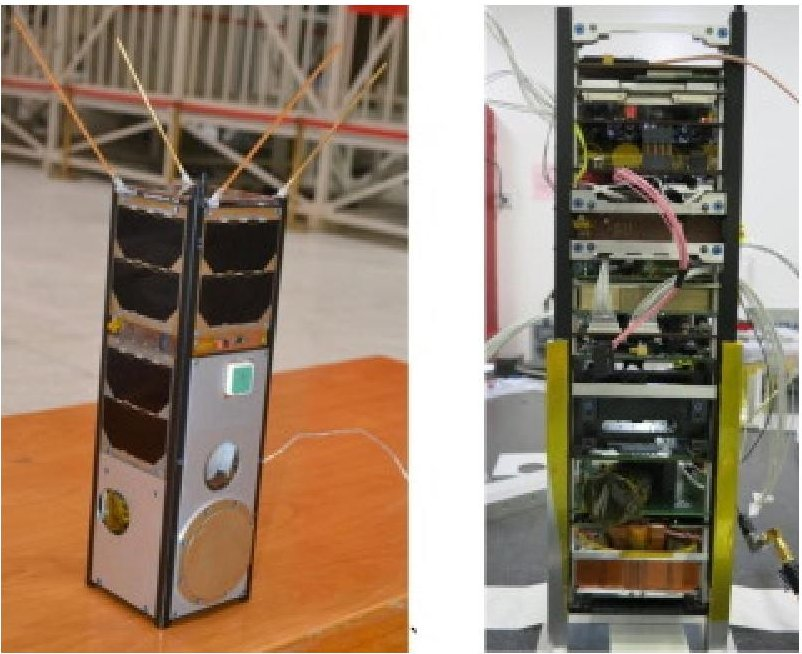

Download: Download high-res image (208KB)

Download: Download full-size image

Fig. 2. STU-2A satellite.

The main payload is an optical camera for polar region observation to monitor icing conditions, with a ground resolution of 94.4m and a swath of 222km from an orbit of 481km, with more details available in the paper "Design and implementation of a Cube satellite mission for Antarctic glacier and sea ice observation" (Shufan et al., 2017). It works in an inconsecutive mode, the two sequential images are designed to overlap in order to to have continuous observation of the polar region. It is a CMOS (Complementary Metal Oxide Semiconductor) based color camera for still imaging, jointly developed by in-house engineers and experts from Xi'an Institute of Optics and Precision Mechanics, Chinese Academy of Science.

Other payloads for technology demonstration include a dual band GPS/BD receiver, a micropropulsion module (Nanospace, 2015), and an integrated communication module (the Gamalink module (Rodrigues et al., 2011). The dual band GPS/BD receiver is an in-house developed system on a chip (SOC), as illustrated in Fig. 3, with a size of $ 2 2. 4 \mathrm{m m} \times1 7 \mathrm{m m} \times2. 2 \mathrm{m m} $ and a mass of 4g and a power consumption of 0.5W. It can achieve position accuracy of 5m in horizontal surface and 10m in altitude, a velocity precision below 1m/s, with a sensitivity below $ -1 3 0 \mathrm{d B} $ . The cold-start time is within 1min and warm start time is within 10s.

<!-- PDF_PAGE: 8 -->

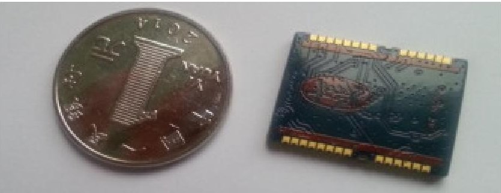

Download: Download high-res image (80KB)

Download: Download full-size image

Fig. 3. Dual band GPS/BD receiver as placed in parallel with a coin of one Chinese yuan.

The micro-propulsion module, CubeProp, is a newly developed cold-gas propulsion system based on MEMS technology, which was contributed to this mission by NanoSpace from Sweden (CubeSat and Module, 2015, Grönland et al., 2016). The GAMALINK is also a new and advanced communication module developed at the Tekever Ltd in Portugal, developed based on Software-defined Radio (SDR) and Mobile wireless ad hoc NETworks (MANETs) technologies (Rodrigues et al., 2011).

Other detailed information about the satellite STU-2A, such as its ADCS (Attitude Determination and Control Subsystem) configuration, data transmission module, TM/TC (Telemery/Telecontrol) module, as well as OBC (On-Board Controller), can be found in the paper "Design and implementation of a Cube satellite mission for Antarctic glacier and sea ice observation" (Shufan et al., 2017). Details of the EPS(electrical power system) is discussed in "Design and Implementation of Electrical System For STU-2 Cubesats" (Chen and Shufan, 2016).

## 3.2. The STU-2B CubeSat

STU-2B, as illustrated in Fig. 4, is a 2U CubeSat, with its main payload being an AIS receiver, to receive marine traffic information of the ground. The AIS receiver is provided by Satlab Ltd from Denmarkwith heritage from the AAUSAT3 mission (Jesper and Hans, 2013). The CubeSat-level AIS receiver is a fully self-contained SDR, which is suitable for LEO satellite missions. Weighing less than 50g and using 0.7W during full operation load, this versatile SDR offers the best performance possible given the typical constraints of a CubeSat.

<!-- PDF_PAGE: 9 -->

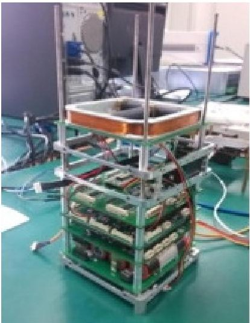

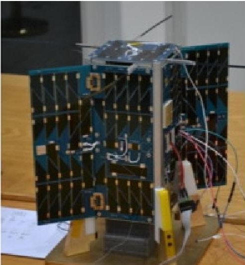

Download: Download high-res image (197KB)

Download: Download full-size image

Fig. 4. STU-2B satellite.

The satellite bus is mainly developed by a team from the Nanjing University of Science and Technology. To enhance the on-board power supply, body mounting solar cells and two deployable small solar panels are used, as shown in Fig. 4. The momentum-biased three-axis stabilization and control is implemented via two momentum wheels mounted on one axis (with one-failure redundancy) combined with the magnetic control strategy. For OBC and EPS and TT&C subsystem, the same products with STU-2A were chosen. It carries also two new models of a dual band GPS/BD (Global Positioning System/Beidou) receiver, which are the different version from that on-board STU-2A, mainly for technology demonstration.

## 3.3. The STU-2C CubeSat

STU-2C, as shown in Fig. 5, is a standard 2U CubeSat, with body mounting solar panels only. The pure magnetic control scheme based on one magnetometer and 3 magnetorquers is adopted.

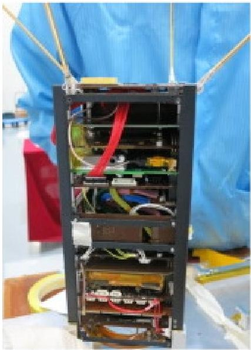

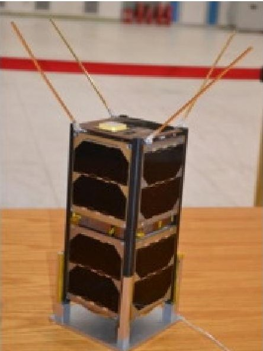

Download: Download high-res image (208KB)

Download: Download full-size image

<!-- PDF_PAGE: 10 -->

Its main payload is an ADS-B receiver (Alminde et al., 2014), to monitor civil aircraft flying within the nadir space region of the satellite. The payload is provided by GOMSpace, upgraded from the heritage and experiences of the GOMX-1 mission.

The other payloads for demonstration include a dual band GPS/BD receiver and a multi-channel inertial sensor. The GPS/BD receiver used the same chipssized receiver as that in STU-2A. The inertial sensor is using the commercial component of ADIS16448, which includes a triaxial gyroscope, a triaxial accelerometer, a triaxial magnetometer, and a pressure sensor. Each sensor has its own dynamic compensation formulas that provide accurate sensor measurements. The ADIS16448 is packaged in a module that is approximately 24.1mm $ \times $ 37.7mm $ \times $ 10.8mm and has a standard connector interface.

## 4. In-orbit comissioning and experiment results

The STU-2 mission with three CubeSats was launched successfully into space on Sep. 25th, 2015, on-board a newly developed small launch vehicle in China, the LoangMarch-11 launcher, towards the target LEO orbit of SSO, with an altitude of 481km, inclination of 97deg, and LTDN at 8:00 AM.

## 4.1. In-orbit commissioning

The 3 CubeSats were all powered-off during the launch campaign. After being released from the launcher, the electrical power was switched on automatically for all satellites as t0, then UHF (Ultra High Frequency) antennas were released with a delay of 20-25min from t0. The UHF transceiver for all 3 satellites were set as silent mode for a period between 30 and 45min from t0, to avoid signal interference among the three satellites. During the in-orbit commissioning period, a temporary UHF ground station was set up in the Shihezhi University, Xinjiang Province, China, which could access the CubeSat on their first orbit after the launch.

The satellites were put into orbit on Sep. 25th 2015, 9:52 AM Beijing time. In the first pass over the Shihezhi ground station, at 11:12 AM satellite-ground links were successfully built up. The received TM data showed that the satellites had already completed the rate damping mode. For example, the residual angular rate of STU-2A had been reduced to be within 0.3deg/sec, and entered already into the sun pointing mode automatically, which comply with the simulation analysis results for the initial de-tumbling mode.

Then a series of TMTC actions were executed from the ground station located in Shanghai and Nanjing. All the mission payloads were successively switched on, valid data were

<!-- PDF_PAGE: 11 -->

received respectively, as to be discussed later. Hereafter some results about the satellite platforms are illustrated.

For the thermal aspect, TM data shows that all the three satellites stay within their designed range. The temperature within each satellite varies between 0 and $ 2 7 \, ^ {\circ} C $ for STU-2A, $ 9-2 2 \, ^ {\circ} C $ for STU-2B, and $ - 1 0 \sim 2 0 \, ^ {\circ} C $ for STU-2C (and $ 1-1 4 \, ^ {\circ} C $ for battery due to the thermal active control on battery). Fig. 6 shows the thermal environments variation during two orbits within the STU-2A satellite bus, measured from different thermometers, showing that the variation of temperature within the STU-2A is between 0 and $ 2 7 \, ^ {\circ} C $

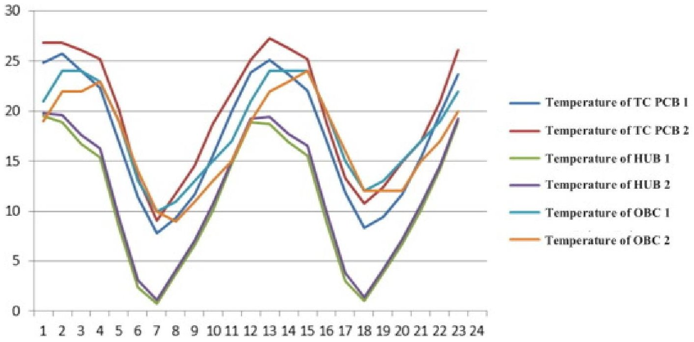

Download: Download high-res image (199KB)

Download: Download full-size image

Fig. 6. Temperature variation within satellite STU-2A.

For the electrical power aspect, all the three satellites show steady power supply and a good energy balance between charging and discharging. Fig. 7 illustrates the EPS charging and discharging situation of the STU-2A, as measured on Nov 1st 2015. The bus voltage varies between 16.6V (saturation for charging) and 16.35V at the end of eclipse period, showing a steady status of EPS.

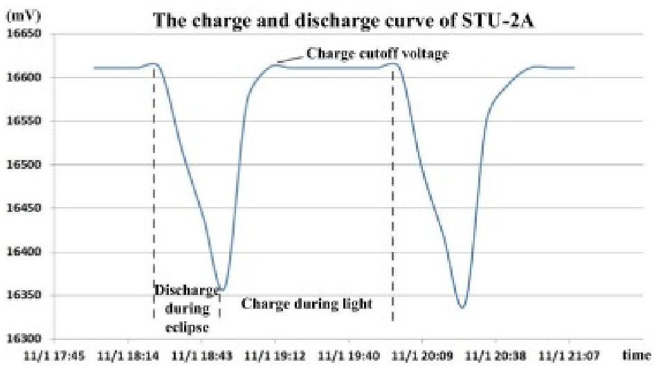

Download: Download high-res image (133KB)

<!-- PDF_PAGE: 12 -->

Fig. 7. The EPS charge and discharge situation of STU-2A.

## 4.2. ADS-B data collection

On the second day after the launch, Sep. 26th 2015, when the STU-2C passed over the Shanghai ground station at 18:15 PM, a tele-command was sent to deploy the helical antenna and switch on the ADS-B receiver as the first trial. Immediately the STU-2C captured ADS-B signals transmitted from 16 aircraft flying under the satellite. After one orbit, on 19:50 PM, it captured 51,665 signals transmitted from 405 different aircraft. Since then the receiver has successfully received over 132,425 ADS-B signals from 19,381 aircrafts (Bbased on data collected by Jan. 10th, 2016).

The signals received by ADS-B receiver were decoded on-board the satellites to get the necessary information, including plane ID, position information of latitude/longitude/altitude, speed, and the timestamp as well. Based on the received in-orbit data, the max number of frames for the receiver to decode was 182 every 10s, and min number could be zero during the pass of some oceans. The distance between the plane being heard and the satellite (STU-2C) could reach 1,500km which indicates the sufficiency of the link budget.

One limitation on receiving the payload data was the data transmitting capacity, where the UHF transceiver is used to download the ADS-B message. Furthermore, the SD card, which was supposed to store the data collected by the payload, was found not working well in space and thus memory is limited to the space available in the RAM which only can store less than 2,000 messages each time. The message in RAM could be removed automatically by a garbage collector controlled by the MCU (Microcontroller Unit) in the receiver, when the messages of planes haven't been heard again for several hours. The receiver can receive over 10,000 messages a day, but only around 2000 to 3000 messages could be downloaded everyday by telemetry channel during the STU-2C passing over the Shanghai station, due to limited down-load data rate and passing time. Thus the data received by the ground station is only a small part of the data received or collected by the ADS-B receiver on board the satellite.

The accumulative data over one orbit (Spe 26th, 2015, 18:15 PM-19:50 PM), on a single day (Nov. 1st 2015) and one month (Oct. 12th-Nov. 11th, 2015) are illustrated in Fig. 8, which show a brief impression of the most busy air traffic regions like the European, North of American and the East of Asia airspace. Several routes across continents could be clearly seen from the map. In sharp contrast, the ADS-B messages heard from southern hemisphere is so rare and is not so realistic although in generally air traffic in South African and South American is much less than that from the northern hemisphere. The RAM storage issue may

<!-- PDF_PAGE: 13 -->

be the greatest cause which makes the receiver have no space to record the data during the satellite passing over the southern hemisphere.

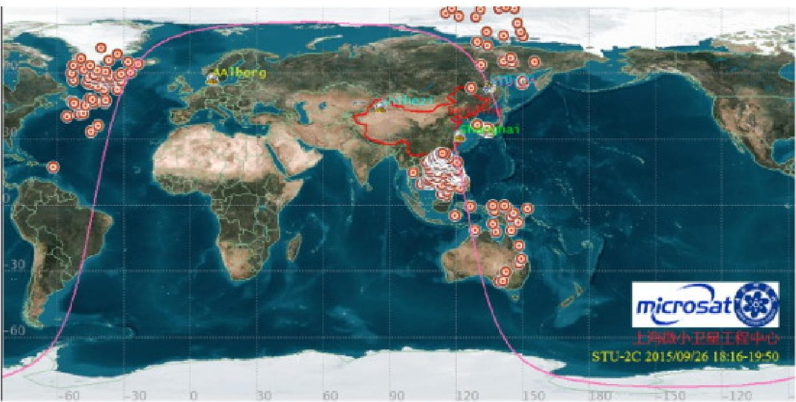

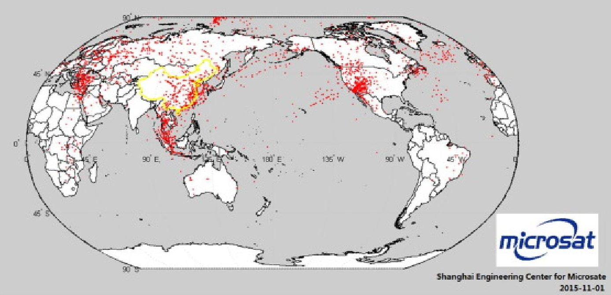

Download: Download high-res image (1MB)

Download: Download full-size image

<!-- PDF_PAGE: 14 -->

The space-based ADS-B system for aircraft tracking has some clear advantages compared to ground ADS-B when one compares the in-orbit data with the ground ADS-B data provided by Feeyo Technology in China (Xuan et al., 2018). A sample of 41,433 messages taken during the period of Dec. 10th to 30th, 2015 by STU-2C yields some interesting scientific findings which are detailed in the next section.

Space-based ADS-B data provide a powerful sense of consistency when compared with the data collected by ground stations. Worth mentioning is that 52% of the data from CubeSat is also received from ground stations, leading to a conclusion that space-based ADS-B brings enhanced reliability of satellite-based surveillance data and it is possible to monitor flights' tracks by satellites.

A very interesting phenomenon is that only 13.6% of the space-based messages are acquired below an altitude of 10,000 feet. The main reason is that ADS-B signal is easily disrupted by mountains, buildings and other obstacles. An example is listed below to validate this feature. STU-2C has coincidently recorded some flight messages when it passed over Chengdu Shuangliu International Airport which is located in the Sichuan Province surrounded by mountains. Only several airplanes were near the airport according to the record by satellite. However, signals from many more airplanes are continuously transmitted received by ground-based ADS-B stations at the same time.

Therefore, this satellite-based data collection may be less effective than ground-based ADS-B stations for mountainous areas, especially for some business districts where plenty of ground stations have been located to guarantee the safety during the taking-off and landing of the flights.

On the other hand, in regions with little ground-based equipment, space-based system shows its irreplaceable advantage. Here we take the air route from Chengdu to Lhasa as an example. Due to the special topography of Tibet, it is nearly impossible to build ground stations along this air route. Thus, the ground stations can only detect signals near the two airports. At the same time, STU-2C has detected signals through the whole route, see reference (Xuan et al., 2018) for details.

When one combines the ground data with satellite data, it is possible to have a full view of the flight path and overall air traffic in a large region/area. The air routes are clear and are matched well with the air routes report data, as reported in reference (Xuan et al., 2018).

## 4.3. Earth observation

<!-- PDF_PAGE: 15 -->

On Sep. 29th, 9:30 AM, the first Earth observation image was successfully captured by STU 2A. Since then, over one hundred images were taken, mainly focusing on the Antarctic region, especially during the XueLong Antarctic Expedition mission trip towards to and backwards from the Antarctic region. Results showed a good performance of the CMOS color camera developed for the STU-2A. Fig. 9, Fig. 10 illustrate the typical pictures taken by STU 2A during its commission phase.

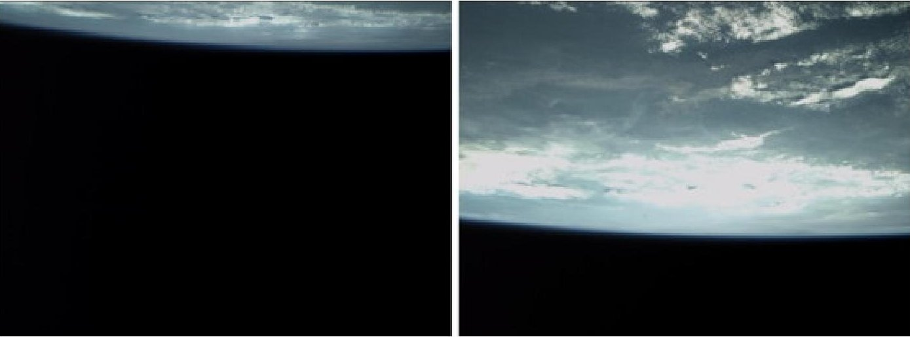

Download: Download high-res image (98KB)

Download: Download full-size image

Fig. 9. The edge of the Earth, taken on Oct 10th 2015.

Download: Download high-res image (279KB)

<!-- PDF_PAGE: 16 -->

Fig. 10. Tapajos river and Amazon river, map of google Earth (Up) and the picture of STU-2A (Down), taken on Oct 14th 2015.

The images taken for the Antarctic region were used to calibrate its exact position with reference to the openly available Modis250 data. Fig. 11 shows a set of 4 images taken by STU-2A being placed against the Modis250 imagines. The coastline characteristics are used to determine and calibrate the attitude error of the satellites by comparing the on-board attitude information with the real attitude vector calculated from geographical image match processing.

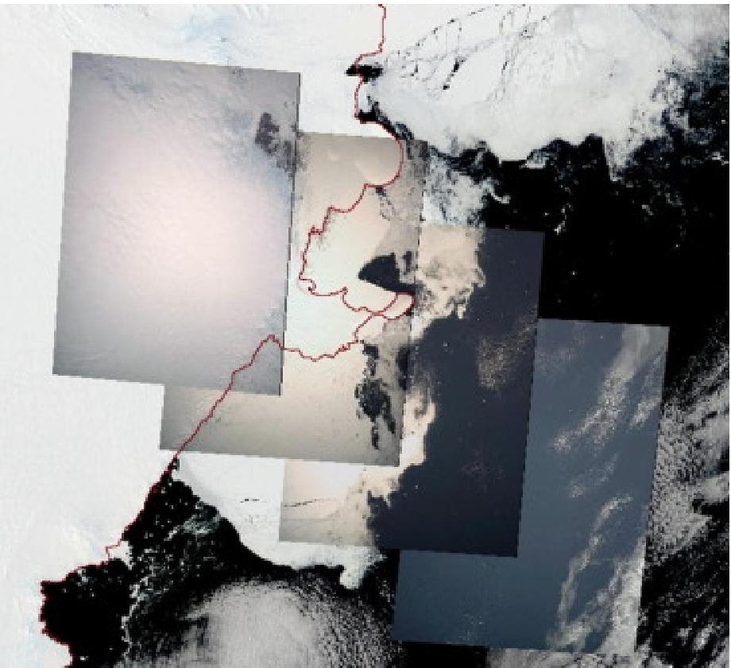

Download: Download high-res image (290KB)

Download: Download full-size image

Fig. 11. Four imagines from STU-2A on Feb. 20th, 2015 as placed into the Modis250 pictures on the same day.

Fig.12 illustrates the image details from STU-2A, as compared with Modis250. Analysis shows that the STU-2A picture gives a much higher resolution as compared to the Modis250 data, which is announced with a ground resolution of 250m. It proves that the obtained STU-2A image has reached below 100m in ground resolution (Shufan et al., 2017).

<!-- PDF_PAGE: 17 -->

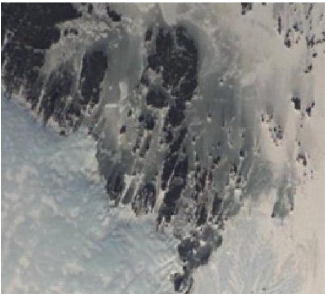

Download: Download high-res image (265KB)

Download: Download full-size image

Fig. 12. STU-2A image (L) vs Modis250 image (R).

## 4.4. CubeProp firing with accidental spinning-up of the satellite and the rescue efforts

Following a one month commissioning phase where all sub-systems were checked out, the first thruster firing was conducted on Nov. 5th 2015, 10:09 AM. Before firing the thrusters, a heating time of 30min was applied to raise the tank temperature to be above 20 $ ^{\circ} \mathrm{C} $ , such as to be able to produce a thrust level of 1mN by each thrusters. Limited by the low sampling rate of CubeProp TM data of 1/16Hz, and the limited overpassing time, the initial firing tests were defined to fire both the throttle B and C (in diagonal) for continuous 5min.

After half an hour, the received TM data of CubeProp show that the pressures of nozzle B and C, which are proportional to the thrust level delivered by that throttle, have shown a big difference between each other soon after the firing. By proper calculation, the resulted thrust level of thruster B and C are illustrated in Fig.13, which shows that the thrust level of throttle B was dropped off rapidly. Therefore, an unbalanced thrust firing occurred during this 5min firing which lead to a high rate spinning of the whole satellite at the end of the firing. The ADCS measured spin rate was at the level of ca 65deg/sec (measured by a redundant MEMS gyro on-board an interface board-the NanoHub), far beyond the designed entry envelope of the ADCS de-tumbling mode.

<!-- PDF_PAGE: 18 -->

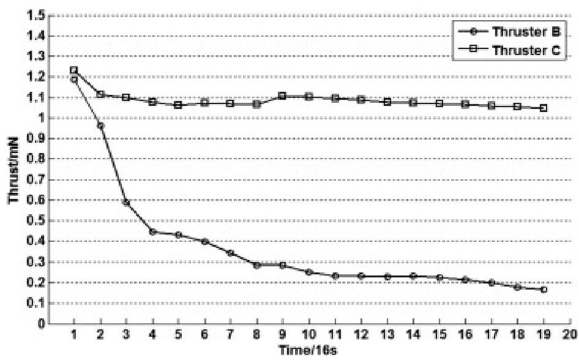

Download: Download high-res image (187KB)

Download: Download full-size image

Fig. 13. STU-2A imagines (L) vs Modi250 image (R).

Despite the induced high spinning rate, the orbit change can be still observed from the orbital parameters, based on the Two Line Element (TLE) data obtained from the website space-track.org, as illustrated in Fig. 14. Analysis of the TLE data indicates that the thruster firing actually had increased the orbit by 600m, which is far below the expected level due to the spinning of the satellite. In other words, if the attitude of the satellite was kept stable during the firing, a much higher orbit increase could be observed. Still, this result shows the capability of the CubeProp module. The total propellant capacity onboard STU-2A corresponds to running two thrusters for at least 6h, which could translate to an orbit raise of more than 40km.

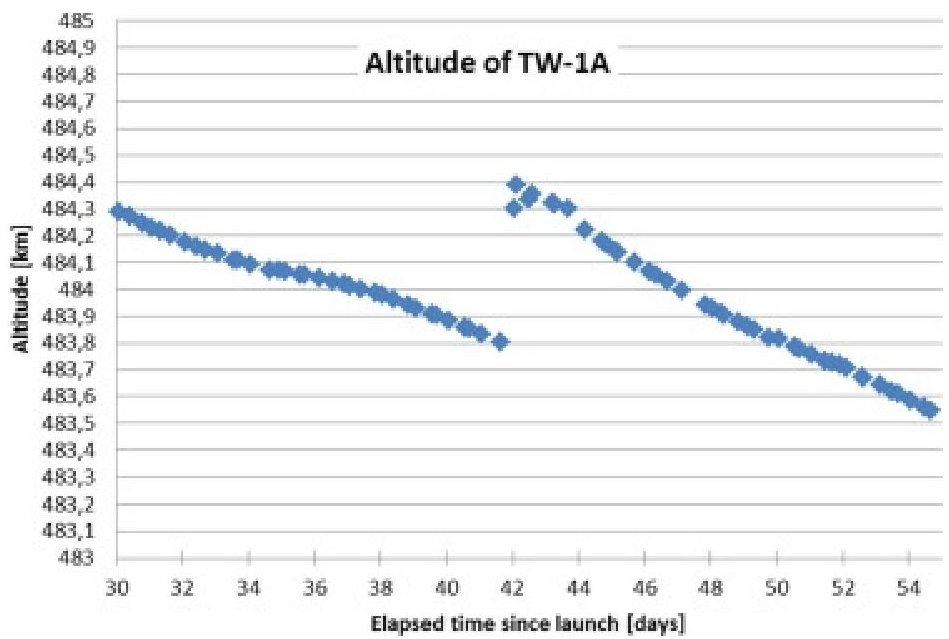

Download: Download high-res image (132KB)

Download: Download full-size image

Fig. 14. STU-2A orbital altitude per day after launch. Based on TLE data published by space track.com.

<!-- PDF_PAGE: 19 -->

It was a very big challenge which required significant effort to rescue the satellite from its high spinning status. Initially pair of thrusters of the CubeProp were commanded to reduce the spin rate, which did decrease the spin rate downwards by a few deg/sec, however, on the next pass, the spin rate would go back to 65deg/sec. Longer firings were also used to bring down the spin rate to be over 10deg/s less in one pass, but the rate of 65deg/s resumed again after one orbit.

Analyses show that there was a sample time (1s) delay in the de-tumbling control loop based on magnetometer and magnetorquer, as coded in the on-board software. The control was calculated based on the last-minute measurements of the magnetorquer from the last cycle and was sent out right after getting a new measurement (to be used for next cycle) of the magnetometer, thus a bit more than one cycle time delay exists in the control loop. For low spin rates, the control loop worked well, but for high spin rates, it turned into a cycle oscillation with a steady rate point at 65deg/s. ADCS simulations revealed and replicated this phenomenon. So it was concluded that the de-tumbling control mode of the ADCS was actually resisting the spin rate to be reduced from its current local stable point of 65deg/sec. Simulation analysis showed that only when the spin rate is below 20deg/s, the current detumbling control loop could bring the rate down to its working point at zero.

With this finding, the new strategy was used, to turn off the on-board ADCS while the thrusters were commanded to fire against the spin rate. This scheme was made feasible thanks to the CSP (Cubesat Space Protocol, 2015) as adopted on-board the satellite, which provides the capability of commanding other modules on-board the satellite directly from the TMTC ground station, rather than going through OBC all the time. Using the finding that long firing at one time could have the relative big risk, a sequential thruster firing was planned and executed, to bring the satellite spin rate to be well below 20deg/sec. A 7day thruster firing sequence between 3 and 7min was executed, as illustrated in Fig.15, in late December 2015 around the Christmas period. The spin-rate was closely monitored during the firing, to ensure its steady decreasing. This process ended up when the spin rate was observed to be successfully reduced down to 13deg/sec, as shown in Fig.15.

<!-- PDF_PAGE: 20 -->

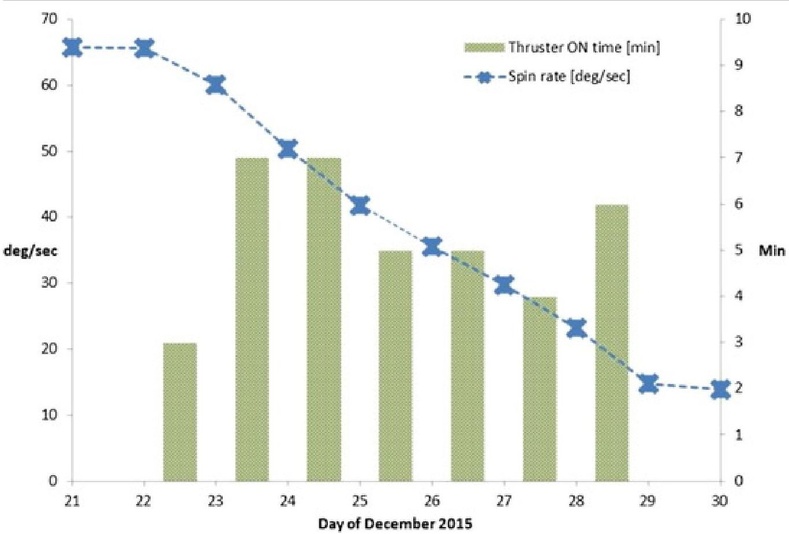

Download: Download high-res image (230KB)

Download: Download full-size image

Fig. 15. Sequence of thrust firings to de-spin the STU-2A.

Then the on-board ADCS was switched on, and the de-tumbling control mode based on magnetic control worked well to further decrease the spin rate down towards the working point at around the zero deg/s and the rescue campaign was successfully completed at the end of 2015.

## 4.5. Inter-satellite communication experiments

All the three satellites carry the same UHF transceiver, mainly for the TMTC function. However, since they are working on the same principle and their frequency could be configured on-board satellite, a trial test between STU-2A and STU-2C for inter-satellite communication was conducted in October 2015, when the two satellites were not separated too far away.

Practical tests show that these two satellites could communicate with each other by using the UHF transceiver once the distance between them was within 360km. A data rate of 4.8 kbps was demonstrated, which laid down a good basis for further experiments for intersatellite communication based on UHF transceiver. The current demonstrated communication range of 360km could be useful for a swarm of satellites flying in formation within a limited range to maintain communication links between each other, by switching into different frequencies when talking to different satellites.

<!-- PDF_PAGE: 21 -->

## 4.6. GPS/BD receiver

The GPS/BD receiver on-board STU-2A and 2C were demonstrated to be operating properly as expected in orbit. The satellites in view can satisfy the receiver to maintain capturing the signals (or fix itself) from both the GPS constellation and the BD constellation. The receiver was turned on when the satellite was passing over the Shanghai ground station, and it resulted in a quick lock of GPS/BD signals in orbit, the first time to fix was less than 5min in-orbit, similar as the ground test result. The accuracy of the GPS/BD receiver was studied by comparing the position and velocity information propagated based on the elements from the TLE of the satellite position and the velocity data obtained in orbit from the GPS/BD receiver.

TLEs are currently the conventional approach for CubeSat orbital tracking, which could be downloaded from North American Aerospace Defense Command (NORAD) website and are updated every day. By using Simplified General Perturbations Satellite Orbit Model 4 (SGP4) propagator in the Systems Tool Kit (STK) based on the TLEs, the satellite orbit information can be estimated. Considering the precision of TLE is in the region of a hundred meters and will deteriorate by time, the calculation can only give a rough estimation of the in-orbit performance.

Both satellites collect the GPS/BD receiver's output every 8s and download them through telemetry. Due to the limited memory space in the OBC and limited access time with the satellite, several in-orbit data was lost. Two sets of data from STU-2C were used to compare with the TLEs data. In set 1, the orbit information propagated from the TLEs with orbit epoch 2h before the in-orbit GPS data was used to verify the accuracy of the orbit. In set 2, a TLE with epoch nearly 8h before the in-orbit GPS data starting time is propagated to determine the orbit of STU-2C. The two sets of data used in the analyses are listed in Table 2. As a result, the accuracy of position is assessed at around 579m, and the accuracy of velocity is at 0.95m/s in the set 1. They become 2.7km and 2.86m/s in the set 2. The result is summarized in Table 3.

<table border="1"><tr><td>Set</td><td>TLE orbit epoch(UTC)</td><td>Start time of in orbit data(UTC)</td><td>In-orbit data interval(s)</td><td>Number of points</td></tr><tr><td>1</td><td>2015/10/27 10:30:20</td><td>2015/10/27 11:39:20</td><td>8</td><td>2000</td></tr><tr><td>2</td><td>2015/10/30 2:37:19</td><td>2015/10/30 10:18:09</td><td>8</td><td>2000</td></tr></table>

Table 3. Error analysis of the GPS/BD2 data in-orbit.

<!-- PDF_PAGE: 22 -->

<table border="1"><tr><td rowspan="2">Set</td><td colspan="2">RMS</td><td colspan="2">Std</td></tr><tr><td>Position(m)</td><td>Velocity(m/s)</td><td>Position(m)</td><td>Velocity(m/s)</td></tr><tr><td rowspan="4">1</td><td>X:199.7</td><td>X:0.693</td><td>X:23.4</td><td>X:0.634</td></tr><tr><td>Y:266.7</td><td>Y:0.599</td><td>Y:18.2</td><td>Y:0.539</td></tr><tr><td>Z:473.8</td><td>Z:0.268</td><td>Z:4.7</td><td>Z:0.256</td></tr><tr><td>3-axis:579.22</td><td>3-axis:0.954</td><td>3-axis:30.015</td><td>3-axis:0.871</td></tr><tr><td rowspan="4">2</td><td>X:1072.1</td><td>X:1.600</td><td>X:268.7</td><td>X:0.477</td></tr><tr><td>Y:1274.1</td><td>Y:2.100</td><td>Y:317.6</td><td>Y:0.671</td></tr><tr><td>Z:2131.9</td><td>Z:1.100</td><td>Z:128.6</td><td>Z:0.586</td></tr><tr><td>3-axis:2705.13</td><td>3-axis:2.86</td><td>3-axis:435.439</td><td>3-axis:1.011</td></tr></table>

The assessed performance data are far above the design specification of the GPS/BD receiver, which was expected to be at or below 10m. This is caused by the lack of a more accurate reference signal on-board the satellites. In order to assess the real performance, a better reference compared to the GPS/BD receiver is needed, which is unfortunately not available on-board the STU-2 satellites.

## 4.7. UHF background noise measurements

As a by-product of the STU-2 mission, the UHF background noise, which is very critical to the telecommand uplink at UHF, over the global Earth was measured and recorded by the on-board UHF transceiver during the period of Nov to Dec 2015, as illustrated in Fig.16. It was shown that background noise level above the east China region is much higher than elsewhere of the world, resulting in the bad performance of the telecommand uplink at UHF for the STU-2 CubeSats.

<!-- PDF_PAGE: 23 -->

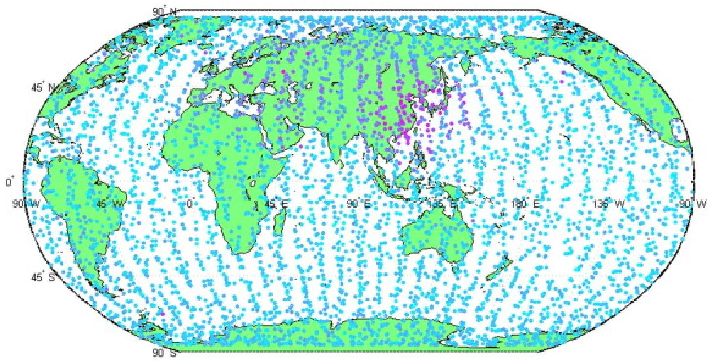

Download: Download high-res image (863KB)

Download: Download full-size image

Fig. 16. Global UHF background noise level measurements [measure in dB].

## 5. Lessons learned

During the mission design and satellite engineering implementation, as well as the in-orbit commissioning and experiment campaign, many findings and lessons were achieved, which shall be useful for other CubeSat missions and developers, hereby are the major lessons learned.

(1) Reconfigurable design for software or even hardware design could be very helpful to avoid unexpected problems during the development.

(2) EMC issue is a critical factor in CubeSat design. The satellite may be easily influenced or disturbed by other signals emitted from the transmitter or specific circuits. Necessary simulation and live testing with Engineering Models (EM) shall be implemented. A proper RF design at the beginning of the mission could help avoid some rework during the development phase. Additional metal protective shells sometimes may be helpful to get rid of the interferences.

(3) Developing software tools with proper visual display and data analysis function for ground test could greatly facilitate the process of performance testing.

(4) An orbit determination method with higher precision than TLEs for CubeSat should be figured out for better evaluation for sensitive GPS/BD receiver in

<!-- PDF_PAGE: 24 -->

space.

(5) PC104 (industrial control bus specifically standard) is used as the main system connector according to the CubeSat specification. However, its AIT (Assembly, Integration, Test) is rather difficult, as a lot of time must be spent on dismounting and reinstalling multiple PC104 boards. A more flexible and easy to install connector or a connector board specially for connecting and testing all the subsystem could be very useful.

(6) For thermal aspects, to protect battery from low temperatures, the heater needs to be switched on when temperature falls to zero or below. From the in-orbit results of STU-2, heaters were barely used during operations. The power consumption of heaters is too much for CubeSat power budgets. Developing a new kind of battery which could tolerate low temperatures would be a better way or effective direction to completely solve this problem.

(7) Redundant backup of key devices, e.g. the MEMS gyro in this case in a different board or module, could greatly improve the reliability, providing more measurements in case of a rescue operation.

(8) On-orbit injection of software parameter is necessary for calibration, and for in-orbit reconfiguration, which could help to handle many unexpected issues.

(9) The impact of residual magnetic field on-board the CubeSat remains to be a very critical issue. The 18,650 lithium-ion batteries have a significant magnetic dipole which is at the same order of magnitude compared to the magnetorquer of STU-2 satellites. This remanence could result in a large orientation error, and even an instability of the attitude.

(10) Magnetometer should be placed as far as possible from large current devices to avoid magnetic interference. If possible, it is better to be placed on a boom.

## 6. Summary

This paper presents that a small CubeSat constellation mission was designed to explore integrated services for earth observation and marine/air traffic information collection and monitoring, with distributed payloads among three CubeSats, based on the low-cost off-the-shelf CubeSat technologies.

Mission analysis, satellite design, in-orbit commission, operation, and test results are presented to illustrate the various aspects of the mission, with practical results being

<!-- PDF_PAGE: 25 -->

elaborated. Many lessons or useful experiences are drawn out, which could be very useful for future CubeSat mission and further extension of CubeSat missions.

## Declaration of Competing Interest

The authors declare that they have no known competing financial interests or personal relationships that could have appeared to influence the work reported in this paper.

## Acknowledgements

This mission is designed and being implemented by a consortium led by the Shanghai Engineering Center for Microsatellites in China, together with partners including the Nanjing University of Science and Technology, the GomSpace from Denmark, Feeyo company, Shanghai Carbon Data Research Center from Shanghai Advanced Research Institute, the NanoSpace from Sweden, and the Tekever Space from Portugal. The authors would like to express sincere appreciation and many thanks to these partners, together with them this mission has been made feasible and successfully implemented. And the authors would like to thank the support from the office of military and civilian integration development committee of Shanghai (2019-jmrh1-kj3).

## References

Alminde et al., 2014 L. Alminde, K. Kaas, M. Bisgaard, J. Christiansen, D. Gerhardt GOMX-1 flight experience and air traffic monitoring results SSC14-XII-7 28th Annual AIAA/USU Conference on Small satellites (2014) Google Scholar

Airservices Australia, 2018 Airservices Australia, 2018. How ADS-B works. http://www.airservicesaustralia.com/projects/ads-b/how-ads-b-works/. Google Scholar

Anon. WINSat-1, 2015 Anon. WINSat-1, 2015. http://en.axelspace.com/solution/wnisat1/. Google Scholar

Australian Maritime Safety Authority, 2008 Australian Maritime Safety Authority, Canberra ACT Australia, 2008. https://www.amsa.gov.au/ Google Scholar

Bouwmeester and Guo, 2010 J. Bouwmeester, J. Guo Survey of worldwide pico- and nanosatellite missions, distributions, and subsystem technology Acta Astronaut., 67 (2010), pp. 854-862

<!-- PDF_PAGE: 26 -->

View PDF View article View in Scopus Google Scholar

Chen, K., Shufan, W., 2016. Design and implementation of electrical system for STU-2 cubesats, IAC.16.C3.4.2, presented at the 67th International Astronautical Congress (IAC), Guadalajara, Mexico, 26-30.

Cubesat Space Protocol, 2015 Cubesat Space Protocol, 2015 https://en.wikipedia.org/wiki/Cubesat_Space_Protocol. Google Scholar

CubeSat and Module, 2015 CubeSat MEMES Propulsion Module, Nanospace, 2015. http://www.sscspace.com/about-the-ssc-group/ssc companies/nanospace/publications-2. Google Scholar

Daniel et al., 2017 S. Daniel, C. Paul, L. Olivier, de Weck Distributed earth satellite systems: what is needed to move forward ? J. Aerospace Inf. Syst., 14 (8) (2017), pp. 412-438 Google Scholar

Farrag et al., 2019 A. Farrag, T. Mahmoud, Y. Ahmed, ELRaffiei Satellite swarm survey and new conceptual design for Earth observation applications Egyptian J. Remote Sens. Space Sci. (2019), pp. 1-8 Google Scholar

Grönland et al., 2016 T.A. Grönland, K. Palmer, K. Jonsson, J. Bejhed Miniaturisation Enables Propulsion Also For Micro- and Nanosatellites, The 4S Symposium Valletta, Malta (2016) Google Scholar

In orbit validation of the AAUSAT3 SDR based AIS receive, 6th International Conference on Recent Advances in Space Technologies (RAST) Istanbul, Turkiye (2013), pp. 12-14 Google Scholar

Meghna, S., 2014. Breakthrough of the Year: The top 10 scientific achievements of 2014, http://www.sciencemag.org/news/2014/12/breakthrough year-top-10-scientific-achievements-2014.

<!-- PDF_PAGE: 27 -->

Google Scholar

Planet Team, 2017 Planet Team, 2017. Planet Application Program Interface: In Space for Life on Earth. San Francisco, CA. 2017, pp. 40. Google Scholar

Rodrigues et al., 2011 Rodrigues, P., Oliveira, A., Mendes, R., 2011. SDR-based ad hoc space networks (SASNETs), IAC-11-B2.1.3, 62nd IAC, Cape Town, South Africa. Google Scholar

Shufan et al., 2015 Shufan, W., Wen, C., Cai Xia, C., Chuanxing, Z., Zhongcheng, M., et al., 2015. Earth observation and marine/air traffic monitoring with a multiple CubeSat constellation. IAC.15.B4.4.3, 66th International Astronautical Congress, 12-16, Jerusalem, Israel. Google Scholar

Shufan and Hongyu, 2013 W. Shufan, C. Hongyu Micro/Nano Satellite Technologies and Applications in China, IAC.13. B4.1.5 (64th), International Astronautical, Congress, Beijing, China (2013) Google Scholar

Shufan et al., 2017 Shufan, W., T.-C. Z., Gao, Y., Cheng, X., 2017. Design and implementation of a Cube satellite mission for Antarctic glacier and sea ice observation. Acta Astronautica, 139, 313-320. Google Scholar

SpaceWorks, 2018 SpaceWorks, 2018. Nano/Microsatellite Market Forecast, 8th Edition http://spaceworkseng.com. Google Scholar

Su et al., 2013 R. Su, K. Zhang, H. Song Summarization of very small satellite development Spacecraft Eng. (a Chin. J.), 22 (6) (2013), pp. 104-111 Google Scholar

Veronica et al., 2016 L.F. Veronica, M. Jacqueline Le, W. Olivier De A survey of cost estimating methodologies for distributed spacecraft missions AIAA (2016), pp. 2016-5245 View in Scopus Google Scholar

Woellert et al., 2011 K. Woellert, P. Ehrenfreund, A.J. Ricco, et al.

<!-- PDF_PAGE: 28 -->

# Cubesat: Cost-effective science and technology platforms for emerging and developing nations

Adv. Space Res., 47 (4) (2011), pp. 663-684

View PDF View article View in Scopus Google Scholar

Xuelong, 2012 Xuelong, 2012. http://china.cnr.cn/yaowen/201207/t20120702_510079247.shtml. Google Scholar

Xuan et al., 2018 Z. Xuan, Z. Jingjing, W. Shufan, C. Qian, Z. Rui Aircraft monitoring by the fusion of satellite and ground ADS-B data Acta Astronaut., 143 (2018), pp. 398-425 View in Scopus Google Scholar

View Abstract