<!-- PDF_PAGE: 1 -->

REGULAR PAPER

# A profile and tool for modelling safety information with design information in SysML

Geoffrey Biggs · Takeshi Sakamoto · Tetsuo Kotoku

Received: 28 May 2013 / Revised: 13 January 2014 / Accepted: 24 January 2014 / Published online: 22 February 2014 $ \textcircled{c} $ Springer-Verlag Berlin Heidelberg 2014

Abstract Communication both between development teams and between individual developers is a common source of safety-related faults in safety-critical system design. Communication between experts in different fields can be particularly challenging due to gaps in assumed knowledge, vocabulary and understanding. Faults caused by communication failures must be removed once found, which can be expensive if they are found late in the development process. Aiding communication earlier in development can reduce faults and costs. Modelling languages for design have been shown through practical experience to improve communication through better information presentation and increased information consistency. In this paper, we describe a SysML profile designed for modelling the safety-related concerns of a system. The profile models common safety concepts from safety standards and safety analysis techniques integrated with system design information. We demonstrate that the profile is capable of modelling the concepts through examples. We also show the use of supporting tools to aid the application of the profile through analysis of the model and generation of reports presenting safety information in formats appropriate to the target reader. Through increased traceability and integration, the profile allows for greater consistency between safety information and system design information and can aid in communicating that information to stakeholders.

Keywords SysML·UML/SysML profile· Safety analysis·System design

## 1 Introduction

The development of safety-critical systems often involves communication amongst various members of a development team. The client communicates their desires to requirements engineers, requirements engineers communicate requirements to system designers, safety engineers analyse requirements for hazards and communicate these to system designers, and hardware engineers communicate interface specifications to software developers, to name just a few of the communications that may occur during development.

Communication both between development teams and between individual developers is known to be a source of safety-related faults in critical system design [16,38]. For example, communication between the client and the developer is often fraught with ambiguities, and defects in the information communicated between the requirements engineer and the test engineer can lead to defects in testing.

Communication between experts in different fields can be particularly challenging due to gaps in assumed knowledge, understanding and information integration. One study of NASA spacecraft development found that communication failures between the hardware team and the software team, such as inadequately specified interfaces, was a major source of faults [38]. A similarly important cause was failures in communicating the requirements. A later NASA study found that the same problems still exist [16]. Moving from security analysis to design is also known to be difficult and error-prone [14].

Communication failures may lead to faults in the system that must be corrected before deployment. Although faults

<!-- PDF_PAGE: 2 -->

can be caught by various means, including design reviews and testing, the latter in the development process a fault is corrected, the more expensive that corrective action becomes. It is cheaper to catch and remove or prevent faults as early in the development process as possible. For faults caused by communication failures, reduction in faults through improvements in communication (and therefore reduction of communication failures) is therefore an important tactic. In addition, design decisions relating to safety-critical aspects must be validated as early as possible by all involved parties [7]. This requires that all involved understand the information.

Communication can be improved through information clarity, specificity and integration. For example, making the relationship between a system's known risks and its design clear and easy to understand can aid in communication between the safety engineer and the system developer. Clearer communication regarding safety supports critical system development [53].

1. It supports developers by helping them to understand which risks are relevant to the system and to its component parts.

2. It supports safety engineers by helping them to understand what risks the system deals with and how it deals with them.

3. It supports certification authorities by clearly specifying the risks that have been considered, the measures taken to counter them and their relationship to the system design, aiding the certifier in making judgements about whether the system is sufficiently safe in its functionality and features.

The use of modelling languages such as UML and SysML has been shown through practical, real-world experience to improve development communication and information management in system development [2], such as traceability from requirements to design and avoiding defects in test cases. Additionally, specialised modelling languages working on the same model to provide different views can be more useful than a general-purpose modelling language in specific situations [3].

In this paper, we follow the above literature in utilising a modelling language designed to express safety-related concerns and working in the same model as the system design in order to improve the integration of related information, to improve the consistency of that information (through improved traceability) and to aid communication between development teams and between development team members working on safety-critical systems [11]. The current approach of isolating safety analyses and system models from each other creates inconsistencies and duplicates effort, while an integrated model can benefit model consistency, traceabil-

ity and automation possibilities due to integrated knowledge with greater consistency [39].

We present a profile of the SysML systems modelling language [46], itself a profile of UML. The profile, named "SafeML", is able to model the risks of a system and how it manages those risks, and integrate that information with a model of the system's design. This paper presents the SafeML profile. Tool support is a benefit to the usability of a modelling language, including storing the model, providing an interface for creating and maintaining the model, and processing the model to provide alternative views of the contained information. In keeping with this, this paper presents related tools supporting the profile's use. The profile's ability to represent safety information and the use of tools to aid in presenting that information (for example, report generation) are demonstrated through examples.

The following section provides background on previous modelling languages that have been used for safety, security, reliability and related aspects of critical system design. Following that, Sect. 3 describes the profile. To demonstrate the profile's capability to model the concepts, an example of applying it to a system model is presented in Sect. 4. Tools that have been designed to support use of the profile are described in Sect. 5. Discussion is given in Sect. 6.

## 2 Modelling system properties

The use of modelling languages such as UML for specifying non-functional system properties is a common theme in the literature. System properties including safety, reliability, security and quality of service (QoS) have all been targets of specialised modelling languages or language extensions.

The existing work can be divided into those approaches that aim for formality to allow automatic analysis, and those approaches that do not specifically require formality (although they may feature it), instead aiming to store and present information.

## 2.1 Automatic analysis generation

Automatic generation of various analyses from modelled information is the most common goal in the existing work.

## 2.1.1 Safety and reliability analysis

Because of the blurred line between safety analysis and reliability analysis in the literature, we have placed these in the same section. These two properties are the most common targets for modelling and automatic analysis generation.

One approach is to model a software system in UML specify the desired safety aspects in the same UML model and generate analysis results, such as FMEA/FMECA and

<!-- PDF_PAGE: 3 -->

FTA, directly from that model. de Miguel et al. describe one such UML profile for safety of software systems [39]. Proposing that software and safety engineers should work with the same model, they provide stereotypes for specifying concepts including safety-aware components and mitigation means. Their goal is to allow the safety and software engineers to work on a single UML-based model, from which an FMECA and an FTA can be generated using model transforms.

Pai and Dugan use UML models with reliability analysis information embedded to generate Dynamic Fault Trees [47]. The statistical information needed for analysis is embedded using stereotypes, such as a "spare" stereotype to mark a component as a hot spare and stereotypes for error propagation.

The CHESS project [40] is an effort to create a complete modelling tool chain for dependable systems. It uses a set of modelling languages and model transforms to aid in analysing a system design. The system model, developed using a UML profile, includes a broad range of aspects, from what faults can affect a component and how errors are transmitted between components to how and by whom faults are detected (including a false alarm ratio) and the maintenance schedules of components. An Intermediate Dependability Model (IDM) is used as a bridge between the system model (with dependability information) and formal analyses, such as FMECA and Fault Propagation and Transformation Calculus [41]. Model transforms are used to transform the system model into the IDM and then the IDM into a suitable model for the desired analysis method. The tools in this project are primarily oriented towards designing fault-tolerant systems.

The HIDE project is a precursor to the CHESS project [7], implemented as a UML profile and aimed at software systems. It aimed to allow early validation of system design with formal techniques, based on model transforms to analysis tools such as Petri nets. A relatively unique innovation was the ability to transform the results of analyses back into the UML software model to assist subsequent design choices.

The Dependability Analysis Model for Real-Time Systems (DAMRTS) is a profile for specifying stochastic and probabilistic information about malfunctions [1]. The profile focuses on adding formal semantics and probabilities to UML 1.x state chart diagrams, allowing formal analyses to be performed on them.

The Society of Automotive Engineers (SAE) has produced the Architecture Analysis and Design Language (AADL) [10]. This modelling language, which has both textual and graphical versions, is designed for modelling the electrical systems of cars. It supports analysis of a system's architecture with respect to performance-critical properties. Reliability models of components can be defined, which are

then used for Markovian analysis or Fault Tree Analysis of the architecture.

## 2.1.2 Quality of service analysis

The modelling and analysis of quality of service properties, such as timing, scheduling and fairness, are useful in realtime embedded systems as an aid to correct system design.

The Component QoS Modelling Language (CQML) is one such QoS modelling language [17,51]. The goal of this language is for a developer of a component-based system to build the system from pre-defined components and then analyse the QoS contracts of those components, such as how reliably they can provide their services or the required availability of services they consume, to determine whether the system as a whole is feasible. A similar approach is taken by QML, a text-based QoS modelling language with a UML profile [13], and by the UML profiles presented by Ritter et al. [50] and Biffl et al. [6]. The latter is used to model the QoS requirements of data links.

AVATAR ("Automated Verification of reAl-Time softwARe") is a SysML-based toolkit designed for specification and formal analysis of real-time embedded systems. $ ^{1} $ It reuses much, but not all, of the SysML profile. It adds the ability to perform a formal verification of each test case specified for a modelled system through a transformation of the model into UPPAAL. The information necessary to make this transformation possible is provided in the model by annotating, for example, state machine transitions. Standard SysML guards are complimented with temporal guards to allow for analysis.

## 2.1.3 Security

Security is another target of modelling. UMLsec is a UML profile for security [28]. Its goals include allowing formal analysis of the security properties of a software system from its UML model. It can manage security properties mainly including confidentiality and can also deal with the structural aspects that impact on these properties, such as using an insecure sub-component in a component meant to be secure. For example, it has been used to verify the confidentiality properties of a variant of the TLS secure protocol [29]. Code generation is also possible, with a UMLsec model used to generate a secure software implementation of the design. UMLsec has been used successfully in German industrial projects, including an analysis of a telecommunications network [29,30], where it was used to analyse the structure of the communications infrastructure for problems regarding confidentiality.

<!-- PDF_PAGE: 4 -->

## 2.1.4 Component compatibility

The compatibility between components (i.e. interface matching) is an important system property for ensuring correct design [35]. Some models for analysis attempt to show that interfaces match.

Hause and Thom provide guidelines for using UML and SysML in safety-critical system design [15]. To assist in ensuring that a component's dependencies are compatible with the safety requirements of that component, they provide stereotypes for the safety integrity level (SIL) concept from ISO 61508. If a component is marked as SIL2, then it is possible to examine the model to confirm that its dependencies are also marked as SIL2 or higher.

Iwu et al. use "safety contracts" to specify what a component expects of its environment and what it commits to achieve [26]. This is used as a formal specification of subsystems' derived safety requirements. They combine this model with tool for analysing the safety contracts of subsystems to ensure they are satisfiable by the other subsystems.

Following a similar theme, Mustafiz et al. target the external interfaces of a system for improving safety [43]. They describe a method for analysing use cases using probabilistic state charts. Based on the analysis results, a use case can be refined by adding detection and recovery measures to ensure dependable system interaction.

## 2.2 Information presentation

Presenting information (most commonly, as an aid to communication) is the other category of approaches in the literature. It is not as common as performing automatic analyses. It has different requirements on how information is modelled, in that it does not necessarily require a formal specification.

Zoughbi et al. aim to improve communication between safety engineers and software engineers through the use of a UML profile that allows software engineers to model safetyrelated concepts and properties in UML [53]. They have created a profile that specifically models the safety concepts of the RTCA DO-178B standard for Software Considerations in Airborne Systems and Equipment Certification.

Douglass describes a UML profile designed specifically for modelling FTA fault trees, assisting the developer in specifying safety requirements [9]. The events in the fault tree can be linked to elements of the UML model, such as the UML element that manifests a fault, improving traceability. The profile can also represent elements that detect faults and element that correct faults using "detect" and "extenuate" relationships from the elements to the fault tree.

Most prominent amongst models for system properties of real-time and embedded systems is a standardised profile

for UML from the Object Management Group (OMG). $ ^{2} $ The OMG UML Profile for Modelling and Analysis of Real-Time Embedded Systems (MARTE) provides support for modelling real-time embedded systems [44]. Stereotypes are provided for annotating models with the information necessary to perform model-based analysis and Verification & Validation (V&V). MARTE enables modelling of both hardware and software in a single, unified model, improving communication between hardware and software engineers.

Bernardi et al. have developed an extension for MARTE $ ^{3} $ that adds dependability analysis and monitoring [5]. It allows the modeller to specify concepts such as faults and maintenance and to derive formal models such as Stochastic Petri Nets from the system model. It is mainly focused on dependability issues caused by internal system faults and is oriented towards fault-tolerant systems.

The OMG UML Profile for Modelling Quality of Service and Fault Tolerance Characteristics (QFTP) is a UML profile for QoS with a broader scope [45]. It models not just the quality characteristics of components and their required quality contracts, but can also model aspects of QoS such as risk, unwanted incidents and "treatments".

SecureUML is a UML profile for communicating the security concerns of a software system [3,4]. It is used to model role-based access control for the purposes of documenting the access privileges of users and entities in a system (relevant to confidentiality and integrity properties). Stereotypes allow the modelling of roles, resources, actions that can be performed on those resources and authorisation constraints (modelled using logical predicates). Questions can be asked of a SecureUML model, such as all the actions that a role can perform, or whether there are redundancies between roles.

Taking a significantly different approach from other models, [48] describes building UML profiles of the concepts found in international standards on safety. The goal of this work is to use modelling techniques to ensure that sufficient correct evidence has been collected to satisfy the relevant standards for certifying a system and thus improve the certification process. They have used this concept to create a model of the evidence required by the IEC 61508 standard, which can be used to verify that the necessary evidence has been gathered for certification [49].

## 2.3 Summary

Two goals are common in the literature. The first is automating analysis of a system property based on augmenting a system model with the necessary information. The second is effectively the opposite approach: assuming that relevant

<!-- PDF_PAGE: 5 -->

analyses have already been performed, add these to an existing model of the system with the goal of presenting the information, for example to stakeholders in the system or to certification authorities [18]. This latter goal is less common than the former. Given our goal of integrating safety information and system design information for the purpose of traceability, information consistency and information presentation, this second type is of more interest to us than allowing automated analyses.

In the surveyed literature, it is considerably more common to modify or extend an existing modelling language than to create a new language. This is possibly because using an existing language is simpler than creating a complete modelling language from scratch. It also has the benefit of producing an integrated model, rather than separate models, which benefits traceability and information consistency. In the reviewed works, UML is the most commonly used base language. The disadvantage of this is that UML is software-oriented; representing other aspects of systems (particularly hardware) is more difficult than in a system-oriented language such as AADL or SysML. The need to consider the entire system, not just its software-related aspects, is recognised in international safety standards such as IEC 61508 (a generally applicable standard for functional safety) [21] and in the literature [36].

Most of the language and profiles, such as the OMG's MARTE, target reliability of system components rather than safety of a system or model the reliability aspects of safety features of a system. Although reliability is important for achieving safety, reliable systems are not necessarily safe; threats to safety are not limited to failing components [35]. These approaches are therefore useful for modelling properties such as performance, possible faults and maintenance, but they do not provide for important safety information such as hazards (other than faults) and potential harm.

The benefits of using an integrated model of the system and its safety/dependability properties are often mentioned in the above works. They include:

1. improved communication amongst developers and development teams;

2. improved traceability of the dependability aspects; and

3. ability to view the same information in different ways for increased understanding or easier focus.

Zoughbi et al. [53] list several advantages of using a UML profile for modelling safety, including improving communication between safety and software engineers, improving the documentation of safety-related properties, improving the participation of software engineers in safety assessments, enabling the reuse of safety assessment results and emphasising a "develop in safety" culture. These benefits can be extended to modelling of the entire system, given a suitable

profile of SysML for modelling safety information with the complete system design. We discuss such a profile in the next section.

## 3 SysML profile for safety

SafeML is a SysML profile for integrating safety information with system design information, as an aid to information consistency and communication between development teams and between members of a team. It can be used for:

1. tracing from hazards through the safety measures used to the verification steps taken to test those measures;

2. documenting the analysed hazards and their safety measures to certification authorities;

3. communicating from safety engineers to system engineers the hazards that must be considered while designing to meet requirements, as identified through hazard and safety analysis processes; and

4. communicating from system engineers to safety engineers the hazards that the system is designed to manage, including the safety measures used.

SafeML, as a profile of SysML, is targeted at safety critical systems that are built from both hardware and software designed to control that hardware.

The goal of SafeML is to allow the intuitive documentation of hazard and safety analyses results and safety measures in the system model. This can improve consistency between multiple analyses and aid in communicating the results of analyses [52]. SafeML focuses on making this information visible in the system design.

SafeML is designed to be used in conjunction with SysML. SysML provides the diagrams and element types necessary for design modelling, while SafeML provides the element types used to add safety information to the model. This concept is illustrated in Fig. 1.

SafeML is usable as part of any development process that involves model-based specification and design. For example, safety analyses may be performed immediately after acquiring system requirements, as is common in a waterfall development model [8]. In this case, the requirements can be modelled in SysML and the safety analyses results added using SafeML elements, followed by modelling design using SysML and including safety features using SafeML. Another option is an agile approach, where prototype architectures are produced to aid in analyses. The prototype architectures can be modelled using SysML, with SafeML used to model the considered safety features.

This section describes SafeML. It specifies the profile that extends SysML and its relationship to safety analyses. In designing SafeML, we considered both the relevant safety

<!-- PDF_PAGE: 6 -->

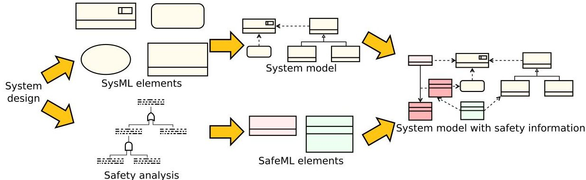

Fig.1 Concept for using SafeML

concepts, described in the next section, and the ways in which SysML can be used to provide safety information, described in Sect. 3.2.

## 3.1 Safety concepts

We begin by describing the safety concepts on which SafeML is built. We base these concepts in part on the definitions given by the following international standards for safety:

1. IEC 61508 [22];

2. ISO 12100 [23]; and

3. ISO 26262 [25].

These three standards are recent prominent standards for safety, covering two approaches (safety of machinery in the case of ISO 12100, and functional safety in the case of IEC 61508 and ISO 26262).

A hazard is a potential source of harm in the system. Hazards are "ever-present" in that the system always contains the potential to cause the related harms, given the correct conditions. Hazards are related to components of the system, aspects of the system's design or uses of the system.

Leveson states that a hazard's description may include the system component where the hazard exists, corrective or preventative measures, operational phases that expose the hazard, and verification methods that demonstrate control over the hazard [32].

Harm is defined generally as physical injury or damage to people, property or the environment by IEC 61508. It is defined specifically as being injury to people by other standards. We use the general definition of IEC 61508. All definitions of "harm" agree that the specific harm caused by a hazard depends on the context (sometimes called the operational situation) that leads to it.

Common to the above definitions is that a hazard must be defined relative to some occurrence that exposes it; without the correct context, a hazard will not cause harm. The necessary context for a hazard to cause a particular harm is known as a hazardous situation (Leveson is more specific, defining it as an "operational phase" of the system [33]). The

occurrence of a hazardous situation is known as a hazardous event. A hazardous event may result in harm. A harmful event occurs when harm does occur.

Safety standards define the concept of a measure to provide safety, although the term used varies. IEC 61508 names it "safety function", ISO 12100 and ISO 13849 use the term "protective measure", while ISO 26262 defines both "safety measure" and "safety mechanism". In all cases, the purpose is to provide some feature of the system that eliminates or mitigates risk (most commonly by moving the system to a known safe state). Safety features must be implemented in the system design. Safety standards require evidence for which safety measures are related to which hazards.

Some, but not all, safety standards explicitly define a monitoring concept [23,24]. Some component of the system detects when a hazardous event has occurred and explicitly activates a safety measure.

Many of the above concepts are also found in the results of safety analysis techniques. Some examples are given below.

1. A Preliminary Hazard Analysis identifies the potential hazards of a system based on its requirements, uses and prototype designs, as well as external information such as hazard checklists [33].

2. Fault Tree Analysis (FTA) [20,34] and Event Tree Analysis [34] are both backward searchers to find the hazardous event(s) that allows some undesired event (a harmful event) to occur.

3. Failure Modes and Effects Analysis (FMEA) is a forward search that identifies the possible harm that an undesired event (typically a failure of a component or process) can cause [19,34].

4. Cause-consequence analysis looks for both the hazardous event that allows an undesired event to occur and the harm that it causes [34].

5. Interface analysis and human error analysis techniques look for hazardous situations arising in the interfaces between system components or between the system and users [34]. User interactions are a common source of safety-related failures [27].

<!-- PDF_PAGE: 7 -->

A profile for SysML that supports these common concepts will therefore allow the results of safety analysis techniques to be specified in the system model [9].

## 3.2 Useful SysML features

This section discusses capabilities of SysML that are useful in the analysis and design of safety-critical systems. SafeML makes use of some of these features, as described in Sect. 3.3.

SysML is a profile of UML. It reuses many diagrams and element types of the UML meta-model and adds several diagrams and element types of its own. It also has the same level of extensibility found in UML. SysML is used in the design of systems that include software, hardware, people, processes and other entities. SysML is building on the success of UML, with wide tooling support available. $ ^{4} $

SysML has features oriented towards system design and specification not found in UML (which is oriented towards software specification), including the capability to represent requirements and to support trade-off analyses. These capabilities make it more useful than UML for specifying the safety of a system that is not purely software.

Much of the information contained in a SysML model of a system can support both the elicitation of and representation of safety information. Some examples are listed below.

1. A Preliminary Hazard Analysis (PHA) examines the system's requirements, design prototypes and so on to look for potential hazards. A SysML model provides requirements and designs (in the form of Block Definition Diagrams and Internal Block Diagrams).

2. The ways in which a system is used are a common source of hazards and hazardous situations [32]. Both correct and incorrect usage of a system may be dangerous. The use cases in a SysML model can be analysed for hazards, while the activity and sequence diagrams that specify those use cases can be analysed, such as through human error analysis techniques when the user is a human, for the specific user interactions (situations) that expose the hazards.

3. Interfaces between system components can give rise to hazardous situations [32]. SysML Internal Block diagrams and Sequence diagrams that define how system components interact can be analysed to find interface points that may be problematic. Activity and sequence diagrams describing processes and procedures (such as use case procedures) can be analysed to identify the specific hazardous situations.

4. Each safety measure must be verified as correctly managing its hazard. SysML includes element types for specifying tests that verify a requirement, and Activity diagrams can be used to specify the test procedure.

## 3.3 Profile description

As a profile extension of SysML, the SafeML profile draws on existing SysML syntax and semantics.

The element types in the SafeML profile represent the safety concepts described in Sect. 3.1. An illustrative instance of the profile is given in Fig. 4, as an aid to understanding. This diagram depicts an instance of each element type and an instance of some of the SysML element types that they can be related to. It shows the various relationships that can occur in a SafeML model, such as the context-defined relationship between a hazard and harm it may cause, and the link from a defence to the SysML requirement it induces in the system model.

The SafeML profile includes seven element types. The profile is shown in Figs. 2 and 3, (note that role names are only shown where they differ from the class name) summarised in Tables 1,2,3,4,5,6 and 7, and described below, including the relationships they have to each other and to SysML elements. The profile is organised in two parts. The first deals with hazards, harms and the context necessary for harms to occur. The second deals with safety measures, which in SafeML are targeted at preventing the hazardous event necessary for a hazard to lead to harm, or mitigating harm should a hazardous event occur.

In a model that includes SafeML elements, SysML elements are used to model aspects of the system, such as requirements (including safety requirements), use cases and components. In the descriptions below, "system model" refers to the parts of the model specified in SysML.

It is not the goal of SafeML to model specific safety measures (such as redundant structuring of components). These can already be modelled using the existing SysML facilities. See the end of Sect. 3.3.5 for more details.

## 3.3.1 Hazard

The HAZARD element represents a potential hazard.

Hazards are related to system requirements, system components and system uses. These are represented in the profile by the DERIVEHZD relationship to SysML REQUIREMENTS, BLOCKs and USE CASES. These relationships trace the poten-

<!-- PDF_PAGE: 8 -->

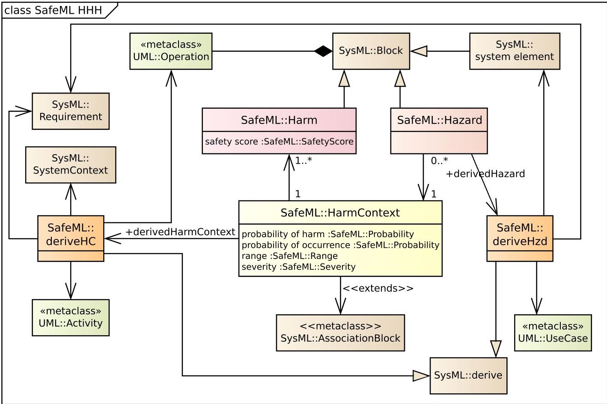

Fig. 2 The SafeML profile elements relating to hazardous events

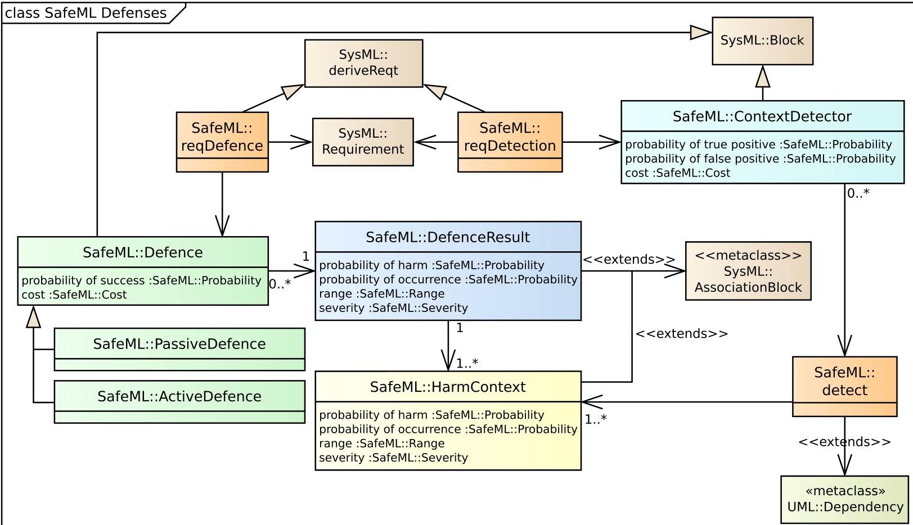

Fig. 3 The SafeML profile elements relating to defences

<!-- PDF_PAGE: 9 -->

Table 1 SafeML::Hazard specification

<table border="1"><tr><td colspan="3">SafeML:Hazard</td></tr><tr><td colspan="3">Description: represents a potential hazard
Derived from: SysML:Blocks:Block</td></tr><tr><td>Relationship</td><td colspan="2">Target and description</td></tr><tr><td>deriveHzd</td><td colspan="2">SysML:Requirements:Requirement,
SysML:Blocks:Block,
UML4SysML:UseCase
Indicates the source of the hazard</td></tr><tr><td>$\rightarrow$</td><td colspan="2">SafeML:Harm
Indicates the potential result of the hazard and
the context that leads to it</td></tr><tr><td>Tagged value</td><td>Type</td><td>Description</td></tr><tr><td>-</td><td>-</td><td></td></tr></table>

Table 2 SafeML::Harm specification

<table border="1"><tr><td colspan="3">SafeML:Harm</td></tr><tr><td colspan="3">Description: represents the potential result of one or more hazards
Derived from: SysML:Blocks:Block</td></tr><tr><td>Relationship</td><td colspan="2">Target and description</td></tr><tr><td>-</td><td colspan="2">-</td></tr><tr><td>Tagged value</td><td>Type</td><td>Description</td></tr><tr><td>Safety score</td><td>SafeML:SafeML
Types:SafetyScore</td><td>Quantifies the overall risk of this harm.
See Sect.5.4</td></tr></table>

tial hazard to the parts of the requirements or design that introduce it.

Given the correct conditions, a hazard may lead to harm being caused. This is indicated by a relationship to the relevant HARM(s). Each link to a HARM is characterised by the context that allows the harm to occur, described using the HARMCONTEXT element.

A hazard may cause multiple harms or cause the same harm in multiple situations. The multiplicity in the relationship with HARM elements seen in Fig. 4 allows this to be represented in SafeML.

## 3.3.2 Harm

The HARM element represents a harm that may be caused by a hazard in some specific context.

Harms are not directly related to elements of the system model. The HARM element is only related to the HAZARD element. A specific harm may be caused by more than one hazardous event, as represented by the multiplicity on this relationship.

## 3.3.3 HarmContext

The HARMCONTEXT element is used to characterise the relationship between a hazard and a harm it may cause. As described in Sect. 3.1, a hazard requires the correct context to produce harm. This element represents one specific context that allows a hazard to cause a specific harm.

The combination of a Hazard and a HarmContext represents a hazardous situation, or hazardous event if it occurs which may lead to a specific harm. The combination of this hazardous situation (Hazard and HarmContext) with a specific Harm represents a harmful event.

While hazards and harms may be reused in a SafeML model, each HARMCONTEXT uniquely identifies and characterises a specific harmful event that has the potential to occur. This allows the reuse of Hazard instances, which may cause a range of harms, and Harm instances, which may be caused by a range of hazards, in a model, while still allowing a specific harmful event to be identified by a HarmContext instance.

The uniqueness of each HarmContext instance means that the characterisation of a hazardous/harmful event is represented in the HARMCONTEXT element rather than the Harm element. For example, the risk presented by a hazardous situation, or the probability of a harmful event occurring. For information on the particular information that could be stored, see Sect. 3.4.

As the target of safety measures in a SafeML model, the HARMCONTEXT element is related to the PASSIVEDEFENCE and ACTIVEDEFENSE elements, and the CONTEXTDETECTOR element via the DETECT relationship.

Sections 3.1 and 3.2 discussed many sources for hazardous situations. These are represented by the DERIVEHC relationship from a HARMCONTEXT to a SysML BLOCK, REQUIREMENT, ACTIVITY or OPERATION. The relationship to ACTIVITY and OPERATION elements is the most important. It allows a HARMCONTEXT element to be traced to the specific activity in a use case or interaction that gives rise to the hazardous situation. This can be illustrated with a simple example.

Assume a system model that has a use case indicating something that an actor does with the system. As part of the system design process, the use case is specified using an Activity Diagram. The use case is also found, through a hazard analysis, to contain a particular potential hazard. The potential hazard leads to a hazardous situation during a particular step of the use case, represented by an ACTIVITY element. This activity is the context that allows the hazard to cause harm. This structure in the SafeML model allows tracing from the context to the relevant hazard and to the specific activity that may lead to harm.

Tracing the context of a hazard to an activity can be further traced to the use case for that activity and ultimately to the user role. This identifies any user roles that may need to be targeted for training to reduce risk.

<!-- PDF_PAGE: 10 -->

Table 3 SafeML::HarmContext specification

<table border="1"><tr><td colspan="3">SafeML::HarmContext</td></tr><tr><td colspan="3">Description: represents a context that allows a hazard to cause a specific harm
Derived from: SysML::AssociationBlock</td></tr><tr><td>Relationship</td><td colspan="2">Target and description</td></tr><tr><td>deriveHC</td><td colspan="2">UML::Activity, SysML::Blocks::Block,
SysML::Requirements::Requirement, UML::Operation
Indicates the source of the context in the system</td></tr><tr><td>Tagged value</td><td>Type</td><td>Description</td></tr><tr><td>Probability of occurrence</td><td>SafeML::SafeMLTypes::Probability</td><td>Probability the context will occur</td></tr><tr><td>Probability of harm</td><td>SafeML::SafeMLTypes::Probability</td><td>Given the context is present, the probability harm will arise</td></tr><tr><td>Severity</td><td>SafeML::SafeMLTypes::Severity</td><td>The maximum possible severity of possible harm</td></tr><tr><td>Range</td><td>SafeML::SafeMLTypes::Range</td><td>The maximum possible range of possible harm</td></tr></table>

Table 4 SafeML::Context Detector specification

<table border="1"><tr><td>SafeML::ContextDetector</td></tr><tr><td>SafeML::ContextDetector</td></tr><tr><td>Description: represents how a hazardous situation/event is detected</td></tr><tr><td>Derived from: SysML::Blocks::Block</td></tr></table>

<table border="1"><tr><td>Relationship</td><td colspan="2">Target and description</td></tr><tr><td>detect</td><td colspan="2">SafeML:HarmContext
Indicates the HARMCONTEXT that is monitored for</td></tr><tr><td>reqDetection</td><td colspan="2">SysML:Requirements:Requirement
Indicates the system requirement created by this detector</td></tr><tr><td>Tagged value</td><td>Type</td><td>Description</td></tr><tr><td>Probability of true positive</td><td>SafeML:SafeMLTypes:Probability</td><td>The probability of correctly detecting the presence of a context</td></tr><tr><td>Probability of false positive</td><td>SafeML:SafeMLTypes:Probability</td><td>The probability of incorrectly detecting the presence of a contexta</td></tr><tr><td>Cost</td><td>SafeML:SafeMLTypes:Cost</td><td>A cost value for using the detector in the system. What this cost means will vary</td></tr></table>

a This value is necessary to determine the amount of "noise" the detector may introduce into the system; a system that believes it is in danger more often than it actually is will have reduced availability

The relationship to SysML BLOCK elements is also important, as it indicates the component(s) of the system that are relevant in the hazardous situation.

## 3.3.4 ContextDetector

As described in Sect. 3.1, some safety standards explicitly define the concept of monitoring for a hazardous

situation/event and activating the relevant safety measures when necessary. The reason for this is that a safety measure may not need to be active at all times. In these cases, the system must have the capability to detect that a particular situation has occurred that requires a particular safety measure to be activated. For example, a train signalling system may monitor for a failure and, upon detecting one, activate a safety measure that brings all trains to a halt. As in [9]

<!-- PDF_PAGE: 11 -->

Table 5 SafeML::Passive Defence specification

<table border="1"><tr><td colspan="3">SafeML::PassiveDefence</td></tr><tr><td colspan="3">Description: represents defence against one or more contexts that continuously defends
Derived from: SysML::Blocks::Block via SafeML::Defence</td></tr><tr><td>Relationship</td><td colspan="2">Target and description</td></tr><tr><td>$\rightarrow$</td><td colspan="2">SafeML::HarmContext
Indicates a context defended against</td></tr><tr><td>reqDefence</td><td colspan="2">SysML::Requirements::Requirement
Indicates the system requirement created by this defence</td></tr><tr><td>Tagged value</td><td>Type</td><td>Description</td></tr><tr><td>Probability of success</td><td>SafeML::SafeMLTypes::Probability</td><td>The probability of successfully transforming the hazardous situation/event&#x27;s characteristics, such as its probability of harm occurring</td></tr><tr><td>Cost</td><td>SafeML::SafeMLTypes::Cost</td><td>A cost value for using the defence in the system. What this cost means will vary</td></tr></table>

Table 6 SafeML::Active Defence specification

<table border="1"><tr><td colspan="3">SafeML:ActiveDefence</td></tr><tr><td colspan="3">Description:represents a defence against one or more contexts that requires activation
Derived from:SysML:Blocks:Block via SafeML:Defence</td></tr><tr><td>Relationship</td><td colspan="2">Target and description</td></tr><tr><td>$\rightarrow$</td><td colspan="2">SafeML:HarmContext
Indicates a context defended against</td></tr><tr><td>reqDefence</td><td colspan="2">SysML:Requirements:Requirement
Indicates the system requirement created by this defence</td></tr><tr><td>Tagged value</td><td>Type</td><td>Description</td></tr><tr><td>Probability of success</td><td>SafeML:SafeMLTypes:Probability</td><td>The probability of successfully transforming the hazardous situation/event&#x27;s characteristics,such as its probability of harm occurring</td></tr><tr><td>Cost</td><td>SafeML:SafeMLTypes:Cost</td><td>A cost value for using the defence in the system.What this cost means will vary</td></tr></table>

SafeML contains this concept. It is represented using the CONTEXTDETECTOR element.

A CONTEXTDETECTOR indicates that the system must provide some means of detecting the HARMCONTEXT it is related to. In other words, the system must provide the capability to monitor for a hazardous situation/event. The CONTEXTDETECTOR therefore induces one or more new safety requirements in the system's requirements. The relevant requirements are represented using SysML REQUIREMENT elements. These are related to the CONTEXTDETECTOR element by the REQDETECTION relationship. This relationship is necessary for traceability: it ensures that the CONTEXTDETECTOR is linked to a requirement, which is in turn linked to SysML

BLOCK elements for implementation and SysML TESTCASE elements for verification.

The CONTEXTDETECTOR element also has the DETECT relationship described in Sect. 3.3.3.

A CONTEXTDETECTOR may detect multiple contexts.

## 3.3.5 Defences

Safety measures in SafeML target hazardous/harmful situations/events, either to prevent their occurrence or to mitigate the potential for or severity of harm should one occur. Safety measures are represented using DEFENCE elements.

<!-- PDF_PAGE: 12 -->

Table 7 SafeML::DefenceResult specification

<table border="1"><tr><td colspan="3">SafeML::DefenceResult</td></tr><tr><td colspan="3">Description: represents the result of defending against a context
Derived from: SysML::AssociationBlock</td></tr><tr><td>Relationship</td><td colspan="2">Target and description</td></tr><tr><td>-</td><td>-</td><td></td></tr><tr><td>Tagged value</td><td>Type</td><td>Description</td></tr><tr><td>Probability of occurrence</td><td>SafeML::SafeMLTypes::Probability</td><td>New probability the context will occur</td></tr><tr><td>Probability of harm</td><td>SafeML::SafeMLTypes::Probability</td><td>Given the context is present, the new probability that harm will arise</td></tr><tr><td>Severity</td><td>SafeML::SafeMLTypes::Severity</td><td>The new maximum possible severity of possible harm</td></tr><tr><td>Range</td><td>SafeML::SafeMLTypes::Range</td><td>The new maximum possible range of possible harm</td></tr></table>

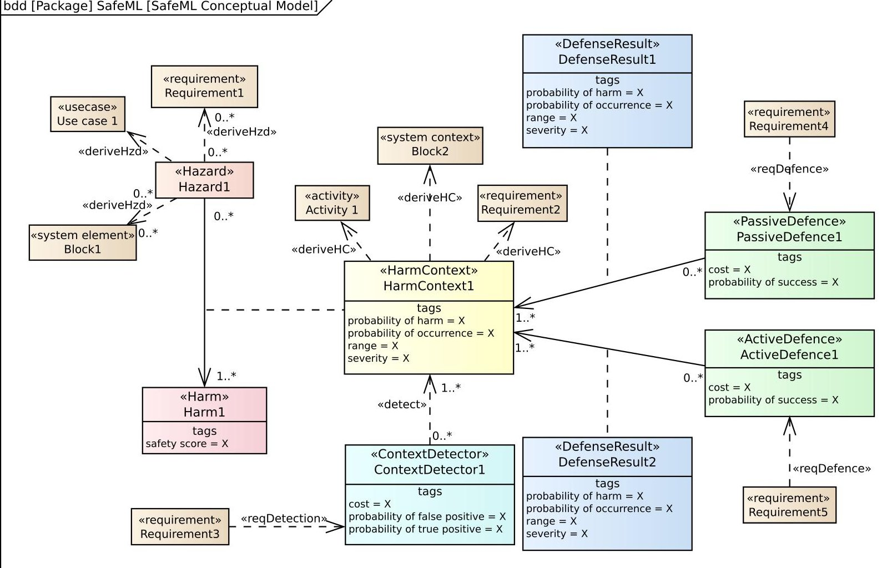

Fig. 4 An illustrative instance of the SafeML profile

SafeML uses two element types for defences. The first, PASSIVEDEFENCE, specifies a safety measure that does not require explicit activation. The second, ACTIVEDEFENCE, specifies a safety measure that must be explicitly activated to protect against a HARMCONTEXT.

The term "passive" is not related to the concept of inherent safety; it does not mean that the defence does not do anything actively, such as a switch cover. It refers to the idea that the defence does not need explicit activation to improve the safety of the system, but instead provides safety constantly:

<!-- PDF_PAGE: 13 -->

it is continuously "working", where what "working" means depends on the safety measure—the aforementioned switch cover is "working" merely by existing. A safety measure that must be continually active to maintain the system in a safe state is a passive defence. A safety measure that only activates when a hazardous event is detected is an active defence.

Although there are no technical differences between the PASSIVEDEFENCE and ACTIVEDEFENCE elements, they can be used by tools to guide the developer. For example, an ACTIVEDEFENCE instance may place a requirement on the model that its related HARMCONTEXTs each has at least one CONTEXTDETECTOR. The concept is that a CONTEXTDETECTOR will, upon detecting a HARMCONTEXT, activate each active defence connected to that HARMCONTEXT; ACTIVEDEFENSE instances connected to other HARMCONTEXT instances that use the same context detector will not be activated.

In both the active and passive case, a defence is related to its relevant hazardous event (HARMCONTEXT) by a relationship characterised by the DEFENCERESULT element. A defence may be related to multiple HARMCONTEXT instances, indicating that it is capable of defending against multiple hazardous situations.

As with the CONTEXTDETECTOR element, PASSIVEDEFENCE instances and ACTIVEDEFENCE instances indicate that the system must have some means of providing those safety measures. This is represented by the REQDEFENCE relationship to a SysML REQUIREMENT. This ensures traceability from a safety measure to the SysML BLOCK elements that implement it and the SysML TESTCASE elements that verify it.

Additionally, traceability from the originating hazard to the implementation and verification of safety measures used is supported. This is achieved by a path from the requirement, use case or system component in which the hazard originates, through the HAZARD itself, the relevant HARM CONTEXT, through the DEFENCE that counters it, through the related REQUIREMENTS, and finally to the system components that implement those requirements and the test cases that verify those requirements. Figures 4 and 12 give examples of complete traces.

The design of a defence can be represented using the existing SysML capabilities. The DEFENCE elements specialise the SysML BLOCK element, which means that they have all the capabilities of a BLOCK, including being decomposed into sub-components specified using SysML BLOCK elements and having behaviour specified through activity and sequence diagrams. $ ^{6} $ However, it is possibly preferable, given the use of a defence to add a safety requirement to the model (as seen in Fig. 4 and Sect. 4) to add additional blocks that

satisfy the safety requirement and so implement the defence in that way. For example, an existing implementation of a system capability may need to be made redundant, according to a PASSIVEDEFENCE and its related safety requirement. This can be specified in its design using SysML BLOCK elements that duplicate functionality, behaviour diagrams for the handling of switching and so on. Traces from the PASSIVEDEFENCE through its safety requirement to the BLOCK elements implementing the redundancy ensure that the reason for the redundancy is knowable.

## 3.3.6 DefenceResult

When a safety measure acts against a hazardous event, it may affect the event's chance of occurring, the chance of harm arising if the hazardous event occurs, and the range and severity of any harm that does arise. For example, a safety measure may prevent the system entering the situation necessary for harm to occur. Alternatively, it may have no effect on the chance of harm occurring, but limit the severity of that harm. The specific effect of a safety measure is specified by the DEFENCERESULT element, which characterises the relationship between each pair of a single DEFENCE instance and a HARMCONTEXT instance.

The DEFENCERESULT element is characterised by the same values as the HARMCONTEXT. These can be used by tools to evaluate the result of a safety measure on the risk presented by a hazardous situation or event. The developer will specify the values that change and support tools will assume the remainder are the same as the original values from the related HARMCONTEXT. See Sect. 3.4 for the information stored.

## 3.4 Tagged values

A SysML element may have a number of tagged values. A profile specifies tagged values that may appear in its elements and gives them semantic meaning.

The SafeML profile specifies tagged values for a number of its elements. They are described in Tables 1, 2, 3, 4, 5, 6 and 7.

Although specified by the profile, the tagged values made available by SafeML are relatively independent of the profile structure (the available elements and their relationships). While the element structure defines safety concepts and how they relate to each other, the tagged values are mainly defined by what tools wish to do with a model.

The tagged values used in this paper are defined in part to support the tools described in Sect. 5. For example, a tool to calculate risk as a product of probability of harm and severity would rely on these values.

<!-- PDF_PAGE: 14 -->

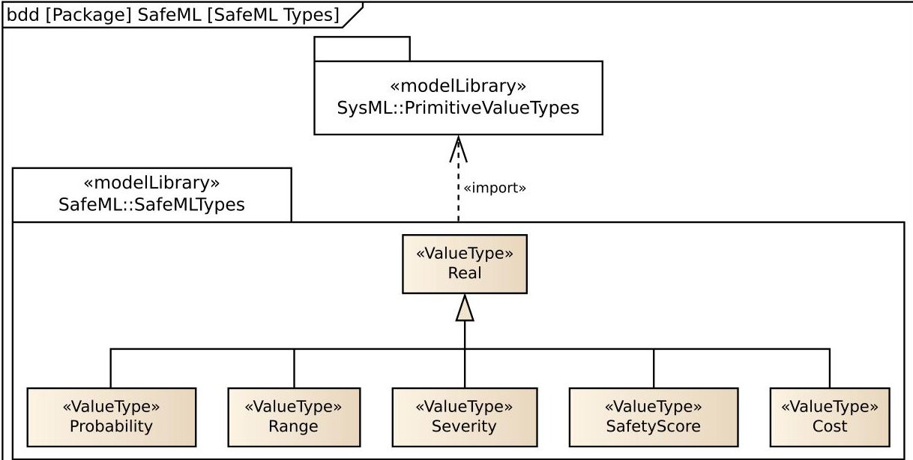

Fig. 5 The types used for tagged values in the SafeML elements

As in [53], the acceptable values that tagged values may use (such as numbers or specific text) are defined by the tool support. In the tool presented in this paper, the values of all tagged values are specified using textual values that are referenced to enumerations provided by the developer. For example, the developer can specify that all probabilities are specified as one of "low", "medium", or "high". Alternatively, they may prefer numerical values for the probability, such as a value between zero and one. As the type of probability usable in safety varies considerably by field, it is important to allow the tool support to define the acceptable tagged values.

An example of using a model library of types for the tagged values is shown in Fig. 5; these types are also used in the profile as presented in this section. However, we stress that, in this respect, SafeML should be treated as a platform- independent model (a model that is independent of any particular implementation), with the version used by a tool, with its chosen specific types, a platform-specific model (the platform independent model after it has been adapted for a specific implementation platform, which in the case of SafeML is a project's and tool's needs). The platform-specific model will choose appropriate types and values for the tagged values according to the needs of a project, such as those dictated by relevant safety standards and the support tool used.

See Sect. 5.1 for more details on tool support using specific types for the tagged values (in the case of this paper's tool, SysML enumerations).

## 3.5 Supporting documentation

A SysML model can link external documents into the model, such as a text-based list of system requirements. As a SysML profile, SafeML gains this ability. It is recommended for use

in linking external risk analysis documentation into the system model to support the addition of SafeML elements. For example, a Preliminary Hazard Analysis document that supports adding some hazards to the model, or the Fault Tree that identifies a context, can be linked in.

## 3.6 Development process

SafeML is a modelling language extension. It places few requirements on the methodology and processes used for system development. These limited requirements are:

1. that safety information relating to the system design is available from safety analyses, international standards and other relevant sources;

2. that system design information is available and can be modelled using SysML; and

3. that the system design can be revised based on the safety information.

SafeML fits into any methodology providing this information. SafeML should be utilised when at least some part of the system design is available and safety analyses have been performed. It is used as part of the design steps that evaluate the relationship between the safety analyses results and design safety measures. As with SysML, SafeML fits into an iterative methodology as well, with additional revisions of the system design (modelled using SysML), safety analyses and the modelled safety information (modelled using SafeML). The information modelled in SafeML can be used at any time when the safety information about a design must be presented to stakeholders or other developers.

A particularly important issue is maintaining the consistency of information when process steps repeat. For exam-

<!-- PDF_PAGE: 15 -->

ple, revising a risk analysis may have an impact on the safety information contained in the model and its related system design information.

Tracing between SafeML and SysML elements helps maintain consistency between safety information and system design information when information sources change. Tool support is necessary to make this task manageable. Many modern SysML modelling tools have support for performing a traceability analysis to find the parts of a model impacted by a change, such as tracing between the requirements contained in the model and their implementations and tests.

Tracing to source analyses (i.e. external documents) is a more difficult problem, but tool support for linking model elements to external documents can be an aid. These traces can be used to find all model elements relying on an external document (such as a risk analysis) that has changed. The tool support presented in Sect. 5 does not address this problem directly, instead relying on the existing capabilities of the Enterprise Architect tool.

## 4 Example application

To demonstrate that the profile is capable of modelling the discussed safety concepts, this section provides an example of applying SafeML to a SysML model of a system. It demonstrates adding safety-related information revealed through a Fault Tree Analysis to the SysML model to produce a system model that includes the relevant safety-related information. This information includes both the hazardous situations and events that the system is vulnerable to and the ways in which the system protects against those situations/ events.

We only present a part of the complete system in this paper. Parts of this example will be used to illustrate the support tools in Sect. 5. The example system is an electric kettle; this device was chosen for its simplicity to enable a clear presentation of SafeML. Electric kettles and similar devices are regularly used as teaching aids for UML and SysML.

## 4.1 Development process

The process used to develop the example system is described below. This is a simple, high-level process that gives one example of how SafeML may be used during development of a safety-critical system.

1. Develop the system requirements and use cases, modelling them in SysML using Requirements diagrams, Use Case diagrams and Activity diagrams as appropriate. $ ^{8} $ Develop a prototype system design and model it in SysML.

2. Perform hazard and safety analyses on the requirements, use cases and design concept. Enter the resulting hazard, harm and hazardous/harmful situation/event information into the model using SafeML elements.

3. Identify safety measures and their effects, and add them to the model using SafeML elements.

4 Connect the safety measures to requirements specified in SysML and added to the system requirements (safety requirements). Connect these to the SysML BLOCKs in the design that implement them, and specify tests to verify correctness.

5. Iterate as necessary to identify additional hazards added by the safety measures or when refining the system design.

## 4.2 Example system

This section describes the system to be analysed and improved. The example system is an electric kettle. The kettle has only a very simple functionality to begin with: when a switch is turned on, the kettle begins heating water. Heating stops when the switch is turned off. The use cases of the system are shown in Fig. 6.

The initial system design focuses solely on functionality and is therefore very simple. The scenario for boiling water is given below.

1. The user opens the lid, fills the kettle's tank with some quantity of water and closes the lid.

2. The user connects a supply of electricity and turns a switch on.

3. The kettle, as long as electricity is flowing, converts that electricity to heat and applies the heat to the water contained in the tank.

4. The user watches for the water to reach the boiling point and then turns the switch off, cutting off the supply of electricity and halting the boiling process.

5. The user pours the boiled water from the kettle's tank into a target container.

The "boil water" use case is expanded into the activity diagram shown in Fig. 7. The "Pour water" use case is expanded into the activity diagram shown in Fig. 8. The logical design of the kettle designed to meet the use cases and requirements is shown in Fig. 9. Although the system model contains a number of other diagrams, we omit them here for space reasons.

<!-- PDF_PAGE: 16 -->

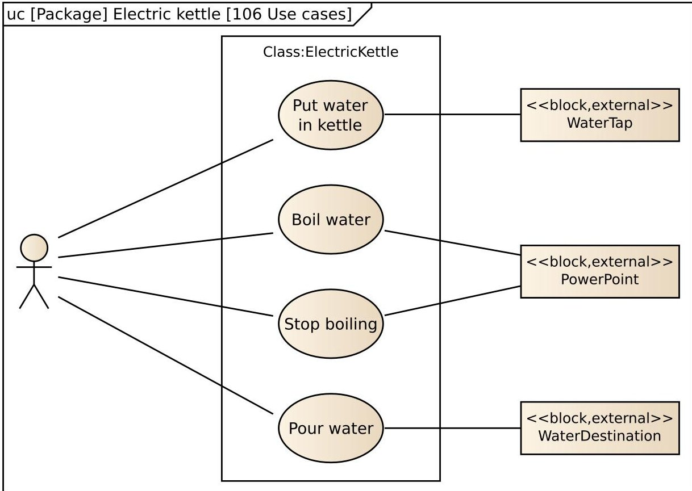

Fig. 6 Electric kettle use cases

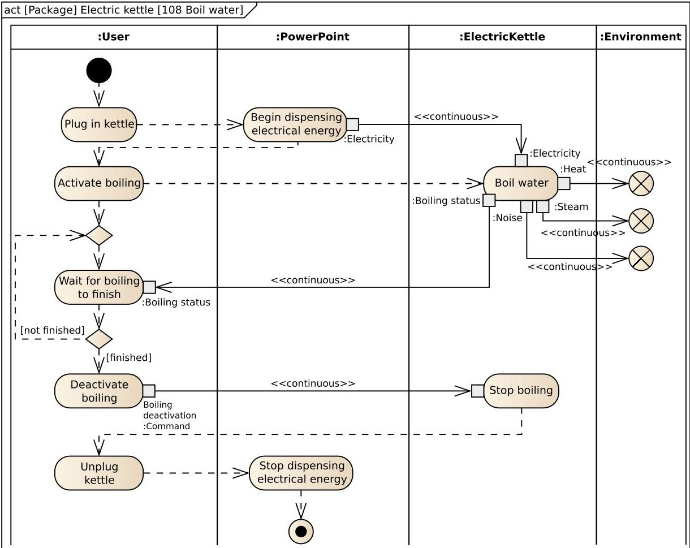

Fig. 7 The SysML Activity diagram for the "Boil water" use case

<!-- PDF_PAGE: 17 -->

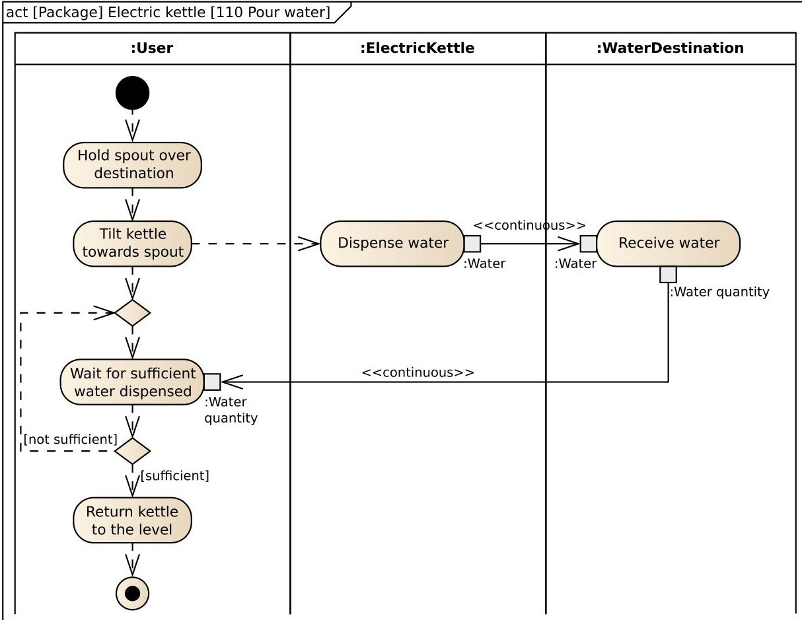

Fig. 8 The SysML Activity diagram for the "Pour water" use case

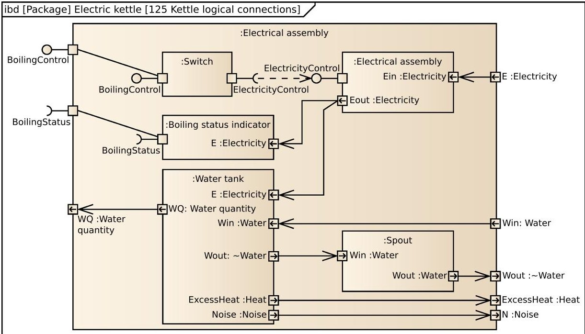

Fig. 9 The SysML Internal Block diagram for the initial kettle design

## 4.3 System risks

A simple hazard analysis finds the following potential hazards and harms.

1. Electricity, which may cause electrocution or an electrical fire.

2. Heat, which may cause heat burns (e.g. by touching a hot object).

3. Steam, which may cause steam burns.

4. Boiling water, which may cause water burns.

A Fault Tree Analysis is performed on each harm to identify the possible ways in which it may come about. The fault tree for the "water burns" harm is shown in Fig. 10 (likelihood information is omitted).

<!-- PDF_PAGE: 18 -->

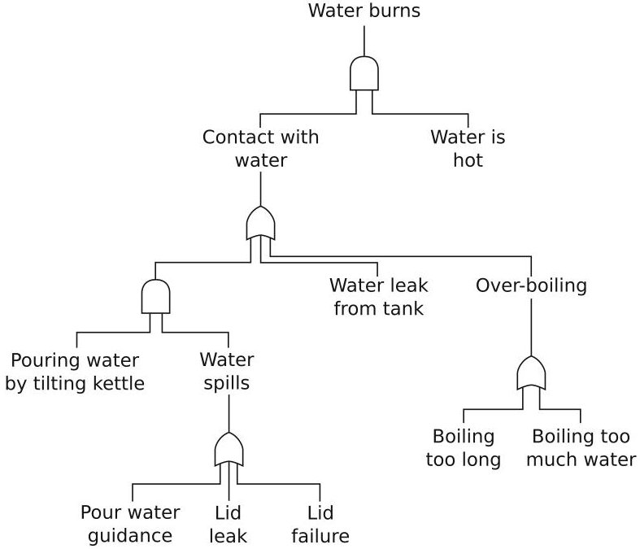

Fig. 10 The fault tree for the "water burns" harm

Analysis of this fault tree finds several minimum cut sets that can lead to water burns, including:

1. the lid leaking while pouring boiling water;

2. the kettle boiling over due to too much water; and

3. the kettle boiling over due to a failure by the user to turn it off.

## 4.4 Modelling the hazardous events

Based on the safety analysis results, the relevant safety-related information can be added to a SysML model of the electric kettle. When modelling the safety-related information, the developer must:

1. specify the relevant hazard, including the aspect(s) of the system (requirement, use case and/or system component) that gives rise to it;

2. specify the possible harm; and

3. specify the context that allows harm to be caused, including the aspect(s) of the system (requirement, activity and/or system component) that produces that context.

When modelling this information, hazards and harms come from hazard/risk analyses, while contexts come from analyses that identify how accidents may happen, such as FTA and FMEA. For example, to transfer the results of the hazard analysis and Fault Tree Analysis from the previous section into the SysML model of the system, the following steps are necessary.

using a HAZARD element, and each potential harm must be added using a HARM element.

1. Identify the relevant hazards and the potential harms they may cause. Each hazard must be added to the model

2. Identify the minimum cut sets in the fault tree. Each minimum cut set represents a context that may lead a hazard to cause a particular harm.

3. For each minimum cut set, a HARMCONTEXT is added to the model to relate the relevant hazard and harm.

For this example, we shall concentrate on the "boiling water" hazard, the "water burns" harm, and the "lid leak" and "over-boiling" contexts. These are shown in their SafeML form in Fig. 11. In Fig. 11a, the activity "Tilt kettle towards spout" indicates an action that may lead to harm, while the block "Lid" indicates a system component relevant to the potential for harm during that activity (in this case, a component whose failure during the activity could lead to harm).

Note that the two diagrams in Fig. 11 could be combined into one. However, we split the information into separate diagrams to improve clarity. $ ^{9} $ We will now describe the displayed model elements.

The "Boiling water" element is an instance of the HAZARD element type (Sect. 3.3.1). It is derived from the requirements and use cases that lead to its presence. In each of the two diagrams shown here, we have shown only the relevant requirement and use case.

The "Water burns" element is an instance of the HARM element type (Sect. 3.3.2). Note that, as with the "Boiling water" hazard element, the same element is present in both diagrams; there is only one HARM instance called "Water burns" in the model.

In both diagrams, the harm is connected to the source hazard by a context that can bring it about. In Fig. 11a, this context is the lid of the kettle leaking water. As the diagram shows, this context arises in the system due to the user extracting water by tilting the kettle combined with the presence of a lid. $ ^{10} $ The hazardous event is characterised in the HARM CONTEXT element as having a high probability of context occurrence and a medium probability of harm occurrence (not shown on the diagram and based on the kettle having a simple plastic lid).

In Fig. 11b, the context that allows harm to arise is overboiling of the water due to the user not deactivating the kettle once boiling is complete (recall from Sect. 4.2 that this kettle does not deactivate automatically). This context arises from the "Boil water" activity of the kettle and the "Wait for boiling to finish" activity of the user.

<!-- PDF_PAGE: 19 -->

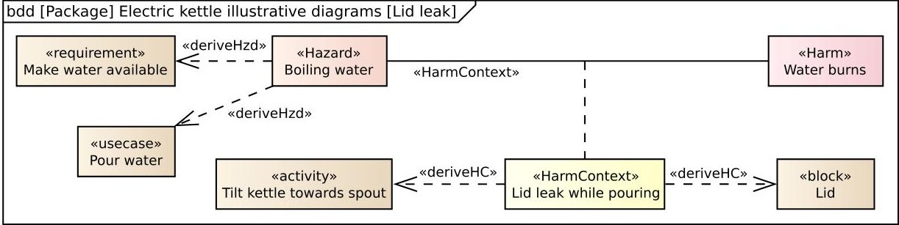

(a)

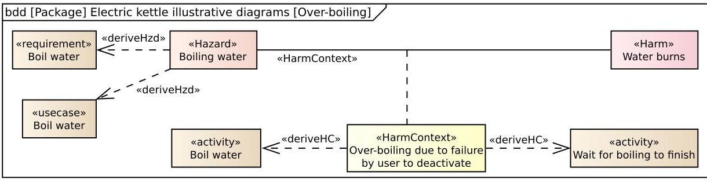

(b)

Fig.11 Two hazardous events modelled using SafeML. a The lid-leak hazardous event. b The over-boiling hazardous event

## 4.5 Improving the system

The developer's next step is to design counter-measures. SafeML diagrams showing the relationships between the hazardous situations/events and aspects of the system allow the developer to target the sources of hazardous situations/events in the same way as a minimum cut set from a Fault Tree Analysis does. SafeML assists the developer by presenting this information close to the system design information.

In our example system, there are several hazardous situations and events that need to be dealt with. We will deal with the two discussed in the previous section. The diagrams for these are shown in Fig. 12. These two views both show the hazard documentation for a specific harmful event. This includes the potential hazard, the related system requirements and uses, the hazardous event, the safety measures used, and the verification methods.

## 4.5.1 Lid leak

We shall first deal with the simpler context of the lid leak. As Fig. 12a shows, we have chosen to prevent lid leaks by adding a seal to the lid. This is modelled in SafeML using an instance of the PASSIVEDEFENCE element type. Note that, due to its passive nature, the defence is constantly "functioning", and no CONTEXTDETECTOR elements are necessary.

The relationship between the defence and the context is characterised by a DEFENCERESULT instance that specifies the effect of the defence. In this case (not shown on the diagram), it reduces the probability of the context occurring from high to low. It does not alter the chance of harm should the context occur, as it is assumed that a lid leak allowing

water to escape will have the same probability of burning the user whether or not the lid has a seal.

As Fig. 12b shows, the newly added defence has led to changes in the system design. It introduces a new requirement, to add a watertight lid seal, which leads to a "Seal" component being added to the "Lid" component, in addition to a verification test that confirms the seal protects against lid leaks. As with any SysML model, the TESTCASE element instance can contain a detailed description of how to perform the test.

This diagram illustrates the benefit of using SafeML to connect hazardous situations/events with system features. It is possible to trace from the source hazard and possible harm, through the context where harm may arise, through the defence concept, and to the specific system features that protect against the situation/event and the tests that must be done to assure those features are sufficient. Although the elements such as blocks and requirements also appear on other diagrams in the model, placing the related elements together on a single diagram like this communicates a single hazardous situation or event and defence concept clearly.

## 4.5.2 Over-boiling

The case of over-boiling requires a more complex defence. $ ^{11} $ We have chosen to defend against over-boiling by adding the auto-cut-off system shown in Fig. 12b.

<!-- PDF_PAGE: 20 -->

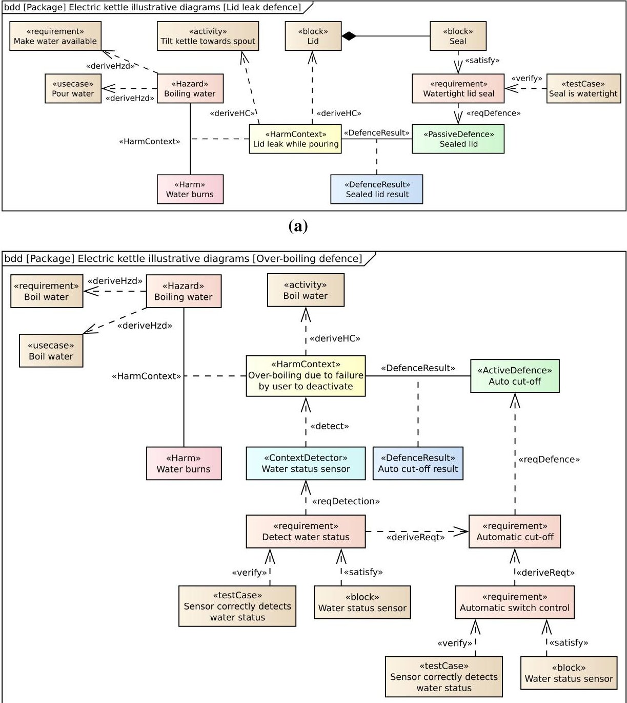

(b)

Fig. 12 Two defences modelled using SafeML. a The defence against lid leaks. b The defence against over-boiling

In this case, the defence is active, indicated by it being an instance of the ACTIVEDEFENCE element type. This implies the need for a feature in the system to activate the defence. We have chosen a water status sensor, indicated in the diagram by an element of the CONTEXTDETECTOR type.

As with the lid seal defence, Fig. 12b shows how the detector and the defence are implemented and tested in the system via the new requirements they induce.

The addition of this defence is more complex than a simple lid seal, so it has consequences for other parts of the system model. First, the activity diagram for the "Boil water" use case must be updated to reflect the new method of interacting with the system: the user is no longer required to manually deactivate the kettle. The revised activity diagram is shown in Fig. 13. As the original diagram in Fig. 7 shows,

the user is responsible for monitoring the kettle and deactivating boiling at the appropriate moment. This leads to a relatively complex user interaction and the hazardous event of over-boiling, as discovered by the safety analysis. User interactions are a common source of safety-related failures [27]. This defence has reduced the complexity of the interaction, improving safety.

The automatic cut-off system also requires changes to the connections between components, such as a connection from the new water status sensor to the switch trigger. The improved system structure is given in the revised Internal Block diagram, shown in Fig. 14.

In order to improve presentation of the safety information further, UML comments are used in the revised diagrams to explain changes made to improve safety. During

<!-- PDF_PAGE: 21 -->

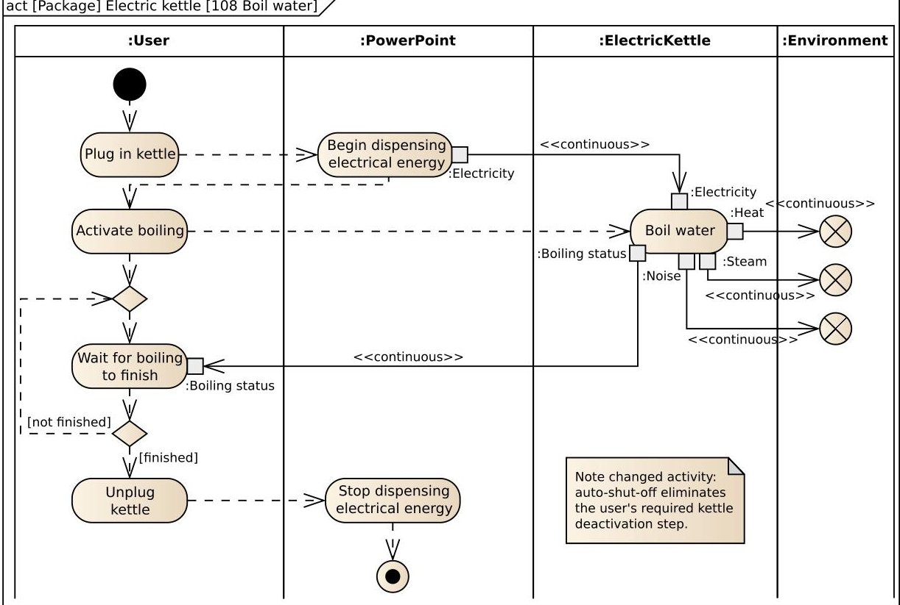

Fig. 13 The improved SysML activity diagram for the "Boil water" use case

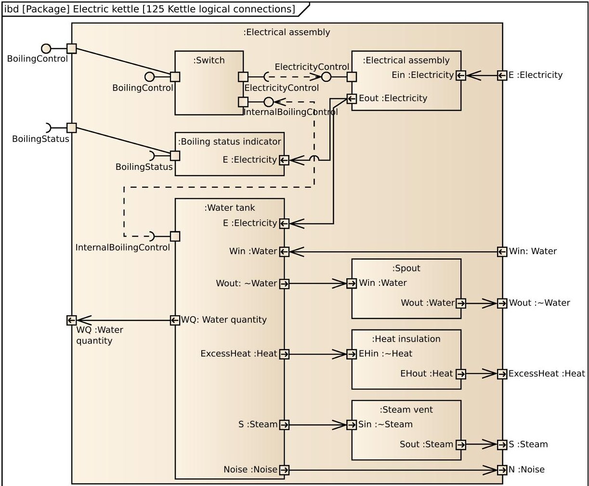

Fig. 14 The SysML Internal Block diagram for the improved kettle design

<!-- PDF_PAGE: 22 -->

Fig.15 Defending against a laser's output power

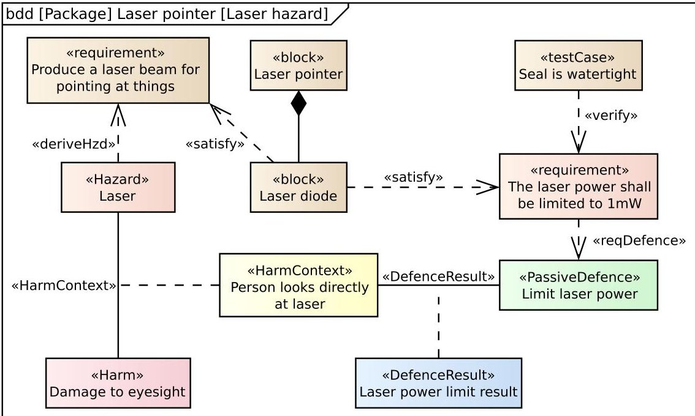

design review meetings, the old and new versions of diagrams should be used to explain design changes made in response to safety analysis results. These diagrams, with their embedded explanatory notes, can be used along with the SafeML diagrams for this purpose.

At this point, the developer has completed revising the system in response to safety analysis results. The next step depends on the development process in use. For example, additional safety analyses and design iteration may occur.

## 4.6 Laser pointer

A second, small example demonstrates that, as well as the new safety feature modelling described above, SafeML can also model constraints derived from hazardous situations and events.

The system is a laser pointer. The risk with such a system is that the user may look directly into the laser, causing damage to their eyesight; this hazardous event originates in the system with the requirement to produce a laser and the presence of a laser diode. The defence is to limit the laser's output power to a safe level. This limit forms a safety constraint on the laser diode, illustrated in Fig. 15.

## 4.7 Defence failures

SafeML is capable of representing three aspects of defence failure.

The first aspect is the case of a complete defence failure. This is modelled through the information contained in the HARMCONTEXT element. If the defence completely fails to mitigate the risk, then the probability of a harmful event, the severity of the harm caused and so on are assumed to be at their original levels as specified in the HARMCONTEXT

element. In other words, a defence failure is equivalent to that defence not existing. $ ^{12} $

The second aspect is a partial failure. In this case, the defence may still have some mitigation. This can be modelled in two ways.

1. Modelling the defence's possible mitigation as being the partially failed mitigation, with a lower chance of failure (in other words, declaring a partial failure to be a form of success). A failure of a defence modelled in this way will mean zero mitigation, or a complete failure rather than only a partial failure.

2. Modelling the defence using two defence elements. The first models the successful defence, while the second models the partially failed defence. Both would be related to the same requirements, blocks, etc. as appropriate.

The third aspect is the impact of a failed defence. This can be modelled through an explicit modelling of the hazardous event of the defence failure. This can be used, for example, if a defence failure produces a different harmful event than a mere lack of defence, or to provide a more explicit depiction of defence fault tolerance. The example from the previous section can be extended as shown in Fig. 16 to demonstrate explicitly modelling the hazardous event of the laser's power limiter failing, although in this example, the consequences are the same as if the defence were not present.

This method of explicit modelling is possible because SafeML relies on SysML elements where possible. A defence is actually implemented in the system design by SysML BLOCK and REQUIREMENT elements. These can in turn be linked to HAZARDS and HARMCONTEXTS of their own.

<!-- PDF_PAGE: 23 -->

Fig.16 Explicitly modelling the hazardous event of a defence failure

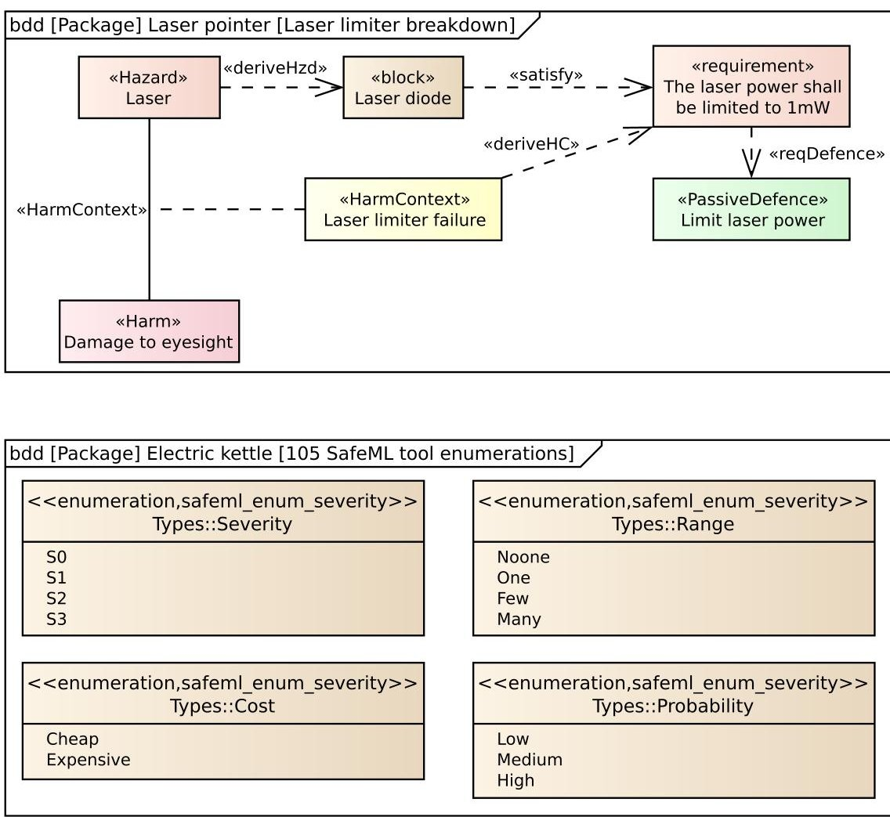

Fig.17 The enumerations used in the electric kettle model

SafeML does not deal with the non-safety-related consequences of defences, failed or not.

## 5 Developer support tools

SafeML is a modelling language extension. As with any modelling language, tool support plays a role in its usefulness For example, alternative views of modelled information can enable readability of the modelled information by people who do not understand the diagrammatic representation.

We have devised a variety of simple tools to both support the developer in working with SafeML models and to make use of the safety information specified in a system model using SafeML. This section describes these tools.

Like SafeML itself, the tools described in this section can be used at any appropriate point in a methodology where working with safety information modelled in SafeML is required.

The tools in this section have been implemented as a plugin for Enterprise Architect 9.2. $ ^{13} $ To support this, the SafeML profile was also implemented for Enterprise Architect 9.2.

## 5.1 Enumerations

Before describing the tool support, the values placed in tagged values by the model developer (see Sect. 3.4) must be described.

Rather than insisting on numerical values for probabilities, severity levels, etc., the support tools allow the developer to use values that are appropriate for their application. This is achieved by requiring the developer to provide a set of SysML enumerations defining the allowable values for specific types of tagged value.

1. The allowable severity levels, such as levels specified by a relevant standard.

2. The allowable range levels, such as levels specified by a relevant standard.

3. The allowable values for probabilities, such as a set of likelihood levels based on the reliability of available data.

4. The allowable cost values, based on how cost is measured.

The enumerations used in the electric kettle model are displayed in Fig. 17.

The enumerations are used by the support tools described in this section, such as for performing calculations on probabilities by converting probability levels into normalised numeric values based on the number of levels.

<!-- PDF_PAGE: 24 -->

## 5.2 Alternative model views

Although modelling languages are typically displayed using a graphical notation, the information contained in a model can also be presented in textual form (see Sect. 5.3) and in tabular form.

Alternative model views can be useful for isolating an aspect of the system that the developer wishes to focus on. The IBM Rational Harmony for Embedded Real-Time Development tool includes a "Safety and Reliability" view, which shows structurally redundant elements and their interactions [9]. An extension of that tool, combined with a UML profile for modelling Fault Trees, provides additional views, including a matrix of faults and their sources, and a matrix of faults and detectors for them.

A commonly used alternative view in SysML is a tabular view of requirements. Because the number of requirements is often very large, it is not feasible to display them all graphically. Instead, the majority are entered and viewed in a tabular format similar to other requirements management software. Only requirements where the structuring is of particular interest, such as high-level requirements, are displayed in Requirements diagrams.

A similar approach can be used in SafeML when the number of hazards or contexts is very large, with individual diagrams used when a specific hazardous/harmful situation/event and its safety measures are inspected. For example, a tabular list of the HARMCONTEXTs present in the model, along with each tagged value in additional columns, can be presented to the developer. New HARMCONTEXTs are entered much like entering them in a spreadsheet. Relationships can be specified using a matrix view.

The plug-in tool for Enterprise Architect provides several alternative views of the SafeML elements.

A table of the hazardous situations and events in the model, along with how they are defended, the probability of occurrence and so on is used to get an overview of the safety situation. Each harm plus harm context is given its own block, within which each row is for an individual defence. The values for probability, severity and so on are taken from the DEFENCERESULT of each defence to show the effect of the defence. For comparison purposes, the raw values of the undefended hazardous situations and events are also shown in a separate row. Hazardous events (HARMCONTEXTS) without defences are highlighted to make their presence obvious to the developer. This table gives a quick overview of the safety-related aspects of the system and assists the developer in choosing which area of safety to work on next: the developer can view the table to find the hazardous situations/events that do not yet have defences (they are highlighted in red), or to target those that have a particularly high severity value, for example. An example of this table for the electric kettle sample (see Sect. 4) is shown in Fig. 18. Note that this table

shows information not always presented in graphical views (that is, the tagged values of the elements).

A table of the defences used by the system provides a view of the safety features in the system design. It presents each defence along with the context it defends against, context detectors used (if present) and the probabilities involved. A similar table provides a view of the context detectors present in the system; these are the safety features related to sensing dangerous situations.

A relationship matrix is a view commonly used in modelling to get an overview of the relationship between elements of two different types. For example, a frequently used view for SysML models is a matrix depicting the "satisfy" relationship between blocks and requirements [12]. Two relationship matrices provided by the plug-in tool give overviews of the relationships between pairs of elements. The first shows harms and the defences related to them. An example of this view is shown in Fig. 19. The second shows harm contexts and the defences against them. An example of this view is shown in Fig. 20.

In both matrices, the cells of the matrix contain the safety score (see Sect. 5.4) of the defence for that harm or harm context. If no defence is related to the harm/harm context, that column is highlighted to make the absence visible to the system and safety engineers.

Some of the alternative views discussed above show possible gaps in the model by highlighting hazardous situations and events that have no related defence. In this way, the tool uses the SafeML-modelled safety information to communicate to the developer the safety of the system design and assist them in adding safety-related features. However, it is important to note that the lack of a defence is not necessarily a problem; reviews of the system design and safety information should determine whether a hazardous situation or event requires defending against. Risks with sufficiently low probability are frequently ignored (with justification) during safety-critical system development.

As mentioned in Sect. 3.3.5, ACTIVEDEFENCES should have at least one context detector for each HARMCONTEXT they are linked to. The Defences view supports this concept by highlighting active defences that are linked to a HARMCONTEXT which itself does not have any CONTEXTDETECTOR element instances attached. This is an example of the importance of tooling in supporting the system engineer, by helping to ensuring that the system design is correct.

Figures 19 and 20 demonstrate the importance of using the correct view for the task: the former does not show important gaps in the defences of the system (it shows only that all harms are defended against), while the latter does by being more specific and showing the hazardous situations/events that are defended against.

<!-- PDF_PAGE: 25 -->

<table border="1"><tr><td>Harm</td><td>HarmContext</td><td>Defence</td><td>P(Context)</td><td>P(Harm)</td><td>Range</td><td>Severity</td><td>P(S)</td><td>SafetyScore</td><td>Defense cost</td></tr><tr><td>Water burns</td><td>Over-boiling due to failure by user to deactivate</td><td>Undefended case</td><td>Low</td><td>Low</td><td>One</td><td>S1</td><td>---</td><td>0.0123</td><td>---</td></tr><tr><td></td><td></td><td>Auto cut-off</td><td>Low</td><td>Low</td><td>One</td><td>S1</td><td>High</td><td>0.0123</td><td>Cheap</td></tr><tr><td></td><td>Over-boiling due to too much water</td><td>Undefended case</td><td>Medium</td><td>Low</td><td>One</td><td>S1</td><td>---</td><td>0.0246</td><td>---</td></tr><tr><td></td><td></td><td>Water level sensor</td><td>Low</td><td>Low</td><td>One</td><td>S1</td><td>High</td><td>0.0123</td><td>Expensive</td></tr><tr><td></td><td></td><td>Water limit indication mark on tank</td><td>Low</td><td>Low</td><td>One</td><td>S1</td><td>Medium</td><td>0.0164</td><td>Cheap</td></tr><tr><td></td><td>Latch failure while pouring</td><td>No Defence</td><td>Low</td><td>High</td><td>Few</td><td>S1</td><td>---</td><td>0.074</td><td>---</td></tr><tr><td></td><td>Lid leak while pouring</td><td>Undefended case</td><td>Low</td><td>Low</td><td>One</td><td>S1</td><td>---</td><td>0.0123</td><td>---</td></tr><tr><td></td><td></td><td>Sealed lid</td><td>Low</td><td>Low</td><td>One</td><td>S1</td><td>High</td><td>0.0123</td><td>Cheap</td></tr><tr><td></td><td>Poor water guidance while pouring</td><td>Undefended case</td><td>Medium</td><td>High</td><td>One</td><td>S1</td><td>---</td><td>0.074</td><td>---</td></tr><tr><td></td><td></td><td>Shaped spout</td><td>Low</td><td>High</td><td>One</td><td>S1</td><td>High</td><td>0.037</td><td>Cheap</td></tr><tr><td>Electrocution</td><td>Contact with live electrical components</td><td>Undefended case</td><td>Low</td><td>High</td><td>One</td><td>S3</td><td>---</td><td>0.1111</td><td>---</td></tr><tr><td></td><td></td><td>Electrical insulation</td><td>Low</td><td>High</td><td>One</td><td>S3</td><td>High</td><td>0.1111</td><td>Cheap</td></tr><tr><td>Electrical fire</td><td>Contact between water and live electrical components</td><td>Undefended case</td><td>High</td><td>Medium</td><td>Many</td><td>S3</td><td>---</td><td>0.6666</td><td>---</td></tr><tr><td></td><td></td><td>Waterproofing</td><td>Low</td><td>Medium</td><td>Many</td><td>S3</td><td>High</td><td>0.2222</td><td>Cheap</td></tr><tr><td></td><td>Short circuit of live electrical components</td><td>Undefended case</td><td>Low</td><td>High</td><td>Many</td><td>S3</td><td>---</td><td>0.3333</td><td>---</td></tr><tr><td></td><td></td><td>Electrical insulation</td><td>Low</td><td>High</td><td>One</td><td>S3</td><td>High</td><td>0.1111</td><td>Cheap</td></tr><tr><td>Heat burns</td><td>Contact with tank</td><td>Undefended case</td><td>Medium</td><td>High</td><td>One</td><td>S2</td><td>---</td><td>0.1481</td><td>---</td></tr><tr><td></td><td></td><td>Heat insulation</td><td>Low</td><td>Low</td><td>One</td><td>S1</td><td>High</td><td>0.0123</td><td>Cheap</td></tr><tr><td></td><td>Contact with element</td><td>No Defence</td><td>Low</td><td>High</td><td>Few</td><td>S1</td><td>---</td><td>0.074</td><td>---</td></tr><tr><td>Steam burns</td><td>Steam build-up from boiled water</td><td>Undefended case</td><td>High</td><td>Medium</td><td>One</td><td>S1</td><td>---</td><td>0.074</td><td>---</td></tr><tr><td></td><td></td><td>Steam venting</td><td>Low</td><td>Medium</td><td>One</td><td>S1</td><td>High</td><td>0.0246</td><td>Cheap</td></tr></table>

Fig. 18 The harms table

<!-- PDF_PAGE: 26 -->

<table border="1"><tr><td></td><td>Water burns</td><td>Electrocution</td><td>Electrical fire</td><td>Heat burns</td><td>Steam burns</td></tr><tr><td>Auto cut-off</td><td>0.0123</td><td></td><td></td><td></td><td></td></tr><tr><td>Water level sensor</td><td>0.0123</td><td></td><td></td><td></td><td></td></tr><tr><td>Water limit indication mark on tank</td><td>0.0164</td><td></td><td></td><td></td><td></td></tr><tr><td>Sealed lid</td><td>0.0123</td><td></td><td></td><td></td><td></td></tr><tr><td>Shaped spout</td><td>0.037</td><td></td><td></td><td></td><td></td></tr><tr><td>Electrical insulation</td><td></td><td>0.1111</td><td>0.1111</td><td></td><td></td></tr><tr><td>Waterproofing</td><td></td><td></td><td>0.2222</td><td></td><td></td></tr><tr><td>Heat insulation</td><td></td><td></td><td></td><td>0.0123</td><td></td></tr><tr><td>Steam venting</td><td></td><td></td><td></td><td></td><td>0.0246</td></tr></table>

Fig. 19 The harms-defences relationship matrix

## 5.3 Report generation

A report generator tool generates documentation from a SysML system model with embedded safety information specified using SafeML.

It is possible to generate a range of reports from SafeML information, such as:

1. a catalogue of the hazards, contexts and harms that the system presents;

2. a list of the hazardous situations and events involved in using the system with the probability that each type of harm will occur (given the necessary probability information in the model);

3. a report of the defences used by the system, including the effect they have on the hazardous situations and events they target;

4. a list of all hazardous situations and events in the model that have no defence;

5. a list of the tests, with the detailed test methods, that must be performed by a testing centre to ensure the system correctly defends against the hazardous situations and events that its design claims it does;

6. a list of the safety-critical requirements for the system, constructed by finding all requirements that are related to HAZARDS, HARMCONTEXTS, CONTEXTDETECTORS or DEFENCES; and

7. a list of the system components that contribute to hazards or contexts, including the severity of the resulting harm [53].

A report generator tool has been implemented as a plugin for the Enterprise Architect modelling tool. (The SafeML profile has also been implemented for this modelling tool.) The generator can create the first and third items on the above list. A sample of pages from a report on the defences

used by the electric kettle sample (see Sect. 4) is given in Fig. 21.

## 5.4 Safety score

Structuring the safety-related information in a format that computers can understand makes it possible to analyse that information. SafeML has provisions for characterising the various elements with additional information, such as risk probabilities and harm severities. Section 3.3 has already described the values present in the current version of SafeML. This section demonstrates performing a calculation on them, using the relationships between elements to guide selection of values from related elements. $ ^{14} $

The value calculated has been termed the "safety score". A safety score or similar value is sometimes used to give a single quantified value to judge the relative risks or safety of two different entities, such as the risk factor of segments of road [42].

The safety score presented here quantifies the relative benefit of a defence compared to the undefended case for the hazardous event that it targets. The formula for calculating the "safety score" of a hazardous event (HARMCONTEXT) is given in Eq. (3).

$$
S S = Q _ {u} (1 - P (S)) + Q _ {d} P (S)
$$

$$
Q _ {u} = P \left(O _ {u}\right) P \left(H _ {u}\right) R _ {u} S _ {u}
$$

$$
Q _ {d} = P \left(O _ {d}\right) P \left(H _ {d}\right) R _ {d} S _ {d}
$$

where $ ^{1 5} $

SS Safety score.

$ Q_{u} $ Preliminary safety score for the undefended case.

$ Q_{d} $ Preliminary safety score for the defended case.

P(S) Probability of defence success (conditional upon probability of context detector true positive for active defences).

$ P ( O_{u} ) $ Probability of context occurring for the undefended case.

$ P ( H_{u} ) $ Probability of harm occurring for the undefended case.

$ R_{u} $ Range of harm for the undefended case.

$ S_{u} $ Severity of harm for the undefended case.

$ P ( O_{d} ) $ Probability of context occurring for the defended case.

$ P ( H_{d} ) $ Probability of harm occurring for the defended case.

$ R_{d} $ Range of harm for the defended case.

$ S_{d} $ Severity of harm for the defended case.

<!-- PDF_PAGE: 27 -->

<table border="1"><tr><td></td><td>Over-boiling due</td><td>Over-boiling due</td><td>Latch failure whil</td><td>Lid leak while pou</td><td>Poor water guida</td><td>Contact with live</td><td>Contact between</td><td>Short circuit of li</td><td>Contact with tan</td><td>Contact with ele</td><td>Steam build-up fr</td></tr><tr><td>Auto cut-off</td><td>0.0123</td><td></td><td></td><td></td><td></td><td></td><td></td><td></td><td></td><td></td><td></td></tr><tr><td>Water level sensor</td><td></td><td>0.0123</td><td></td><td></td><td></td><td></td><td></td><td></td><td></td><td></td><td></td></tr><tr><td>Water limit indication mark on tank</td><td></td><td>0.0123</td><td></td><td></td><td></td><td></td><td></td><td></td><td></td><td></td><td></td></tr><tr><td>Sealed lid</td><td></td><td></td><td></td><td>0.0123</td><td></td><td></td><td></td><td></td><td></td><td></td><td></td></tr><tr><td>Shaped spout</td><td></td><td></td><td></td><td></td><td>0.037</td><td></td><td></td><td></td><td></td><td></td><td></td></tr><tr><td>Electrical insulation</td><td></td><td></td><td></td><td></td><td></td><td>0.1111</td><td></td><td>0.1111</td><td></td><td></td><td></td></tr><tr><td>Waterproofing</td><td></td><td></td><td></td><td></td><td></td><td></td><td>0.2222</td><td></td><td></td><td></td><td></td></tr><tr><td>Heat insulation</td><td></td><td></td><td></td><td></td><td></td><td></td><td></td><td></td><td>0.0123</td><td></td><td></td></tr><tr><td>Steam venting</td><td></td><td></td><td></td><td></td><td></td><td></td><td></td><td></td><td></td><td></td><td>0.0246</td></tr></table>

Fig. 20 The harm contexts-defences relationship matrix

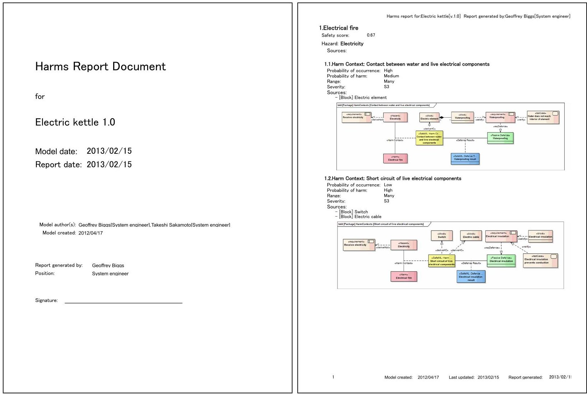

Fig. 21 A report generated from SafeML information

The values for these variables are found in the SafeML element instances of the model. Beginning with a HARMCONTEXT element, the safety score calculator looks for linked defences and context detectors. It uses the values in these, and in the DEFENCERESULT relationships between defences and contexts, to calculate the safety score for that HARMCONTEXT (which represents the hazardous situation/event that also involves a single hazard and a single harm).

The plug-in tool described in Sect. 5.2 displays the safety score value in its Harms view. There, the developer can use it to evaluate which situation or event they should tackle next when designing defences, and the relative benefit of defence methods when multiple defences are assigned to a situation or event.

It is through analyses such as this that the structured information of SafeML supports prioritising the use of available development resources during the development process.

<!-- PDF_PAGE: 28 -->

Fig. 22 The SafeML model checker tool's error list

<table border="1"><tr><td>RelationshipType</td><td>Source</td><td>Target</td></tr><tr><td>Detect</td><td>Water status sensor</td><td>Auto cut-off</td></tr><tr><td>reqDefence</td><td>Over-boiling due to failure by user t...</td><td>Auto cut-off</td></tr><tr><td>reqDetection</td><td>Detect water status</td><td>Auto cut-off result</td></tr></table>

## 5.5 Model consistency checker

A developer using a modelling language requires automated assurance that their model is syntactically correct with respect to the profiles in use, particularly for large and complex models. Most modelling tools include some form of checker that ensures the model being built conforms to specific meta-models and profiles (for example, common ones such as UML and SysML). A model checker for SafeML has two benefits.

1. It helps to ensure the correct and consistent use of SafeML elements.

2. It helps to keep safety information consistent by enforcing well-structured information.

We have implemented a model checker as a plug-in for the Enterprise Architect modelling tool. The checker is invoked when a model containing SafeML elements is loaded, or when the developer requests a check. It examines the relationships between all SafeML elements and any elements they are linked to, looking for relationships that do not conform to the SafeML profile.

If errors are found in the model, the tool presents the developer with a list of the errors, including the elements they involve. An example of this list is shown in Fig. 22. The developer can click on an element in the list to be taken to that element in the modelling tool, where they can examine its relations and locate the problem.

The ability to use a consistency checker is another benefit of using a computer model (such as SafeML) to represent safety information. In the case of SafeML, this benefit is extended further because consistency of the model with regard to system design information is also checkable due to the integrated model.

## 6 Discussion

This paper has presented a SysML profile, named SafeML, for specifying the safety-related aspects of a system design. As well as the profile itself, support tools that utilise information modelled in the profile have also been presented.

The main purpose of SafeML is as a tool for integrating safety and system design information. Such integrated models have been shown to aid information consistency and communication. With communication playing an important part

in the design of safety-critical systems, and with communication known to be an important source of faults during development, it is important to provide developers with easy-touse and consistent communications methods. SafeML does this by structuring the core safety concepts presenting the information close to the aspects of system design that it is related to.

SafeML can also be used as an aid to design. A company's body of knowledge about the safety aspects of commonly used requirements and system components can be made available as SafeML models. It can then be used by designers for preliminary assessments of the impact on a system of adding a new requirement or component. This would be followed by a full analysis by a qualified safety engineer. Such a process could reduce the number of iterations between system engineers and safety engineers, and reduce the work load on safety engineers, without impacting the quality of system designs.

Model transformations can be effective when used with specialised languages like SafeML [3]. Test cases can be generated from the tests for defences, for example, or a new model can be created by combining a system model with a SafeML model of the relevant safety information for its requirements, for example from a database of accumulated experience.

SafeML falls into the qualitative tool category [37], relying on existing formal and semi-formal methods to support the information it presents. As an example, a Fault Tree Analysis was used in Sect. 4 to provide the information for contexts that allow a hazard to cause a harm.

In most modelling tools, the documents providing these proofs can be linked to the model as external resources. SafeML elements can be related to the external resources to indicate how they support the model, such as linking the Fault Tree to the contexts that it provides. This supports traceability amongst design artifacts and allows a developer to include justification for why SafeML elements are present in the model. Enhanced traceability is a well-known benefit of model-based design [18], and a model that integrates system and safety information improves the traceability of the safety information [40].

SafeML can be customised to meet developer needs. The tagged values contained in the SafeML elements (see Sect. 3.4) are relatively independent of the structure of the elements (the stereotype names and the relationships between the elements). If SafeML is to be used in a domain with specific safety concepts, then the tagged values of its elements

<!-- PDF_PAGE: 29 -->

could be customised to reflect those concepts. (This would also require adjusting tool support.)

The enumerations used by the tools presented in this paper (see Sect. 5.1) provide easy customisation for developers. The tools use the enumerations stored in a model to understand textual values used in a model. If the developer requires fine-grained severity levels, they need only to define the severity enumeration with the required levels and the tools will support those levels.

SafeML supports system assurance. If the developer produces a structured argument for the safety of the system, SafeML can be used as part of that argument. This is another example of how the structured safety information of SafeML can improve information use. If the argument is structured using the Goal Structuring Notation [31], as an example, then SafeML can be of assistance by:

1. providing evidence for an argument, such as by showing that a hazardous situation/event has been considered during the system design, or how a situation/event is defended against; and

2. guiding the choice of goals in the GSN argument, such as possible harmful events forming the goals (which leads to using the defences against a harmful event as one form of evidence for the goal).

SafeML structures information about the safety-relevant aspects of a system design, improving information consistency and aiding communication between safety engineers and system engineers, aiding system engineers in responding to safety analysis results, and aiding understanding of the safety features by safety engineers.

## 6.1 Comparison with existing work

SafeML is more general than many existing approaches. Firstly, SafeML provides a complete system perspective. This is in contrast to the approaches discussed in Sect. 2, which are mostly aimed at software systems (especially those that are UML profiles). Because SafeML is a profile of SysML, it is more easily able to model all aspects of a system, particularly requirements and hardware.

Secondly, the meta-models and profiles for safety or dependability discussed in Sect. 2 are designed for modelling failures caused by internal faults and errors. $ ^{16} $ On the other hand, the meta-model and profiles for security assume that security failures are caused by external factors. SafeML is less specific, and instead of explicitly requiring that a hazardous situation or event arises in a component (as in the safety languages) or an external actor (as in the security languages), their origin can be any of a system block, a use

case or a requirement. This allows both internal and external hazard sources to be represented; in the external case, how the hazard is relevant to the system is the focus, but external actors can also be represented via use cases.

Finally, SafeML models general safety concepts. [53] aims to improve communication between safety engineers and software engineers. The profile itself is significantly different, being specifically designed for the concepts of the DO-178B standard. Effective use of the meta-model requires knowledge of the standard. SafeML does not model one single standard. On the other hand, the approach of [53] can provide finer detail about the safety aspects of a system. SafeML chose the route of greater generality and intuitiveness in order to allow a model that is likely to be more understandable, even to those who are not safety experts. Both profiles can be used as part of the certification process to provide safety information to certification authorities. The approach of [53] can provide fine detail about safety measures, but can only be used to certify systems to the DO-178B standard. SafeML can conceivably be used as part of certifying a system to any existing safety standard that uses the same safety concepts described in Sect. 3.1, but additional information from the system model and development documentation may be necessary to satisfy a certification agency.

Similarly, some of the approaches reviewed are linked to a specific type of hazard or safety analysis. For example, [9] is tightly linked to Fault Tree Analysis. SafeML can use information from many types of analysis.

A goal of many of the reviewed approaches is to allow the automated generation of some form of analysis; FTA is the most common. SafeML follows [53] and [9] in taking the opposite approach: analyses are performed as usual, with the results added to the system model.

## 7 Conclusions

This paper has presented a SysML profile for modelling the safety information of safety-critical systems.

The profile is designed based on the important concepts found in safety standards and in the results of hazard and safety analyses. It can be used to present this information to people involved in system development, particularly those who have different specialties. As a profile of SysML, it can be used to directly model the safety-related information of a system in the same model as that system's design. Safety critical systems are not typically limited to pure software and include aspects such as hardware and procedures. Consistent exchange of information with the engineers who specialise in these is just as important as it is for those who focus on software [38]. By being designed for SysML rather than UML, the profile allows modelling safety in a modelling language

<!-- PDF_PAGE: 30 -->

for whole-system design specification, rather than just the software.

The profile includes seven new elements and seven new relationships. It relies heavily on exploiting existing SysML elements and relationships as part of the safety information. This ensures a strong link between a system design modelled in SysML and its safety information. The profile enables traceability from the requirement that leads to a hazard, through possible hazardous events and situations, to the safety measures the system uses, how those measures are implemented, and how they are tested. The use of links to relevant external documents, such as analysis documents, ensures completeness of information.

The profile has been shown to be capable of representing safety information through use of examples. Supporting tools have been developed to assist in using the profile. These tools provide alternative views of the modelled information tailored to different tasks, such as analysing the hazards of a system. They aid the use of the profile and presentation of the modelled information through the automatic tailoring of the presentation format to the target audience, for example by generating reports for certification.

Future work includes a comprehensive investigation of any benefit provided by SafeML over traditional techniques. As part of this, the profile should be improved through feedback from use in complex system developments. The profile can also be extended in several ways, including addition of behaviour modelling of hazards, detectors and defences. The support tools presented in this paper can be considered prototypes; there are many additional functions that a support tool for a modelling language can provide. For example, automatically retrieving defence implementation and behaviour specifications from the model to be placed in generated reports.

## References

1. Addouche, N., Antoine, C., Montmain, J.: UML models for dependability analysis of real-time systems. In: IEEE international conference on systems, man and cybernetics, 2004, vol. 6, pp. 5209-5214 (2004). doi:10.1109/ICSMC.2004.1401021

2. Anda, B., Hansen, K., Gullesen, I., Thorsen, H.K.: Experiences from introducing UML-based development in a large safety-critical project. Empir. Softw. Eng. 11(4), 555-581 (2006). doi:10.1007/s10664-006-9020-6

3. Basin, D., Clavel, M., Egea, M.: A decade of model-driven security. In: Proceedings of the 16th ACM Symposium on Access Control Models and Technologies, SACMAT '11, pp. 1-10. ACM, New York, NY (2011). doi:10.1145/1998441.1998443

4. Basin, D., Doser, J., Lodderstedt, T.: Model driven security. In: Broy, M., Grnbauer, J., Harel, D., Hoare, T. (eds.) Engineering Theories of Software Intensive Systems, NATO Science Series, vol. 195, pp. 353-398. Springer, Netherlands (2005). doi:10.1007/1-4020-3532-2_12

5. Bernardi, S., Merseguer, J., Petriu, D.: A dependability profile within MARTE. Softw. Syst. Model. 10, 313-336 (2011). doi:10. 1007/s10270-009-0128-1

6. Biffl, S., Mordinyi, R., Schatten, A.: A model-driven architecture approach using explicit stakeholder quality requirement models for building dependable information systems. In: Fifth International Workshop on Software Quality, 2007. WoSq'07: ICSE Workshops 2007, p. 6 (2007). doi:10.1109/WOSq.2007.1

7. Bondavalli, A., Dal, Cin M.: Dependability analysis in the early phases of UML based system design. J. Comput. Syst. Sci. Eng. 16(5), 265-275 (2001)

8. Douglass, B.P.: Doing Hard Time: Developing Real-Time Systems with UML, Objects, Frameworks and Patterns, Chap. 4. Addison-Wesley, Reading, MA (1999)

9. Douglass, B.P.: Analyze System Safety Using UML within the IBM Rational Rhapsody Environment. Technical report, Rational Software, IBM Software Group (2009)

10. Feiler, P.H., Gluch, D.P., Hudak, J.J.: The Architecture Analysis & Design Language (AADL): An Introduction. Technical report, Software Engineering Institute, Carnegie-Mellon University, Pittsburgh (2006)

11. Fernndez Briones, J., Miguel, M., Silva, J., Alonso, A.: Application of safety analyses in model driven development. In: Obermaisser, R., Nah, Y., Puschner, P., Rammig, F. (eds.) Software Technologies for Embedded and Ubiquitous Systems. Lecture Notes in Computer Science, vol. 4761, pp. 93-104. Springer, Berlin (2007). doi:10.1007/978-3-540-75664-4_10

12. Friedenthal, S., Moore, A., Steiner, R.: A Practical Guide to SysML: The Systems Modeling Language. Morgan Kaufmann, Los Altos, CA (2009)

13. Frlund, S., Koistinen, J.: Quality-of-service specification in distributed object systems. Distrib. Syst. Eng. 5(4), 179 (1998). http:// stacks.iop.org/0967-1846/5/i=4/a=005

14. Hatebur, D., Heisel, M., Jrjens, J., Schmidt, H.: Systematic development of UMLsec design models based on security requirements. In: Giannakopoulou, D., Orejas, F. (eds.) Fundamental Approaches to Software Engineering. Lecture Notes in Computer Science, vol. 6603, pp. 232-246. Springer, Berlin (2011). doi:10.1007/978-3-642-19811-3_17

15. Hause, M., Thom, F.: An integrated safety strategy to model driven development with SysML. In: Second Institution of Engineering and Technology International Conference on System Safety, 2007, pp. 124-129 (2007)

16. Hayhurst, K., Holloway, C.: Challenges in software aspects of aerospace systems. In: Proceedings of the 26th Annual NASA Goddard on Software Engineering Workshop, 2001, pp. 7-13 (2001). doi:10.1109/SEW.2001.992649

17. Hill, J., Dabholkar, A., Kavimandan, A., Balasubramanian, J., Abdelwahed, S.: A platform independent component QoS modeling language for distributed real-time and embedded systems. Technical report, Vanderbilt University (2007)

18. Huhn, M., Hungar, H.: UML for software safety and certification: Model-based development of safety-critical software-intensive systems. In: Proceedings of the 2007 International Dagstuhl Conference on Model-Based Engineering Of Embedded Real-Time Systems, MBEERTS'07, pp. 201-237. Springer, Berlin (2010). http://dl.acm.org/citation.cfm?id=1927558.1927569

19. IEC 60812 Analysis techniques for system reliability—Procedure for failure mode and effects analysis (FMEA) (2006)

20. IEC 61205 Fault tree analysis (FTA) (2006)

21. IEC 61508 Functional safety of electrical/electronic/program mable electronic safety-related systems (2010)

22. IEC 61508 Functional safety of electrical/electronic/program mable electronic safety-related systems—part 4: definitions and abbreviations (2010)

<!-- PDF_PAGE: 31 -->

23. ISO 12100 Safety of machinery—General principles for design Risk assessment and risk reduction (2010)

24. ISO 13849 Safety of machinery—Safety-related parts of control systems—Part 1: general principles for design (2006)

25. ISO 26262 Road vehicles—Functional safety (2011)

26. Iwu, F., Galloway, A., McDermid, J., Toyn, I.: Integrating safety and formal analyses using UML and PFS. Reliab. Eng. Syst. Saf. 92(2):156-170 (2007). doi:10.1016/j.ress.2005.11.060. http:// www.sciencedirect.com/science/article/pii/S095183200500270X

27. Johnson, C.W.: The hidden human factors in unmanned aerial vehicles. In: Proceedings of the 2007 International Systems Safety Society Conference. Baltimore (2007)

28. Jürjens, J.: Towards development of secure systems using UMLsec. In: Hussmann, H. (ed.) Fundamental Approaches to Software Engineering. Lecture Notes in Computer Science, vol. 2029, pp. 187- 200. Springer, Berlin (2001). doi:10.1007/3-540-45314-8_14

29. Jürjens, J.: Sound methods and effective tools for model-based security engineering with UML. In: Proceedings of the 27th International Conference on Software Engineering, 2005. ICSE 2005, pp. 322-331 (2005). doi:10.1109/ICSE.2005.1553575

30. Jürjens, J., Schreck, J., Bartmann, P.: Model-based security analysis for mobile communications. In: ACM/IEEE 30th International Conference on Software Engineering, 2008. ICSE'08, pp. 683-692 (2008). doi:10.1145/1368088.1368186

31. Kelly, T., Weaver, R.: The goal structuring notation—A safety argument notation. In: Proceedings of the Dependable Systems and Networks 2004 Workshop on Assurance Cases (2004)

32. Leveson, N.G.: Safeware: System Safety and Computers. ACM, New York, NY (1995)

33. Leveson, N.G.: Safeware: System Safety and Computers, Chap. 13. ACM, New York, NY (1995)

34. Leveson, N.G.: Safeware: System Safety and Computers, Chap. 14. ACM, New York, NY (1995)

35. Leveson, N.G.: Engineering a Safer World, Chap. 2. The MIT Press, Cambridge, MA (2011)

36. Leveson, N.G.: Engineering a Safer World, Chap. 3. The MIT Press, Cambridge, MA (2011)

37. Lipaczewski, M., Struck, S., Ortmeier, F.: Using tool-supported model based safety analysis—Progress and experiences in SAML development. In: IEEE 14th International Symposium on HighAssurance Systems Engineering (HASE), 2012, pp. 159-166 (2012). doi:10.1109/HASE.2012.34

38. Lutz, R.: Analyzing software requirements errors in safety-critical, embedded systems. In: Proceedings of IEEE International Symposium on Requirements Engineering, 1993, pp. 126-133 (1993). doi:10.1109/ISRE.1993.324825

39. de Miguel, M., Briones, J., Silva, J., Alonso, A.: Integration of safety analysis in model-driven software development. IET Softw. 2(3), 260-280 (2008). doi:10.1049/iet-sen:20070050

40. Montecchi, L., Lollini, P., Bondavalli, A.: Dependability concerns in model-driven engineering. In: Fourteenth IEEE International Symposium on Object/Component/Service-Oriented RealTime Distributed Computing Workshops (ISORCW), 2011, pp. 254-263 (2011). doi:10.1109/ISORCW.2011.32

41. Montecchi, L., Lollini, P., Bondavalli, A.: An intermediate dependability model for state-based dependability analysis. Technical report rcl101115 v2.1, University of Florence, Dipartimento di Sistemi e Informatica, RCL group (2011). http://dcl.isti.cnr.it/ Documentation/Papers/Techreports.html

42. Montella, A.: Safety reviews of existing roads: quantitative safety assessment methodology. Transp. Res. Rec. J. Transp. Res. Board 1922, 62-72 (2005). doi:10.3141/1922-09. http://trb.metapress. com/content/RT7RU54215302751

43. Mustafiz, S., Sun, X., Kienzle, J., Vangheluwe, H.: Model-driven assessment of system dependability. Softw. Syst. Model. 7, 487- 502 (2008). doi:10.1007/s10270-008-0084-1

44. Omg, UML Profile for MARTE: Modeling and Analysis of Real-Time Embedded Systems (2011). http://www.omg.org/spec/ MARTE/1.1/

45. Omg, UML Profile for Modeling Quality of Service and Fault Tolerance Characteristics and Mechanisms (QFTP) (2011). http:// www.omg.org/spec/QFTP/1.1/

46. OMG Systems Modeling Language (OMG SysML) (2012). http:// www.omg.org/spec/SysML/1.3/

47. Pai, G., Dugan, J.: Automatic synthesis of dynamic fault trees from UML system models. In: Proceedings of the 13th International Symposium on Software Reliability Engineering, 2002. ISSRE 2003, pp. 243-254 (2002). doi:10.1109/ISSRE.2002.1173261

48. Panesar-Walawege, R., Sabetzadeh, M., Briand, L.: A model-driven engineering approach to support the verification of compliance to safety standards. In: IEEE 22nd International Symposium on Software Reliability Engineering (ISSRE), 2011, pp. 30-39 (2011). doi:10.1109/ISSRE.2011.11

49. Panesar-Walawege, R., Sabetzadeh, M., Briand, L.: Using UML profiles for sector-specific tailoring of safety evidence information. In: Jeusfeld, M., Delcambre, L., Ling, T.W. (eds.) Conceptual Modeling ER 2011. Lecture Notes in Computer Science, vol. 6998, pp. 362-378. Springer, Berlin (2011). doi:10.1007/978-3-642-24606-7_27

50. Ritter, T., Born, M., Unterschiitz, T., Weis, T.: A QoS metamodel and its realization in a CORBA component. In: Proceedings of the 36th Annual Hawaii International Conference on System Sciences, 2003, p. 10. (2003). doi:10.1109/HICSS.2003.1174879

51. Tambe, S., Balasubramanian, J., Gokhale, A., Damiano, T.: MDDPro: model-driven dependability provisioning in enterprise distributed real-time and embedded systems. In: Malek M., Reitenspie M., Moorsel A. (eds.) Service Availability. Lecture Notes in Computer Science, vol. 4526, pp. 127-144. Springer, Berlin (2007). doi:10.1007/978-3-540-72736-1_11

52. Wilson, S.P., McDermid, J.A.: Integrated analysis of complex safety critical systems. Comput. J. 38(10), 765-776 (1995). doi:10. 1093/comjnl/38.10.765

53. Zoughbi, G., Briand, L., Labiche, Y.: Modeling safety and airworthiness (RTCA DO-178B) information: conceptual model and UML profile. Softw. Syst. Model. 10, 337-367 (2011). doi:10. 1007/s10270-010-0164-x

<!-- PDF_PAGE: 32 -->

Geoffrey Biggs completed his BE in Computer Systems Engineering at the University of Auckland in 2002, followed by his Ph.D. in Electrical Engineering, studying robotics, in 2007. His research focussed on tools used by developers of mobile robotic systems. He is currently a research scientist at the National Institute of Advanced Industrial Science and Technology (AIST) in Japan, where he works at the intersection of software architectures, modelling technologies and safety. He is a member of the

OMG Robotics DTF and Systems Assurance TF, and additionally works at the Japanese national level on ISO standardisation of robot safety.

Takeshi Sakamoto is an expert in UML and SysML modelling technologies. He has worked at the Object Management Group as a member of the Robotics DTF, on the standardisation of component models for robotics, developing the models for three standards since 2005. He has also contributed to several journal papers on model-based frameworks for robotics. He is currently CEO of a modelling consultancy and also works as a lecturer at the Shibaura Institute of Technology in Tokyo, Japan.

Tetsuo Kotoku received his M.E and Ph.D. degrees in Mathematical Engineering and Information Physics from The University of Tokyo, Japan, in 1988 and 1998, respectively. Since 1988, he was a Researcher at the Mechanical Engineering Laboratory, Tsukuba, Japan, and he is currently at the National Institute of Advanced Industrial Science and Technology, Tsukuba, Japan, where he is manager of the Innovation School, working on career development for postdoctoral researchers, as well as

an Adjunct Professor at The University of Tsukuba, Japan. He was CoChair of the Robotics DTF at OMG from 2005 to 2013. His research interests are virtual environments with force reflection and their application to tele-manipulation systems. These days, network robotics, human robot interaction, reuse and sharing of robot technology (RT) and standardization of RT are his interests.

