<!-- PDF_PAGE: 1 -->

# Emergence of Second-Generation Low Earth Orbit Satellite Constellations: A Prospective Technical, Economic, and Policy Analysis

by

Veronica L. Foreman B.S. Aerospace Engineering - Georgia Institute of Technology, 2014

Submitted to the Department of Aeronautics and Astronautics and the Institute for Data, Systems, and Society in Partial Fulfillment of the Requirements for the Degrees of

Master of Science in Aeronautics and Astronautics Master of Science in Technology and Policy

at the

Massachusetts Institute of Technology

June 2018

$ \textcircled{c} $ 2018 Massachusetts Institute of Technology. All rights reserved.

Signature of Author:

Signature redacted Department of Aeronautics and Astronautics, Institute for Data, Systems, and Society May 24, 2018 Signature redacted

Certified by:

Olivier de Weck Professor of Aeronautics and Astronautics Thesis Supervisor

Certified by:

Signature redacted

Thesis Supervisor

Afreen Siddiqi

Research Scientist, Institute for Data, Systems, and Society

Thesis Co-Advisor

Accepted by:

Signature redacted

Hamsa Balakrishnan

Associate Professor of Aeronautics and Astronautics Chair, Graduate Program Committee, Department of Aeronautics and Astronautics

Accepted by:

Signature redacted

Munther Dahleh

ARCHIVES

W. Coolidge Professor of Electrical Engineering and Computer Science Director, Institute for Data, Systems, and Society

<!-- PDF_PAGE: 2 -->

<!-- PDF_PAGE: 3 -->

# Emergence of Second-Generation Low Earth Orbit Satellite Constellations: A Prospective Technical, Economic, and Policy Analysis

by Veronica L. Foreman

Submitted to the Department of Aeronautics and Astronautics and the Institute for Data, Systems, and Society on May 24, 2018 in Partial Fulfillment of the Requirements for the Degrees of

Master of Science in Aeronautics and Astronautics Master of Science in Technology and Policy

## Abstract

Modern proposals for Low Earth Orbit (LEO) satellite constellations underscore the tremendous potential and versatility of distributed spacecraft missions (DSMs), but they have also begun to stress the limits of the existing development paradigm. A new generation of LEO constellations is emerging, and understanding the related technical, economic, and policy landscapes will be critical to fostering their success. The most significant value of this research effort comes from its breadth. LEO constellations are becoming essential tools for a wide range of applications, and this work seeks to examine the diverse set of topics facing modern constellation stakeholders. Through a multidisciplinary, systems engineering evaluation, this thesis synthesizes current knowledge gaps and questions related to second-generation LEO constellations. The investigation begins with a discussion of the historical development of DSMs, and three distinct eras of constellation use are identified. The initial time period, 1959 to 1996, captures the early DSMs that framed the development of modern systems. The first generation spans from 1997 to 2009. It begins with the installation of the first commercial, telecommunications constellations and demonstrates logistic growth for commercial DSM member spacecraft. Growth rates surge again as the second generation begins in 2010, and the data reflect current trends toward commercial, remote-sensing applications of DSM systems. The second generation of LEO constellations coincides with an approximately 189% increase in the annual NGSO satellite launch rate and a 92% increase in the number of constellation systems initialized each year over the first generation. This work continues by underscoring technologies that have enabled this growth through a survey of relevant literature and patent filings. Contemporary issues in constellation technology policy are also examined. Through a series of cost and risk focused case studies, limitations within the existing development and maintenance paradigms are illustrated. The new generation of constellations is challenging the assumptions that have traditionally guided such analyses, and opportunities for further framework development are discussed. This thesis represents a contribution to the advancement of constellation systems by assessing the viability of the existing paradigm and identifying critical areas of future research.

Thesis Supervisor: Dr. Olivier de Weck

Title: Professor of Aeronautics and Astronautics

Thesis Co-Advisor: Dr. Afreen Siddiqi

Title: Research Scientist, Institute for Data, Systems, and Society

<!-- PDF_PAGE: 4 -->

## Disclaimer

This research is supported by the National Science Foundation Graduate Research Fellowship under Grant No. 1122374. Any opinion, findings, and conclusions or recommendations expressed in this material are those of the author and do not necessarily reflect the views of the National Science Foundation.

<!-- PDF_PAGE: 5 -->

## Acknowledgements

Many of my friends know that my favorite portion of any work is the acknowledgements section. I have tremendous respect for the intellectual effort and determination that goes into any research project, but there is something uniquely powerful about the years' or even lifetime's worth of dedication that contributes to this section. I have been looking forward to writing this page since the moment I was accepted to MIT, and while I certainly hope this is not the first time I have expressed my gratitude to these friends and colleagues, I know it will not be the last.

Thank you first and foremost to my advisors, Dr. Oli de Weck and Dr. Afreen Siddiqi. The advice I got the most often when looking for a graduate program was "Pick the right advisor for you, and the rest will follow." You have shown me how true that is. Your careful guidance and unwavering support have helped me through many valuable lessons during my three years here, and I am truly grateful for the opportunity to work with you both.

I am incredibly appreciative of the generous support provided by the National Science Foundation Graduate Research Program for my graduate education and thesis research.

To Dr. Frank Field, Barb DeLaBarre, and Ed Ballo, thank you so much for your encouragement. TPP has had an immeasurable impact on how I approach problem solving and given me more appreciation for the breadth of issues facing innovators and leaders today. What's more, TPP has been a wonderful, uplifting part of my MIT experience, and I am so appreciative of the opportunity to be part of this program.

To Beth Marois in Aero Astro and Beth Milnes in IDSS, I cannot imagine how any of the students at MIT would make it through without dedicated people like you. Thank you for all of the work that you do.

To my colleagues and mentors at NASA Goddard Space Flight Center, especially Dr. Jacqueline Le Moigne and Matt Holland, thank you for giving me the chance to be part of the TAT-C Project and for your support as I have grown as a graduate student. To the wonderful team at Virgin Orbit, I am so looking forward to joining you in Long Beach and am so grateful for the chance to work with you all.

To my friends, colleagues, and brunch-mates in SERG and 33-409—it has been such an honor to work with you (and also to distract you from work we should have been doing). You made our office a place I knew I could always find insight, laughter, and high-quality sarcasm. Kailah, thank you for always lending me an understanding ear. John, thank you for showing me how it feels to have your sassy UROP beat you to graduation. George, thank you for your alwaysinnovative problem solving and positive outlook. Matt, thank you for helping me to see the bright side of every challenge. Alex, thank you for being my go to for all things related to Georgia Tech and The Office (which are two of the best things friends can have in common). Anne, thank you for your encouragement, enthusiasm, and spectacular perspective. Narek, thank you for your kindness and for bringing so much art to the scientific work we do. Sam, thank you for setting a wonderful example and being such a phenomenal friend. Andrew, thank you for your wisdom and patience, and of course, for spending so many hours getting coffee/tea with me.

<!-- PDF_PAGE: 6 -->

To all of the brilliant students in Aero Astro, especially my first new friend at MIT, Aditya, and the wonderful women of GWAE, especially Charlotte, Angie, and Akshata, thank you for challenging me, providing a such a talented and welcoming community, and for making MIT feel like home.

To my fellow TPPers, from IYR to last minute drives to watch the sun rise in Maine, you have made grad school better than I ever could have imagined. Knowing how many cohorts before us have stayed in touch is comforting because I know that the toughest part of my time at MIT will be saying goodbye to you. I especially want to thank Alix, Cassie, Stephen, Nate, Barry, Paige, Amy, and Katie, for being such incredible role models. Being your friend has made me a better, happier person. Micaela, thank you for encouraging my sense of adventure and appreciation for life. To my Best Bromance partner and one of my very best friends, Sydney, thank you for always encouraging me to Get Back Up Again. I cannot imagine MIT without you.

To my friends from Georgia Tech, thank you for helping me keep Progress and Service and Swarm level enthusiasm in my every day life. To Chris, thank you for your friendship. I am so grateful for all of your advice and support. To Nick, Katherine, Owen, Kelsey, Sheena, Nicole, Ryan, and Dylan-your visits, care packages, and late night phone calls have reminded me that no matter how far you travel from the people you love, they are always on your team. Kara, if it wouldn't be incredibly weird to put that picture of the girl with the fish in my thesis, I'd do it for you. And, of course, thank you to George P. Burdell.

To my family, I cannot imagine what I could have done to be so lucky. Your faith in me and (I can't imagine how many) hours spent listening are the most cherished gifts I have ever received. David, I mean it when I say I could not have become who I am today without you. You make every day brighter. Ali, you have made me a stronger, more resilient person, and you are the best sibling a person could wish for. You are my best friend. Dad, you are my hero. I am so lucky to have had you to look up to in so many things, and I cannot thank you enough for your help and support. Mom, you have given more to me than I can imagine giving to another person, and I am grateful beyond words. You are the person I want to be when I grow up. Thank you all for everything.

"It's a lesson that I've learned over and over again but it bears repeating. No one achieves anything alone."

- Leslie Knope

<!-- PDF_PAGE: 7 -->

# Emergence of Second-Generation Low Earth Orbit Satellite Constellations: A Prospective Technical, Economic, and Policy Analysis

by

Veronica Foreman

Supervised by

Dr. Olivier de Weck and Dr. Afreen Siddiqi

<!-- PDF_PAGE: 8 -->

<!-- PDF_PAGE: 9 -->

## Table of Contents

# Table of Contents

Abstract... 3

Disclaimer... 4

Acknowledgements... 5

Table of Contents... 9

List of Figures... 11

List of Tables... 12

1 Introduction... 15

1.1 Motivation... 15

1.2 Gap Analysis... 16

1.3 Scope and Contributions... 17

1.4 Research Questions... 17

1.5 Thesis Overview... 18

2 Distributed Spacecraft Missions Background... 21

2.1 System Terminology... 21

2.2 System Design Tradespace... 23

2.2.1 Distributed Spacecraft Mission Design Considerations... 24

2.2.2 Common Constellation Architectures... 25

2.3 Prior Research in DSM Development... 28

3 Establishing the Second Generation of LEO Constellations... 31

3.1 Developing a Constellation Mission Data Set... 31

3.2 NGSO Spacecraft and DSM Population Growth... 34

3.3 Second-Generation LEO Constellations... 45

4 Constellation Enabling Technologies... 49

4.1 Constellation Technologies Literature Review... 49

4.1.1 Distributed Functionality... 49

4.1.2 Small Satellites... 50

4.2 Patent Landscape... 53

4.3 Enabling Constellation Demand... 59

4.4 Regulatory Considerations... 60

4.4.1 Spacecraft Licensing... 60

4.4.2 Launch Services... 61

4.4.3 Orbital Debris... 62

4.4.4 International Collaborations... 66

4.5 Technology Development and Policy Conclusions... 68

5 Constellation Cost Estimating... 71

5.1 Constellation Cost Estimating Literature Review... 71

5.1.1 Cost Estimating Process... 71

5.1.2 Cost Estimating Methodologies... 73

5.1.3 Prior Research in Constellation Cost Estimating... 75

5.2 Application of Existing Models to Modern LEO Constellations... 77

5.2.1 Sources of Uncertainty... 78

5.2.2 Gravity Recovery and Climate Experiment (GRACE)... 78

5.2.3 Cyclone Global Navigation Satellite System (CYGNSS)... 85

<!-- PDF_PAGE: 10 -->

5.2.4 Landsat Data Continuity Mission (LDCM)... 89

**5.3 Constellation Specific Cost Considerations**... 96

5.3.1 Design Iteration and Rework... 96

5.3.2 Mission Operations... 97

**5.4 Cost Conclusions**... 98

## 6 Constellation System Risks ... 99

**6.1 Constellation Risk Assessment Literature Review**... 99

**6.2 Second-Generation Constellation STPA Case Study**... 100

6.2.1 TROPICS System Description and Formalized Goals... 101

6.2.2 System Level Accident and Hazard Identification... 102

6.2.3 Organizational Requirements... 105

6.2.4 Stakeholder Analysis... 105

6.2.5 Hierarchical Safety Control Structure... 106

6.2.6 STPA: Hazard Identification and Analysis... 109

**6.3 Generalized Results from STPA**... 115

**6.4 Orbital Debris Collision Risk**... 116

6.4.1 Orbital Debris Environment... 117

6.4.2 Orbital Debris and Satellite Constellations Literature Review... 119

6.4.3 NGSO Orbital Debris Case Studies... 120

## 7 Conclusions... 129

**References**... 133

**Acronyms and Abbreviations**... 146

**Appendix A – Subset of NGSO Satellite and DSM Data**... 148

**Appendix B – Inflation Factors**... 169

**Appendix C – Subset of ORDEM Trial Results**... 170

Circular Orbit: 1200 km altitude, 87.9 degree inclination... 170

Circular Orbit: 1248 km altitude, 37.4 degree inclination... 171

Circular Orbit: 1000 km altitude, 99.5 degree inclination... 172

Highly Elliptical Orbit: 8089 km perigee altitude, 43509 apogee altitude, 63.4 degree inclination... 173

Circular Orbit: 1150 km altitude, 53 degree inclination... 174

Circular Orbit: 1110 km altitude, 53.8 degree inclination... 175

Circular Orbit: 1130 km altitude, 74 degree inclination... 176

Circular Orbit: 1275 km altitude, 81 degree inclination... 177

Circular Orbit: 1325 km altitude, 70 degree inclination... 178

<!-- PDF_PAGE: 11 -->

## List of Figures

Figure 1. Walker Delta Constellation Configuration, Image Credit: [35], [36]. ... 26

Figure 2. Streets of Coverage Constellation Configuration, Image Credit: [35], [36]. ... 27

Figure 3. Train Constellation Configuration, as implemented for NASA's Afternoon Train Constellation, Image Credit: [38]. ... 27

Figure 4. Total NGSO Satellite Population Growth between 1957 and 2017, including individual spacecraft and DSM member spacecraft... 35

Figure 5. NGSO DSM Population Growth between 1957 and 2017... 35

Figure 6. Eras of Total NGSO Satellite Population Growth and Corresponding Growth Rates, including individual spacecraft and DSM member spacecraft... 37

Figure 7. Eras of NGSO DSM Population Growth and Corresponding Growth Rates... 37

Figure 8. DSM Member Satellite Population Growth by DSM Classification... 38

Figure 9. System Population Growth by DSM Classification... 39

Figure 10. DSM Population Growth Separated by Payload Service Type... 40

Figure 11. Second-Generation Government DSM Member Satellite Population Growth... 40

Figure 12. Second-Generation Private Industry DSM Member Satellite Population Growth... 41

Figure 13. DSM Population Growth Examined By Consolidated Mission Objective... 42

Figure 14. DSM Member Satellite Population Growth By Payload Service Type... 43

Figure 15. First-Generation, Commercial LEO Constellation Population Growth... 44

Figure 16. DSM Member Satellite Population Growth By Consolidated Mission Objective... 45

Figure 17. CPC B64G 1/1085 Patent Trend, by Application Year... 54

Figure 18. Top First-Generation LEO Satellite Constellation Patent Top Assignees... 55

Figure 19. Top Second-Generation LEO Satellite Constellation Patent Assignees... 55

Figure 20. Sub-classification Affiliation Growth within Swarms and Constellations Dataset... 58

Figure 21. Relative Distribution of Constellation Member Spacecraft By Mission Objective... 67

Figure 22. NASA Space Flight Project Work Breakdown Structure Template, Levels 1 and 2, Image Credit: [150]... 72

Figure 23. Cost Growth Observed in 40 Earth and Space Science Missions Examined by National Research Council, Image Credit: [161]... 76

Figure 24. Model of TROPICS System Coverage. Instrument swaths are shown in red. Image credit: [202]... 102

Figure 25. Proposed TROPICS System Hierarchical Control Structure... 107

Figure 26. Proposed Member Spacecraft Level Hierarchical Control Structure... 108

Figure 27. Avionics Control Structure... 110

Figure 28. TROPICS Command, Control, Communication, and Data Elements. Image Credit: [202]... 112

Figure 29. Satellite Maneuver, Human in the Loop Control Structure... 114

Figure 30. Orbital Debris Field Characterization, figure produced by NASA Orbital Debris Program Office, Image Credit: [215]... 118

Figure 31. Comparison of orbital debris environment development without (left) and with (right) hypothetical large constellation, Image Credit: [205]... 120

<!-- PDF_PAGE: 12 -->

## List of Tables

Table 1. DSM and Constellation Example Missions...23

Table 2. Sample Data Point from NGSO Constellation Data Set...33

Table 3. Summary of DSM Dataset...34

Table 4. Contribution of DSM Member Spacecraft to Total NGSO Population...44

Table 5. Summary of a Subset of Commercial Telecommunications and Remote Sensing Constellation Proposals...47

Table 6. NASA Small Satellite Mass Classifications [80]...50

Table 7. Allocation of Satellite Constellation Patents by Assignee Type...54

Table 8. Impact of Patent Filings on Constellation Population Growth...56

Table 9. Top 10 Additional CPC Patent Classifications Associated with B64G1/1085 Patent Filings...57

Table 10. Existing Parametric Cost Estimating Tools Summary...74

Table 11. GRACE Spacecraft Parameters...79

Table 12. SSCM05 Parametric Cost Estimating Relationships [18]...80

Table 13. NICM Version IIIC Parametric Cost Estimating Relationships [18]...81

Table 14. SSCM05 and NICM Version IIIC Produced Most Likely Cost Estimates and Standard Errors for GRACE Input Parameters...81

Table 15. Distribution of Nonrecurring and Recurring Costs from a Cost Model Producing Estimates of Nonrecurring Cost and One Protoflight Unit [134]...82

Table 16. Separated Nonrecurring and Recurring Costs of GRACE Mission, Using Distribution Provided in Table 15...83

Table 17. Cost Estimate Using GRACE Mission Parameters...84

Table 18. CYGNSS Mission Parameters...86

Table 19. SSCM05 and NICM Version IIIC Produced Most Likely Cost Estimates and Standard Errors for CYGNSS input parameters...87

Table 20. Separated Nonrecurring and Recurring Costs of CYGNSS Mission, Using Distribution Provided in Table 15...88

Table 21. Cost Estimate Using CYGNSS Mission Parameters...89

Table 22. Landsat 8 Spacecraft Parameters...90

Table 23. USCM8 Parametric Cost Estimating Relationships [18]...91

Table 24. USCM8 and NICM Version IIIC Produced Most Likely Cost Estimates and Standard Errors for Landsat 8 Parameters...93

Table 25. Cost Estimate Using Landsat 8 Mission Parameters...94

Table 26. TROPCIS Constellation Parameter Summary [200]–[202]...101

Table 27. TROPICS System Goals...102

Table 28. Constellation System Accidents...103

Table 29. Constellation System Level Hazards, Traced to System Accidents Identified in Table 28...104

Table 30. Satellite Technical System Safety Requirements, Traced to System Hazards Identified in Table 29...104

Table 31. Organizational Requirements, Traced to System Hazards Identified in Table 29...105

Table 32. Unsafe Control Actions (UCA) – Phasing Maneuver Execution...114

Table 33. Unsafe Control Actions (UCA) – Collision Avoidance Maneuver Execution...115

Table 34. Additional Safety Constraints Deriving from Unsafe Control Actions Identified in Tables 32 and 33...115

<!-- PDF_PAGE: 13 -->

Table 35. OneWeb Constellation Data Summary [223] $ - $ [225] . 121

Table 36. Space Norway AS Constellation Data Summary [226] $ - $ [228] . 122

Table 37. Telesat Canada Constellation Data Summary [84], [229] . 122

Table 38. SpaceX Constellation Data Summary [139], [230] . 123

Table 39. FCC Licensed NGSO Constellation Summary. 123

Table 40. ORDEM Version 3 Input Parameters for Licensed NGSO Constellations. 125

Table 41. Expected Number of Encounters Between Licensed Constellation and Orbital Debris Greater Than 1 cm in Diameter, Based on ORDEM Flux Calculation. 126

Table 42. Summary of Second-Generation LEO Constellation Paradigm Limitations. 129

<!-- PDF_PAGE: 14 -->

<!-- PDF_PAGE: 15 -->

## 1 Introduction

## 1.1 Motivation

Constellations of satellites in Low Earth Orbit (LEO) offer unique advantages over monolithic spacecraft, such as instantaneous global coverage, redundancy to satellite failures, and improved communications link budgets, particularly when compared to satellites in Geostationary Earth Orbit (GEO). However, these systems also face many challenges including complex operations, dense launch schedules, and significant capital requirements, among others. The prospects and challenges of second-generation LEO constellations, many of which will be launched in coming years, is the central topic of this thesis.

As interest in space-based observations and infrastructure capabilities has increased in recent years, so has the interest in satellite constellation technologies. While the concept of multiple spacecraft working toward a common goal has a great deal of historical precedent, a distinct, second generation of LEO constellations is clearly emerging. Bolstered by progress in the private launch industry and the miniaturization of many space technologies, satellite constellations are entering an era of unprecedented capability and affordability. Modern design proposals span the entire design tradespace, addressing a wide range of applications for both the public and private sectors. Planet Inc., a satellite start-up company headquartered in San Francisco, currently operates the largest private constellation in history. The constellation consists of 149 satellites that can, in a single day, collectively photograph the entire Earth at high-resolution, resulting in more than 6 terabytes of information [1], [2]. Space Exploration Technologies Corporation (SpaceX) and OneWeb (formerly WorldVu satellites) are racing to implement constellations capable of providing global, high-speed Internet services from space [3]. The Commander of the United States Strategic Command (US STRATCOM), US Air Force General John Hyten, has argued that even the US military must pursue the advantages offered by distributed spacecraft systems: "I won't support the development any further of large, big, fat, juicy targets... We are going to go down a different path, and we have to go down that path quickly" [4].

Interest in rising commercial value and strategic advantage are pointing to distributed systems as a potential design solution more than ever before. Increasingly, government and private industry are leveraging constellations to reduce cost, increase risk resilience, and address new objectives, including 'big-data' style research questions. This coupling of technology development and cost reduction offers a unique opportunity for innovation in this sphere, but it has also begun to reveal certain limitations within the existing technological, economic, and policy frameworks for satellite constellations. As the number of constellation systems increases, the severity and scope of these problems is likely to similarly expand.

The purpose of this thesis is to address these limitations through the lens of systems engineering, linking the satellite constellations themselves to the broader sociotechnical framework in which they are developed. A multifaceted analysis of the constellation development paradigm and regulatory guidelines can provide insight as to how the emergence of new constellation technologies are shaping the global space industry and the extent to which the state of the industry is fostering growth in particular realms of constellation design and implementation. This work comes at a time when the space industry is poised to support more launches and more spacecraft than ever before, and recent trends and pending system proposals suggest that a new

<!-- PDF_PAGE: 16 -->

generation of constellation missions is emerging. Characterizing the aforementioned limitations and developing a deeper understanding of what challenges they present will enable targeted solutions, broader adoption of constellation systems, more effective and reliable long-term performance, and ultimately greater return on investment for future satellite constellation missions.

## 1.2 Gap Analysis

The current discussion surrounding satellite constellations illustrates a classic problem in technology development and the associated regulatory spheres. Innovative constellation mission designs hold the promise of improved performance, increased profit and science return, and greater coverage rates (LeMoigne et al., 2016; Nag, LeMoigne, & de Weck, 2014). Emerging private launch companies and high-capability small satellites have made these systems, in theory, more affordable and accessible [6], [7]. In practice however, constellation missions are encountering unforeseen obstacles. Some systems are struggling to demonstrate their compliance with existing regulations during the proposal phase [8], while others are incurring atypical cost and schedule overruns during development [9]. In-orbit operations increasingly rely on automated processes, which introduces a greater degree of software complexity and risk; this is of particular concern during periods of "lights out" operations, when constellations may execute maneuvers without human operator oversight [10]. These setbacks often stem from the fact that the scale of modern constellations, in terms of mission complexity or the sheer magnitude of the system, has exceeded the scope for which planning tools and regulatory guidelines were intended. For example, existing science data-management techniques for Earth observing missions are generally effective for approximately 10 spacecraft [11], but modern constellation proposals can include hundreds, if not thousands, of satellites. New capabilities are emerging to address the needs of these cutting-edge systems, and prior research has sought to advance constellation technology. However, there has been limited investigation into what shortcomings within the existing framework could present hurdles for advanced system development.

Mission owners are now often designing at the edge of the tradespace, creating unique systems that can be difficult to implement and regulate, and therefore the technology and regulatory frameworks are evolving together, each exerting substantial pressure on the other. Industry leaders who have invested in constellation systems have much to gain by becoming early adopters of emerging regulations and can offer their expertise to craft regulations that reflect the technical reality. Regulators must simultaneously take care to not unduly hinder growth nor endanger other orbital assets [12]. Constellation system stakeholders include complementary industries, end users of data products, university and non-profit developers, and emerging space nations, among others. The way that the space industry responds to the challenges facing modern satellite constellations will set the trajectory for future development in this arena and tangentially, in other sectors as varied as telecommunications, disaster response, infrastructure development, economic investment, and education.

Methods from systems engineering are ideally suited to investigate this type of multidisciplinary research question [13]. Identifying the challenges that are embedded in the development process in a systematic manner will be the first step toward ensuring the success of future constellation missions, which have a history of emerging slightly before their time. The Iridium constellation came within hours of being intentionally de-orbited because the system seemed financially unsalvageable, but successful management has made Iridium an enduring and essential

<!-- PDF_PAGE: 17 -->

component of the global communications infrastructure [14]. As the second generation of LEO constellations emerges, careful development of technologies and regulatory schemes capable of addressing the needs of these systems will ideally create a stable environment for innovation and hopefully prevent any drastic measures, such as the planned destruction of Iridium.

Prior research has examined questions pertaining to the development of specific types of systems, but the constellation tradespace is varied enough that targeted technical solutions often cannot be applied easily to other constellation systems. This localization of development could delay or even prevent widespread adoption of constellation systems. Often, the extent to which prior missions can serve as technology demonstrations for similar systems applied in different contexts is limited. In turn, technology readiness level (TRL) estimates remain low, and system risk estimates increase. Thus, the cycle begins again as specific studies are undertaken to prove and demonstrate a unique mission concept. By undertaking this work and attempting to characterize the existing technological, economic, and regulatory inefficiencies facing the next generation of LEO constellations, a meaningful contribution to the future development of both development and oversight tools can be made.

## 1.3 Scope and Contributions

The purpose of this thesis is to identify and characterize the inefficiencies within the LEO constellation design, development, and implementation frameworks. This research question is inherently interdisciplinary, and there are many venues for future research that will not be addressed within this work. The focus is on the technical tools available to mission designers and developers, the economic realities facing mission owners and program managers, and the international legal frameworks within which all stakeholders must operate. The intention of this work is to conduct systems engineering research for modern constellations in a way that promotes sustainable development and successful implementation of distributed spacecraft missions (DSMs).

This thesis is limited to the consideration of LEO satellite constellations and spacecraft in GEO will not be considered. Within the realm of LEO constellations, spacecraft of varying mission objectives, mass classes, and levels of risk mitigation will be discussed. Technologies will not be assessed at the component level, but rather systems will be examined as complete entities to allow for more generalized conclusions.

Collectively, this work represents a contribution to the advancement of constellation systems by assessing the viability of the existing development framework. Independently, each chapter is a small piece of a much broader research topic. The most significant value of this research effort comes from its breadth. The examination of a range of topics and treating each concept with a pointed set of research tools allows for a holistic systems perspective to be constructed for the second generation of LEO constellations. Through a systems engineering and multidisciplinary evaluation, this thesis synthesizes current knowledge gaps and burgeoning questions related to second-generation LEO constellations. This work can serve as a valuable starting place for future research in the realm of constellation development.

## 1.4 Research Questions

This thesis was motivated by recent discussions in both academic literature and technical current events that suggest a new era of constellation technologies is emerging. Seeking to understand

<!-- PDF_PAGE: 18 -->

the technical shifts that may be driving such discussions, the first research question addressed within this thesis is:

1. Are recent advances in LEO constellation design and implementation strategies indicative of a new generation of systems?

The research presented in Chapter 3 concludes that a new era of constellation development has begun. Characterized by an increase in remote sensing spacecraft and greater prevalence of DSMs, second-generation systems are developing as the surrounding technical, economic, and regulatory paradigms take shape. Anecdotal evidence indicates that traditional frameworks may be difficult to transition to the modern era. The remainder of this thesis therefore focuses on identifying the technologies that have enabled progress thus far and characterizing limitations within the current paradigm that may inhibit further development. These efforts seek to answer the following additional research questions:

2. What technologies are enabling the second generation of LEO constellations?

3. How might the existing regulatory landscape influence second-generation constellation technology development?

4. What limitations are there in the existing paradigm that might prevent mission success, particularly with respect to system cost and risk?

## 1.5 Thesis Overview

This thesis is organized to answer the identified research questions in the order in which they have been posed. In Chapter 2, background information regarding DSM terminology, the design process, common existing architectures, and prior research is presented. This chapter constitutes a high-level literature review for DSM systems, but each subsequent chapter also contains a detailed, targeted literature review for the topic of interest. In Chapter 3, a comprehensive history of the implementation of DSM systems is presented using an aggregate dataset consisting of data from both the United States Federal Aviation Administration (FAA) Office of Commercial Space Transportation (AST) Space Transportation and Research (STAR) database and the National Aeronautics and Space Administration (NASA) Space Science Data Coordinated Archive (NSSDCA). Recent trends in DSM growth, mission objective, and payload service type are identified and quantified as appropriate. In Chapter 4, technologies that have enabled the modern era of constellation development are identified using recent literature and "Swarms and Constellations" patent filings under the international Coordinated Patent Classification system. This chapter continues with a discussion of constellation relevant issues in contemporary technology policy.

Turning to the development framework limitations that may inhibit long-term success of second-generation constellations, Chapter 5 examines the applicability of current cost estimating tools to second-generation systems. Three case studies, including the Gravity Recovery and Climate Experiment (GRACE), Cyclone Global Navigation Satellite System (CYGNSS), and Landsat Data Continuity Mission (LDCM), are examined using common, publicly available cost models. In Chapter 6, constellation system risks are discussed using the first step of the Systems Theoretic Process Analysis (STPA) methodology, as applied to the Time-Resolved Observations of Precipitation structure and storm Intensity with a Constellation of Smallsats (TROPICS) mission. This analysis concludes that second-generation systems, given their size and relative

<!-- PDF_PAGE: 19 -->

concentration in particular LEO altitudes, are facing intensified risk from orbital debris. To provide a preliminary framing of this risk, the four Non-Geostationary Orbit (NGSO) constellations that have been authorized by the United States Federal Communications Commission (FCC) to provide space-based broadband services to the US market are examined as orbital debris case studies. These systems are treated using Version 3 of NASA's Orbital Debris Engineering Model (ORDEM) for purposes of illustrating the scope of the orbital debris challenge. These results provide context for future work and policy discussion, but are not conclusive, given the nature of the ORDEM model and the competition sensitive, and therefore proprietary, nature of much of the data regarding NGSO systems. Finally, in Chapter 7, the paradigm limitations identified throughout this work and the answers to the research questions defined in Section 1.4 are summarized.

<!-- PDF_PAGE: 20 -->

<!-- PDF_PAGE: 21 -->

## 2 Distributed Spacecraft Missions Background

## 2.1 System Terminology

Satellite constellations are a subset of a broader classification known as distributed spacecraft missions (DSMs). Taxonomies have been proposed to characterize these missions based on their mission objective [15], [16] and conversely, based on their architecture, regardless of the mission objective [17]. Ambiguity remains within the relevant literature, and in practice within the space industry, as to the definitions of several DSM related terms. A common set of terms and definitions could facilitate greater research coordination in this realm, but a widely accepted nomenclature does not yet exist. As novel mission architectures emerge in the coming decades, such coordination will be essential to ensuring the development of modern DSM architectures as a whole, rather than in localized research areas.

<table border="1"><tr><td>Paradigm Limitation 1:</td></tr><tr><td>There is not yet a widely accepted taxonomy for DSM missions or DSM related concepts, making research coordination in these realms more challenging.</td></tr></table>

Generally, a satellite constellation is a "set of satellites distributed over space intended to work together to achieve common objectives" [18]. However, the manner in which the spacecraft are distributed, either in space or in time, can significantly shape the nature of those common objectives and the system design process. Definitions for the terms employed within this work are provided below, and example missions for each DSM category are provided in Table 1.

- Distributed Spacecraft Mission (DSM): "A mission that involves multiple spacecraft to achieve one or more common goals." (LeMoigne et al., 2016)

- Constellation: "A space mission that, beginning with its inception, is composed of two or more spacecraft that are placed into specific orbit(s) for the purpose of serving a common objective." (LeMoigne et al., 2016) This term can be used define the set of distributed spacecraft missions that were always intended to utilize multiple spacecraft but does not apply to follow-on style missions which constitute DSMs after the fact. For most of this work, unless otherwise indicated, the terms "DSM" and "constellation" are both used to refer to systems of multiple spacecraft, as long as the systems in question were designed from their inception to leverage two or more satellites.

- Member Spacecraft: A single satellite that is part of a constellation or DSM system.

- Formation Flying Mission: A constellation mission that requires "multiple spacecraft with specific spatial configuration requirements, such as relative distance or three dimensional spatial relationships, which are controlled through direct sensing capabilities of one spacecraft tracking at least one other spacecraft. Loose formation flying missions impose less stringent relative spatial requirements, while preserving the requirement that the spacecraft orientation be maintained relative to the other spacecraft within the formation" [19]. Within this work, individual missions that are later operated cooperatively, such as NASA's Afternoon Train, are not considered formation flying missions, but rather Ad-Hoc DSMs with particular spatial requirements.

- Satellite Cluster: "A set of spacecraft flying in close proximity to perform a common mission" [17]. This is distinct from formation flying missions, in which the member spacecraft are dynamically coupled based on their orbits. Rather, cluster missions

<!-- PDF_PAGE: 22 -->

leverage the relative proximity of the spacecraft to perform common tasks, such as multiangle sensing.

- Series Constellation or Temporally Distributed Spacecraft Mission: A constellation mission that leverages two or more spacecraft to establish and maintain a common data record over time [19]. An individual member spacecraft may or may not also represent a stand-alone mission, and this type of mission is distinct from the act of constellation replenishment, in which spare or replacement spacecraft are added to a previously established constellation mission to lengthen the design life of the entire system beyond that of an individual spacecraft.

- Ad Hoc Constellation: "An alternative architecture in which the individual elements of the constellation are launched as rideshare opportunities," and therefore are not placed into an optimized orbital configuration [20].

- Ad Hoc DSM: A mission in which multiple spacecraft are developed separately, often by different managing agencies, but then operated and treated as part of a common system for some portion of the mission lifecycle, most typically for purposes of data analysis and interpretation. The individual spacecraft may or may not also represent a stand-alone mission. Follow-on missions that are designed after the launch of the original mission fit into this category.

- Satellite Swarm: A "biologically inspired [DSM that features] self-organization among a large set of identical spacecraft" [17].

- Fractionated Spacecraft Mission: Fractionated missions distribute subsystem level functionality across multiple spacecraft that can in turn communicate with each other via intersatellite links [18]. For example, one spacecraft may record observations and pass data to another that is responsible for downlink to a ground station; neither spacecraft meets a mission objective independently. This is distinct from other distributed spacecraft mission architectures, which involve multiple, complete spacecraft performing in support of a common objective.

- Federated Satellite System (FSS): Architectures that function by "trading and sharing previously inefficiently allocated and unused resource commodities that are available in space assets at any given time," where resources are broadly defined as an commodity that can be shared between spacecraft [21]. This concept is still an emerging area of research and no demonstration missions have been proposed, so it is omitted from Table 1.

Notably, development programs, such as the Sputnik program, are not encompassed by this set of distributed spacecraft mission terms, nor are repeated measurements such as the micrometeoroid satellites orbited as part of the Explorer program. Similarly, rendezvous missions, calibration missions, identical mission re-flights, and targeted anti-satellite technology tests are not treated as constellations within this work, despite the fact that such missions include multiple spacecraft in support of a common goal and could also be described by the DSM definition provided above.

The rationale for these exclusions relates to the concept of performance as an emergent system property. Systems are defined as having both form and function (Crawley, Cameron, & Selva, 2015). In the case of distributed spacecraft missions, the form is two or more spacecraft. However, the same form can often perform a variety of functions, and the combination of both

<!-- PDF_PAGE: 23 -->

form and function is what distinguishes a particular system. The satellite function, which depends upon the mission objective, includes not only tasks the spacecraft undertake, such as remote sensing or communications relay, but also the context of the mission, including interaction of the spacecraft with other member satellites within the constellation and with its environment. Through this interaction, a greater functionality emerges, and the performance of the constellation exceeds the sum of capabilities of the individual spacecraft. Emergence, in the context of system architecting, "occurs when the functionality of the system is greater than the sum of the functionalities of the individual entities considered separately" [22]. Therefore, what sets distributed spacecraft missions apart from other missions that include multiple spacecraft is the ability of the spacecraft to perform as a system, from which enhanced capabilities, such as increased surface coverage, multi-angle sensing, or long-duration observation, emerge.

Table 1. DSM and Constellation Example Missions.

<table border="1"><tr><td>DSM Category</td><td>Example Mission</td><td>Description</td></tr><tr><td>Constellation</td><td>Cyclone Global Navigation Satellite System(CYGNSS)[23]</td><td>Eight spacecraft orbiting earth in a single plane, spaced approximately 45 degrees apart</td></tr><tr><td>Formation Flying Mission</td><td>Gravity Recovery and Climate Experiment(GRACE)[24]</td><td>Twin spacecraft separated by approximately 220km in LEO</td></tr><tr><td>Satellite Cluster</td><td>Cluster[25]</td><td>Set of four spacecraft gathering data on Earth&#x27;s magnetosphere</td></tr><tr><td>Series Constellation</td><td>Landsat Series[26]</td><td>Series of eight satellites launched to maintain a common Earth observation record over multiple decades; ninth mission pending</td></tr><tr><td>Ad Hoc Constellation</td><td>Aerospace Constellation[7]</td><td>Proposed rideshare-initiated constellation of 24 cubesatellites</td></tr><tr><td>Ad Hoc DSM</td><td>Afternoon Train(A-Train) Constellation[27]</td><td>Six currently operational spacecraft, managed by different national agencies, supporting common Earth science objectives</td></tr><tr><td>Satellite Swarm</td><td>Prospecting Autonomous Nanotechnology Swarm(ANTS) Mission[17]</td><td>Proposed planetary exploration mission for 2020-2025 timeframe</td></tr><tr><td>Fractionated Spacecraft Mission</td><td>DARPA&#x27;s Future, Fast, Flexible,Fractionated Free-Flying Spacecraft(System F6) Program[28]</td><td>Fractionated mission concept developed by commercial companies for DARPA, but canceled prior to flight</td></tr></table>

## 2.2 System Design Tradespace

The systemic use of spacecraft in support of a common objective that is defined in the preceding section sets distributed spacecraft missions apart from monolithic spacecraft missions in performance, and also vastly expands the design tradespace. Mission planners must consider the full system, as well as the individual spacecraft and the manner in which they will cooperate at the beginning of the design process. Identifying and developing candidate designs that demonstrate the strengths of the system concept without incurring undue expense is the first challenge constellation mission architects face when considering distributed spacecraft missions.

<!-- PDF_PAGE: 24 -->

The constellation design tradespace is complex in part because the number of spacecraft chosen for the mission drives the performance requirements defining how capable each spacecraft must be, and vice versa. For example, a given mission might be achieved using two larger spacecraft or six small satellites, depending on the quantity and quality of data each spacecraft must be able to produce and store onboard. However, at the system level, the revisit time for a given target on Earth and global coverage capability can also drive the number of spacecraft required to achieve certain mission objectives. This, in turn, can also influence the parameters of the individual spacecraft, and the iterative nature of the constellation design process becomes clear.

## 2.2.1 Distributed Spacecraft Mission Design Considerations

The DSM design process is fundamentally a multi-objective, interdisciplinary optimization problem of combinatorial complexity [29]. For a given mission, many performance metrics are possible and designers are typically tasked with optimizing performance subject to an array of both technical and non-technical constraints. Maximizing system performance while satisfying the needs of a wide array of stakeholders, including but not limited to mission designers, program managers, funding organizations, owners of proximate orbital assets, data or service users, and associated governing bodies, is a sophisticated engineering problem that often results in a set of solutions rather than a single optimal solution. Mission architects therefore must be well versed in the technicalities of the system and the broader context in which the system will operate. The resultant design process is carefully tailored to each mission, often blending technical expertise and creativity into an entirely unique process. Notably many different design teams have invested significant amounts of capital in designing similar systems in the past and have produced highly differentiated results, illustrating the wide range of possible solutions to a given design problem. There is, however, a set of principal issues that dominate the constellation design process [18].

## 2.2.1.1 Technical Facets of Design

From a technical performance perspective, the mission objective, be it communications services, surface imaging, remote sensing, or otherwise, will govern the desired global coverage for the system, which in turn will produce requirements pertaining to continuity of coverage and maximum revisit times. The mission objective can also create requirements regarding distance to the target, observation angle, local lighting conditions, or need for inter-satellite communication links. These requirements manifest themselves as the architecture decisions relating to the number of satellites to be utilized within the design and their respective orbits, governing parameters such as altitude, inclination, and minimum elevation angle, among others [18]. The formation of the constellation and spare availability needs can create requirements related to spacecraft phasing within the chosen orbit or orbits, and dictate the environment in which the constellation will operate, creating another host of architecture decisions [30]. While increased altitude may allow for fewer satellites, depending on coverage needs, it may also expose the constellation member spacecraft to greater radiation, in addition to driving communication subsystem requirements.

The decisions pertaining to the number and nature of the spacecraft within the constellation are closely coupled with the selection of the launch system or systems that will place the constellation into orbit. At the most basic level, launches to higher altitudes tend to be more expensive and consume a greater portion of launch vehicle performance. However, with the recent increase in the availability of private launch providers and secondary payload aggregation

<!-- PDF_PAGE: 25 -->

services, launch vehicle performance and availability can be traded directly against system performance capability and number of satellites. In short, the launch vehicle itself is becoming a possible variable in the optimization problem, introducing questions of launch responsiveness for constellation maintenance, the value of primary payload control on launch schedule, and distribution of launch risk throughout the launch campaign.

## 2.2.1.2 Designing to Mitigate Risk

From a risk mitigation perspective, in addition to the distribution of spacecraft between multiple launch events when possible, the allocation of on-orbit spares is a critical component of constellation design and risk mitigation. The constellation may be designed with spares launched into the original configuration, launched on-demand or in response to a member spacecraft failure, or with substantially robust science requirements that the system is fault tolerant to the loss of one or more spacecraft. The design decisions governing the ability of each member spacecraft to engage in station keeping within the constellation relate not only to maintenance of the constellation, but also to collision avoidance in many cases [18]. Collision avoidance capability in turn, is determined by the constellation pattern, proximity of each member spacecraft, and attitude control. Collisions in satellite constellations are of concern most immediately because of the diminished capability of the constellation. This concern is amplified by the possibility of follow-on collisions further damaging the constellation or rendering the orbit unusable [31]. Extending the concept of follow-on collisions a step further, successful station keeping and collision avoidance are essential tools for protecting LEO environment from excessive orbital debris accumulation.

## 2.2.1.3 Constellation Program Management

The final set of design considerations pertain to the management of the constellation. Legal and regulatory constraints can impact both the rate at which the constellation is constructed and the timeline within which defunct spacecraft must be de-orbited [18]. Successful staged implementation [32] can allow for profit generation or science return at a low level while the full system is assembled, and a graceful degradation can maximize the economic useful life of the spacecraft and total science return. Regulatory hurdles that are inadequately addressed during system development can create schedule delays that result in lost profits or diminished data products. In the competitive environment facing contemporary constellation owners, such delays can significantly impact system viability and jeopardize stakeholder support. In more extreme cases, failure to comply with relevant legal standards can prevent system development entirely.

## 2.2.2 Common Constellation Architectures

These design questions have given rise to a set of widely accepted constellation patterns that simplify the design problem somewhat by leveraging circular orbits and nearly repeated orbital elements for all member spacecraft. This repetition ensures that the three dominant perturbations experienced in Earth's orbit, the gravitational pull of the sun and moon, Earth's oblateness, and atmospheric drag, impact the constellation uniformly, thereby simplifying constellation design and maintenance planning [33].

The highly regular Walker Delta constellation, first proposed in the 1980s, consists of t total spacecraft, evenly distributed across p orbital planes with an inclination i, such that there are s spacecraft in each plane [18], [33], [34]. As shown in Figure 1, The spacecraft are phased evenly within each plane, and the relative phasing between spacecraft in adjacent orbital planes is

<!-- PDF_PAGE: 26 -->

described by defining the angle between a spacecraft in one plane as it crosses its ascending node and the closest spacecraft in the next most westerly plane. This distribution must be even as well, to ensure that the orbital planes have the same relationship relative to one another, and is defined as the variable f, which is an integral multiple of $ 3 6 0 / t $ . The pattern is commonly then described using i: t/p/f notation [18], [33].

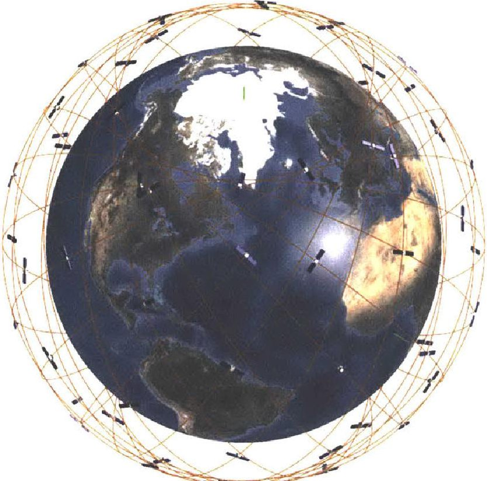

Figure 1. Walker Delta Constellation Configuration, Image Credit: [35], [36].

The Streets of Coverage Pattern, shown in Figure 2, leverages multiple adjacent orbital planes with an equal number of spacecraft evenly distributed in each plane to provide a swath of coverage along the system ground track for which there is continuous coverage. The impact of altitude on system design is clearly demonstrated in this pattern; given that coverage does not vary continuously with altitude, changes to the altitude fundamentally alter the constellation structure [18].

<!-- PDF_PAGE: 27 -->

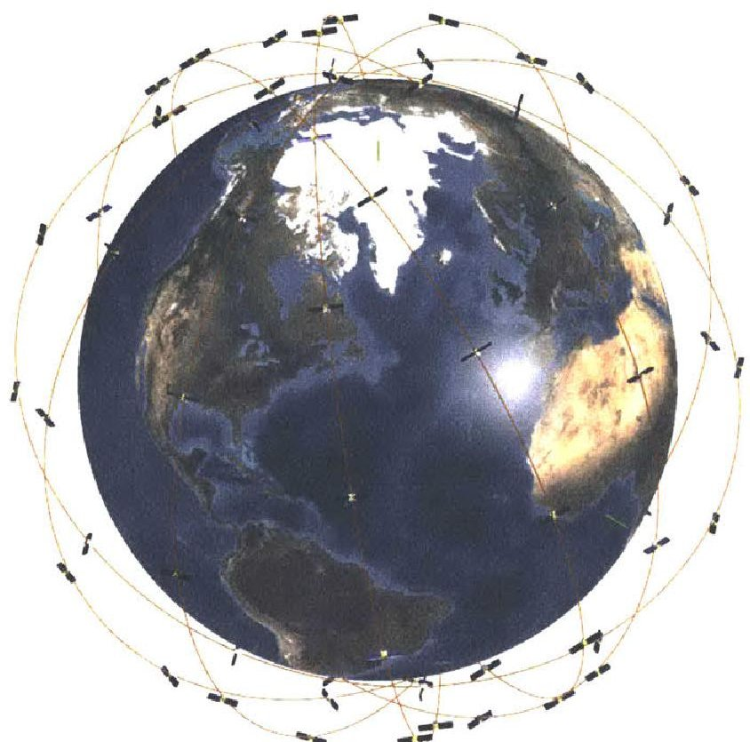

Figure 2. Streets of Coverage Constellation Configuration, Image Credit: [35], [36].

String of Pearls or Train constellations, such as NASA's Afternoon Train as shown in Figure 3, place all member spacecraft in a single orbital plane, either spaced evenly along the orbit or separated by a phasing angle, such that the observations of all spacecraft follow the same ground track [37]. This is particularly valuable when the mission objective requires close-proximity repeat measurements or a series of measurements provided by unique instrumentation onboard different observatories.

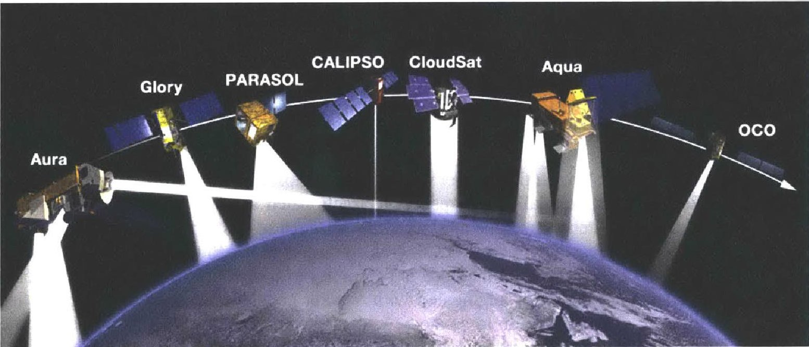

Figure 3. Train Constellation Configuration, as implemented for NASA's Afternoon Train Constellation, Image Credit: [38].

Beyond these established architectures lies a rich research landscape. Prior work on DSMs has examined how to streamline the design tradespace [39]; the use of various techniques, including evolutionary algorithms and collaborative optimization, to identify non-dominated constellation

<!-- PDF_PAGE: 28 -->

architectures [29], [40], [41]; and the reconfigurability of staged-deployment style designs [32]. While the lack of uniformity in constellation mission architecting allows for creativity in the research and design processes, the continued variation reveals that there is no standard for constellation development, and that there is widespread investment in improving the existing solution set.

This lack of standardization produces an inefficiency that has both positive and negative impacts on technology development. Positively, this variation in research interest and proposed development avenues allows the industry to foster growth in a broad range of technical capabilities and avoids prematurely reducing the set of possible outcomes, which could result in the exclusion of innovative, possibly paradigm shifting, design architectures. Negatively, innovation is often expensive, demanding significant investment in research and development efforts. The cost of designing, manufacturing, and implementing a novel system can serve as a barrier to entry, preventing the demonstration of technologies that might offer significant advantages, but seem too risk intensive or implausible during the proposal and selection process. In the longer term, this can prevent new firms from entering the constellation market, particularly if they are unable to secure investor support as they attempt to implement such novel systems. For a sector such as the satellite industry, which is closely related to the growth of the private launch industry, remote sensing data market, and communications infrastructure, among others, a lack of diversity can have significant spillover effects.

## 2.3 Prior Research in DSM Development

As DSMs and constellations have recently drawn increased attention from the space industry, a body of literature is emerging to address whether or not "the time is ripe for this architectural paradigm to emerge as dominant, or whether the industry still faces the conditions that led similar concepts to fail as business propositions in the late 1990s and 2000s" [17]. Recent studies have sought to assess the value proposition of distributed satellite systems for space science [15] and contextualize the history of distributed Earth observing missions [42]. In their 2017 work, Selva et al. examine the factors that lead to the emergence of distributed space mission architectures and propose a research agenda aimed at addressing gaps in the existing literature surrounding DSMs. The authors argue that further research development pertaining to the technical, economic, strategic, legal, and mission concept facets of DSM design is needed before novel, modern DSM architectures can be realized.

Other research has sought to quantify the net value gained or lost by distributing the functionality of a monolithic system, specifically with respect to fractionated spacecraft [43]. Engelen et al. focused specifically on satellite swarms and noted the absence of systems engineering methods that are capable of addressing modern DSM architectures [44]. Although limited in scope, research focused on developing such methods is beginning to take shape. The popular Systems Tool Kit (STK) software has been augmented with Walker constellation modeling capabilities [45], while other research efforts aim to create new, dedicated constellation tools that reflect the emerging design tradespace.

Led by Dr. Jacqueline Le Moigne, researchers at NASA Goddard Space Flight Center (GSFC) have developed a tool, the Tradespace Analysis Tool for Constellations (TAT-C), which allows for pre-Phase A exploration of the constellation design tradespace for Earth science missions (LeMoigne et al., 2016). The software is capable of processing user provided inputs that

<!-- PDF_PAGE: 29 -->

characterize the mission science requirements, defining a set of possible constellation mission architectures, modeling the orbit propagation of each spacecraft to compute system coverage, and providing a pre-Phase A cost and risk forecast for a given architecture. A knowledge base module supports various TAT-C tasks by providing a centralized data repository that can interact with various other modules within the software and provide valuable mission analysis that is readable by both humans and machines. The software is managed by NASA GSFC, with collaborators at the Massachusetts Institute of Technology, the Stevens Institute of Technology, Cornell University, and the Bay Area Research Institute. LeMoigne et al. describe the full capabilities and use-cases of the tool in their 2016 work, and a more detailed journal article is pending. A significant portion of the research in this thesis was conducted in parallel with the development of the TAT-C Cost and Risk Module. Deeper analysis of these concepts is provided in subsequent sections, and the work conducted in support of the TAT-C project was instrumental to the formulation of this research effort. In developing an automated cost and risk framework for early design phase constellation mission concepts, clear gaps between the existing technologies employed for such assessments and the needs of modern constellation mission architects began to emerge.

<table border="1"><tr><td>Paradigm Limitation 2:</td></tr><tr><td>The design tradespace for DSMs is sufficiently large that no standard process for exploring and selecting possible architectures yet exists[18].Furthermore,there are limited tools available to facilitate DSM design and tradespace exploration.</td></tr></table>

<!-- PDF_PAGE: 30 -->

<!-- PDF_PAGE: 31 -->

## 3 Establishing the Second Generation of LEO Constellations

Recent works have shown that the nature of modern constellation missions and proposals has deviated from historical trends [17]. Others have suggested that the rapid increase in ITU filings for large satellite constellations is indicative of a burgeoning 'gold rush' mentality within the space industry [46]. To investigate whether or not these observations are merely anecdotal or representative of a shifting paradigm, this chapter examines the history of DSMs in NonGeostationary Orbit (NGSO) between 1957 and 2017. This contextualization can shed light on the relationships between space technology advancements, economic and policy investments, and the development of modern distributed spacecraft systems.

## 3.1 Developing a Constellation Mission Data Set

One challenge within the existing constellation paradigm is the extent to which these systems are addressed in isolation. While many space object catalogues exist [47] -[49], none of the existing databases actively track whether or not the object is part of a distributed system. This makes researching long-term trends challenging and obscures perspectives on how previous missions have paved the way for contemporary LEO constellations. Therefore, the first step in establishing whether or not the current era is distinct from recent history is creating a data set that can be used to answer such questions.

<table border="1"><tr><td>Paradigm Limitation 3:</td></tr><tr><td>Associations between spacecraft are published in mission specific documentation,rather than formally identified in a comprehensive,readily accessible format.There is not yet a catalogue of DSM missions,which can increase the complexity of trend analysis and contextualization efforts.</td></tr></table>

The United States Federal Aviation Administration (FAA) Office of Commercial Space Transportation (AST) maintains the Space Transportation and Research (STAR) database, which contains detailed information of more than 5,300 launch events and their affiliated payloads [48]. To understand the evolution of constellation systems over time, a complete list of spacecraft launched between October 4, 1957, and December 31, 2017, was generated using the STAR Database. Subsequently, the record was filtered to include only spacecraft that were placed in NGSO, defined as those orbits with an altitude below 35,786 km. This resulted in 6,490 spacecraft, from which 8 were removed for a missing orbital designation. While the focus of this work is on LEO constellations, including systems that extend between Medium Earth Orbit (MEO) and GEO allows for the inclusion of the early Molniya communications satellites that were leveraged during the Cold War and other pre-cursors to the current era of NGSO constellations.

For each of the remaining 6,482 spacecraft, a wide range of data are available within the STAR database, including the payload name, the International Designator (which is also known as the COSPAR identification number), associated system, mass, launch date and type, operator characteristics, mission use category (e.g. communications, scientific, navigation), and orbital parameters, among other fields. Using the COSPAR Identification number for each spacecraft in the record, when available, the data set was supplemented using information from the NASA Space Science Data Coordinated Archive (NSSDCA). These additional data points include the

<!-- PDF_PAGE: 32 -->

NSSDCA mission description, discipline, funding agency, secondary mass estimate, launch vehicle and launch site [47].

A sample data point is provided in Table 2. The resultant dataset provides a comprehensive perspective on NGSO launches for the past 60 years, with descriptions of each spacecraft mission where possible. In instances where a COSPAR ID or mission description was unavailable, additional research was conducted to understand the purpose and nature of the mission in question. A subset of this data is provided in Appendix A. $ ^{1} $

Using this NGSO satellite dataset, each spacecraft can be examined in the context of its associated system designation and assigned constellation, program, or monolithic status. It was assumed that spacecraft with a blank system field or associated with a system that appears only once in the record are individual missions, including both single flight technology demonstrations and monolithic missions. Systems with multiple appearances in the record and NSSDCA descriptions that indicate design or experiment iterations between flights are deemed programs of development or scientific inquiry, rather than distributed spacecraft systems. The remaining systems are then confirmed to be DSM missions and further identified as a constellation, formation flying, series constellation, or ad-hoc constellation system in keeping with the definitions provided in Section 2.1. When the nature of the system could not be determined based on the available information, no DSM affiliation was assigned. A brief summary of this dataset is provided in Table 3.

<!-- PDF_PAGE: 33 -->

Table 2. Sample Data Point from NGSO Constellation Data Set.

<table border="1"><tr><td>Parameter</td><td>Value</td></tr><tr><td>Payload Name</td><td>Aqua</td></tr><tr><td>COSPAR ID</td><td>2002-022A</td></tr><tr><td>System Name</td><td>A-Train</td></tr><tr><td>Launch Date</td><td>2002-05-04</td></tr><tr><td>Number of System Member Spacecraft</td><td>6</td></tr><tr><td>NSSDCA Description</td><td>The Earth Observing System (EOS) is a science and observation program that will provide long-term(15-year)data sets for Earth system science in order to gain an understanding of the interactions between Earth&#x27;s land, atmosphere, oceans,and biology.The EOS is the centerpiece of NASA&#x27;s Mission to Planet Earth(MTPE).The EOS program was restructured in response to direction from the EOS Engineering Review Committee,U.S.Congress,and the EOS Payload Advisory Panel to fly EOS instruments on intermediate-sized and smaller spacecraft instead of on large space platforms.The EOS-PM1 is an afternoon equator-crossing platform which includes a suite of sensors designed to study the diurnal properties of cloud and aerosol radiative fluxes,cloud formation,and precipitation(MIMR,AIRS/AMSU-A/MHS,and MODIS-N)in conjunction with a wind scatterometer planned for the Japanese ADEOS-II spacecraft.MIMR,MODIS-N,and AIRS will contribute to studies of sea-ice extent and heat exchange with the atmosphere.Data from the EOS-PM1 platform and the sensors on the TRMM spacecraft will combined to assess the utility and accuracy of precipitation measurements.MODIS-N and MIMR will allow the mapping of snow water equivalent and the monitoring of variability and change of the climate and hydrological systems.The EOS-PM1 is to be launched using an Atlas IIAS launch vehicle into a polar orbit in2000.</td></tr><tr><td>DSM Classification</td><td>Ad-hoc(International)</td></tr><tr><td>Payload Service Type</td><td>Government Civil</td></tr><tr><td>Orbit Type</td><td>SSO</td></tr><tr><td>Country of Operator</td><td>USA</td></tr><tr><td>Operator Type</td><td>Civil</td></tr><tr><td>Operator</td><td>NASA</td></tr><tr><td>Use</td><td>Remote Sensing</td></tr><tr><td>Mission Discipline</td><td>Earth Science</td></tr><tr><td>Funding Agency</td><td>NASA-Office of Space Science Applications(United States)</td></tr><tr><td>Mass(kg)</td><td>3117</td></tr><tr><td>International Collaboration</td><td>Yes</td></tr><tr><td>Launch Vehicle</td><td>Delta II</td></tr><tr><td>Launch Site</td><td>Vandenberg AFB,United States</td></tr><tr><td>Launch Type</td><td>Non-commercial</td></tr><tr><td>Total # of Payloads per Launch Event</td><td>1</td></tr><tr><td>Orbital Apogee(km)</td><td>687</td></tr><tr><td>Orbital Perigee(km)</td><td>674</td></tr><tr><td>Orbital Inclination(deg)</td><td>98.17</td></tr><tr><td>Orbital Period(min)</td><td>98.36</td></tr></table>

<!-- PDF_PAGE: 34 -->

Table 3. Summary of DSM Dataset.

<table border="1"><tr><td colspan="2">Classification</td><td>Number of Missions Identified</td></tr><tr><td colspan="3">By DSM Type</td></tr><tr><td colspan="2">Constellation</td><td>127</td></tr><tr><td colspan="2">Series Constellation</td><td>67</td></tr><tr><td colspan="2">Constellation Development Mission</td><td>20</td></tr><tr><td colspan="2">Formation Flying</td><td>6</td></tr><tr><td colspan="2">Ad Hoc DSM</td><td>2</td></tr><tr><td colspan="3">By Payload Service Type</td></tr><tr><td colspan="2">Government Military</td><td>95</td></tr><tr><td colspan="2">Government Civil</td><td>80</td></tr><tr><td colspan="2">Commercial</td><td>31</td></tr><tr><td colspan="2">Non-Profit</td><td>16</td></tr><tr><td colspan="3">By Mission Objective</td></tr><tr><td>Original FAA“Use”Classification</td><td>Consolidated MissionObjective Classification</td><td></td></tr><tr><td>Imagery Intelligence(22)</td><td rowspan="4">Intelligence and EarlyWarning</td><td rowspan="4">50</td></tr><tr><td>Intelligence(14)</td></tr><tr><td>Signals Intelligence(11)</td></tr><tr><td>Early Warning(3)</td></tr><tr><td>Remote Sensing(49)</td><td>Remote Sensing</td><td>49</td></tr><tr><td>Scientific(37)</td><td>Scientific</td><td>37</td></tr><tr><td>Development(26)</td><td rowspan="2">Testing and Development</td><td rowspan="2">30</td></tr><tr><td>Test(4)</td></tr><tr><td>Communications(28)</td><td>Communications</td><td>28</td></tr><tr><td>Navigation(19)</td><td>Navigation</td><td>19</td></tr><tr><td>Meteorological(9)</td><td>Meteorological</td><td>9</td></tr><tr><td colspan="3">Total DSMs</td></tr><tr><td colspan="2">All Categories</td><td>222</td></tr></table>

## 3.2 NGSO Spacecraft and DSM Population Growth

The results from this effort illustrate the way that DSMs have evolved over time. Figure 4 and Figure 5 illustrate the growth of the NGSO satellite population and DSM population between 1957 and 2017, respectively. In many cases the specific re-entry date for a spacecraft is not available from either the FAA STAR database or the NSSDCA database. Therefore, these plots account for the total number of spacecraft or DSMs launched over time and do not account for the deorbiting of defunct spacecraft.

Both the spacecraft and constellation populations display a sharp increase in population growth rate during the last decade, which has included the replenishment of many of the telecommunications constellations originally launched in the 1990s and the beginning of the the Planet Inc. remote sensing constellation. Of the 6,482 NGSO spacecraft included in the dataset, 3,585 were found to be members of DSM systems, suggesting 55.3% of spacecraft launched into NGSO between 1957 and 2017 were DSM member spacecraft. This statistic is heavily influenced by the early military adoption of distributed spacecraft systems for reconnaissance missions, many of which involved a series constellation maintaining a photographic record. Excluding those spacecraft identified as having military operators within the STAR database, constellation member spacecraft constitute approximately 46.5% of the total NGSO population in the same 60-year period.

<!-- PDF_PAGE: 35 -->

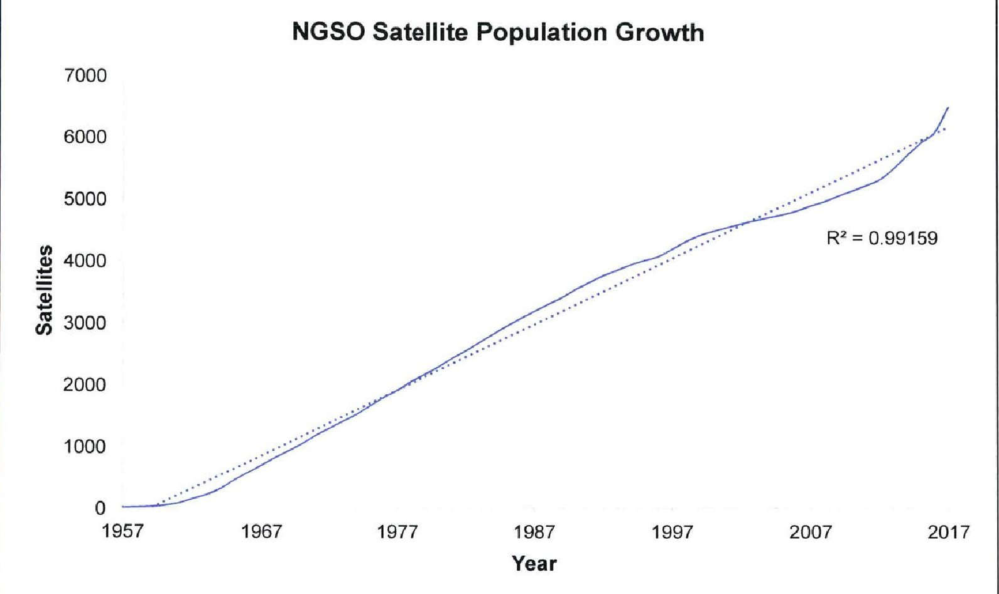

Figure 4. Total NGSO Satellite Population Growth between 1957 and 2017, including individual spacecraft and DSM member spacecraft.

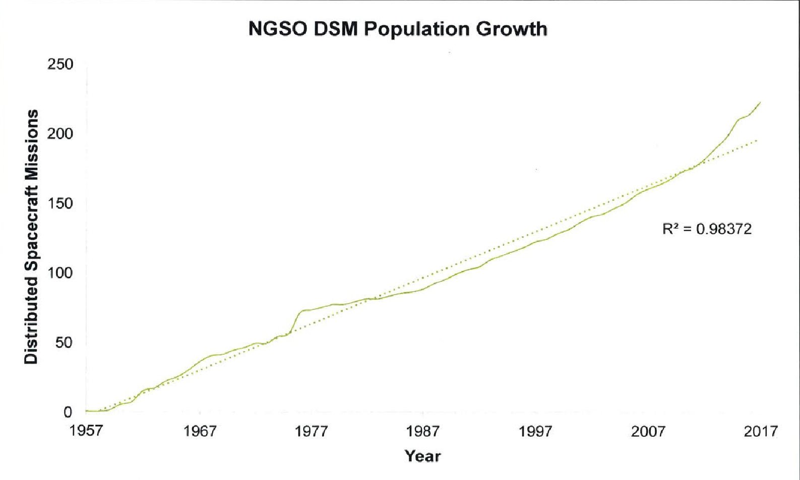

Figure 5. NGSO DSM Population Growth between 1957 and 2017.

<!-- PDF_PAGE: 36 -->

Figure 6 and Figure 7 illustrate the trends in satellite deployment rate during three eras of NGSO constellation development. Spacecraft are assigned to the year in which they launched, and constellations are assigned to the year in which their first member spacecraft was launched. Some constellations, as identified within the data set described in the preceding section, include member satellites with different FAA assigned "use" cases, which is used here to identify the satellite's mission objectives. These assigned use fields have been consolidated into broader categories, as described below, but have not be changed for the sake of reproducibility. Therefore, each DSM mission objective is assigned based on the FAA determined "use" of the first launched member spacecraft.

The first era, spanning 1957 to 1996, includes the systems that preceded the launch of the Iridium constellation, which was the first LEO constellation for communications purposes. These formative systems, particularly series constellations and programs, are precursors to the first-generation of LEO constellations [17].

After Iridium and subsequently Globalstar, which launched in 1998, many additional constellation missions were proposed, marking the advent of the first-generation of LEO constellations. During this period, the satellite industry began transitioning toward NASA's faster, better, cheaper approach, which aimed to "shorten development times, reduce cost, and increase the scientific return by flying more missions in less time" [50]. Many contemporary monolithic missions had become expensive, highly specialized instruments that took years to develop. Concerns emerged that a launch failure could result in the loss of an extreme proportion of an organization's resources, and NASA proposed the faster, better, cheaper strategy, in part, to mitigate some of that risk. Spacecraft during this period generally became less massive, and distributed systems gained support as alternatives to large monolithic missions [17]. Despite this technical advantage, many constellation systems in this era failed to meet their business objectives [17]. Even Iridium, which still serves as a critical component of the global telecommunications infrastructure, initially appeared to be a financial catastrophe for Motorola and was nearly destroyed [14]. The first-generation constellation systems that were successful, however, including Iridium, Globalstar, and Orbcomm, endured and began to showcase the value of distributed mission architectures.

The emergence of the second generation of LEO constellations coincides with the replenishment of the flagship first-generation telecommunications constellations. The second generation of Globalstar spacecraft began launching in 2010, and the data reflect a clear shift in growth rate for both satellites and constellations after 2010. The second generation of LEO constellations coincides with an approximately 189% increase in the total, annual satellite launch rate over the first generation. The number of constellation systems launched each year increases by approximately 92% from the first generation to the second.

<!-- PDF_PAGE: 37 -->

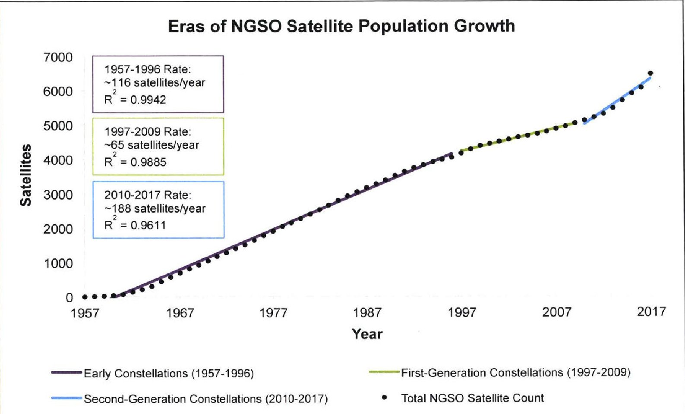

Figure 6. Eras of Total NGSO Satellite Population Growth and Corresponding Growth Rates, including individual spacecraft and DSM member spacecraft.

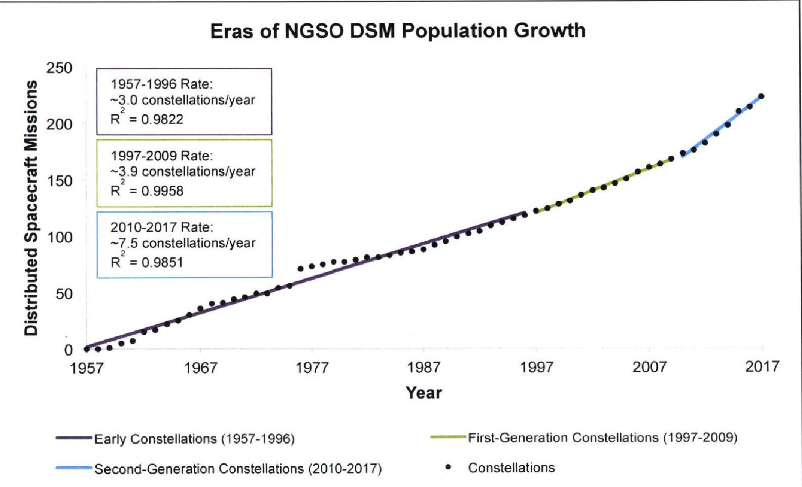

Figure 7. Eras of NGSO DSM Population Growth and Corresponding Growth Rates.

<!-- PDF_PAGE: 38 -->

Within the high-level classification of DSM, the definitions provided in the preceding chapter constitute a set of sub-classifications. Based on the NSSDCA description of each payload within a constellation, a DSM within the dataset has the sub-classification of constellation, series, formation flying, ad-hoc constellation, or a constellation-specific technology demonstration mission. The growth of these types of DSMs is shown in Figure 8 by the number of member spacecraft launched into such systems and Figure 9 by the count of overall DSM architectures.

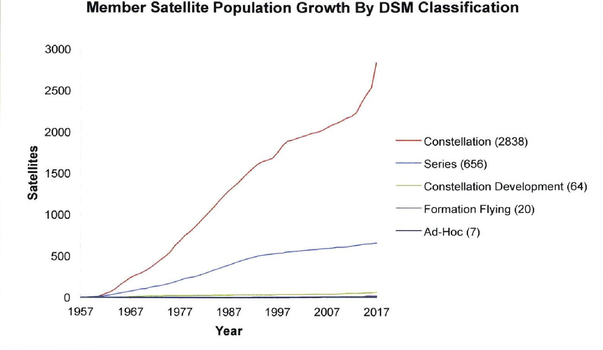

Figure 8. DSM Member Satellite Population Growth by DSM Classification.

Figure 9 shows an increase in the launch rate of constellation development DSMs circa 2008, suggesting the installation of systems that may have paved the way for the beginning of the second generation in 2010. The overall number of constellation missions and the number of member spacecraft in constellation missions rises substantially in approximately 2000 and again in 2010, further suggesting two distinct generations of systems.

<!-- PDF_PAGE: 39 -->

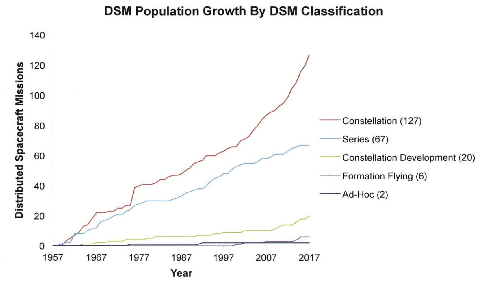

Figure 9. System Population Growth by DSM Classification.

DSM use has been and continues to be dominated by military and government payloads. Figure 10 shows the how the population of unique DSM systems has grown over time, broken down by payload service type. While governments in both civil and military capacities have been using DSM systems since 1959 and 1962, respectively, the first launch of DSM member spacecraft that was both owned and operated by a commercial entity took place in 1991. Appropriately, this launch placed Orbcomm-X into LEO. The spacecraft was a technology demonstration mission for the Orbcomm telecommunications system, and helped pave the way for the first-generation of LEO constellation systems.

Figure 10 reveals the extent to which the space industry is shifting away from the military and government applications and toward commercial and non-profit ventures. The second-generation military and civil government DSM member satellite populations are growing linearly. By contrast, commercial and non-profit mission populations demonstrate exponential growth with time constants of 6.6 and 2.9 years, respectively. These trends are illustrated in Figure 11 and Figure 12.

<!-- PDF_PAGE: 40 -->

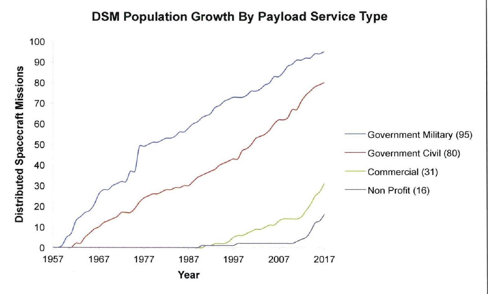

Figure 10. DSM Population Growth Separated by Payload Service Type.

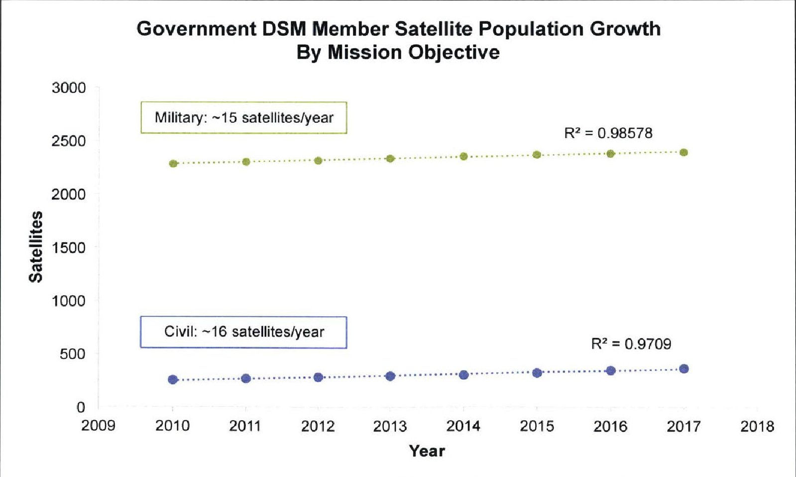

Figure 11. Second-Generation Government DSM Member Satellite Population Growth.

<!-- PDF_PAGE: 41 -->

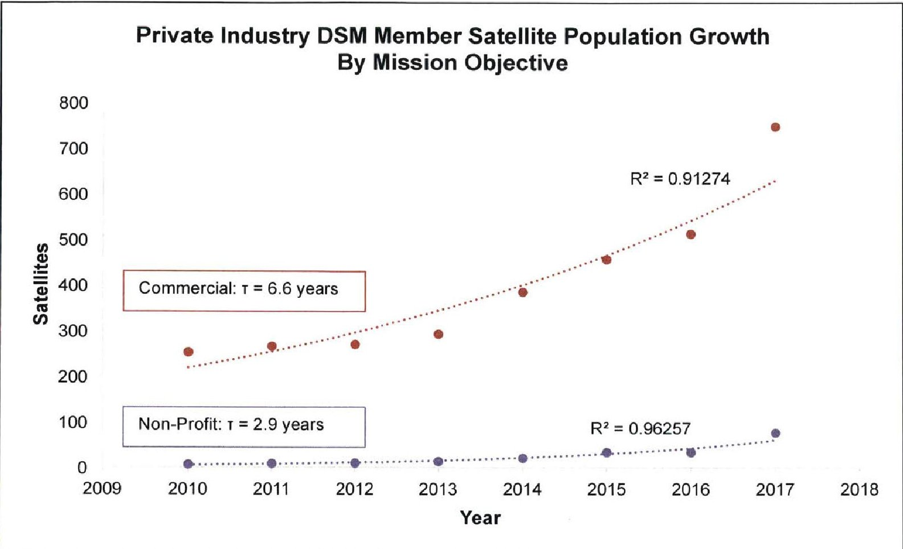

Figure 12. Second-Generation Private Industry DSM Member Satellite Population Growth.

It is also informative to examine the mission objectives of these distributed spacecraft systems. Figure 13 shows the growth of the DSM population in eight distinct mission objective categories (as identified by the mission objective associated with the first launched member spacecraft in the STAR database). Intuitively, intelligence and early intercontinental ballistic missile warning systems are the largest collection of DSMs, and the rise of communications systems throughout the 1990s coincides with the installation of the original LEO telecommunications constellations, such as Orbcomm and Iridium. More strikingly, remote sensing spacecraft, defined as any "civil and commercial system designed to gather data by means of optical (panchromatic, multispectral, or hyperspectral) or radar sensors" [48], have increased rapidly since the mid 1980s, and even more so since the early 2000s. Testing and development constellations, which leverage multiple spacecraft to advance a system or hardware technology readiness level (TRL), are also on the rise, suggesting that multiple spacecraft are increasingly being utilized to develop more sophisticated on orbit technologies that can enable future distributed spacecraft missions. This increase in development spacecraft is also a sign of innovation within the sector and a precursor for increased activity in the future.

<!-- PDF_PAGE: 42 -->

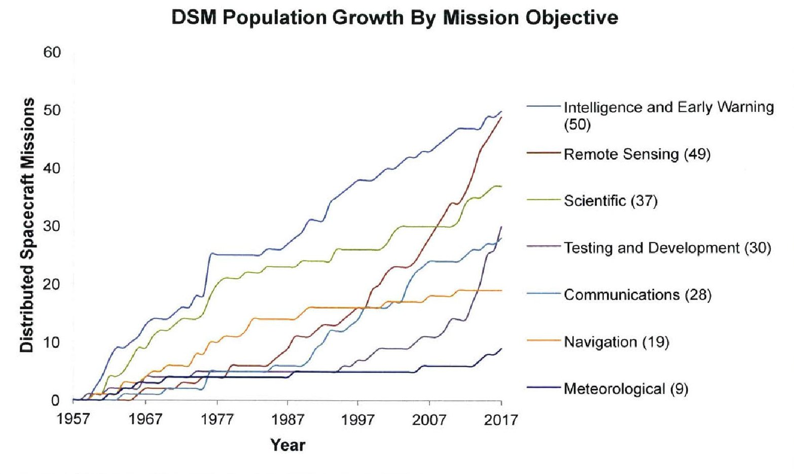

Figure 13. DSM Population Growth Examined By Consolidated Mission Objective.

Considering the individual DSM member spacecraft populations sheds light on the historical investment of various technology sectors in system development. Figure 14 illustrates the population growth of DSM member spacecraft separated by payload service type. Military payloads constitute a majority of DSM member spacecraft launched into NGSO orbit, echoing the DSM population. However, there is some uncertainty within this portion of the data set. Many of the military systems included within this set were determined to belong to DSMs because the mission description, which illustrates the use of multiple spacecraft in support of a common objective, has been de-classified. For more recent systems, which may still be classified such that no mission description is available, a DSM affiliation cannot be assigned.

The shape of the curve depicting the growth of the commercial DSM member spacecraft population in Figure 14 is telling, particularly if the number of spacecraft is considered as a proxy for system performance. This comparison is appropriate because, as described in a previous section, spacecraft within distributed systems contribute to the emergence of system performance, and a greater number of spacecraft indicates the mission owner had an incentive to invest additional resources in expanding the system capability. The commercial population displays two eras of rapid growth. The first, as described above, coincides with the installation of the first global telecommunications systems in the 1990s. Then a period of system maturity is reached, where fewer spacecraft are launched, and fewer additional systems are created, as shown in Figure 13. This pattern of slow early adoption, known as fermentation, followed by a period of rapid performance growth, and subsequently industry stabilization as the entrance of new firms slows is known as the Innovation or Technology S-Curve [51]. When disruptive technologies emerge within the industry, the pattern repeats itself and an additional 'take-off' period is observed, as seen in the commercial DSM member satellite population curve in Figure

<!-- PDF_PAGE: 43 -->

14 during the 2010s. Here, the disruptive element is not only advanced technologies enabling some modern systems, but also the application of existing technologies in new contexts.

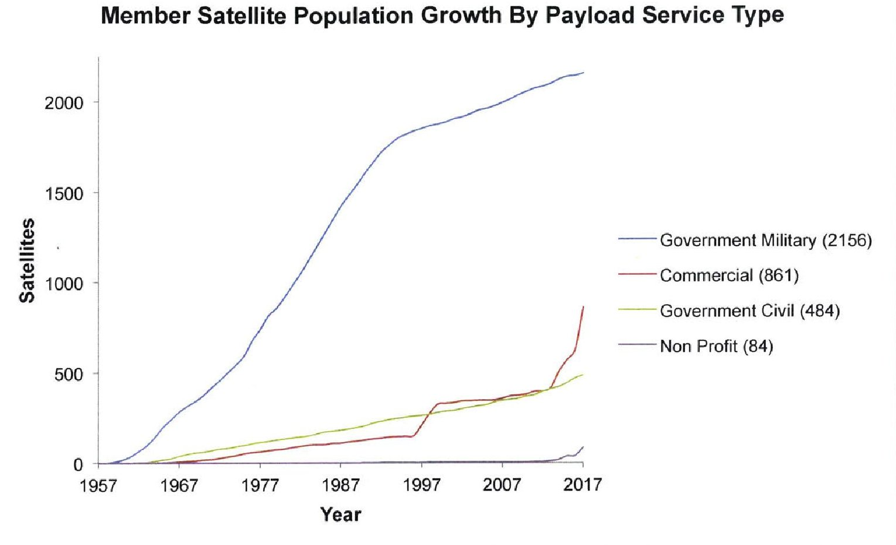

Figure 14. DSM Member Satellite Population Growth By Payload Service Type.

The S-Curve illustrated for the first-generation of commercial, LEO DSM member spacecraft can be quantified by a logistic growth equation; the curve fit for the first-generation data is shown in Figure 15. To illustrate the S-Curve model, this figure includes years prior to and following what has been identified here as the first generation. The logistic growth of the commercial DSM member satellite population is described by Equation 1. This equation indicates that 1997 is the period of most rapid growth and therefore further supports the notion that the first-generation of LEO constellations begins in 1997. As the curve levels off at approximately 354 member spacecraft, coinciding with the 2007 data point, the transition the next generation begins, as seen in Figure 14.

$$
f (n) = \frac {L}{1 + e ^ {- k \left(n - n _ {0}\right)}} = \frac {2 1 9 . 7 7}{1 + e ^ {- 1 . 1 9 \left(n - 1 9 9 7 . 5 9\right)}}
$$

<!-- PDF_PAGE: 44 -->

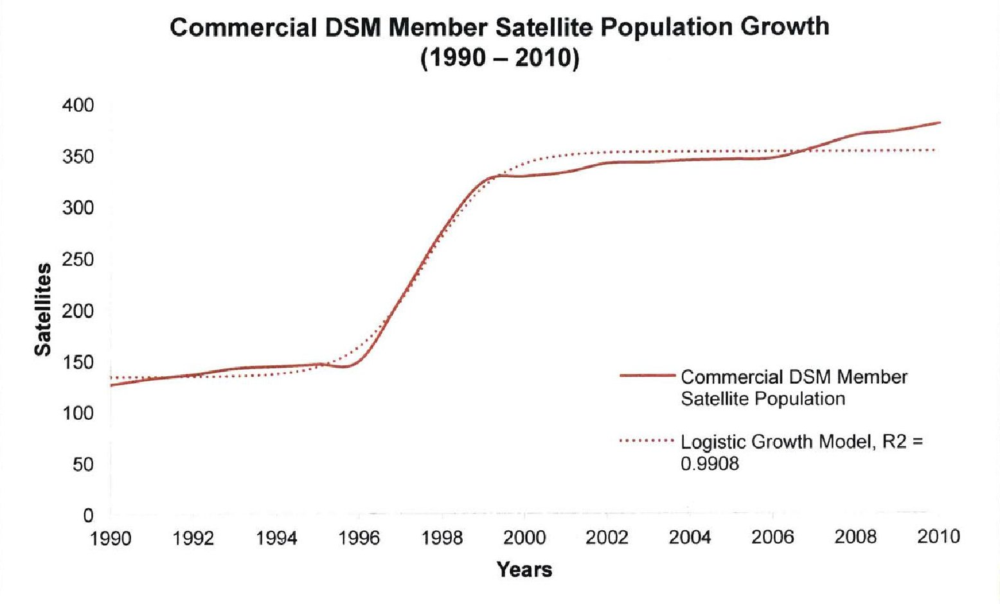

Figure 15. First-Generation, Commercial LEO Constellation Population Growth.

The surge in both constellation and spacecraft launch rates seen in Figure 6 and Figure 7 further suggests that the industry is entering a new technological era. The recent increase in the total number of spacecraft launched per year is not surprising; there is extensive market research both forecasting and confirming this increase [52], [53]. However, the simultaneous increase in the number of constellations is striking, and prior research reports have not specifically examined trends within the constellation population. The concurrent deviation from the linear trend for both the satellite and constellation populations suggest that as more spacecraft are launched, in addition to replenishing established systems, more of these spacecraft are contributing to the development of new constellation systems from which enhanced performance and value can emerge. In fact, the number of constellation member spacecraft launched between 2011 and 2017, relative to the total number of NGSO spacecraft launched, represents more than an 11% increase over the preceding seven-year period, as shown in Table 4.

Table 4. Contribution of DSM Member Spacecraft to Total NGSO Population.

<table border="1"><tr><td>Period</td><td>NGSO Satellites Launched</td><td>Constellation Member Spacecraft</td><td>Constellation Contribution(%)</td></tr><tr><td>2004-2010</td><td>481</td><td>222</td><td>46.2</td></tr><tr><td>2011-2017</td><td>1356</td><td>780</td><td>57.5</td></tr></table>

Finally, Figure 16 shows the growth of the NSGO DSM member satellite population for each of the eight mission objective categories included in Figure 13. The significant rise in the remote sensing population in recent years supports the notion that many emerging DSM firms are

<!-- PDF_PAGE: 45 -->

gathering significant amounts of data, and that their product is not the spacecraft themselves, but rather the data the spacecraft can generate [54]. This notion of a space-based data market is explored further in Chapter 4.

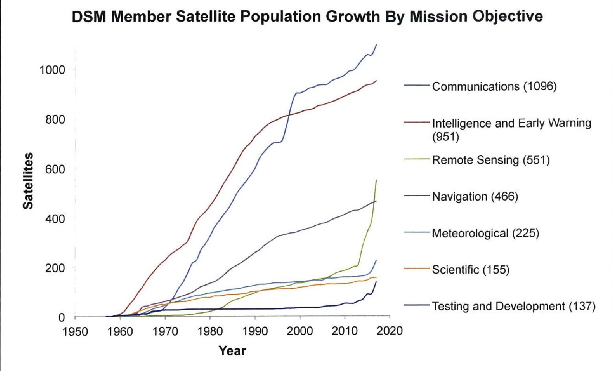

Figure 16. DSM Member Satellite Population Growth By Consolidated Mission Objective.

## 3.3 Second-Generation LEO Constellations

The second generation of DSM systems is dominated by constellation systems, which were defined previously as systems that are designed from their inception to include multiple spacecraft. There is growing industry support for these design efforts. The second-generation LEO constellation population thus far is characterized by an increase in commercial ownership and remote sensing applications, although there is still substantial variety in mission owners and objectives. Moving forward, these data suggest that follow-on and series constellation development is also likely, particularly given the nature of ongoing Earth science research.

An emerging trend of second-generation NGSO constellations is the heavy reliance on small satellites. While larger payloads are by no means becoming obsolete, developments in the realm of small satellite technology have made a noticeable impact on the space industry. Missions such as Planet Inc.'s imaging constellation, the developing OneWeb global Internet constellation, and the CYGNSS remote-sensing constellation are demonstrating the power and flexibility of small satellite constellations. Businesses have been quick to respond to these strengths. The global small satellite market generated more than $2.5 billion in 2016, and further growth is anticipated due to ongoing research efforts in the realm of additive manufacturing and other spacecraft technologies [55]. Many small satellite launch service providers are also entering the private space sector, including mission aggregation services and dedicated launch vehicles. However,

<!-- PDF_PAGE: 46 -->

the dataset does not yet reflect a downward trend in the mass of second-generation LEO constellation member spacecraft. This area will constitute a valuable area for future research, particularly following the launch of many constellations that are currently proposed or in development.

The forecast for near-term constellation development also includes so-called 'megaconstellations,' including hundreds or thousands of spacecraft in a single system. Table 5 summarizes a subset of constellations that have either been proposed or are currently in development $ ^{2} $ , and the percent increase over the LEO population that the individual system would represent if launched in its entirety. To ensure that system data are current, mission owner publications and industry news outlets have been leveraged as much as possible. The LEO population, for purposes of this comparison, is taken to be 1,071 spacecraft, which was the reported total as of August 31, 2017 [49]. It is unlikely that each system in this subset will be fully realized, and some similar systems have already failed. However, the list is also by no means exhaustive and additional systems may be proposed. This rate of growth has implications not only for the safety of these systems and the LEO environment, but also for the commercial space industry and associated markets.

No clear trend is shown by currently available data regarding the size of second-generation systems relative to the previous generation with respect to either mass or number of spacecraft. However, trends in the small satellite industry and recent NGSO system proposals suggest that large constellations of small satellites are generating significant research interest. A 2016 report by the National Academies of Sciences, Engineering, and Medicine Space Studies board argues that the most transformational science in coming decades might be enabled through "constellations of dozens or even hundreds of CubeSats" [11]. This too constitutes a promising venue for future research.

<!-- PDF_PAGE: 47 -->

Table 5. Summary of a Subset of Commercial Telecommunications and Remote Sensing Constellation Proposals.

<table border="1"><tr><td>Constellation</td><td>Number of Constellation Member Spacecraft</td><td>Increase Over Aug.2017 LEO Population(%)</td><td>Status</td></tr><tr><td colspan="4">Commercial Telecommunications</td></tr><tr><td>LeoSat Enterprises[56]</td><td>108</td><td>10.08</td><td>Proposed</td></tr><tr><td>Boeing Phase1[57]</td><td>1396</td><td>130.35</td><td>Proposed</td></tr><tr><td>Boeing Phase2[57]</td><td>1560</td><td>145.66</td><td>Proposed</td></tr><tr><td>OneWeb Phase1[58]</td><td>720</td><td>67.23</td><td>Partially Installed</td></tr><tr><td>OneWeb Phase2[58]</td><td>1260</td><td>117.65</td><td>Proposed</td></tr><tr><td>SpaceX Phase1[59]</td><td>4425</td><td>413.17</td><td>Proposed</td></tr><tr><td>SpaceX Phase2[60]</td><td>7518</td><td>701.96</td><td>Proposed</td></tr><tr><td>IridiumNEXT[61]</td><td>66</td><td>6.16</td><td>Partially Installed</td></tr><tr><td>Sky and Space Global[62]</td><td>200</td><td>18.67</td><td>Proposed</td></tr><tr><td>Spacebelt[63]</td><td>12</td><td>1.12</td><td>Proposed</td></tr><tr><td colspan="4">Remote Sensing</td></tr><tr><td>PlanetiQ[64]</td><td>12</td><td>1.12</td><td>Proposed</td></tr><tr><td>Astro Digital[65]</td><td>30</td><td>2.80</td><td>Partially Installed</td></tr><tr><td>BlackSky Global[66]</td><td>60</td><td>5.60</td><td>Proposed</td></tr><tr><td>Radarsat[67]</td><td>3</td><td>0.28</td><td>Proposed</td></tr><tr><td>Axelspace[68]</td><td>50</td><td>4.67</td><td>Proposed</td></tr><tr><td>Satellogic[69]</td><td>300</td><td>28.01</td><td>Partially Installed</td></tr><tr><td>Spire[70]</td><td>150</td><td>14.01</td><td>Proposed</td></tr><tr><td colspan="4">Table Summary</td></tr><tr><td>Total</td><td>17870</td><td>1668.53</td><td></td></tr></table>

This chapter has established that a second generation of LEO constellations is emerging, characterized primarily by increased growth rates in satellite and DSM populations as well as greater emphasis on private industry constellations. Proposed or developing missions that will launch within the coming years are likely to further show second-generation constellations to leverage a greater number of smaller spacecraft to meet mission objectives, particularly in the realm of space-based Internet and remote sensing. While these trends are not yet showcased within the available dataset, the first-generation systems experienced a seven to ten year lag between proposal and implementation [17]. It is likely that clear trends will emerge for second-generation constellations within the coming decade. Building upon the success of prior distributed spacecraft missions, the new generation will further develop the capabilities of constellation technology. However, as the technology is pushed to edges of the design tradespace and new mission concepts are introduced, the existing development paradigm will be tested; shortcomings, revealed by effectively stress-testing the paradigm in this way, are already beginning to emerge. Identifying and characterizing the challenges this rapidly growing population will face so that they may be adequately addressed is the focus of the remainder of this thesis.

<!-- PDF_PAGE: 48 -->

<!-- PDF_PAGE: 49 -->

## 4 Constellation Enabling Technologies

The demonstrated increase in the number of constellation architectures in the past decade and the number of recent mission proposals suggests that there are underlying technologies in the satellite industry enabling this expansion. Previous research has suggested that modern engineering and programmatic considerations have driven the shift toward distributed Earth observing space systems [17]. This chapter explores constellation related technologies to characterize the technological and economic trends emerging to support the broader constellation industry.

## 4.1 Constellation Technologies Literature Review

Constellation architectures emerged to address a need for improved coverage and re-visit time, and garnered further support as distributed architectures demonstrated shorter development times, lower costs, and decreased risk of obsolescence [71]. To develop and implement DSMs effectively, so that these advantages could be captured, industry investment in supporting technologies was necessary. Increased interest and research in distributed architectures, coupled with a near simultaneous boom in the small satellite industry and NASA's emphasis on 'faster, better, and cheaper' missions fostered development in constellation related technologies in the 1990s and 2000s [17]. This important step forward for constellation architectures was characterized by research in technologies that enable a greater degree of distributed functionality and the maturation of small satellite technologies [17].

## 4.1.1 Distributed Functionality

Many early constellation systems leveraged multiple spacecraft that could be operated independently. Some constellations, such as the Block I GPS constellation, also leveraged intersatellite links that enabled cross-communication between spacecraft [72]. Some of these early constellations constitute "systems of systems", given that member spacecraft fulfill a "valid purpose in their own right and [continue] to operate to fulfill those purposes if disassembled from the overall system" and "are managed (at least in part) for their own purposes rather than the purposes of the whole" [73]. The shift toward distributed functionality has previously been identified as a contributing factor in the growth of DSM systems [17], but also represents a shift away from systems of systems design. Formation flying missions and fractionated spacecraft missions, which began to emerge in the late 1990s and early $ 2 0 0 0 s^{3} $ respectively, necessarily include spacecraft that cannot fulfill their mission objectives without the complete constellation. New technologies capable of supporting these distributed functionality constellation missions may have emerged during this time and spurred growth in these mission categories. Relatedly, this development period coincides with the first-generation LEO systems identified in the previous chapter, and is reflected by the increase in the number of formation flying missions reflected in Figure 9.

Current trends in DSM development suggest that fractionated systems and systems with decentralized ownership may play a critical role in the future of the constellation industry [17]. Federated satellite system (FSS) architectures are those that function by "trading and sharing previously inefficiently allocated and unused resource commodities that are available in space

<!-- PDF_PAGE: 50 -->

assets at any given time," where resources are broadly defined as an commodity that can be shared between spacecraft [21]. By sharing these resources in a cloud-computing style network, proponents of FSS architectures argue that this class of design represents the most efficient form of DSM and could prevent future underutilization of on-orbit assets.

The success of FSS and other novel constellation designs will rely on the maturation of intersatellite link technologies and the capability to coordinate efforts between spacecraft with different communications schemes [21]. Current science data management techniques generally are limited to 10 spacecraft in a given system, but second-generation constellation development will require approaches that can support a greater number of spacecraft, as well as coordinated fleet navigation and autonomous operating principles [11].

Hosted payload architectures, in which instrument owners fly their subsystem by purchasing necessary resources onboard a host satellite, are also gaining traction as an essential DSM technology [17]. Hosted payload missions can range from basic technology demonstration missions to long duration operational systems, and have previously been considered for both government and commercial applications in GEO [74], [75]. LEO applications of this technology, as proposed by the IridiumNext and GEOScan missions [76], [77], could lower the barrier to entry for would-be constellation owners by reducing the cost of constellation implementation. Mission owners could then focus exclusively on science requirements and novel applications of DSM functionality, rather than developing detailed design for a complete constellation.

## 4.1.2 Small Satellites

Small satellites are increasingly being treated as attractive LEO mission solutions, and the maturation of small satellite technologies constitutes an important step forward for DSM architectures [17]. Prior research has argued that the rise of small satellites contributed directly to increased interest in DSMs [78]. However, the term 'small satellite' is somewhat ambiguous, reflecting the growth of the industry over time. Beginning in the 1990s, there is a steady decrease in the mass of Earth observing spacecraft. Driven primarily by the miniaturization of sensor and electronics capabilities, this period of development is often referred to as 'small satellite revolution' [17], [78]. The Aerospace Corporation first developed a dedicated cost modeling tool to address the characteristics of these systems in 1995, and defines small satellites as those with mass below 1000 kg [79]. As these systems have become more commonplace, this mass threshold has decreased. In 2008, Baker and Worden defined it as 750 kg. Most recently, in 2015, NASA has set the threshold at just 180 kg, and further outlined a set of sub-classifications, as shown in Table 6. Cubesatellites are small satellites that conform to a particular form factor, consisting of 10 cubic centimeter units (U) [80].

Table 6. NASA Small Satellite Mass Classifications [80].

<table border="1"><tr><td>Classification</td><td>Mass Range</td></tr><tr><td>Small Satellite</td><td>&lt;180kg</td></tr><tr><td>Minisatellite</td><td>100-180kg</td></tr><tr><td>Microsatellite</td><td>10-100kg</td></tr><tr><td>Nanosatellite</td><td>1-10kg</td></tr><tr><td>Picosatellite</td><td>0.01-1kg</td></tr><tr><td>Femtosatellite</td><td>0.001-0.01kg</td></tr></table>

<!-- PDF_PAGE: 51 -->

Previous work has argued that small satellites can be powerful tools for global coverage in Earth science missions [81]. Others have demonstrated that very small satellites, such as SpaceChips and PCBSats, can "merge the concepts of distributed satellite systems and terrestrial wireless sensor networks" to enable simultaneous multipoint sensing [82]. Industry has similarly seized upon the potential benefits offered by small satellites. The Planet Inc. Earth imaging constellation, which is in many ways emblematic of second-generation constellation systems, consists of 149 small satellites based on the standard 3U configuration [1], [83]. The licensed Telesat Canada NGSO constellation, which plans to offer global broadband services, leverages 117 spacecraft with a mass of approximately 70 kg [84], [85].

Small satellites are less expensive and require shorter development times than larger spacecraft, particularly given the availability of commercial off the shelf (COTS) products [86], [87]. Depending on the mission objectives, small spacecraft can therefore be used to minimize the cost of a constellation mission without sacrificing coverage capability. From a constellation maintenance perspective, this also allows member spacecraft to be replaced quickly and at relatively low-cost, lowering the overall risk sensitivity of the architecture [88]. Short development periods can also allow for design iteration between generations, as demonstrated by the evolving design of the Planet Inc. spacecraft [83].

The National Academies of Sciences, Engineering, and Medicine has noted that cubesatellites in particular are emerging as off-the-shelf platforms that can enable science constellations and formation flying missions: "Constellations of 10 to 100 science spacecraft have the potential to enable critical measurements for space science and related space weather, weather and climate, as well as some astrophysics and planetary science topics. Therefore, NASA should develop the capability to implement large-scale constellation missions taking advantage of cubesats or cubesat-derived technology and a philosophy of evolutionary development" [11]. In support of this recommendation, four technologies have been identified as capable of having the largest impact on science missions: high-bandwidth communications, precision attitude control, propulsion, and miniaturized instrument technology [11].

Recent industry trends echo these conclusions. The small satellite industry is expanding at an unprecedented rate. More than 300 nanosatellites, here defined as spacecraft with mass between 1 and 50 kilograms, were launched in 2017, far exceeding industry projections [89]. Other projections suggest as many as 6200 small satellites will be launched in the coming decade [90]. While enthusiasm for small satellites has been building for decades, recent success has been driven in part by second-generation constellation systems. Planet Inc. built approximately 35% of all nanosatellites launched between 2008 and 2017 [91]. The QB50 academic constellation launched 36 member spacecraft in 2017 [89], and the 2017 State of the Satellite Industry Report, produced by Bryce Space and Technology, also identified constellations of very small, customizable small satellites as a significant driver of recent market behavior [92].

## 4.1.2.1 Advances in Manufacturing

Streamlined manufacturing capabilities for small satellites and cubesatellites will be required to enable constellation systems [11]. The satellite manufacturing industry has traditionally operated with a significant supply and demand imbalance: at times the capacity of the market to produce spacecraft has been insufficient by as much as an order of magnitude relative to anticipated global satellite orders [93].

<!-- PDF_PAGE: 52 -->

Carayannis and Samanta Roy have suggested that the relative immaturity of the industry may be due to the concentration of a few, large firms that have been supported by government partnerships, rather than by demand within the private sector. Their work asserts that a competitive market, including both large and small aerospace firms, will be necessary to sustain the industry and support innovation in small satellite manufacturing [88]. However, recent studies have shown a decrease in satellite manufacturing revenues; global growth in this arena fell 13% between 2015 and 2016 [92]. This was due in part to the decrease in the number of spacecraft launched between those years. A total of 46 cubesatellites were launched in 2016, representing approximately 35% of the spacecraft launched that year but less than 1% of the total value added to the satellite manufacturing industry. Firms such as Planet Inc., SpaceX, and OneWeb have invested in their own, dedicated satellite-manufacturing facilities, creating assembly line type processes that will yield hundreds or thousands of spacecraft [94], [95]. Such facilities reduce cost and allow for iterations between design, both of which are critical to constellation success [94], but do not necessarily result in manufacturing sector growth.

Different facets of the satellite industry are tightly coupled, and recent losses in the manufacturing sector have also been attributed, in part, to the bottleneck in immediately available launch services [92]. In their 2016 report, the National Academies also concluded that advances in both manufacturing and launch would be required to enable future cubesatellite constellations [11].

## 4.1.2.2 Launch Opportunities

Launch manifesting for constellation missions focuses on three main questions [96]. The first investigates the sequence in which the member spacecraft must be placed in orbit. The second focuses on the strategy of launching multiple payloads, either on a single vehicle or through multiple launches. The third, predicated on the second, evaluates the number of spacecraft that should be placed on each launch vehicle. Extensive research has been conducted regarding the nature of the constellation deployment problem. Cornara et al. have outlined an approach to constellation launch manifesting that considers deployment and replacement strategies [96], and de Weck et al. examined how this method changes with respect to reconfigurability requirements [32].

Small satellite constellation development has suffered from a lack of small satellite launch vehicles. Smaller spacecraft often join launch manifests as secondary payloads, limiting their control over orbital placement and launch schedules. Mission aggregators, such as Spaceflight Industries, have addressed this need somewhat. In 2017, the Indian Space Research Organization (ISRO) set a record by launching 104 satellites with a single flight of their Polar Satellite Launch Vehicle (PSLV) [97]. By distributing the cost among several payloads, secondary and aggregated launch opportunities offer small satellites orbital access at "lower total expense than an independently commissioned launch" [78].

As commercial companies have shown more interest in small satellites and constellations of small satellites, a demand has emerged for dedicated small satellite launch vehicles. As of 2017, at least 33 launch vehicles with a total LEO capacity of less than 500 kg were under development [92]. While the cost per kilogram of these vehicles is relatively high compared to larger launchers, they provide schedule and orbital control to what would otherwise be secondary payloads. These launch opportunities will be critical to the development of second-generation

<!-- PDF_PAGE: 53 -->

constellations, particularly for very small member spacecraft, as "constellations launches are most likely to occur in dedicated vehicles" [11].

## 4.2 Patent Landscape

Patent data has been established as a "valuable resource for the analysis of technological change" and can be used as a proxy measurement for research and development activities over time [98]. Subsequent research has concluded that patent family data, which covers all continuing and closely related patent applications, is a better unit of analysis for studying technological research and development, because "all patents in the same family are essentially from the same R&D (or related) project, even though the application or grant years vary" [99]. Therefore, to characterize the timeline of constellation-related R&D efforts, a survey of the associated patent families is provided here.

Patent data for this discussion is sourced from the PatSnap database, which includes more than 127 million patents from more than 60 national patent databases and that of the World Intellectual Property Organization. From this database, a dataset of all patents associated with the Cooperative Patent Classification (CPC) designation for "Swarms and Constellations," B64G1/1085, can be generated [100], consisting of 1,418 patents in 345 simplified patent families. The CPC scheme was developed jointly by the European Patent Office (EPO) and United States Patent and Trade Office (USPTO), combining the practices of both offices; it has been in effect since 2013 and was applied retroactively to existing patents within these systems. Notably, this system has not been applied comprehensively to Chinese patents, and so the following discussion is missing data regarding Chinese development. According to a 2013 Memorandum of Understanding signed between the EPO and the Chinese State Intellectual Property Office (SIPO), China will apply the CPC system comprehensively to all patents from January 2016 onward [101]. The International Patent Classification (IPC), which is used in conjunction with the CPC scheme, does not have a specific satellite constellation designation, but addresses "Artificial satellites" and "systems of such satellites" in its designation B64G 1/10 [102]. Because the CPC designator allows for a more targeted evaluation of the patents pertaining to satellite constellation systems, it is the focus of the following discussion.

<!-- PDF_PAGE: 54 -->

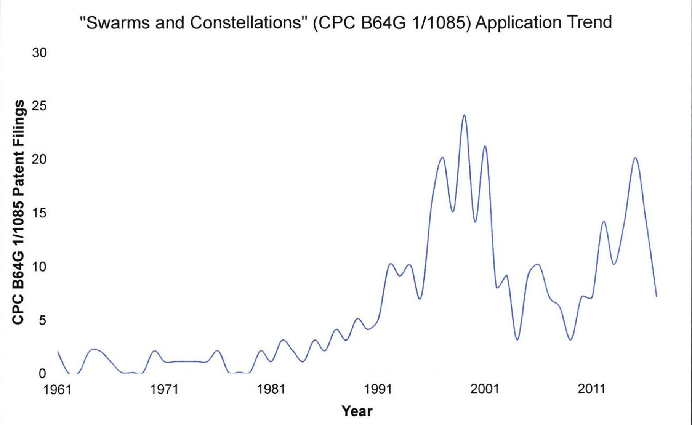

Figure 17. CPC B64G 1/1085 Patent Trend, by Application Year.

Figure 17 illustrates the growth of satellite swarm and constellation patent applications over time. There is a distinct rise in applications leading into both the first and second generations of LEO constellations signaling investment in intellectual property protections during these boom periods. This further suggests an increase at least in the perception of, if not the true, system value and profitability. Figure 18 and Figure 19 illustrate the top 10 patent assignees for B64G1/1085 associated applications filed during both the first and second generations. There is a significant diversification of the type of patent assignees moving from the first to the second era, as well as a redistribution of investment between countries, as shown Table 7.

Table 7. Allocation of Satellite Constellation Patents by Assignee Type.

<table border="1"><tr><td>Assignee Type</td><td>First-Generation</td><td>Second-Generation</td></tr><tr><td>Commercial Entity</td><td>100.00%</td><td>75.00%</td></tr><tr><td>University</td><td>-</td><td>12.50%</td></tr><tr><td>Government Agency</td><td>-</td><td>6.25%</td></tr><tr><td>Individual</td><td>-</td><td>6.25%</td></tr></table>

<!-- PDF_PAGE: 55 -->

Top 10 First-Generation Satellite Constellation Assignees

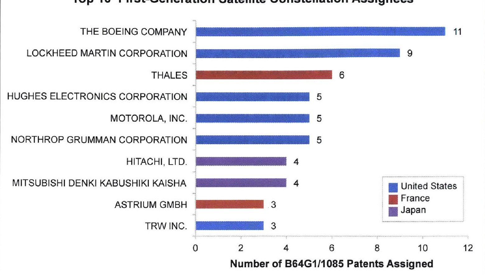

Figure 18. Top First-Generation LEO Satellite Constellation Patent Assignees.

Top 10 Second-Generation Satellite Constellation Assignees

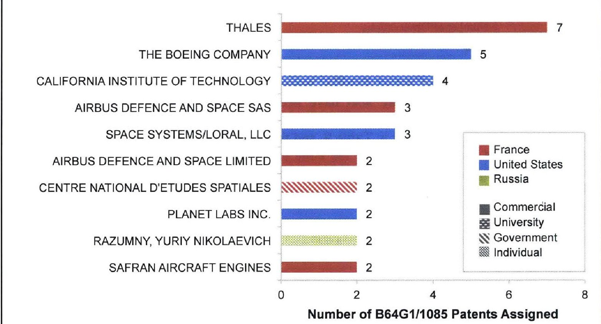

Figure 19. Top Second-Generation LEO Satellite Constellation Patent Assignees.

<!-- PDF_PAGE: 56 -->

To investigate the extent to which patent filings in the "Swarms and Constellations" CPC subclassification are indicative of growth in the actual satellite constellation population, a simple linear regression analysis is presented. The model presented here treats the rate of the change of the constellation population as the dependent variable, and the number of patent filings in each of the preceding 5 years as the dependent variables. Patent filings three years prior are associated positively correlated with the rate of change of the constellation population to a statistically significant degree, as shown in Table 8. This delay somewhat intuitively corresponds to the average development cycle for a commercial satellite system [103], suggesting that satellite constellation technology patents are likely filed early in the development process, as systems are being designed and implemented within the population at the conclusion of the development cycle. While intuitive, this result indicates that patent filings in this area may be a valuable indicator for portions of future demand within the launch market.

Table 8. Impact of Patent Filings on Constellation Population Growth.

<table border="1"><tr><td>Independent Variable</td><td>Rate of Change, Coefficient(Standard Error)</td></tr><tr><td rowspan="2">Swarms and Constellations Patents Filed OneYear Prior</td><td>0.009</td></tr><tr><td>(0.045)</td></tr><tr><td rowspan="2">Swarms and Constellations Patents Filed TwoYears Prior</td><td>0.053</td></tr><tr><td>(0.050)</td></tr><tr><td rowspan="2">Swarms and Constellations Patents FiledThree Years Prior</td><td>0.113*</td></tr><tr><td>(0.052)</td></tr><tr><td rowspan="2">Swarms and Constellations Patents Filed FourYears Prior</td><td>0.060</td></tr><tr><td>(0.052)</td></tr><tr><td rowspan="2">Swarms and Constellations Patents Filed FiveYears Prior</td><td>0.036</td></tr><tr><td>(0.049)</td></tr><tr><td>Number of Observations</td><td>51</td></tr><tr><td>Note</td><td>$\cdot$ p&lt;0.05</td></tr></table>

Each of the 345 simplified patent families associated with the "Swarms and Constellations" (B64G1/1085) classification may also have been filed with one or more additional CPC affiliations. The 10 CPC sub-classifications most frequently associated the swarms and constellations dataset are defined in Table 9, and their representation within the parent set of 345 patent families is summarized within the table as well. The growth of these additional subclassification filings, again as subsets of the swarms and constellations dataset, is illustrated in Figure 20.

<!-- PDF_PAGE: 57 -->

Table 9. Top 10 Additional CPC Patent Classifications Associated with B64G1/1085 Patent Filings.

<table border="1"><tr><td>CPC Classification</td><td>Number of Patents within B64G1/1085 Dataset</td><td>Percent of B64G1/1085 Patents that also have this designation</td></tr><tr><td>Orbits and trajectories (B64G1/242)</td><td>176</td><td>50.87%</td></tr><tr><td>Communications satellites, communication aspects (H04B7/185)</td><td>130</td><td>37.57%</td></tr><tr><td>Launch systems (B64G1/002)</td><td>65</td><td>18.79%</td></tr><tr><td>Non-synchronous stations (H04B7/195)</td><td>63</td><td>18.21%</td></tr><tr><td>Interstage or payload connectors (B64G1/641)</td><td>48</td><td>13.87%</td></tr><tr><td>Earth observation satellites (B64G1/1021)</td><td>46</td><td>13.29%</td></tr><tr><td>Dispensers for arranging multiple satellites in a single launcher (B64G2001/643)</td><td>43</td><td>12.43%</td></tr><tr><td>Arrangements or adaptations of apparatus or instruments, not otherwise provided for, for use in satellites (H01Q1/28), (B64G1/66)</td><td>40</td><td>11.56%</td></tr><tr><td>Orbit transfer (B64G1/007)</td><td>38</td><td>10.98%</td></tr><tr><td>Guiding or controlling apparatus, e.g. for attitude control (B64G1/24)</td><td>32</td><td>9.25%</td></tr></table>

Some of these technologies closely echo the constellation enabling technologies identified within the 2016 National Academies report described in the preceding section. Again, these four key technology areas are high-bandwidth communications, precision attitude control, propulsion, and miniaturized instrument technology [11]. Communications affiliations are represented in approximately 19% of the filings, captured by sub-classification H04B7/185. Notably, this classification count rises rapidly during the first-generation of constellation systems, which was characterized in part by the implementation of the original telecommunications constellations. The recent increase in the number of these filings relative to constellation systems further supports the National Academies conclusion. Attitude control technologies, represented in approximately 5% of the filings, are captured by sub-classification B64G1/24. These have demonstrated more linear growth, and show a general trend of relevance to constellation development, rather than spikes during specific development periods. Propulsion, captured here as orbit transfer capability for cosmonautic vehicles, is represented in approximately 6% of filings as affiliation with sub-classification B64G1/007. This sub-classification has also demonstrated growth that appears linear, although the recent growth rate is increasing. Miniaturized instrument technology parallels the sub-classification B64G1/66, which is applied to patent filings that address arrangements or adaptations of apparatus or instruments not otherwise provided for in satellite use. The sharp increase in this category demonstrated in Figure 4 corresponds to the period in the late 1990s often referred to as the "small satellite revolution" [17].

Beyond the technology spheres identified within the National Academies report, these associated sub-classifications also reveal a common filing association between satellite constellation patents

<!-- PDF_PAGE: 58 -->

and architecture development efforts, including orbits, trajectories, and non-synchronous stations. Orbits and trajectories patents, designated by sub-classification B64G1/242 dominate the illustrated dataset, demonstrating two sharp increases in filing rate that correspond to the beginning of the first and second LEO constellation generations. Earth observation systems are affiliated with approximately 7% of constellation patent filings, captured as classification B64G1/1021, and demonstrate a significant increase beginning in 2011. This corresponds to the beginning of the second generation of LEO constellations and the Planet Inc. imaging constellation, which triggered a great deal of interest in the remote-sensing capabilities of small satellite constellations. Recent demand for remote sensing data products, as discussed in the following section, may play a critical role in this facet of future constellation development. The final category of technical innovation highlighted here is launch services, including: launch systems, payload dispensers tailored for aggregate launches, and payload connectors. This final category in particular supports the notion that launch needs for constellation systems are different than those for monolithic missions. Dispensers for arranging and deploying multiple spacecraft on a single launch vehicle will be essential tools for adapting existing launch capabilities to smaller spacecraft. Given recent trends in small satellite development, this trend of may be an area of interest for future work.

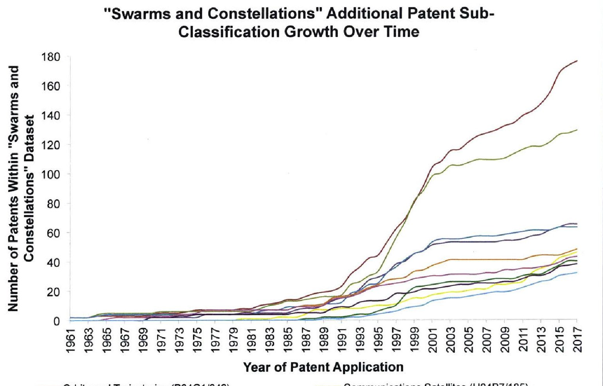

Communications Satellites (H04B7/185)

Non-Synchronous Stations (H04B7/195)

Earth Observation Satellites (B64G1/1021)

Arrangement/Adaptations of Instruments (B64G1/66)

Attitude Control Apparatus (B64G1/24)

Figure 20. Sub-classification Affiliation Growth within Swarms and Constellations Dataset.

<!-- PDF_PAGE: 59 -->

## 4.3 Enabling Constellation Demand

The previously outlined technologies have served to enable the development of second-generation constellation systems from a supply perspective. From the demand perspective, constellation missions tap into the momentum exhibited by other 'big data' industries, presenting a new perspective on space-based data products and services.

An extremely wide range of market applications is emerging for constellation based data sets. Prior research has suggested that modern Earth observing systems constitute disruptive technologies that are likely to endure even in the face of uncertainty regarding their future industrial, technical and political structure [104]. Citing private investment and the falling cost of orbital assets, a 2017 study suggests that space-based data will be applied to a wide range of industries in the coming decades [90]. Advances in artificial intelligence and satellite remote sensing capabilities, particularly in high resolution Earth imagery, have implications for geospatial analytics, such as retail store management [90], [105], [106]. Some reports suggest that the use of satellite data may even surpass that offered by Unmanned Aerial Vehicles (UAVs) for precision agriculture applications [107]. A number of commercial systems are also emerging to address gaps in current weather forecasting techniques [11]. Other system concepts may address the passive connectivity needs of Internet of Things (IoT) technologies [108].

Government agencies may also benefit from this trend, which could allow them to purchase data rather than build space systems and collect the data independently. Remote sensing systems, which are becoming more popular as second-generation LEO constellations, are an ideal candidate for this type of exchange between the public and private sectors. NASA posted a request for information (RFI) in December 2017, soliciting capability statements from small satellite constellation owners that are interested in selling remote sensing data to the agency [109]. The development of low-cost space systems and small satellites, which has contributed significantly to the rise of second-generation LEO constellations, is already playing a role in promoting space-based data as an essential component of the global 'big data' economy [54].

Infrastructure applications of satellite systems have also incentivized second-generation constellation systems. Global broadband services, such as those planned by OneWeb, SpaceX, and Telesat Canada, among others could provide unprecedented connectivity to remote parts of the world, offering particularly significant benefits to developing nations [110]. Details regarding the four constellations that have been granted operating licenses by the FAA are available in Chapter 6. Other space based infrastructure investments are targeting tracking capabilities provided by ADS-B compatible systems and could enable greater situational awareness in applications such as aircraft monitoring [111]. Constellation systems are also emerging as potential tools for disaster response, enabling rapid revisit time and information availability at times when terrestrial infrastructure may be inoperable [112].

The landscape is varied, but as the industry finds new ways in which space systems can support terrestrial productivity, investment in and demand for constellation systems is likely to continue [90]. Broadly, this suggests that second-generation constellations are likely to become critical components of today's sociotechnical environment.

<!-- PDF_PAGE: 60 -->

## 4.4 Regulatory Considerations

Second-generation constellations present innovative opportunities for growth but have also rapidly revealed the limits of the existing policy framework, creating a unique technology policy challenge. To foster continued growth in the constellation industry, technologists and regulators must come to a consensus regarding the needs of second-generation systems and what policies can efficiently address those needs. Recent events have emphasized the need for policy-centric discussions in the realms of spacecraft licensing, launch services, and orbital debris.

## 4.4.1 Spacecraft Licensing

Globally, the International Telecommunications Union (ITU) manages satellite licensing and radio spectrum allocation for orbital assets. The ITU is also responsible for assigning orbital slots in GEO, as availability in the orbit is inherently limited. Requirements mandating that spacecraft be separated by a minimum of 2 degrees to prevent accidents and interference further reduces the number of GEO stations [113], [114]. In the United States, the Federal Communications Commission (FCC) is responsible for implementing ITU regulations and authorized to issue licenses for communications "to and from the United States or any U.S. satellite" [115]. Orbital slots in LEO are not assigned as they are in GEO, and therefore the FCC is responsible for assessing the relative safety of proposed orbital systems. This includes regulating spacecraft radio spectrum use and determining whether a proposed satellite system poses an excessively high tracking or collision risk to other orbital assets [108].

## 4.4.1.1 Spectrum Allocation

The ITU and its national counterparts allocate spacecraft use of radio spectrum between spacecraft to avoid operational interference, both between multiple spacecraft on orbit and between spacecraft and terrestrial systems. In 1994, the FCC issued a spectrum sharing order known as the "Big LEO Order" to facilitate use of electromagnetic spectrum for mobile satellite systems operating in NGSO [116]. This order restricted the use of the 1610-1626.5 MHz and 2483.5-2500 MHz bands to NGSO spacecraft systems, with certain provisions. Subsequent rules issued by the FCC allowed for the use of Ancillary Terrestrial Components (ATCs), which supplement orbital services with ground-based networks as necessary, and for further development of spectrum allocating regulations.

Modern constellation proposals have highlighted the need for advanced coordination efforts that build upon the prior FCC framework regarding spectrum allocation. NGSO constellations applying to the FCC for operating licenses must not only detail their planned spectrum use, but also provide documentation proving the system will not interfere with terrestrial systems operating in nearby frequencies. Especially as Internet of Things (IoT) proposals leveraging LEO constellations continue to develop, revision to existing protocols may be an important facet of ensuring system success and maintainability [117].

## 4.4.1.2 Orbital Slot Assignment

When placement conflicts arise between proposed LEO spacecraft system operators are largely left to resolve the issue independently. For example, Boeing submitted a request in June 2016 for permission to implement a network of as many as 2,956 satellites [118]. The constellation, which would be installed in two phases, also aims to offer global Internet services and was originally designed to operate at the same 1,200 km altitude as the OneWeb constellation. However, in March 2017, the two companies announced an agreement that lowers the Boeing constellation

<!-- PDF_PAGE: 61 -->

considerably, aiming to alleviate some pressure on space traffic management resources. The proposed solution would place the Boeing satellites in orbits at 1082 km, 1,030 km, and 970 km [119].

The recent unauthorized launch of four Swarm Technologies spacecraft onboard an Indian Polar Satellite Launch Vehicle (PSLV) illustrates a way in which the existing licensing regime may be vulnerable. In April 2017, Swarm Technologies submitted an application for a launch license for four spacecraft, each approximately one-quarter of the size of a traditional 1U cubesatellite [108]. The application stated intent to place the spacecraft onboard a January 2018 PSLV launch. In December 2017, the FCC denied Swarm Technologies' request for experimental authorization to launch their "SpaceBees" spacecraft on the grounds that the spacecraft are "below the size threshold at which detection by the Space Surveillance Network (SSN) can be considered routine" and that it would not be possible to "assess the need for and plan effective collision avoidance maneuvers" [120]. Despite this, the SpaceBees were launched onboard the named 2018 PSLV flight [108], [121]. The FCC quickly issued an enforcement advisory in response to the unauthorized SpaceBees launch [115] and revoked permissions for a planned Swarm Technologies launch [108]. The launch has raised questions about the responsibility of launch providers to ensure relevant payloads are appropriately licensed and what enforcement capability is available to regulators. Shortly after the FCC publicly addressed the unauthorized launch, a panel of New Space industry leaders was asked at the MIT New Space Age Conference about their perspective on Swarm Technologies' choice. Broadly, the panel consensus indicated that the existing regulatory scheme is only effective if all stakeholders work to preserve its validity.

There are "no domestic or international norms on maneuverability or the ability to track or deorbit CubeSats or other satellites. Neither are there any agreed-upon norms as to how CubeSat constellations will be designed, manufactured, deployed, or operated (beyond what is the case for all satellites), domestically or globally" [11]. Moving forward, small satellite technologies and constellations may drive the need for new policy discussions.

## 4.4.2 Launch Services

As discussed in Sections 4.1.2.2 and 4.2, the private launch services industry has undoubtedly played a role in the emergence of second-generation constellations. Private launch service providers have been one of the dominant forces behind the interest in commercializing access to LEO, capitalizing on the lack of government owned launch vehicles that have emerged since the end of the Space Shuttle Program. However, as private firms make progress, regulatory questions remain. Even the Space Shuttle, which was undoubtedly a tremendous technical achievement, has been treated as an example of policy failure, given that the program did not meet the original cost and launch rate objectives [122]. Future launch policies must strike a delicate balance between public and private development, cost and risk, innovation and flight heritage. As the number of private launch service providers increases, commercial launch policy must account for both national security interests and market objectives.

The US Federal government's role with respect to the commercial launch market is twofold: it functions as both a regulator and customer. American access to space is essential to a wide range of critical industries and services, including national defense, finance, telecommunications, and GPS navigation. Consequently, there is an inherent need for the government to ensure American access to LEO. Therefore, the government has a regulatory incentive to support private industry

<!-- PDF_PAGE: 62 -->

and foster growth. This is particularly clear from the perspective of the dual assured access to space policy that exists for national security payloads [123].

On the other hand, if the private industry develops into a truly competitive market, the government can benefit from lower launch costs and a wider range of performance capabilities. In a small market with few launch service providers, this second objective can contradict the first. Policy that governs market development is therefore going to be instrumental in defining the resources available to serve government needs in the coming years. Recent legislation has directed the Department of Transportation, which oversees launch licensing through the FAA, to monitor industry progress in voluntary standard setting, as well as other Congressional directives [124]. Industry self-regulation can play a valuable role in developing manageable standards in technical fields. This concept is explored more specifically in Section 4.4.3.1, as it pertains to orbital debris.

## 4.4.3 Orbital Debris

An earlier version of the work within this section was published in the conference proceedings of the 2017 American Institute of Aeronautics and Astronautics (AIAA) SPACE Exposition and Forum [125]. Since its original publication, the concepts have been revisited and the conclusions refined.

A key technology policy issue facing second-generation LEO constellations is how constellation systems can operate safely within the LEO environment. Even though accidents in space are extremely rare, second-generation LEO constellations are fueling the question of orbital debris management. The following discussion pertains to the regulatory issues surrounding orbital debris. A technical discussion of the risk orbital debris poses to LEO constellations is offered in Chapter 6.

The orbital debris policy problem is two-sided. Technologists and regulators must ensure that orbital debris does not threaten the success of constellation systems. At the same time, they must also safeguard the LEO environment against any undue risks that might be introduced by modern constellations. Regulatory capabilities exist to address both of these perspectives, but second-generation systems are pushing the limits of the existing regulatory framework. Future systems may include an unprecedented number of member spacecraft or very small, difficult to track spacecraft, or a combination thereof. This creates an interesting dilemma. Insufficient regulation could result in degradation of the LEO environment, but excessive regulation could hinder commercial development. Balancing these competing needs through effective technology policy will be essential to second-generation LEO constellation success.

The notion of orbital debris is widely accepted by spacefaring nations to describe non-functional spacecraft and spacecraft fragments, but there is some ambiguity embedded within this definition. Most of the policy discussion surrounding the classification of an object as orbital debris emphasizes the lack of functionality of the object. However, nations may disagree as to the true meaning of 'functional,' which leaves room for future disagreement, particularly with regard to active debris removal (ADR) techniques. Debates could stem from the concept of spacecraft salvage value, degraded operating capability, or operations beyond the end of a planned mission lifetime. Furthermore, many ADR technologies also have clear applications as

<!-- PDF_PAGE: 63 -->

anti-satellite tools, and widespread research in this arena has generated substantial debates over topics including the militarization of space and international collaboration, among others [126].

To illustrate what existing framework is in place and offer a starting point for future discussion in this arena, a brief overview of the debris relevant portions of major space policy agreements is provided below.

The fundamental space policy agreement is the "1967 Treaty on Principles Governing the Activities of States in the Exploration and Use of Outer Space, including the Moon and Other Celestial Bodies," known more commonly as the Outer Space Treaty. The legal framework it sets forth could serve as a basis for addressing issues of orbital debris, but the document does not account for debris mitigation efforts specifically [127]. Other scholars have argued that the legal obligations laid out within this document are insufficient for the evolving orbital debris challenge [128].

Article VI of the Outer Space Treaty states that each signatory nation is responsible for its activities in space. Activities conducted either by the state itself or any nongovernmental entities based in that state are classified as the legal responsibility of the launching state's government. The article further states that nongovernmental organizations require authorization and continued supervision by the appropriate national regulatory agent. This provision suggests that any satellites launched by a national government or a private entity headquartered in a given nation are the legal responsibility of the country from which the satellite originated, as are the activities associated with that satellite, including launch, mission operations, and end of life behavior. End of life behavior could encompass debris generation, and therefore activities that have a high potential to produce orbital debris could be regulated pursuant to Article VI.

Article VII of the treaty states that all signatories will be held internationally liable for "damage to another State Party to the Treaty or its natural or juridical persons by such object or its component parts" [129]. Article VIII holds that the launching authority, regardless of the object's presence in space or reentry status, retains the ownership of an orbital object. This has two implications. The first pertains to whether another country can treat a nonfunctional spacecraft as debris without consent of the launching state. Under this consideration, even after a satellite reaches the end of its mission life and even without further operational value or control capability, it remains the property of its originator and responsibility of the launching state. This could have significant implications for any ADR efforts pursued without broad international support [130]. The Convention on Registration of Objects Launched Into Outer Space, which entered into effect in 1976, provides a method by which nations can notify the UN Office for Outer Space Affairs (OOSA) of a change in operational status of a given space object [130], and therefore may be an appropriate basis on which to build a formal classification and notification scheme for orbital debris. Such a framework might allow an object to be de-orbited by a state other than the launching state or provide an arena for ownership transfer. The second implication pertains to collision responsibility if the orbital object can be definitively linked to a given nation. Even if an object is defunct or not being actively tracked by the host nation, its ownership is not affected. While these provisions do not state that a signatory nation is liable for damage caused by its orbital property to other orbital assets, it may serve as a basis for future legal work in this realm.

<!-- PDF_PAGE: 64 -->

Activities with high potential for orbital debris generation may possibly be further regulated under Article IX of the Outer Space Treaty, which requires signatories to conduct research in outer space and on celestial bodies in a manner that "avoid[s] their harmful contamination" [129]. The article continues that signatories shall consult the international community if a planned activity would cause "potentially harmful interference" with the activities of other nations or their ability to pursue the exploration and use of space. This places regulators at an important intersection. Activities that could promote economic growth in one country, may threaten the future space activities of another if the debris from the former cannot be sufficiently mitigated. A threshold for 'sufficient' mitigation, however, may be difficult to define, and this area is ripe for future research, particularly regarding the actions of highly-developed national space programs and their relationships with emerging space-nations.

The "1972 Convention on International Liability for Damage Caused by Space Objects" [131], known as the Liability Convention, has also been previously examined as a possible basis for the formation of a debris regulation regime [127].

The Liability Convention "imposes upon a launching state absolute liability for damage caused by its space object on the Earth or to aircraft in flight" and a space object is defined as "component parts of a space object as well as its launch vehicle and parts thereof" without regard to the component's functional state [131]. This has direct legal implications for pieces of orbital debris, but the Liability Convention does not clearly indicate which actor is at fault if the damage caused by a component part is inflicted in orbit. If a re-entering piece of debris causes damage to an airborne or ground based asset, the launching nation bears responsibility, but fault or legal responsibility for collisions that occur in space, especially without detailed behavioral characteristics of each object prior to the collision, would be more difficult to assign. The 1995 Interagency Report on Orbital Debris, produced by the United States National Science and Technology Council Committee on Transportation Research and Development, suggests that a form of tort law might be appropriate in this case, but would require the definition of a negligence standard that could classify whether control efforts made by the launching state were reasonable to prevent the collision [131]. However, further complications could arise pertaining to the ability of the damaged spacecraft's governing authority to prove a given claim, especially if the collision involves a small piece of orbital debris of unknown provenance. Even very small pieces of debris can cause substantial damage to on-orbit assets [132]. Given these complexities, a purely punitive and reactive legal approach is not likely to be sufficient moving forward as a mitigation strategy.

In 1999, the United Nations published a Technical Report on Space Debris, outlining shielding and collision avoidance strategies, and offered an assessment of the effectiveness of those measures. The report acknowledges that some voluntary mitigation measures implemented in the early 1980s began to successfully reduce the debris population. Early mission design that accounts for debris mitigation and de-orbit planning, as well as the limitation of upper stage explosions (e.g. controlled stage de-orbit burns or explosion prevention measures for stages and/or defunct spacecraft with remaining fuel) could be effective in addressing long term orbital debris generation concerns [133]. However, such design efforts are expensive, both through the cost of the design effort and the portion of reserve fuel that must be kept to properly de-orbit a launch vehicle upper stage following payload deployment or a spacecraft following the end of its

<!-- PDF_PAGE: 65 -->

mission lifetime. In the latter case, this fuel could directly impact the lifetime of the spacecraft by limiting the number of station keeping maneuvers the satellite can execute. Further concerns exist surrounding the reliability of spacecraft that incorporate such efforts, given that they will have low flight heritage and limited capacity for on-orbit testing.

These cost and risk considerations give rise to a "tragedy of the commons" situation, in which there are significant costs borne by the first actor to take steps to protect or improve the environment, while the benefits are shared by all, and so there is limited incentive for any one individual to take the first step toward a solution [134]. It is clear, as recommended by the UN Technical Report and US Interagency Report, among others, that the solution to the orbital debris problem must be an international one. Efforts are already being made to coordinate initiatives between the United States and China, both of which are major contributors to the number of objects in Earth orbit and which met in June and October of 2016 for workshops on orbital debris and collision avoidance [135], [136].

Many space-faring nations have already outlined preliminary standards for orbital debris mitigation, but a formal, international agreement does not yet exist. Recent efforts that have addressed strategies for orbital debris mitigation directly, include the 2017 "NASA Procedural Requirements for Limiting Orbital Debris and Evaluating the Meteoroid and Orbital Debris Environments" and the 2010 "United Nations Space Debris Mitigation Guidelines of the Committee on the Peaceful Uses of Outer Space" [137], [138]. The NASA procedural requirements are mandatory and offer insight into NASA's plan to mitigate the United States contribution to the orbital debris population, however assessing the effectiveness of these requirements will take time. Furthermore, recent European Space Agency (ESA) estimates suggest that approximately 40% of low orbiting satellites do not comply with existing IADC orbital debris mitigation guidelines [119].

<table border="1"><tr><td>Paradigm Limitation 4:</td></tr><tr><td>International agreements do not comprehensively address how space-faring nations should protect other state&#x27;s orbital assets or the orbital environment or from space debris generated by their efforts. Similarly,the existing framework does not address legal obligations for responding to debris generation events such as anti-satellite tests or collisions.</td></tr></table>

## 4.4.3.1 Value of Self-Regulation

Given that the IADC has no binding authority with which to implement or enforce mitigation standards, and that there is not yet international consensus regarding regulatory frameworks, many constellation operators are developing their own standards. Each NGSO constellation operator must submit an orbital debris mitigation plan to the FCC as part of their operating license request, and these mitigation efforts are beginning to expand to a form of industry selfregulation. OneWeb has openly stated that the IADC regulations are not stringent enough, suggesting that satellites should be required to de-orbit within five years or one times their mission lifetime, whichever is shorter, following their retirement, as opposed to the existing IADC requirement of 25 years [119]. The agreement reached between Boeing and OneWeb, described in Section 4.4.1, is another example of industry coordination to prevent collisions and mitigate orbital debris risk. In its technical attachment to its FCC licensing application, SpaceX states an intention to implement their planned constellation according to the mitigation

<!-- PDF_PAGE: 66 -->

recommendations set forth by NASA and the USAF, "typically choosing the more restrictive of the two and, where deemed applicable, choosing a more restrictive value than either reference due to the scope of the project" [139].

New companies are entering the market in response to the emerging need for active debris removal. Astroscale, a debris removal start-up based out of Singapore, has specifically cited the emergence of mega-constellations as a key component of their business case [140], [141]. Once a constellation is in place, a number of those satellites, five to ten percent by Astroscale's estimation, may become inoperable before the planned end of mission [141]. Astroscale's ADR spacecraft could be launched responsively to remove the defunct spacecraft, possibly accompanying a replacement spacecraft on a targeted launch vehicle [140]. In an interview with SpaceNews, Astroscale's Chief Operating Officer said this operating scheme can provide "more mission assurance for these companies in question and for the rest of us who are using the orbital environment" [141].

There is a clear dedication by industry leaders to mitigate debris risk, illustrating support within the space industry for the kind of corporate responsibility that is becoming more common within today's global economy. Proponents of self-regulation argue that voluntary standards are easier to implement that traditional industry regulatory requirements, while critics point to the lack of enforceability as detriment to the credibility of such regulatory efforts [142]. However, industry self-regulation has previously been considered as a valuable method for building industry consensus prior to the implementation of government standards [142]. This perspective could prove particularly valuable in the emerging debate surrounding orbital debris and tend toward long-term enforceability. Prior work has argued that the private sector may benefit significantly from establishing a set of common guidelines that can be translated into a certification system. In addition to drawing on the technical expertise of a wide range of actors at various stages of development, this approach "would have the further benefit of directly involving commercial space operators in the establishment of orbital debris mitigation standards, at a time when the space industry is poised to transition into a more market-oriented model" [127]. This is an ongoing area of debate and research facing the second generation of LEO constellations, and one that is likely to becoming more pressing as more constellations are implemented.

A coordinated effort including both the private and public sectors to address international debris mitigation standards could offer significant advantages in the coming years and should be a critical component of future orbital debris policy.

## 4.4.4 International Collaborations

There is some precedence for the use of multinational Earth science constellations in facilitating both research and cooperation. The Afternoon Train, focused on studying various aspects of Earth's climate, has included seven satellites since the launch of the first member spacecraft in 2002, and NASA, JAXA, and CNES have all played critical roles in developing and managing the constellation. Some spacecraft within the constellation have also been collaborative efforts, but as NASA notes, the true value of the constellation derives from the complete system: "The real advantage of constellation flying... is that the data from the various satellites are synergistic and can be combined together to allow for even more comprehensive studies of climate" [143].

<!-- PDF_PAGE: 67 -->

Based on the constellation dataset discussed in the previous chapter, it is possible to examine the characteristics of internationally developed constellation missions. Again, using the NSSDCA description and relevant literature, a mission is identified as part of an international constellation if it was developed collaboratively by two or more countries. There is inherently some uncertainty within this classification effort, further illustrating the need for such data to be tracked in a formalized manner.

From the dataset, 22 constellation systems are identified as internationally collaborative efforts, consisting of 91 total member spacecraft. The relative distribution between international constellations and unilateral constellations is shown in Figure 21. The percentage of systems for each mission objective is calculated relative to the total system population. For example, the percentage of communications constellations operated as part of an international effort is shown relative to 22 total systems. Internationally developed systems are focused to a greater extent on scientific, remote sensing, and testing spacecraft, relative to unilateral constellations. The widespread applicability of the data produced by such missions for a common good could increase their appeal as collaborative efforts.

Relative Distribution of Constellation Member Spacecraft By Mission Objective

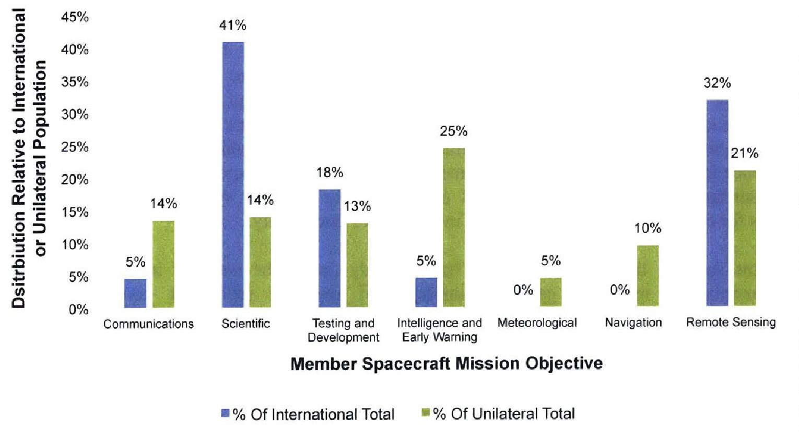

Figure 21. Relative Distribution of Constellation Member Spacecraft By Mission Objective.

Evidence of collaboration in intelligence missions is an unexpected result of this research, but stems from the close relationship between space-based imagery and a wide range of applications. In keeping with the methodology described in Chapter 3, constellations have been assigned to the mission objective associated with their first launched spacecraft. The 5% representation shown here comes from the classification of the first satellite in the Chinese Ziyuan series constellation, which is classified within the FAA STAR database as an Imagery Intelligence

<!-- PDF_PAGE: 68 -->

mission. The series constellation mission included six member spacecraft operated by commercial entities and was linked to the development of the CBERS series constellation, which was developed jointly by China and Brazil to monitor environmental and vegetation conditions [47]. This mission may be more suitably classified in this context as remote sensing (as are later launches within this series), but again, the data has not been changed from the original FAA designation to allow for reproducibility.

Given recent advances in low-cost small satellites, Earth science constellations represent a unique platform for international collaboration that includes emerging space nations seeking to foster program growth. Since its inception in 1998, the International Space Station (ISS) has represented a monumental feat of engineering and international collaboration. With the space station as a shared objective, the 15 partner nations that have supported its development have shaped technical innovations and global space policies. The extent to which it was conceived, financed, and operated as an international effort offers unique perspectives that can be leveraged in future Earth science missions. Those perspectives can offer guidance for future Earth science satellite constellations, which can similarly offer wide-reaching international benefits.

The Intergovernmental Agreement (IGA), four Memoranda of Understandings (MoUs), and several bilateral Implementing Arrangements facilitated development of the ISS [144]. Collectively, this documentation represents a unique legal framework designed to facilitate technical coordination between partner nations and simultaneously allow for long-term system evolution [145]. The agreement includes a number of sections that extend naturally to constellation systems, particularly Article 9, "Utilization"; Article 10, "Operation"; Article 14, "Evolution"; Article 15, "Funding"; Article 16, "Cross-Waiver of Liability'; Article 19, "Exchange of Data and Goods"; Article 23, "Consultations"; and Article 24, "Space Station Cooperation Review." Broadly, these sections outline a scheme for coordination between countries with distinct technical capabilities and best practices, while allowing for appropriate deference to the partner nation's requirements for technical data exports. By identifying avenues for coordination and establishing legal protections for inherent system risk, the framework allows for complex system development in the face of uncertainty.

Systems such as the Afternoon Train have already paved the way for international system implementation, requiring careful planning and member spacecraft coordination. One simplifying advantage of these systems is the ability to launch and implement member spacecraft without physically mating spacecraft, reducing the need for hardware interface design. However, constellations may require greater analysis of the intellectual property and data rights that emerge from the implementation of multiple member spacecraft. Furthermore, the question of follow-on collision liability in the event that two member spacecraft collide and generate a significant debris cloud is not provided for within Article 16. This is a key risk facing constellation missions, as discussed in Chapter 6, and warrants further consideration by technologists and policy makers.

## 4.5 Technology Development and Policy Conclusions

Recent technological developments have played a critical role in enabling the advent of second-generation LEO constellations. Distributed functionality and small satellites are emerging as key areas of constellation technology research, and the current patent landscape shows an increased rate of growth of intellectual property for constellation orbit and trajectory design, Earth-

<!-- PDF_PAGE: 69 -->

observing satellites, and adaptations of technologies for use on constellation member spacecraft. As these technical capabilities have expanded, so have the challenges facing policy makers. There is a diverse range of potential regulatory issues emerging for second-generation constellations. The authorities for these areas are decentralized, which has made coordination thus far difficult, especially with respect to international issues such as orbital debris mitigation. Failure to adequately address the policy needs of second-generation constellation enabling technologies, including the high-level management of system architectures, could limit development. However, the regulatory needs of the current industry may be well served by innovative policy solutions that encourage international coordination and private sector participation. Public-private partnerships constitute a meaningful opportunity to balance both regulatory needs and competitive preferences of commercial entities and warrant further research.

<!-- PDF_PAGE: 70 -->

<!-- PDF_PAGE: 71 -->

## 5 Constellation Cost Estimating

Persistent concerns regarding NASA's budget and the profitability of commercial space ventures make accurately forecasting a design's cost, and similarly its propensity for cost growth, an industry wide concern. In many ways, the cost estimate is as essential to developing a mission concept as the technical facets of the design. Detailed cost estimates are required of any mission proposal submitted to NASA, and there are a wide variety of cost estimating tools available for mission managers [19], [146]. Despite their longstanding history, constellation missions present a unique set of challenges to cost estimators, and an industry wide consensus regarding the nature of constellation costs does not yet exist [6], [19].

In 2011, Wertz, Everett, and Puschell suggested that constellations are most often used for communications, navigation, or similar missions with a global scope "because constellations are inherently very expensive" and as such require a large market to offset their expense [18]. Notably, the authors acknowledge the Defense Advanced Research Projects Agency (DARPA) project System F6 Program as a contemporary example of multiple spacecraft being used to minimize system cost and vulnerability. However, System F6, which sought to distribute the functionality of a single monolithic spacecraft across several smaller satellites, was canceled in 2013, despite DARPA's approximately $226 million investment between 2006 and 2012. At the time of the cancellation, DARPA leadership suggested that further funding could not be justified absent a clear business case for developing heterogeneous, fractionated space missions [147]. By contrast, the 2017 National Academies of Sciences, Engineering, and Medicine Decadal Survey for Earth Science and Applications from Space study report suggests that satellite constellations, as well as smaller spacecraft, could be "an efficient pathway to technological development" given current cost considerations [148]. These contrasting statements illustrate an ongoing debate surrounding the cost and relative value of constellation missions. Constellation cost estimate reliability is critical to the success of future LEO constellations, particularly as the second generation of distributed systems is emerging. The NASA Cost Estimating Handbook captures this theme well: "Resources are increasingly scarce, and space systems are increasingly expensive. Informed decisions are critical" [149].

## 5.1 Constellation Cost Estimating Literature Review

An earlier version of the work within this chapter was presented at the 2016 American Institute of Aeronautics and Astronautics (AIAA) SPACE Exposition and Forum in Long Beach, California [19].

## 5.1.1 Cost Estimating Process

Producing a cost estimate for any proposed space system, monolithic or distributed, is one of the first steps toward assessing design viability. Accurate cost estimating is essential to project acquisition and subsequently to project management processes. Cost estimates are major components of system design reviews and must be presented at each Key Decision Point (KDP) before a program can move into the next development phase. The process is iterative in practice, with estimates often being repeated and refined as systems mature and additional data becomes available [149].

The work breakdown structure (WBS) provides a hierarchical representation of all deliverables required to meet the project objectives and serves as the foundation of the cost estimate [13]. System requirements are used to develop a WBS that accounts for all of the work content to be

<!-- PDF_PAGE: 72 -->

contributed by all performing project stakeholders. The WBS should completely capture the efforts necessary to complete a project, and therefore work not accounted for within the WBS is not included in project cost estimates. While an industry wide WBS does not exist [18], there is a standard WBS template for Levels 1 and 2 of all NASA space flight and technology projects; lower levels of the WBS allow for the inclusion of greater detail, such as unique development efforts and mission specific implementation characteristics. The NASA space flight project template is reproduced as Figure 22. Complete descriptions of the Level 2 elements, shown in blue in the figure, and the associated lower-level work products are available within the NASA Work Breakdown Structure Handbook, Appendix C [150].

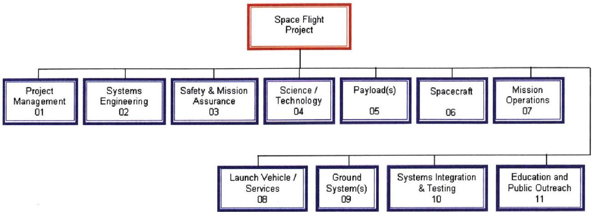

Figure 22. NASA Space Flight Project Work Breakdown Structure Template, Levels 1 and 2, Image Credit: [150].

There are three primary methods of cost estimation: analogy, parametric, and engineering build-up, all of which rely on the WBS to develop an assessment of project cost. The chosen methodology must be appropriate for the phase of development and availability of technical data, and as such certain approaches may be more appropriate than others at a given point in the project lifecycle [149]. A brief description of each method and its appropriate realm of application are provided in the following sections. The initial cost estimate may be refined throughout the program lifecycle to reflect design changes, known spending from earlier development phases, or more detailed estimates for manufacturing or operating costs. It is therefore not uncommon for cost estimators to use a combination of methodologies over the course of a project, either to validate an existing estimate or revise prior work.

Cost estimates are expressed in terms of lifecycle cost, recurring, and nonrecurring costs. Lifecycle cost is used to describe the total cost for all phases of a mission from concept development to decommissioning [149]. Recurring costs include those development costs that are necessarily incurred more than once, such as the materials and labor required to manufacture flight hardware and integrate the flight system, as well as launch and orbital operations expenses. Recurring costs decrease as multiple units are produced, because subsequent units benefit from the experience gained during the production of their predecessors. Nonrecurring costs include those development costs incurred only once, such as designing, testing, and qualifying a flight system, as well as the cost of ground support equipment and spacecraft refurbishment, if necessary [18]. These costs are incurred only once, regardless of the number of units produced.

<!-- PDF_PAGE: 73 -->

## 5.1.2 Cost Estimating Methodologies

## 5.1.2.1 Analogy Cost Estimating

Analogy cost estimating relies on known cost data for a similar, previously fielded space system as a starting point for a new project's cost estimate [149], [151]. The existing mission, referred to as the Basis of Estimate (BOE), provides historical context for the developing mission and is chosen to reflect a similar mission objective or level of complexity. The cost estimate is developed by considering costs known for the BOE and increasing or decreasing them relative to anticipated expenditures for the mission of interest. This method can be useful early in the design process when limited details regarding the implementation of a mission are known. The analog mission can help cost estimators capture the impact of unique facets of mission design or management practices, which might be obscured otherwise, and in such cases the analogy method can produce a more accurate result than other cost estimation techniques [151]. This is particularly useful if the mission of interest falls into a unique subset with only a few comparable predecessors.

A key disadvantage of analogy costing is that the method is subjective and the quality of the estimate depends largely on the expertise of the cost estimator. If a close analog mission cannot be identified, this method may rely too heavily on assumptions made by the estimator, making the estimate difficult to reproduce or defend during the mission review process [149]. The human element of analogy cost estimating, presented in both the experience of the cost estimator and of the chosen analog, introduces an element of uncertainty that makes this method somewhat less favored as the design matures and distinguishes itself from the analog. Analogy costing is therefore most appropriate in early phases of the mission lifecycle, such as mission concept development and preliminary design, and can provide a valuable cross-reference during the later, detailed design process [149].

## 5.1.2.2 Parametric Cost Estimating

Parametric cost estimation leverages a large historical dataset to develop statistical cost estimating relationships (CERs) that forecast mission cost based on known mission parameters. While CER development is a time-intensive and expensive process in and of itself, regression efforts typically reveal a set of key design parameters that drive many aspects of mission cost, known as cost drivers. These independent variables characterize the design and most significantly impact the project budget [18], [149].

Parametric costing is a particularly effective method when few design variables are known, and the methodology offers the added advantage of statistical estimates of uncertainty. Similar to the analogy method described above, this method is appropriate during early phases of design, but extends more reliably to later phases of development and design-to-cost trade studies than analogy costing. Parametric cost estimating is highly repeatable and requires minimal additional assumptions to be made. Parametric estimates withstand scrutiny well, as long as the model is applied appropriately [149]. Beyond the range of accepted inputs, parametric models quickly lose their predictive capability, and so model inputs must be carefully documented and reviewed to trace potential sources of uncertainty. An important assumption embedded within each parametric model is that the trends and market pressures that have affected past missions will continue to impact future missions. CERs must be updated to reflect shifts within the mission

<!-- PDF_PAGE: 74 -->

design and management paradigms, and separate models must be developed for distinct mission classes.

Table 10 presents a summary of some widely accepted parametric cost models, addressing a wide range of space mission applications, system architectures, and performance objectives. Cost estimating methodologies generally arise to meet a need created by changing technological trends. The advent of small satellites in the mid 1980's contributed to the development of the Small Satellite Cost Model [79]. As project intricacy has increased with greater technological capability in recent decades, efforts have been made to develop complexity-based cost estimating relationships (CCERs), which enable mission stakeholders to consider schedule and cost as part of the design process [152]. The models in Table 10 therefore reflect the industry perspective on space mission cost estimating in recent decades, to some extent. A constellation specific parametric cost model has not yet emerged, but the case studies within this chapter can provide insight as to why such a model is necessary.

Table 10. Existing Parametric Cost Estimating Tools Summary.

<table border="1"><tr><td>Name</td><td>Developer</td><td>Original Release Date</td><td>Most Recent Release Date</td><td>Scope</td><td>Availability</td></tr><tr><td>Unmanned Space Vehicle Cost Model (USCM)[153][153]</td><td>Telecote Research for the US Air Force, Space and Missile Systems Center</td><td>1969</td><td>June 2015</td><td>Unmanned, earth orbiting spacecraft; does not include launch vehicles</td><td>Public</td></tr><tr><td>Small Satellite Cost Model (SSCM)[79]</td><td>Aerospace Corporation</td><td>1995</td><td>January 2015</td><td>Earth orbiting or near planetary spacecraft with mass&lt;1000kg; dataset is restricted to post-1990 missions</td><td>Public</td></tr><tr><td>Constructive Systems Engineering Cost Model (COSYSMO)[154]</td><td>Massachusetts Institute of Technology and University of Southern California</td><td>2005</td><td>2009</td><td>Systems engineering efforts for large scale systems (hardware and software)</td><td>Public</td></tr><tr><td>NASA Instrument Cost Model (NICM)[155]</td><td>NASA Cost Analysis Division and Jet Propulsion Laboratory</td><td>2007</td><td>Spring 2014</td><td>CERs for specific types of instruments; found to be low fidelity for Explorer-class missions4</td><td>Access through NASA ONCE Portal</td></tr><tr><td>NASA Instrument Cost Model for Explorer Class Missions (NICM-E)[155]</td><td>NASA Cost Analysis Division and Jet Propulsion Laboratory</td><td>Spring 2014</td><td>Spring 2014</td><td>Instruments intended for flight on Class C missions, with substantial university or research foundation involvement, and significant design heritage</td><td>Access through NASA ONCE Portal</td></tr></table>

<!-- PDF_PAGE: 75 -->

<table border="1"><tr><td>Project Cost Estimating Capability(PCEC)[156]</td><td>NASA Headquarters and Marshall Space Flight Center</td><td>May 2014</td><td>August 2016</td><td>All elements of the NASA Work Breakdown Structure as defined in NPD 7120.5E; carries forward select elements of NAFCOM</td><td>Public</td></tr><tr><td>Mission Operations Cost Estimating Tool(MOCET)[157]</td><td>Aerospace Corporation and NASA Science Office For Mission Assessments</td><td>Released within ONCE Portal</td><td>Released within ONCE Portal</td><td>Phase E mission costs; planetary, Earth science, near Earth orbiting missions</td><td>Access through NASA ONCE Portal</td></tr><tr><td>Aerospace Picosatellite Cost Model(A-PICOMO)[158]</td><td>Aerospace Corporation</td><td>Model was never publicly released</td><td>Model was never publicly released</td><td>Satellites with mass much less than 50kg, with an emphasis on mass less than 10kg; directly motivated by a lack of applicability of SSCM to cubesatellites</td><td>Aerospace Corporation internal effort</td></tr><tr><td>Technology Cost and Schedule Estimating(TCASE)5[159]</td><td>NASA Headquarters and SpaceWorks Enterprises, Inc.</td><td>Released within ONCE Portal</td><td>Released within ONCE Portal</td><td>Schedule duration and cost ranges for a new technology development project(TRL1-TRL6)</td><td>Access through NASA ONCE Portal</td></tr></table>

## 5.1.2.3 Engineering Build-Up Cost Estimating

The engineering build-up cost estimating methodology requires the development of a Cost Breakdown Structure (CBS), which is similar to the WBS described previously but includes even greater detail regarding additional funding requirements such as budget reserves and the time value of money [18], [149]. In this approach, a comprehensive accounting for all of the elements within the WBS, down to the work package level, and associated overhead costs is conducted. As opposed to the previous two methodologies, which pursue a top-down approach to cost estimating, this technique requires a bottom-up summation of all elements of the mission from the beginning of the mission design to the end of the decommissioning phase. Given the level of detail required in this effort, build-up cost estimating becomes more applicable over time, as more mission specifications are finalized. While highly defensible and easily examined at the subsystem or even component level, this approach to cost estimating does not enable mission stakeholders to readily assess the significance of major cost drivers or conduct trade studies. It is best suited for production cost estimating and other resource allocation tasks associated with mature projects [149].

## 5.1.3 Prior Research in Constellation Cost Estimating

Previous research has examined the shortcomings of existing cost practices as they pertain to the early stages of mission formulation, for both individual satellites and small satellite

<!-- PDF_PAGE: 76 -->

constellations [6], [160]. Among these shortcomings is a tendency to underestimate the cost growth of Earth and Space Science missions [161]. Figure 23 shows the actual cost growth observed in a set of 40 Earth and Space science missions examined by the National Research Council. Of the 14 missions that experienced the most cost growth 6 are constellations, including the twin Mars rovers. Of the 26 missions that experienced the least cost growth 3 are constellations. The NRC report did not specifically address controlling the cost growth for constellation missions, but the disproportionate number of constellation missions in the high cost growth category suggests that constellation cost estimating may be overly optimistic.

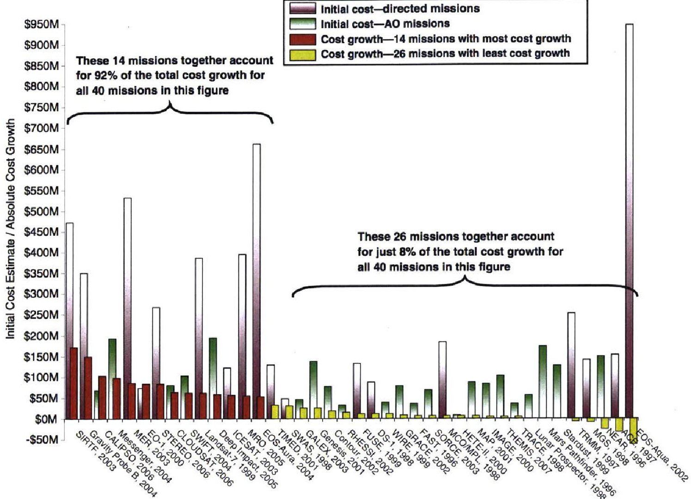

Figure 23. Cost Growth Observed in 40 Earth and Space Science Missions Examined by National Research Council, Image Credit: [161].

Recommendations have been made for how to improve the cost models for individual satellites one-at-a-time, but much of the complexity in constellation cost modeling comes from constellation systems level considerations and the nuanced effort of producing multiple satellite copies. Whitley, Hahn, and Powers have previously sought to quantify the efficiencies gained by building spacecraft and instrument constellations using a series of cost case studies [162].

One key to creating cost-viable constellation designs will be an efficient early phase design process [41]. Many mission cost drivers are set with the initial selection of mission parameters, such as spacecraft mass, instrument type, and number of spacecraft. In an attempt to address these cost drivers early, cost caps implemented as design constraints and design-to-cost trade

<!-- PDF_PAGE: 77 -->

studies have been considered as cost reduction strategies [18]. A patent focused on incorporating both cost and performance into Earth observing constellation design optimization was filed in 2012 [163]. Other studies have focused on the costs incurred during operations, given the complexity of operating many satellites simultaneously, and operational cost mitigating best practices are emerging within the industry as well [164], [165]. These efforts are a valuable first effort, but continued research regarding constellation specific costs is needed.

Nag et al.'s 2014 work, examining the accuracy of applying the traditional learning curve approach to mission cost estimating for small satellites of Earth science constellations, is one of the most targeted research efforts thus far on constellation cost estimating [6]. The authors also address the lack of parametric cost tools intended for satellites with mass less than 20 kilograms and insufficient understanding of small satellite DSM operations practices as a barrier to accurate costing for small satellite constellations. The work within this chapter seeks to build upon their efforts, and link three case studies to the broader paradigm in which second-generation LEO constellations are being developed. By characterizing the challenges associated with constellation cost estimating for a broad range of mission classifications, knowledge gaps that could hinder the development of second-generation LEO constellations can be identified and addressed.

## 5.2 Application of Existing Models to Modern LEO Constellations

Comprehensive standards for constellation cost estimating do not yet exist. Existing cost models are largely designed to evaluate a single spacecraft at a time or apply a traditional 'learning curve' savings scheme to the production of multiple satellites [149], [153]. The scope of these models does not fully capture the nuances of constellation design and implementation, in part because such models are largely based on historical data sets, and these data sets either do not include constellation missions or include constellations and monolithic missions, obscuring constellation specific cost contributions.

To illustrate the cost estimating process and examine the applicability of existing cost models to constellation missions, three Earth science mission case studies are presented: the Gravity Recovery and Climate Experiment (GRACE), the Cyclone Global Navigation Satellite System (CYGNSS), and the Landsat Data Continuity Mission (LDCM). Earth science missions have been chosen given the demonstrated increase in remote sensing spacecraft since 2011, and the 2017 National Academies' recommendation that Earth science missions pursue constellation architectures. These missions have all been NASA partnerships and are also selected, in part, because technical information and lifecycle cost data are available for analysis. Detailed design and cost data are not widely published for commercial or military constellation missions, so restricting this discussion to civil government missions requires fewer assumptions. Each mission is examined using publicly available parametric cost models, and the results of the cost estimating exercise are compared to the published cost of the mission at the time of launch. These case studies then serve as the basis for discussion and a series of conclusions regarding the challenges facing second-generation LEO constellations.

The case studies will be examined using CERs from three publicly available parametric models. The Aerospace Corporation's 2005 Small Satellite Cost Model (SSCM05) is appropriate for Earth-orbiting or near-Earth planetary spacecraft with total wet mass below 500 kg, and will be applied to the GRACE and CYGNSS constellations [18], [79]. The Unmanned Space Vehicle

<!-- PDF_PAGE: 78 -->

Cost Model Version 8 (USCM8), developed by Telecote Research for the US Air Force, Space and Missile Systems Center, is intended for larger spacecraft and is used to examine the Landsat 8 mission [18], [153]. The NASA Instrument Cost Model (NICM) Version IIIC is used to provide a more tailored estimate of the remote sensing payloads for each case study. The equations used in the following section are the most recent, publicly available CERs; more recent versions of these models exist but have not yet been released with completely unrestricted access. The fiscal year of each cost estimate is adjusted to the mission launch year, so that costs can be compared in constant year dollars. The set of inflation factors used is provided in Appendix B. It is assumed that each model represents a historical dataset that consists primarily of missions that incurred neither excessive redesign expenses, nor benefitted from abnormally high design heritage.

## 5.2.1 Sources of Uncertainty

There is some uncertainty introduced by aggregating multiple models and by assumptions regarding the application of the models are stated in each case study. Different values are reported by various sources for some of the space mission data, but the range of variation is relatively small. The specific values reported in each case study are selected to be representative of the published values. As stated previously, parametric model accuracy falls off as input values exceed the acceptable input range by more than 25% [134]. Some of the mission parameters in each case study are outside the recommended input range; in each instance the variable is identified and the implications for the estimate are discussed. The standard error of each estimate is provided, and as costs are totaled, the standard error of the estimate of the total is obtained by taking the square root of the sum of the constituent variances. The CERs employed here address the upper levels of the WBS, so this cost is approximate; greater fidelity could be achieved through the use of component level CERs and detailed design information.

## 5.2.2 Gravity Recovery and Climate Experiment (GRACE)

The GRACE mission consisted of two identical spacecraft placed into a 500-kilometer polar orbit about the Earth. The satellites were separated by approximately 220 kilometers; the exact distance between them, which changed over the course of the mission due to variations in the Earth's gravity field, was measured using GPS and microwave ranging [24]. Because the relative spacing of the two spacecraft was essential to the mission implementation, GRACE can be classified as a formation flying mission, as per the definitions provided in the previous chapter. The science data from the mission were used to generate monthly maps of regional gravity variations, which were subsequently used to monitor the reduction in the Earth's ice sheets over time, sea level rise, ocean circulation, ground water resources, and dry soil contributions to drought conditions, among other research topics. Launched in March 2002 onboard a Russian Rockot, the mission was designed for an operational period of five years, but far exceeded its expected performance and provided more than 15 years of science data; the spacecraft were deorbited in late 2017 [166]. The published total lifecycle cost of the mission at launch was $127 million, sponsored jointly by NASA and the German Aerospace Center, Deutsches Zentrum für Luft- und Raumfahrt (DLR). The agencies contributed $97 million and $30 million, respectively [167].

The GRACE mission has been chosen as a case study in part because it is well known within the Earth science community and is a constellation in the most classic sense of the term: two spacecraft designed from their inception to operate in support of a common goal. It predates the

<!-- PDF_PAGE: 79 -->

subsequent case studies and provides a baseline perspective for considering second-generation Earth science constellations. Table 11 provides a summary of parameters known for the GRACE spacecraft used in this case study.

Table 11. GRACE Spacecraft Parameters.

<table border="1"><tr><td>Parameter(Unit)</td><td>Value</td><td>Notes</td></tr><tr><td>Number of Spacecraft</td><td>2</td><td>[167]</td></tr><tr><td>Launch Vehicle</td><td>Three-stage Rockot</td><td>[167]</td></tr><tr><td>Launch Vehicle Cost(FY2002 $M)</td><td>12</td><td>Lower bound of reported range,$12-15 million[168]</td></tr><tr><td>Spacecraft Total Mass(kg)</td><td>471</td><td>[18]</td></tr><tr><td>Spacecraft Dry Mass(kg)</td><td>458</td><td>[18]</td></tr><tr><td>Propellant Mass(kg)</td><td>13</td><td>Total Mass-Dry Mass</td></tr><tr><td>Spacecraft Bus Dry Mass(kg)</td><td>388</td><td>[18]</td></tr><tr><td>Structure Subsystem Mass(kg)</td><td>160.3</td><td>35% of Dry Mass[18]</td></tr><tr><td>Thermal Control Subsystem Mass(kg)</td><td>27.48</td><td>6% of Dry Mass[18]</td></tr><tr><td>ADCS Subsystem Mass(kg)</td><td>77.86</td><td>17% of Dry Mass[18]</td></tr><tr><td>EPS Subsystem Mass(kg)</td><td>68.7</td><td>15% of Dry Mass[18]</td></tr><tr><td>TT&amp;C Subsystem Mass(kg)</td><td>4.58</td><td>1% of Dry Mass[18]</td></tr><tr><td>CD&amp;H Subsystem Mass(kg)</td><td>13.74</td><td>3% of Dry Mass[18]</td></tr><tr><td>Payload Type</td><td>Microwave Instrument</td><td>[167]</td></tr><tr><td>Payload Mass(kg)</td><td>70</td><td>[18]</td></tr><tr><td>Maximum Payload Instrument Power(W)</td><td>50</td><td>[18]</td></tr><tr><td>Payload Data Rate(kbps)</td><td>62000</td><td>[167]</td></tr><tr><td>Payload TRL</td><td>7</td><td>Assumed based on technical description of instrument testing and development[24],[166],[167]</td></tr></table>

## 5.2.2.1 Parametric Models Applied

The costing exercise outlined below leverages SSCM05 and NICM Version IIIC, as published in 2011 by Wertz et al. Table 12 summarizes the cost component, corresponding CER, and absolute standard error, if known, for SSCM05. Table 13 summarizes the cost components and corresponding CERs and standard errors for NICM Version IIIC.

Table 14 summarizes the output and the standard error of the estimate for each CER using the input parameters given in Table 11.

<!-- PDF_PAGE: 80 -->

Table 12. SSCM05 Parametric Cost Estimating Relationships [18].

<table border="1"><tr><td>Cost Component(WBS Level)</td><td>Input Parameter(Unit)</td><td>Input Range</td><td>Most Likely Cost Estimate Model CER(FY10 $K)</td><td>Standard Error</td><td>Eq.</td></tr><tr><td>Spacecraft Bus(Spacecraft Level)</td><td>Spacecraft BusDry Weight(kg)</td><td>20-400</td><td>1064+35.5x^{1.261}$</td><td>3696</td><td>(2)</td></tr><tr><td>Spacecraft Structure(Subsystem Level)</td><td>StructureWeight(kg)</td><td>5-100</td><td>407+19.3X*lnx</td><td>1097</td><td>(3)</td></tr><tr><td>Thermal Control(Subsystem Level)</td><td>ThermalControlWeight(kg)</td><td>5-12</td><td>335+5.7x^{2}$</td><td>119</td><td>(4)</td></tr><tr><td>AttitudeDetermination andControl System(Subsystem Level)</td><td>ADCS DryWeight(kg)</td><td>1-25</td><td>1850+11.7x^{2}$</td><td>1113</td><td>(5)</td></tr><tr><td>Electrical Power Supply(Subsystem Level)</td><td>EPS Weight(kg)</td><td>7-70</td><td>1261+539x^{0.72}$</td><td>910</td><td>(6)</td></tr><tr><td>Propulsion(Subsystem Level)</td><td>Spacecraft BusDryWeight(kg)</td><td>20-400</td><td>89+3.0x^{1.261}$</td><td>310</td><td>(7)</td></tr><tr><td>Telemetry,Tracking,&amp;Command(Subsystem Level)</td><td>TT&amp;C Weight(kg)</td><td>3-30</td><td>486+55.5x^{1.35}$</td><td>629</td><td>(8)</td></tr><tr><td>Command&amp;DataHandling(Subsystem Level)</td><td>CD&amp;H Weight(kg)</td><td>3-30</td><td>658+75x^{1.35}$</td><td>854</td><td>(9)</td></tr><tr><td>Payload(Subsystem Level)</td><td>Spacecraft BusTotal Cost($K)^{6}$</td><td>2600-69000</td><td>0.4x</td><td></td><td>(10)</td></tr><tr><td>Integration,Assembly,&amp;Test(System Level)</td><td>Spacecraft BusTotal Cost($K)</td><td>2600-69000</td><td>0.139x</td><td></td><td>(11)</td></tr><tr><td>Program Level(System Level)</td><td>Spacecraft BusTotal Cost($K)</td><td>2600-69000</td><td>0.229x</td><td></td><td>(12)</td></tr><tr><td>Launch&amp;OrbitalOperationsSupport(System Level)</td><td>Spacecraft BusTotal Cost($K)</td><td>2600-69000</td><td>0.061x</td><td></td><td>(13)</td></tr><tr><td>Ground SupportEquipment(System Level)</td><td>Spacecraft BusTotal Cost($K)</td><td>2600-69000</td><td>0.066x</td><td></td><td>(14)</td></tr></table>

<!-- PDF_PAGE: 81 -->

Table 13. NICM Version IIIC Parametric Cost Estimating Relationships [18].

<table border="1"><tr><td>Cost Component(WBS Level)</td><td>Input Parameter(Unit)</td><td>Input Range</td><td>Most Likely Cost EstimateModel CER(FY10 $K)</td><td>StandardError</td><td>Eq.</td></tr><tr><td rowspan="4">Active and PassiveMicrowave Payload,E.g. Radars,altimeters,scattermeters,GPS receivers(Subsystem Level)</td><td>m=Instrument total mass(kg)</td><td>10-15</td><td rowspan="4">23620(m0.284)(p0.325)...(d0.09)(t-1.296)</td><td rowspan="4">37%</td><td rowspan="4">(15)</td></tr><tr><td>p=Maximuminstrument power(W)</td><td>10-600</td></tr><tr><td>d=Payload data rate(kbps)</td><td>0.1-1000</td></tr><tr><td>t=Instrument TRL</td><td>4-9</td></tr><tr><td rowspan="3">Optical Earth-orbiting PayloadE.g. cameras,spectrometers,interferometers(Subsystem Level)</td><td>m=Instrument total mass inkg</td><td>10-350</td><td rowspan="3">1163(m0.328)(p0.357)(d0.092)</td><td rowspan="3">35%</td><td rowspan="3">(16)</td></tr><tr><td>p=Maximuminstrument power inW</td><td>0.5-400</td></tr><tr><td>d=total data rate inkilobits/second</td><td>0.1-30000</td></tr></table>

Table 14. SSCM05 and NICM Version IIIC Produced Most Likely Cost Estimates and Standard Errors for GRACE Input Parameters.

<table border="1"><tr><td>Cost Component</td><td>Input Value</td><td>Percentage beyond input range, if applicable</td><td>Most Likely Cost Estimate(FY10$K)</td><td>Standard Error of Estimate(FY10$K)</td></tr><tr><td colspan="5">SSCM05</td></tr><tr><td>Spacecraft Bus</td><td>388(kg)</td><td></td><td>66338.74</td><td>3696</td></tr><tr><td>Spacecraft Structure</td><td>160.3(kg)</td><td>60.30%</td><td>16114.32</td><td>1097</td></tr><tr><td>Thermal Control</td><td>27.48(kg)</td><td>127.33%</td><td>4639.36</td><td>119</td></tr><tr><td>Attitude Determination and Control System(ADCS)</td><td>77.86(kg)</td><td>211.44%</td><td>72777.50</td><td>1113</td></tr><tr><td>Electrical Power Supply(EPS)</td><td>68.7(kg)</td><td></td><td>12590.16</td><td>910</td></tr><tr><td>Propulsion(Reaction Control)</td><td>388(kg)</td><td></td><td>5605.18</td><td>310</td></tr><tr><td>Telemetry,Tracking,&amp;Command(TT&amp;C)</td><td>4.58(kg)</td><td></td><td>918.97</td><td>629</td></tr><tr><td>Command&amp;Data Handling(CD&amp;H)</td><td>13.74(kg)</td><td></td><td>3236.36</td><td>854</td></tr><tr><td>Spacecraft Payload</td><td>66338.74($K)</td><td></td><td>26535.50</td><td>1478</td></tr><tr><td>Integration,Assembly,&amp;Test(IA&amp;T)</td><td>66338.74($K)</td><td></td><td>9221.09</td><td>514</td></tr><tr><td>Program Level</td><td>66338.74($K)</td><td></td><td>15191.57</td><td>846</td></tr><tr><td>Launch&amp;Orbital Operations Support(LOOS)</td><td>66338.74($K)</td><td></td><td>4046.66</td><td>225</td></tr><tr><td>Ground Support Equipment(GSE)</td><td>66338.74($K)</td><td></td><td>4378.36</td><td>244</td></tr></table>

<!-- PDF_PAGE: 82 -->

<table border="1"><tr><td colspan="5">NICM Version IIIC</td></tr><tr><td rowspan="4">Passive Microwave Payload</td><td>70(kg)</td><td>40.00%</td><td rowspan="4">61026.88</td><td rowspan="4">22580</td></tr><tr><td>50(W)</td><td></td></tr><tr><td>62000(kps)</td><td>6100.00%</td></tr><tr><td>7</td><td></td></tr></table>

The SSCM and NICM CERs each produce an estimate for the total nonrecurring cost and one protoflight unit, so it is necessary to separate the model into nonrecurring and recurring cost estimates. Then, the recurring costs can be adjusted using a learning curve approach to estimate the cost of producing two identical spacecraft [134]. The allocation between nonrecurring and recurring costs for each cost component is provided in Table 15. Table 16 provides nonrecurring, recurring, and total most likely cost estimates for each cost element based on the model outputs given in Table 14.

Table 15. Distribution of Nonrecurring and Recurring Costs from a Cost Model Producing Estimates of Nonrecurring Cost and One Protoflight Unit [134].

<table border="1"><tr><td>Cost Component</td><td>Nonrecurring</td><td>Recurring</td></tr><tr><td>Spacecraft Bus</td><td>60%</td><td>40%</td></tr><tr><td>Spacecraft Structure</td><td>70%</td><td>30%</td></tr><tr><td>Thermal Control</td><td>50%</td><td>50%</td></tr><tr><td>Attitude Determination and Control System(ADCS)</td><td>37%</td><td>63%</td></tr><tr><td>Electrical Power Supply(EPS)</td><td>62%</td><td>38%</td></tr><tr><td>Propulsion(Reaction Control)</td><td>50%</td><td>50%</td></tr><tr><td>Telemetry,Tracking,&amp;Command(TT&amp;C)</td><td>71%</td><td>29%</td></tr><tr><td>Command&amp;Data Handling(CD&amp;H)</td><td>71%</td><td>29%</td></tr><tr><td>Spacecraft Payload</td><td>60%</td><td>40%</td></tr><tr><td>Integration,Assembly,&amp;Test(IA&amp;T)</td><td>0%</td><td>100%</td></tr><tr><td>Program Level</td><td>50%</td><td>50%</td></tr><tr><td>Launch&amp;Orbital Operations Support(LOOS)</td><td>0%</td><td>100%</td></tr><tr><td>Ground Support Equipment(GSE)</td><td>100%</td><td>0%</td></tr></table>

<!-- PDF_PAGE: 83 -->

Table 16. Separated Nonrecurring and Recurring Costs of GRACE Mission, Using Distribution Provided in Table 15.

<table border="1"><tr><td>Cost Component</td><td>Most Likely Nonrecurring Cost Estimate(FY10$K)</td><td>Standard Error of Estimate(FY10$K)</td><td>Most Likely Recurring Cost Estimate(FY10$K)</td><td>Standard Error of Estimate(FY10$K)</td><td>Most Likely Total Cost Estimate(FY10$K)</td><td>Standard Error of Estimate(FY10$K)</td></tr><tr><td colspan="7">SSCM05</td></tr><tr><td>Spacecraft Bus</td><td>39803.24</td><td>2218</td><td>26535.50</td><td>1478</td><td>66338.74</td><td>3696</td></tr><tr><td>Spacecraft Structure</td><td>11280.02</td><td>768</td><td>4834.30</td><td>329</td><td>16114.32</td><td>1097</td></tr><tr><td>Thermal Control</td><td>2319.68</td><td>60</td><td>2319.68</td><td>60</td><td>4639.36</td><td>119</td></tr><tr><td>Attitude Determination and Control System(ADCS)</td><td>26927.68</td><td>412</td><td>45849.83</td><td>701</td><td>72777.50</td><td>1113</td></tr><tr><td>Electrical Power Supply(EPS)</td><td>7805.90</td><td>564</td><td>4784.26</td><td>346</td><td>12590.16</td><td>910</td></tr><tr><td>Propulsion(Reaction Control)</td><td>2802.59</td><td>155</td><td>2802.59</td><td>155</td><td>5605.18</td><td>310</td></tr><tr><td>Telemetry,Tracking,&amp;Command(TT&amp;C)</td><td>652.47</td><td>447</td><td>266.50</td><td>182</td><td>918.97</td><td>629</td></tr><tr><td>Command&amp;Data Handling(CD&amp;H)</td><td>2297.81</td><td>606</td><td>938.54</td><td>248</td><td>3236.36</td><td>854</td></tr><tr><td>Spacecraft Payload</td><td>15921.30</td><td>887</td><td>10614.20</td><td>591</td><td>26535.50</td><td>1478</td></tr><tr><td>Integration,Assembly,&amp;Test(IA&amp;T)</td><td>0.00</td><td>0</td><td>9221.09</td><td>514</td><td>9221.09</td><td>514</td></tr><tr><td>Program Level</td><td>7595.79</td><td>423</td><td>7595.79</td><td>423</td><td>15191.57</td><td>846</td></tr><tr><td>Launch&amp;Orbital Operations Support(LOOS)</td><td>0.00</td><td>0</td><td>4046.66</td><td>225</td><td>4046.66</td><td>225</td></tr><tr><td>Ground Support Equipment(GSE)</td><td>4378.36</td><td>244</td><td>0.00</td><td>0</td><td>4378.36</td><td>244</td></tr><tr><td colspan="7">NICM Version IIIC</td></tr><tr><td>Active and Passive Microwave Payload</td><td>36616.13</td><td>13548</td><td>24410.75</td><td>9032</td><td>61026.88</td><td>22580</td></tr></table>

The total production cost of the two GRACE spacecraft can be modeled by multiplying the recurring cost, as given in Table 16, by a learning curve factor, L, as defined in Equations 17 and 18 [134]. Here, n represents the number of production units and is equivalent to the number of spacecraft in the constellation. The parameter s is the assumed learning curve slope. Typically, s is assumed to be 0.95 for less than 10 production units, but in their 2014 work, Nag et al. concluded that a value of 0.662 is more appropriate for constellations of small, Earth observing spacecraft. For two spacecraft, these slopes produce a learning curve factor, L, of 1.9 and 1.342 respectively. The results of the cost estimating process using both learning curve factors are presented below.

$$
L = n ^ {b}
$$

<!-- PDF_PAGE: 84 -->

$$
b = 1 - \frac {\ln \frac {1}{s}}{\ln 2}
$$

The cost estimates produced by both parametric models are in fiscal year 2010 (FY2010) thousands of dollars. Finally, to compare the outputs from the model to the cost of the mission as reported in 2002, the fiscal year of the estimate must be adjusted. To convert from FY2010 to FY2002 dollars the costs are multiplied by the ratio of the factors of the years of interest from Appendix B, which is equal to 0.84.

## 5.2.2.2 GRACE Mission Results

Table 17 provides the total lifecycle cost estimate and standard error for the GRACE mission, as approximated by the parameters in Table 11, and includes results for the two learning curve factors discussed above. The cost of the launch vehicle, as given in Table 11, has also been included in the estimates provided below. The table also includes the error of the calculated cost estimate, relative to the published mission cost: $127 million.

The results of four different cost aggregation schemes are shown in the table. The first two schemes include the high-level bus cost produced by Equation 2, and then consider separate payload costs, as produced by SSCM05 and NICM Version IIIC, respectively. The second two schemes sum the component level CERs presented in Equations 3 through 9, and then again consider the payload costs produced by both models. All summations include the system level costs calculated using Equations 11-14.

Table 17. Cost Estimate Using GRACE Mission Parameters.

<table border="1"><tr><td>Estimation Scheme</td><td>Aggregate Most Likely Cost Estimate(FY2002 $M)</td><td>Standard Error(FY2002 $M)</td><td>Equations Used</td><td>Error, relative to $127 Million</td></tr><tr><td colspan="5">Assuming Learning Curve Slope of 0.95(L=1.9)</td></tr><tr><td>1. Spacecraft Level Bus,SSCM Payload</td><td>161.46</td><td>5</td><td>2,10-14,17,18</td><td>27.13%</td></tr><tr><td>2. Spacecraft Level Bus,NICM Payload</td><td>200.86</td><td>26</td><td>2,11-15,17,18</td><td>58.16%</td></tr><tr><td>3. Component Level Bus,SSCM Payload</td><td>229.73</td><td>3</td><td>3-14,17,18</td><td>80.89%</td></tr><tr><td>4. Component Level Bus,NICM Payload</td><td>269.13</td><td>26</td><td>3-9,11-15,17,18</td><td>111.91%</td></tr><tr><td colspan="5">Assuming Learning Curve Slope of 0.662(L=1.324)</td></tr><tr><td>1. Spacecraft Level Bus,SSCM Payload</td><td>133.39</td><td>4</td><td>2,10-14,17,18</td><td>5.03%</td></tr><tr><td>2. Spacecraft Level Bus,NICM Payload</td><td>166.12</td><td>21</td><td>2,11-15,17,18</td><td>30.80%</td></tr><tr><td>3. Component Level Bus,SSCM Payload</td><td>184.60</td><td>3</td><td>3-14,17,18</td><td>45.35%</td></tr><tr><td>4. Component Level Bus,NICM Payload</td><td>217.33</td><td>22</td><td>3-9,11-15,17,18</td><td>71.12%</td></tr></table>

<!-- PDF_PAGE: 85 -->

Because the GRACE parameters used in Equations 3-5 and Equation 15 fall outside the acceptable input range, the first aggregation scheme produces the most reliable cost estimate. The results from the other aggregation schemes have been included to illustrate the range of possible outputs and to highlight the need for widely available CERs capable of accommodating modern Earth science spacecraft.

For an upper WBS level cost estimate, the model result for the GRACE mission is relatively accurate using the traditional learning curve slope of 0.95, but is significantly improved by the learning curve slope of 0.662 proposed by Nag et al. The reduction from approximately 27% error to 5% error demonstrates the benefit offered to cost estimators by techniques that are tailored specifically to constellations. GRACE was launched before 2011, and therefore was part of the first generation of LEO satellite constellations. The accuracy of the estimate even without the constellation learning curve slope suggests that the mission incurred relatively few constellation specific costs. This could be due to the two-satellite mission architecture, limiting the extent of learning curve savings, or due to the relative simplicity of designing a two-satellite mission, as opposed to a larger fleet of spacecraft. The CERs applied in this case were published after GRACE had been launched and can be assumed to have accurately captured contemporary technological trends. GRACE therefore serves as a valuable baseline case study; in the following case study, the CYGNSS mission will be used to illustrate the effect of increasing the number of spacecraft for a second-generation small satellite constellation on the accuracy of the model results.

## 5.2.3 Cyclone Global Navigation Satellite System (CYGNSS)

The CYGNSS constellation consists of eight spacecraft orbiting earth in a single plane, spaced approximately 45 degrees apart, at an altitude of approximately 510 kilometers, and inclination of 35 degrees [23], [169]. Using passive microwave radiometers, the CYGNSS satellites measure GPS signals reflected off the ocean; the extent of signal scattering is then used to calculate local wind speed at the observed point on Earth. In the nominal configuration, the constellation provides measurements every 7 hours, and the downlinked data are then used to monitor and track the strength of tropical storms and hurricanes between 35 degrees north and south latitude. The constellation is robust to configuration changes and capable of meeting its mission science requirements as long as each member spacecraft is separated by at least 20 degrees from the next satellite in the orbital plane [23]. CYGNSS offers a significant improvement, in both speed and quality, over existing hurricane force measurement techniques [169]. The eight member spacecraft were launched on a Pegasus XL launch vehicle in December 2016, with a planned two-year mission lifetime, and a projected mission lifecycle cost of $157 million [169].

CYGNSS, which is currently in orbit, was the first mission to be selected under NASA's Earth System Science Pathfinder (ESSP) program, and is classified as a Class D mission, suggesting characteristically lower project cost [170]. The science elements of the mission are managed by the University of Michigan, and the Southwest Research Institute (SwRI) is responsible for project management, including spacecraft procurement and mission operations. The spacecraft payload is a commercial off-the-shelf (COTS) component available from Surrey Satellite Technologies [171].

The CYGNSS constellation is provided as the second case study within this chapter because, similar to GRACE, it is an Earth science constellation comprised of small satellites, defined as

<!-- PDF_PAGE: 86 -->

those spacecraft with a mass below 500 kilograms. It is representative of many of the remote sensing missions being introduced as second-generation LEO constellations, and has been hailed as "an important step for science constellation development" [11]. Because CYGNSS includes more member spacecraft than GRACE, the mission can also be used to examine the impact of a greater number of member satellites on the cost estimating process. Table 18 provides a summary of parameters known for the CYGNSS mission.

Table 18. CYGNSS Mission Parameters.

<table border="1"><tr><td>Parameter(Unit)</td><td>Value</td><td>Notes</td></tr><tr><td>Number of Spacecraft</td><td>8</td><td>[23]</td></tr><tr><td>Launch Vehicle</td><td>Pegasus XL</td><td>[169]</td></tr><tr><td>Launch Vehicle Cost(FY2016 $M)</td><td>20.25</td><td>Lower bound of reported range,$20.25-33.75 million,adjusted for inflation to FY2016 $M[168]</td></tr><tr><td>Spacecraft Total Mass(kg)</td><td>28.9</td><td>[172]</td></tr><tr><td>Spacecraft Dry Mass(kg)</td><td>28.9</td><td>[172]</td></tr><tr><td>Propellant Mass(kg)</td><td>0</td><td>The system leverages differential drag maneuvers to phase the spacecraft within the constellation[172]</td></tr><tr><td>Spacecraft Bus Dry Mass(kg)</td><td>26.9</td><td>Total Mass-Payload Mass</td></tr><tr><td>Structure Subsystem Mass(kg)</td><td>5.78</td><td>Estimated as 20% of dry mass8[18]</td></tr><tr><td>Thermal Control Subsystem Mass(kg)</td><td>0.578</td><td>Estimated as 2% of dry mass[18]</td></tr><tr><td>ADCS Subsystem Mass(kg)</td><td>2.312</td><td>Estimated as 8% of dry mass[18]</td></tr><tr><td>EPS Subsystem Mass(kg)</td><td>5.491</td><td>Estimated as 19% of dry mass[18]</td></tr><tr><td>TT&amp;C Subsystem Mass(kg)</td><td>0.578</td><td>Estimated as 2% of dry mass[18]</td></tr><tr><td>CD&amp;H Subsystem Mass(kg)</td><td>1.445</td><td>Estimated as 5% of dry mass[18]</td></tr><tr><td>Payload Type</td><td>Microwave Instrument</td><td>[173]</td></tr><tr><td>Payload Mass(kg)</td><td>2</td><td>[174]</td></tr><tr><td>Maximum Payload Instrument Power(W)</td><td>12</td><td>[174]</td></tr><tr><td>Payload Data Rate(kbps)</td><td>4000</td><td>[174]</td></tr><tr><td>Payload TRL</td><td>9</td><td>Assumed based(COTS) nature of instrument</td></tr></table>

## 5.2.3.1 Parametric Models Applied

As with GRACE, known parameters for the CYGNSS mission are used as inputs to system, spacecraft, and subsystem level CERs from SSCM05 and NICM Version IIIC, as provided in Table 12 and Table 13. Table 19 summarizes the output and the standard error of the estimate for each CER using the input parameters given in Table 18. Again, some input parameters fall outside the acceptable input range for the parametric models, and the percentage beyond the range is provided below.

The model outputs are separated into nonrecurring and recurring costs using the allocations provided in Table 15. These results are provided in Table 20 for each cost component in the

<!-- PDF_PAGE: 87 -->

model. Recurring costs can then be scaled using the learning curve factor calculated with Equations 17 and 18. The learning curve factor for eight production units is 6.859 using the traditional learning curve slope of 0.95, and 2.321 using the proposed small, Earth science satellite constellation learning curve slope of 0.662. This case study more clearly illustrates the recurring cost savings captured by producing multiple identical spacecraft. For eight spacecraft, these two factors result in approximately 14% and 71% recurring cost savings, respectively, when compared to a less targeted 'multiply-by-n' approach.

Table 19. SSCM05 and NICM Version IIIC Produced Most Likely Cost Estimates and Standard Errors for CYGNSS input parameters.

<table border="1"><tr><td>Cost Component</td><td>Input Value</td><td>Percentage beyond input range, if applicable</td><td>Most Likely Cost Estimate(FY10$K)</td><td>Standard Error of Estimate(FY10$K)</td></tr><tr><td colspan="5">SSCM05</td></tr><tr><td>Spacecraft Bus</td><td>26.9(kg)</td><td></td><td>3319.00</td><td>3696</td></tr><tr><td>Spacecraft Structure</td><td>5.78(kg)</td><td></td><td>602.71</td><td>1097</td></tr><tr><td>Thermal Control</td><td>0.578(kg)</td><td>88.44%</td><td>336.90</td><td>119</td></tr><tr><td>Attitude Determination and Control System(ADCS)</td><td>2.312(kg)</td><td></td><td>1912.54</td><td>1113</td></tr><tr><td>Electrical Power Supply(EPS)</td><td>5.491(kg)</td><td>21.56%</td><td>3098.12</td><td>910</td></tr><tr><td>Propulsion(Reaction Control)</td><td>26.9(kg)</td><td></td><td>279.56</td><td>310</td></tr><tr><td>Telemetry,Tracking,&amp;Command(TT&amp;C)</td><td>0.578(kg)</td><td>80.73%</td><td>512.48</td><td>629</td></tr><tr><td>Command&amp;Data Handling(CD&amp;H)</td><td>1.445(kg)</td><td>51.83%</td><td>781.28</td><td>854</td></tr><tr><td>Spacecraft Payload</td><td>3319.00($K)</td><td></td><td>1327.60</td><td>1478</td></tr><tr><td>Integration,Assembly,&amp;Test(IA&amp;T)</td><td>3319.00($K)</td><td></td><td>461.34</td><td>514</td></tr><tr><td>Program Level</td><td>3319.00($K)</td><td></td><td>760.05</td><td>846</td></tr><tr><td>Launch&amp;Orbital Operations Support(LOOS)</td><td>3319.00($K)</td><td></td><td>202.46</td><td>225</td></tr><tr><td>Ground Support Equipment(GSE)</td><td>3319.00($K)</td><td></td><td>219.05</td><td>244</td></tr><tr><td colspan="5">NICM Version IIIC</td></tr><tr><td rowspan="4">Passive Microwave Payload</td><td>2(kg)</td><td>80.00%</td><td rowspan="4">7888.48</td><td rowspan="4">2919</td></tr><tr><td>12(W)</td><td></td></tr><tr><td>4000(kps)</td><td>75.00%</td></tr><tr><td>9</td><td></td></tr></table>

<!-- PDF_PAGE: 88 -->

Table 20. Separated Nonrecurring and Recurring Costs of CYGNSS Mission, Using Distribution Provided in Table 15.

<table border="1"><tr><td>Cost Component</td><td>Most Likely Nonrecurring Cost Estimate(FY10$K)</td><td>Standard Error of Estimate(FY10$K)</td><td>Most Likely Recurring Cost Estimate(FY10$K)</td><td>Standard Error of Estimate(FY10$K)</td><td>Most Likely Total Cost Estimate(FY10$K)</td><td>Standard Error of Estimate(FY10$K)</td></tr><tr><td colspan="7">SSCM05</td></tr><tr><td>Spacecraft Bus</td><td>1991.40</td><td>2218</td><td>1327.60</td><td>1478</td><td>3319.00</td><td>3696</td></tr><tr><td>Spacecraft Structure</td><td>421.90</td><td>768</td><td>180.81</td><td>329</td><td>602.71</td><td>1097</td></tr><tr><td>Thermal Control</td><td>168.45</td><td>60</td><td>168.45</td><td>60</td><td>336.90</td><td>119</td></tr><tr><td>Attitude Determination and Control System(ADCS)</td><td>707.64</td><td>412</td><td>1204.90</td><td>701</td><td>1912.54</td><td>113</td></tr><tr><td>Electrical Power Supply(EPS)</td><td>1920.84</td><td>564</td><td>1177.29</td><td>346</td><td>3098.12</td><td>910</td></tr><tr><td>Propulsion(Reaction Control)</td><td>139.78</td><td>155</td><td>139.78</td><td>155</td><td>279.56</td><td>310</td></tr><tr><td>Telemetry, Tracking,&amp;Command(TT&amp;C)</td><td>363.86</td><td>447</td><td>148.62</td><td>182</td><td>512.48</td><td>629</td></tr><tr><td>Command&amp;Data Handling(CD&amp;H)</td><td>554.71</td><td>606</td><td>226.57</td><td>248</td><td>781.28</td><td>854</td></tr><tr><td>Spacecraft Payload</td><td>796.56</td><td>887</td><td>531.04</td><td>591</td><td>1327.60</td><td>1478</td></tr><tr><td>Integration,Assembly,&amp;Test(IA&amp;T)</td><td>0.00</td><td>0</td><td>461.34</td><td>514</td><td>461.34</td><td>514</td></tr><tr><td>Program Level</td><td>380.03</td><td>423</td><td>380.03</td><td>423</td><td>760.05</td><td>846</td></tr><tr><td>Launch&amp;Orbital Operations Support(LOOS)</td><td>0.00</td><td>0</td><td>202.46</td><td>225</td><td>202.46</td><td>225</td></tr><tr><td>Ground Support Equipment(GSE)</td><td>219.05</td><td>244</td><td>0.00</td><td>0</td><td>219.05</td><td>244</td></tr><tr><td colspan="7">NICM Version IIIC</td></tr><tr><td>Active and Passive Microwave Payload</td><td>4733.09</td><td>1751</td><td>3155.39</td><td>1167</td><td>7888.48</td><td>2919</td></tr></table>

## 5.2.3.2 CYGNSS Mission Results

Table 21 provides the total lifecycle cost estimate, including the cost of the launch vehicle, and associated standard error for the CYGNSS mission, as approximated by the parameters in Table 18, and considering both of these learning curve factors. The estimate has been adjusted to FY2016 dollars using a factor of 1.14.

Given the input parameters that are out of range for these models, the first aggregation scheme again produces the most reliable cost estimate because the inputs to all of the used equations are within range. The limiting input ranges for some parameters both here and in the preceding case study suggest that traditional models may not draw from data sets representative of contemporary Earth science LEO constellations.

<!-- PDF_PAGE: 89 -->

Table 21. Cost Estimate Using CYGNSS Mission Parameters.

<table border="1"><tr><td>Estimation Scheme</td><td>Aggregate Most Likely Cost Estimate(FY2016 $M)</td><td>Standard Error(FY2016 $M)</td><td>Equations Used</td><td>Error, relative to $152 Million</td></tr><tr><td colspan="5">Assuming Learning Curve Slope of 0.95(L=6.859)</td></tr><tr><td>1. Spacecraft Level Bus,SSCM Payload</td><td>46.80</td><td>16</td><td>2,10-14,17,18</td><td>69.21%</td></tr><tr><td>2. Spacecraft Level Bus,NICM Payload</td><td>71.80</td><td>19</td><td>2,11-15,17,18</td><td>52.77%</td></tr><tr><td>3. Component Level Bus,SSCM Payload</td><td>64.40</td><td>12</td><td>3-14,17,18</td><td>57.63%</td></tr><tr><td>4. Component Level Bus,NICM Payload</td><td>89.40</td><td>15</td><td>3-9,11-15,17,18</td><td>41.18%</td></tr><tr><td colspan="5">Assuming Learning Curve Slope of 0.662(L=2.321)</td></tr><tr><td>1. Spacecraft Level Bus,SSCM Payload</td><td>31.79</td><td>7</td><td>2,10-14,17,18</td><td>79.09%</td></tr><tr><td>2. Spacecraft Level Bus,NICM Payload</td><td>43.21</td><td>6</td><td>2,11-15,17,18</td><td>71.57%</td></tr><tr><td>3. Component Level Bus,SSCM Payload</td><td>39.47</td><td>5</td><td>3-14,17,18</td><td>74.04%</td></tr><tr><td>4. Component Level Bus,NICM Payload</td><td>50.89</td><td>7</td><td>3-9,11-15,17,18</td><td>66.52%</td></tr></table>

The model substantially underestimates the cost of the CYGNSS constellation for both learning curves. Even the multiply-by-n approach applied to the total cost of the spacecraft, including both recurring and nonrecurring cost, plus the cost of the launch vehicle produces an expected lifecycle cost of $77.59 million. This underestimation suggests that if the CERs above were leveraged during an early phase cost estimate, the planned budget could be insufficient to meet project needs and result in cost overruns. This may contribute to the perspective that constellation missions are inherently prone to cost growth, when in reality costs are being inaccurately forecast. A constellation specific cost-estimating tool could mitigate this.

CYGNSS also represents a design to cost mission, in that the grant awarded under NASA's ESSP program is associated with a strict cost cap and significant cost overruns could result in a mission termination review [175]. Therefore, the planned mission may be deliberately low cost to reduce the risk of cost overruns. With 25% cost margin applied to the multiply-by-n approach, the total lifecycle cost of the mission as characterized by the inputs in Table 18 is approximately $99 million. This implies that the CYGNSS mission may have incurred additional costs not accounted for within the parametric models employed here and that consumed the remaining budget. Without detailed spending data from the participating organizations, sound conclusions regarding the discrepancy between the cost estimate provided here and the ESSP award amount cannot be drawn. However, this case study further demonstrates the need for more capable constellation, and particularly small satellite constellation, cost estimating capability.

## 5.2.4 Landsat Data Continuity Mission (LDCM)

The Landsat Data Continuity Mission is the eighth mission in the Landsat Program and is also often referred to as Landsat 8. The Landsat Program is a series constellation of Earth observing spacecraft, the first of which launched in 1972, that represents the "world's longest continuously

<!-- PDF_PAGE: 90 -->

acquired collection of space-based moderate-resolution land remote sensing data" [176]. Jointly managed by the United States Geological Survey (USGS) and NASA, the Landsat Program data has been utilized for research in agriculture, geology, and regional planning, among others, and contributed significantly to emergency response and disaster relief efforts. Landsat 8 was designed as a follow on mission to Landsat 7, as directed by The Land Remote Sensing Policy Act of 1992, to ensure data continuity; the mission is currently operating on an eight-day temporal offset, relative to Landsat 7 [26]. To the extent that both missions are currently supporting a common mission objective, Landsat 7 and Landsat 8 also represent an ad-hoc constellation, in that they were not designed originally as a two spacecraft system, but can be treated as one. The published cost of the mission at the time of launch was $855 million [177].

Landsat 8 is included as a case study within this chapter because it is a large spacecraft, which must be examined with a model other than SSCM05, and is part of a series constellation. This mission strategy allows each successive mission to contribute to a common mission objective, but also significantly constrains the design tradespace, as the objective must be maintained over time. Such rigid constraints can complicate the selection of a final architecture, especially if nontechnical requirements are not maintained from one mission to the next. More discussion on the policy forces that shaped the implementation of the Landsat 8 mission is provided in 3.2.4.3. Table 22 provides a summary of parameters known for Landsat 8 and its two primary instruments. The spacecraft hosts both the Optical Land Imager (OLI) and Thermal Infrared Sensor (TIRS) [26], onboard the LEOStar 3 satellite bus [178], produced by Orbital ATK.

Table 22. Landsat 8 Spacecraft Parameters.

<table border="1"><tr><td>Parameter(Unit)</td><td>Value</td><td>Notes</td></tr><tr><td>Number of Spacecraft</td><td>1</td><td>[26]</td></tr><tr><td>Launch Vehicle</td><td>Atlas V 401</td><td>[26]</td></tr><tr><td>Launch Vehicle Cost(FY2013 $M)</td><td>141.28223</td><td>[26]</td></tr><tr><td>Spacecraft Total Mass(kg)</td><td>2623</td><td>[179]</td></tr><tr><td>Spacecraft Dry Mass(kg)</td><td>2237</td><td>Total Mass-Propellant Mass</td></tr><tr><td>Spacecraft Bus Dry Mass(kg)</td><td>1512</td><td>[179]</td></tr><tr><td>Propellant Mass(kg)</td><td>386</td><td>Hydrazine Monopropellant[180]</td></tr><tr><td>Total Reaction Control System Tank Volume(cm3)</td><td>350000</td><td>Approximated using the average fuel fuel capacity of the LEOStar 3 bus(363kg)[178]and density of liquid hydrazine(1.02g/cm3)</td></tr><tr><td>Spacecraft Power(W)</td><td>4300</td><td>[179]</td></tr><tr><td>Structure Subsystem Mass(kg)</td><td>603.99</td><td>27% of Dry Mass9[18]</td></tr><tr><td>Thermal Control Subsystem Mass(kg)</td><td>44.74</td><td>S-Band,2% of Dry Mass[18],[180]</td></tr><tr><td>ADCS Subsystem Mass(kg)</td><td>134.22</td><td>6% of Dry Mass[18]</td></tr><tr><td>EPS Subsystem Mass(kg)</td><td>469.77</td><td>21% of Dry Mass[18]</td></tr><tr><td>TT&amp;C Subsystem Mass(kg)</td><td>44.74</td><td>2% of Dry Mass[18]</td></tr><tr><td>CD&amp;H Subsystem Mass(kg)</td><td>111.85</td><td>5% of Dry Mass[18]</td></tr></table>

<!-- PDF_PAGE: 91 -->

<table border="1"><tr><td>OLI Payload Mass(kg)</td><td>301</td><td>Estimated by subtracting the 2071 kilograms,cited as the mass of the spacecraft without the payloads,and the TIRS mass from the total spacecraft mass[180]</td></tr><tr><td>OLI Peak Power(W)</td><td>1684</td><td>Estimated by assuming that 48% of system power for spacecraft with propulsion is dedicated to the payloads[18]and subtracting TIRS power consumption</td></tr><tr><td>OLI Data Rate(kbps)</td><td>265000</td><td>[181]</td></tr><tr><td>TIRS Payload Instrument Mass(kg)</td><td>236</td><td>[180]</td></tr><tr><td>TIRS Peak Power(W)</td><td>380</td><td>[180]</td></tr><tr><td>TIRS Data Rate(kbps)</td><td>26200</td><td>[181]</td></tr></table>

## 5.2.4.1 Parametric Models Applied

Applicable CERs from USCM8 are provided in Table 23. This model is intended primarily for satellites with communications payloads, and as such the payload cost is estimated using the CER for optical payloads provided in NICM Version IIIC. As in the two preceding case studies, when a CER requires the spacecraft bus cost as an input, the value is taken from the corresponding spacecraft level CER, rather than from the sum of the subsystem level outputs. The payload nonrecurring and recurring costs required for input to Equations 25, 26, 33, and 34 have been separated from the output of the NICM CERs using the 60% to 40% allocation suggested in Table 15.

Table 24 summarizes the output and the standard error of the estimate for each CER using the input parameters given in Table 22. For inputs that are outside of the acceptable input range, the percentage beyond the limit is also given. The OLI payload parameters are the most out of range, and because the USCM CERs rely on the payload cost as an input to Equations 25, 26, 33, and 34, the uncertainty introduced in this calculation propagates through the estimate. This illustrates one of the challenges of aggregating multiple cost models, and again emphasizes the need for models better suited to current Earth science technology performance capabilities.

Table 23. USCM8 Parametric Cost Estimating Relationships [18].

<table border="1"><tr><td>Cost Component(WBS Level)</td><td>Input Parameter(Unit)</td><td>Input Range</td><td>Most Likely Cost Estimate Model CER(FY10 $K)</td><td>Standard Error</td><td>Eq.</td></tr><tr><td colspan="6">Non-Recurring</td></tr><tr><td>Spacecraft Bus(Spacecraft Level)</td><td>Spacecraft Mass(kg)</td><td>114-5127</td><td>108x</td><td>47%</td><td>(19)</td></tr><tr><td>Structure and Thermal Control(Subsystem Level)</td><td>Structure+Thermal Subsystem Mass(kg)</td><td>59-501</td><td>646x0.684</td><td>22%</td><td>(20)</td></tr><tr><td>Attitude Determination and Control System(Subsystem Level)</td><td>ADCS Mass(kg)</td><td>35-524</td><td>324x</td><td>44%</td><td>(21)</td></tr><tr><td>Electrical Power Supply(Subsystem Level)</td><td>EPS Mass(kg)</td><td>47-1065</td><td>64.3x</td><td>41%</td><td>(22)</td></tr><tr><td>Propulsion,Reaction Control(Subsystem Level)</td><td>Total RCS tank volume(cm3)</td><td>Not given</td><td>20x0.485</td><td>35%</td><td>(23)</td></tr></table>

<!-- PDF_PAGE: 92 -->

<table border="1"><tr><td>Telemetry, Tracking, &amp; Command (Subsystem Level)</td><td>(Average Value)</td><td>(Average Value)</td><td>26916</td><td></td><td>(24)</td></tr><tr><td>Integration, Assembly, &amp; Test (System Level)</td><td>Spacecraft Bus Nonrecurring Cost + Payload Nonrecurring Cost ($K)</td><td>3600-545000</td><td>0.195x</td><td>42%</td><td>(25)</td></tr><tr><td>Program Level, non-communications satellite (System Level)</td><td>Spacecraft Bus Nonrecurring Cost + Payload Nonrecurring Cost + IA&amp;T Nonrecurring cost ($K)</td><td>7850-353804</td><td>0.357x</td><td>50%</td><td>(26)</td></tr><tr><td rowspan="2">Aerospace Ground Equipment (System Level)</td><td>x: Spacecraft Bus Nonrecurring cost ($K)</td><td>7850-353804</td><td rowspan="2">$0.432x^{0.907} \times 2.244^{y=1}$</td><td rowspan="2">37%</td><td rowspan="2">(27)</td></tr><tr><td>y: Communications Spacecraft Indicator</td><td>y=1 for non-communications satellite</td></tr><tr><td colspan="6">Recurring</td></tr><tr><td>Spacecraft Bus (Spacecraft Level)</td><td>Spacecraft Mass (kg)</td><td>288-7398</td><td>$283.5x^{0.716}$</td><td>21%</td><td>(28)</td></tr><tr><td>Structure and Thermal Control (Subsystem Level)</td><td>Structure + Thermal Subsystem Mass (kg)</td><td>59-501</td><td>22.6x</td><td>21%</td><td>(29)</td></tr><tr><td>Attitude Determination and Control System (Subsystem Level)</td><td>ADCS Mass (kg)</td><td>27-524</td><td>$795x^{0.593}$</td><td>36%</td><td>(30)</td></tr><tr><td>Electrical Power Supply (Subsystem Level)</td><td>EPS Mass (kg)</td><td>111-1479</td><td>32.4x</td><td>31%</td><td>(31)</td></tr><tr><td rowspan="2">Telemetry, Tracking, &amp; Command (Subsystem Level)</td><td>S-Band TT&amp;C Mass (kg)</td><td>12-76</td><td rowspan="2">$883.7 \times x^{0.491} \times 1.13^{y=0}$</td><td rowspan="2">18%</td><td rowspan="2">(32)</td></tr><tr><td>Geosynchronous Transfer Orbit (GTO) Indicator</td><td>y=0 if non-GTO</td></tr><tr><td>Integration, Assembly, &amp; Test (System Level)</td><td>Spacecraft Bus Recurring Cost + Payload Recurring Cost ($K)</td><td>35367-142044</td><td>0.124x</td><td>34%</td><td>(33)</td></tr><tr><td>Program Level, non-communications satellite (System Level)</td><td>Spacecraft Bus Recurring Cost + Payload Recurring Cost + IA&amp;T Recurring Cost ($K)</td><td>13287-268225</td><td>0.320x</td><td>40%</td><td>(34)</td></tr><tr><td>Launch Operations and Orbital Support (LOOS)</td><td>(Average Value)</td><td>(Average Value)</td><td>5850</td><td></td><td>(35)</td></tr></table>

<!-- PDF_PAGE: 93 -->

Table 24. USCM8 and NICM Version IIIC Produced Most Likely Cost Estimates and Standard Errors for Landsat 8 Parameters.

<table border="1"><tr><td>Cost Component</td><td>Input Value</td><td>Percentage beyond input range, if applicable</td><td>Most Likely Cost Estimate(FY10$K)</td><td>Standard Error of Estimate(FY10$K)</td></tr><tr><td colspan="5">USCM Nonrecurring</td></tr><tr><td>Spacecraft Bus(Spacecraft Level)</td><td>2623</td><td></td><td>283284.00</td><td>133143</td></tr><tr><td>Structure and Thermal Control(Subsystem Level)</td><td>648.73</td><td>29.49%</td><td>54160.70</td><td>11915</td></tr><tr><td>Attitude Determination and Control System(Subsystem Level)</td><td>134.22</td><td></td><td>43487.28</td><td>19134</td></tr><tr><td>Electrical Power Supply(Subsystem Level)</td><td>469.77</td><td></td><td>30206.21</td><td>12385</td></tr><tr><td>Propulsion, Reaction Control(Subsystem Level)</td><td>350000</td><td></td><td>9770.19</td><td>3420</td></tr><tr><td>Telemetry, Tracking, &amp; Command(Subsystem Level)</td><td>(Average Value)</td><td></td><td>26916.00</td><td></td></tr><tr><td>Integration, Assembly, &amp; Test(System Level)</td><td>575284.57</td><td>5.56%</td><td>112180.49</td><td>47116</td></tr><tr><td>Program Level, non-communications satellite(System Level)</td><td>687465.07</td><td>94.31%</td><td>245425.03</td><td>122713</td></tr><tr><td>Aerospace Ground Equipment(System Level)</td><td>283284</td><td></td><td>85442.12</td><td>31614</td></tr><tr><td colspan="5">USCM Recurring</td></tr><tr><td>Spacecraft Bus(Spacecraft Level)</td><td>2623</td><td></td><td>79508.33</td><td>16697</td></tr><tr><td>Structure and Thermal Control(Subsystem Level)</td><td>648.73</td><td>29.49%</td><td>14661.30</td><td>3079</td></tr><tr><td>Attitude Determination and Control System(Subsystem Level)</td><td>134.22</td><td></td><td>14526.56</td><td>5230</td></tr><tr><td>Electrical Power Supply(Subsystem Level)</td><td>469.77</td><td></td><td>15220.55</td><td>4718</td></tr><tr><td>Telemetry, Tracking, &amp; Command(Subsystem Level)</td><td>44.74</td><td></td><td>5712.11</td><td>1028</td></tr><tr><td>Integration, Assembly, &amp; Test(System Level)</td><td>274175.38</td><td>93.02%</td><td>33997.75</td><td>11559</td></tr><tr><td>Program Level, non-communications satellite(System Level)</td><td>308173.13</td><td>14.89%</td><td>98615.41</td><td>39446</td></tr><tr><td>Launch Operations and Orbital Support(LOOS)</td><td>(Average Value)</td><td></td><td>5850</td><td></td></tr><tr><td colspan="5">NICM Version IIIC-OLI Payload</td></tr><tr><td rowspan="3">Optical Earth-orbiting Payload(Subsystem Level)</td><td>301</td><td></td><td rowspan="3">338292.42</td><td rowspan="3">118402</td></tr><tr><td>1684</td><td>321.00%</td></tr><tr><td>265000</td><td>783.33%</td></tr></table>

<!-- PDF_PAGE: 94 -->

<table border="1"><tr><td colspan="5">NICM Version IIIC-TIRS Payload</td></tr><tr><td rowspan="3">Optical Earth-orbiting Payload(Subsystem Level)</td><td>236</td><td></td><td rowspan="3">148375.20</td><td rowspan="3">51931</td></tr><tr><td>380</td><td></td></tr><tr><td>26200</td><td></td></tr></table>

In this case, there is only a single satellite, but learning savings must still be calculated for the spacecraft bus, which has prior flight heritage. Landsat 8 was the tenth mission for which Orbital ATK provided a LEOStar 3 bus [178], and therefore Equations 17 and 18 are applied with n = 10, and s = 0.9, which is a standard learning curve slope for between 10 and 50 production units [134]. This results in a learning curve factor of 7.05 and approximately a 30% reduction in the recurring cost of the bus. The learning curve slope proposed by Nag et al. is specific to small satellite constellations, and is therefore not applied in this case study.

## 5.2.4.2 Landsat 8 Mission Results

The lifecycle cost of the mission can be calculated using either the spacecraft level CERs or the subsystem level CERs from USCM8. Both methods have been employed, and the cost estimates and standard errors are provided in Table 25. The results do not include the average value provided for launch and orbital operations cost provided by Equation 35, as the Landsat 8 is still on orbit and final operating costs are not known. Preliminary forecasts suggest the final cost of the mission may approach $1 billion [182]. The percent error of the estimates relative to the $855 million mission cost, as published in 2013, are also provided in Table 25. The estimates have been converted from FY2010 to FY2013 dollars using a factor of 1.07.

Table 25. Cost Estimate Using Landsat 8 Mission Parameters.

<table border="1"><tr><td>Estimation Scheme</td><td>Aggregate Most Likely Cost Estimate(FY2013 $M)</td><td>Standard Error(FY2013 $M)</td><td>Equations Used</td><td>Error, relative to $855 Million</td></tr><tr><td>1. Spacecraft Level Bus, System Level, and Payload Costs</td><td>1367.05</td><td>201</td><td>16,19,25-28,33-34</td><td>59.89%</td></tr><tr><td>2. Subsystem Level Bus, System Level, and Payload Costs</td><td>1255.59</td><td>207</td><td>16,20-27,29-34</td><td>46.85%</td></tr></table>

The first estimation scheme requires the fewest number of assumptions regarding the input parameters and has fewer CER inputs outside of the appropriate range. However, given that the inputs for the OLI are significantly out of range, there is uncertainty in both cost estimates in Table 25, and the model is an imperfect fit for the case. This case study is valuable because it captures the fact that there is not a method for including the cost impacts of follow-on or series constellation mission architectures in standard parametric models. This will be of particular importance as second-generation constellations are increasingly leveraged to create and maintain data records.

## 5.2.4.3 Policy Prompted Design Iteration of Landsat 8

This section focuses on the policy forces that specifically shaped the implementation of the Landsat 8 mission, but the history of the complete Landsat Program provides even greater insight into the challenges of collaboration on series constellations. For a more detailed discussion on

<!-- PDF_PAGE: 95 -->

the political history of commercial remote sensing in the United States, including the formulation of the earlier Landsat missions, the reader is encouraged to read Dr. Kenneth Thompson's 2007 dissertation on the subject [183].

The 1992 Land Remote Sensing Policy Act directed NASA and USGS to develop concepts for a Landsat 7 follow on mission, with the driving technical requirement that the mission be capable of continuing the Landsat data record. The project, initially dubbed the Landsat Data Continuity Mission, was intended to provide "sufficiently consistent (in terms of acquisition geometry, coverage characteristics, and spectral characteristics) with previous Landsat data to allow comparisons for global and regional change detection and characterization" [184]. The Act further stated a Congressional preference that the follow on spacecraft be developed by the private sector, "as long as such a development met the goals of data continuity" [26].

Initially, NASA and USGS sought to form a public-private partnership, in which the government would partner with a private entity to develop the mission, thereby distributing the cost and risk of development. Once on orbit, the spacecraft would have then been owned and operated by the private firm, which would retain the rights to sell the data returned by the spacecraft back to the US government. This arrangement would have met the technical data continuity requirement, satisfied the nontechnical desire to have the Landsat 8 system developed within the private sector, and resulted in a reduction in total Landsat 8 data acquisition cost for the US Government [26]. NASA issued a request for proposals (RFP) in line with this vision in January 2003 but terminated the solicitation in November of the same year without accepting any of the submissions, citing the failure of all proposals to meet the cost reduction objective. This data-purchasing configuration is quite attractive in the context of second-generation LEO constellations, despite the fact that it was not successfully achieved through the initial Landsat 8 RFP, as discussed in Chapter 4.

Following the Landsat 8 RFP termination, the Executive Office of the President convened an interagency working group to identify other possible mission implementations. The working group recommended placing sensors capable of meeting the data continuity requirement onboard the National Polar-orbiting Operational Environmental Satellite System (NPOESS) spacecraft. The necessary technical and program level changes required to accommodate this implementation strategy, as directed and the Office of Science and Technology Policy (OSTP) in 2004, proved too intensive. The following year, OSTP issued a second memorandum suggesting the final mission implementation: a single spacecraft, developed by NASA and USGS, capable of meeting the data continuity requirement as a follow on mission to Landsat 7. Even though the final mission architecture satisfied the technical requirements, the design rework required to accommodate the series constellation's nontechnical requirements delayed the launch of the system more than seven years beyond the five-year design life of Landsat 7 [26].

The regulatory challenges surrounding the development of Landsat 8 illustrate a trend in LEO satellite constellations, as well as within the broader industry. Orbital assets are increasingly becoming sociotechnical systems that play an essential role in technical and policy spheres. Sociotechnical systems offer improved value to stakeholders, but also demand more sophisticated design methods that are capable of addressing the wide variety of requirements presented for such systems [185]. As second-generation LEO constellations become more

<!-- PDF_PAGE: 96 -->

prevalent and more critical to the global infrastructure, specifically including policy stakeholders in early design conversations can reduce the degree of design rework highlighted by the history Landsat 8.

## 5.3 Constellation Specific Cost Considerations

The preceding case studies highlight a set of limitations within the existing cost estimating toolset as it pertains to second-generation LEO constellations. The GRACE case study validates the improved learning curve slope proposed by Nag et al. for small satellite Earth science constellations, and demonstrates the benefit offered by constellation specific costing tools. The CYGNSS case study illustrates the challenge of cost estimating subject to a cost cap, particularly given uncertainty surrounding the learning curve cost savings incurred with a higher number of small satellites. The first two case studies each address homogeneous constellations, but heterogeneous architectures containing multiple different satellite designs would further obscure the appropriate costing technique. The degree of commonality between the spacecraft designs and the tradespace constraints could have varied effects on project cost that would be difficult to capture with the models presented here. This warrants additional research and could be a valuable element of a future constellation cost model. The Landsat 8 case study illustrates the lack of tools available for estimating the cost of follow-on missions and series constellations, as well as the complexities that can be introduced by sociotechnical design processes. Notably, all of these missions were launched on a single vehicle. The constellation launch manifesting problem, including the designation between primary and secondary payloads, adds another layer to the cost estimate and constitutes a fruitful venue for future research.

In addition to the trends demonstrated in the case studies, two broad themes are emerging in the conversation surrounding second-generation constellation cost. A brief discussion of each of these themes is presented below.

## 5.3.1 Design Iteration and Rework

The design tradespace for constellation missions is large and early architecture trade studies can help to avoid costly rework after the design has been finalized. During initial project development, such trade studies may result in design iteration, leveraging product resources to converge on a solution. The NASA WBS handbook however does not address the need for system rework (which includes design iteration), but instead states that "Rework, Retesting and Refurbishing are additional non-product oriented terms and are not usually recommended as appropriate" for inclusion within the WBS [150]. For constellations, inclusion of design iteration as a systems engineering cost, contained within Element 6 of the WBS presented in Figure 22, could prevent underestimating of design specific costs.

Furthermore, while rework for a monolithic mission is limited to one flight system, constellation mission rework can involve changes to a greater number of instruments and the costs of rework scale accordingly. This cost escalates as the satellite moves through the design process; the cost of correcting a design flaw or implementation error increases by approximately an order of magnitude for each phase of the development cycle [134]. Existing cost margins may not be sufficient to cover such costs for a constellation mission, particularly because rework is specifically excluded from the WBS. To illustrate this consideration, the Magnetospheric Multiscale (MMS) mission is discussed in the following section.

<!-- PDF_PAGE: 97 -->

## 5.3.1.1 Design Rework in the Magnetospheric Multiscale Mission

Launched in 2015, the Magnetospheric Multiscale (MMS) mission is an Earth-orbiting constellation mission consisting of four spacecraft, each hosting the Fast Plasma Instrument (FPI) payload, designed to study magnetic reconnection [186]. During the mission integration phase, optocouplers within FPI were found to be unsuitable for the original mission requirements. Because each of the four spacecraft included the FPI instrument suite, a total of 288 optocouplers were required, and their failure to meet mission requirements presented a serious threat to the mission's science return. The resulting rework caused significant cost overruns, and before the completion of the integration and test phase, MMS had used almost all of its available budget [187]. As of the 2014 GAO project update on MMS, NASA GSFC, the MMS project office, had committed $2.15 million to correct problems associated with the optocouplers [188].

The rework associated with optocoupler replacement also generated significant schedule delays. Once the MMS optocoupler rework was complete, the NASA GSFC thermal vacuum chamber was needed for testing of the James Webb Space Telescope (JWST), which was given testing priority. The testing delay, and other delays associated with the 2013 government shutdown, resulted in a launch delay from October 2014 to March 2015 and additional cost growth. Ultimately, MMS experienced approximately 3% development cost growth, relative to the 2009 baseline development cost ($857 million) approved by NASA, resulting in a final development cost of approximately $877 million and a lifecycle cost of $1.083 billion [9], [188].

## 5.3.2 Mission Operations

Satellite constellation operations can be simplified through the increased use of automated operations. The ability to manage the constellation as a system, rather than commanding each spacecraft individually, can reduce orbit maintenance and communications commands, thereby reducing cost and risk [189]. Autonomous system operation reduces the need for some ground station equipment, facilities, and personnel, but also results in increased software development and testing costs and software specific risks, which have been shown to contribute to accidents in unique ways within software intensive aerospace systems [190]. Constellation operations therefore present new tradeoffs between cost and risk, which must be considered in the cost estimating process.

Automated systems may also increase the relative need for personnel in off-nominal operating conditions, as demonstrated by NASA's Space Technology 5 mission. The constellation, which consisted of three small satellites, encountered a series of anomalies when it was first deployed on orbit, including false signals from the sun sensors. The system processed these false signals and as a result, the constellation was maneuvered into an incorrect configuration [191]. Once the error was identified, the "ST5 Anomaly Team" was activated in an attempt to preserve mission performance [10]. Largely due to the efforts of the anomaly team, ST5 was able to achieve its objectives. Cost margins for constellation systems should include ample budget for the use of such skilled operators. While this situation is unlikely in any system, a margin capable of absorbing the cost can both enable mission success and minimize the risk of a cost overrun. Toward the end of the 100-day mission, ST5 also completed a wecklong 'lights out' operating period. During this operating phase, the constellation used a set of pre-programmed commands to function without ground station input [10].

<!-- PDF_PAGE: 98 -->

Previous work has argued that fully autonomous orbit maintenance could simplify and reduce the cost of constellation operations [189]. This could offer substantial value to large constellations, as well as missions that outlive their intended design life. As noted previously, GRACE continued operating for 10 years beyond its planned mission lifetime [166]. The LEOStar 3 bus has supported an extended operations period for six of its last 10 missions [178]. Long-lived missions are not uncommon in Earth science: the 2016 NASA Earth Science Technology Forum in Annapolis, MD, it was reported that approximately 10% of NASA's Earth Science Technology Office annual budget is dedicated to maintaining and processing data produced by spacecraft that have exceeded their planned operational lifetimes [192]. Fully automated operations could reduce the cost of extending a mission, increasing the return on the initial investment for minimal additional cost. Automation can be a time-intensive process that requires careful testing, however, so the implementation of automated operations could also increase software development costs. Future constellation cost estimates should account for the both the possible savings and expenses with these innovations.

## 5.4 Cost Conclusions

This chapter illustrates the ways in which existing cost estimating tools perform when applied to three well-known Earth science missions. Collectively, these case studies reveal a limitation within the existing constellation paradigm:

<table border="1"><tr><td>Paradigm Limitation 5:</td></tr><tr><td>Second-generation LEO constellations threaten the validity of assumptions that underlie the traditional parametric cost estimating process. Existing models are therefore ill suited to address the needs of second-generation constellation cost estimators and may even undermine the budget planning process if realistic cost forecasts cannot be produced.</td></tr></table>

All cost estimating procedures rely on historical trends to forecast mission cost. Modern satellite constellations have begun to diverge from their monolithic and first-generation counterparts in ways that challenge the validity of these models. A clear need is emerging for a set of constellation specific cost estimating practices that account for the added complexity of the constellation design tradespace, the cost savings associated with producing multiple copies of the same spacecraft, and the changing nature of system operations. Such a cost model would support broader understanding of the costs associated with constellation systems and enable more reliable performance and cost trade studies. In the longer term, a better understanding of constellation costs can foster development and make constellation architectures more attractive as Earth science design solutions.

<!-- PDF_PAGE: 99 -->

## 6 Constellation System Risks

Mitigating risk for second-generation constellations is essential to preventing downtime and failures, and ultimately ensuring that system value is delivered to stakeholders. Prior system safety research has noted that modern systems face new threats from fast paced technological change and the reduced ability to learn from experience, as well as increased complexity and coupling within system architectures [193]. Relatedly, recent proposals for large-scale constellation systems have increased interest in the potential interaction between such second-generation systems and the orbital debris environment in LEO.

The work within this chapter first leverages the Systems Theoretic Process Analysis methodology to assess the system risks unique to constellation architectures. Then, the interaction between second-generation LEO constellations and the existing orbital debris environment is explored using NASA's Orbital Debris Engineering Model (ORDEM) Version 3.

## 6.1 Constellation Risk Assessment Literature Review

Satellite risk management is critical to mission design and implementation. Even minor imperfections in space systems can have far-reaching impacts on system performance. Risk mitigation efforts can reduce the threat of failure and maximize mission return. Generally, the goal of any such effort is to identify which system risks should be accepted and which should be mitigated using a project's limited resources. Existing tools can address both qualitative and quantitative aspects of risk, ranging from high-level fever chart style representations to detailed Failure Modes, Effects, and Criticality Analysis (FMECA) or Probabilistic Risk Assessment (PRA) approaches [18].

For purposes of this analysis, it is useful to define some common terms as they are employed within this chapter to avoid any ambiguity in subsequent sections.

- Risk: Broadly defined as a negative event that may occur, risks can be further classified as implementation risks, which affect budget and resource margins, or mission risks, which threaten the total return delivered to stakeholders [18]. Each risk has an associated consequence and likelihood, and their product can be used to quantify the impact the risk would have on the mission if realized.

- Reliability: Used to describe the likelihood that a system does not fail, reliability is most often quantified as the mean time between failures (MTBF) [193]. For a LEO constellation in which multiple spacecraft offer coverage of the same point on Earth, it is important to note that the system MTBF may be greater than that for an individual spacecraft. $ ^{10} $ This robustness to the loss of an individual spacecraft is one of the unique advantages offered by constellation systems.

- Accidents: Described as adverse events that result in a significant loss [193].

System safety spans the spectrum of risk management and encompasses all approaches to engineering for safety [193]. These research areas have been explored extensively for individual spacecraft but have been examined to a lesser extent for constellation missions. A key gap within

<!-- PDF_PAGE: 100 -->

the existing literature emerges here: techniques for addressing system safety are evolving, but are not yet being leveraged to address modern constellation systems. Rather, constellation risks are addressed indirectly and examined as part of the design process. Because system value and reliability are tightly coupled, much of the research pertaining to constellation risk is embedded in research on value-centric engineering. The value associated with member satellite reliability, expressed in dollars, has been quantified for constellation missions [194], and Value-Centric Risk Methodology (VCRM) played a critical role in the development of DARPA's F6 program [195], [196]. Other research has examined the applicability of existing risk models to constellations of small, Earth observing spacecraft, but the conclusions of this investigation were primarily focused on the impacts of system risk on cost, rather than on system safety [6].

Previous work has also demonstrated that traditional risk analyses are ill suited to modern space systems [197]. Many traditional hazard analysis methodologies focus on the reliability of electromechanical components and subsystems to estimate the likelihood of failure or offnominal performance. The System-Theoretic Accident Model and Processes (STAMP) approach, by contrast, places emphasis on designing effective controls for necessary constraints on system performance that could lead to an accident. The model relies on system constraints imposed within a hierarchical structure and their relationship to controlled processes to capture causal factors not addressed by traditional methods [193]. This often yields informative results and nonintuitive insights into the design of a system, missing feedback loops, logical flaws, and the operational procedures that surround the system of interest. The Systems Theoretic Process Analysis (STPA) methodology is based on this model and was developed such that it could be applied to a wide range of sociotechnical systems. While it has previously been applied to the H-II Transfer Vehicle, it has not yet been applied to a modern constellation.

## 6.2 Second-Generation Constellation STPA Case Study

In the following analysis, $ ^{11} $ the STPA methodology will be applied to Time-Resolved Observations of Precipitation structure and storm Intensity with a Constellation of Smallsats (TROPICS) mission. STPA is appropriate to examine the safety challenges facing second-generation LEO systems because it is based in an accident modeling paradigm, rather than traditional reliability theory. The goal of this analysis is "to identify potential causes of accidents... so they can be eliminated or controlled in design or operations before damage occurs" [193]. By addressing safety at the system rather than component level, generalized conclusions can be drawn based on a representative case study. TROPICS has been chosen for the case study because it is characterized by many of the second generation LEO constellation trends identified in Chapter 3, and will be the first science focused cubesatellite constellation ever implemented [198].

TROPICS is a constellation of small, remote sensing satellites, leveraging COTS technologies. The system consists of 12 identical 3U cubesatellites in three orbital planes that will provide radiometric imagery and thermal data used in weather prediction analysis. MIT Lincoln Laboratory, in partnership with NASA Goddard Space Flight Center (GSFC), is currently developing the mission as both an Earth science mission and a constellation technology

<!-- PDF_PAGE: 101 -->

demonstration mission [199], [200]. The mission is scheduled for launch in late 2019 with a planned mission lifetime of one year [200].

The following analysis follows the STPA methodology outlined in Engineering A Safer World [193]. For more detailed discussion on system safety, accident causation for complex systems, or the STPA process, the interested reader is referred to Engineering A Safer World.

## 6.2.1 TROPICS System Description and Formalized Goals

The TROPICS system consists of 12 identical 3U Microsized Microwave Atmospheric Satellite 2 (MicroMAS-2) cubesatellites. MicroMAS-2 has substantial flight heritage in its predecessor, MicroMAS-1, and the Microwave Radiometer Technology Acceleration (MiRaTA) cubesatellite [200], [201]. Given the high TRL of these member spacecraft, the following STPA will only consider system level risks, and will not address risks that exist only as the spacecraft level. This allows for extension of the STPA conclusions to similar constellations that leverage different technologies.

The TROPICS constellation parameters are summarized in Table 26. Figure 24 illustrates TROPICS constellation coverage [202]. This STPA only considers the orbital assets of TROPICS and commands provided to the orbital system. It does not address hazards internal to the ground segment.

Table 26. TROPCIS Constellation Parameter Summary [200]----[202].

<table border="1"><tr><td>Parameter</td><td>Value</td></tr><tr><td colspan="2">System Parameters</td></tr><tr><td>Number of Spacecraft</td><td>12</td></tr><tr><td>Number of Orbital Planes(Equally Spaced RAAN)</td><td>3</td></tr><tr><td>RAAN tolerance</td><td>$\pm 30^{\circ}$</td></tr><tr><td>Nominal Number of Spacecraft per Plane</td><td>4</td></tr><tr><td>Orbital Altitude(km)</td><td>550$\pm 50$</td></tr><tr><td>Orbital Plane Inclination(deg.)</td><td>30$\pm 3^{\circ}$</td></tr><tr><td>Average Observational Revisit Time(min.)</td><td>40</td></tr><tr><td>Median Observational Revisit Time(min.)</td><td>25</td></tr><tr><td>Orbital Lifetime(years)</td><td>9</td></tr><tr><td>Swath Width(km, latitudes)</td><td>2025,$\pm 56^{\circ}$</td></tr><tr><td colspan="2">Member Spacecraft Parameters</td></tr><tr><td>Member Spacecraft Mass(kg)</td><td>3.8</td></tr><tr><td>Member Spacecraft Average Power(W)</td><td>9.1</td></tr><tr><td>Member Spacecraft TRL</td><td>9(COTS)</td></tr><tr><td>Member Spacecraft Instrument</td><td>Passive Microwave Radiometer</td></tr><tr><td>Swath Width(km, latitudes)</td><td>2025,$\pm 56^{\circ}$</td></tr><tr><td>Member Spacecraft Data Rate(GB/day,approximate)</td><td>43</td></tr></table>

<!-- PDF_PAGE: 102 -->

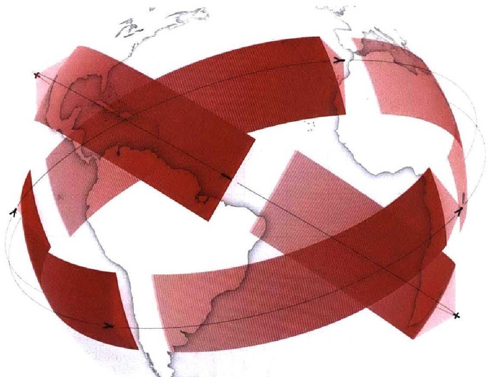

Figure 24. Model of TROPICS System Coverage. Instrument swaths are shown in red. Image credit: [202].

The TROPICS system goal is to provide "an unprecedented combination of horizontal and temporal resolution to measure environmental and inner-core conditions for tropical cyclones on a nearly global scale" [203]. By deploying meteorological sensors in a constellation architecture, TROPICS yields scientific data regarding storm system development and behavior in the tropics regions with increased temporal resolution and observational frequency (as opposed to previous, monolithic missions with similar objectives). These goals are enumerated more formally in Table 27.

Table 27. TROPICS System Goals.

<table border="1"><tr><td>Goal</td><td>Goal Description</td></tr><tr><td>G1</td><td>Return science data pertaining to the radiometric and thermal behavior of tropical cyclones</td></tr><tr><td>G2</td><td>Provide increased temporal resolution and sampling frequency relative to similar, previous experiments</td></tr><tr><td>G3</td><td>Demonstrate the technological benefits of small satellite constellations for Earth science missions</td></tr></table>

## 6.2.2 System Level Accident and Hazard Identification

As defined in Section 5.1, accidents are adverse events that result in a significant loss. While the loss of any spacecraft is a significant loss, for constellation missions, the more significant loss is

<!-- PDF_PAGE: 103 -->

diminished performance, either in the form of decreased science return or coverage outages. This can be caused by the loss of one or more spacecraft or a breakdown of the constellation configuration. On-orbit spares can be used to supplement architectures, and transitioned into operation if a member spacecraft becomes permanently inoperable or must be removed from the constellation. Therefore, the events that lead to a loss of performance and can be considered an accident are dependent upon the mission architecture.

This choice of loss event is not meant to trivialize the loss of a spacecraft, but rather to illustrate that the loss of a spacecraft is not necessarily equivalent to the loss of the system. If the constellation architecture has no spares, the scenarios are the same. Each individual satellite also constitutes a system with possible accident scenarios and hazards that threaten its ability to contribute to the overall mission. To keep this analysis general, the following discussion only focuses on constellation level accident scenarios. As mentioned previously, this is also made possible by the choice of TROPICS as the focus of this STPA, because the individual spacecraft have significant flight heritage.

TROPICS nominally consists of 12 satellites in three planes, but is capable of meeting its science requirements with the installation of eight spacecraft in two of the proposed orbital planes [202]. This is a common strategy for distributed spacecraft missions and often leveraged to support gradual system installation through the definition of performance plateaus [134]. This also allows for the possibility of a system de-scope, while still successfully achieving the mission goals. The system level accidents A1 and A2 in Table 28 are focused on the loss of system performance, accounting for this robustness and the configuration tolerances described in Table 26. Accident A3 is focused on the safe operation of the constellation relative to other orbital assets.

Table 28. Constellation System Accidents.

<table border="1"><tr><td>Accident</td><td>Constellation System Accident Description</td></tr><tr><td>A1</td><td>Loss of one or more satellites in more than one plane; either total loss or functional loss resulting in reduced science return</td></tr><tr><td>A2</td><td>Loss of constellation formation beyond acceptable tolerances</td></tr><tr><td>A3</td><td>Loss of non-member spacecraft due to collision with TROPICS member spacecraft (necessarily coupled with A1, as a collision would destroy both spacecraft)</td></tr></table>

It is also necessary to consider interactions that take place within the orbital system. TROPICS does not leverage intersatellite links so the only possible interaction between member spacecraft is due to physical proximity. Interaction could take the form of either RF interference or a collision between spacecraft on orbit. This interaction and other possible system hazards are identified in Table 29. From these hazards it is possible to derive system safety requirements in the form of system constraints. The safety constraints for the TROPICS system are defined in Table 30.

<!-- PDF_PAGE: 104 -->

Table 29. Constellation System Level Hazards, Traced to System Accidents Identified in Table 28.

<table border="1"><tr><td>Hazard</td><td>Hazard Description</td></tr><tr><td>H1</td><td>Member spacecraft is unable to transmit data to ground station[A1,A2,A3]</td></tr><tr><td>H2</td><td>Member spacecraft is unable to receive data from ground station[A1]</td></tr><tr><td>H3</td><td>Member spacecraft collides with orbital debris or another satellite on orbit[A1,A3]</td></tr><tr><td>H4</td><td>Member spacecraft is unable to maintain attitude[A1,A2,A3]</td></tr><tr><td>H5</td><td>Member spacecraft is unable to maintain orbit.[A2,A3]</td></tr><tr><td>H6</td><td>Member spacecraft is unable to store science data between downlinks[A1]</td></tr><tr><td>H7</td><td>Member spacecraft is unable to collect or downlink payload science data[A1]</td></tr><tr><td>H8</td><td>Member spacecraft is unable to withstand on orbit environment for duration of mission[A1,A2]</td></tr></table>

Table 30. Satellite Technical System Safety Requirements, Traced to System Hazards Identified in Table 29.

<table border="1"><tr><td>Safety Constraints</td><td>Safety Constraint Description</td></tr><tr><td>SC1</td><td>Member spacecraft must maintain communication with ground station to ensure space situational awareness and data downlink [H1,H2]</td></tr><tr><td>SC2</td><td>Member spacecraft must avoid debris and other spacecraft [H3,H4]</td></tr><tr><td>SC3</td><td>Member spacecraft must maintain required attitude [H1,H2,H3,H4,H5]</td></tr><tr><td>SC4</td><td>Member spacecraft must maintain required orbit [H3,H5,H7,H8]</td></tr><tr><td>SC5</td><td>Member spacecraft must gather and store science mission data [H7]</td></tr><tr><td>SC6</td><td>Member spacecraft must return science mission data [H1,H6]</td></tr><tr><td>SC7</td><td>Member spacecraft must be capable of withstanding conditions of orbital environment for the intended mission duration [H3,H5,H8]</td></tr><tr><td>SC8</td><td>Member spacecraft must be capable of operating for the intended mission lifecycle [H4,H5,H6,H7,H8]</td></tr></table>

<!-- PDF_PAGE: 105 -->

## 6.2.3 Organizational Requirements

MIT Lincoln Laboratory is a federally funded research and development laboratory designed to create and test prototype systems for the federal government [204]. The TROPICS program, while proposed by MIT Lincoln Laboratory, is a collaborative effort involving many other organizations and universities [201]. MIT Lincoln Laboratory is responsible for:

- Overseeing the development of the TROPICS system, subsystems, and interfaces

- Tracking and implementing system requirements

- Facilitating ideas from participating organizations and managing mission objectives

- Requesting funds and project resources to design, fabricate, test, launch, and operate the TROPICS system

Table 31. Organizational Requirements, Traced to System Hazards Identified in Table 29.

<table border="1"><tr><td>Organizational Requirements</td><td>Requirements Description</td></tr><tr><td>OR1</td><td>Engineers must design safety modes that prevent loss of communication between constellation member satellites and the ground station. [H1,H2,H7,H8]</td></tr><tr><td>OR2</td><td>Engineers must design TROPICS constellation system and orbital configuration to maintain separation between each of the 12 satellites and to prevent on orbit collision. [H2,H5,H8]</td></tr><tr><td>OR3</td><td>Project manager must ensure that system design and safety requirements are tested and met. [H8]</td></tr><tr><td>OR4</td><td>Ground station controllers must monitor constellation orbital paths and debris fields. [H3,H8]</td></tr><tr><td>OR5</td><td>Lincoln Laboratory must enforce safety procedures that minimize chance of loss of member spacecraft or loss of mission events. [H1,H2,H3,H4,H5,H6,H7,H8]</td></tr></table>

## 6.2.4 Stakeholder Analysis

The stakeholders for the TROPICS constellation include the mission owner, MIT Lincoln Labs and its partner organizations: NASA Goddard Space Flight Center, NASA Wallops Flight Facility, the University of Massachusetts Amherst, the University of Wisconsin Madison, the Utah State University Space Dynamics Laboratory, the Massachusetts Institute of Technology, Cornell University, The National Oceanic and Atmospheric Administration, the University of Miami, and Tufts University [203]. At a higher level, NASA and other satellite owners, particularly those managing assets in close orbital proximity to TROPICS are system safety stakeholders. Other stakeholders include the international space community and commercial program developers that may be impacted by the success of this program (e.g. in the context of future proposals or research contracts) or those that also have interest in understanding the hazard mitigation process for TROPICS. These accidents identified in Table 28 are of interest to all mission stakeholders, regardless of their connection to the mission.

<!-- PDF_PAGE: 106 -->

The first two accidents are A1: the loss of a member spacecraft, either through subsystem failure or total system loss; and A2, the breakdown of the constellation configuration beyond acceptable tolerances. Both accidents directly affect the stakeholders who invested financially in the system or the science data that would have been returned from the constellation. Indirectly, stakeholders with nearby on orbit assets are impacted because the surrounding orbital environment is altered. An inoperable member spacecraft effectively becomes orbital debris, and collision risk increases for all orbits intersecting that of the member spacecraft. This is the basis of accident A3: Loss of non-member spacecraft due to collision with TROPICS member spacecraft. Furthermore, collision could result in additional fragments on orbit, which poses particular risk for orbit contamination and orbital debris propagation for constellations [205].

H1, the inability of a member spacecraft to transmit to ground station, and H4, the inability of a member spacecraft to maintain attitude, affect all three potential system accidents and are of particular interest to system stakeholders. In the case where the satellite cannot transmit information or science data to the ground, H1 and H7, the mission objectives to demonstrate constellation effectiveness and return high amounts of radiometric and thermal data cannot be met. With respect to mission objectives, the inability to transmit data to the ground station is functionally equivalent to the complete loss of the satellite. H3, collision damages to the satellite, impacts the greatest number of stakeholders because it will impact the ability to meet mission objectives and could pose a hazard to surrounding vehicles or contribute to the orbital debris concerns of a particular orbit.

## 6.2.5 Hierarchical Safety Control Structure

In this section, a hierarchical safety control structure for the TROPICS system is proposed, based on available mission data and existing regulations governing the operation of spacecraft in LEO. Solid lines within figures indicate controls that have been identified within the existing mission documentation; dashed lines indicate controls that are likely to exist or would benefit the system if they were to be implemented. In each case, the control annotation is a proposed summary of information that could be exchanged between each entity, based on available documentation whenever possible.

The top level of the hierarchical control structure for TROPICS should include NASA, US Space Command, and the International Telecommunication Union (ITU), to manage the orbital slot assignment and frequency assignment to ensure that the spacecraft do not pose a threat to each other or other spacecraft. This will further provide protection against accident scenarios A1 and A3. Moving down a level within the hierarchy, TROPICS will be managed by MIT Lincoln Laboratory and its partner institutions, enumerated above. The next lower level consists of Project Management, which is largely concentrated at MIT Lincoln Laboratory.

The project management team will impose safety standards on the constellation design, which will be incorporated into the system design requirements along with system test requirements. The system level requirements will influence constellation implementation and system integration testing. Constellation integration involves testing and assembly of each spacecraft as well as testing of the system as a whole. This two-tier integration process will be governed by the implementation requirements that are derived from the system level requirements set by the project management team.

<!-- PDF_PAGE: 107 -->

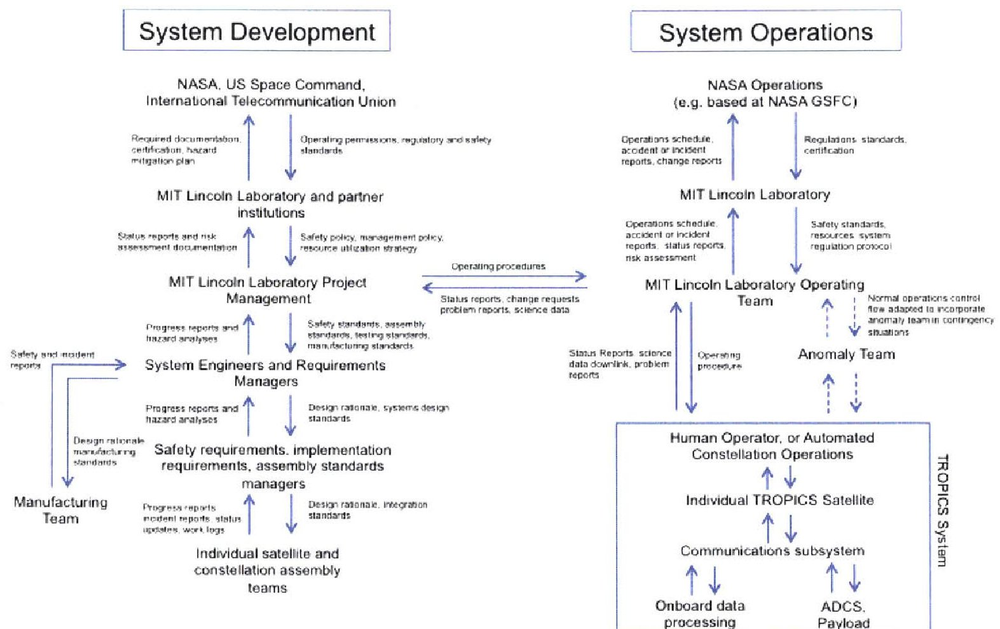

Figure 25. Proposed TROPICS System Hierarchical Control Structure.

The manufacturing team should report to project management at MIT Lincoln Labs to ensure that the design is implemented to acceptable standards. There may be several layers of control within the manufacturing team depending on the complexity of the system and manufacturing methods selected. Each subsystem should be considered multiple copies of a single unit, given the constellation architecture, which implies that the manufacturing team and integration teams should work closely with one another to ensure that small design defects do not propagate to system level faults. Given that TROPICS has no onboard propulsion system, orbit maintenance and station keeping abilities will be severely limited, leveraging only spacecraft drag related maneuvers for orbital phasing. This suggests that the project management team must work closely with the TROPICS operating team to ensure that the system is well suited to the concept of operations selected to achieve the mission goals. This includes allowing for the appropriate level of uncertainty regarding the execution of the drag maneuvers.

The system operations should be governed, at the highest level, by NASA GSFC and industry standards pertaining to spacecraft communications and accident mitigation. MIT Lincoln Labs will govern the TROPICS operating team through internally defined operating standards, which should include the definition and training of an anomaly team $ ^{12} $ that can be used to troubleshoot on orbit configuration errors. The operating team should communicate directly with the satellites to manage the downlink of science data and day-to-day operation of the satellites. Daily operations will include a human controller interacting with the satellite to manage attitude

<!-- PDF_PAGE: 108 -->

determination tasks, scheduling of downlinks, and status checks. Additional operations details will depend on the degree of automation designed into the constellation operations scheme.

As discussed above, the TROPICS constellation system is a system of systems containing 12 individual satellites. To appropriately address the constellation hazards outlined in Table 29, it is necessary to also develop a hierarchical control structure at the satellite level that accounts for the connection between the leadership teams at MIT Lincoln Labs and NASA GSFC. The proposed control hierarchy is illustrated in Figure 26.

At the top level of development, NASA GSFC should oversee design reviews, define safety standards, and provide resources to the MIT Lincoln Laboratory development team, which will in turn provide all required documentation and design deliverables. This MIT team will interface with the lead on the MIT Lincoln Laboratory Operations Team to define operational requirements and provide status updates as development proceeds. The MIT Lincoln Laboratory development team will work directly with the system engineering and constellation design team to outline high level system requirements. At the next lowest level, the system engineering team must interact with the lead system engineers for the individual satellites to manage the system of systems architecture effectively.

The development lead for the individual satellites must interface with the satellite subsystem leads, who have direct connections to the manufacturing team, and the integration and test groups. The individual satellite team leads must also work closely with the science teams based at University of Madison Wisconsin and the University of Miami (working with the National Hurricane Center) to iterate on science performance metrics and track requirement flow down throughout the system. This will protect against faults that may threaten the success of the onboard communications system, and therefore can be used as protection against all accident scenarios.

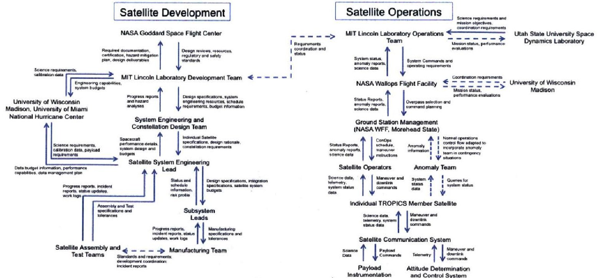

Figure 26. Proposed Member Spacecraft Level Hierarchical Control Structure.

<!-- PDF_PAGE: 109 -->

MIT Lincoln Laboratory should direct TROPICS operations and interface with Utah State University Space Dynamics laboratory to manage the constellation operations requirements. MIT Lincoln Laboratory should also provide routine mission status and performance updates to USU SDL. MIT Lincoln Laboratory should provide system commands and operating requirements to NASA Goddard Space Flight Center's Wallops Flight Facility, which is responsible for scheduling downlink and maneuver commands according to each satellite's expected orbital path. Wallops Flight Facility should return status reports, anomaly information, and science data to MIT Lincoln Laboratory. Wallops Flight Facility will manage each of the three ground stations that have been included within the current mission design. This will include two locations managed by NASA and another by Morehead State University.

Each ground station will include an anomaly team, as discussed above, and a nominal operating team. The ground station mission leads will provide the TROPICS concept of operations and the concept of operations for each individual satellite, maneuver commands, and downlink requirements to the satellite operator. The satellite operator will command the individual satellite by interfacing with the satellite communication system, which will in turn command the onboard attitude determination and control system and payload instrumentation. These subsystems will return telemetry, system status, and payload data to the operator. The operator will pass it up the hierarchy to Wallops Flight Facility, which will transmit the data to the science analysis team based at the University of Wisconsin Madison. In order to ensure that science objectives are met, there should be routine interaction between Wallops and the University of Wisconsin Madison, this will directly relate to accident scenarios A1 and A2.

## 6.2.6 STPA: Hazard Identification and Analysis

The first step of the STPA analysis is to assess hazard control actions within the TROPICS system. In this case study, these control actions will relate to a software control action and an operator control action that contribute to A1, the loss of one or more satellites in more than one plane.

The purpose of the control action analysis is to determine what control action behaviors would result in unsafe actions in various operating scenarios. From this analysis, we can derive control action requirements that will prevent unsafe actions from occurring. Control actions can be hazardous in four ways [193]:

1. A control action required for safety is not provided or is not followed.

2. An unsafe control action is provided that leads to a hazard.

3. A potentially safe control action is provided too late, too early, or out of sequence.

4. A safe control action is stopped too soon or applied too long (for a continuous or non-discrete control action).

## 6.2.6.1 Avionics Hazard Identification

Each TROPICS member spacecraft is packaged with eight Earth horizon sensors and an ADCS reaction wheel subsystem. These systems are assumed to have the traditional attitude sensing

<!-- PDF_PAGE: 110 -->

capabilities, and along with other onboard processes, are managed by the satellite avionics. The avionics subsystem is therefore critical to the functionality of each member spacecraft, and assuming the subsystem is identical on each member spacecraft, the complete constellation system.

Avionics software acts as a controller onboard each constellation member spacecraft. Satellite attitude control is critical to maintaining communications with the ground station and aligning solar cells with the sun. If a satellite is unable to manage its attitude using the onboard equipment, the satellite may not be able to orient itself properly for these mission critical actions. Avionics further manages power distribution onboard the spacecraft, ensuring instruments can gather, store, and downlink science data and telemetry information. Figure 27 illustrates a standard avionics control structure.

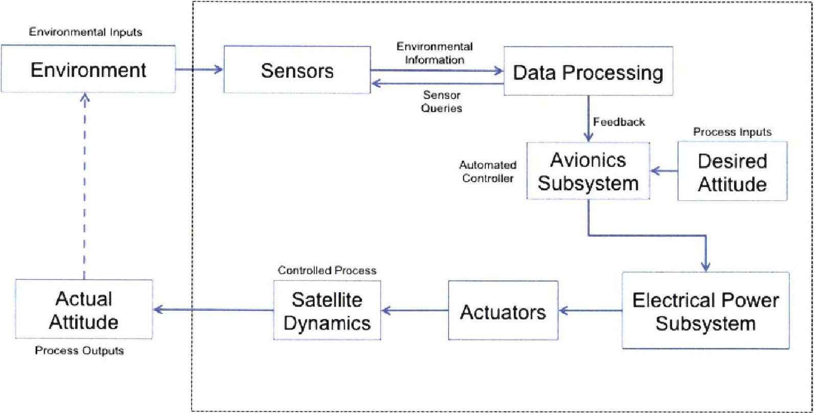

Figure 27. Avionics Control Structure.

Individual TROPICS member satellite

The STPA process is not conducted for avionics subsystem as a controller for two reasons. The first is that this STPA effort is focused on system level, rather than spacecraft level risks, and design of the avionics system is conducted at the spacecraft level. Secondly, and more importantly, software in complex systems can easily surpass human intellectual limits, such that it "cannot [be understood] in terms of being able to determine how it will behave under all conditions" [193]. The extent to which software risks may impact the success of LEO constellations is beyond the scope of this thesis case study, but its understanding will be a critical to their success and to preventing accidents. To illustrate this criticality, the subsets of hazards and corresponding control actions associated with the TROPICS avionics software are stated below.

<!-- PDF_PAGE: 111 -->

## Hazards Controlled by Avionics Software:

H1: Member spacecraft is unable to transmit data to ground station [A1, A2, A3]

H2: Member spacecraft is unable to receive data from ground station [A1]

H4: Member spacecraft is unable to maintain attitude [A1, A2, A3]

H6: Member spacecraft is unable to store science data between downlinks [A1]

H7: Member spacecraft is unable to collect or downlink payload science data [A1]

## Satellite System Safety Constraints on Avionics Software:

SC1: Member spacecraft must maintain communication with ground station to ensure space situational awareness and data downlink [H1, H2]

SC3: Member spacecraft must maintain required attitude [H1, H2, H3, H4, H5]

SC4: Member spacecraft must maintain required orbit [H3, H5, H7, H8]

SC5: Member spacecraft must gather and store science mission data [H7]

SC6: Member spacecraft must return science mission data [H1, H6]

SC8: Member spacecraft must be capable of operating for the intended mission lifecycle [H4, H5, H6, H7, H8]

While TROPICS is not a formation flying mission, it is important to note that the consequences of these hazards are heightened if the member spacecraft of a system are operating in close proximity to one another.

## 6.2.6.2 Constellation Software Risk Discussion

Software has been shown to contribute adversely to aerospace system accidents [190], and previous work has noted that modern constellations are more likely to rely on autonomous decision making capability than previous space systems [17]. Documentation available for TROPICS does not suggest an abnormally high reliance on automated processes, but they are addressed here for completeness.

Traditionally, operational decisions for space systems are made on the ground and transmitted to the spacecraft for execution. Onboard processing power is expensive and carries greater risk, particularly given the relative immaturity of aerospace intelligent technologies [17]. However, proposed second-generation LEO constellation systems include, in some cases, thousands of satellites. Coordinating maneuvers for member spacecraft in these systems will be a complex problem that will require some degree of automation either on board the spacecraft or on the ground. If decision making authority is granted to the spacecraft, "units could generate data products (at least partially) on board, coordinate their schedules to observe interesting targets simultaneously, tune their instruments in coordination to look at these targets from complementary angles or spectral bands, or sell/buy resources to/from each other in real time" [17]. Autonomous vehicle decision-making is a rapidly growing field of systems engineering and software research, for both aerospace and terrestrial systems [206], [207]. Further development in this research area as it pertains to constellations is essential. There are already documented instances of automated operations contributing to off-nominal constellation performance during the ST5 mission [10].

<!-- PDF_PAGE: 112 -->

Cyber security has also been shown to be a significant concern for existing constellations, such as the GPS System, which is vulnerable to jamming and being made to produce false signals [208]. Beyond system interference, cyber security concerns extend to satellite collision avoidance [17]. Orbital parameters are often treated as proprietary information in the space industry, although increased data sharing would increase the fidelity of collision forecasting efforts. Efforts have been proposed to enable greater coordination through orbital position data sharing, but without guarantees that their data are secure, corporations are unlikely to opt in to such a program [17].

Collectively, these ongoing research efforts and the constellation hazards discussed in the preceding section underscore the need for a deeper understanding of constellation system software to prevent accidents. Notably, software intensive operations in second-generation constellations are discussed in Chapter 5 as key challenges facing cost estimators. Constellation software systems are already challenging the existing paradigm, and the limited industry experience in addressing these concerns could threaten the viability of second-generation systems.

## 6.2.6.3 Spacecraft Drag Maneuver Hazard Identification and Analysis

Returning the discussion of the TROPICS system, the key control action provided by ground operators is the commanding of drag maneuvers. Each satellite will undergo a series of drag maneuvers that will leverage spacecraft form factor and atmospheric drag in LEO to gradually decrease the satellite velocity, resulting in an orbital configuration for the 12 spacecraft that will allow for the completion of mission objectives: equally spaced RAAN $ (\pm 30^{\circ} $ tolerance), 550 km altitude $ (\pm 50 $ km tolerance), and $ 30^{\circ} $ inclination $ (\pm 3^{\circ} $ tolerance) [202]. It is assumed that each spacecraft can be commanded to execute a drag maneuver independently, for both phasing and to avoid collision with another space object if necessary. These maneuvers, whether conducted by a human or computer operator, are control actions that can produce unsafe behaviors tracking to all of the accidents outlined in Table 28.

The mission operations team for TROPICS will include system experts and operators from MIT Lincoln Laboratories, the Utah State University Space Dynamics Laboratory, and NASA Goddard Space Flight Center. The command, control, communication and data elements for TROPICS are illustrated in Figure 28 [202].

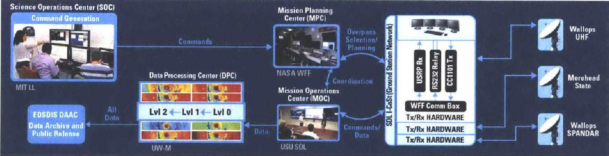

Figure 28. TROPICS Command, Control, Communication, and Data Elements. Image Credit: [202].

Human operators will manage each spacecraft using ground station equipment and software. Operators for each satellite will be responsible for ensuring that the spacecraft are adequately

<!-- PDF_PAGE: 113 -->

positioned within their respective orbital planes, and are appropriately positioned to contribute to the greater system of systems including all 12 spacecraft. On orbit oversight generally includes monitoring orbital position, altitude, and orientation data of the satellite while also monitoring the on orbit conditions, including orbital debris.

The control action of interest is executing drag maneuvers in support of the aforementioned mission operations objectives. Again, it is assumed that the operator sends a command to execute required maneuvers to place a single satellite in the appropriate orbital position either to phase the spacecraft appropriately or avoid an on-orbit collision. Figure 29 illustrates the control diagram for such maneuvers with a human in the loop controller.

## Hazards Controlled by Drag Maneuvers:

H3: Member spacecraft collides with orbital debris or another satellite on orbit [A1, A3]

H5: Member spacecraft is unable to maintain orbit. [A2, A3]

H8: Member spacecraft is unable to withstand on orbit environment for duration of mission [A1, A2]

## Satellite System Safety Constraints on Drag Maneuvers:

SC2: Member spacecraft must avoid debris and other spacecraft [H3, H4]

SC3: Member spacecraft must maintain required attitude [H1, H2, H3, H4, H5]

SC4: Member spacecraft must maintain required orbit [H3, H5, H7, H8]

SC7: Member spacecraft must be capable of withstanding conditions of orbital environment for the intended mission duration [H3, H5, H8]

SC8: Member spacecraft must be capable of operating for the intended mission lifecycle [H4, H5, H6, H7, H8]

## Functional Requirements of the Spacecraft:

1) Receive commands from the ground station

2) Validate impact of command through onboard data processing

3) If validation indicates maneuver is feasible, execute maneuver

<!-- PDF_PAGE: 114 -->

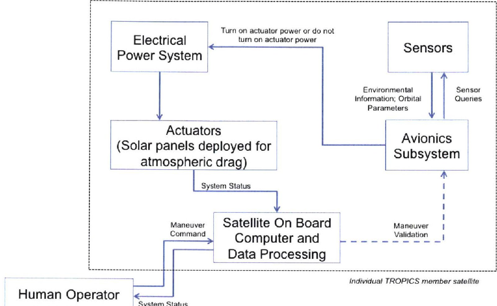

Figure 29. Satellite Maneuver, Human in the Loop Control Structure.

Unsafe control actions for the drag maneuvers for orbital positioning are summarized in Table 32. Unsafe control actions for the drag maneuvers for collision avoidance are summarized in Table 33.

Table 32. Unsafe Control Actions (UCA) - Phasing Maneuver Execution.

<table border="1"><tr><td>Control Actions</td><td>Not Providing Command Causes Hazard</td><td>Providing Command Causes Hazard</td><td>Incorrect Timing or Order Causes Hazard</td><td>Duration Too Long/Too Short Causes Hazard</td></tr><tr><td>Orient solar panels to increase drag</td><td>UCA 1: Spacecraft are not adequately spaced within orbital plane and pose collision threat or diminish science return [H3,H5]</td><td>UCA 2: Drag maneuver results in excessive disturbance and results in off-nominal configuration, tending toward diminished science return or loss of satellite [H3,H5,H8]</td><td>UCA 3: Spacecraft are insufficiently or excessively spaced within orbital plane [H3,H5,H8]</td><td>UCA 4: Insufficient/Excessive spacing results in off-nominal configuration, tending toward diminished science return [H5,H8]</td></tr></table>

<!-- PDF_PAGE: 115 -->

Table 33. Unsafe Control Actions (UCA) - Collision Avoidance Maneuver Execution.

<table border="1"><tr><td>Control Actions</td><td>Not Providing Command Causes Hazard</td><td>Providing Command Causes Hazard</td><td>Incorrect Timing or Order Causes Hazard</td><td>Duration Too Long/Too Short Causes Hazard</td></tr><tr><td>Orient solar panels to increase drag</td><td>UCA 5: Spacecraft are not adequately re-position to avoid impending collision[H3,H5,H8]</td><td>UCA 6: Drag maneuver results in excessive orbital disturbance and spacecraft orbit begins to decay[H3,H5,H8]</td><td>UCA 7: Maneuver is executed too early and too late and attempt to avoid a collision is unsuccessful or a new collision threat is introduced[H3,H5,H8]</td><td>UCA 8: Insufficient/Excessive spacing fails to avoid a collision is unsuccessful or a new collision threat is introduced[H5,H8]</td></tr></table>

These unsafe control actions reveal the need for additional drag maneuver specific safety constraints, which are shown in Table 34.

Table 34. Additional Safety Constraints Deriving from Unsafe Control Actions Identified in TablesTable 32Table 33.

<table border="1"><tr><td>Safety Constraints</td><td>Safety Constraint Description</td></tr><tr><td>SC9</td><td>Member spacecraft avionics must validate the feasibility of received command with avionics subsystem [UCA2]</td></tr><tr><td>SC10</td><td>Human operator must monitor system status reports to monitor constellation performance [UCA1-UCA8]</td></tr><tr><td>SC11</td><td>Member spacecraft must maintain required attitude such that solar panels are properly oriented for drag maneuver [UCA2,UCA6]</td></tr></table>

Safety constraints S9 and S11 are linked to the avionics subsystem described in Section 6.2.6.1, further illustrating the tight coupling between second-generation constellation software and system safety.

An optional additional step in the STPA process, which may be of interest for TROPICS stakeholders or cubesatellite constellation researchers, is the determination of how these unsafe control actions could occur. This is left for future work. TROPICS has not yet been fielded and a causal analysis based on information contained within existing publications would be speculative.

## 6.3 Generalized Results from STPA

The TROPCIS case study presented in the previous section captures many of the risks facing second-generation constellations. This analysis has been conducted using high-level specifics, and a more detailed assessment of TROPICS or a similarly representative second-generation constellation would be a valuable future effort. Based on this initial analysis and other literature on this topic, two limitations within the current constellation paradigm that could affect second-generation systems can be identified.

A key outcome of the STPA presented here is that the loss of a constellation member spacecraft is not necessarily as significant to the mission outcome as degradation of the constellation

<!-- PDF_PAGE: 116 -->

structure. This result follows from the notion that system performance is an emergent property, and that constellation value stems from multiple spacecraft working collaboratively. If the constellation is not tolerant to the loss of a member spacecraft, either through the use of on-orbit spares or science requirements that can still be met with reduced performance, the impacts of these loss events are the same. Obviously, all reasonable efforts should be made to prevent the loss of an orbital asset but the most significant loss to a constellation system is created when the overall system performance capacity is reduced. This perspective may impact traditional perspectives on spacecraft risk and permit mission owners to consider architectures with lower individual spacecraft reliability as long as the system is tolerant to the loss of member spacecraft.

Paradigm Limitation 6:

<table border="1"><tr><td>Traditional spacecraft mission assurance efforts have equated the loss of a single spacecraft as equivalent to loss of mission (LOM). Constellation architectures may be tolerant to the loss of one or more spacecraft. Therefore, a system-focused perspective on accident prevention that treats degraded performance as the most critical loss event may better promote second-generation constellation success.</td></tr></table>

However, an important caveat to this is that robustness to failure does not lessen orbital debris mitigation requirements. On-orbit collisions with orbital debris and other spacecraft remains one of the most important concerns facing the satellite industry. Currently, the United Nations Inter-Agency Space Debris Coordination Committee (IADC) suggests that post-mission orbit lifetime be no longer than 25 years. Reports have suggested, however, that cubesatellites, particularly those at orbital altitudes greater than 600 km, are at an increased risk of violating this guideline, [209]. Given the number of second-generation constellations proposing to use small satellites, such as cubesatellites, this forecast has important legal and regulatory implications. Orbital debris policy is explored more thoroughly in Chapter 4.

The generalized risk identified through this STPA effort is the extent to which constellations are rapidly becoming software intensive systems, even in the face of uncertainty regarding software reliability. Automated operations in constellations have already resulted in off-nominal constellation performance, and existing constellations have been shown to be vulnerable to cyber security threats. A deep and nuanced understanding of constellation software behaviors will be critical to the success of second-generation systems.

## Paradigm Limitation 7:

Second-generation satellite constellations are likely to leverage a greater degree of automated processing than ever before. This may force traditional risk assessments to consider software vulnerabilities to a greater extent, and literature addressing these needs is still evolving. A mismatch may be emerging between the industry's ability to build software-intensive constellations and its ability to understand their operational risks.

## 6.4 Orbital Debris Collision Risk

The previous STPA analysis emphasized the risk of collision facing satellite constellations. This risk is well acknowledged by the space industry and within the literature. The following sections are an evolution of work first published in the 2017 American Institute of Aeronautics and Astronautics (AIAA) SPACE Exposition and Forum conference proceedings [125]. Since its

<!-- PDF_PAGE: 117 -->

initial publication, the concepts addressed within the work have been revisited, a computational error has been corrected, and the conclusions have been refined.

## 6.4.1 Orbital Debris Environment

Collisions with other member spacecraft are of particular concern because any orbital debris generated by a collision would necessarily be in orbits that intersect with the original. In any constellation with multiple spacecraft in one plane, this increases the local debris field density and, by extension, the risk of collision to other member spacecraft. Collisions between spacecraft are extremely rare. In fact, the first major collision between two satellites occurred in 2009 between Iridium 33 and a defunct Russian satellite, Cosmos 2251 [210]. The collision illustrates a major challenge facing second-generation constellation operators. Despite ground software estimates suggesting that an approach as close as 117 meters was possible, uncertainty within the calculations prevented a definite prediction of the collision [211]. In fact, data available at the time would not have suggested that this particular approach posed the greatest threat to Iridium, then a 66-satellite constellation, in the week preceding the accident. Around the time of the expected close approach, Iridium 33 ceased downlinking information to ground stations on Earth. Shortly thereafter, the United States SSN reported debris clouds in the Iridium 33 and Cosmos 2251 orbits. Much of the knowledge that helped analysts assess the result of the 2009 collision emerged from a 1986 collision experiment. During the experiment, the upper stage of a Delta 180 launch vehicle was made to collide with the spacecraft the rocket had placed in orbit [212]. This knowledge helped initially characterize the debris cloud generated in 2009. The collision destroyed both satellites, and generated more than a thousand pieces of orbital debris, 30% of which came from Iridium 33 and became a concern for other satellites within the Iridium constellation that still occupied nearby or intersecting orbits [213].

Collisions with pieces of orbital debris are of equal, if not greater, concern to constellation operators. Even small pieces of debris can cause catastrophic damage to a spacecraft, and if the debris is sufficiently small, advanced detection may be impossible. The orbital debris environment in LEO is not a new concern. The orbital debris environment was first studied at NASA Johnson Space Center (JSC) in the early 1970s, and researchers concluded that any collision between active satellites and orbital debris was highly unlikely [31]. Their work suggested that only objects with a diameter greater than 100 meters faced a significant threat. Subsequent studies based out of NASA Langley Research Center (LaRC) and NASA JSC predicted that the true orbiting population was much larger than the existing catalogued population, which in turn suggested that the collision threat was higher than originally calculated [31]. Fragments from anticipated collisions emerged as potential threats to future missions, particularly those in LEO, where the majority of orbital assets and human missions take place. With the advent of second-generation LEO constellations, the orbital debris environment is of great interest for mission stakeholders.

The Inter-Agency Space Debris Coordination Committee (IADC), one of several international collaborative efforts attempting to characterize and understand the orbital debris situation, defines space debris as "all man-made objects including fragments and elements thereof, in Earth orbit or re-entering the atmosphere, that are non-functional" and the UN has adopted a similar definition [214]. These objects are tracked and catalogued by a variety of agencies on Earth, including the United States Space Surveillance Network (SSN) and the Inter-Agency Space Debris Coordination Committee, as well as the United States, Russian, and Chinese militaries.

<!-- PDF_PAGE: 118 -->

The tracked objects generally fall into four categories: fragmentation debris, mission related debris, rocket bodies and launch vehicle upper stages, and defunct satellites [215]. The contribution of each of these categories to the total orbital debris object count is monitored and frequently published by NASA; Figure 30 is from the February 2018 (Volume 22, Issue 1) Orbital Debris Quarterly News, and represents the most recent of these debris field characterizations. Small pieces of orbital debris, particularly those smaller than a few centimeters in diameter present unique tracking challenges; hundreds of thousands of untracked objects may be in Earth's orbit and are not accounted for within this figure [130].

Monthly Number of Objects in Earth Orbit by Object Type

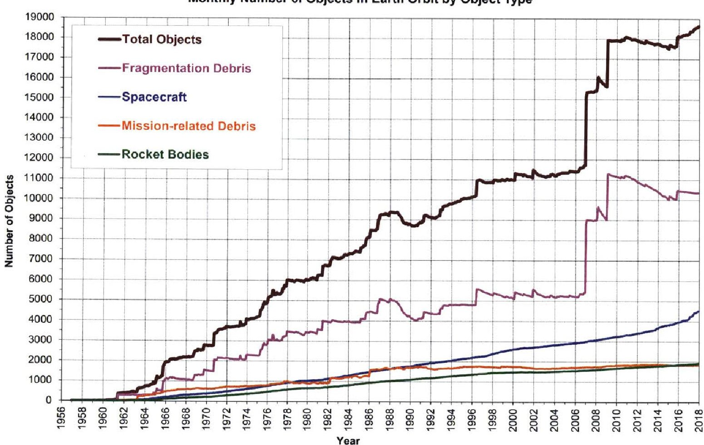

Figure 30. Orbital Debris Field Characterization, figure produced by NASA Orbital Debris Program Office, Image Credit: [215].

The last two decades have seen nearly a 70% increase in the total orbital debris object count. The two most significant contributors to that increase are the 2007 Chinese Fengyun-1C anti-satellite test and the 2009 collision between Iridium 33 and Cosmos 2251. In January 2007, China verified its anti-satellite technology by destroying one of its own failing weather satellites, Fengyun-1C. The resultant debris cloud represented the largest single event increase to the orbital population in history. Improved tracking capability identified additional fragments from the 2007 anti-satellite test and the 2009 collision in 2012, shown in Figure 30 as a step increase in total number of tracked objects during that year.

Failed launches of both the Ariane and Pegasus launch vehicles, in 1986 and 1995 respectively, also increased the total debris population, as can be seen in the years following the collisions, although to a lesser extent than the aforementioned incidents [216]. Gradual orbital decay and

<!-- PDF_PAGE: 119 -->

atmospheric re-entry over time can result in a decrease in the overall debris count, and voluntary mitigation measures in the early 1980s were successful at reducing the overall population, as seen within the figure.

The impact of orbital debris collisions largely depends on the size of the debris involved in collision and the speed of the impact. For small pieces of debris, those smaller than 0.01 centimeter in diameter, shielding can be sufficient protection against surface erosion and pitting, but debris fragments as small as flecks of paint have done substantial damage to the Space Shuttle and International Space Station (ISS) [131], [132]. Debris ranging from 0.01 to 1 centimeter in diameter can cause impact damage that significantly degrades system performance, and impacts from pieces larger than 1 centimeter in diameter are sufficiently large to disable a spacecraft [131]. Small pieces of orbital debris, particularly those smaller than a few centimeters in diameter present unique tracking challenges, and experts believe that the number of untracked objects in Earth's orbit numbers in the hundreds of thousands [217].

Novel satellite mission profiles, including the increased prevalence of constellations and small satellites, have further contributed to the increase in the number of objects in orbit. Small satellite missions, namely those involving spacecraft with a mass below 1,200 kg, have been identified as a contributing factor to the increase in the number of spacecraft launched between 2012 and 2016, up 53% over the preceding five-year period [92]. Recent estimates suggest there are 1,071 spacecraft in LEO [49], and approximately 750,000 pieces of orbital debris measuring more than 1 centimeter in diameter in Earth's orbit (as of January 2017) [218].

## 6.4.2 Orbital Debris and Satellite Constellations Literature Review

The projected increase in the number of launches to LEO, including both single spacecraft and constellation missions, has renewed concerns regarding the possibility of collisions between active spacecraft and orbital debris. Constellation operators have considered the role of orbital debris in managing their NGSO systems, as evidenced by the orbital debris mitigation strategies associated with the FCC petitions for each licensed system. The academic literature has similarly taken interest in the concept of large constellations, sometimes called 'mega constellations', and their interaction with the space debris environment.

Prior research has examined how the orbital debris environment may evolve in response to the introduction of large satellite constellations. In 1997, Walker et al. considered a constellation consisting of 840 member spacecraft at 800 km altitude [219]. More recently, Virgili et al. examined the LEO environmental response to the introduction of a large satellite constellation with varying levels of de-orbit reliability [205]. This study also compared the anticipated orbital debris cloud assuming that end of life mission disposal guidelines (for satellites and launch vehicle upper stages, as proposed by the UN) are implemented with a 90% success rate and the debris cloud that would exist following the launch and subsequent disposal (under the same disposal assumptions) of a hypothetical constellation consisting of 1080 satellites, distributed across 20 orbital planes at 1,100 km altitude. This comparison is demonstrated in Figure 31.

The debris cloud in the case without the constellation increases gradually over time, in keeping with other similar studies. In the constellation case, the number of objects in LEO increases dramatically, and then decreases as pieces of debris at sufficiently low orbital altitudes naturally re-enter the Earth's atmosphere. Even with this natural debris attrition, the impact of the

<!-- PDF_PAGE: 120 -->

constellation is significant, showing the addition of approximately 5000 pieces of orbital debris that are greater than 10 centimeters in diameter. As discussed above, objects of this size could cause catastrophic impact damage on other spacecraft, including manned vehicles such as the ISS. Further heightening the severity of this hypothetical situation, the 90% success rate of adherence to disposal guidelines may be optimistic, and so the simulation of the orbital debris environment was also considered for lower disposal success rates. The results, presented for three different disposal success rates, are presented in Figure 31 and indicate that even the introduction of a single constellation could permanently contaminate the LEO environment, and potentially approach the 'cascading collision' state proposed by Kessler in the 1970s [130].

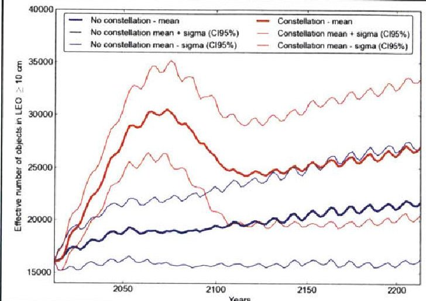

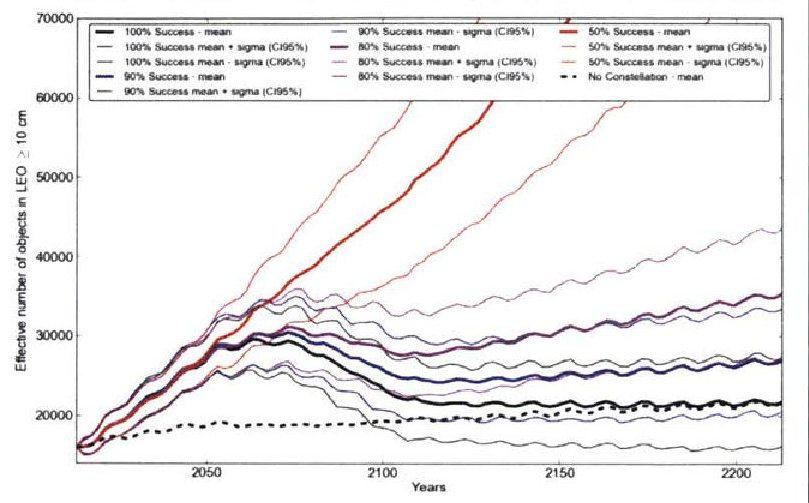

Figure 31. Comparison of orbital debris environment development without (left) and with (right) hypothetical large constellation, Image Credit: [205].

It is important to emphasize that the 2016 study includes only one large satellite constellation consisting of 1080 satellites, which is approximately 20.5% of the number of spacecraft that have been licensed to launch as part of NGSO systems in the coming decade. This increase in the number of orbital objects could significantly increase the collision risk to other spacecraft. More detail on licensed NGSO systems is provided in the subsequent section. Rossi et al. also argued that the existing orbital debris management schemes may be insufficient given the projected concentration of spacecraft in particular altitude bands, resulting in a significant increase in the risk of a chain reaction of collisions [220].

Second-generation NGSO constellation proposals have also garnered particular interest. While previous research examined either hypothetical constellations or the projected increase in the number of spacecraft in LEO, recent studies have examined contemporary proposals in detail. One study concluded that the number of collision alert warnings will increase significantly in response the implementation of the proposed NGSO systems and that effective, long-term operation will likely require updates to the existing space traffic management scheme [221]. The OneWeb constellation has previously been examined as a case study for how mega constellations may interact with the orbital debris environment, considering both orbital maneuvering capability and nature of possible fragmentation clouds [222].

## 6.4.3 NGSO Orbital Debris Case Studies

Recent applications to the US Federal Communications Commission (FCC), which regulates radio spectrum use for domestic spacecraft and coordinates with the UN International Telecommunications Union (ITU) to avoid interference with international spacecraft, have

<!-- PDF_PAGE: 121 -->

indicated that private firms are aggressively pursuing technologies that would enable large scale satellite constellations to provide unprecedented communications services from space. These 'mega-constellation' proposals are an interesting facet of the conversation surrounding second-generation constellations because, while many of these systems are already in development, they have not yet been fully installed. Consequently, the trends illustrated in Chapter 3 may shift substantially, reflecting a greater number of constellations focused on commercial telecommunications services and architectures with hundreds or thousands of member spacecraft.

## 6.4.3.1 NGSO Constellation Systems

OneWeb filed a petition with the FCC on April 28, 2016, for a constellation consisting of 720 satellites at an altitude of approximately 1,200 km, evenly distributed across 18 near-polar orbital planes. The goal of the constellation is to "provide ubiquitous low latency broadband connectivity across the United States, including some of the most remote areas in places like Alaska where broadband access has not been possible before" [223]. Following a round of discussion regarding the petition and input from a range of other satellite operators, the FCC granted the request on June 22, 2017. A summary of the proposed constellation is provided in Table 35.

Table 35. OneWeb Constellation Data Summary [223] - [225].

<table border="1"><tr><td>Parameter</td><td>Licensed Deployment</td></tr><tr><td>Total Number of Spacecraft</td><td>720</td></tr><tr><td>Orbital Planes</td><td>18</td></tr><tr><td>Satellites per Plane</td><td>40</td></tr><tr><td>Circular Altitude(km)</td><td>1200</td></tr><tr><td>Orbital Inclination(degrees)</td><td>87.9</td></tr><tr><td>Approximate Mission Lifetime(years)</td><td>7</td></tr><tr><td>Spacecraft Mass(kg)</td><td>150</td></tr><tr><td>Spacecraft Cross-Sectional Area(m2)</td><td>3.5</td></tr><tr><td>Licensing Date</td><td>June 22,2017</td></tr></table>

The OneWeb filing was the first in a series of similar petitions to the FCC for large satellite constellations aiming to provide broadband communication services. Following the OneWeb application, the FCC solicited proposals from other companies that may be seeking operating permissions in the same frequency bands, triggering a series of follow-on proposals from other private space companies. Since this 2016 processing round, four NGSO satellite constellations have been approved, including OneWeb. Summaries of the three additional systems are provided in Table 36 to Table 38.

<!-- PDF_PAGE: 122 -->

Table 36. Space Norway AS Constellation Data Summary [226] - [228].

<table border="1"><tr><td>Parameter</td><td>Licensed Deployment</td></tr><tr><td>Total Number of Spacecraft</td><td>2</td></tr><tr><td>Orbital Planes</td><td>1</td></tr><tr><td>Satellites per Plane</td><td>2</td></tr><tr><td>Altitude-Apogee;Perigee(km)</td><td>43,509;8,089</td></tr><tr><td>Orbital Inclination(degrees)</td><td>63.4</td></tr><tr><td>Approximate Mission Lifetime(years)</td><td>15</td></tr><tr><td>Spacecraft Mass(kg)</td><td>2000-3000</td></tr><tr><td>Spacecraft Cross-Sectional Area(m^2)</td><td>5-6</td></tr><tr><td>Licensing Date</td><td>November2,2017</td></tr></table>

Table 37. Telesat Canada Constellation Data Summary [84], [229].

<table border="1"><tr><td>Parameter</td><td colspan="2">Licensed Deployment</td></tr><tr><td>Total Number of Spacecraft</td><td colspan="2">117</td></tr><tr><td>Total Number of Spacecraft in Set</td><td>45</td><td>72</td></tr><tr><td>Orbital Planes</td><td>5</td><td>6</td></tr><tr><td>Satellites per Plane</td><td>9</td><td>12</td></tr><tr><td>Circular Altitude(km)</td><td>1248</td><td>1000</td></tr><tr><td>Orbital Inclination(degrees)</td><td>37.4</td><td>99.5</td></tr><tr><td>Approximate Mission Lifetime(years)^{13}$</td><td>7</td><td>7</td></tr><tr><td>Spacecraft Mass(kg)</td><td>70</td><td>70</td></tr><tr><td>Spacecraft Cross-Sectional Area(m^2)^{14}$</td><td>0.23</td><td>0.23</td></tr><tr><td>Licensing Date</td><td colspan="2">November 2,2017</td></tr></table>

<!-- PDF_PAGE: 123 -->

Table 38. SpaceX Constellation Data Summary [139], [230].

<table border="1"><tr><td>Parameter</td><td colspan="5">Licensed Deployment</td></tr><tr><td>Total Number of Spacecraft</td><td colspan="5">4425</td></tr><tr><td>Total Number of Spacecraft in Set</td><td>1600</td><td>1600</td><td>400</td><td>375</td><td>450</td></tr><tr><td>Orbital Planes</td><td>32</td><td>32</td><td>8</td><td>5</td><td>6</td></tr><tr><td>Satellites per Plane</td><td>50</td><td>50</td><td>50</td><td>75</td><td>75</td></tr><tr><td>Circular Altitude(km)</td><td>1150</td><td>1110</td><td>1130</td><td>1275</td><td>1325</td></tr><tr><td>Orbital Inclination(degrees)</td><td>53</td><td>53.8</td><td>74</td><td>81</td><td>70</td></tr><tr><td>Approximate Mission Lifetime(years)</td><td>5-7</td><td>5-7</td><td>5-7</td><td>5-7</td><td>5-7</td></tr><tr><td>Spacecraft Mass(kg)</td><td>386</td><td>386</td><td>386</td><td>386</td><td>386</td></tr><tr><td>Spacecraft Cross-Sectional Area(m^2)</td><td>7.2</td><td>7.2</td><td>7.2</td><td>7.2</td><td>7.2</td></tr><tr><td>Licensing Date</td><td colspan="5">March 29,2018</td></tr></table>

The licensed NGSO constellation proposals represent nearly a fivefold increase to the number of operational satellites in Earth's orbit. A summary of these constellation proposals and the percentage increase they represent, with respect to the existing population $ ^{15} $ , is provided in Table 39. Each of these systems has the potential to serve the public interest and offer significant benefits to end-users, but in pursuing these benefits, it is important to examine the capacity of the existing orbital debris management framework, from both a technical and policy perspective, to handle this increase. The technical implications of these systems are addressed in the following section. Additional discussion of emerging orbital debris policy is provided in Chapter 4.

Table 39. FCC Licensed NGSO Constellation Summary.

<table border="1"><tr><td>Proposing Organization</td><td>Total Number of Spacecraft Licensed</td><td>Percentage Increase over Existing Operational LEO Satellite Population</td></tr><tr><td>OneWeb</td><td>720</td><td>67.23%</td></tr><tr><td>Space Norway AS</td><td>2</td><td>0.19%</td></tr><tr><td>Telesat Canada</td><td>117</td><td>10.92%</td></tr><tr><td>SpaceX</td><td>4425</td><td>413.17%</td></tr><tr><td>Total</td><td>5264</td><td>491.50%</td></tr></table>

Protecting the member spacecraft from collisions serves the dual purpose of maintaining constellation operational capability and protecting the LEO environment from further orbital debris contamination. As required, each FCC licensed system included a detailed orbital debris mitigation plan in their initial application. These strategies reflect significant industry dedication to meeting the existing technical standards regarding orbital debris, a commitment to space situational awareness, and emphasis on the need for coordination among NGSO constellation operators to ensure safety. For details regarding these plans, the interested reader is referred to the publicly available FCC licensing documentation.

<!-- PDF_PAGE: 124 -->

## 6.4.3.2 Methodology

Previous research has examined the collision risk to the OneWeb constellation [222] and collision alerts that may be generated by the SpaceX, OneWeb, LeoSat, Spire, Skybox, IridumNext, Globalstar 2, and Orbcomm 2 constellations [221]. This section builds upon these prior works and illustrates the collision risks facing second-generation constellation systems using NASA Johnson Spaceflight Center's Orbital Debris Engineering Model (ORDEM, Version 3). Based on the licensed NGSO constellations and existing regulatory framework, future technology development and policy design will rely heavily on the expected contribution of the constellations to the orbital debris environment. This section considers the licensed NGSO constellations described above from the perspective of expected contribution. This is not meant as a predictive modeling exercise, but rather an illustrative example that underscores the technical collision risks discussed in preceding sections and frames the related policy discussion provided in Chapter 4.

The ORDEM software produces the expected orbital debris flux per square meter per year, given a desired year of observation and a spacecraft's orbital parameters. The parameters used as inputs to the ORDEM software are drawn from the values provided in the preceding section. A summary of the ORDEM input values for each constellation is provided in Table 40. The nature of the model is such that separate trials must be conducted for each unique orbital altitude and inclination, therefore NGSO constellations are considered here as a set of smaller architectures when appropriate. The observation year for the OneWeb and Telesat Canada case studies is determined based on the anticipated start of service and the expected mission lifetime. As OneWeb is expected to begin operations in 2019 with a seven-year mission lifetime, this results in an observation year of 2026. Similarly, for Telesat Canada, which is expected to begin services in 2021, the observation year is 2028.

Because SpaceX has previously filed a waiver request for the six year FCC installation requirements that suggests it would prefer to launch the first 1600 spacecraft in that time period, the first 1600 spacecraft in the constellation are assumed to be in place by 2024 and operational for seven years, resulting in an observation year of 2031. This simulation therefore assumes that SpaceX will reapply for and be granted the installation requirement waiver. The remaining spacecraft in the constellation are assumed to be launched within the following three years, in keeping with the relaxed FCC regulation requiring the entire constellation be operational within 9 years of licensing. Using the planned seven-year mission lifetime, the observational year is then 2034. Given the size of the constellation and the number of launches that will be required for installation, this is likely an ambitious assumption and should be revisited in future work considering this particular constellation.

Space Norway's highly elliptical system is difficult to model using the ORDEM software. Using the same logic as before and the proposed launch date of 2022, the year of observation should be 2037. ORDEM, however, has a maximum year of observation set at 2035. Furthermore, the tool does not model orbital debris above 40,000 km and therefore the debris near apogee for the Space Norway system is not included here.

<!-- PDF_PAGE: 125 -->

Table 40. ORDEM Version 3 Input Parameters for Licensed NGSO Constellations.

<table border="1"><tr><td>ORDEM Input Parameter</td><td>OneWeb Case Study</td><td colspan="2">Telesat Canada Case Study</td><td>Space Norway Case Study</td><td colspan="5">SpaceX Case Study</td></tr><tr><td>Altitude(km)</td><td>1200</td><td>1248</td><td>1000</td><td>43,509;8,089</td><td>1150</td><td>1110</td><td>1130</td><td>1275</td><td>1325</td></tr><tr><td>Orbital Inclination(deg)</td><td>87.9</td><td>37.4</td><td>99.5</td><td>63.4</td><td>53</td><td>53.8</td><td>74</td><td>81</td><td>70</td></tr><tr><td>Year of Observation</td><td>2026</td><td colspan="2">2028</td><td>2035</td><td>2031</td><td colspan="4">2034</td></tr></table>

The flux results from the ORDEM model are then converted into an expected number of encounters over the constellation lifetime between a constellation member spacecraft and orbital debris larger than 1 cm in diameter. For NGSO systems that leverage more than one orbit, the constellation consists of a set of member spacecraft, and the expected number of encounters is considered as a sum of the expected number of encounters for the spacecraft in each set. These values are added for each of the modeled component architectures. This calculation is described by Equation 36, where E is the number of forecast constellation encounters with potentially threatening orbital debris, i is the number of orbital planes, n is the number of member spacecraft in a given plane, t is the expected satellite operational lifetime (years), A is the member satellite cross sectional area $ \mathrm{m}^{2} $ , and $ \phi_{i} $ is the ORDEM produced orbital debris flux for the plane of interest (debris fragments/ $ \mathrm{m}^{2} $ /year).

$$
E = \sum_ {i} n \cdot t \cdot A \cdot \phi_ {i}
$$

While simplistic, this model illustrates the extent to which collisions with debris sufficiently large to significantly damage a spacecraft must either be avoided or survivable over the lifetime of a constellation. On orbit, encounters with orbital debris or close approach scenarios may result an evasive orbital maneuver, facilitated by onboard or ground-based space situational awareness (SSA) capabilities, if the debris is large enough to be detected. If an impact with orbital debris cannot be avoided, however, a collision could render the spacecraft inoperable. In the event that the spacecraft is rendered completely inoperable, the end-of-life de-orbit maneuvers that constellation owners have included as part of their debris mitigation plans could become impossible to execute. In the most optimistic case, such defunct spacecraft would exist as single pieces of debris in the spacecraft's original orbit. However, an impact could also result in the generation of many pieces of orbital debris and could trigger additional impacts. This would pose a threat to remaining member spacecraft within the constellation, other nearby satellites, and the quality of the orbital environment. This model is intended to demonstrate possibilities rather than provide conclusions regarding the long-term viability of these constellations, and should not be considered a predictive result.

This approach includes several high-level assumptions that skew the interaction between the examined constellations and the orbital debris environment. First, it is assumed that each piece of orbital debris and the calculated rate of possible collision events are completely independent for purposes of the model. Second, it is assumed that each spacecraft is capable of withstanding an impact by any orbital debris less than 1 centimeter in diameter and that such a collision results in no change in performance of the spacecraft. Third, it is assumed that for all collisions between a member spacecraft and orbital debris equal to or greater than one centimeter in diameter, the spacecraft is fully disabled, as per the aforementioned ESA metric. The collision is assumed to

<!-- PDF_PAGE: 126 -->

be perfectly inelastic and generate no additional debris fragments, and therefore each collision generates only one piece of debris and does not impact the likelihood of follow-on collisions. Finally, it is assumed that each set of member spacecraft within a given constellation becomes completely operational at a common start date, at which point the simulated mission lifetime begins. This assumption results in a longer orbital lifetime than any of the proposed spacecraft should experience, given the associated orbital debris mitigation strategies.

The model does not include the risk of encountering debris during end-of-life disposal procedures. The impact of the launch manifest on the surrounding orbital debris environment is also neglected here; launch vehicle upper stages placed in orbit during installation have not been considered. For large satellite constellations requiring multiple launches, this consideration may be significant however, and should be included in future, high-fidelity modeling efforts.

## 6.4.3.3 Results

The results of the ORDEM model for the inputs provided in Table 40, as well as the expected number of encounters with debris equal to or larger than 1 cm in diameter, as calculated using Equation 36, for each constellation are provided in Table 41. Since a fraction of an encounter is not meaningful, the number of expected encounters is rounded up to the next whole value in each case, and provided in addition to the calculated result.

Table 41. Expected Number of Encounters Between Licensed Constellation and Orbital Debris Greater Than 1 cm in Diameter, Based on ORDEM Flux Calculation.

<table border="1"><tr><td></td><td>OneWeb</td><td colspan="2">TeleSat</td><td>Space Norway</td><td colspan="5">SpaceX</td></tr><tr><td>Altitude(km)</td><td>1200</td><td>1248</td><td>1000</td><td>43,509;8,089</td><td>1150</td><td>1110</td><td>1130</td><td>1275</td><td>1325</td></tr><tr><td>Inclination(deg.)</td><td>87.9</td><td>37.4</td><td>99.5</td><td>63.4</td><td>53</td><td>53.8</td><td>74</td><td>81</td><td>70</td></tr><tr><td>Year of Obs.</td><td>2026</td><td>2028</td><td>2028</td><td>2037</td><td>2031</td><td>2034</td><td>2034</td><td>2034</td><td>2034</td></tr><tr><td>Number of Planes,i</td><td>18</td><td>5</td><td>6</td><td>1</td><td>32</td><td>32</td><td>8</td><td>5</td><td>6</td></tr><tr><td>Number of Spacecraft per Plane,n</td><td>40</td><td>9</td><td>12</td><td>2</td><td>50</td><td>50</td><td>50</td><td>75</td><td>75</td></tr><tr><td>Expected Mission Lifetime,t(years)</td><td>7</td><td>7</td><td>7</td><td>15</td><td>7</td><td>7</td><td>7</td><td>7</td><td>7</td></tr><tr><td>Spacecraft Cross Sectional Area,A(m2)</td><td>3.5</td><td>0.2279</td><td>0.2279</td><td>6</td><td>7.2</td><td>7.2</td><td>7.2</td><td>7.2</td><td>7.2</td></tr><tr><td>ORDEM Debris Flux, $\phi_{i}$(debris/m2/year)</td><td>3.75E-05</td><td>2.31E-05</td><td>1.05E-04</td><td>9.98E-09</td><td>3.15E-05</td><td>3.63E-05</td><td>4.34E-05</td><td>4.21E-05</td><td>2.82E-05</td></tr><tr><td>Result of Equation 36</td><td>0.6615</td><td colspan="2">0.0137</td><td>1.7964E-06</td><td colspan="5">7.7776</td></tr><tr><td>Expected Number of Encounters</td><td>1</td><td colspan="2">1</td><td>1</td><td colspan="5">8</td></tr></table>

<!-- PDF_PAGE: 127 -->

The results shown here for the OneWeb constellation and first 1600 member spacecraft within the SpaceX constellation have been corrected since their original publication in 2017 [125]. In the original work, the ORDEM output flux was incorrectly interpreted to represent the flux for debris of a given size and up to the next stated particle size. However, the flux output by ORDEM is totally cumulative. Therefore, this incorrect interpretation resulted in an artificially high number of possible encounters between the constellation member spacecraft and potentially disabling orbital debris. The calculation has been corrected here. The ORDEM output files for each trial are available upon request. A subset of the results for these trials is provided in Appendix C.

## 5.4.3.3 Discussion of results

The number of possible encounters calculated here is illustrative and not a conclusive result. However, even in this context, the results suggest that collision avoidance between constellation member spacecraft and orbital debris and orbital traffic management will be of paramount importance to the success of second-generation constellations.

From the orbital debris collision perspective, the results of the ORDEM trials suggest that each constellation may encounter debris large enough to disable a member spacecraft during their initial operating periods. As spares are added to each constellation and, in later stages, as the systems enter the replenishment phase, this problem will become more complex. Aging or failing spacecraft must be moved out of the active orbits without damaging any nearby spacecraft.

From the traffic management perspective, each of these evasive maneuvers must not only protect a given spacecraft from collision with orbital debris, but also coordinated with other nearby spacecraft. There is a relatively strong concentration of the licensed systems in LEO. Excluding the two-spacecraft system planned by Space Norway to be placed in HEO, all of the licensed spacecraft will orbit the Earth at altitudes between 1000 km and 1325 km. A proposed Boeing constellation, which is currently awaiting a ruling from the FCC, would place up to an additional 2,956 spacecraft in similar orbits, at circular altitudes of 1082 km, 1,030 km, and 970 km [119].

This highlights the need for improved accuracy in tracking orbital systems and ability to maneuver spacecraft out of the path of possible collisions. Greater data sharing between constellation operators regarding the orbits of their member spacecraft has been proposed to facilitate improved space situational awareness, but the competitive sensitivity of these data could reduce constellation operators' willingness to provide such information [17].

<table border="1"><tr><td>Paradigm Limitation 8:</td></tr><tr><td>Contemporary Space Situational Awareness(SSA) capabilities have previously been insufficient to predict and prevent an impending collision,as in the 2009 Iridium 33 and Cosmos 2251 accident.The emerging concentration of second-generation LEO systems between approximately 1000km and 1400km may necessitate significant improvement of SSA capabilities,possibly including greater transparency between system operators to avoid collisions between spacecraft.</td></tr></table>

Technically, this paradigm limitation points toward an opportunity for early technology adopters and industry leaders to contribute to long-term industry evolution. By offering their expertise to the issue of orbital debris mitigation, constellation operators can protect existing orbital assets and the LEO environment. OneWeb has designed several orbital debris mitigation strategies into

<!-- PDF_PAGE: 128 -->

its constellation design, including a fixture for possible use with future ADR technologies and fuel reserves for a planned de-orbit maneuver that should remove retired satellites from orbit within two years [225]. Regulators have praised OneWeb's efforts to address orbital debris concerns, but questions remain regarding the concentration of satellites around the Earth's poles and future space traffic management schemes. Similarly, SpaceX is working collaboratively with the Joint Space Operations Center (JSpOC), which manages space traffic and debris, among other space coordination efforts associated with the US Department of Defense. Furthermore, the SpaceX constellation's "orbital characteristics have been chosen in order to maximize the spacing between satellites and thereby preclude the risk of conjunction"[139]. The technical efforts to mitigate the risk of orbital debris by the licensed NGSO system owners constitute a valuable opportunity for the private sector to contribute to a long-term, international debris mitigation strategy. These efforts are addressed more from a policy perspective in Chapter 4.

A shortcoming of the ORDEM trials presented here is the inability to consider the interaction of the complete constellation with the debris environment simultaneously and the inability to address interactions between the planned constellations. Prior research has applied a variety of tools to the question of large satellite constellation modeling. A dedicated tool for assessing a given constellation and its interactions with debris, either in isolation or in the presence of additional constellations, over the course of the mission lifetime does not yet exist. As more second-generation systems are proposed, particularly those with hundreds or thousands of member spacecraft, this modeling capability will be critical.

Paradigm Limitation 9:

<table border="1"><tr><td>A dedicated tool for modeling large satellite constellations and their potential interaction with and impact on the orbital debris environment does not yet exist. An independent research tool capable of such analysis could validate debris mitigation plans offered by constellation operators and aid in protecting both operational spacecraft and the LEO environment.</td></tr></table>

The technical aspects of constellation risk and interaction with the orbital debris environment are rich areas for future research, and there is substantial ongoing work being done in this sphere.

<!-- PDF_PAGE: 129 -->

## 7 Conclusions

ConstConstellations of satellites in LEO have long-offered significant advantages to system stakeholders. Modern technical capabilities have amplified this value and ushered in a new generation of constellations. Thus far, these second-generation systems have demonstrated an increase in the use of constellations for remote sensing applications and greater participation by the private space sector. This thesis offers initial quantification of these trends and examines limitations within the existing technical, economic, and policy paradigms that could inhibit longterm success of second-generation LEO constellations. These paradigm limitations are identified throughout this work in response to individual case studies and analyses. Here, they are provided collectively as Table 42.

These paradigm limitations are identified to provide a starting point for future research and collaboration. As the industry's technical capabilities have expanded, so can our ability to foster growth and effective use of constellation systems. The second generation of constellations warrants an updated approach to system development, maintenance, and regulation.

Table 42. Summary of Second-Generation LEO Constellation Paradigm Limitations.

<table border="1"><tr><td>Paradigm Limitation</td><td>Chapter</td></tr><tr><td>1. There is not yet a widely accepted taxonomy for DSM missions or DSM related concepts, making research coordination in these realms more challenging.</td><td>2</td></tr><tr><td>2. The design tradespace for DSMs is sufficiently large that no standard process for exploring and selecting possible architectures yet exists[18]. Furthermore, there are limited tools available to facilitate DSM design and tradespace exploration.</td><td>2</td></tr><tr><td>3. Associations between spacecraft are published in mission specific documentation, rather than formally identified in a comprehensive, readily accessible format. There is not yet a catalogue of DSM missions, which can increase the complexity of trend analysis and contextualization efforts.</td><td>3</td></tr><tr><td>4. International agreements do not comprehensively address how space-faring nations should protect other state&#x27;s orbital assets or the orbital environment or from space debris generated by their efforts. Similarly, the existing framework does not address legal obligations for responding to debris generation events such as anti-satellite tests or collisions.</td><td>4</td></tr><tr><td>5. Second-generation LEO constellations threaten the validity of assumptions that underlie the traditional parametric cost estimating process. Existing models are therefore ill suited to address the needs of second-generation constellation cost estimators and may even undermine the budget planning process if realistic cost forecasts cannot be produced.</td><td>5</td></tr><tr><td>6. Traditional spacecraft mission assurance efforts have equated the loss of a single spacecraft as equivalent to loss of mission(LOM). Constellation architectures may be tolerant to the loss of one or more spacecraft. Therefore,a system-focused perspective on accident prevention that treats degraded performance as the most critical loss event may better promote second-generation constellation success.</td><td>6</td></tr></table>

<!-- PDF_PAGE: 130 -->

<table border="1"><tr><td>7. Second-generation satellite constellations are likely to leverage a greater degree of automated processing than ever before. This may force traditional risk assessments to consider software vulnerabilities to a greater extent, and literature addressing these needs is still evolving. A mismatch may be emerging between the industry&#x27;s ability to build software-intensive constellations and its ability to understand their operational risks.</td><td>6</td></tr><tr><td>8. Contemporary Space Situational Awareness (SSA) capabilities have previously been insufficient to predict and prevent an impending collision, as in the 2009 Iridium 33 and Cosmos 2251 accident. The emerging concentration of second-generation LEO systems between approximately 1000km and 1400km may necessitate significant improvement of SSA capabilities, possibly including greater transparency between system operators to avoid collisions between spacecraft.</td><td>6</td></tr><tr><td>9. A dedicated tool for modeling large satellite constellations and their potential interaction with and impact on the orbital debris environment does not yet exist. An independent research tool capable of such analysis could validate debris mitigation plans offered by constellation operators and aid in protecting both operational spacecraft and the LEO environment.</td><td>6</td></tr></table>

Chapter 2 focuses on providing background information on the challenges and current research regarding distributed spacecraft mission architecture implementation. Through a discussion of the existing terminology and design, this section offers an overview of prior research in DSM development. The key limitations within the existing framework that are identified from this literature review are the lack of a universal DSM taxonomy and the relative shortage of tools for constellation design, both of which make research and discussion regarding novel DSM architectures more challenging.

Chapter 3 provides data regarding historical trends in DSM implementation by architecture mission objective, and service type, based on a dataset generated using the FAA STAR database and NSSDCA database. The data illustrate three distinct periods of DSM use. The initial development period, from 1959 to 1996, captures the early DSM systems that precede the launch of the Iridium. Iridium, which was the first commercial LEO telecommunications constellation, is identified as the inaugural first-generation constellation. The first generation, which spans 1997 to 2009, is characterized by a decrease in launch rate of DSM member spacecraft into government military constellations and logistic growth in the commercial sector. Commercial constellation member spacecraft during this era illustrate the classic technology S-Curve, in which innovation triggers a rapid market expansion before leveling off as the technological carrying capacity is reached. Growth rates surge again as the second generation begins, spanning from 2010 to the present. Recent trends depict an increase in the number of DSMs being used for remote sensing applications, including Earth observation and imagery. Furthermore, the private sector, including commercial and non-profit entities, is beginning to apply DSMs to a wide range of applications. Constellations are experiencing the most dramatic growth of any DSM classification in the current era, but the use of series constellations and formation flying missions is also increasing. Looking forward, the second generation is likely to continue expanding the constellation industry. Proposed and developing constellations, including a number of systems that will offer global broadband services, could constitute a significant increase in the of number spacecraft operating in LEO. If all of these systems were to be realized, which may be unlikely given the technical and funding challenges they could face, the LEO satellite population would increase by more than 1600% relative to August 2017. However, even a subset of the proposed

<!-- PDF_PAGE: 131 -->

constellations would represent a dramatic shift in the LEO environment and industry configuration, and more constellation proposals are likely to emerge in the coming years.

Chapter 4 reviews the existing literature pertaining to constellation enabling technologies, and identifies distributed functionality and small satellites as the two dominant trends that have supported the emergence of second-generation systems discussed in the preceding chapter. Within the realm of small satellite technologies, advances in manufacturing and improved launch service options are discussed in detail. Then, an assessment of the current patent landscape is offered using the CPC patent classification for "Swarms and Constellations" (B64G1/1085). Using the PatSnap database, 1,418 patents that constitute 345 simplified patent families are identified. These data are leveraged to provide an assessment of the number of constellation-related patents filed and the leading assignees over time. Broadly, the patent data show an increase in the filing rate leading into both the first and second generations of LEO constellations. The top ten patent assignees in the first generation are all commercial entities based in France, the United States, or Japan. While still dominated by commercial firms, there is greater diversity in patent ownership in the second generation, including university, government agency, and individual assignees, and a shift from Japanese to Russian representation alongside France and the US. Patent filings associated with the CPC classification B64G1/1085 are also shown to be positively correlated with the rate of the change of the constellation population three years following patent application. This three year lag roughly corresponds to the average development lifecycle for a commercial satellite [103]. Each of the 345 patent families associated with the CPC constellation designation may also be associated with additional technical classifications. The leading additional classifications support conclusions offered by the 2016 National Academies report "Achieving Science with CubeSats," which suggests that high-bandwidth communications, precision attitude control, propulsion, and miniaturized instrument technology will be key constellation technologies. The leading additional classifications also point toward intellectual property investment in constellation architecture development, Earth observation systems, and launch services for constellations. The discussion of enabling technologies continues with a survey of the demand side of the constellation market.

Chapter 4 continues with a discussion of the domestic technology policy framework surrounding LEO constellations. Spacecraft licensing, both with respect to spectrum allocation and orbital slot assignment, is becoming a more pertinent topic of discussion given the rise in the LEO population and advancement of communications technologies. Launch services are discussed in context of the US government acting as both a regulator and customer in the modern market. Orbital debris policy, which lacks a formalized international agreement, is examined in the context of existing space legislation and the value of industry self-regulation. Private sector leaders should play a critical role in contributing to future debris policies, so that they can be implemented effectively and without placing undue burden on the commercial market. Finally, LEO Earth science constellations are identified as valuable venues for international collaboration that can build upon the foundation provided by the ISS legal framework. By facilitating emerging space nation participation, jointly developed constellation missions may provide a unique opportunity for high-return on investment for less mature space programs, owing to the synergistic effect of multiple spacecraft producing a common data set. The dominant theme of this discussion is that the private sector can play an essential role in working with regulators to build effective space policy that balances the needs of the market and the needs of the public.

<!-- PDF_PAGE: 132 -->

Second-generation constellations can offer significant advantages, and ensuring their responsible, sustainable development will be an important component of reaping these benefits.

Chapter 5 examines the parametric cost estimating process as it pertains to constellation missions. The GRACE mission is used as a baseline case study and treated with the Small Satellite Cost Model (2005) to illustrate the cost estimating process for two identical spacecraft. This mission provides a valuable starting point because GRACE is a well-known first-generation, Earth science mission. Using 0.662 as the learning curve slope, as proposed by Nag et al. in their 2014 work, the GRACE mission lifecycle cost is estimated with approximately 5% error. The second case study presented is the CYGNSS constellation, which is again treated using the 0.662 learning curve slope. Here, the SSCM CERs are shown to underestimate the constellation lifecycle cost by approximately 79% when compared to public data regarding program cost. The third case study is the LDCM, also known as LandSat8, and is examined using the Unmanned Space Vehicle Cost Model (Version 8). This case is an imperfect application of the USCM because the inputs for the OLI payload are outside of the acceptable input range for the corresponding CER, but is valuable because it captures the cost estimating process for a series constellation using a heritage spacecraft bus. These three case studies are not meant to examine the accuracy of existing cost models, but rather to illustrate the challenge of cost estimating for constellation missions and to identify areas in which the validity of traditional cost assumptions may be challenged by second-generation constellations. From the case studies, design iteration, re-work, and mission operations are identified as areas that warrant future research in constellation cost estimating.

Chapter 6 addresses constellation specific risks through the first step of the STPA methodology, applied to the TROPICS mission. The TROPICS constellation is a valuable case study because it captures many distinct elements of second-generation systems. The architecture makes use of small satellite technologies for remote sensing applications, and it has been designed with a degree of tolerance to loss of member spacecraft. The case study highlights the changing nature of risk assessment for constellation systems, as opposed to monolithic missions, when drag maneuvering is the chief control action of interest. A key outcome of this analysis is the risk to constellations posed by orbital debris. To illustrate how developing systems may encounter this issue, the four constellations that have been granted FCC operating licenses to provide spacebased broadband services to the US market are examined with NASA's ORDEM model. These systems have been chosen because they may represent substantial increases to the LEO satellite population given the size of the planned architectures and because the mission owners are already contributing to advancement of debris mitigation strategies. These case studies are not conclusive collision predictions but can be used to illustrate how the number of encounters with potentially damaging debris may scale with the addition of large constellation systems.

The second generation of LEO constellations has begun. This new era of space activities will herald new opportunities as well as challenges. This work offers a preliminary characterization of limitations within the existing paradigm that offer valuable opportunities for future research, can advance the state of the art in DSM technologies, and improve related technology policy. Constellations can offer tremendous value to system stakeholders and the global community. The goal of this thesis is to support their future development and contribute to these long-term benefits.

<!-- PDF_PAGE: 133 -->

## References

[1] R. Schingler, "Planet Launches Satellite Constellation to Image the Whole Planet Daily," 2017. [Online]. Available: https://www.planet.com/pulse/planet-launches-satellite constellation-to-image-the-whole-planet-daily/. [Accessed: 01-Mar-2018].

[2] W. Marshall, "Mission 1 Complete!," 2017. [Online]. Available: https://www.planet.com/pulse/mission-1/. [Accessed: 01-Mar-2018].

[3] A. Svitak, "SpaceX, OneWeb Unveil Rival Broadband Constellation Plans | Space content from Aviation Week," Aviation Week & Space Technology, 2015. [Online]. Available: http://aviationweek.com/space/spacex-oneweb-unveil-rival-broadband-constellation-plans. [Accessed: 01-Mar-2018].

[4] S. Erwin, "STRATCOM chief Hyten: 'I will not support buying big satellites that make juicy targets' - SpaceNews.com," SpaceNews, 2017. [Online]. Available: http://spacenews.com/stratcom-chief-hyten-i-will-not-support-buying-big-satellites-that make-juicy-targets/. [Accessed: 01-Mar-2018].

[5] J. Le Moigne, P. Dabney, O. L. De Weck, V. Foreman, P. Grogan, M. Holland, S. Hughes, and S. Nag, "Trade-space Analysis Tool for Constellations ( TAT-C )," in 49th American Geophysical Union, 2016.

[6] S. Nag, J. LeMoigne, and O. de Weck, "Cost and risk analysis of small satellite constellations for earth observation," 2014 IEEE Aerosp. Conf., pp. 1-16, 2014.

[7] J. Gangestad, J. Wilson, K. Gates, and J. Langer, "Rideshare-Initiated Constellations: Future CubeSat Architectures with the Current Launch Manifest," 2015.

[8] A. Boyle, "SpaceX's broadband internet satellite plan reportedly runs into opposition GeekWire," GeekWire, 2017. [Online]. Available: https://www.geekwire.com/2017/spacexs-broadband-satellite-plan-reportedly-runs opposition/. [Accessed: 28-Feb-2018].

[9] D. Leone, "After Dodging Bullets in Development, MMS Set for Launch," SpaceNews, 2015. [Online]. Available: http://spacenews.com/after-dodging-bullets-in-developmentmms-set-for-launch/. [Accessed: 03-Aug-2016].

[10] J. R. O'Donnell, M. Concha, D. C. Tsai, S. J. Placanica, J. R. Morrissey, and A. M. Russo, "Space technology 5 launch and operations," in Advances in the Astronautical Sciences, 2007, vol. 128, pp. 735-753.

[11] Space Studies Board, Achieving Science with CubeSats. Washington, D.C.: Nationa Academies Press, 2016.

[12] Y. Butt, "Opinion | Avoiding Collisions in Outer Space - The New York Times," New York Times, 2018. [Online]. Available:

https://www.nytimes.com/2018/03/19/opinion/space-race-regulation.html. [Accessed: 28 Mar-2018].

[13] NASA, "NASA Systems Engineering Handbook," Syst. Eng., vol. 6105, no. June, p. 360, 2007.

[14] J. Bloom, Eccentric orbits: the Iridium story. Atlantic Books, 2016.

[15] B. A. Corbin, "The value proposition of distributed satellite systems for space science missions," 2015.

[16] G. B. Shaw, "The Generalized Information Network Analysis Methodology for Distributed Satellite Systems," 1998.

[17] D. Selva, A. Golkar, O. Korobova, I. L. i Cruz, P. Collopy, and O. L. de Weck,

<!-- PDF_PAGE: 134 -->

"Distributed Earth Satellite Systems: What Is Needed to Move Forward?," J. Aerosp. Inf. Syst., vol. 14, no. 8, pp. 412-438, Jan. 2017.

[18] J. R. Wertz, D. F. Everett, and J. J. Puschell, Space mission engineering: the new SMAD. Microcosm Press, 2011.

[19] V. L. Foreman, J. Le Moigne, and O. De Weck, "A Survey of Cost Estimating Methodologies for Distributed Spacecraft Missions," in AIAA SPACE 2016, 2016.

[20] A. Ellis, M. Mercury, and S. Brown, "Global coverage from ad-hoc constellations in rideshare orbits," Small Satell. Conf. 2012, Logan, Utah, August 10-15, 2012, pp. 1-7, 2012.

[21] A. A. Golkar, "Federated Satellite Systems (FSS): A Vision Towards an Innovation in Space Systems Design," in 9th IAA Symposium on Small Satellites for Earth Observation, 2013.

[22] E. Crawley, B. Cameron, and D. Selva, System architecture: strategy and product development for complex systems. 2015.

[23] B. Allen and B. Dunbar, "Cyclone Global Navigation Satellite System (CYGNSS)," NASA, 2017. [Online]. Available: https://www.nasa.gov/cygnss. [Accessed: 01-Mar 2018].

[24] T. Greicius, "GRACE Mission: Mission Overview," NASA.gov, 2012. [Online]. Available: https://www.nasa.gov/mission_pages/Grace/overview/index.html. [Accessed: 20-Apr- 2018].

[25] European Space Agency, "ESA's Cluster satellites in closest-ever 'dance in space' / Operations / Our Activities / ESA," ESA, 2013. [Online]. Available:

http://www.esa.int/Our_Activities/Operations/ESA_s_Cluster_satellites_in_closest ever_dance_in_space. [Accessed: 21-Apr-2018].

[26] J. R. Irons, J. L. Dwyer, and J. A. Barsi, "The next Landsat satellite: The Landsat Data Continuity Mission," Remote Sens. Environ., vol. 122, pp. 11-21, 2012.

[27] T. Earth and S. Enterprise, "Formation Flying: The Afternoon 'A-Train' Satellite Constellation," NASA Facts, pp. 1-6, 2003.

[28] M. O'Neill, H. Yue, S. Nag, P. Grogan, and O. de Weck, "Comparing and Optimizing the DARPA System F6 Program Value-Centric Design Methodologies," in AIAA SPACE 2010 Conference & Exposition, 2010.

[29] M. P. Ferringer and D. B. Spencer, "Satellite Constellation Design Tradeoffs Using Multiple-Objective Evolutionary Computation," J. Spacecr. Rockets, vol. 43, no. 6, pp. 1404-1411, 2006.

[30] O. L. de Weck, U. Scialom, and A. Siddiqi, "Optimal reconfiguration of satellite constellations with the auction algorithm," Acta Astronaut., vol. 62, no. 2-3, pp. 112-130, 2008.

[31] D. J. Kessler, "Orbital debris issues," Adv. Sp. Res., vol. 5, no. 2, pp. 3-10, 1985.

[32] O. L. De Weck, R. De Neufville, and M. Chaize, "Staged Deployment of Communications Satellite Constellations in Low Earth Orbit," J. Aerosp. Comput. Information, Commun., vol. 1, no. 3, pp. 119-136, 2004.

[33] M. W. Lo, "Satellite-constellation design," Comput. Sci. Eng., vol. 1, no. 1, pp. 58-67, 1999.

[34] J. G. Walker, "SATELLITE CONSTELLATIONS.," JBIS. J. Br. Interplanet. Soc., vol. 37, no. 12, pp. 559-572, 1984.

[35] "AVM Dynamics Images," 2000. [Online]. Available:

<!-- PDF_PAGE: 135 -->

https://www.avmdynamics.com/images. [Accessed: 01-May-2018].

[36] J. A. Parish, "OPTIMIZING COVERAGE AND REVISIT TIME IN SPARSE MILITARY SATELLITE CONSTELLATIONS: A COMPARISON OF TRADITIONAL APPROACHES AND GENETIC ALGORITHMS," Naval Postgraduate School, 2004.

[37] C. Carlisle and E. H. Webb, "Space Technology 5 -A Successful Micro-Satellite Constellation Mission," 2007.

[38] C. Trepte, "NASA - Cloud-Aerosol Lidar and Infrared Pathfinder Satellite Observations," NASA, 2017. [Online]. Available: https://www-calipso.larc.nasa.gov/about/atrain.php. [Accessed: 01-May-2018].

[39] S. Nag, S. P. Hughes, and J. Le Moigne, "Streamlining the Design Tradespace for Earth Imaging Constellations," in AIAA SPACE 2016, 2016.

[40] E. A. Williams, W. A. Crossley, and T. J. Lang, "Average and maximum revisit time trade studies for satellite constellations using a multiobjective genetic algorithm," Adv. Astronaut. Sci., vol. 105 I, pp. 653-666, 2000.

[41] I. A. Budianto and J. R. Olds, "Design and Deployment of a Satellite Constellation Using Collaborative Optimization," J. Spacecr. Rockets, vol. 41, no. 6, pp. 956-963, 2004.

[42] M. D. Graziano, "Overview of distributed missions," in Distributed Space Missions for Earth System Monitoring, 2013, pp. 375-386.

[43] M. Mosleh, K. Dalili, and B. Heydari, "Distributed or Monolithic? A Computational Architecture Decision Framework," IEEE Syst. J., 2016.

[44] S. Engelen, E. K. A. Gill, and C. J. M. Verhoeven, "Systems engineering challenges for satellite swarms," in IEEE Aerospace Conference Proceedings, 2011.

[45] Analytical Graphics Inc., "STK - Object Tools - Walker," 2018. [Online]. Available: http://help.agi.com/stk/index.htm#stk/tools-12.htm. [Accessed: 23-Apr-2018].

[46] P. de Selding, "Signs of a Satellite Internet Gold Rush in Burst of ITU Filings," SpaceNews, 2015. [Online]. Available: http://spacenews.com/signs-of-satellite-internet gold-rush/. [Accessed: 19-Apr-2018].

[47] D. Williams and E. Bell, "NASA Space Science Data Coordinated Archive," 2016.

[Online]. Available: https://nssdc.gsfc.nasa.gov/. [Accessed: 20-Nov-2017].

[48] FAA, "Space Transportation Analysis and Research (STAR) Database, Public," Washington DC, 2015.

[49] UCS, "UCS Satellite Database," 2017.

[50] T. Spear, "NASA FBC TASK FINAL REPORT," Washington DC, 2000.

[51] M. Nieto, F. Lopéz, and F. Cruz, "Performance analysis of technology using the S curve model: the case of digital signal processing (DSP) technologies," Technovation, vol. 18, no. 6-7, pp. 439-457, 1998.

[52] C. Q. Choi, "Space Forecast Predicts Satellite Production Boom," Space.com, p. 15, Jun 2009.

[53] A. Dolgopolov, P. M. Smith, C. B. Christensen, T. Stroup, and C. Weeden, "Analysis of the Commercial Satellite Industry," in AIAA SPACE and Astronautics Forum and Exposition, 2017.

[54] B. Marr, "Why Space Data Is The New Big Data," Forbes, 2017. [Online]. Available: https://www.forbes.com/sites/bernardmarr/2017/10/19/why-space-data-is-the-new-bigdata/#2307f44569a1. [Accessed: 16-Mar-2018].

[55] BIS Research, "Global Small Satellites Market - Analysis and Forecast: 2017 to 2021 Focus on Types, Subsystems and End Users (ID: 4439378)," 2017.

<!-- PDF_PAGE: 136 -->

[56] LeoSat Enterprises, "A New Satellite Paradigm and Unique Data Network Solution," LEOSat, 2013. [Online]. Available: http://leosat.com/. [Accessed: 23-Mar-2018].

[57] D. Werner, "Boeing's LEO constellation hinges on V-band's viability," SpaceNews.com, Mar-2017.

[58] Henry C, "OneWeb asks FCC to authorize 1200 more satellites," SpaceNews.com, Mar 2018.

[59] C. Henry, "SpaceX, OneWeb detail constellation plans to Congress," SpaceNews.com, Oct-2017.

[60] S. Clark, "Test satellites for SpaceX's broadband 'megaconstellation' set for launch," SpaceflightNow.com, Feb-2018.

[61] P. Blau, "Iridium-NEXT," Spaceflight101: Space News and Beyond, Triptis, Germany, 2018.

[62] C. Henry, "Sky and Space Global Details Vision for 200 Satellite LEO Network," SatelliteToday.com, Jul-2016.

[63] Cloud Constellation Corporation, "SpaceBelt: SECURING HIGHLY SENSITIVE DATA IN SPACE," 2015. [Online]. Available: http://spacebelt.com/. [Accessed: 01-Mar-2018].

[64] PlanetIQ, "PlanetIQ Home," 2017. [Online]. Available: http://planetiq.com/. [Accessed: 01-Mar-2018].

[65] Astro Digital, "Land Mapper Constellation[Brochure]." 2017.

[66] P. B. De Selding, "BlackSky Global Says It's Poised to Cover Globe with 60 Smallsats," SpaceNews.com, Jun-2016.

[67] Canadian Space Agency, "RADARSAT Constellation," Canadian Space Agency Satellite Activities Web Page, 2017. [Online]. Available: http://www.asc-csa.gc.ca/eng/satellites/radarsat/Default.asp. [Accessed: 01-Mar-2018].

[68] Axelspace Corporation, "AxelGlobe Home Page," 2008. [Online]. Available: https://www.axelspace.com/en/axelglobe_/.[Accessed: 01-Mar-2018].

[69] J. Foust, "Satellogic raises $27 million round for hyperspectral imaging constellation," SpaceNews.com, Jun-2017.

[70] D. Werner, "Spire Global is expanding cubesat constellation to offer persistent global view," SpaceNews.com, Jan-2018.

[71] D. Selva and E. F. Crawley, "Integrated assessment of packaging architectures in earth observing programs," in IEEE Aerospace Conference Proceedings, 2010.

[72] G. Krebs, "GPS (Navstar)," Gunter's Space Page, 2018. [Online]. Available: http://space.skyrocket.de/doc_sdat/navstar.htm. [Accessed: 01-May-2018].

[73] M. W. Maier, "Architecting Principles for Systems-of-Systems," INCOSE Int. Symp., vol. 6, no. 1, pp. 565-573, 1996.

[74] A. Davidson, D. W. Kwon, and P. Shannon, "Pricing a hosted payload," in 2012 IEEE Aerospace Conference, 2012, pp. 1-12.

[75] M. Andraschko, J. Antol, R. Baize, S. Horan, D. Neil, P. Rinsland, and R. Zaiceva, "The potential for hosted payloads at NASA," in 2012 IEEE Aerospace Conference, 2012, pp. 1-12.

[76] L. Dyrud, J. Fentzke, G. Bust, B. Erlandson, S. Whitely, B. Bauer, S. Arnold, D. Selva, K. Cahoy, R. Bishop, W. Wiscombe, S. Lorentz, S. Slagowski, B. Gunter, and K. Trenberth, "GEOScan: A global, real-time geoscience facility," in IEEE Aerospace Conference Proceedings, 2013.

[77] R. E. Erlandson, M. A. Kelly, C. A. Hibbitts, C. K. Kumar, H. Darlington, L. Dyrud, and

<!-- PDF_PAGE: 137 -->

O. P. Gupta, "Using hosted payloads on iridium NEXT to provide global warning of volcanic ash," in Proceedings of SPIE - The International Society for Optical Engineering, 2012, vol. 8371, p. The Society of Photo-Optical Instrumentation Engin.

[78] N. H. Crisp, K. Smith, and P. Hollingsworth, "Launch and deployment of distributed small satellite systems," Acta Astronaut., vol. 114, pp. 65-78, 2015.

[79] E. Mahr and G. Richardson, "Development of the small satellite cost model (SSCM) edition 2002," in IEEE Aerospace Conference Proceedings, 2003, vol. 8, pp. 3831-3841.

[80] E. Mabrouk, "What are SmallSats and CubeSats?," 2017. [Online]. Available: https://www.nasa.gov/content/what-are-smallsats-and-cubesats. [Accessed: 04-May 2018].

[81] R. Sandau, K. Brieß, and M. D'Errico, "Small satellites for global coverage: Potential and limits," ISPRS J. Photogramm. Remote Sens., vol. 65, no. 6, pp. 492-504, 2010.

[82] D. J. Barnhart, T. Vladimirova, and M. N. Sweeting, "Very-Small-Satellite Design for Distributed Space Missions," J. Spacecr. Rockets, vol. 44, no. 6, pp. 1294-1306, 2007.

[83] ESA, "Flock 1 Constellation - Satellite Missions," eoPortal Directory, 2018. [Online]. Available: https://directory.eoportal.org/web/eoportal/satellite-missions/f/flock-1. [Accessed: 03-May-2018].

[84] FCC, "ORDER AND DECLARATORY RULING IBFS File No. SAT-PDR-20161115- 00108." Federal Communications Commission, Washington, D.C., 2017.

[85] "LEO Vantage 2," Spaceflight101, 2018. [Online]. Available: http://spaceflight101.com/meteor-m-2-1/leo-vantage-2/. [Accessed: 04-May-2018].

[86] R. Sandau, "Status and trends of small satellite missions for Earth observation," Acta Astronautica, vol. 66, no. 1-2. pp. 1-12, 2010.

[87] D. N. Baker and S. P. Worden, "The large benefits of small-satellite missions," Eos (Washington. DC)., vol. 89, no. 33, pp. 301-302, 2008.

[88] E. Carayannis and R. Samanta Roy, "The Speed and Acceleration of Technological Innovation in the Small Satellite Manufacturing Industry: A Co-optitive Dynamics Perspective," in IEEE EMS IEMC 1998 Conference, 1998.

[89] SpaceWorks, "2018 Nano/Microsatellite Market Forecast, 8th Edition," 2018.

[90] Sparks & Honey, "Exploration Innovation Brought Down to Earth," 2017.

[91] J. Foust, "New companies needed to maintain small satellite market growth," SpaceNews, 2018. [Online]. Available: http://spacenews.com/new-companies-needed-to-maintain small-satellite-market-growth/. [Accessed: 01-May-2018].

[92] Bryce Space and Technology, "2017 State of the Satellite Industry Report," 2017.

[93] J. H. Saleh, "Will we see a regional or global duopoly in the satellite manufacturing industry? The European perspective," Space Policy, vol. 21, no. 4, pp. 277-285, 2005.

[94] A. Vance, "The Tiny Satellites Ushering in the New Space Revolution - Bloomberg," Bloomberg, 2017. [Online]. Available: https://www.bloomberg.com/news/features/2017- 06-29/the-tiny-satellites-ushering-in-the-new-space-revolution. [Accessed: 05-May-2018].

[95] C. Palmer and H. Pirrwitz, "OneWeb Satellites Unveils The World's Largest High Volume Satellite Manufacturing Facility - OneWeb | OneWorld," OneWeb, 2016. [Online]. Available: http://www.oneweb.world/press-releases/2016/oneweb-satellites-unveils-the-worlds-largest-high-volume-satellite-manufacturing-facility. [Accessed: 05-May-2018].

[96] S. Cornara, T. W. Beech, M. Bello-Mora, and A. Martinez De Aragon, "SATELLITE CONSTELLATION LAUNCH, DEPLOYMENT, REPLACEMENT AND END-OF-

<!-- PDF_PAGE: 138 -->

LIFE STRATEGIES," in Small Satellite Conference, 1999.

[97] S. Choudhury, "India Breaks Record for Launching Most Satellites From Single Rocket," The Wall Street Journal, 2017. [Online]. Available: https://blogs.wsj.com/indiarealtime/2017/02/15/india-breaks-record-for-launching-most satellites-from-single-rocket/. [Accessed: 05-May-2018].

[98] Z. Griliches, A. Pakes, and B. Hall, "The Value of Patents as Indicators of Inventive Activity," Econ. Policy Technol. Perform., 1986.

[99] S. Nagaoka, K. Motohashi, and A. Goto, "Patent statistics as an innovation indicator," Handb. Econ. Innov., vol. 2, no. 1, pp. 1083-1127, 2010.

[100] Espacenet, "Cooperative Patent Classification: B64G 1/1085," European Patent Office 2017. [Online]. Available: https://worldwide.espacenet.com/classification?locale=en_EP#!/CPC=B64G1/1085. [Accessed: 12-May-2018].

[101] European Patent Office, "Europe and China agree to use same patent classification system (CPC)," 2013. [Online]. Available: https://www.epo.org/news- issues/news/2013/20130604.html. [Accessed: 14-May-2018].

[102] WIPO, "WIPO Scheme B64G 1/10," World Intellectual Property Organization, 2018. [Online]. Available: http://www.wipo.int/classifications/ipc/ipcpub/?notion=scheme&version=20180101&symbol=B64G0001100000&menulang=en&lang=en&viewmode=p&fipcpc=no&showdeleted yes&indexes=no&headings=yes&notes=yes&direction=o2n&initial=A&cwid=none&tre e=no&searchmode=smart. [Accessed: 12-May-2018].

[103] L. A. Davis and L. Filip, "How Long Does It Take to Develop and Launch Government Satellite Systems?," 2015.

[104] G. Denis, A. Claverie, X. Pasco, J. P. Darnis, B. de Maupeou, M. Lafaye, and E. Morel, "Towards disruptions in Earth observation? New Earth Observation systems and markets evolution: Possible scenarios and impacts," Acta Astronaut., vol. 137, pp. 415-433, 2017.

[105] DigitalGlobe, "Agriculture: See your yield grow," 2018. [Online]. Available: https://www.digitalglobe.com/industries/agriculture. [Accessed: 15-Apr-2018].

[106] Orbital Insight, "Orbital Insight Website," 2018. [Online]. Available: https://orbitalinsight.com/. [Accessed: 15-Apr-2018].

[107] D. Hest, "Satellite imagery boom for farming," Farm Industry News, May-2014.

[108] M. Harris, "FCC Accuses Stealthy Startup of Launching Rogue Satellites," IEEE Spectrum, 2018.

[109] S. Cauffman and C. Bonniksen, "Earth Observations from Private Sector Small Satellite Constellations Pilot - NNH18ES0001," Federal Business Opportunities, 2017. [Online]. Available:

https://www.fbo.gov/index?s=opportunity&mode=form&id=2d56625b7edfdec3acdd3c4e 4ad11c8e&tab=core&_cview=0. [Accessed: 01-Mar-2018].

[110] P. Perry, "Internet access for all: How close are we to global satellite internet?," Big Think, 2018. [Online]. Available: http://bigthink.com/philip-perry/internet-access-for-allhow-close-are-we-to-a-global-high-speed-web. [Accessed: 06-May-2018].

[111] X. Zhang, J. Zhang, S. Wu, Q. Cheng, and R. Zhu, "Aircraft monitoring by the fusion of satellite and ground ADS-B data," Acta Astronaut., vol. 143, pp. 398-405, 2018.

[112] H. Iglseder, W. Arens-Fischer, and W. Wolfsberger, "Small satellite constellations for disaster detection and monitoring," Adv. Sp. Res., vol. 15, no. 11, pp. 79-85, 1995.

<!-- PDF_PAGE: 139 -->

[113] International Telecommunications Union, "ITU Space Services Department (SSD) Web Page," 2018. [Online]. Available: https://www.itu.int/ITU-R/go/space/en. [Accessed: 28-Mar-2018].

[114] R. L. Freeman, Satellite Communications. John Wiley & Sons, Inc., 2002.

[115] N. McNeil, K. Kensinger, and W. Johnston, "Enforcement Advisory on Satellite Communications Licensing (Enforcement Advisory No. 2018-01)," Washington, DC, 2018.

[116] FCC, REPORT AND ORDER, FOURTH REPORT AND ORDER AND FURTHER NOTICE OF PROPOSED RULEMAKING: IB Docket No. 02-364. United States, 2004.

[117] Z. Qu, G. Zhang, and J. Xie, "LEO Satellite Constellation for Internet of Things," IEEE Access, pp. 1-1, 2017.

[118] P. de Selding, "Boeing proposes big satellite constellations in V- and C-bands," SpaceNews, 2016. [Online]. Available: http://spacenews.com/boeing-proposes-big satellite-constellations-in-v-and-c-bands/. [Accessed: 25-Apr-2018].

[119] P. de Selding, "OneWeb, Boeing settle constellation orbit issue; SpaceX questions OneWeb ownership," Space Intel Report, 2017. [Online]. Available: https://www.spaceintelreport.com/oneweb-boeing-settle-constellation-orbit-issue-spacex questions-oneweb-ownership/. [Accessed: 08-Dec-2017].

[120] A. Serafini, "DISMISSED-WITHOUT PREJUDICE File No. 0305-EX-CN-201 7." FCC Experimental Licensing Branch, Washington, D.C., 2017.

[121] ISRO, "PSLV-C40: CARTOSAT-2 Series Satellite," 2018.

[122] J. M. Logsdon, "The Space Shuttle Program: A Policy Failure?," 1990.

[123] "10 U.S.Code $ \§2273 $ - Policy regarding assured access to space: national security payloads | US Law | LII / Legal Information Institute," Cornell Law School, 2008. [Online]. Available: https://www.law.cornell.edu/uscode/text/10/2273. [Accessed: 06-May-2018].

[124] K. McCarthy, H.R.2262-U.S. Commercial Space Launch Competitiveness Act. Washington, DC: United States Congress, 2015.

[125] V. L. Foreman, A. Siddiqi, and O. L. De Weck, "Large Satellite Constellation Orbital Debris Impacts: Case Studies of OneWeb and SpaceX Proposals," in AIAA SPACE and Astronautics Forum and Exposition, 2017.

[126] M. Ansdell, "Active Space Debris Removal: Needs, Implications, and Recommendations for Today's Geopolitical Environment," J. Public Int. Aff., vol. 21, no. 1, p. 16, 2010.

[127] B. Jacobs, "Debris Mitigation Certification and the Commercial Space Industry: A New Weapon in the Fight against Space Pollution," Media Law Policy, no. 20, p. 117, 2011.

[128] P. L. Meredith, "Legal Implementation of Orbital Debris Mitigation Measures: A Survey of Options and Approaches," Am. Univ. Int. Law Rev., vol. 6, no. 2, pp. 203-216, 1991.

[129] UNOOSA, "Outer Space Treaty," Unoosa. 1967.

[130] B. Weeden, "Overview of the legal and policy challenges of orbital debris removal," Space Policy, vol. 27, no. 1, pp. 38-43, 2011.

[131] J. H. Gibbons, "Interagency Report on Orbital Debris," Washington, DC, 1995.

[132] M. Garcia, "Space Debris and Human Spacecraft," NASA.gov, 2016. [Online]. Available: http://www.nasa.gov/mission_pages/station/news/orbital_debris.html. [Accessed: 15-May- 2017].

[133] Scientific and Technical Subcommittee of the United Nations Committee on the Peaceful Uses of Outer Space, "Technical Report on Space Debris," 2013.

<!-- PDF_PAGE: 140 -->

[134] W. J. Larson and J. R. Wertz, Space Mission Analysis and Design. 1999.

[135] L. Hall, "The History of Space Debris," in Space Traffic Management Conference: 2014 Roadmap to the Stars, 2014.

[136] K. Henry, "The Second Meeting of the U.S.-China Space Dialogue." U.S. Department of State, Washington, DC, 2016.

[137] Office of Safety and Mission Assurance, "NPR 8715.6B, NASA Procedural Requirements for Limiting Orbital Debris and Evaluating the Meteoroid and Orbital Debris Environments." National Aeronautics and Space Administration, 2017.

[138] Office for Outer Space Affairs, "Space Debris Mitigation Guidelines of the Committee on the Peaceful Uses of Outer Space," Vienna, 2010.

[139] L. Space Exploration Holdings, "SPACEX NON-GEOSTATIONARY SATELLITE SYSTEM ATTACHMENT A TECHNICAL INFORMATION TO SUPPLEMENT SCHEDULE S," Washington, D.C., 2016.

[140] N. Okada, "Space Sweepers: Solving the Orbital Debris Problem," in MIT New Space Age Conference, 2018.

[141] C. Henry, "Q&amp;A | Astroscale's Chris Blackerby aims to turn a profit by cleaning up space - SpaceNews.com," SpaceNews, 2017. [Online]. Available: http://spacenews.com/qa-astroscales-chris-blackerby-on-turning-a-profit-by-cleaning-up space2/. [Accessed: 16-May-2018].

[142] V. Haufler, A Public Role for the Private Sector: Industry Self-Regulation in a Global Economy. Washington, D.C.: Carnegie Endowment for International Peace, 2001.

[143] S. Platnick, "The Afternoon Constellation," NASA.gov, 2018. [Online]. Available: https://atrain.nasa.gov/intro.php. [Accessed: 08-Mar-2018].

[144] ESA, "International Space Station Legal Framework," European Space Agency, 2013. [Online]. Available: https://www.esa.int/Our_Activities/Human_Spaceflight/International_Space_Station/International_Space_Station_legal_framework. [Accessed: 16-May-2018].

[145] Department of State, "Space Station Agreement Between the United States of America and Other Governments," TREATIES AND OTHER INTERNATIONAL ACTS SERIES 12927. United States Department of State, Washington, D.C., 1998.

[146] J. Richards and S. Marucci, "Guidebook for Proposers Responding to a NASA Funding Announcement," Washington DC, 2018.

[147] W. Ferster, "DARPA Cancels Formation-flying Satellite Demo - SpaceNews.com," SpaceNews, 2013. [Online]. Available: http://spacenews.com/35375darpa-cancelsformation-flying-satellite-demo/. [Accessed: 29-Mar-2018].

[148] E. and M. National Academies of Sciences, Thriving on Our Changing Planet. Washington, D.C.: National Academies Press, 2018.

[149] E. Bash, "NASA Cost Estimating Handbook v4.0," Handbook, vol. 1, 2015.

[150] S. M. Terrell, NASA Work Breakdown Structure (WBS) Handbook (NASA/SP-2010-3404). Washington DC, 2018.

[151] R. Kellogg, E. Mahr, and M. Lobbia, "An analogy-based method for estimating the costs of spacecraft," in IEEE Aerospace Conference Proceedings, 2005, vol. 2005.

[152] G. Filippazzo, "Complexity based cost estimating relationships for space systems," in IEEE Aerospace Conference Proceedings, 2004, vol. 6, pp. 4093-4098.

[153] T. Research, Unmanned Space Vehicle Cost Model (USCM). 2002.

[154] R. Valerdi, B. W. Boehm, and D. J. Reifer, "COSYSMO: A Constructive Systems

<!-- PDF_PAGE: 141 -->

Engineering Cost Model Coming of Age Background on COSYSMO," Proc. 13th Annu. Int. INCOSE Symp., vol. 1, no. Boehm 1994, pp. 70-82, 2003.

[155] H. Habib-agahi, J. Mrozinski, and G. Fox, "NASA Instrument Cost / Schedule Model," IEEE Aerosp. Conf. Proc., pp. 1-19, 2011.

[156] H. Jones, "Estimating the Life Cycle Cost of Space Systems," NASA Tech. Reports Serv., Jul. 2015.

[157] M. R. Hayhurst, B. W. Wood, S. Eftekharzadeh, C. L. Daniels, L. M. Jordin, W. A. Sasamoto, and W. J. Rodriguez, "Mission Operations Cost Estimation Tool (MOCET)," in 2017 IEEE Aerospace Conference, 2017, pp. 1-13.

[158] M. Boghosian, R. Valerdi, and M. B. Org, "A Cost Estimating Methodology for Very Small Satellites," in Summer CubeSat Developers' Workshop, USU, 2011.

[159] M. Schaffer, J. Wallace, and J. DePasquale, "TCASE: Technology Cost and Schedule Estimating Tool," in AIAA SPACE 2013 Conference, 2013, pp. 1-8.

[160] M. S. Net, D. Selva, and A. Golkar, "Exploring classification algorithms for early mission formulation cost estimation," in IEEE Aerospace Conference Proceedings, 2014.

[161] NRC, Controlling Cost Growth of NASA Earth and Space Science Missions. 2010.

[162] S. Whitley, M. Hahn, and N. Powers, "The Incremental Cost of One or More Copies Quantifying Efficiencies from Building Spacecraft and Instrument Constellations," AIAA/USU Conf. Small Satelll., Aug. 2013.

[163] L. C. Korb and A. R. Korb, "Method and apparatus for selectively operating satellites in tundra orbits," 19-Feb-2009.

[164] A. W. Lewin, "Low-Cost Operation of the Orbcomm Satellite Constellation," J. Reducing Sp. Mission Cost, vol. 1, pp. 105-117, 1998.

[165] J. Howard, D. Oza, and D. S. Smith, "Best Practices for Operations of Satellite Constellations," SpaceOps 2006 Conf., 2006.

[166] A. Buis and S. Cole, "Prolific Earth Gravity Satellites End Science Mission," Jet Propulsion Laboratory News, 2017. [Online]. Available: https://www.jpl.nasa.gov/news/news.php?feature=6984. [Accessed: 20-Jun-2016].

[167] D. E. Steitz, F. O'Donnell, A. Buis, L. Chandler, M. Baguio, and V. Weber, "GRACE Launch: Press Kit," Washington DC, 2002.

[168] J. Hopkins Jr., J. Hopkins, and S. Isakowitz, International Reference Guide to Space Launch Systems, Fourth Edition. Washington, DC: American Institute of Aeronautics and Astronautics, Inc., 2004.

[169] J. Emspak, "NASA Launches 8-Satellite Constellation to Track Hurricanes from Space," Space.com, 2016. [Online]. Available: https://www.space.com/35038-nasa-launches-cygnss-hurricane-satellites.html. [Accessed: 01-Mar-2018].

[170] R. Bitten, S. Shinn, and E. Mahr, "Assessing the benefits of NASA Category 3, low cost class C/D missions," in 2013 IEEE Aerospace Conference, 2013, pp. 1-16.

[171] "S-Band Patch Antenna [Brochure]." Surrey Satellite Technology US LLC, 2014.

[172] S. Potter, J. Atkinson, G. Diller, F. J. Marsik, E. J. Olsen, M. M. Stothoff, and T. Helquist, "CYGNSS Press Kit: Looking through the rain to see the wind," Washington DC, 2016.

[173] C. Ruf, P. S. Chang, M.-P. Clarizia, S. Gleason, Z. Jelenak, S. Majumdar, M. Morris, J. Murray, S. Musko, D. Posselt, D. Provost, D. Starkenburg, and V. Zavorotny, CYGNSS Handbook Cyclone Global Navigation Satellite System Deriving Surface Wind Speeds in Tropical Cyclones, First. Ann Arbor, MI: University of Michigan, 2016.

[174] SSTL, "S-Band Patch Antenna [Brochure]," 2014. .

<!-- PDF_PAGE: 142 -->

[175] E. Weiler, L. Roe, and F. Peri, "Earth System Science Pathfinder Program Office Program Plan," Washington DC, 2011.

[176] USGS, "Landsat Project Description | Landsat Missions," USA.gov, 2018. [Online].

[176] USGS, Landsat Project Description | Landsat Missions, USA.gov, 2018. [Online]. Available: https://landsat.usgs.gov/landsat-project-description. [Accessed: 01-Apr-2018].

[177] W. Harwood, "NASA launches $855 million Landsat mission," CBS News, 2013. [Online]. Available: https://www.cbsnews.com/news/nasa-vlaunches-855-million-landsatmission/. [Accessed: 01-Mar-2018].

[178] Orbital ATK, "LEOStar-3 Bus [Brochure]." 2016.

[179] World Meteorological Organization, "Satellite: Landsat-8," 2018.

[180] H. J. Kramer, "Landsat-8/LDCM," ESA eoPortal, 23-Apr-2010. [Online]. Available: http://proceedings.spiedigitallibrary.org/proceeding.aspx?doi=10.1117/12.862277. [Accessed: 10-Mar-2018].

[181] K. Zanter, LANDSAT 8 (L8) DATA USERS HANDBOOK. Washington DC: Department of the Interior, US Geological Survey, 2016.

[182] D. Leone, "NASA Official: A Landsat 8 Clone Would Cost More Than $650 Million - SpaceNews.com," SpaceNews, 2014. [Online]. Available: http://spacenews.com/40841nasa-official-a-landsat-8-clone-would-cost-more-than-650 million/. [Accessed: 01-Mar-2018].

[183] K. P. Thompson, "A Political History of US Commercial Remote Sensing, 1984-2007 Conflict, Collaboration, and the Role of Knowledge in the High-Tech World of Earth Observation Satellites," Virginia Polytechnic Institute and State University, 2007.

[184] G. E. Brown Jr., R. S. Walker, and J. Scheuer, H.R. 6133-102nd Congress: Land Remote Sensing Policy Act of 1992. United States Congress, 1992.

[185] G. Baxter and I. Sommerville, "Socio-technical systems: From design methods to systems engineering," Interact. Comput., vol. 23, no. 1, pp. 4-17, 2011.

[186] R. Garner and B. Dunbar, "MMS Mission Overview," NASA, 2017. [Online]. Available: https://www.nasa.gov/mission_pages/mms/overview/index.html. [Accessed: 01-Mar 2018].

[187] C. Chaplain, "NASA Assessments of Selected Large-Scale Projects: Report to Congressional Committees," Washington, DC, 2014.

[188] P. K. Martin, "AUDIT OF NASA'S JOINT COST AND SCHEDULE CONFIDENCE LEVEL PROCESS," Washington, DC, 2015.

[189] J. R. Wertz and et al., "Autonomous constellation maintenance," in Mission Design and Implementation of Satellite Constellations, Netherlands: Springer, 1998, pp. 263-273.

[190] V. L. Foreman, F. M. Favaró, J. H. Saleh, and C. W. Johnson, "Software in military aviation and drone mishaps: Analysis and recommendations for the investigation process," Reliab. Eng. Syst. Saf., vol. 137, pp. 101-111, 2015.

[191] H. Kramer, "Space Technology 5 (ST5)," EoPortal Directory - Satellite Missions, 2002. [Online]. Available: https://directory.eoportal.org/web/eoportal/satellite-missions/s/st5. [Accessed: 03-Aug-2016].

[192] M. Freilich, "Forum Welcome and Plenary Address," in Earth Science and Technology Forum, 2016.

[193] N. G. Leveson, Engineering a Safer World: Systems Thinking Applied to Safety. 2011.

[194] P. Collopy, "Assigning Value to Reliability in Satellite Constellations," in AIAA Space 2003 Conference and Exposition, 2003.

[195] O. Brown, P. Eremenko, and P. Collopy, "Value-Centric Design Methodologies for

<!-- PDF_PAGE: 143 -->

Fractionated Spacecraft: Progress Summary from Phase 1 of the DARPA System F6 Program," in AIAA SPACE 2009 Conference & Exposition, 2009.

[196] O. L. De Weck and R. Thompson, "Value Centric Risk Management (VCRM)," Cambridge, MA, 2010.

[197] T. Ishimatsu, N. G. Leveson, J. P. Thomas, C. H. Fleming, M. Katahira, Y. Miyamoto, R. Ujiie, H. Nakao, and N. Hoshino, "Hazard Analysis of Complex Spacecraft Using Systems-Theoretic Process Analysis," J. Spacecr. Rockets, vol. 51, no. 2, pp. 509-522, 2014.

[198] "Earth Science Division Overview," Washington DC, 2016.

[199] W. J. Blackwell, "An overview of the NASA tropics earth venture mission," in International Geoscience and Remote Sensing Symposium (IGARSS), 2017, vol. 2017- July, pp. 5934-5937.

[200] R. Rogers, R. Atlas, F. Marks, J. Dunion, M. DeMaria, C. Velden, and R. Bennartz, "Time-Resolved Observations of Precipitation structure and storm Intensity with a Constellation of Smallsats (TROPICS)," in Tropical Cyclone Operations and Research Forum, 2017.

[201] W. Blackwell, "TROPICS Fact Sheet," MIT, 2015. [Online]. Available: https://tropics.ll.mit.edu/CMS/tropics/pdf/nasaTropicsFactSheet.pdf. [Accessed: 23-Apr 2018].

[202] W. J. Blackwell and S. Braun, "TROPICS Mission Implementation," MIT, 2015. [Online]. Available: https://tropics.ll.mit.edu/CMS/tropics/tropics-mission-implementation. [Accessed: 23-Apr-2018].

[203] W. Blackwell and S. Braun, "TROPICS Mission Overview," MIT, 2015. [Online]. Available: https://tropics.ll.mit.edu/CMS/tropics/Mission-Overview. [Accessed: 23-Apr 2018].

[204] MIT LL, "MIT Lincoln Laboratory," 2017. [Online]. Available: https://www.ll.mit.edu/ [Accessed: 23-Apr-2018].

[205] B. Bastida Virgili, J. C. Dolado, H. G. Lewis, J. Radtke, H. Krag, B. Revelin, C. Cazaux, C. Colombo, R. Crowther, and M. Metz, "Risk to space sustainability from large constellations of satellites," Acta Astronaut., vol. 126, pp. 154-162, 2016.

[206] S. M. Veres, L. Molnar, N. K. Lincoln, and C. P. Morice, "Autonomous vehicle control systems - A review of decision making," Proceedings of the Institution of Mechanical Engineers. Part I: Journal of Systems and Control Engineering, vol. 225, no. 3. pp. 155195, 2011.

[207] F. Favarò, S. Eurich, and N. Nader, "Autonomous vehicles' disengagements: Trends, triggers, and regulatory limitations," Accid. Anal. Prev., vol. 110, pp. 136-148, 2018.

[208] R. G. Johnston and J. S. Warner, "Title: Think GPS Offers High Security? Think Again," in Business Contingency Planning Conference, 2004.

[209] "Orbital Debris Quarterly News, Volume 19, Issue 3," Washington DC, 2015.

[210] J.-C. Liou, "Orbital Debris Quarterly News: NASA and DARPA Sponsor International Debris Removal Conference," 2010.

[211] T. S. Kelso, "Iridium 33/Cosmos 2251 Collision," 2012. [Online]. Available: http://celestrak.com/events/collision/. [Accessed: 03-Aug-2017].

[212] A. Tan and D. Zhang, "Analysis and interpretation of the Delta 180 collision experiment in space," J. Astronaut. Sci., vol. 49, no. 4, pp. 585-599, 2001.

[213] A. Tan, T. X. Zhang, and M. Dokhanian, "Analysis of the Iridium 33 and Cosmos 2251

<!-- PDF_PAGE: 144 -->

collision using velocity perturbations of the fragments," Adv. Aerosp. Sci. Appl., vol. 3, no.1, pp.13-25, 2013.

[214] United Nations Office for Outer Space Affairs, "Space Debris," Vienna, Austria, 2017.

[215] P. Anz-Meador, "Orbital Debris Quarterly News: Two Anomalous Events in GEO," 2018.

[216] M. E. Sorge and G. Peterson, "How to Clean Space: Disposal and Active Debris Removal," Crosslink Magazine, Dec-2015.

[217] ESA, "How many space debris objects are currently in orbit? / Clean Space / Space Engineering &amp; Technology / Our Activities / ESA," ESA, 2013. [Online]. Available: http://www.esa.int/Our_Activities/Space_Engineering_Technology/Clean_Space/How_many_space_debris_objects_are_currently_in_orbit. [Accessed: 13-Aug-2017].

[218] ESA, "Space debris by the numbers," ESA, 2017. [Online]. Available: https://www.esa.int/Our_Activities/Operations/Space_Debris/Space_debris_by_the_numbers. [Accessed: 25-Apr-2018].

[219] R. Walker, P. H. Stokes, J. E. Wilkinson, and G. G. Swinerd, "Long-term collision risk prediction for low earth orbit satellite constellations," Sci. Technol. Ser., vol. 100, pp. 241-254, 1997.

[220] A. Rossi, L. Anselmo, C. Pardini, P. Farinella, and A. Cordelli, "Interaction of the Satellite Constellations with the Low Earth Orbit Debris Environment," Springer, Dordrecht, 1998, pp. 327-335.

[221] G. E. Peterson, A. B. Jenkin, M. E. Sorge, and J. P. McVey, "Implications of proposed small satellite constellations on space traffic management and long-term debris growth in near-earth environment," in Proceedings of the International Astronautical Congress, IAC, 2016.

[222] J. Radtke, C. Kebschull, and E. Stoll, "Interactions of the space debris environment with mega constellations—Using the example of the OneWeb constellation," Acta Astronaut., vol. 131, pp. 55-68, Feb. 2017.

[223] FCC, "OneWeb Market Access Grant: Order and Declaratory Ruling - IBFS File No. SAT-LOI-201604428-00041," Washington DC, 2017.

[224] C. Henry, "FCC approves OneWeb for US market as it considers other constellations - SpaceNews.com," SpaceNews, 2017. [Online]. Available: http://spacenews.com/fcc approves-oneweb-for-us-market-as-it-considers-other-constellations/. [Accessed: 25-Apr 2018].

[225] P. B. de Selding, "OneWeb Pledges Vigilance on Orbital Debris Issue," SpaceNews, 2015. [Online]. Available: http://spacenews.com/oneweb-pledges-vigilance-on-orbital-debris issue/. [Accessed: 25-Apr-2018].

[226] FCC, "ORDER AND DECLARATORY RULING IBFS File No. SAT-PDR-20161115- 00111." Federal Communications Commission, Washington, D.C., 2017.

[227] J. Ronneberg, "PETITION FOR DECLATORY RULING." Federal Communications Commission, Washington, D.C., 2016.

[228] S. Torvet, "Personal Communication with Space Norway." 2018.

[229] Telesat, "Telesat LEO," 2018. [Online]. Available: https://www.telesat.com/services/leo. [Accessed: 03-May-2018].

[230] FCC, "MEMORANDUM OPINION, ORDER AND AUTHORIZATION IBFS File No. SAT-LOA-20161115-00118." Federal Communications Commission, Washington, D.C., 2018.

[231] J. K. Johnson, E. Plumer, M. Blandford, and J. Mcafee, "One NASA Cost Engineering

<!-- PDF_PAGE: 145 -->

Database (ONCE)," in 2015 NASA Cost Symposium, 2015.

[232] SSTL, "Telesat LEO Phase 1 satellite," SSTL, 2018. [Online]. Available: https://www.sstl.co.uk/Missions/Telesat-LEO-Phase-1-satellite-Launched-2018/Telesat LEO-Phase-1-satellite/Telesat-LEO-Phase-1-satellite. [Accessed: 03-May-2018].

[233] SSTL, "SSTL-X50 Platform." SSTL, 2018.

<!-- PDF_PAGE: 146 -->

## Acronyms and Abbreviations

Active Debris Removal (ADR)

Attitude Determination and Control Subsystem (ADCS)

Aerospace Picosatellite Cost Model (A-PICOMO)

Ancillary Terrestrial Components (ATCs)

Basis of Estimate (BOE)

Cost Breakdown Structure (CBS)

Complexity-Based Cost Estimating Relationships (CCER)

Constructive Systems Engineering Cost Model (COSYSMO)

Cost Estimating Relationship (CER)

Cubesatellite (cubesat)

Cyclone Global Navigation Satellite System (CYGNSS)

Defense Advanced Research Projects Agency (DARPA)

Distributed Spacecraft Missions (DSMs)

Federal Aviation Administration (FAA)

Fast Plasma Instrument (FPI)

Federal Communications Commission (FCC)

Geostationary Earth Orbit (GEO)

Gravity Recovery and Climate Experiment (GRACE)

Inter-Agency Space Debris Coordination Committee (IADC)

International Telecommunications Union (ITU)

Internet of Things (IoT)

Joint Space Operations Center (JSpOC)

Key Decision Point (KDP)

Landsat Data Continuity Mission (LDCM)

Loss of Mission (LOM)

Low Earth Orbit (LEO)

Magnetospheric Multiscale (MMS) Mission

Medium Earth Orbit (MEO)

Mission Operations Cost Estimating Tool (MOCET)

National Aeronautics and Space Administration (NASA)

NASA Goddard Space Flight Center (GSFC)

Non-Geostationary Orbit (NGSO)

NASA Instrument Cost Model (NICM)

NASA Instrument Cost Model for Explorer Class Missions (NICM-E)

NASA Johnson Space Center (JSC)

NASA Langley Research Center (LaRC)

NASA Space Science Data Coordinated Archive (NSSDCA)

Office of Commercial Space Transportation (AST)

Optical Land Imager (OLI)

Polar Satellite Launch Vehicle (PSLV)

Project Cost Estimating Capability (PCEC)

Request For Information (RFI)

Request For Proposals (RFP)

Small Satellite Cost Model (SSCM)

<!-- PDF_PAGE: 147 -->

Space Situational Awareness (SSA)

Space Surveillance Network (SSN)

Space Transportation and Research (STAR) Database

Systems Tool Kit (STK)

Technology Cost and Schedule Estimating (TCASE)

Technology Readiness Level (TRL)

Thermal Infrared Sensor (TIRS)

Tradespace Analysis Tool for Constellations (TAT-C)

Time-Resolved Observations of Precipitation structure and storm Intensity with a Constellation of Smallsats (TROPICS)

Unit (U)

United States Geological Survey (USGS)

Unmanned Space Vehicle Cost Model (USCM)

Work Breakdown Structure (WBS)

<!-- PDF_PAGE: 148 -->

## Appendix A - Subset of NGSO Satellite and DSM Data

Sourced from: [47], [48].

<table border="1"><tr><td>Payload Name</td><td>COSPAR ID</td><td>System Name</td><td>Launch Date</td><td># System Instances</td><td>NSSDCA Description</td><td>DSM Type</td><td>Payload Service Type</td><td>Operator Type</td><td>NSSDCA Funding Agency</td><td>Int&#x27;l Collab.</td><td>Mission Objective</td></tr><tr><td>NRO L-49</td><td>2011-002A</td><td>KH-12</td><td>1/20/11</td><td>5</td><td>USA 224 was launched from Vandenberg Air Force Base on 20 January 2011 at 21:10 UT by a Delta IV rocket. USA 224 is a National Reconnaissance Office (NRO) classified satellite. It flew in the&quot;heavy&quot; configuration, the highest capacity Evolved Expendable Launch Vehicle (EELV) variant and the most powerful unmanned rocket currently in service. This was the first Delta IV Heavy launched from Vandenberg and, to date, the heaviest vehicle to lift off from Vandenberg.</td><td>Series</td><td>Government Military</td><td>Military</td><td>National Reconnaissance Office (United States)</td><td>no</td><td>Intelligence and Early Warning</td></tr><tr><td>Cosmos 2471</td><td>2011-009A</td><td>Glonass K</td><td>2/26/11</td><td>2</td><td>Glonass-K, also known as Cosmos 2471, was launched from Plesetsk on 26 February 2011 at 03:07 UT by a Soyuz 2 rocket. The satellite weighed 935 kg at launch. It is the first Glonass-K satellite of the Russian fleet of the Glonass navigational system. This next generation satellite is smaller than earlier platforms, will transmit more navigation signals, and has a longer design life. It has five navigation channels, four in special L1 and L2 bands and one for civilian applications in the L3 band. The design life is ten years. The Glonass constellation currently includes twenty-two operational satellites and four in</td><td>Constellation</td><td>Government Military</td><td>Military</td><td>Unknown (Russia)</td><td>no</td><td>Navigation</td></tr></table>

<!-- PDF_PAGE: 149 -->

<table border="1"><tr><td></td><td></td><td></td><td></td><td></td><td>maintenance. The fleet requires twenty-four operational satellites to achieve global navigation service.</td><td></td><td></td><td></td><td></td><td></td></tr><tr><td>Meridian 4</td><td>2011-018A</td><td>Meridian</td><td>5/4/11</td><td>6</td><td>Meridian 4, a Russian military satellite, was launched from Plesetsk on 04 May 2011 at 17:41 UT by a Soyuz rocket. The satellite is the fourth in the Meridian series of military communications satellites that are intended to replace the aging Molniya system. The Meridian communications satellite will link terrestrial military forces, ground stations, aircraft and ships with command and control centers.</td><td>Constellation</td><td>Government Military</td><td>Military</td><td>Unknown (Russia)</td><td>no</td><td>Communications</td></tr><tr><td>Cosmos 2472</td><td>2011-028A</td><td>Yantar/Kobalt</td><td>6/27/11</td><td>31</td><td>Cosmos 2472 was launched from Plesetsk on 27 June 2011 at 16:00 UT by a Soyuz rocket. Cosmos 2472 is a Russian military satellite.</td><td>Series</td><td>Government Military</td><td>Military</td><td>Unknown (Russia)</td><td>no</td><td>Intelligence and Early Warning</td></tr><tr><td>Globalstar 2nd Gen 07</td><td>2011-033A</td><td>Globalstar</td><td>7/13/11</td><td>77</td><td>Globalstar M083 was launched from Baikonur on 13 July 2011 at 02:27 UT by a Soyuz rocket. There were a total of six new second-generation satellites launched, each weighing approximately 650kg. They joined six previous Globalstar 2 satellites in orbit. The Globalstar constellation is designed to provide mobile satellite voice and duplex data services. This is the second of four such launches that by late 2011 are expected to complete deployment of Globalstar&#x27;s second-generation constellation of 24 satellites. The Globalstar satellites are divided among eight orbital planes to evenly spread the spacecraft across the globe. This Globalstar launch was timed so that one of the satellites would reach one of the orbital planes and enter into service, while the others will</td><td>Constellation</td><td>Commercial</td><td>Commercial</td><td>Globalstar (International)</td><td>no</td><td>Communications</td></tr></table>

<!-- PDF_PAGE: 150 -->

<table border="1"><tr><td></td><td></td><td></td><td></td><td></td><td>drift to their ultimate locations. All six satellites will be in service within three-to-five months and have a design life of 15 years.</td><td></td><td></td><td></td><td></td><td></td><td></td></tr><tr><td>Globalstar 2nd Gen 08</td><td>2011-033B</td><td>Globalstar</td><td>7/13/11</td><td>77</td><td>Globalstar M088 was launched from Baikonur on 13 July 2011 at 02:27 UT by a Soyuz rocket. There were a total of six new second-generation satellites launched, each weighing approximately 650kg. They joined six previous Globalstar 2 satellites in orbit. The Globalstar constellation is designed to provide mobile satellite voice and duplex data services.
This is the second of four such launches that by late 2011 are expected to complete deployment of Globalstar&#x27;s second-generation constellation of 24 satellites. The Globalstar satellites are divided among eight orbital planes to evenly spread the spacecraft across the globe. This Globalstar launch was timed so that one of the satellites would reach one of the orbital planes and enter into service, while the others will drift to their ultimate locations. All six satellites will be in service within three-to-five months and have a design life of 15 years.</td><td>Constellation</td><td>Commercial</td><td>Commercial</td><td>Globalstar (International)</td><td>no</td><td>Communications</td></tr><tr><td>Globalstar 2nd Gen 09</td><td>2011-033C</td><td>Globalstar</td><td>7/13/11</td><td>77</td><td>Globalstar M091 was launched from Baikonur on 13 July 2011 at 02:27 UT by a Soyuz rocket. There were a total of six new second-generation satellites launched, each weighing approximately 650kg. They joined six previous Globalstar 2 satellites in orbit. The Globalstar constellation is designed to provide mobile satellite voice and duplex data services.</td><td>Constellation</td><td>Commercial</td><td>Commercial</td><td>Globalstar (International)</td><td>no</td><td>Communications</td></tr></table>

<!-- PDF_PAGE: 151 -->

<table border="1"><tr><td></td><td></td><td></td><td></td><td></td><td>This is the second of four such launches that by late 2011 are expected to complete deployment of Globalstar&#x27;s second-generation constellation of 24 satellites. The Globalstar satellites are divided among eight orbital planes to evenly spread the spacecraft across the globe. This Globalstar launch was timed so that one of the satellites would reach one of the orbital planes and enter into service, while the others will drift to their ultimate locations. All six satellites will be in service within three-to-five months and have a design life of 15 years.</td><td></td><td></td><td></td><td></td><td></td><td></td></tr><tr><td>Globalstar 2nd Gen 10</td><td>2011-033D</td><td>Globalstar</td><td>7/13/11</td><td>77</td><td>Globalstar M085 was launched from Baikonur on 13 July 2011 at 02:27 UT by a Soyuz rocket. There were a total of six new second-generation satellites launched, each weighing approximately 650kg. They joined six previous Globalstar 2 satellites in orbit. The Globalstar constellation is designed to provide mobile satellite voice and duplex data services.
This is the second of four such launches that by late 2011 are expected to complete deployment of Globalstar&#x27;s second-generation constellation of 24 satellites. The Globalstar satellites are divided among eight orbital planes to evenly spread the spacecraft across the globe. This Globalstar launch was timed so that one of the satellites would reach one of the orbital planes and enter into service, while the others will drift to their ultimate locations. All six satellites will be in service within three-to-five months and have a design life of</td><td>Constellation</td><td>Commercial</td><td>Commercial</td><td>Globalstar (International)</td><td>no</td><td>Communications</td></tr></table>

<!-- PDF_PAGE: 152 -->

<table border="1"><tr><td></td><td></td><td></td><td></td><td></td><td>15 years.</td><td></td><td></td><td></td><td></td><td></td></tr><tr><td>Globalstar2nd Gen 11</td><td>2011-033E</td><td>Globalstar</td><td>7/13/11</td><td>77</td><td>GlobalstarM081 was launched from Baikonur on13July2011 at02:27UTbyaSoyuz rocket. There were a total of six new second-generation satellites launched, each weighing approximately650kg. They joined six previousGlobalstar2 satellites in orbit.The Globalstar constellation is designed to provide mobile satellite voice and duplex data services.
This is the second of four such launches that by late2011 are expected to complete deployment ofGlobalstar&#x27;s second-generation constellation of24 satellites.The Globalstar satellites are divided among eight orbital planes to evenly spread the spacecraft across the globe.This Globalstar launch was timed so that one of the satellites would reach one of the orbital planes and enter into service, while the others will drift to their ultimate locations.All six satellites will be in service within three-to-five months and have a design life of15 years.</td><td>Constellation</td><td>Commercial</td><td>Commercial</td><td>Globalstar(International)</td><td>no</td><td>Communications</td></tr><tr><td>Globalstar2nd Gen 12</td><td>2011-033F</td><td>Globalstar</td><td>7/13/11</td><td>77</td><td>GlobalstarM089 was launched from Baikonur on13July2011 at02:27UTbyaSoyuz rocket. There were a total of six new second-generation satellites launched, each weighing approximately650kg. They joined six previousGlobalstar2 satellites in orbit.The Globalstar constellation is designed to provide mobile satellite voice and duplex data services.
This is the second of four such launches that by late2011 are expected to complete deployment ofGlobalstar&#x27;s</td><td>Constellation</td><td>Commercial</td><td>Commercial</td><td>Globalstar(International)</td><td>no</td><td>Communications</td></tr></table>

<!-- PDF_PAGE: 153 -->

<table border="1"><tr><td></td><td></td><td></td><td></td><td></td><td>second-generation constellation of 24 satellites. The Globalstar satellites are divided among eight orbital planes to evenly spread the spacecraft across the globe. This Globalstar launch was timed so that one of the satellites would reach one of the orbital planes and enter into service, while the others will drift to their ultimate locations. All six satellites will be in service within three-to-five months and have a design life of 15 years.</td><td></td><td></td><td></td><td></td><td></td><td></td></tr><tr><td>Navstar GPS 2F-02</td><td>2011-036A</td><td>GPS</td><td>7/16/11</td><td>69</td><td>Navstar 66, a US Air Force satellite, was launched from Cape Canaveral on 16 July 2011 at 06:41 UT by a Delta 4 rocket. The satellite is part of the GPS constellation which is comprised of 31 operational satellites. The GPS constellation satellites orbit about 11,000 nautical miles above the planet and emit continuous navigation signals that allow users to find their location in latitude, longitude and altitude and determine time. The constellation features six orbital planes with multiple satellites flying in each. Navstar 66 will occupy the Plane D, slot 2A location of the network and is expected to enter service approximately 30 days after launch. It will replace the Navstar 39 satellite.</td><td>Constellation</td><td>Government Military</td><td>Military</td><td>Department of Defense- Department of the Air Force (United States)</td><td>no</td><td>Navigation</td></tr><tr><td>Haiyang 2A</td><td>2011-043A</td><td>Haiyang</td><td>8/15/11</td><td>3</td><td></td><td>Series</td><td>Government Civil</td><td>Civil</td><td>China National Space Administration (Peoples Republic of China)</td><td>no</td><td>Remote Sensing</td></tr><tr><td>Nigeriasat 2</td><td>2011-044B</td><td>DMC</td><td>8/17/11</td><td>10</td><td>NigeriaSat 2, a Nigerian observation satellite, was launched from Yasny on 17 August 2011 at 07:12 UT by a Dnepr rocket. The satellite weighed 300 kg and has an</td><td>Constellation</td><td>Government Civil</td><td>Civil</td><td>Unknown (Nigeria)</td><td>yes</td><td>Remote Sensing</td></tr></table>

<!-- PDF_PAGE: 154 -->

<table border="1"><tr><td></td><td></td><td></td><td></td><td></td><td>expected operational lifetime of 7 years. NigeriaSat 2 carries a high-resolution imagery payload which will provide high resolution maps of Nigerian territory, and monitor Nigerian crops to ensure the security of the nation&#x27;s food supply. The spacecraft&#x27;s imager will take images with a resolution of 2.5m. Imagery from NigeriaSat 2 will contribute to urban planning in Nigeria, Africa&#x27;s most populated country, and also join the Disaster Monitoring Constellation, a network of lightweight orbiting spacecraft designed to assist with disaster relief and track environmental changes around the world.</td><td></td><td></td><td></td><td></td><td></td><td></td></tr><tr><td>NX</td><td>2011-044C</td><td>DMC</td><td>8/17/11</td><td>10</td><td>NigeriaSat-X, also known as NX, is a Nigerian observation satellite. It was launched from Yasny on 17 August 2011 at 07:12 UT by a Dnepr rocket. The craft weighed 100kg and was primarily built to train Nigerian engineers in satellite construction techniques. NigeriaSat-X is equipped with a trispectral imager with a resolution of 22m. It will join the Disaster Monitoring Constellation, a network of lightweight orbiting spacecraft designed to assist with disaster relief and track environmental changes around the world.</td><td>Constellation</td><td>Government Civil</td><td>Civil</td><td>Unknown(Nigeria)</td><td>yes</td><td>Remote Sensing</td></tr><tr><td>ExactEarth1(AprizeSat5)</td><td>2011-044E</td><td>AprizeSat</td><td>8/17/11</td><td>10</td><td>AprizeSat 5, an Argentinean communications satellite, was launched from Yasny on 17 August 2011 at 07:12 UT by a Dnepr rocket. The satellite weighed approximately 12kg and will be used for data collection from small fixed and mobile ground stations. It also carries Automatic Identification System transponders to track ships at sea.</td><td>Constellation</td><td>Commercial</td><td>Civil</td><td>Aprize Satellite, Inc.(United States)</td><td>yes</td><td>Communications</td></tr></table>

<!-- PDF_PAGE: 155 -->

<table border="1"><tr><td>ExactEarth2(AprizeSat6)</td><td>2011-044F</td><td>AprizeSat</td><td>8/17/11</td><td>10</td><td>AprizeSat6, an Argentinean communications satellite, was launched from Yasny on17August 2011 at07:12UT by aDnepr rocket.The satelliteweighed approximately12kgandwill be used for data collection from small fixed and mobile ground stations.It also carriesAutomatic IdentificationSystem transponders to track ships at sea.</td><td>Constellation</td><td>Commercial</td><td>Civil</td><td>AprizeSatellite,Inc.(UnitedStates)</td><td>yes</td><td>Communications</td></tr><tr><td>IGS Optical4C</td><td>2011-050A</td><td>IGS</td><td>9/23/11</td><td>10</td><td>IGS6A(Information GatheringSatellite),a Japanese satellite,was launched on23September2011 at04:36UT fromTanegashima by anH-2A rocket.The classified satellitecarries an optical camera and telescope to supply imagery tothe Japanese government for intelligence,defense and civilianremote sensing applications.</td><td>Constellation</td><td>GovernmentMilitary</td><td>Military</td><td>JapanAerospaceExplorationAgency(Japan)</td><td>no</td><td>Intelligence andEarlyWarning</td></tr><tr><td>Cosmos2474</td><td>2011-055A</td><td>GlonassM</td><td>10/2/11</td><td>40</td><td>Cosmos2474,aGlonassM Russian navigation satellite,was launched fromPlesetsk on02October2011 at20:15UT.The satelliteweighed1,414kgandwas launchedbyaSoyuz2-1Brocket.Cosmos2474joinedtheGlonassconstellationthatcurrentlyconsistsof23operationalsatellitesandfoursatelliteseitherintestsorundergoingmaintenance.Thesatellitewasdeployedin thefirstorbitalplaneoftheconstellation.ItrestorestheGlonasssatellitefleettofullcapabilityforthefirsttimesince1996,givingthesystemreacharoundtheworld.</td><td>Constellation</td><td>GovernmentMilitary</td><td>Military</td><td>RussianSpaceForces(Russia)</td><td>no</td><td>Navigation</td></tr><tr><td>GalileoIOV PFM(Thijs)</td><td>2011-060A</td><td>Galileo</td><td>10/21/11</td><td>24</td><td>GalileoPFMwaslaunchedfromthenewEuropeanspaceportattheGuianaSpaceCenter(CSG)inKourou,FrenchGuianaon21October2011.TheSoyuz2.1brocketlaunchedat10:30UTandcarriedtwosatellites,GalileoFM2andGalileoPFM.Thesetwosatellitescomprisedthe</td><td>Constellation</td><td>GovernmentCivil</td><td>Civil</td><td>EuropeanSpaceAgency(International)</td><td>no</td><td>Navigation</td></tr></table>

<!-- PDF_PAGE: 156 -->

<table border="1"><tr><td></td><td></td><td></td><td></td><td></td><td>Galileo IOV-1(In-Orbit Validation) payload,the first two operational satellites of the European Union&#x27;s Galileo navigation program.The two satellites totaled1.4tonnes mass.
The Galileo satellites will conduct maneuvers every12 hours for the first two weeks to reach their test positions.Three months from launch the satellites will produce their first navigation signals.These two satellites will be joined later by two additional Galileo satellites to be launched in2012.The four satellites will form the operational nucleus of the full30-satellite constellation.The four spacecraft together will show whether the satellites and ground segment meet many of Galileo&#x27;s requirements and will validate the system&#x27;s design in advance of completing and launching the remainder of the constellation.
Once the in-orbit validation phase has been completed,the remaining satellites will be installed to reach full operational capability.The 30-satellite Galileo navigation system will provide high-quality positioning,navigation and timing services to users across the whole world as a civil-controlled service offering guaranteed continuity of coverage.The system is planned to begin transmitting signals to users in2014 and will become fully operational in2016.The satellite carries a payload consisting of:two passive hydrogen maser atomic clocks;two Rubidium atomic clocks;clock monitoring and control</td><td></td><td></td><td></td><td></td><td></td><td></td></tr></table>

<!-- PDF_PAGE: 157 -->

<table border="1"><tr><td></td><td></td><td></td><td></td><td></td><td>unit; navigation signal generator unit; an L-band antenna for navigation signal transmission, a C-band antenna for uplink signal detection, two S-band antennas for telemetry and telecommands; and, a search and rescue antenna. The satellite has a design life of more than 12 years.</td><td></td><td></td><td></td><td></td><td></td><td></td></tr><tr><td>Galileo IOV FM2(Natalia)</td><td>2011-060B</td><td>Galileo</td><td>10/21/11</td><td>24</td><td>Galileo FM2 was launched from the new European spaceport at the Guiana Space Center (CSG) in Kourou, French Guiana on 21 October 2011. The Soyuz 2.1b rocket launched at 10:30 UT and carried two satellites, Galileo FM2 and Galileo PFM. These two satellites comprised the Galileo IOV-1(In-Orbit Validation) payload, the first two operational satellites of the European Union&#x27;s Galileo navigation program. The two satellites totaled 1.4 tonnes mass.The Galileo satellites will conduct maneuvers every 12 hours for the first two weeks to reach their test positions. Three months from launch the satellites will produce their first navigation signals. These two satellites will be joined later by two additional Galileo satellites to be launched in 2012.The four satellites will form the operational nucleus of the full 30-satellite constellation.The four spacecraft together will show whether the satellites and ground segment meet many of Galileo&#x27;s requirements and will validate the system&#x27;s design in advance of completing and launching the remainder of the constellation.Once the in-orbit validation</td><td>Constellation</td><td>Government Civil</td><td>Civil</td><td>European Space Agency(International)</td><td>no</td><td>Navigation</td></tr></table>

<!-- PDF_PAGE: 158 -->

<table border="1"><tr><td></td><td></td><td></td><td></td><td></td><td>phase has been completed, the remaining satellites will be installed to reach full operational capability. The 30-satellite Galileo navigation system will provide high-quality positioning, navigation and timing services to users across the whole world as a civil-controlled service offering guaranteed continuity of coverage. The system is planned to begin transmitting signals to users in 2014 and will become fully operational in 2016. The satellite carries a payload consisting of: two passive hydrogen maser atomic clocks; two Rubidium atomic clocks; clock monitoring and control unit; navigation signal generator unit; an L-band antenna for navigation signal transmission, a C-band antenna for uplink signal detection, two S-band antennas for telemetry and telecommands; and, a search and rescue antenna. The satellite has a design life of more than 12 years.</td><td></td><td></td><td></td><td></td><td></td><td></td><td></td></tr><tr><td>DICE 1</td><td>2011-061B</td><td>DICE</td><td>10/28/11</td><td>2</td><td></td><td>Constellation</td><td>Non Profit</td><td>Non Profit</td><td></td><td>no</td><td>Scientific</td></tr><tr><td>DICE 2</td><td>2011-061C</td><td>DICE</td><td>10/28/11</td><td>2</td><td></td><td>Constellation</td><td>Non Profit</td><td>Non Profit</td><td></td><td>no</td><td>Scientific</td></tr><tr><td>Cosmos 2476</td><td>2011-064A</td><td>Glonass M</td><td>11/4/11</td><td>40</td><td>Cosmos 2476, a Glonass-M Russian navigation satellite, was launched from Baikonur on 04 November 2011 at 12:51 UT by a Proton-M rocket. Cosmos 2476, which launched along with two other Glonass-M satellites, will join the Glonass constellation of 27 satellites. The constellation includes 23 which are used for their designated purpose, while one is in the phase of joining to the system, two are out of operation for technical maintenance, and one is in orbital reserve. The constellation is spread among</td><td>Constellation</td><td>Government Military</td><td>Military</td><td>Russian Space Forces (Russia)</td><td>no</td><td>Navigation</td></tr></table>

<!-- PDF_PAGE: 159 -->

<table border="1"><tr><td></td><td></td><td></td><td></td><td></td><td>three orbital planes, each designed to contain eight satellites to maximize coverage around the world. At least 18 working satellites are needed for the GLONASS system navigation signal to be received continuously all over Russian territory, while for global purposes there needs to be 24.</td><td></td><td></td><td></td><td></td><td></td><td></td></tr><tr><td>Cosmos 2477</td><td>2011-064B</td><td>Glonass M</td><td>11/4/11</td><td>40</td><td>Cosmos 2477, a Glonass-M Russian navigation satellite, was launched from Baikonur on 04 November 2011 at 12:51 UT by a Proton-M rocket. Cosmos 2477, which launched along with two other Glonass-M satellites, will join the Glonass constellation of 27 satellites. The constellation includes 23 which are used for their designated purpose, while one is in the phase of joining to the system, two are out of operation for technical maintenance, and one is in orbital reserve. The constellation is spread among three orbital planes, each designed to contain eight satellites to maximize coverage around the world. At least 18 working satellites are needed for the GLONASS system navigation signal to be received continuously all over Russian territory, while for global purposes there needs to be 24.</td><td>Constellation</td><td>Government Military</td><td>Military</td><td>Russian Space Forces (Russia)</td><td>no</td><td>Navigation</td></tr><tr><td>Cosmos 2475</td><td>2011-064C</td><td>Glonass M</td><td>11/4/11</td><td>40</td><td>Cosmos 2475, a Glonass-M Russian navigation satellite, was launched from Baikonur on 04 November 2011 at 12:51 UT by a Proton-M rocket. Cosmos 2475, which launched along with two other Glonass-M satellites, will join the Glonass constellation of 27 satellites. The constellation includes 23 which are used for their designated purpose, while one is in the phase of joining to the system.</td><td>Constellation</td><td>Government Military</td><td>Military</td><td>Russian Space Forces (Russia)</td><td>no</td><td>Navigation</td></tr></table>

<!-- PDF_PAGE: 160 -->

<table border="1"><tr><td></td><td></td><td></td><td></td><td></td><td>two are out of operation for technical maintenance, and one is in orbital reserve. The constellation is spread among three orbital planes, each designed to contain eight satellites to maximize coverage around the world. At least 18 working satellites are needed for the GLONASS system navigation signal to be received continuously all over Russian territory, while for global purposes there needs to be 24.</td><td></td><td></td><td></td><td></td><td></td></tr><tr><td>Yaogan 12</td><td>2011-066B</td><td>Yaogan</td><td>11/9/11</td><td>49</td><td>Yaogan 12, a Chinese remote sensing satellite, was launched on 09 November 2011 from Taiyuan at 03:21 UT on a Long March 4B rocket.</td><td>Constellation</td><td>Government Military</td><td>Military</td><td>Unknown (Peoples Republic of China)</td><td>no</td><td>Intelligence and Early Warning</td></tr><tr><td>Cosmos 2478</td><td>2011-071A</td><td>Glonass M</td><td>11/28/11</td><td>40</td><td>Cosmos 2478, a Glonass-M Russian navigation satellite, was launched from Plesetsk on 28 November 2011 at 08:26 UT by a Soyuz 2-1B rocket. The satellite weighed 1414 kg. It will join the Glonass network of spacecraft at nearly full capacity, with 23 Glonass satellites operational, three satellites in their commissioning phase before entering service, two satellites undergoing maintenance, 1 in the midst of flight testing, and one satellite as an in-orbit spare. Cosmos 2478 will bring Russia&#x27;s fleet of Glonass navigation satellites to moe than 30 working satellites, including the spacecraft not in active service. The Glonass constellation is spread among three orbital planes, each designed to contain eight satellites to maximize coverage around the world.</td><td>Constellation</td><td>Government Military</td><td>Military</td><td>Russian Space Forces (Russia)</td><td>no</td><td>Navigation</td></tr><tr><td>Yaogan 13</td><td>2011-072A</td><td>Yaogan</td><td>11/29/11</td><td>49</td><td>Yaogan 13, a Chinese remote sensing satellite, was launched on 29 November 2011 from Taiyuan at 18:50 UT on a Long March 2C rocket.</td><td>Constellation</td><td>Government Military</td><td>Military</td><td>Unknown (Peoples Republic of China)</td><td>no</td><td>Intelligence and Early Warning</td></tr></table>

<!-- PDF_PAGE: 161 -->

<table border="1"><tr><td>IGS Radar 4B</td><td>2011-075A</td><td>IGS</td><td>12/12/11</td><td>10</td><td>IGS 7A(Information Gathering Satellite),a Japanese reconnaissance satellite,was launched from Tanegashima on 12 December at 01:21 UT by a H-2A rocket.IGS 7A joins Japans Information Gathering Satellite system expanding the country&#x27;s capacity to observe military and civil developments around the world.The Information Gathering Satellite(IGS) is a military spy satellite system whose primary mission is to provide early warning of impending hostile launches.</td><td>Constellation</td><td>Government Military</td><td>Military</td><td>Japan Aerospace Exploration Agency(Japan)</td><td>no</td><td>Remote Sensing</td></tr><tr><td>Elisa W11</td><td>2011-076A</td><td>Elint</td><td>12/17/11</td><td>4</td><td>ELISA W11(Electronic Intelligence Satellite),a French military satellite,was launched from Kourou on 17 December 2011 at 02:03 UT.The craft weighed 125kg and was launched by a Soyuz rocket.ELISA is a demonstration project sponsored by the French defense procurements agency(DGA).ELISA W11 was one of four ELISA satellites launched together to map radar emissions worldwide,characterizing and cataloging their sources for use in electronic warfare.The satellites will drift to their correct position in orbit over the next three months before testing begins.</td><td>Constellation Development</td><td>Government Military</td><td>Military</td><td>Ministry of Defense,France(France)</td><td>no</td><td>Intelligence and Early Warning</td></tr><tr><td>Elisa W23</td><td>2011-076A</td><td>Elint</td><td>12/17/11</td><td>4</td><td>ELISA W11(Electronic Intelligence Satellite),a French military satellite,was launched from Kourou on 17 December 2011 at 02:03 UT.The craft weighed 125kg and was launched by a Soyuz rocket.ELISA is a demonstration project sponsored by the French defense procurements agency(DGA).ELISA W11 was one of four ELISA satellites launched together to map radar emissions worldwide,characterizing and</td><td>Constellation Development</td><td>Government Military</td><td>Military</td><td>Ministry of Defense,France(France)</td><td>no</td><td>Intelligence and Early Warning</td></tr></table>

<!-- PDF_PAGE: 162 -->

<table border="1"><tr><td></td><td></td><td></td><td></td><td></td><td>cataloging their sources for use in electronic warfare. The satellites will drift to their correct position in orbit over the next three months before testing begins.</td><td></td><td></td><td></td><td></td><td></td></tr><tr><td>Elisa E12</td><td>2011-076B</td><td>Elint</td><td>12/17/11</td><td>4</td><td>ELISA E24 (Electronic Intelligence Satellite), a French military satellite, was launched from Kourou on 17 December 2011 at 02:03 UT. The craft weighed 125 kg and was launched by a Soyuz rocket. ELISA is a demonstration project sponsored by the French defense procurements agency (DGA). ELISA E24 was one of four ELISA satellites launched together to map radar emissions worldwide, characterizing and cataloging their sources for use in electronic warfare. The satellites will drift to their correct position in orbit over the next three months before testing begins.</td><td>Constellation Development</td><td>Government Military</td><td>Military</td><td>Ministry of Defense, France (France)</td><td>no</td><td>Intelligence and Early Warning</td></tr><tr><td>Elisa E24</td><td>2011-076B</td><td>Elint</td><td>12/17/11</td><td>4</td><td>ELISA E24 (Electronic Intelligence Satellite), a French military satellite, was launched from Kourou on 17 December 2011 at 02:03 UT. The craft weighed 125 kg and was launched by a Soyuz rocket. ELISA is a demonstration project sponsored by the French defense procurements agency (DGA). ELISA E24 was one of four ELISA satellites launched together to map radar emissions worldwide, characterizing and cataloging their sources for use in electronic warfare. The satellites will drift to their correct position in orbit over the next three months before testing begins.</td><td>Constellation Development</td><td>Government Military</td><td>Military</td><td>Ministry of Defense, France (France)</td><td>no</td><td>Intelligence and Early Warning</td></tr><tr><td>Pleiades HR 1</td><td>2011-076F</td><td>ORFEO</td><td>12/17/11</td><td>5</td><td>Pleiades 1, a French Earth observation satellite was launched from Kourou on 17 December 2011 at 02:03 UT.</td><td>Constellation</td><td>Government Civil</td><td>Civil</td><td>Centre National d'Etudes Spatiales (France)</td><td>yes</td><td>Remote Sensing</td></tr></table>

<!-- PDF_PAGE: 163 -->

<table border="1"><tr><td></td><td></td><td></td><td></td><td></td><td>The craft weighed 970kg and was launched by a Soyuz rocket. Pleiades 1 is a multi-role observation craft. It will collect high-resolution (features as small as 0.5m) optical imagery for military and civilian users. When operational, it will collect up to 450 images each day, including tri-stereo imagery and mosaics. Pleiades 1 will be in its final orbit about 10 days after launch. It is designed for a five-year mission.</td><td></td><td></td><td></td><td></td><td></td></tr><tr><td>Ziyuan I-02C</td><td>2011-079A</td><td>Ziyuan</td><td>12/22/11</td><td>6</td><td>Ziyuan 1, a Chinese Earth observation satellite, was launched from Taiyuan on 26 December 2011 at 03:26 UT by a Long March 4B rocket. Ziyuan 1, also called ZY 1, weighed 2100kg. It carries two high-resolution HR cameras, capable of a spatial resolution of 2.36m, with a joint swath of 54km. The satellite will be mainly used by the Ministry of Land and Resources. It is designed to have a service life of three years.</td><td>Series</td><td>Government Civil</td><td>Commercial</td><td>China National Space Administration (Peoples Republic of China)</td><td>yes</td><td>Remote Sensing</td></tr><tr><td>Globalstar 2nd Gen 13</td><td>2011-080A</td><td>Globalstar</td><td>12/28/11</td><td>77</td><td>Globalstar M084 was launched from Baikonur on 28 December 2011 at 17:09 UT by a Soyuz rocket. There were a total of six new second-generation satellites launched, each weighing approximately 700kg. In the coming months the satellites will use their on-board power to climb into a 1,400-km operating orbit, where they will join the rest of the Globalstar constellation.
The Globalstar satellites are divided among eight orbital planes to evenly spread the spacecraft across the globe. This is the third group of six satellites to be placed in orbit. The fourth group of six is scheduled to launch in the first half of 2012,</td><td>Constellation</td><td>Commercial</td><td>Commercial</td><td>Globalstar (International)</td><td>no</td><td>Communications</td></tr></table>

<!-- PDF_PAGE: 164 -->

<table border="1"><tr><td></td><td></td><td></td><td></td><td></td><td>which will complete Globalstar&#x27;s 24 second-generation constellation. Once the constellation of the second-generation satellites is fully deployed, it will support Globalstar&#x27;s mobile satellite voice and data services for commercial and government customers in more than 120 countries. The second-generation Globalstar constellation will replace the existing first-generation constellation, gradually restoring voice and duplex data service as they join the network. The satellites are expected to operate for 15 years.</td><td></td><td></td><td></td><td></td><td></td><td></td></tr><tr><td>Globalstar 2nd Gen 14</td><td>2011-080B</td><td>Globalstar</td><td>12/28/11</td><td>77</td><td>Globalstar M080 was launched from Baikonur on 28 December 2011 at 17:09 UT by a Soyuz rocket. There were a total of six new second-generation satellites launched, each weighing approximately 700kg. In the coming months the satellites will use their on-board power to climb into a 1,400-km operating orbit, where they will join the rest of the Globalstar constellation.The Globalstar satellites are divided among eight orbital planes to evenly spread the spacecraft across the globe. This is the third group of six satellites to be placed in orbit. The fourth group of six is scheduled to launch in the first half of 2012, which will complete Globalstar&#x27;s 24 second-generation constellation. Once the constellation of the second-generation satellites is fully deployed, it will support Globalstar&#x27;s mobile satellite voice and data services for commercial and government</td><td>Constellation</td><td>Commercial</td><td>Commercial</td><td>Globalstar (International)</td><td>no</td><td>Communications</td></tr></table>

<!-- PDF_PAGE: 165 -->

<table border="1"><tr><td></td><td></td><td></td><td></td><td></td><td>customers in more than 120 countries. The second-generation Globalstar constellation will replace the existing first-generation constellation, gradually restoring voice and duplex data service as they join the network. The satellites are expected to operate for 15 years.</td><td></td><td></td><td></td><td></td><td></td><td></td></tr><tr><td>Globalstar 2nd Gen 15</td><td>2011-080C</td><td>Globalstar</td><td>12/28/11</td><td>77</td><td>Globalstar M082 was launched from Baikonur on 28 December 2011 at 17:09 UT by a Soyuz rocket. There were a total of six new second-generation satellites launched, each weighing approximately 700kg. In the coming months the satellites will use their on-board power to climb into a 1,400-km operating orbit, where they will join the rest of the Globalstar constellation.The Globalstar satellites are divided among eight orbital planes to evenly spread the spacecraft across the globe. This is the third group of six satellites to be placed in orbit. The fourth group of six is scheduled to launch in the first half of 2012, which will complete Globalstar&#x27;s 24 second-generation constellation. Once the constellation of the second-generation satellites is fully deployed, it will support Globalstar&#x27;s mobile satellite voice and data services for commercial and government customers in more than 120 countries.The second-generation Globalstar constellation will replace the existing first-generation constellation, gradually restoring voice and duplex data service as they join the network.The satellites are expected to operate</td><td>Constellation</td><td>Commercial</td><td>Commercial</td><td>Globalstar (International)</td><td>no</td><td>Communications</td></tr></table>

<!-- PDF_PAGE: 166 -->

<table border="1"><tr><td></td><td></td><td></td><td></td><td></td><td>for 15 years.</td><td></td><td></td><td></td><td></td><td></td></tr><tr><td>Globalstar2nd Gen 16</td><td>2011-080D</td><td>Globalstar</td><td>12/28/11</td><td>77</td><td>GlobalstarM092 was launched from Baikonur on 28 December 2011 at 17:09 UT by a Soyuz rocket. There were a total of six new second-generation satellites launched, each weighing approximately 700kg. In the coming months the satellites will use their on-board power to climb into a 1,400-km operating orbit, where they will join the rest of the Globalstar constellation.The Globalstar satellites are divided among eight orbital planes to evenly spread the spacecraft across the globe. This is the third group of six satellites to be placed in orbit. The fourth group of six is scheduled to launch in the first half of 2012, which will complete Globalstar&#x27;s 24 second-generation constellation. Once the constellation of the second-generation satellites is fully deployed, it will support Globalstar&#x27;s mobile satellite voice and data services for commercial and government customers in more than 120 countries.The second-generation Globalstar constellation will replace the existing first-generation constellation, gradually restoring voice and duplex data service as they join the network.The satellites are expected to operate for 15 years.</td><td>Constellation</td><td>Commercial</td><td>Commercial</td><td>Globalstar(International)</td><td>no</td><td>Communications</td></tr><tr><td>Globalstar2nd Gen 17</td><td>2011-080E</td><td>Globalstar</td><td>12/28/11</td><td>77</td><td>GlobalstarM090 was launched from Baikonur on 28 December 2011 at 17:09 UT by a Soyuz rocket. There were a total of six new second-generation satellites launched, each weighing approximately 700kg. In the coming months the satellites will</td><td>Constellation</td><td>Commercial</td><td>Commercial</td><td>Globalstar(International)</td><td>no</td><td>Communications</td></tr></table>

<!-- PDF_PAGE: 167 -->

<table border="1"><tr><td></td><td></td><td></td><td></td><td>use their on-board power to climb into a 1,400-km operating orbit, where they will join the rest of the Globalstar constellation.
The Globalstar satellites are divided among eight orbital planes to evenly spread the spacecraft across the globe. This is the third group of six satellites to be placed in orbit. The fourth group of six is scheduled to launch in the first half of 2012, which will complete Globalstar&#x27;s 24 second-generation constellation. Once the constellation of the second-generation satellites is fully deployed, it will support Globalstar&#x27;s mobile satellite voice and data services for commercial and government customers in more than 120 countries. The second-generation Globalstar constellation will replace the existing first-generation constellation, gradually restoring voice and duplex data service as they join the network. The satellites are expected to operate for 15 years.</td><td></td><td></td><td></td><td></td><td></td><td></td></tr><tr><td>Globalstar 2nd Gen 18</td><td>2011-080F</td><td>Globalstar</td><td>12/28/11</td><td>77</td><td>Globalstar M086 was launched from Baikonur on 28 December 2011 at 17:09 UT by a Soyuz rocket. There were a total of six new second-generation satellites launched, each weighing approximately 700 kg. In the coming months the satellites will use their on-board power to climb into a 1,400-km operating orbit, where they will join the rest of the Globalstar constellation.
The Globalstar satellites are divided among eight orbital planes to evenly spread the</td><td>Constellation</td><td>Commercial</td><td>Commercial</td><td>Globalstar (International)</td><td>no</td><td>Communications</td></tr></table>

<!-- PDF_PAGE: 168 -->

<table border="1"><tr><td></td><td></td><td></td><td></td><td></td><td>spacecraft across the globe. This is the third group of six satellites to be placed in orbit. The fourth group of six is scheduled to launch in the first half of 2012, which will complete Globalstar&#x27;s 24 second-generation constellation. Once the constellation of the second-generation satellites is fully deployed, it will support Globalstar&#x27;s mobile satellite voice and data services for commercial and government customers in more than 120 countries. The second-generation Globalstar constellation will replace the existing first-generation constellation, gradually restoring voice and duplex data service as they join the network. The satellites are expected to operate for 15 years.</td><td></td><td></td><td></td><td></td><td></td><td></td><td></td></tr></table>

<!-- PDF_PAGE: 169 -->

<table border="1"><tr><td>Fiscal Year</td><td>Inflation Factor to Base Year 2000</td></tr><tr><td>1985</td><td>0.681</td></tr><tr><td>1986</td><td>0.700</td></tr><tr><td>1987</td><td>0.719</td></tr><tr><td>1988</td><td>0.740</td></tr><tr><td>1989</td><td>0.771</td></tr><tr><td>1990</td><td>0.802</td></tr><tr><td>1991</td><td>0.837</td></tr><tr><td>1992</td><td>0.860</td></tr><tr><td>1993</td><td>0.883</td></tr><tr><td>1994</td><td>0.901</td></tr><tr><td>1995</td><td>0.918</td></tr><tr><td>1996</td><td>0.937</td></tr><tr><td>1997</td><td>0.958</td></tr><tr><td>1998</td><td>0.970</td></tr><tr><td>1999</td><td>0.984</td></tr><tr><td>2000</td><td>1.000</td></tr><tr><td>2001</td><td>1.017</td></tr><tr><td>2002</td><td>1.034</td></tr><tr><td>2003</td><td>1.052</td></tr><tr><td>2004</td><td>1.075</td></tr><tr><td>2005</td><td>1.099</td></tr><tr><td>2006</td><td>1.123</td></tr><tr><td>2007</td><td>1.148</td></tr><tr><td>2008</td><td>1.173</td></tr><tr><td>2009</td><td>1.199</td></tr><tr><td>2010</td><td>1.225</td></tr><tr><td>2011</td><td>1.252</td></tr><tr><td>2012</td><td>1.279</td></tr><tr><td>2013</td><td>1.308</td></tr><tr><td>2014</td><td>1.336</td></tr><tr><td>2015</td><td>1.366</td></tr><tr><td>2016</td><td>1.396</td></tr><tr><td>2017</td><td>1.427</td></tr><tr><td>2018</td><td>1.458</td></tr><tr><td>2019</td><td>1.490</td></tr><tr><td>2020</td><td>1.523</td></tr></table>

<!-- PDF_PAGE: 170 -->

## Appendix C - Subset of ORDEM Trial Results

Circular Orbit: 1200 km altitude, 87.9 degree inclination

<table border="1"><tr><td colspan="4">ORDEM Spacecraft Mode</td></tr><tr><td>Debris Flux</td><td colspan="3">(#/m^2/yr)</td></tr><tr><td>Year</td><td colspan="3">2026</td></tr><tr><td>Perigee Altitude</td><td colspan="3">1200km</td></tr><tr><td>Apogee Altitude</td><td colspan="3">1200km</td></tr><tr><td>Inclination</td><td colspan="3">87.9deg</td></tr><tr><td>Size(m)</td><td>Flux</td><td>-Sigma</td><td>+Sigma</td></tr><tr><td>1.00E-02</td><td>3.75E-05</td><td>1.18E-05</td><td>1.18E-05</td></tr><tr><td>1.02E-02</td><td>3.58E-05</td><td>1.13E-05</td><td>1.13E-05</td></tr><tr><td>1.05E-02</td><td>3.42E-05</td><td>1.08E-05</td><td>1.08E-05</td></tr><tr><td>1.07E-02</td><td>3.27E-05</td><td>1.03E-05</td><td>1.03E-05</td></tr><tr><td>1.10E-02</td><td>3.12E-05</td><td>9.90E-06</td><td>9.90E-06</td></tr><tr><td>1.12E-02</td><td>2.99E-05</td><td>9.48E-06</td><td>9.48E-06</td></tr><tr><td>1.15E-02</td><td>2.86E-05</td><td>9.08E-06</td><td>9.08E-06</td></tr><tr><td>1.17E-02</td><td>2.74E-05</td><td>8.71E-06</td><td>8.71E-06</td></tr><tr><td>1.20E-02</td><td>2.62E-05</td><td>8.35E-06</td><td>8.35E-06</td></tr><tr><td>1.23E-02</td><td>2.51E-05</td><td>8.02E-06</td><td>8.02E-06</td></tr><tr><td>1.26E-02</td><td>2.41E-05</td><td>7.69E-06</td><td>7.69E-06</td></tr><tr><td>1.29E-02</td><td>2.31E-05</td><td>7.39E-06</td><td>7.39E-06</td></tr><tr><td>1.32E-02</td><td>2.21E-05</td><td>7.10E-06</td><td>7.10E-06</td></tr><tr><td>1.35E-02</td><td>2.12E-05</td><td>6.82E-06</td><td>6.82E-06</td></tr><tr><td>1.38E-02</td><td>2.04E-05</td><td>6.56E-06</td><td>6.56E-06</td></tr><tr><td>1.41E-02</td><td>1.96E-05</td><td>6.31E-06</td><td>6.31E-06</td></tr><tr><td>1.45E-02</td><td>1.88E-05</td><td>6.07E-06</td><td>6.07E-06</td></tr><tr><td>1.48E-02</td><td>1.81E-05</td><td>5.84E-06</td><td>5.84E-06</td></tr><tr><td>1.51E-02</td><td>1.74E-05</td><td>5.63E-06</td><td>5.63E-06</td></tr><tr><td>1.55E-02</td><td>1.67E-05</td><td>5.42E-06</td><td>5.42E-06</td></tr><tr><td>1.58E-02</td><td>1.61E-05</td><td>5.22E-06</td><td>5.22E-06</td></tr><tr><td>1.62E-02</td><td>1.55E-05</td><td>5.03E-06</td><td>5.03E-06</td></tr><tr><td>1.66E-02</td><td>1.49E-05</td><td>4.85E-06</td><td>4.85E-06</td></tr><tr><td>1.70E-02</td><td>1.43E-05</td><td>4.68E-06</td><td>4.68E-06</td></tr><tr><td>1.74E-02</td><td>1.38E-05</td><td>4.52E-06</td><td>4.52E-06</td></tr><tr><td>1.78E-02</td><td>1.33E-05</td><td>4.36E-06</td><td>4.36E-06</td></tr><tr><td>1.82E-02</td><td>1.28E-05</td><td>4.21E-06</td><td>4.21E-06</td></tr><tr><td>1.86E-02</td><td>1.24E-05</td><td>4.07E-06</td><td>4.07E-06</td></tr><tr><td>1.91E-02</td><td>1.19E-05</td><td>3.93E-06</td><td>3.93E-06</td></tr><tr><td>1.95E-02</td><td>1.15E-05</td><td>3.79E-06</td><td>3.79E-06</td></tr><tr><td>2.00E-02</td><td>1.11E-05</td><td>3.67E-06</td><td>3.67E-06</td></tr></table>

<!-- PDF_PAGE: 171 -->

Circular Orbit: 1248 km altitude, 37.4 degree inclination

<table border="1"><tr><td colspan="4">ORDEM Spacecraft Mode</td></tr><tr><td>Debris Flux</td><td colspan="3">(#/m^2/yr)</td></tr><tr><td>Year</td><td colspan="3">2028</td></tr><tr><td>Perigee Altitude</td><td colspan="3">1248km</td></tr><tr><td>Apogee Altitude</td><td colspan="3">1248km</td></tr><tr><td>Inclination</td><td colspan="3">37.4deg</td></tr><tr><td>Size(m)</td><td>Flux</td><td>-Sigma</td><td>+Sigma</td></tr><tr><td>1.00E-02</td><td>2.31E-05</td><td>7.74E-06</td><td>7.74E-06</td></tr><tr><td>1.02E-02</td><td>2.20E-05</td><td>7.42E-06</td><td>7.42E-06</td></tr><tr><td>1.05E-02</td><td>2.11E-05</td><td>7.12E-06</td><td>7.12E-06</td></tr><tr><td>1.07E-02</td><td>2.02E-05</td><td>6.84E-06</td><td>6.84E-06</td></tr><tr><td>1.10E-02</td><td>1.93E-05</td><td>6.57E-06</td><td>6.57E-06</td></tr><tr><td>1.12E-02</td><td>1.85E-05</td><td>6.31E-06</td><td>6.31E-06</td></tr><tr><td>1.15E-02</td><td>1.77E-05</td><td>6.07E-06</td><td>6.07E-06</td></tr><tr><td>1.17E-02</td><td>1.70E-05</td><td>5.84E-06</td><td>5.84E-06</td></tr><tr><td>1.20E-02</td><td>1.63E-05</td><td>5.63E-06</td><td>5.63E-06</td></tr><tr><td>1.23E-02</td><td>1.56E-05</td><td>5.42E-06</td><td>5.42E-06</td></tr><tr><td>1.26E-02</td><td>1.50E-05</td><td>5.22E-06</td><td>5.22E-06</td></tr><tr><td>1.29E-02</td><td>1.44E-05</td><td>5.03E-06</td><td>5.03E-06</td></tr><tr><td>1.32E-02</td><td>1.38E-05</td><td>4.86E-06</td><td>4.86E-06</td></tr><tr><td>1.35E-02</td><td>1.33E-05</td><td>4.69E-06</td><td>4.69E-06</td></tr><tr><td>1.38E-02</td><td>1.28E-05</td><td>4.52E-06</td><td>4.52E-06</td></tr><tr><td>1.41E-02</td><td>1.23E-05</td><td>4.37E-06</td><td>4.37E-06</td></tr><tr><td>1.45E-02</td><td>1.18E-05</td><td>4.22E-06</td><td>4.22E-06</td></tr><tr><td>1.48E-02</td><td>1.14E-05</td><td>4.08E-06</td><td>4.08E-06</td></tr><tr><td>1.51E-02</td><td>1.10E-05</td><td>3.94E-06</td><td>3.94E-06</td></tr><tr><td>1.55E-02</td><td>1.06E-05</td><td>3.81E-06</td><td>3.81E-06</td></tr><tr><td>1.58E-02</td><td>1.02E-05</td><td>3.69E-06</td><td>3.69E-06</td></tr><tr><td>1.62E-02</td><td>9.83E-06</td><td>3.57E-06</td><td>3.57E-06</td></tr><tr><td>1.66E-02</td><td>9.48E-06</td><td>3.46E-06</td><td>3.46E-06</td></tr><tr><td>1.70E-02</td><td>9.14E-06</td><td>3.35E-06</td><td>3.35E-06</td></tr><tr><td>1.74E-02</td><td>8.82E-06</td><td>3.24E-06</td><td>3.24E-06</td></tr><tr><td>1.78E-02</td><td>8.51E-06</td><td>3.14E-06</td><td>3.14E-06</td></tr><tr><td>1.82E-02</td><td>8.22E-06</td><td>3.04E-06</td><td>3.04E-06</td></tr><tr><td>1.86E-02</td><td>7.93E-06</td><td>2.95E-06</td><td>2.95E-06</td></tr><tr><td>1.91E-02</td><td>7.66E-06</td><td>2.86E-06</td><td>2.86E-06</td></tr><tr><td>1.95E-02</td><td>7.40E-06</td><td>2.77E-06</td><td>2.77E-06</td></tr><tr><td>2.00E-02</td><td>7.15E-06</td><td>2.69E-06</td><td>2.69E-06</td></tr></table>

<!-- PDF_PAGE: 172 -->

Circular Orbit: 1000 km altitude, 99.5 degree inclination

<table border="1"><tr><td colspan="4">ORDEM Spacecraft Mode</td></tr><tr><td>Debris Flux</td><td colspan="3">(#/m^2/yr)</td></tr><tr><td>Year</td><td colspan="3">2028</td></tr><tr><td>Perigee Altitude</td><td colspan="3">1000km</td></tr><tr><td>Apogee Altitude</td><td colspan="3">1000km</td></tr><tr><td>Inclination</td><td colspan="3">99.5deg</td></tr><tr><td>Size(m)</td><td>Flux</td><td>-Sigma</td><td>+Sigma</td></tr><tr><td>1.00E-02</td><td>1.05E-04</td><td>4.52E-05</td><td>4.52E-05</td></tr><tr><td>1.02E-02</td><td>1.01E-04</td><td>4.35E-05</td><td>4.35E-05</td></tr><tr><td>1.05E-02</td><td>9.67E-05</td><td>4.19E-05</td><td>4.19E-05</td></tr><tr><td>1.07E-02</td><td>9.31E-05</td><td>4.03E-05</td><td>4.03E-05</td></tr><tr><td>1.10E-02</td><td>8.96E-05</td><td>3.88E-05</td><td>3.88E-05</td></tr><tr><td>1.12E-02</td><td>8.62E-05</td><td>3.74E-05</td><td>3.74E-05</td></tr><tr><td>1.15E-02</td><td>8.30E-05</td><td>3.61E-05</td><td>3.61E-05</td></tr><tr><td>1.17E-02</td><td>8.00E-05</td><td>3.48E-05</td><td>3.48E-05</td></tr><tr><td>1.20E-02</td><td>7.71E-05</td><td>3.35E-05</td><td>3.35E-05</td></tr><tr><td>1.23E-02</td><td>7.44E-05</td><td>3.24E-05</td><td>3.24E-05</td></tr><tr><td>1.26E-02</td><td>7.17E-05</td><td>3.13E-05</td><td>3.13E-05</td></tr><tr><td>1.29E-02</td><td>6.92E-05</td><td>3.02E-05</td><td>3.02E-05</td></tr><tr><td>1.32E-02</td><td>6.68E-05</td><td>2.92E-05</td><td>2.92E-05</td></tr><tr><td>1.35E-02</td><td>6.45E-05</td><td>2.82E-05</td><td>2.82E-05</td></tr><tr><td>1.38E-02</td><td>6.24E-05</td><td>2.73E-05</td><td>2.73E-05</td></tr><tr><td>1.41E-02</td><td>6.03E-05</td><td>2.64E-05</td><td>2.64E-05</td></tr><tr><td>1.45E-02</td><td>5.83E-05</td><td>2.55E-05</td><td>2.55E-05</td></tr><tr><td>1.48E-02</td><td>5.63E-05</td><td>2.47E-05</td><td>2.47E-05</td></tr><tr><td>1.51E-02</td><td>5.45E-05</td><td>2.39E-05</td><td>2.39E-05</td></tr><tr><td>1.55E-02</td><td>5.27E-05</td><td>2.31E-05</td><td>2.31E-05</td></tr><tr><td>1.58E-02</td><td>5.11E-05</td><td>2.24E-05</td><td>2.24E-05</td></tr><tr><td>1.62E-02</td><td>4.94E-05</td><td>2.17E-05</td><td>2.17E-05</td></tr><tr><td>1.66E-02</td><td>4.79E-05</td><td>2.11E-05</td><td>2.11E-05</td></tr><tr><td>1.70E-02</td><td>4.64E-05</td><td>2.04E-05</td><td>2.04E-05</td></tr><tr><td>1.74E-02</td><td>4.50E-05</td><td>1.98E-05</td><td>1.98E-05</td></tr><tr><td>1.78E-02</td><td>4.36E-05</td><td>1.92E-05</td><td>1.92E-05</td></tr><tr><td>1.82E-02</td><td>4.23E-05</td><td>1.87E-05</td><td>1.87E-05</td></tr><tr><td>1.86E-02</td><td>4.10E-05</td><td>1.81E-05</td><td>1.81E-05</td></tr><tr><td>1.91E-02</td><td>3.98E-05</td><td>1.76E-05</td><td>1.76E-05</td></tr><tr><td>1.95E-02</td><td>3.86E-05</td><td>1.71E-05</td><td>1.71E-05</td></tr><tr><td>2.00E-02</td><td>3.75E-05</td><td>1.66E-05</td><td>1.66E-05</td></tr></table>

<!-- PDF_PAGE: 173 -->

Highly Elliptical Orbit: 8089 km perigee altitude, 43509 apogee altitude, 63.4 degree inclination

<table border="1"><tr><td colspan="4">ORDEM Spacecraft Mode</td></tr><tr><td>Note:</td><td colspan="3">Sub-10cm flux has not been validated above2000km.SeeUser&#x27;sGuideTable2-1forinformation.</td></tr><tr><td>Debris Flux</td><td colspan="3">(#/m^2/yr)</td></tr><tr><td>Year</td><td colspan="3">2035</td></tr><tr><td>Perigee Altitude</td><td colspan="3">8089km</td></tr><tr><td>Apogee Altitude</td><td colspan="3">43509km</td></tr><tr><td>Inclination</td><td colspan="3">63.4deg</td></tr><tr><td>Size(m)</td><td>Flux</td><td>-Sigma</td><td>+Sigma</td></tr><tr><td>1.00E-02</td><td>9.98E-09</td><td>3.16E-09</td><td>3.16E-09</td></tr><tr><td>1.02E-02</td><td>9.64E-09</td><td>3.05E-09</td><td>3.05E-09</td></tr><tr><td>1.05E-02</td><td>9.33E-09</td><td>2.94E-09</td><td>2.94E-09</td></tr><tr><td>1.07E-02</td><td>9.03E-09</td><td>2.84E-09</td><td>2.84E-09</td></tr><tr><td>1.10E-02</td><td>8.74E-09</td><td>2.75E-09</td><td>2.75E-09</td></tr><tr><td>1.12E-02</td><td>8.47E-09</td><td>2.66E-09</td><td>2.66E-09</td></tr><tr><td>1.15E-02</td><td>8.22E-09</td><td>2.57E-09</td><td>2.57E-09</td></tr><tr><td>1.17E-02</td><td>7.97E-09</td><td>2.49E-09</td><td>2.49E-09</td></tr><tr><td>1.20E-02</td><td>7.74E-09</td><td>2.42E-09</td><td>2.42E-09</td></tr><tr><td>1.23E-02</td><td>7.52E-09</td><td>2.34E-09</td><td>2.34E-09</td></tr><tr><td>1.26E-02</td><td>7.31E-09</td><td>2.27E-09</td><td>2.27E-09</td></tr><tr><td>1.29E-02</td><td>7.11E-09</td><td>2.21E-09</td><td>2.21E-09</td></tr><tr><td>1.32E-02</td><td>6.92E-09</td><td>2.15E-09</td><td>2.15E-09</td></tr><tr><td>1.35E-02</td><td>6.74E-09</td><td>2.09E-09</td><td>2.09E-09</td></tr><tr><td>1.38E-02</td><td>6.57E-09</td><td>2.03E-09</td><td>2.03E-09</td></tr><tr><td>1.41E-02</td><td>6.40E-09</td><td>1.97E-09</td><td>1.97E-09</td></tr><tr><td>1.45E-02</td><td>6.24E-09</td><td>1.92E-09</td><td>1.92E-09</td></tr><tr><td>1.48E-02</td><td>6.09E-09</td><td>1.87E-09</td><td>1.87E-09</td></tr><tr><td>1.51E-02</td><td>5.95E-09</td><td>1.83E-09</td><td>1.83E-09</td></tr><tr><td>1.55E-02</td><td>5.81E-09</td><td>1.78E-09</td><td>1.78E-09</td></tr><tr><td>1.58E-02</td><td>5.67E-09</td><td>1.74E-09</td><td>1.74E-09</td></tr><tr><td>1.62E-02</td><td>5.54E-09</td><td>1.70E-09</td><td>1.70E-09</td></tr><tr><td>1.66E-02</td><td>5.42E-09</td><td>1.65E-09</td><td>1.65E-09</td></tr><tr><td>1.70E-02</td><td>5.30E-09</td><td>1.62E-09</td><td>1.62E-09</td></tr><tr><td>1.74E-02</td><td>5.19E-09</td><td>1.58E-09</td><td>1.58E-09</td></tr><tr><td>1.78E-02</td><td>5.08E-09</td><td>1.54E-09</td><td>1.54E-09</td></tr><tr><td>1.82E-02</td><td>4.97E-09</td><td>1.51E-09</td><td>1.51E-09</td></tr><tr><td>1.86E-02</td><td>4.87E-09</td><td>1.48E-09</td><td>1.48E-09</td></tr><tr><td>1.91E-02</td><td>4.77E-09</td><td>1.44E-09</td><td>1.44E-09</td></tr><tr><td>1.95E-02</td><td>4.68E-09</td><td>1.41E-09</td><td>1.41E-09</td></tr><tr><td>2.00E-02</td><td>4.59E-09</td><td>1.38E-09</td><td>1.38E-09</td></tr></table>

<!-- PDF_PAGE: 174 -->

<table border="1"><tr><td colspan="4">ORDEM Spacecraft Mode</td></tr><tr><td>Debris Flux</td><td colspan="3">(#/m^2/yr)</td></tr><tr><td>Year</td><td colspan="3">2031</td></tr><tr><td>Perigee Altitude</td><td colspan="3">1150 km</td></tr><tr><td>Apogee Altitude</td><td colspan="3">1150 km</td></tr><tr><td>Inclination</td><td colspan="3">53 deg</td></tr><tr><td>Size(m)</td><td>Flux</td><td>-Sigma</td><td>+Sigma</td></tr><tr><td>1.00E-02</td><td>3.15E-05</td><td>1.02E-05</td><td>1.02E-05</td></tr><tr><td>1.02E-02</td><td>3.01E-05</td><td>9.73E-06</td><td>9.73E-06</td></tr><tr><td>1.05E-02</td><td>2.88E-05</td><td>9.31E-06</td><td>9.31E-06</td></tr><tr><td>1.07E-02</td><td>2.75E-05</td><td>8.92E-06</td><td>8.92E-06</td></tr><tr><td>1.10E-02</td><td>2.63E-05</td><td>8.55E-06</td><td>8.55E-06</td></tr><tr><td>1.12E-02</td><td>2.52E-05</td><td>8.19E-06</td><td>8.19E-06</td></tr><tr><td>1.15E-02</td><td>2.41E-05</td><td>7.85E-06</td><td>7.85E-06</td></tr><tr><td>1.17E-02</td><td>2.31E-05</td><td>7.53E-06</td><td>7.53E-06</td></tr><tr><td>1.20E-02</td><td>2.22E-05</td><td>7.23E-06</td><td>7.23E-06</td></tr><tr><td>1.23E-02</td><td>2.12E-05</td><td>6.94E-06</td><td>6.94E-06</td></tr><tr><td>1.26E-02</td><td>2.04E-05</td><td>6.67E-06</td><td>6.67E-06</td></tr><tr><td>1.29E-02</td><td>1.95E-05</td><td>6.40E-06</td><td>6.40E-06</td></tr><tr><td>1.32E-02</td><td>1.88E-05</td><td>6.16E-06</td><td>6.16E-06</td></tr><tr><td>1.35E-02</td><td>1.80E-05</td><td>5.92E-06</td><td>5.92E-06</td></tr><tr><td>1.38E-02</td><td>1.73E-05</td><td>5.69E-06</td><td>5.69E-06</td></tr><tr><td>1.41E-02</td><td>1.66E-05</td><td>5.48E-06</td><td>5.48E-06</td></tr><tr><td>1.45E-02</td><td>1.60E-05</td><td>5.27E-06</td><td>5.27E-06</td></tr><tr><td>1.48E-02</td><td>1.54E-05</td><td>5.08E-06</td><td>5.08E-06</td></tr><tr><td>1.51E-02</td><td>1.48E-05</td><td>4.89E-06</td><td>4.89E-06</td></tr><tr><td>1.55E-02</td><td>1.42E-05</td><td>4.71E-06</td><td>4.71E-06</td></tr><tr><td>1.58E-02</td><td>1.37E-05</td><td>4.54E-06</td><td>4.54E-06</td></tr><tr><td>1.62E-02</td><td>1.32E-05</td><td>4.38E-06</td><td>4.38E-06</td></tr><tr><td>1.66E-02</td><td>1.27E-05</td><td>4.22E-06</td><td>4.22E-06</td></tr><tr><td>1.70E-02</td><td>1.22E-05</td><td>4.07E-06</td><td>4.07E-06</td></tr><tr><td>1.74E-02</td><td>1.18E-05</td><td>3.93E-06</td><td>3.93E-06</td></tr><tr><td>1.78E-02</td><td>1.14E-05</td><td>3.80E-06</td><td>3.80E-06</td></tr><tr><td>1.82E-02</td><td>1.10E-05</td><td>3.66E-06</td><td>3.66E-06</td></tr><tr><td>1.86E-02</td><td>1.06E-05</td><td>3.54E-06</td><td>3.54E-06</td></tr><tr><td>1.91E-02</td><td>1.02E-05</td><td>3.42E-06</td><td>3.42E-06</td></tr><tr><td>1.95E-02</td><td>9.83E-06</td><td>3.30E-06</td><td>3.30E-06</td></tr><tr><td>2.00E-02</td><td>9.49E-06</td><td>3.19E-06</td><td>3.19E-06</td></tr></table>

<!-- PDF_PAGE: 175 -->

Circular Orbit: 1110 km altitude, 53.8 degree inclination

<table border="1"><tr><td colspan="4">ORDEM Spacecraft Mode</td></tr><tr><td>Debris Flux</td><td colspan="3">(#/m^2/yr)</td></tr><tr><td>Year</td><td colspan="3">2034</td></tr><tr><td>Perigee Altitude</td><td colspan="3">1110km</td></tr><tr><td>Apogee Altitude</td><td colspan="3">1110km</td></tr><tr><td>Inclination</td><td colspan="3">53.8deg</td></tr><tr><td>Size(m)</td><td>Flux</td><td>-Sigma</td><td>+Sigma</td></tr><tr><td>1.00E-02</td><td>3.63E-05</td><td>1.12E-05</td><td>1.12E-05</td></tr><tr><td>1.02E-02</td><td>3.47E-05</td><td>1.08E-05</td><td>1.08E-05</td></tr><tr><td>1.05E-02</td><td>3.32E-05</td><td>1.03E-05</td><td>1.03E-05</td></tr><tr><td>1.07E-02</td><td>3.18E-05</td><td>9.87E-06</td><td>9.87E-06</td></tr><tr><td>1.10E-02</td><td>3.05E-05</td><td>9.46E-06</td><td>9.46E-06</td></tr><tr><td>1.12E-02</td><td>2.92E-05</td><td>9.07E-06</td><td>9.07E-06</td></tr><tr><td>1.15E-02</td><td>2.80E-05</td><td>8.71E-06</td><td>8.71E-06</td></tr><tr><td>1.17E-02</td><td>2.69E-05</td><td>8.36E-06</td><td>8.36E-06</td></tr><tr><td>1.20E-02</td><td>2.58E-05</td><td>8.02E-06</td><td>8.02E-06</td></tr><tr><td>1.23E-02</td><td>2.48E-05</td><td>7.71E-06</td><td>7.71E-06</td></tr><tr><td>1.26E-02</td><td>2.38E-05</td><td>7.41E-06</td><td>7.41E-06</td></tr><tr><td>1.29E-02</td><td>2.29E-05</td><td>7.12E-06</td><td>7.12E-06</td></tr><tr><td>1.32E-02</td><td>2.20E-05</td><td>6.85E-06</td><td>6.85E-06</td></tr><tr><td>1.35E-02</td><td>2.11E-05</td><td>6.59E-06</td><td>6.59E-06</td></tr><tr><td>1.38E-02</td><td>2.03E-05</td><td>6.34E-06</td><td>6.34E-06</td></tr><tr><td>1.41E-02</td><td>1.96E-05</td><td>6.10E-06</td><td>6.10E-06</td></tr><tr><td>1.45E-02</td><td>1.88E-05</td><td>5.87E-06</td><td>5.87E-06</td></tr><tr><td>1.48E-02</td><td>1.81E-05</td><td>5.66E-06</td><td>5.66E-06</td></tr><tr><td>1.51E-02</td><td>1.75E-05</td><td>5.45E-06</td><td>5.45E-06</td></tr><tr><td>1.55E-02</td><td>1.68E-05</td><td>5.26E-06</td><td>5.26E-06</td></tr><tr><td>1.58E-02</td><td>1.62E-05</td><td>5.07E-06</td><td>5.07E-06</td></tr><tr><td>1.62E-02</td><td>1.56E-05</td><td>4.89E-06</td><td>4.89E-06</td></tr><tr><td>1.66E-02</td><td>1.51E-05</td><td>4.72E-06</td><td>4.72E-06</td></tr><tr><td>1.70E-02</td><td>1.45E-05</td><td>4.55E-06</td><td>4.55E-06</td></tr><tr><td>1.74E-02</td><td>1.40E-05</td><td>4.39E-06</td><td>4.39E-06</td></tr><tr><td>1.78E-02</td><td>1.35E-05</td><td>4.24E-06</td><td>4.24E-06</td></tr><tr><td>1.82E-02</td><td>1.30E-05</td><td>4.10E-06</td><td>4.10E-06</td></tr><tr><td>1.86E-02</td><td>1.26E-05</td><td>3.96E-06</td><td>3.96E-06</td></tr><tr><td>1.91E-02</td><td>1.22E-05</td><td>3.83E-06</td><td>3.83E-06</td></tr><tr><td>1.95E-02</td><td>1.17E-05</td><td>3.70E-06</td><td>3.70E-06</td></tr><tr><td>2.00E-02</td><td>1.14E-05</td><td>3.57E-06</td><td>3.57E-06</td></tr></table>

<!-- PDF_PAGE: 176 -->

Circular Orbit: 1130 km altitude, 74 degree inclination

<table border="1"><tr><td colspan="4">ORDEM Spacecraft Mode</td></tr><tr><td>Debris Flux</td><td colspan="3">(#/m^2/yr)</td></tr><tr><td>Year</td><td colspan="3">2034</td></tr><tr><td>Perigee Altitude</td><td colspan="3">1130km</td></tr><tr><td>Apogee Altitude</td><td colspan="3">1130km</td></tr><tr><td>Inclination</td><td colspan="3">74deg</td></tr><tr><td>Size(m)</td><td>Flux</td><td>-Sigma</td><td>+Sigma</td></tr><tr><td>1.00E-02</td><td>4.34E-05</td><td>1.33E-05</td><td>1.33E-05</td></tr><tr><td>1.02E-02</td><td>4.15E-05</td><td>1.27E-05</td><td>1.27E-05</td></tr><tr><td>1.05E-02</td><td>3.97E-05</td><td>1.22E-05</td><td>1.22E-05</td></tr><tr><td>1.07E-02</td><td>3.80E-05</td><td>1.16E-05</td><td>1.16E-05</td></tr><tr><td>1.10E-02</td><td>3.63E-05</td><td>1.12E-05</td><td>1.12E-05</td></tr><tr><td>1.12E-02</td><td>3.48E-05</td><td>1.07E-05</td><td>1.07E-05</td></tr><tr><td>1.15E-02</td><td>3.33E-05</td><td>1.02E-05</td><td>1.02E-05</td></tr><tr><td>1.17E-02</td><td>3.19E-05</td><td>9.83E-06</td><td>9.83E-06</td></tr><tr><td>1.20E-02</td><td>3.06E-05</td><td>9.43E-06</td><td>9.43E-06</td></tr><tr><td>1.23E-02</td><td>2.93E-05</td><td>9.05E-06</td><td>9.05E-06</td></tr><tr><td>1.26E-02</td><td>2.82E-05</td><td>8.69E-06</td><td>8.69E-06</td></tr><tr><td>1.29E-02</td><td>2.70E-05</td><td>8.35E-06</td><td>8.35E-06</td></tr><tr><td>1.32E-02</td><td>2.59E-05</td><td>8.02E-06</td><td>8.02E-06</td></tr><tr><td>1.35E-02</td><td>2.49E-05</td><td>7.71E-06</td><td>7.71E-06</td></tr><tr><td>1.38E-02</td><td>2.39E-05</td><td>7.41E-06</td><td>7.41E-06</td></tr><tr><td>1.41E-02</td><td>2.30E-05</td><td>7.13E-06</td><td>7.13E-06</td></tr><tr><td>1.45E-02</td><td>2.21E-05</td><td>6.86E-06</td><td>6.86E-06</td></tr><tr><td>1.48E-02</td><td>2.12E-05</td><td>6.60E-06</td><td>6.60E-06</td></tr><tr><td>1.51E-02</td><td>2.04E-05</td><td>6.35E-06</td><td>6.35E-06</td></tr><tr><td>1.55E-02</td><td>1.97E-05</td><td>6.12E-06</td><td>6.12E-06</td></tr><tr><td>1.58E-02</td><td>1.89E-05</td><td>5.89E-06</td><td>5.89E-06</td></tr><tr><td>1.62E-02</td><td>1.82E-05</td><td>5.68E-06</td><td>5.68E-06</td></tr><tr><td>1.66E-02</td><td>1.75E-05</td><td>5.47E-06</td><td>5.47E-06</td></tr><tr><td>1.70E-02</td><td>1.69E-05</td><td>5.28E-06</td><td>5.28E-06</td></tr><tr><td>1.74E-02</td><td>1.63E-05</td><td>5.09E-06</td><td>5.09E-06</td></tr><tr><td>1.78E-02</td><td>1.57E-05</td><td>4.91E-06</td><td>4.91E-06</td></tr><tr><td>1.82E-02</td><td>1.51E-05</td><td>4.74E-06</td><td>4.74E-06</td></tr><tr><td>1.86E-02</td><td>1.46E-05</td><td>4.57E-06</td><td>4.57E-06</td></tr><tr><td>1.91E-02</td><td>1.41E-05</td><td>4.42E-06</td><td>4.42E-06</td></tr><tr><td>1.95E-02</td><td>1.36E-05</td><td>4.26E-06</td><td>4.26E-06</td></tr><tr><td>2.00E-02</td><td>1.31E-05</td><td>4.12E-06</td><td>4.12E-06</td></tr></table>

<!-- PDF_PAGE: 177 -->

<table border="1"><tr><td colspan="4">ORDEM Spacecraft Mode</td></tr><tr><td>Debris Flux</td><td colspan="3">(#/m^2/yr)</td></tr><tr><td>Year</td><td colspan="3">2034</td></tr><tr><td>Perigee Altitude</td><td colspan="3">1275 km</td></tr><tr><td>Apogee Altitude</td><td colspan="3">1275 km</td></tr><tr><td>Inclination</td><td colspan="3">81 deg</td></tr><tr><td>Size(m)</td><td>Flux</td><td>-Sigma</td><td>+Sigma</td></tr><tr><td>1.00E-02</td><td>4.21E-05</td><td>1.33E-05</td><td>1.33E-05</td></tr><tr><td>1.02E-02</td><td>4.03E-05</td><td>1.27E-05</td><td>1.27E-05</td></tr><tr><td>1.05E-02</td><td>3.85E-05</td><td>1.23E-05</td><td>1.23E-05</td></tr><tr><td>1.07E-02</td><td>3.69E-05</td><td>1.18E-05</td><td>1.18E-05</td></tr><tr><td>1.10E-02</td><td>3.53E-05</td><td>1.14E-05</td><td>1.14E-05</td></tr><tr><td>1.12E-02</td><td>3.38E-05</td><td>1.09E-05</td><td>1.09E-05</td></tr><tr><td>1.15E-02</td><td>3.25E-05</td><td>1.06E-05</td><td>1.06E-05</td></tr><tr><td>1.17E-02</td><td>3.11E-05</td><td>1.02E-05</td><td>1.02E-05</td></tr><tr><td>1.20E-02</td><td>2.99E-05</td><td>9.83E-06</td><td>9.83E-06</td></tr><tr><td>1.23E-02</td><td>2.87E-05</td><td>9.49E-06</td><td>9.49E-06</td></tr><tr><td>1.26E-02</td><td>2.76E-05</td><td>9.17E-06</td><td>9.17E-06</td></tr><tr><td>1.29E-02</td><td>2.65E-05</td><td>8.86E-06</td><td>8.86E-06</td></tr><tr><td>1.32E-02</td><td>2.55E-05</td><td>8.57E-06</td><td>8.57E-06</td></tr><tr><td>1.35E-02</td><td>2.45E-05</td><td>8.29E-06</td><td>8.29E-06</td></tr><tr><td>1.38E-02</td><td>2.36E-05</td><td>8.02E-06</td><td>8.02E-06</td></tr><tr><td>1.41E-02</td><td>2.28E-05</td><td>7.76E-06</td><td>7.76E-06</td></tr><tr><td>1.45E-02</td><td>2.19E-05</td><td>7.52E-06</td><td>7.52E-06</td></tr><tr><td>1.48E-02</td><td>2.11E-05</td><td>7.28E-06</td><td>7.28E-06</td></tr><tr><td>1.51E-02</td><td>2.04E-05</td><td>7.06E-06</td><td>7.06E-06</td></tr><tr><td>1.55E-02</td><td>1.97E-05</td><td>6.84E-06</td><td>6.84E-06</td></tr><tr><td>1.58E-02</td><td>1.90E-05</td><td>6.64E-06</td><td>6.64E-06</td></tr><tr><td>1.62E-02</td><td>1.83E-05</td><td>6.44E-06</td><td>6.44E-06</td></tr><tr><td>1.66E-02</td><td>1.77E-05</td><td>6.25E-06</td><td>6.25E-06</td></tr><tr><td>1.70E-02</td><td>1.71E-05</td><td>6.06E-06</td><td>6.06E-06</td></tr><tr><td>1.74E-02</td><td>1.65E-05</td><td>5.89E-06</td><td>5.89E-06</td></tr><tr><td>1.78E-02</td><td>1.59E-05</td><td>5.71E-06</td><td>5.71E-06</td></tr><tr><td>1.82E-02</td><td>1.54E-05</td><td>5.55E-06</td><td>5.55E-06</td></tr><tr><td>1.86E-02</td><td>1.49E-05</td><td>5.39E-06</td><td>5.39E-06</td></tr><tr><td>1.91E-02</td><td>1.44E-05</td><td>5.24E-06</td><td>5.24E-06</td></tr><tr><td>1.95E-02</td><td>1.39E-05</td><td>5.09E-06</td><td>5.09E-06</td></tr><tr><td>2.00E-02</td><td>1.34E-05</td><td>4.94E-06</td><td>4.94E-06</td></tr></table>

<!-- PDF_PAGE: 178 -->

Circular Orbit: 1325 km altitude, 70 degree inclination

<table border="1"><tr><td colspan="4">ORDEM Spacecraft Mode</td></tr><tr><td>Debris Flux</td><td colspan="3">(#/m^2/yr)</td></tr><tr><td>Year</td><td colspan="3">2034</td></tr><tr><td>Perigee Altitude</td><td colspan="3">1325km</td></tr><tr><td>Apogee Altitude</td><td colspan="3">1325km</td></tr><tr><td>Inclination</td><td colspan="3">70deg</td></tr><tr><td>Size(m)</td><td>Flux</td><td>-Sigma</td><td>+Sigma</td></tr><tr><td>1.00E-02</td><td>2.82E-05</td><td>6.91E-06</td><td>6.91E-06</td></tr><tr><td>1.02E-02</td><td>2.68E-05</td><td>6.59E-06</td><td>6.59E-06</td></tr><tr><td>1.05E-02</td><td>2.56E-05</td><td>6.30E-06</td><td>6.30E-06</td></tr><tr><td>1.07E-02</td><td>2.44E-05</td><td>6.02E-06</td><td>6.02E-06</td></tr><tr><td>1.10E-02</td><td>2.33E-05</td><td>5.75E-06</td><td>5.75E-06</td></tr><tr><td>1.12E-02</td><td>2.23E-05</td><td>5.50E-06</td><td>5.50E-06</td></tr><tr><td>1.15E-02</td><td>2.13E-05</td><td>5.26E-06</td><td>5.26E-06</td></tr><tr><td>1.17E-02</td><td>2.04E-05</td><td>5.04E-06</td><td>5.04E-06</td></tr><tr><td>1.20E-02</td><td>1.95E-05</td><td>4.83E-06</td><td>4.83E-06</td></tr><tr><td>1.23E-02</td><td>1.87E-05</td><td>4.63E-06</td><td>4.63E-06</td></tr><tr><td>1.26E-02</td><td>1.79E-05</td><td>4.44E-06</td><td>4.44E-06</td></tr><tr><td>1.29E-02</td><td>1.72E-05</td><td>4.26E-06</td><td>4.26E-06</td></tr><tr><td>1.32E-02</td><td>1.65E-05</td><td>4.09E-06</td><td>4.09E-06</td></tr><tr><td>1.35E-02</td><td>1.58E-05</td><td>3.93E-06</td><td>3.93E-06</td></tr><tr><td>1.38E-02</td><td>1.51E-05</td><td>3.77E-06</td><td>3.77E-06</td></tr><tr><td>1.41E-02</td><td>1.45E-05</td><td>3.63E-06</td><td>3.63E-06</td></tr><tr><td>1.45E-02</td><td>1.40E-05</td><td>3.49E-06</td><td>3.49E-06</td></tr><tr><td>1.48E-02</td><td>1.34E-05</td><td>3.36E-06</td><td>3.36E-06</td></tr><tr><td>1.51E-02</td><td>1.29E-05</td><td>3.23E-06</td><td>3.23E-06</td></tr><tr><td>1.55E-02</td><td>1.24E-05</td><td>3.11E-06</td><td>3.11E-06</td></tr><tr><td>1.58E-02</td><td>1.19E-05</td><td>3.00E-06</td><td>3.00E-06</td></tr><tr><td>1.62E-02</td><td>1.15E-05</td><td>2.89E-06</td><td>2.89E-06</td></tr><tr><td>1.66E-02</td><td>1.11E-05</td><td>2.78E-06</td><td>2.78E-06</td></tr><tr><td>1.70E-02</td><td>1.07E-05</td><td>2.69E-06</td><td>2.69E-06</td></tr><tr><td>1.74E-02</td><td>1.03E-05</td><td>2.59E-06</td><td>2.59E-06</td></tr><tr><td>1.78E-02</td><td>9.89E-06</td><td>2.50E-06</td><td>2.50E-06</td></tr><tr><td>1.82E-02</td><td>9.54E-06</td><td>2.41E-06</td><td>2.41E-06</td></tr><tr><td>1.86E-02</td><td>9.20E-06</td><td>2.33E-06</td><td>2.33E-06</td></tr><tr><td>1.91E-02</td><td>8.87E-06</td><td>2.25E-06</td><td>2.25E-06</td></tr><tr><td>1.95E-02</td><td>8.56E-06</td><td>2.17E-06</td><td>2.17E-06</td></tr><tr><td>2.00E-02</td><td>8.26E-06</td><td>2.10E-06</td><td>2.10E-06</td></tr></table>