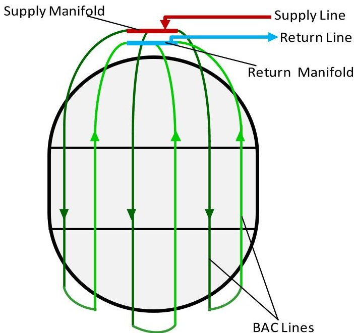
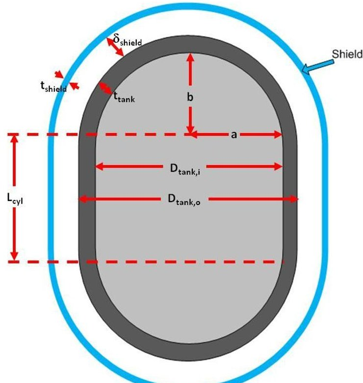
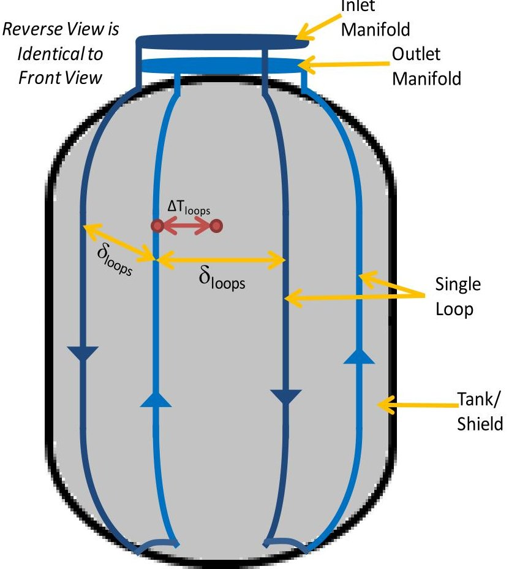
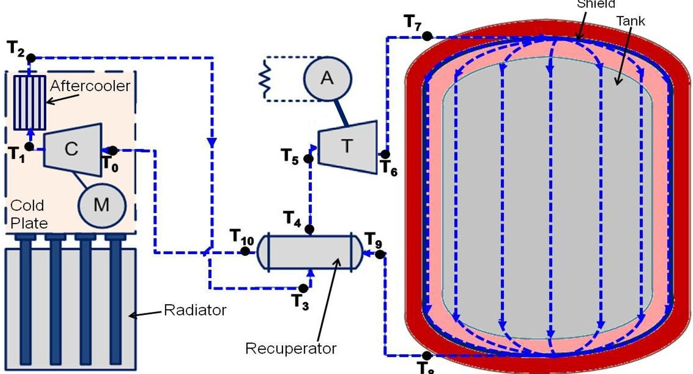
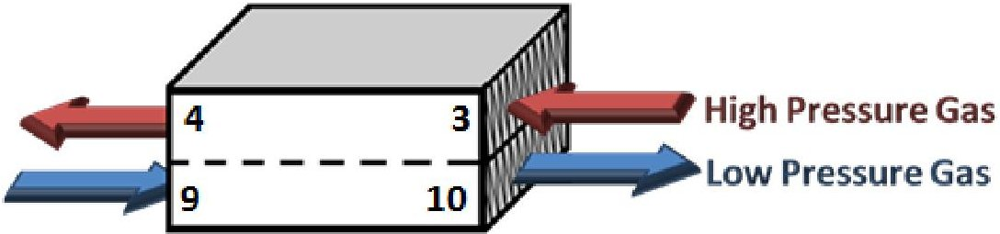
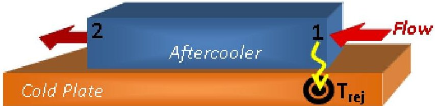
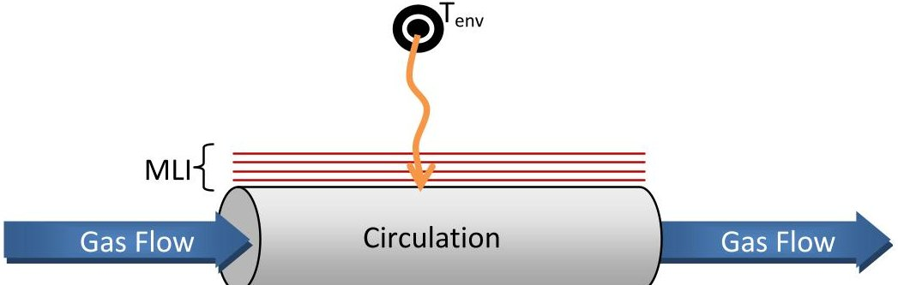
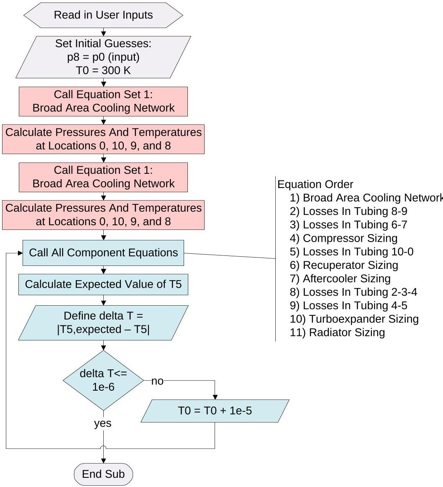
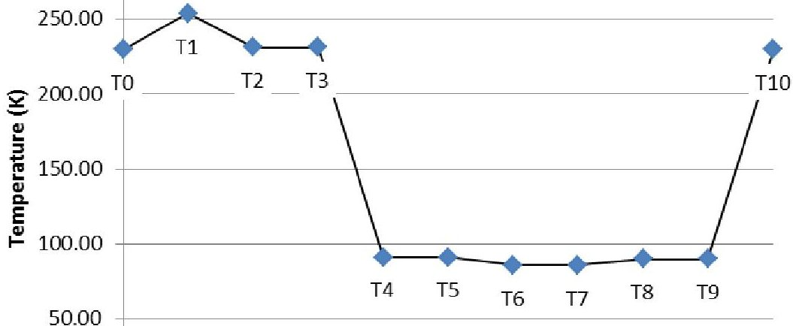
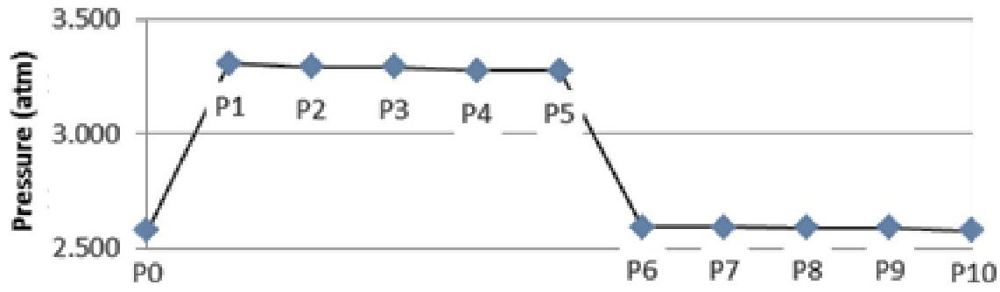

<!-- PDF_PAGE: 1 -->

# A SCALING TOOL FOR MODELING SINGLE STAGE REVERSE TURBO-BRAYTON CYCLE CRYOCOOLERS WITH A BROAD AREA COOLING SYSTEM FOR CRYOGENIC PROPELLANT TANKS

Monica C. Guzik Thomas M. Tomsik NASA Glenn Research Center

## ABSTRACT

In the pursuit of missions requiring long-duration space exploration, a growing need has arisen for the development of active cooling systems for cryogenic propellant storage tanks in order to reduce or eliminate the mass loss of the cryogenic fuel or oxidizer that is caused by boil-off. One method of actively cooling a cryogenic storage tank involves the use of cryocoolers with a distributed Broad Area Cooling (BAC) system. However, current cryocooler technology has been oriented towards heat removal at very small heat loads on the order of 20 Watts or less when operating at temperatures near those required for liquid hydrogen storage at 20 Kelvin. As focus shifts to larger tanks and longer missions, the heat load requirements on the cooling system increase dramatically. It has been theorized that the Reverse Turbo-Brayton Cycle (RTBC) cryocooler is currently the most capable technology for scale-up to larger capacities and efficiently managing these larger heat loads. This paper illustrates a method for scaling an active cooling system consisting of a single stage RTBC cryocooler and integrated BAC network from the low capacity designs currently in use to the larger heat loads associated with future missions that could be as high as 500 Watts or more. The described method utilizes fundamental thermodynamic and fluid relationships and turbomachinery scaling laws to perform a comprehensive component-level analysis of the cooling system for a wide range of tank sizes and applications. Preliminary validation efforts will include comparison with a low-capacity RTBC analytical model, as well as proposed scaling results generated by an in-house extensibility study. Forward work involves further validation with experimental results generated during testing to be performed at NASA Glenn Research Center's Small Multi-Purpose insulation Research Facility (SMiRF) during the upcoming year.

## INTRODUCTION

As the focus of the National Aeronautics and Space Administration (NASA) turns towards extending and sustaining human activities across the solar system, the need has emerged for significant mass savings in future space exploration systems aimed at missions beyond low earth orbit $ ^{(1)} $ . As NASA develops an integrated framework for future exploration destinations, it must address challenges in the development of enabling technologies for exploration. In particular, the area of long-duration cryogenic propellant storage has been identified as having the potential for the most significant contribution towards total system mass savings $ ^{(2)} $ .

The storage of cryogenic propellants for liquid rocket engines presents a unique challenge, as any source of heat that enters the storage tanks will contribute to the vaporization of the

<!-- PDF_PAGE: 2 -->

stored liquid propellant. This phenomenon, known as boil-off, causes the tank pressure to raise beyond the design limits for tank operation, and thus requires occasional venting of the resultant boil-off gas in order to return the pressure back into the acceptable range. Each vent results in some loss of propellant. Therefore, a contingency mass must be carried onboard the vehicle to compensate for the predicted mass loss. This results in additional launch masses that, while acceptable for short-duration missions such as those to the International Space Station, become prohibitive when considering long-duration missions to destinations such as Mars.

In an attempt to decrease cryogenic propellant loss, various methods of intercepting heat entering the tank have been studied. One such method, passive cooling, is primarily performed by insulating the tank from the various heat sources that are encountered throughout the course of a mission. In particular, Spray-On Foam Insulation (SOFI) is used during the period prior to launch, where convective heat transfer with the significantly warmer surrounding atmosphere is a large source of potential heat. Once in the relative vacuum of space, radiation and conduction become the primary methods of heat transfer. The latter of these can be partially abated by Multi-Layer Insulation (MLI), which consists of numerous reflective layers, with each layer acting to diminish the heat being radiated into the tank.

In orbit, MLI can make significant reductions to cryogen boil-off mass. However, preliminary studies have shown that for missions greater than one month, the introduction of an active cooling system in conjunction with passive cooling can contribute to even further overall mass savings $ ^{(3)} $ . These systems utilize an active refrigeration method, such as a cryocooler, in order to intercept heat entering the tank. One concept for active cooling, commonly referred to as Broad Area Cooling (BAC), involves the incorporation of a distributed network of tubes over the surface of the tank. A coolant fluid is circulated through these tubes to a cryocooler, which removes the heat that is picked up in the tubing. Figure 1 further illustrates this concept.

Figure 1. This concept depicts a Broad Area Cooling (BAC) tubing network, consisting of BAC lines (green) distributed across a tank surface. Cool fluid enters through the supply line (red), and the heated fluid exits through the return line (blue).

<!-- PDF_PAGE: 3 -->

When considering liquid hydrogen storage, reduced boil-off (RBO) can be achieved by locating broad area cooling tubes over a shield that is located within the layers of MLI on the tank. This shield would cool the MLI to a temperature of roughly 90 Kelvin, which is the rough storage temperature of liquid oxygen. A similar circulator and cryocooler could be used to eliminate all boil-off for a liquid oxygen or methane tank, thus achieving zero boil-off (ZBO). In this configuration, the tubes would be adhered directly to the tank surface, providing cooling at the desired liquid storage temperature. A hydrogen zero boil-off system would utilize a two-stage cooling concept by removing heat at 90 Kelvin using a tube-on-shield configuration, then removing the remaining heat by using tubes located directly on the tank $ ^{(4)} $

Currently, the most common cryocoolers for broad area cooling applications include pulse-tube, Stirling cycle, and reverse turbo-Brayton cycle coolers. While pulse-tube and Stirling cycle cryocoolers require an additional circulator and interface heat exchanger in order to circulate and effectively cool the heat transfer fluid in the system, the reverse turbo-Brayton cycle cooler has the unique advantage of having a circulator integrated into the cryocooler system. This makes it of special interest when considering a broad area cooling design concept $ ^{(4)} $

A primary concern when choosing the cryocooler and circulator is the ability to manage the high heat loads associated with the large tanks required for long-duration storage associated with the emerging exploration framework. While cryocoolers are commonly available to manage heat loads of nearly 20 Watts at 90 Kelvin, the heat loads for actual flight systems will be much larger. As such, analytical work and technology improvements must be performed to scale the current technology options up to meet the needs of future missions $ ^{(4)} $ . In studying the potential of various cryocooler and circulators for scaling purposes, the reverse turbo-Brayton cycle cryocooler has been found to hold the most promise for handling higher heat loads, especially at temperatures as low as 20 Kelvin, due to the high power density inherent in turbomachinery, allowing for efficiency to increase with cooling capacity $ ^{(5)} $ .

In an effort to gain a better understanding of the reverse turbo-Brayton cryocooler operation in conjunction with a broad area cooling network, the Single Stage Reverse Turbo-Brayton cryocooler with Broad Area Cooling (SStaRT_BAC) modeling tool was developed. This tool was based on a reverse turbo-Brayton cryocooler similar to that used for the Hubble Space Telescope's NICMOS instrument cooling system, which was then combined with a broad area cooling loop for a tube-on-tank liquid oxygen zero boil-off configuration $ ^{(6)} $ $ ^{(7)} $ . Currently, the SStaRT_BAC model is being updated to incorporate basic turbomachinery scaling relationships in order to study the advantages of the reverse turbo-Brayton cryocooler when incorporating it into a broad area cooling shield application for either reduced boil-off liquid hydrogen storage or zero boil-off liquid oxygen storage. In doing so, the model is assembled on the component level before being optimized to determine the overall integrated system performance. Keeping with the methods used to develop the previous version of the SStaRT_BAC tool $ ^{(6)} $ , the components can be considered as part of one of two subsystems, either belonging to the broad area cooling distributed tubing network, or the single-stage reverse turbo-Brayton cryocooler.

<!-- PDF_PAGE: 4 -->

## THE BROAD AREA COOLING DISTRIBUTED TUBING NETWORK

The broad area cooling distributed tubing network subsystem can be considered in terms of three primary components: the broad area cooling shield that is located within the layers of MLI, the tubing loops distributed across the shield surface, and the inlet and outlet manifolds to which they are connected. For a given tank geometry and shield offset, the broad area cooling shield geometry can be calculated. This geometry then feeds directly into the calculations needed to quantify the tubing loop and manifold geometry, which in turn is used in conjunction with the desired outlet conditions and heat load to calculate the associated inlet conditions, pressure drop, and mass flow rate.

## Broad Area Cooling Shield Sizing

For a given tank size, the offset of the broad area cooling shield can be found externally of the SStaRT_BAC modeling tool by optimizing the cooling location within the MLI layers. Utilizing this value as an input to the model, the shield length, radius, surface area, and mass can be calculated. Figure 2 depicts the geometric attributes of the shield and tank for a reduced boil-off liquid hydrogen configuration. In the case of zero boil-off liquid oxygen storage, the shield offset and shield thickness would be equal to zero, and the shield location would be at the outer diameter of the tank wall.

Figure 2. This sketch highlights the main geometric properties of a broad area cooling shield, shown in blue, for a liquid hydrogen ZBO configuration.

Where the shield offset, $ \delta_{shield} $ , and thickness, $ t_{shield} $ , are known for a given tank diameter, $ D_{tank,i} $ radius to dome height ratio, $ \left[ \frac{a}{b} \right]_{tank} $ , and wall thickness, $ t_{tank} $ , the following equations can be used to characterize the shield geometry $ ^{(8)} $ .

<!-- PDF_PAGE: 5 -->

Tank Outside Diameter

$$
D _ {t a n k, o} = D _ {t a n k, i} + t _ {t a n k}
$$

Tank Radius

$$
a _ {t a n k} = ^ {D _ {t a n k, o}} / _ {2}
$$

Tank Dome Height

$$
b _ {t a n k} = \frac {a _ {t a n k}}{\left[ \mathrm {a} / \mathrm {b} \right] _ {\mathrm {t a n k}}}
$$

BAC Shield Inside Radius

$$
a _ {B A C} = a _ {t a n k} + \delta_ {s h i e l d}
$$

BAC Shield Dome Height

$$
b _ {B A C} = b _ {t a n k} + \delta_ {s h i e l d}
$$

BAC Shield Eccentricity

$$
e c c _ {B A C} = \frac {\sqrt {a _ {B A C} ^ {2} - b _ {B A C} ^ {2}}}{a _ {B A C}}
$$

$$
(\text {n o t e}: \text {a s s u m e} L _ {\mathrm {c y l}, \mathrm {B A C}} = L _ {\mathrm {c y l}, \mathrm {t a n k}})
$$

$$
L _ {c y l, B A C} = L _ {t a n k, t o t a l} - 2 b _ {B A C}
$$

$$
V _ {B A C, i} = \frac {4}{3} \pi a _ {B A C} ^ {3}, \quad L _ {c y l, B A C} = 0
$$

BAC Shield Inside Volume (inner volume is hollow)

$$
= \pi a _ {B A C} ^ {2} \cdot L _ {c y l, B A C} + \frac {4 \pi a _ {B A C} ^ {3}}{3 \left(a _ {B A C} / b _ {B A C}\right)}, L _ {c y l, B A C} \neq 0
$$

## Total Length of BAC Shield

$$
L _ {t o t, B A C} = 2 b _ {B A C} + L _ {c y l, B A C}
$$

Surface Area of BAC Shield Cylinder Section

$$
A _ {c y l, B A C} = 2 \pi L _ {c y l, B A C} \left(a _ {B A C} + t _ {s h i e l d}\right)
$$

Surface Area of BAC Shield Dome Sections (2 total)

$$
\begin{array}{l} A _ {d o m e s, B A C} = 4 \pi \left(a _ {B A C} + t _ {s h i e l d}\right) ^ {2}, e c c _ {B A C} = 0 \\ = 2 \pi \left(a _ {B A C} + t _ {s h i e l d}\right) ^ {2} \\ \end{array}
$$

$$
+ \frac {\pi \left(b _ {B A C} + t _ {s h i e l d}\right) ^ {2}}{e c c _ {B A C}} \left[ \ln \frac {1 + e c c _ {B A C}}{1 - e c c _ {B A C}} \right], e c c _ {B A C} \neq 0
$$

BAC Shield Surface Area

$$
A _ {t o t, B A C} = A _ {c y l, B A C} + A _ {d o m e s, B A C}
$$

BAC Shield Mass

$$
\left(\text {i f} t _ {\text {sh i e l d}} = 0, \text {t h e n n o sh i e l d}\right)
$$

$$
m _ {B A C} = A _ {t o t, B A C} \rho_ {s h i e l d, w a l l} t _ {s h i e l d}
$$

The shield surface area can then be used to calculate the heat flux imposed on the shield for a given heat load, $ Q_{load}. $

Heat Flux into BAC shield

$$
q _ {s h i e l d} = \left. Q _ {l o a d} \right| _ {A _ {t o t, B A C}}
$$

<!-- PDF_PAGE: 6 -->

Utilizing the perimeter of the shield as the location of the broad area cooling tubing, the number, length, and mass of the tubing loops can be calculated based on an initial spacing estimate, $ x_{loops}. $ Figure 3 shows the basic configuration of the tubing loops used in the geometry calculations.

Figure 3. The basic configuration utilized for BAC tubing calculations performed in the SStaRT_BAC modeling tool. The BAC tubing is shown in blue.

When performing the BAC tubing calculations, the term total is used to describe the combined value for all BAC tubing runs, while the term loop refers to a single run, or loop, of tubes, as depicted in Figure 3. The inside diameter of the broad area cooling tubes, $ D_{i,tube} $ , is based on the typical thicknesses of aluminum or stainless steel tubing, depending on which is selected by the user, as well as the desired outside diameter of the tubes, $ D_{o,tube} $ . This is also true for the inside diameter of the manifold tubing, $ D_{i,manifold} $ , which is based on the next highest available outside tubing diameter, $ D_{o,manifold} $ , or an outside diameter of 0.75 inches, whichever is greater.

Number of BAC Loops (round to next highest even#)

$$
n _ {t o t a l, l o o p s} = 0. 5 \left[ \frac {2 \pi a _ {B A C}}{x _ {l o o p s}} \right| _ {e v e n}
$$

Loop Separation Distance

$$
\delta_ {l o o p s} = \frac {2 \pi a _ {B A C}}{2 * n _ {t o t a l , l o o p s}}
$$

<!-- PDF_PAGE: 7 -->

Loop Length Along Cylinder

$$
L _ {c y l, l o o p} = 2 * L _ {c y l, B A C}
$$

Loop Length Along Domes

$$
L _ {d o m e s, l o o p} \approx 2 * \frac {\pi a _ {B A C} + \pi b _ {B A C}}{2}
$$

Length of Single Loop (assume additional length needed to reach each manifold is ~1m)

$$
L _ {l o o p} = L _ {c y l, l o o p} + L _ {d o m e s, l o o p} + \delta_ {l o o p s} + 1 m
$$

Combined Manifold Length (assume 15% of circumference)

$$
L _ {m a n i f o l d s} = 0. 1 5 \left[ 2 \pi a _ {B A C} \right]
$$

Combined Manifold Mass

$$
= \pi \rho_ {t u b e, w a l l} L _ {m a n i f o l d} \left(\frac {D _ {o , m a n i f o l d} - D _ {i , m a n i f o l d}}{2}\right) ^ {2}
$$

Combined Loop Mass

$$
\begin{array}{l} m _ {t o t a l, l o o p s} \\ = \pi \rho_ {t u b e, w a l l} L _ {t o t a l, l o o p s} \left(\frac {D _ {o , t u b e} - D _ {i , t u b e}}{2}\right) ^ {2} \\ \end{array}
$$

Flow Calculations within the Broad Area Cooling Distributed Tubing Network

If it is assumed that the temperature difference between each loop, as shown as $ \Delta T_{loops} $ in Figure 3, is equivalent to the temperature difference between the inlet and outlet of the broad area cooling tubing network, then the inlet temperature of the broad area cooling network can be calculated for a given outlet temperature $ ^{(8)} $ . This outlet temperature is equal to the desired control temperature for the cryocooler.

Temperature Difference Between Loops

$$
\Delta T _ {l o o p s} = \frac {q _ {s h i e l d} \left(\delta_ {l o o p s}\right) ^ {2}}{8 k _ {s h i e l d} t _ {s h i e l d}}
$$

Inlet Temperature of BAC System

$$
T _ {i n} = T _ {o u t} - \Delta T _ {l o o p s}
$$

The mass flow rate required to maintain this temperature difference for the given heat load can then be calculated for each loop, as well as the total system flow rate.

Flow Rate in Each Loop

$$
\dot {m} _ {l o o p} = \frac {Q _ {l o a d} / C _ {g a s} \Delta T _ {l o o p s}}{n _ {t o t a l , l o o p s}}
$$

Total Flow Rate in System

$$
\dot {m} _ {s y s t e m} = \dot {m} _ {l o o p} n _ {l o o p s}
$$

<!-- PDF_PAGE: 8 -->

Next, the total pressure drop can be calculated in the broad area cooling network, recognizing that the total pressure drop across one loop is equivalent to the total pressure drop in the broad area cooling system. The final pressure drop takes into account that of both the tubing and manifold runs $ ^{(9)} $

Reynolds Number in One Loop

$$
R e _ {l o o p} = \frac {4 \dot {m} _ {l o o p}}{\pi D _ {i , t u b e} \mu_ {g a s}}
$$

Friction Factor in One Loop

$$
\begin{array}{l} f _ {l o o p} = \frac {6 4}{R e _ {l o o p}}, R e _ {l o o p} < 3 0 0 0 \\ = \frac {0 . 3 1 6}{\left(R e _ {l o o p} ^ {0 . 2 5}\right)}, R e _ {l o o p} \geq 3 0 0 0 \\ \end{array}
$$

Pressure Drop Across All Loops

$$
\begin{array}{l} \Delta p _ {l o o p s} = \left(\frac {f _ {l o o p} L _ {l o o p}}{D _ {i , l o o p}} + 1 + 0. 5 + (2 \cdot 0. 4 6) + (2 \cdot 0. 7 4)\right) \\ \cdot \left(\frac {8 \dot {m} _ {l o o p} ^ {2}}{\rho_ {g a s} \pi^ {2} D _ {i , l o o p} ^ {4}}\right) \\ \end{array}
$$

Reynolds Number in Manifold

$$
R e _ {m a n i f o l d} = \frac {4 \dot {m} _ {s y s t e m}}{\pi D _ {i , m a n i f o l d} \mu_ {g a s}}
$$

Friction Factor in Manifold

$$
\begin{array}{l} f _ {m a n i f o l d} = \frac {6 4}{R e _ {m a n i f o l d}}, R e _ {m a n i f o l d} < 3 0 0 0 \\ = 0. 3 1 6 / \left(R e _ {m a n i f o l d} ^ {0. 2 5}\right), R e _ {m a n i f o l d} \geq 3 0 0 0 \\ \end{array}
$$

Pressure Drop Across Manifolds

$$
\begin{array}{l} \Delta p _ {m a n i f o l d s} = \left(\frac {f _ {m a n i f o l d} L _ {m a n i f o l d s}}{D _ {i , m a n i f o l d}} + 1 + 0. 5 n _ {l o o p s}\right) \\ \cdot \left(\frac {8 \dot {m} _ {s y s t e m} ^ {2}}{\rho_ {g a s} \pi^ {2} D _ {i , m a n i f o l d} ^ {4}}\right) \\ \end{array}
$$

Inlet Pressure of BAC System

$$
p _ {i n} = p _ {o u t} + \Delta p _ {l o o p s} + \Delta p _ {m a n i f o l d s}
$$

Upon determining the total mass flow rate in the system that is required to maintain the desired cooling load conditions, the cryocooler subsystem components can be evaluated appropriately.

## THE SINGLE STAGE REVERSE TURBO-BRAYTON CRYOCOOLER

The single stage reverse turbo-Brayton cryocooler subsystem consists of two turbomachinery components: the compressor, and the turboalternator. The former of these is powered by the vehicle power bus, and includes a motor and inverter to account for losses when transferring electrical power to mechanical work on the fluid. The turboalternator is comprised of a turbine

<!-- PDF_PAGE: 9 -->

paired with an alternator that converts the mechanical work performed by the fluid to turn the drive shaft into electrical energy. In addition to the turbomachinery components, a counterflow heat exchanger, or recuperator, essentially, acts to separate the warm side of the cryocooler, where the compressor is located, from the cold end, where the turbine and broad area cooling subsystem reside. A plate-fin heat exchanger, known as an aftercooler, serves to remove much of the heat of compression from the fluid on the hot side of the recuperator. Together, the compressor and aftercooler are mounted on a cold plate that is thermally linked to a radiator, where heat is rejected to the surrounding atmosphere. In addition, the parasitic heat leak and pressure are calculated for each tubing run between components. A schematic of this system is shown in Figure 4.

Figure 4. A schematic depicting a reduced boil-off liquid hydrogen broad area cooling configuration in conjunction with a single stage reverse turbo-Brayton cryocooler. Here, the compressor is marked by a C, the motor by an M, and the turboalternator by the combined symbols marked T and A. The temperature locations as referred to in the model are numbered as $ T_{x} $ , with x indicating the referenced location in the system.

## Compressor Sizing

When scaling the compressor to higher heating values, it is assumed that the tip velocity of the impeller, $ u_{c} $ does not change between the baseline design and the new compressor, so that the head coefficients remain the same $ \left( \psi_{baseline}=\psi_{new}\right) $ . In addition, it is assumed that the inlet conditions to the compressor remain constant from the baseline design to the new, scaled compressor. Using these assumptions, a scaled compressor design can be derived from an existing compressor design, using the baseline compressor flow rate, $ \dot{m}_{baseline} $ , head coefficient, $ \psi_{baseline} $ , flow coefficient, $ \varphi_{baseline} $ , impeller diameter, $ D_{c,baseline} $ , and rotor eye diameter, $ D_{c,eye,baseline}^{(10)} $ .

<!-- PDF_PAGE: 10 -->

Compressor Impeller Diameter

$$
D _ {c, n e w} = D _ {c, b a s e l i n e} \sqrt {\frac {\dot {m} _ {s y s t e m}}{\dot {m} _ {b a s e l i n e}}}
$$

Compressor Rotor Eye Diameter

$$
D _ {c, e y e, n e w} = D _ {c, e y e, b a s e l i n e} \sqrt {\frac {\dot {m} _ {s y s t e m}}{\dot {m} _ {b a s e l i n e}}}
$$

Baseline Compressor Meridional Velocity

$$
C _ {m, b a s e l i n e} = \frac {4 \dot {m} _ {b a s e l i n e}}{\pi \rho_ {g a s} D _ {c , e y e , b a s e l i n e} ^ {2}}
$$

New Compressor Meridional Velocity

$$
C _ {m, n e w} = \frac {4 \dot {m} _ {s y s t e m}}{\pi \rho_ {g a s} D _ {c , e y e , n e w} ^ {2}}
$$

Compressor Tip Speed

$$
u _ {c} = \frac {C _ {m , b a s e l i n e}}{\phi_ {b a s e l i n e}}
$$

New Compressor Flow Coefficient

$$
\phi_ {n e w} = \frac {C _ {m , n e w}}{u _ {c}}
$$

Specific Enthalpy Change (Isentropic Specific Work)

$$
\Delta h _ {o, c} = \psi_ {n e w} u _ {c} ^ {2}
$$

Compressor Ideal Power (Isentropic)

$$
P _ {c} = \dot {m} _ {s y s t e m} \Delta h _ {o, c}
$$

Compressor Rotational Speed

$$
N _ {c} = \frac {u _ {c}}{\pi D _ {c , n e w}}
$$

Compressor Angular Velocity

$$
\omega_ {c} = 2 \pi N _ {c}
$$

Compressor Specific Speed

$$
N _ {s, c} = \omega_ {c} \frac {\sqrt {\dot {m} _ {s y s t e m} / \rho_ {g a s}}}{\left(\Delta h _ {o , c}\right) ^ {3 / 4}}
$$

Compressor inlet eye velocity

$$
u _ {c, e y e} = \frac {4 \dot {m} _ {s y s t e m} C _ {g a s} T _ {1}}{\pi p _ {1} \left(D _ {c , e y e , n e w} ^ {2}\right)}
$$

For a given motor, inverter, and compressor efficiency, or $ \eta_{m},\eta_{inv} $ , and $ \eta_{c} $ , respectively, the total compressor input power can be found. In addition, if the inlet conditions to the compressor are assumed to be known, the outlet conditions and pressure ratio can be calculated.

Total Compressor Input Power

$$
P _ {i n, t o t} = \frac {P _ {c}}{\eta_ {m} \eta_ {i n v} \eta_ {c}}
$$

<!-- PDF_PAGE: 11 -->

Pressure at Compressor Outlet

$$
p _ {o u t} = p _ {i n} + \rho_ {g a s} \Delta h _ {o, c}
$$

Compressor Pressure Ratio

$$
\mathrm {P R} _ {\mathrm {c}} = \frac {\mathrm {p} _ {\mathrm {o u t}}}{\mathrm {p} _ {\mathrm {i n}}}
$$

Temperature at Compressor Outlet

$$
T _ {o u t} = T _ {i n} + P R _ {c} ^ {(\gamma - 1) / \gamma}, \gamma = \frac {C _ {p}}{C _ {v}}
$$

## Recuperator Sizing

Like the compressor, the recuperator is also sized using an existing, or baseline, design point. Here, the heat transfer coefficient of the recuperator, $ U_{recup} $ is assumed constant among all scaling points. In addition, it is assumed that the recuperator area, $ A_{recup,baseline} $ scales linearly with the total heat transferred between streams. Therefore, if the conditions in the low-pressure gas stream are known, the high-pressure gas stream conditions and updated heat transfer area can be calculated for a given effectiveness, $ \varepsilon_{recup} $ . Figure 5 shows the flow path within the recuperator, as referenced in the sizing equations.

Figure 5. The flow path within the recuperator is shown, with the high pressure gas stream depicted in red, and the low pressure gas stream in blue. The numbers refer to the location within the system, as shown in Figure 4.

The heat transfer and temperatures across the recuperator can be calculated using the assumption that the temperature difference between locations 9 and 10 (low-pressure gas stream inlet and outlet) is equivalent to the difference between locations 3 and 4 (high-pressure gas stream inlet and outlet) $ ^{(7)} $

Actual Heat Transfer in Low Pressure Stream

$$
Q _ {r e c u p, L P G} = \dot {m} _ {s y s t e m} C _ {g a s, 1 0} \left(T _ {1 0} - T _ {9}\right)
$$

Temperature at Location 3

$$
T _ {3} = \frac {T _ {1 0}}{\varepsilon_ {r e c u p}} - T _ {9} \left(\frac {1 - \varepsilon_ {r e c u p}}{\varepsilon_ {r e c u p}}\right)
$$

Temperature at Location 4

$$
T _ {4} = T _ {3} + \varepsilon_ {r e c u p} \left(T _ {3} - T _ {9}\right)
$$

Total Heat Transfer In Recuperator

$$
Q _ {r e c u p, t o t a l} = Q _ {r e c u p, L P G} \left(1 + \varepsilon_ {r e c u p}\right)
$$

<!-- PDF_PAGE: 12 -->

The baseline recuperator area and heat transfer coefficient are then used to scale up to a new recuperator area using a linear scaling factor.

Heat Transfer Coefficient Term for Scaled Recuperator

$$
U A _ {r e c u p} = \frac {Q _ {r e c u p , t o t a l}}{T _ {3} - T _ {9}}
$$

Total Heat Transfer in Baseline Recuperator

$$
Q _ {r e c u p, b a s e l i n e} = U _ {r e c u p} A _ {r e c u p, b a s e l i n e} \left(T _ {3} - T _ {9}\right)
$$

Recuperator Scaling Factor

$$
s f _ {r e c u p} = \frac {Q _ {r e c u p , t o t a l}}{Q _ {r e c u p , b a s e l i n e}}
$$

Area of Scaled Recuperator

$$
A _ {r e c u p} = s f _ {r e c u p} A _ {r e c u p, b a s e l i n e}
$$

Pressure drops through the recuperator are calculated based on an inputted pressure drop over inlet pressure ratio, $ \frac{\Delta p}{p_{9}} \bigg|_{recup} $ , assuming that the ratio is true for any recuperator design. This ratio is provided for both the high-pressure and low-pressure streams.

Recuperator Pressure Drop

$$
\Delta p _ {r e c u p} = p _ {i n} \left(\frac {\Delta p}{p _ {i n}} \Bigg | _ {r e c u p}\right)
$$

## Aftercooler Sizing

The aftercooler is scaled in a manner similar to that of the recuperator. However, rather than heat being transferred between streams, the heat is conductively transferred to a cold plate. Again, it is assumed that the heat transfer coefficient of the aftercooler is constant when scaling, and that the area scales linearly with heat transfer. The flow path through the aftercooler is shown in Figure 6.

Figure 6. The flow path within the aftercooler is shown. The numbers refer to the location within the system, as shown in Figure 4.

Actual Heat Transferred by Aftercooler (from 1 to 2)

$$
Q _ {a c} = \dot {m} _ {s y s t e m} C _ {g a s, 1} \left(T _ {1} - T _ {2}\right)
$$

Total Heat Transfer in Aftercooler, with Losses

$$
Q _ {a c, t t l} = Q _ {a c} \left(1 + \varepsilon_ {a c}\right)
$$

<!-- PDF_PAGE: 13 -->

Heat Rejection Temperature

$$
T _ {r e j} = T _ {2} - \left(\frac {T _ {1} - T _ {2}}{\varepsilon_ {a c}}\right)
$$

Heat Transfer Coefficient Term for Scaled Aftercooler

$$
U A _ {a c} = \frac {Q _ {a c , t o t a l}}{T _ {r e j} - T _ {2}}
$$

Total Heat Transfer in Baseline Aftercooler

$$
Q _ {a c, b a s e l i n e} = U _ {a c, b a s e l i n e} A _ {a c, b a s e l i n e} \left(T _ {r e j} - T _ {2}\right)
$$

Aftercooler Scaling Factor

$$
s f _ {a c} = \frac {Q _ {a c , t o t a l}}{Q _ {a c , b a s e l i n e}}
$$

Area of Scaled Aftercooler

$$
A _ {a c} = s f _ {a c} A _ {a c, b a s e l i n e}
$$

Pressure Drop In Aftercooler

$$
\Delta p _ {a c} = p _ {1} \left(\frac {\Delta p}{p _ {1}} \Bigg | _ {a c}\right)
$$

## Turbine Sizing

Unlike the previously mentioned components, the turbine is sized based on the calculated inlet and outlet conditions, as calculated in the system model. The only required input for the turbine is the mechanical efficiency, $ \eta_{ta}^{(10)} $ .

Turboalternator Pressure Ratio

$$
P R _ {t a} = \frac {p _ {i n}}{p _ {o u t}}
$$

$$
\eta_ {t a, o v e r a l l} = \frac {T _ {i n} - T _ {o u t}}{T _ {i n}} \left(\frac {P R _ {t a} ^ {n}}{P R _ {t e} ^ {(n - 1)}}\right)
$$

"n" term in Efficiency Equation

$$
n = \frac {k - 1}{k}, k = \frac {C _ {p}}{C _ {v}} = \gamma
$$

Turbine Tip Speed

$$
u _ {t a} = \left[ C _ {g a s} \left(T _ {i n} - T _ {o u t}\right) \right] ^ {0. 5}
$$

Specific Enthalpy Change (Isentropic Specific Work)

$$
\Delta h _ {o, t a} = \frac {p _ {i n} - p _ {o u t}}{\rho_ {g a s}}
$$

Isentropic Power Generated by Turboalternator

$$
P _ {t a} = \dot {m} _ {s y s t e m} \Delta h _ {o, t a}
$$

Total Power Generated by Turboalternator

$$
P _ {t a, o u t} = \eta_ {t a} P _ {t a}
$$

<!-- PDF_PAGE: 14 -->

Turboalternator Heat Removed

$$
\dot {Q} _ {t a} = \dot {m} _ {s y s t e m} C _ {g a s} \left(T _ {i n} - T _ {o u t}\right)
$$

Turboalternator Head Coefficient

$$
\psi_ {t a} = \frac {\Delta h _ {o , t a}}{u _ {t a} ^ {2}}
$$

Turboalternator Inlet Velocity

$$
v _ {o, t a} = \sqrt {2 \Delta h _ {o , t a}}
$$

Turboalternator Flow Coefficient

$$
\phi_ {t a} = \frac {v _ {o , t a}}{u _ {t a}}
$$

Turboalternator Impeller Diameter

$$
D _ {t a} = \sqrt {\frac {4 \dot {m} _ {s y s t e m}}{\pi v _ {o , t a} \rho_ {g a s}}}
$$

Turboalternator Rotational Speed

$$
N _ {t a} = \frac {u _ {t a}}{\pi D _ {t a}}
$$

Turboalternator Angular Velocity

$$
\omega_ {t a} = 2 \pi N _ {t a}
$$

Turboalternator Specific Speed

$$
N _ {s, t a} = \omega_ {t a} \frac {\sqrt {\dot {m} _ {s y s t e m} / \rho_ {g a s}}}{\left(\Delta h _ {o , t a}\right) ^ {3 / 4}}
$$

Turboalternator eye velocity

$$
u _ {t a, e y e} = \frac {4 \dot {m} _ {s y s t e m} C _ {g a s} T _ {o u t}}{\pi p _ {o u t} \left(D _ {t a} ^ {2}\right)}
$$

## Radiator Sizing

The radiator is sized based on the heat flux generated by the temperature difference between the heat rejection temperature and the environment, which is calculated outside of the modeling space and entered as an input. It is assumed that all heat transfer between the radiator and the environment occurs as radiation (no convection or conduction), and that the heat rejection temperature of the aftercooler (cold plate temperature) is equal to that of the radiator.

Heat Flux of Radiator

$$
\left. \frac {Q}{A} \right| _ {r a d i a t o r} = e _ {r a d i a t o r} \sigma \left(T _ {r e j} ^ {4} - T _ {e n v} ^ {4}\right)
$$

Parasitic Heat In System

$$
\dot {Q} _ {s y s, p a r} = \dot {Q} _ {c} + \dot {Q} _ {l o a d} - \dot {Q} _ {a c} - \dot {Q} _ {t e} + \sum_ {n} \dot {Q} _ {r a d, n}
$$

Heat Load on Radiator

$$
\dot {Q} _ {r a d i a t o r} = \dot {Q} _ {s y s, p a r} + \dot {Q} _ {a c}
$$

$$
A _ {r a d i a t o r} = \frac {\dot {Q} _ {r a d i a t o r}}{\left(\frac {Q}{A} \mid_ {r a d i a t o r}\right)}
$$

Radiator Surface Area

<!-- PDF_PAGE: 15 -->

For a given tubing length, $ L_{CCtube} $ , and number of MLI layers, $ n_{MLI} $ , for each run of circulation tubing, the radiative heat loss in the tubing and the pressure drop can be calculated using standard fluid flow equations $ ^{(9)} $ . Figure 7 shows a diagram of the heat and fluid flow within the tubes.

Figure 7. A diagram showing the heat and fluid flow within the circulation tubes.

Radiation Heat Loss In Tubing Length

$$
\begin{array}{l} Q _ {r a d} = e _ {M L I, t u b e s} \sigma \left(\frac {1}{n _ {M L I , t u b e s}}\right) \\ \cdot \left[ \pi D _ {i, C C t u b e} L _ {C C t u b e} \left(T _ {e n v} ^ {4} - T _ {i n} ^ {4}\right) \right] \\ \end{array}
$$

Temperature at Outlet

$$
T _ {o u t} = T _ {i n} + \frac {Q _ {r a d}}{\dot {m} _ {s y s t e m} C _ {g a s}}
$$

Reynolds Number In Tubing Length

$$
R e = \frac {4 \dot {m} _ {s y s t e m}}{\pi D _ {i , C C t u b e} \mu_ {g a s}}
$$

Friction Factor

$$
f = 0. 0 0 1 3 7 5 \left[ 1 + \left(\frac {2 0 0 0 \varepsilon_ {C C t u b e}}{D _ {i , C C t u b e}} + \frac {1 e 6}{R e}\right) ^ {1 / 3} \right]
$$

Pressure Drop

$$
\Delta p _ {C C t u b e} = \left(\frac {8 f}{\pi^ {2}}\right) \left(\frac {L _ {C C t u b e , 8 - 9}}{D _ {i , C C t u b e} ^ {5}}\right) \left(\frac {\dot {m} _ {s y s t e m} ^ {2}}{\rho_ {g a s}}\right)
$$

## INTEGRATED MODELING APPROACH

In order to perform a system-level analysis, the fluid conditions at each component inlet must be consistent with the outlet conditions of the component that precedes it in the system. To simplify the identification of each location at which the fluid conditions are determined, numerical indicators are used, as shown in Figure 4. At each location, the temperature and pressure are calculated based on the inputs and component-level equations summarized in the previous sections.

The system analysis is initialized by two known conditions retrieved from user input: the compressor inlet pressure, $ p_{0} $ , and the broad area cooling loop outlet temperature, $ T_{8} $ . As an

<!-- PDF_PAGE: 16 -->

initial guess, the outlet pressure of the broad area cooling loop, $ p_{8} $ is set equal to the compressor inlet pressure, and the inlet temperature to the compressor, $ T_{0} $ is set to 300 K, the typical operating temperature of current turbo-Brayton compressors. Once the broad area cooling outlet conditions are known, broad area cooling subsystem equations 1.1 through 1.33 are called in order to establish the flow rate through the system. This flow rate is then used in equations 7.1 through 7.5, as well as equation 3.9, to solve for the pressure and temperatures at each location between the compressor inlet and broad area cooling outlet. Based on the pressure losses calculated, the broad area cooling outlet pressure is updated from the value found during the initial guess, and the process is repeated once more. Once this is completed, the broad area cooling outlet pressure reaches its actual value in the system.

Figure 8. A flow diagram depicting the data logic progression utilized to solve the set of system equations for the SStaRT_BAC modeling tool.

Next, the remainder of the component sizing is performed in accordance with the updated broad area cooling outlet pressure and the initial guess of 300 K assigned to the compressor inlet temperature. The system is then solved backwards from the broad area cooling outlet conditions to find the turboalternator outlet conditions, and forwards from the compressor inlet conditions to find the turboalternator inlet conditions. Because the turbine inlet

<!-- PDF_PAGE: 17 -->

temperature, $ T_{5} $ , is calculated independently of the turbine operation, if the initial temperature guess does not correspond to the actual compressor inlet temperature, the turbine inlet temperature will not match the actual inlet temperature that matches the turbine performance calculations, as indicated by the previously optimized pressures and outlet temperature. In reality, the turbine inlet temperature should be a function of the pressure ratio, as show in equation 8.1.

Turboalternator Inlet Temperature

$$
T _ {5, e x p e c t e d} = T _ {6} \left(\left[ \left(1 - \eta_ {t a, o v e r a l l}\right) P R _ {t e} \right] ^ {(\gamma - 1) / \gamma}\right), \gamma = \frac {C _ {p}}{C _ {v}}
$$

The value of $ T_{5} $ that is calculated in the system equations is then compared to the expected value from equation 8.1. If the two are equal to each other within a tolerance of $ 10^{-6} $ , then the solution has converged, and the final values are reported. If they are not equal, then the inlet temperature to the compressor is incremented by some small degree, and the system is iterated again, until convergence is reached. This flow logic is shown in Figure 8. Upon completion, the available output data includes component-level sizing information as well as system pressure, temperature, and entropy profiles. This information can be used to determine specific cryocooler geometries and performance characteristics to obtain a preliminary design for a wide variety of mission applications.

## RESULTS

To demonstrate a potential real-world application of the SStaRT_BAC tool for future use, one can utilize the cryocooler that was optimized in the previous version of the tool $ ^{(6)} $ as the baseline design for the current beta version described in this paper. To demonstrate this, assume that an aluminum liquid hydrogen storage tank that has a diameter of 4 feet and a length of 4.33 feet, with a radius to dome height ratio of 1.414 has a calculated net heat leak of 5 Watts entering a 5 mil thick aluminum shield that is offset 1.5 inches from the tank wall. The heat is intercepted at 90 Kelvin using a broad area cooling tubing network. The cooling fluid is neon gas, with an initial pressure entering the compressor at 32.9 pounds per square inch, and the circulation tubes have 30 layers of MLI applied to their exterior walls. These inputs set the scaling parameters from which the baseline inputs will be applied.

The baseline inputs applied in this case are taken directly from the results generated using the previous version of the SStaRT_BAC tool $ ^{(6)} $ . These are summarized in Table 1. In addition, it is common for the pressure drop to inlet pressure ratios to be known for a given recuperator and aftercooler, as that ratio typically remains constant when scaling to larger applications. These values, along with projected turbomachinery efficiencies and heat exchanger effectiveness, complete the inputs necessary to generate an effective scaling design solution. In this example, the scaled design parameters almost exactly match the original baseline design, and therefore have good agreement with the expected results. It should be noted that the scaled solution is limited to the applicability of the applied baseline design. Therefore, the most relevant baseline parameters should be used whenever possible to ensure a high fidelity solution.

<!-- PDF_PAGE: 18 -->

Table 1. A summary of potential baseline inputs for use in the SStaRT_BAC modeling tool.

<table border="1"><tr><td>Baseline Compressor Head Coefficient</td><td>$\psi_{c,baseline}$</td><td>0.85</td><td>----</td></tr><tr><td>Baseline Compressor Flow Coefficient</td><td>$\varphi_{c,baseline}$</td><td>0.03</td><td>----</td></tr><tr><td>Baseline Compressor Mass Flow Rate</td><td>$\dot{m}_{baseline}$</td><td>1.190</td><td>g/s</td></tr><tr><td>Baseline Compressor Rotor Eye Diameter</td><td>$D_{c,eye,baseline}$</td><td>0.400</td><td>in</td></tr><tr><td>Baseline Compressor Impeller Diameter</td><td>$D_{c,baseline}$</td><td>0.600</td><td>in</td></tr><tr><td>Baseline Recuperator Heat Transfer Coeff</td><td>$U_{recup,baseline}$</td><td>257.4</td><td>W/m2-K</td></tr><tr><td>Baseline Recuperator Heat Transfer Area</td><td>$A_{recup,baseline}$</td><td>92.07</td><td>in2</td></tr><tr><td>Baseline Aftercooler Heat Transfer Coeff</td><td>$U_{ac,baseline}$</td><td>20.2</td><td>W/m2-K</td></tr><tr><td>Baseline Aftercooler Heat Transfer Area</td><td>$A_{ac,baseline}$</td><td>140</td><td>in2</td></tr></table>

Either the output generated in this example can be viewed on a component level, or through system level plots displaying pressure and temperature trends. For example, the compressor component output page displays a compressor input power of approximately 70 Watts, and a new rotor diameter of 0.58 inches which is smaller than that of the baseline design. If scaling to a larger tank application, this rotor diameter would increase to exceed the baseline results. The system pressure and temperature trends are shown in Figure 9 and Figure 10. The ratio of total input power to heat removed for this application is approximately 14.0.

Figure 9. This plot displays the temperatures at each discrete location in the cryocooler system as determined using the inputs summarized in the above section.

Figure 10. This plot displays the pressures at each discrete location in the cryocooler system as determined using the inputs summarized in the above section.

<!-- PDF_PAGE: 19 -->

## CONCLUSIONS

Currently the SStaRT_BAC tool has been validated for the design case established by its previous version, for a single stage reverse turbo-Brayton cryocooler capable of removing up to 15 W of heat at $ 7 7 \mathrm{K}^{(6)} $ . Initial attempts at scaling up to higher heat lifts and pressure drops are currently utilizing this design point for all baseline component references. In conjunction with the Cryogenic Propellant Storage and Transfer (CPST) project, work is currently ongoing to develop higher capacity cryocooler designs, particularly for lower temperature applications as encountered for liquid hydrogen zero boil-off storage. The results of this study will then be available as an additional reference point for the SStaRT_BAC tool sometime in the fall of 2012. As further data is obtained, the tool will provide a small database of reference from which the user can select an appropriate baseline design to fit their needs.

In addition, CPST is funding a Cryogenic Boil-off Reduction Systems test for the late summer of 2012. This test will utilize a flight-representative reverse turbo-Brayton cryocooler and broad area cooling shield for reduced boil-off liquid hydrogen, as well as zero boil-off liquid nitrogen. The resulting data from this system-level test will then be used to validate the SStaRT_BAC tool prior to its final release. Leveraging multiple data sources and validation efforts for known system configurations will provide a higher degree of confidence when applying the tool to larger applications for which data is widely unavailable. As such, the Single Stage Reverse Turbo-Brayton cryocooler with Broad Area Cooling modeling tool will contribute to the advancement of NASA mission design and development, and help enable human exploration of space to reach new and exciting heights.

<!-- PDF_PAGE: 20 -->

## ACKNOWLEDGEMENTS

The authors would like to acknowledge the NASA Glenn Cryogenic Boil-off Reduction Systems engineering team for their assistance in the development and implementation of the SStaRT_BAC modeling tool, especially the broad area cooling system insight provided by Robert Christie and David Plachta. Additional acknowledgement is extended to Robert Buehrle for his assistance in assembling resources for the investigation of turbomachinery scaling.

## CONTACT

Monica C. Guzik, AST Gas & Fluid Systems Engineer Fluid Systems Branch, NASA Glenn Research Center 21000 Brookpark Road, Mail Stop 86-12 Cleveland, OH 44135 monica.c.guzik@nasa.gov

Thomas M. Tomsik, P.E., AST Gas & Fluid Systems Engineer Fluid Systems Branch, NASA Glenn Research Center 21000 Brookpark Road, Mail Stop 86-12 Cleveland, OH 44135 thomas.m.tomsik@nasa.gov

<!-- PDF_PAGE: 21 -->

## NOMENCLATURE

a Radius

A Surface Area

b Dome Height

D Diameter

$ \delta $ Offset

$ \varepsilon $ Effectiveness/Emissivity

f Friction Factor

L Length

m Mass

μ Viscosity

$ \eta $ Efficiency

p Pressure

P Power

$ \Psi $ Head Coefficient

PR Pressure Ratio

q Heat Flux

Q Heat Rate

Re Reynolds Number

ρ Density

T Temperature

t Thickness

sf Scaling Factor

$ \Phi $ Flow Coefficient

V Volume

<!-- PDF_PAGE: 22 -->

## ACRONYMS/ABBREVIATIONS

AST Aerospace Technology

BAC Broad Area Cooling

CAT Cryogenic Analysis Tool

CPST Cryogenic Propellant Storage and Transfer

GRC Glenn Research Center

GUI Graphical User Interface

LOX Liquid Oxygen

LH2 Liquid Hydrogen

MLI Multi-Layer Insulation

NASA National Aeronautics and Space Administration

NICMOS Near Infrared Camera and Multi-Object Spectrometer

NIST National Institute of Standards and Technology

RBO Reduced Boil-Off

Refprop Reference Fluid Thermodynamic and Transport Properties Database

RTBC Reverse Turbo-Brayton Cycle/Cryocooler

SMiRF Small Multi-Purpose insulation Research Facility

SStaRT_BAC Single Stage Reverse Turbo-Brayton cryocooler with Broad Area Cooling

TFAWS Thermal and Fluids Analysis Workshop

TPSX Thermal Protection Systems Expert (material properties database)

VBA Visual Basic for Applications

ZBO Zero Boil-Off

<!-- PDF_PAGE: 23 -->

## REFERENCES

1. National Aeronatics and Space Administration. 2011 NASA Strategic Plan. Washington, DC: NASA Headquarters, 2011.

2. Braun, Robert. Investments in our Future: Exploring Space through Innovation and Washington, DC: National Aeronautics and Space Administration, 2011.

3. Guzik, Monica C., Plachta, David W. and Elchert, Justin P. Modeling a Transient Pressurization Active Cooling Sizing Tool. Newport News, VA: Thermal and Fluids Analysis Workshop, 2011.

4. Christie, R. J., et al. Broad Area Cooler Concepts for Cryogenic Propellant Tanks. Newport News, VA: Thermal and Fluids Analysis Workshop, 2011.

5. Zagarola, Mark V. and McCormick, John A. High-capacity turbo-Brayton cryocoolers for space applications. Hanover, NH : Cryogenics, 2006. Vol. 46.

6. Guzik, Monica C. and Tomsik, Thomas M. An Active Broad Area Cooling Model of a Cryogenic Propellant Tank with a Single Stage Reverse Turbo-Brayton Cycle Cryocooler. Newport News, VA: Thermal and Fluids Analysis Workshop, 2011.

7. Dolan, Francis. Preliminary Thermal Performance Model for the Single Stage Reverse-Brayton Cycle Cryogenic Cooler Model Description and Sample Calculations. Hanover, NH : Creare, Inc, 1991. TM-1465.

8. NASA Glenn Research Center. Cryogenic Analysis Tool (CAT). Cleveland, OH: s.n., 2010.

9. de Nevers, Noel. Fluid Mechanics for Chemical Engineers. 3rd Edition. New York, NY: McGraw-Hill, 2005.

10. Japikse, David and Baines, Nicholas C. Introduction to Turbomachinery. White River Junction, VE : Concepts ETI, Inc., 1997.