<!-- PDF_PAGE: 1 -->

# A semantic model for axiomatic systems design

Haoqi Wang $ ^{1} $ , Xu Zhang $ ^{1} $ , Chengtong Tang $ ^{1} $ and Vincent Thomson $ ^{2} $

Proc IMechE Part C:

J Mechanical Engineering Science

2018, Vol. 232(12) 2159-2184

$ \textcircled{c} $ IMechE 2017

Reprints and permissions:

sagepub.co.uk/journalsPermissions.nav

DOI: 10.1177/0954406217718858

journals.sagepub.com/home/pic

## Abstract

## SAGE

Design of large-scale engineering systems such as an automobile, satellite, or airplane is a process to satisfy requirements by making various decisions. Design axioms provide system designers with a theoretical background to make right decisions. However, the axiomatic systems design is still hard to be implemented in the real word due to its informal representation for both the human and machine, and few researches focus on formalizing concepts of this process. In order to define axiomatic systems design models to be both user-understandable and machine-readable, this paper combines axiomatic design process with the Semantic Web technology and proposes an axiomatic design semantic representation model, called axiomatic design ontology, which organizes customers' requirements, functional requirements, design parameters, and design solutions. The class of concepts elements and their semantic relationships are defined by the Web Ontology Language (OWL2). Rules for identifying functional couplings (the Independence Axiom) and selecting the optimal design solution (the Information Axiom) are formally represented and encoded with the Semantic Web Rule Language, which enhances the reasoning capability of the axiomatic design ontology. A framework for capturing systems design semantic information based on the axiomatic design ontology, and aligning it with domain-specific ontologies according to the semantic mapping approach has been developed, by which elaborated design information is captured and shared. Finally, a case study of systems design of a satellite solar wing subsystem is given to demonstrate the proposed axiomatic design ontology-based systems design approach.

## Keywords

Axiomatic design, system design, large-scale engineering systems, semantic representation, ontology

Date received: 19 January 2017; accepted: 12 June 2017

## Introduction

Design is a creative process to satisfy design requirements through a series of decisions. $ ^{1,2} $ Systems design performs a crucial role through explicit representations of system requirements and overall solutions that have a profound influence on subsequent integration, verification, validation, and operation. $ ^{3} $ A conventional system design process includes three interactive activities: requirements analysis, function analysis, and design synthesis. The design process can be displayed using the "Vee" model based on standards such as EIA-632 and ISO-15288. $ ^{4} $ However, the conventional design is commonly applied in the field of an art rather than a science. $ ^{5} $

Axiomatic design (AD) has been developed to become a commonly applied engineering design theory in the academic literature and industrial practice, and it forms a scientific basis to support large-scale design problems. $ ^{6} $ Kulak et al. $ ^{7} $ provided an overview over a 20-year period (1990-2010) from four perspectives: type of axiom, application area,

method, and evaluation type. Findings of his study indicated that AD was used mainly in the areas of the product (42%) and software design (23%) , while systems design was only used 19% of the time.

Over the past few years, AD has been playing a larger role in system design (i.e., axiomatic systems design) where the growth in system complexity has increased the risk to unacceptable levels. Hong and Park $ ^{8} $ proposed a collaborative design process to conceive a large-scale system by alleviating the conflicts among the subsystems by using the Independence Axiom. Hehenberger et al. $ ^{9} $ presented a hierarchical

<!-- PDF_PAGE: 2 -->

design process for mechatronic systems by integrating AD principles with systems design.

However, the axiomatic systems design is still hard to be implemented in the real word. One of the reasons is its informal representation for both the human and machine. Different designers understand and define elements of AD domains (i.e., customer, functional, physical, and process) in a different level of abstract and decomposition. For example, a design parameter (DP) can be so wide and considered as a system, component or even variable. Thus, ambiguity tends to arise when this information is scattered throughout various documents that transformed during the systems design process, and most design knowledge is difficult to find. $ ^{8} $ As a result, much time is spent to understand the original design intent. $ ^{10} $ Therefore, one of the main challenges for axiomatic systems design is how to represent systems design information to be both user-understandable and machine-readable.

In diverse design information representation technologies, Semantic Web technology $ ^{11} $ is being accepted by an increasing number of industries due to its strong semantic and logic representation. The foundation of Semantic Web technology is the representation of ontology that defines specific vocabularies of domain concepts and their semantic relationships. $ ^{12} $ The W3C has contributed a lot for standardizing the specification necessary for the Semantic Web by introducing resource description framework (RDF) $ ^{13} $ and RDF schema (RDFS). $ ^{14} $ In order to enhance knowledge representation, the W3C finalized the Web Ontology Language (OWL) by extending the expressive power of the RDF and RDFS. However, there are many semantic relations that cannot be specified explicitly by the OWL ontology especially in the reasoning process. $ ^{10} $ The Semantic Web Rule Language (SWRL) $ ^{16} $ is an OWL-based rule language and it allows users to write rules in terms of OWL concepts to provide more powerful deductive reasoning capabilities than OWL alone.

Much significant research has been done in the areas of ontology-based systems design. Graves et al. $ ^{17} $ gave an overview of the current state of ontology used in engineering systems, one of the biggest impediments in modeling a domain is the use of an incorrect ontology. Zhang et al. $ ^{10} $ proposed a new ontology-based semantic representation model for design rational information. Schmit et al. $ ^{18} $ introduced an ontological approach for design space refinement in conceptual design for model-based systems engineering. Juan et al. $ ^{19} $ defined ontology to capitalize knowledge about case-based reasoning (CBR) processes for systems design.

However, few works cater to formalize the axiomatic systems design by taking advantage of the ontology. Although Zhuochen $ ^{20} $ presented the development of a formal ontology for AD, several limitations still existed. First, there was a lack of description for customer needs.

Second, the functional coupling decision rule "if two different components fulfill the same function, then the design solution is functional coupled" was only a necessary condition, not a sufficient one. Because system design is coupled as long as the design matrix of the AD design equation is a full matrix, the design may not be coupled when two different DPs affect the same function. Third, the Information Axiom representation of AD was not considered.

This paper aims at defining axiomatic systems design models to be both user-understandable and machine-readable by:

(1) Representing AD semantic information formally so that systems design intent could be explicit;

(2) Enhancing reasoning ability of ontology to achieve theoretical design based on design axioms;

(3) Integrating axiomatic systems design information with domain-specific information so that information could be shared and reused.

In order to realize these objectives, firstly, an AD ontology is developed in engineering design by combining AD principles with ontology technology. Then, an AD ontology-based semantic representation framework is proposed to capture and describe semantic information during system requirements analysis, functions analysis, and design synthesis activities. In addition, the semantic mapping between domain-specific DPs and system design solutions is introduced for sharing domain-specific information. Finally, a demonstration case study of the systems design of a satellite solar wing subsystem is given to illustrate how to use the proposed AD ontology-based systems design approach.

## AD principles

AD is a design methodology created by Suh. $ ^{21} $ AD has been built on three core perspectives. $ ^{22} $

## (1) Design domains

AD consists of four domains: customer domain, functional domain, physical domain, and process domain, as displayed in Figure 1. These domains are represented by customer requirements (CRs), functional requirements (FRs), design parameters (DPs), and process variants (PVs), respectively.

## (2) Zigzag process

The mapping between adjacent domains is accompanied with top-down zigzag decomposition. The former domain describes design objectives and the latter one shows approaches for realizing these objectives. The zigzag mapping process proceeds layer by layer until an enforceable design solution is achieved. $ ^{2 3} $

## (3) Design axioms

<!-- PDF_PAGE: 3 -->

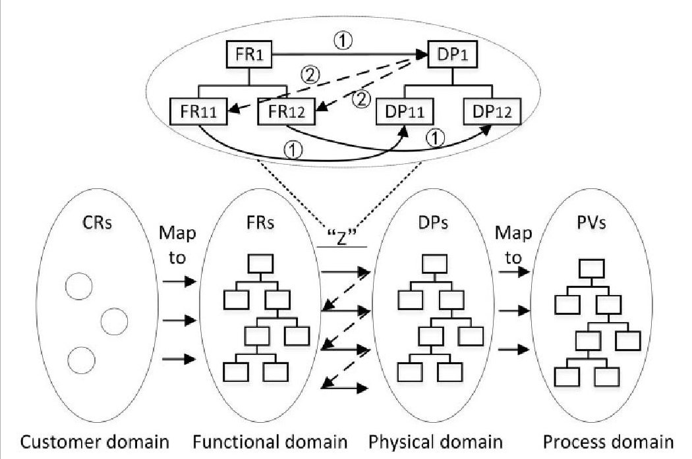

Figure 1. Design domains and the zigzag mapping process. DP: design parameter; CR: customer requirement; FR: functional requirement; PV: process variants.

The basis of AD principles is the following two axioms:

Axiom 1 (Independence Axiom) is able to maintain the independence of FRs.

The main concern of the Independence Axiom is the relationships between FRs and DPs. These relationships can be expressed by design equation (1), where a vector F with m components represents the characteristics of a design and DPs constitute a vector P with n components.

$$
F = A P
$$

The relationships between F and P are documented in the design matrix [A] which can be written as

$$
[ A ] = \left[ \begin{array}{c c c c} A _ {1 1} & A _ {1 2} & \dots & A _ {1 n} \\ A _ {2 1} & A _ {2 2} & \dots & A _ {2 1} \\ . & . & \dots & . \\ A _ {m 1} & A _ {m 2} & \dots & A _ {m n} \end{array} \right]
$$

According to the characteristics of the design matrix [A], three cases of the design are shown in Table 1.

Axiom 2 (Information Axiom) suggests that minimization of information content is the optimal alternative.

The Information Axiom gives an approach to calculate the value of a particular design. The information content $ \mathrm{I_{i}} $ of an $ \mathrm{F R_{i}} $ is calculated by the success probability $ \mathrm{P r b}_{i}. $ $ ^{2 3} $

As shown in Figure 2, the design range (DR) defines the ideal range associated with a specific

Table I. Relationship between FRs and DPs.

<table border="1"><tr><td>Type</td><td colspan="2">Ideal</td><td colspan="2">Decoupled</td><td colspan="2">Coupled</td></tr><tr><td>Design Matrix</td><td colspan="2">[A1100A22]</td><td colspan="2">[A1100A21A22]</td><td colspan="2">[A11A12A21A22]</td></tr></table>

DP: design parameter; FR: functional requirement.

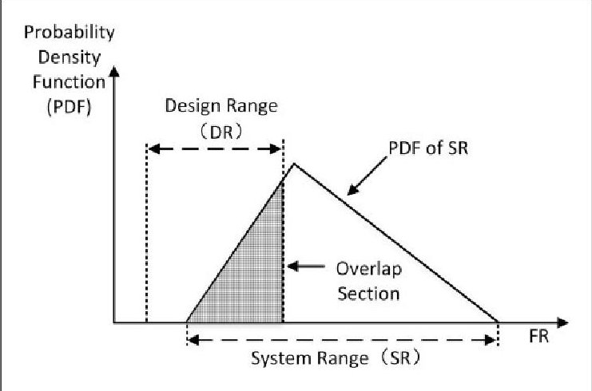

Figure 2. Probabity of success in fulfilling a functional requirement.

FR: functional requirement.

$ \mathrm{F R_{i}} $ . The system range (SR) defines the real capability of a $ \mathrm{D P_{i}} $ which fulfills its corresponding $ \mathrm{F R_{i}} $ . As for a $ \mathrm{D P_{i}-F R_{i}} $ pair, its $ \mathrm{I_{i}} $ is defined by equation (3) where the area of common range (CR) refers to the overlap section of the DR and SR.

$$
\mathrm {I} _ {\mathrm {i}} = \log_ {2} \frac {1}{\mathrm {P r b} _ {i}} = - \log_ {2} \mathrm {P r b} _ {i} = \log_ {2} \frac {1}{\mathrm {o v e r l a p s e c t i o n}}
$$

<!-- PDF_PAGE: 4 -->

## Semantic representation based on ontology for AD

## Modeling requirements for systems design

In fact, systems design is a kind of process for searching for an optimal solution to satisfy new functions or to improve original functions. $ ^{24} $ The axiomatic systems design modeling is required to satisfy at least the following two requirements:

(1) It should be able to abstract and organize the systems design information explicitly. An AD process provides a framework for systems design and can organize its information into four design domains.

(2) It should document and trace relationships between systems design information. AD has the ability to capture this information by decomposition and zigzag mapping of design domains.

Although the above two basic requirements can be fulfilled by AD itself, two limitations still exist when applying AD to the engineering design process in practice:

- Informal representation. The representation of AD lacks semantic representation on CRs, FRs, DPs, and design solutions, and does not provide the ability to semantically reason. For example, a DP can be regarded as a system component or even variable, but which DP should be determined when they should be decomposed and on what level the decomposition stops are out of principles of AD. As a result, it is hard for AD information to be understood and exchanged by various information processing systems. So the reasonable approach to decide which solution is feasible should be represented to help designers apply AD effectively.

- Inconformity for multitudinal design ideas. Contemporary systems design is assumed to be complex and includes internal couplings among multiple domains, such as mechanical, electrical, and software engineering instead of perfectly satisfying the AD structure matrix. More importantly, the significance of system integration is growing with increasing physical and functional coupling. $ ^{8} $ However, AD prefers keeping FRs as only design factors, detailed consideration of various domain-specific design ideas would be missed. Therefore, simply relying on two design axioms, AD does not fit for all the design due to the design complexity especially for the detailed structure and information. Applying AD requires integrating domain-specific knowledge to analyze the design comprehensively.

In order to semantically represent AD information in formal and consistent ways, and effectively share domain-specific information, understandability and

reasonability of the systems design model should be enhanced, so the axiomatic systems design modeling should also be equipped with:

(3) Semantic representation capability: concept elements of systems design and their semantic relationships should be formally represented, and retrieved and shared by different designers. Ontology is able to give a formal definition of a particular domain. $ ^{2 4} $ AD ontology section prescribes a formal AD ontology which has the potential to provide a semantic basis and lay the reasoning foundation for identifying functional couplings and selecting optimal design solutions. The class of concept elements of CRs, FRs, DPs, design solutions, and their semantic relationships are expressed by OWL2.

(4) Reasoning capability: the systems design modeling should aid designers to deduce coupled design alternatives and select the optimal one. Reasoning rules based on the Independence and Information Axioms $ ^{2 5} $ are created through SRWL, and built-in axioms of AD ontology for improving its consistency, validity, and reasoning capability are established in Design axioms and rules in AD ontology section.

(5) Ability to integrate with domain-specific information: systems design outcomes should guide subsequent design processes which need input from different domain-specific information. $ ^{26} $ Thus, the systems design modeling should have the ability to integrate with domain-specific information. A framework based on AD ontology and the ontology mapping technology $ ^{27} $ involves the integration in Systems design representation and integration based on the AD ontology section.

## AD ontology

Based on the above analyzed requirements for axiomatic systems design modeling, this paper proposes an ontology-based semantic representation model, the AD semantic model. The foundation of the AD semantic model is an AD ontology, which uses a set of shared concepts, relations, axioms, and rules to describe systems design information, and lays the foundation for reasoning for the identification of functional couplings, optimal alternative selection, and information integration.

Definition 1: AD ontology is a kind of conceptual description of systems design information, which consists of a set of concepts, relations, axioms, and rules about the systems design process.

The AD ontology can be defined by expression (4)

$$
\mathrm {O n t o l o g y} _ {\mathrm {A D}} = \left\{\mathrm {C} _ {\mathrm {S D}}, \mathrm {C} _ {\mathrm {S D}} ^ {\mathrm {R}}, \mathrm {P} _ {\mathrm {S D}}, \mathrm {A} _ {\mathrm {S D}}, \mathrm {R} _ {\mathrm {S D}} \right\}
$$

<!-- PDF_PAGE: 5 -->

where $ C_{SD} $ is the set of concepts for the AD ontology. This paper defines six concept elements for AD using OWL2: Customer Requirement (CR) class, Function Requirement (FR) class, Design Parameter (DP) class, Design Solution (DS) class, Independence Axiom (IndA) class, and Information Axiom (InfoA) class.

$ C_{\mathrm{SD}}^{\mathrm{R}} $ denotes the set of relations of the AD ontology instances. These relations are represented by "objectProperty" of OWL2 and include two aspects: One is the semantic relationships defined by ontology modeling primitives, like the inheritance relationship "subClassOf" and the instance relationship "instanceOf" in OWL2. $ ^{15} $ Another aspect comes from the characteristics of AD principles, such as the FRs and DPs mapping relationship "zMapToFR," the decomposition and composition relationship ("hasSuperDP" and "hasSubDP") between DPs.

$ \mathrm{P_{SD}} $ shows the set of relations (called "properties" in this paper) between concept instances and data types. These properties are represented by "dataTypeProperty" of OWL2. Because OWL2 provides no predefined data types, users have to specify necessary types or refer to date types of other semantic languages like the XML Schema. $ ^{28} $

What $ \mathrm{C}_{\mathrm{SD}}^{\mathrm{R}} $ and $ \mathrm{P}_{\mathrm{SD}} $ denotes are collections of binary relationships with domains and ranges. For example, as for a concept x $ \in $ X, y $ \in $ Y, if $ \exists p \in P_{SD} $ and $ p ( x )=y $ , then the domain of the property p is X and its range is Y. This description can be expressed by $ p ( x,y). $

$ A_{SD} $ describes the set of axioms of the AD ontology. Extra constraints including class axioms, property axioms, and class axioms of properties can be specified based on mutual relationships between classes, properties, and relations.

$ R_{SD} $ denotes the set of rules of the AD ontology.

Figure 3 displays the concept elements and relationships of the AD ontology and they are formally defined by expression (5), (6), and (7), where $ C_{CR} $ $ C_{FR} $ $ C_{DP} $ $ C_{DS} $ $ C_{IND} $ , and $ C_{INFO} $ represents the CR

Class, FR Class, DP Class, DS Class, IndA Class, and InfoA Class, respectively. Formula (6) and (7) give properties and relations between different design domains, while relationships inner domains are provided in the detailed definition of each class. Due to paper's space limitation, this paper discusses only core concept elements, properties, relations, axioms, and rules of the AD ontology.

$$
\mathrm {C} _ {\mathrm {S D}} = \left\{\mathrm {C} _ {\mathrm {C R}}, \mathrm {C} _ {\mathrm {F R}}, \mathrm {C} _ {\mathrm {D P}}, \mathrm {C} _ {\mathrm {D S}}, \mathrm {C} _ {\mathrm {I N D}}, \mathrm {C} _ {\mathrm {I N F O}} \right\}
$$

$$
\mathrm {C} _ {\mathrm {S D}} ^ {\mathrm {R}} = \left\{ \begin{array}{l} \mathrm {m a p T o F R}, \mathrm {m a p T o D P}, \mathrm {z M a p T o F R}, \\ \mathrm {g e n e r a t e D S}, \mathrm {f u l f i l l C R} \end{array} \right.
$$

$$
\begin{array}{l} \mathrm {P} _ {\mathrm {S D}} \\ = \left\{ \begin{array}{l} \mathrm {c o n f o r m I n d}, \mathrm {v i o l a t e I n d}, \mathrm {c o n f o r m I n f o}, \\ \mathrm {v i o l a t e I n f o} \end{array} \right. \tag {7} \\ \end{array}
$$

CR class. The description of CR elements initiates systems design. Initial requirements are documented by the customers' natural language with desired functions and performance of a product. However, sometimes it is difficult to explicitly represent requirements since they could be in a high abstract level. To clarify CR elements, three characteristics of requirements are given: diversity, hierarchy, and degree of importance.

The diversity characteristic means that different customers have different needs. Some of them mainly concern the functionality of a product; some pay more attention to product performance; some may request restrictions for the usability of the product. For example, for the design of a satellite solar array, requirements cover not only its layout, strength, and stiffness, but also its weight constraints, interfaces, and environmental tests. $ ^{29} $ Therefore, it is necessary to classify requirements into appropriate categories such as the functionalities, reliability, manufacturability,

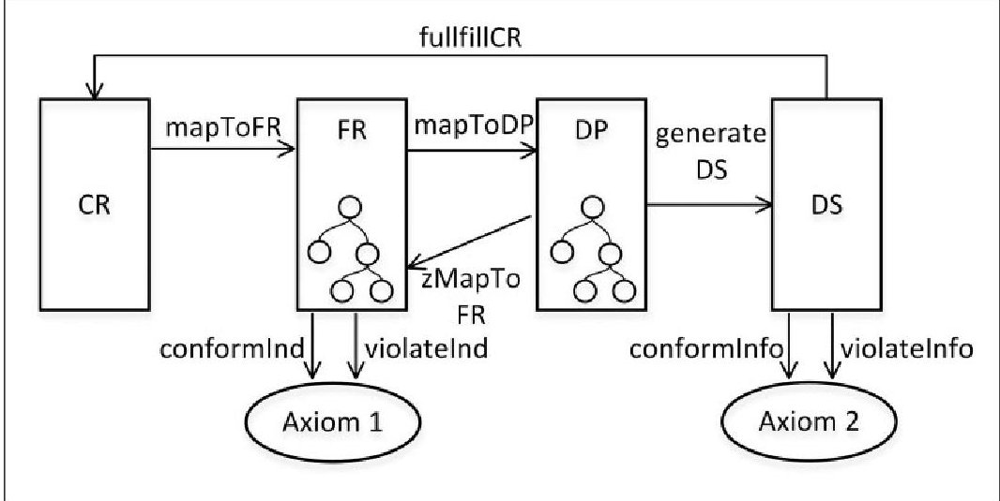

Figure 3. The concept elements and relationships in axiomatic design ontology. DP: design parameter; CR: customer requirement; FR: functional requirement; DS: design solution.

<!-- PDF_PAGE: 6 -->

maintenance, and other constraints. This paper uses the object relation "hasCRType" to represent a specific type of CR. AD ontology solely focuses on functionality. For example, a solar wing has a function to supply the electrical power (i.e., "the power supply requirement").

The hierarchy characteristic indicates that different requirements stay at different abstract decompositions. A detailed requirement could be contained in a more general one. For instance, "the supporting requirement" of a solar wing to the satellite's power can be decomposed into two subrequirements: providing installation and providing strength and stiffness. Another situation is that a requirement is too implicit to be defined. For example, customer requests that the product be convenient to use. This paper uses the combination ("combineCR") decomposition ("hasSubCR") and abstraction relationships ("hasSuperCR") to organize these kinds of requirements.

The degree of importance reflects how important a requirement is for a customer. Ranging CRs helps designers focus on requirements with higher priority.

Definition 2: CRs are abstract element entities constituting the customer domain and representing the customers' original needs with characteristics of diversity, hierarchy, and degree of importance.

Based on the above analysis, the CR ontology $ \mathrm{O}_{\mathrm{C R}} $ consists of the set of CR concepts $ \left(\mathrm{C}_{\mathrm{C R}}\right) $ relations $ \left(\mathrm{C}_{\mathrm{C R}}^{R}\right) $ , and properties $ \left(\mathrm{P}_{\mathrm{C R}}\right) $ which can be formally represented by expression (8), (9), and (10).

$$
\begin{array}{l} \mathrm {O} _ {\mathrm {C R}} = \{\mathrm {C R}, \mathrm {C R N a m e}, \mathrm {C R C o n t e n t}, \mathrm {C R I n P o r t}, \\ \mathrm {C R T y p e}, \mathrm {C R P r i o r i t y}, \mathrm {C} _ {\mathrm {C R}} ^ {\mathrm {R}}, \mathrm {P} _ {\mathrm {C R}} \} \\ \end{array}
$$

$$
\mathrm {C} _ {\mathrm {C R}} ^ {\mathrm {R}} = \left\{ \begin{array}{l} \mathrm {h a s S u b C R}, \mathrm {h a s S u p e r C R}, \mathrm {c o m b i n e C R}, \\ \mathrm {h a s I n P o r t}, \mathrm {m a p T o F R} \end{array} \right.
$$

$$
\begin{array}{l} \mathrm {P} _ {\mathrm {C R}} = \left\{\mathrm {h a s C R N a m e}, \mathrm {h a s C R C o n t e n t}, \right. \\ \left. \mathrm {h a s C R T y p e}, \mathrm {a t C R P r i o r i t y} \right\} \\ \end{array}
$$

where a CR stands for a customer requirement. CRName denotes a brief name of a CR, such as a weight requirement, a quantity requirement, a time requirement, a required sphere of action, etc. The property "hasCRName" associates a CR with its CRName.

CRContent stands for literals to explain CRName by a natural sentence. The property between a CR and its CRContent is "hasCRContent." For example, "the power supply requirement" of a solar wing can be explained as "providing electrical power for normal operation of the equipment and payloads of a satellite during its lifecycle."

InPort represents the source of a CR and it can be a person or an organization. The relation between a CR and its InPort is "hasInPort." For example, InPort of the "weight constraint" of a solar wing is part of the design of the launch vehicle; "the power supply requirement" comes from the power subsystem, and "the supporting requirement" is put forward by the structure subsystem.

A CR is mapped to a FR in the function domain through the relation "mapToFR."

The type of CR is described by CRType classified into the functional CR and the nonfunctional CR. The functional CR has a hierarchical structure, and the nonfunctional one is further categorized into the reliability, maintainability, constraints, etc. The relation between a CR and its CRType is "hasCRType."

CRPriority denotes the degree of importance of a CR by a low, medium, and high level. The property "atCRPriority" associates a CR with its CRPriority.

The concept elements and relationships of $ \mathrm{O_{CR}} $ are represented by RDFS in Figure 4. Names, types, domains, and ranges of binary relationships in the $ \mathrm{O_{CR}} $ are listed in Table 2.

FR class. FR elements are delineated in the functional domain. $ \mathrm{S u h}^{2 3} $ defines FRs as "a minimum set of independent requirements representing functions of a product."

To present hierarchical levels of FRs during the decomposition process "hasSubFR" and "hasSuperFR" are created. For example, "the power supply function" $ \left( \mathrm{F R}_{1}^{i} \right) $ at abstract level "i" is decomposed into two subfunctions: "converting solar energy into electricity function" $ \left( \mathrm{F R}_{1}^{i+1} \right) $ and "delivering electricity function" $ \left( \mathrm{F R}_{2}^{i+1} \right). $

The zigzag mapping between the functional domain and the physical domain leads to the decomposition of FRs. Figure 5 shows concept elements, relationships, and decomposition processes in the functional domain. In the figure, during the first iteration (LEVEL 1), $ \mathrm{F R}_{1}^{1} $ is mapped to the corresponding $ \mathrm{D P}_{1}^{1} $ in the physical domain (The formal definition of the DPs is discussed in design solution class section) and the mapping relation is documented by "mapToDP." Within the second iteration (LEVEL 2), the design comes back to the functional domain to specify subfunctions $ \mathrm{F R}_{1}^{2} $ and $ \mathrm{F R}_{2}^{2} $ that satisfy the top-level $ \mathrm{F R}_{1}^{1} $ and this mapping relation is represented by "zMapToFR," and then, the design proceeds to the physical domain again to define $ \mathrm{D P}_{1}^{2} $ and $ \mathrm{D P}_{2}^{2} $ satisfying the corresponding $ \mathrm{F R}_{1}^{2} $ and $ \mathrm{F R}_{1}^{2}. $ The zigzag mapping process continues until it is not necessary to decompose any FR (LEVEL n).

According to the definition, FRs at the same hierarchical level have to stay independent from each other. (Design axioms and rules in AD ontology section discusses the Independence Axiom representation in more detail.) This paper uses the relation "coupledWith" to show functional couplings and uses "affectFR" and "isAffectedBy" to represent the

<!-- PDF_PAGE: 7 -->

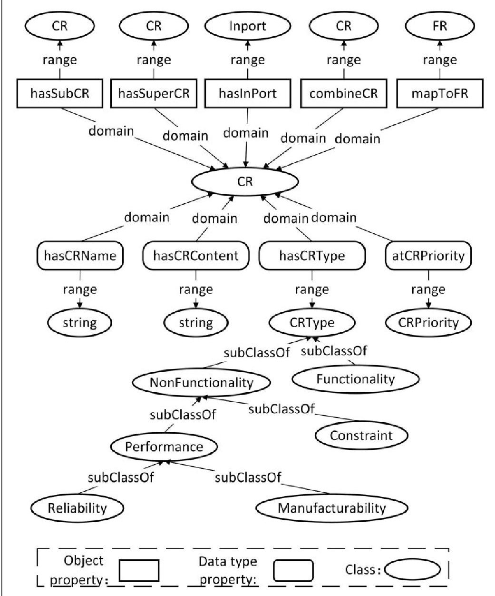

Figure 4. Relationships between concepts of $ O_{CR}. $ CR: customer requirement; FR: functional requirement.

Table 2. The relationships of CR class.

<table border="1"><tr><td>Relationship</td><td>Type</td><td>Description</td><td>Domain</td><td>Range</td></tr><tr><td>hasSubCR</td><td>Object</td><td>Has subclasses</td><td>CR</td><td>CR</td></tr><tr><td>hasSuperCR</td><td>Object</td><td>Has a super class</td><td>CR</td><td>CR</td></tr><tr><td>hasInPort</td><td>Object</td><td>Has stakeholders</td><td>CR</td><td>CR</td></tr><tr><td>combineCR</td><td>Object</td><td>Combine CRs</td><td>CR</td><td>CR</td></tr><tr><td>mapToFR</td><td>Object</td><td>Mapping a CR to a FR</td><td>CR</td><td>FR</td></tr><tr><td>hasCRName</td><td>DataType</td><td>A brief name</td><td>CR</td><td>xsd:string</td></tr><tr><td>hasSubCR</td><td>Object</td><td>Has subclasses</td><td>CR</td><td>CR</td></tr><tr><td>hasCRContent</td><td>DataType</td><td>A text description</td><td>CR</td><td>xsd:string</td></tr><tr><td>hasCRType</td><td>DataType</td><td>A particular type</td><td>CR</td><td>CRType</td></tr><tr><td>atCRPriority</td><td>DataType</td><td>A particular priority</td><td>CR</td><td>CRPriority</td></tr></table>

CR: customer requirement; FR: functional requirement.

influence between DPs and FRs. For example, "the supporting function" of a solar wing affects its "power supply function," because the structure of the power provides the solar wing with the installation space, position, and required strength and stiffness.

Definition 3: The FR class is an aggregate of a variety of element entities describing FRs that constitute the functional domain mapped from the customer domain, and they should be kept independent from each other.

<!-- PDF_PAGE: 8 -->

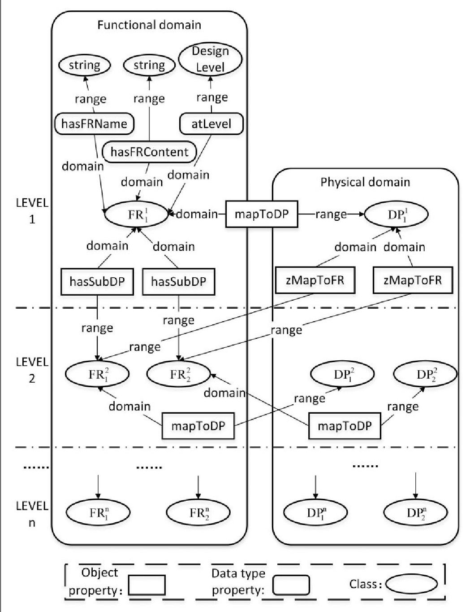

Figure 5. Concepts, relations, and hierarchical decomposition of FR ontology. DP: design parameter; FR: functional requirement.

The FR ontology $ \mathrm{O}_{\mathrm{F R}} $ consists of the set of FR concepts $ \left(\mathrm{C}_{\mathrm{F R}}\right) $ , relations $ \left(\mathrm{C}_{\mathrm{F R}}^{\mathrm{R}}\right) $ , and properties $ \left(\mathrm{P}_{\mathrm{F R}}\right) $ which can be formally represented by expression (11), (12), and (13).

$$
\begin{array}{l} \mathrm {O} _ {\mathrm {F R}} = \left\{\mathrm {F R}, \mathrm {F R N a m e}, \mathrm {F R C o n t e n t}, \mathrm {D e s i g n L e v e} 1, \right. \\ \mathrm {C} _ {\mathrm {F R}} ^ {\mathrm {R}}, \mathrm {P} _ {\mathrm {F R}} \} \\ \end{array}
$$

$$
\mathrm {C} _ {\mathrm {F R}} ^ {\mathrm {R}} = \left\{ \begin{array}{l} \mathrm {h a s S u b F R}, \mathrm {h a s S u p e r F R}, \mathrm {m a p T o D P}, \\ \mathrm {z M a p T o F R}, \mathrm {c o u p l e d W i t h}, \mathrm {a f f e c t F R}, \\ \mathrm {i s A f f e c t e d B y} \end{array} \right.
$$

$$
\mathrm {P} _ {\mathrm {F R}} = \{\mathrm {h a s F R N a m e}, \mathrm {h a s F R C o n t e n t}, \mathrm {a t L e v e l} \}
$$

where FR denotes a functional requirement in the functional domain.

FRName represents a brief name of an FR. The property associates "hasFRName" an FR with its FRName.

FRContent stands for the content of an FR and it explains FRName by a natural sentence. The property between an FR and its FRContent is "hasFRContent." For example, "the fulfilling required actions function" of a solar wing can be explained as "the structures and mechanisms should be capable of pressing, releasing, deploying, locking, and orientating a solar wing to operate normally."

DesignLevel denotes the design abstract level (i.e., the number of iterations) of an FR. The property "atLevel" associates an FR with its DesignLevel represented by a positive integer.

Table 3 lists names, types, domains, and ranges of binary relationships in the $ \mathrm{O_{FR}} $

DP clas. Suh $ ^{2 3} $ defines DPs as "physical variables representing design" without considering the

<!-- PDF_PAGE: 9 -->

Table 3. The relationships of FR class.

<table border="1"><tr><td>Relationship</td><td>Type</td><td>Description</td><td>Domain</td><td>Range</td></tr><tr><td>hasSubFR</td><td>Object</td><td>Has a subclass</td><td>FR</td><td>FR</td></tr><tr><td>hasSuperFR</td><td>Object</td><td>Has a super class</td><td>FR</td><td>FR</td></tr><tr><td>mapToDP</td><td>Object</td><td>Mapping an FR to a DP in the same level</td><td>FR</td><td>DP</td></tr><tr><td>zMapToFR</td><td>Object</td><td>Mapping a DP back to an FR in the less general level</td><td>DP</td><td>FR</td></tr><tr><td>coupledWith</td><td>Object</td><td>Is coupled with another DP</td><td>FR</td><td>FR</td></tr><tr><td>affectFR</td><td>Object</td><td>Affecting an FR</td><td>DP</td><td>FR</td></tr><tr><td>isAffectedBy</td><td>Object</td><td>Is affected by a DP</td><td>FR</td><td>DP</td></tr><tr><td>hasFRName</td><td>DataType</td><td>A brief name</td><td>FR</td><td>xds: string</td></tr><tr><td>hasFRContent</td><td>DataType</td><td>A text description</td><td>FR</td><td>xds: string</td></tr><tr><td>atLevel</td><td>DataType</td><td>A particular designing level</td><td>FR</td><td>DesignLevel</td></tr></table>

CR: customer requirement; FR: functional requirement; DP: design parameter.

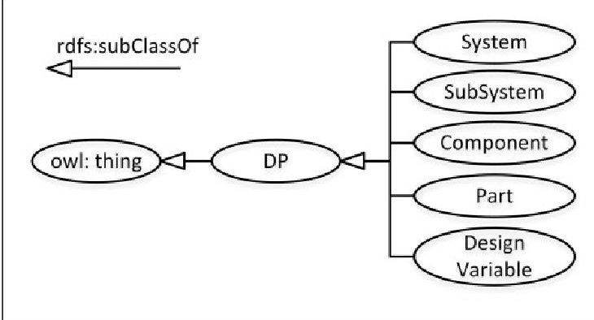

Figure 6. Design parameters class hierarchy. DP: design parameter.

inconsistency among them. According to different levels of design decomposition, the concepts of DPs are classified as System, Subsystem, Component, Part, and Design Variable shown in Figure 6. For example, the battery array of a satellite belongs to the electrical power subsystem; components providing supporting and moving condition for the battery array belong to the structure and mechanism subsystem.

Composing and decomposing relationships are created between DPs. For example, "the structure subsystem of a solar wing" （subSystem $ _{1}^{1} $ ）contains "a pressing component" （component $ _{1}^{2} $ ）and "a deploying component" （component $ _{2}^{2} $ ）, which is represented by the relation "decomposeDP"; in a similar way, the component $ _{1}^{1} $ consists of the component $ _{1}^{2} $ and the part $ _{2}^{2} $ . For instance, the above "deploying component" （component $ _{2}^{2} $ ）consists of hinges, linkage components, and driving parts, and is represented by the relation "composed." Concept elements and their relationships of $ \mathrm{O_{CR}} $ are represented by RDFS in Figure 7.

The decomposition of DPs depends on the zigzag mapping process between the functional domain and the physical domain.

The relation "hasAlternativeDP" denotes that two or more DPs satisfy the same FR, such as $ \mathrm{D P}_{1}^{2} $ and $ \mathrm{D P}_{2}^{2} $ satisfying $ \mathrm{F R}_{1}^{1} $ in Figure 7. For example, the substrate of a solar wing could be rigid, semi-rigid, or flexible.

When the decomposition process finishes, different DPs constitute alternative design solutions, this kind of relation is represented by "generateDS." For example, in Figure 7, $ \mathrm{D P}_{1}^{2}, $ $ \mathrm{D P}_{1}^{3}, $ and $ \mathrm{D P}_{2}^{3} $ generate DS1; $ \mathrm{D P}_{2}^{2}, $ $ \mathrm{D P}_{1}^{3}, $ and $ \mathrm{D P}_{2}^{3} $ generate DS2.

Definition 4: The DP class is an aggregate of various physical concepts which are used to satisfy corresponding FR and they include the subclasses of System, Subsystem, Component, Part, and Design Variable and their mutual relationships.

The formal definition of DP ontology $ \mathrm{O_{DP}} $ is given by expressions (14), (15), and (16).

$$
\mathrm {O} _ {\mathrm {D P}} = \{\mathrm {D P}, \mathrm {D P N a m e}, \mathrm {D e s i g n L e v e l},
$$

$$
\mathrm {D P T y p e}, \mathrm {C} _ {\mathrm {D P}} ^ {\mathrm {R}}, \mathrm {P} _ {\mathrm {D P}} \}
$$

$$
\mathrm {C} _ {\mathrm {D P}} ^ {\mathrm {R}} = \left\{ \begin{array}{l} \text {d e c o m p o s e D P , c o m p o s e D P , g e n e r a t e D S ,} \\ \text {h a s A l t e r n a t i v e D P} \end{array} \right. \tag {15}
$$

$$
\mathrm {P} _ {\mathrm {D P}} = \{\mathrm {h a s D P N a m e}, \mathrm {a t L e v e l}, \mathrm {h a s D P T y p e} \}
$$

where a DP denotes a design parameter in the physical domain. DPName denotes a brief name of a DP. The property "hasDPName" associates a DP with its DPName. DesignLevel, which is the same as DesignLevel in the definition of $ \mathrm{O_{FR}} $ denotes the design level of a DP. The property "atLevel" relates a DP to its DesignLevel. As shown in Figure 6, different DPs are organized by different types. The property "hasDPType" associates a DP with its DPType.

Table 4 lists names, types, domains, and ranges of binary relationships in the $ \mathrm{O_{DP}} $

DS class. In each design level, the set of DPs are organized into a design solution. The definition of DS class can be formally represented as following:

Definition 5: The DS class is a minimum set of bottom DPs satisfying specific customer's requirements.

It can be seen from this definition that designers can generate a DS after finishing the decomposition

<!-- PDF_PAGE: 10 -->

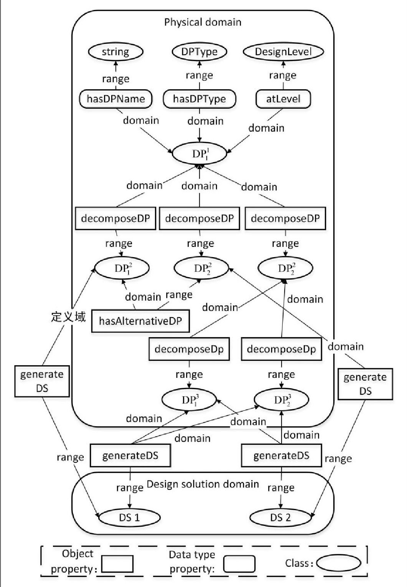

Figure 7. Concept elements and their relationships of CR ontology and the generation of designing solutions. CR: customer requirement; DP: design parameter; DS: design solution.

Table 4. The relationships of DP class.

<table border="1"><tr><td>Relationship</td><td>Type</td><td>Description</td><td>Domain</td><td>Range</td></tr><tr><td>decomposeDP</td><td>Object</td><td>Decompose a DP</td><td>DP</td><td>DP</td></tr><tr><td>composeDP</td><td>Object</td><td>Compose DPs</td><td>DP</td><td>DP</td></tr><tr><td>hasAlternativeDP</td><td>Object</td><td>Has alternatives</td><td>DP</td><td>DP</td></tr><tr><td>generateDS</td><td>Object</td><td>Generate a DP</td><td>DP</td><td>DS</td></tr><tr><td>hasDPName</td><td>DataType</td><td>A brief name</td><td>DP</td><td>xds:string</td></tr><tr><td>atLevel</td><td>DataType</td><td>A particular design level</td><td>DP</td><td>DesignLevel</td></tr><tr><td>hasDPType</td><td>DataType</td><td>A particular type</td><td>DP</td><td>DPType</td></tr></table>

DP: design parameter; DS: design solution.

<!-- PDF_PAGE: 11 -->

of FRs and DPs. A designer selects "bottom" DPs as long as they are detailed enough to satisfy corresponding requirements and they can be any type classified in Design solution class section.

The Information Axiom of AD helps a designer select the optimal alternative DS, which is discussed in Design axioms and rules in AD ontology section.

Equation (17) formally represents the definition of the design solution ontology $ \mathrm{O_{DS}} $

$$
\mathrm {O} _ {\mathrm {D S}} = \left\{\mathrm {D S}, \mathrm {D S N a m e}, \mathrm {C} _ {\mathrm {D S}} ^ {\mathrm {R}}, \mathrm {P} _ {\mathrm {D S}} \right\}
$$

where a DS denotes a design solution and DSName denotes a brief name of it.

There is a data type property hasDSName $ \in $ $ P_{DS} $ and two object properties fulFillCR, generateDS $ \in $ $ C_{DS}^{R} $ in $ O_{DS} $ . The former represents the satisfying relationship between a DS and a CR; the latter represents the generating relationships between a DS and a DP.

## Design axioms and rules in AD ontology

The AD ontology defined above establishes the general knowledge and semantic relationships of the AD semantic model. This section firstly gives formal definitions of the IndA class and the InfoA class; secondly, new rules based on these axioms are defined by SWRL and created by the SWRL editor in protégé to enhance the reasoning ability of the AD ontology.

IndA class and rules. What deserves illustration is the difference between axioms of AD and Z. The former is a kind of design rule following the Independence Axiom and the Information Axiom to guide the systems design process; the latter implies the need for mandatory constraints for improving the consistency, validity, and reasoning capability of the ontology (Axioms of relations and properties in the AD ontology section).

According to the analysis in AD principles section, the form of the design matrix [A] in the design equation (1) determines the satisfying condition of the Independence Axiom. Thus, the concepts, relations, properties, and functions in the Independence Axiom ontology $ \mathrm{O_{IND}} $ can be formally defined as following

$$
\mathrm {O} _ {\mathrm {I N D}} = \{\mathrm {S D}, \mathrm {D M}, \mathrm {F R s}, \mathrm {D P s}, \mathrm {D e s i g n L e v e l},
$$

$$
\mathrm {D M T y p e}, \mathrm {C} _ {\mathrm {I N D}} ^ {\mathrm {R}}, \mathrm {P} _ {\mathrm {I N D}}, \mathrm {F} _ {\mathrm {I N D}} \}
$$

$$
\mathrm {C} _ {\mathrm {I N D}} ^ {\mathrm {R}} = \{\mathrm {h a s S u b D M}, \mathrm {h a s S u p e r D M} \}
$$

$$
\begin{array}{l} \mathrm {P} _ {\mathrm {I N D}} = \{\mathrm {a t L e v e l}, \mathrm {c o n f o r m I n d}, \mathrm {v i o l a t E I n d}, \\ \mathrm {h a s D M T y p e}, \mathrm {i s C o u p l e d D e s i g n}, \\ \mathrm {i s R e d u n d a n t D e s i g n}, \mathrm {i s I d e a l D e s i g n} \} \\ \end{array}
$$

$$
\mathrm {F} _ {\mathrm {I N D}} = \{\mathrm {h a s N u m b e r O f} \}
$$

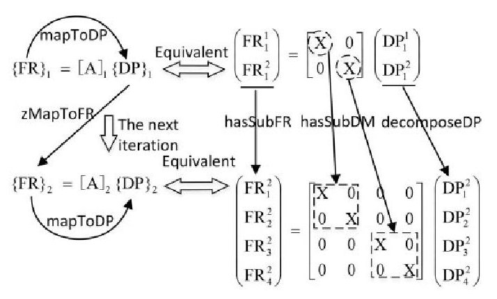

Figure 8. Design matrices hierarchy. DP: design parameter; FR: functional requirement.

SD denotes the system design described by the design formula $ \left\{\mathrm{F R}\right\}_{\mathrm{L}}=[\mathrm{A}]_{\mathrm{L}}\left\{\mathrm{D P}\right\}_{\mathrm{L}} $ where the symbol "L" represents the design level.

DM denotes the design matrix in the design formula and its symbolic representation is $ [\mathbf{A}]_{\mathrm{L}} $ which documents the relationships between FRs and DPs at a particular design level.

FRs denotes an FR vector represented by the symbol $ \left\{\mathrm{F R}\right\}_{\mathrm{L}} $ . For example, "the power supply function", "the supporting function" and "the fulfilling required actions function" of a solar wing constitute the $ \left\{\mathrm{F R}\right\}_{1} $ at the first design level.

FRs denotes a DP vector represented by the symbol $ \left\{\mathrm{DP}\right\}_{\mathrm{L}}. $ DesignLevel is the same as the DesignLevel defined in $ \mathrm{O}_{\mathrm{F R}} $ and $ \mathrm{O}_{\mathrm{D P}}. $

DMType denotes three types (i.e., diagonalMatrix, triangularMatrix, and fullMatrix) of a design matrix. The property "hasDMType" associates a design matrix with its DMType.

Since FRs and DPs are hierarchical, the corresponding DMs also have hierarchical levels (shown in Figure 8) which are represented by the relationships "hasSubDM" and the "hasSuperDM."

The property "conformInd" means that FRs conform to the Independence Axiom and the property "violateInd" means that it violates the axiom. Properties "isCoupledDesign," "isRedundantDesign," and "isIdealDesign" associate an SD to the coupled design, the redundant design, and the ideal design, respectively.

In order to calculate the number of elements in FRs or DPs, the function "hasNumberOf" is added in the $ \mathrm{O}_{\mathrm{IND}} $ . For instance, the number of elements of the above $ \{\mathrm{F R}\}_{1} $ and $ \{\mathrm{D P}\}_{1} $ are both three after performing the "hasNumberOf" function.

Table 5 shows names, types, domains, and ranges of binary relationships in the $ \mathrm{O}_{\mathrm{IND}} $

SWRL rules for explicitly representing whether a design matrix [A] is in accord with the Independence Axiom or not are defined below:

Rule 1: If the type of design matrix DM is a diagonal matrix or triangular matrix, then the

<!-- PDF_PAGE: 12 -->

Table 5. The relationships of IND class.

<table border="1"><tr><td>Relationship</td><td>Type</td><td>Description</td><td>Domain</td><td>Range</td></tr><tr><td>hasSubDM</td><td>Object</td><td>Has a sub-DM</td><td>DM</td><td>DM</td></tr><tr><td>hasSuperDM</td><td>Object</td><td>Has a super DM</td><td>DM</td><td>DM</td></tr><tr><td>atLevel</td><td>DataType</td><td>A particular design level</td><td>DM/SD</td><td>DesignLevel</td></tr><tr><td>hasDMType</td><td>DataType</td><td>A particular type</td><td>DM</td><td>DMType</td></tr><tr><td>conformInd</td><td>DataType</td><td>Conform to Axiom I</td><td>FRs</td><td>xsd: true</td></tr><tr><td>violateInd</td><td>DataType</td><td>Violate Axiom I</td><td>FRs</td><td>xsd: true</td></tr><tr><td>isCoupledDesign</td><td>DataType</td><td>A coupled design</td><td>SD</td><td>xsd: true</td></tr><tr><td>isRedundantDesign</td><td>DataType</td><td>A redundant design</td><td>SD</td><td>xsd: true</td></tr><tr><td>isIdealDesign</td><td>DataType</td><td>An ideal design</td><td>SD</td><td>xsd: true</td></tr><tr><td>hasNumber</td><td>Function</td><td>Get the number</td><td>FRs/DPs</td><td>xsd: integer</td></tr></table>

IND: independence. DM: design matrix; SD: system design.

corresponding FRs conform to the Independence Axiom.

$$
\begin{array}{l} \mathrm {D M} (\mathrm {? x 1}) ^ {\wedge} \mathrm {F R s} (\mathrm {? x 2}) ^ {\wedge} \mathrm {h a s D M T y p e} \\ (? x 2, \mathrm {d i a g o n a l M a t r i x}) \\ \end{array}
$$

$$
\rightarrow \mathrm {c o n f o r m I n d} (? \mathrm {x 2}, \mathrm {t r u e})
$$

$$
\mathrm {D M} (? \mathrm {x} 1) ^ {\wedge} \mathrm {F R s} (? \mathrm {x} 2) ^ {\wedge} \mathrm {h a s D M T y p e}
$$

$$
(? x 2, \mathrm {t r i a n g u l a r M a t r i x})
$$

$$
\rightarrow \mathrm {c o n f o r m I n d} (? \mathrm {x 2}, \mathrm {t r u e})
$$

Rule 2: If the type of design matrix DM is a full matrix, then the corresponding FRs violate the Independence Axiom.

$$
\mathrm {D M} (? \mathrm {x} 1) ^ {\wedge} \mathrm {F R s} (? \mathrm {x} 2) ^ {\wedge} \mathrm {h a s D M T y p e} (? \mathrm {x} 2, \mathrm {f u l l M a t r i x})
$$

$$
\rightarrow \mathrm {v i o l a t e I n d} (? \mathrm {x 2}, \mathrm {t r u e})
$$

Rules for reasoning the type of systems design (DS) are explicitly defined below:

Rule 3: If the number of elements in DPs is less than that in FRs, then the SD is a coupled design.

$$
\mathrm {S D} (? \mathrm {x}) ^ {\wedge} \mathrm {F R s} (? \mathrm {y}) ^ {\wedge} \mathrm {D P s} (? \mathrm {z}) ^ {\wedge} \mathrm {m a p T o D P} (? \mathrm {y}, ? \mathrm {z})
$$

$$
^ {\wedge} \mathrm {h a s N u m b e r O f} (? \mathrm {y}, ? \mathrm {m}) ^ {\wedge} \mathrm {h a s N u m b e r O f} (? \mathrm {z}, ? \mathrm {n})
$$

$$
^ {\wedge} \mathrm {s w r l b}: \mathrm {l e s s T h a n} (? \mathrm {n}, ? \mathrm {m}) \rightarrow \mathrm {i s C o u p l e d D e s i g n} (? \mathrm {x}, \mathrm {t r u e})
$$

Rule 4: If the number of elements in DPs is greater than that in FRs, then an SD is a redundant design.

$$
\mathrm {S D} (? \mathrm {x}) ^ {\wedge} \mathrm {F R s} (? \mathrm {y}) ^ {\wedge} \mathrm {D P s} (? \mathrm {z}) ^ {\wedge} \mathrm {m a p T o D P} (? \mathrm {y}, ? \mathrm {z})
$$

$$
^ {\wedge} \mathrm {h a s N u m b e r O f} (? \mathrm {y}, ? \mathrm {m}) ^ {\wedge} \mathrm {h a s N u m b e r O f} (? \mathrm {z}, ? \mathrm {n})
$$

$$
^ {\wedge} \mathrm {s w r l b}: \mathrm {g r e a t e r T h a n} (? \mathrm {n}, ? \mathrm {m})
$$

$$
\rightarrow \mathrm {i s C o u p l e d D e s i g n} (? \mathrm {x}, \mathrm {t r u e})
$$

Rule 5: If the number of elements in DPs is equal to that in FRs which conforms to the Independence

Axiom, then the SD is an ideal design.

$$
\mathrm {S D} (? \mathrm {x}) ^ {\wedge} \mathrm {F R s} (? \mathrm {y}) ^ {\wedge} \mathrm {D P s} (? \mathrm {z}) ^ {\wedge} \mathrm {m a p T o D P} (? \mathrm {y}, ? \mathrm {z})
$$

$$
^ {\wedge} \mathrm {h a s N u m b e r O f} (? \mathrm {y}, ? \mathrm {m}) ^ {\wedge} \mathrm {h a s N u m b e r O f} (? \mathrm {z}, ? \mathrm {n})
$$

$$
\wedge \mathrm {s w r l b}: \mathrm {e q u a l} (? \mathrm {n}, ? \mathrm {m}) \rightarrow \mathrm {i s I d e a l D e s i g n} (? \mathrm {x}, \mathrm {t r u e})
$$

InfoA class and rules. $ \mathrm{P r b_{i}} $ is crucial in equation (3) for calculating the information content of an FR. In order to get $ \mathrm{P r b_{i}} $ , the definitions of DR and SR are formally represented below:

Definition 6: DR (Design Range) is determined by an FR to represent what a designer wishes to achieve in term of tolerance.

Definition 7: SR (System Range) is determined by a DP to represent what a system is capable of delivering.

Expressions (23), (24), and (25) below explicitly represent concepts, relations, and properties of the Information Axiom ontology $ \mathrm{O}_{\mathrm{INFO}} $

$$
\mathrm {O} _ {\mathrm {I N F O}}
$$

$$
= \{\mathrm {F R}, \mathrm {D P}, \mathrm {D S}, \mathrm {D e s i g n R a n g e}, \mathrm {S y s t e m R a n g e},
$$

$$
\mathrm {F R I n f o m a t i o n}, \mathrm {S y s t e m I n f o r m a t i o n}, \mathrm {C} _ {\mathrm {I N D}} ^ {\mathrm {R}}, \mathrm {P} _ {\mathrm {I N D}} \}
$$

$$
\mathrm {O} _ {\mathrm {I N F O}} = \{\mathrm {h a s D R}, \mathrm {h a s S R} \}
$$

$$
\mathrm {P} _ {\mathrm {I N F O}} = \left\{ \begin{array}{l} \mathrm {h a s F R I n f o}, \mathrm {h a s S y s t e m I n f o}, \mathrm {c o n f o r m I n f o}, \\ \mathrm {v i o l a t e I n f o}, \mathrm {i s O p t i m a l D e s i g n} \end{array} \right.
$$

where the FR, DP, and DS represent a functional requirement, a design parameter, and a design solution, respectively. The relation between FR and its design range is represented by "hasDR." The relation

<!-- PDF_PAGE: 13 -->

(a)

(b)

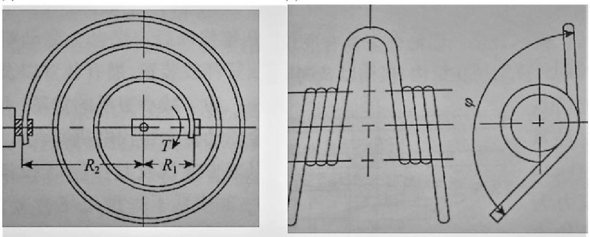

Figure 9. Driving parts of a solar wing. (a) Flat spiral spring. (b) Torsion spring.

Table 6. The relationships of the INFO class.

<table border="1"><tr><td>Relationship</td><td>Type</td><td>Description</td><td>Domain</td><td>Range</td></tr><tr><td>hasDR</td><td>Object</td><td>Has a design range</td><td>FR</td><td>DR</td></tr><tr><td>hasSR</td><td>Object</td><td>Has a system range</td><td>DP</td><td>SR</td></tr><tr><td>hasFRInfo</td><td>DataType</td><td>Information content</td><td>FR</td><td>xsd: double</td></tr><tr><td>hasSystemInfo</td><td>DataType</td><td>System information content</td><td>SD</td><td>xsd: double</td></tr><tr><td>conformInfo</td><td>DataType</td><td>Conform to Axiom 2</td><td>DP</td><td>xsd: true</td></tr><tr><td>violateInfo</td><td>DataType</td><td>Violate Axiom 2</td><td>DP</td><td>xsd: true</td></tr><tr><td>isOptimalDesign</td><td>DataType</td><td>An optimal design</td><td>SD</td><td>xsd: true</td></tr></table>

INFO: information; SD: system design; FR: functional requirement; DR: design range; SR: system range.

between DP and its system range is represented by "hasSR."

The allocation of a deploying function of a solar array is given to illustrate the use of the InfoA class and rules. The deploying function consists of a function for unfolding the battery array $ \mathrm{F R}_{1} $ , a function for driving the deploying action $ \mathrm{F R}_{2} $ , a function for keeping required speed $ \mathrm{F R}_{3} $ , and a function for keeping the array stable $ \mathrm{F R}_{4} $ . These functions constitute a vector of FRs which has corresponding DPs containing hinges $ \mathrm{D P}_{1} $ , driving parts $ \mathrm{D P}_{2} $ , the driving force $ \mathrm{D P}_{3} $ , and linkage components $ \mathrm{D P}_{4} $ . However, as shown in Figure 9, a designer can choose the torsion spring or the flat spiral spring as the $ \mathrm{D P}_{2} $ $ ^{30} $ The Information Axiom is used to help the designer select the better one. The DR of $ \mathrm{F R}_{2} $ is $ 1 8 0^{\circ} $ when the battery array is fully deployed. The SRs of a torsion spring and a flat spiral spring are $ 0^{\circ}-9 0^{\circ} $ and $ 0^{\circ}->1 8 0^{\circ} $ , respectively. Therefore, the torsion spring's DR is partially in the range of SR, which indicates that its information content for fulfilling $ \mathrm{F R}_{2} $ is greater than 0, whereas the flat spiral spring's DR is totally in the range of SR; thus, its information content for fulfilling $ \mathrm{F R}_{2} $ is equal to 0. In conclusion, the flat spiral spring is chosen as $ \mathrm{D P}_{2} $ because the $ \mathrm{F R}_{2} $ conforms to the Information Axiom.

Table 6 shows names, types, domains, and ranges of binary relationships in the $ \mathrm{O}_{\mathrm{I N F O}} $

Four rules for reasoning the Information Axiom are represented below. Rules 6 and 7 are used to determine if a DP conforms to the Information Axiom; rules 8 and 9 help a designer select the optimal design solution.

Rule 6: If the SR of a DP is completely in the range of the DR of an FR whose information content is 0 then the DP conforms to the Information Axiom.

$$
\begin{array}{l} \mathrm {F R} (? \mathrm {x}) ^ {\wedge} \mathrm {D P} (? \mathrm {y}) ^ {\wedge} \mathrm {F R I n f o r m a t i o n} (? \mathrm {z}) \\ ^ {\wedge} \mathrm {h a s D R} (? \mathrm {x}, ? \mathrm {w}) \\ \end{array}
$$

> conformInfo(?y, true)

Rule 7: If the SR of a DP is fully outside of the range of the DR of an FR whose information content 1, then the DP violates the Information Axiom.

FR(?x) $ ^{\wedge} $ DP(?y) $ ^{\wedge} $ FRInformation(?z) $ ^{\wedge} $ hasDR(?x, ?w)

$ ^{\wedge} $swrlb : equal (?m,1)

→ conformInfo(?y, true)

<!-- PDF_PAGE: 14 -->

Rule 8: If every DP of a DS conforms to the Information Axiom, then the DS is the optimal design.

DS(?x) $ ^{\wedge} $ DP(?y) $ ^{\wedge} $ generateDS(?y, ?x)

$$
\mathrm {^ {\wedge} c o n f o r m I n f o (? y , t r u e)} \rightarrow \mathrm {i s O p t i m a l D e s i g n (? x , t r u e)}
$$

Rule 9: If two design solutions (e.g., DS1 and DS2) both violate the Information Axiom, then the one with the less information content is the better design.

$$
\mathrm {D S} (? \mathrm {x}) ^ {\wedge} \mathrm {D S} (? \mathrm {y}) ^ {\wedge} \mathrm {D P} (? \mathrm {u}) ^ {\wedge} \mathrm {D P} (? \mathrm {v}) ^ {\wedge}
$$

generateDS(?u, ?x) $ ^{\wedge} $ generateDS(?u, ?y)

$ ^{ \wedge} $ violateInfo(?u, true) $ ^{ \wedge} $ violateInfo(?v, true)

$ ^{ \wedge} $hasSystemInfo(?x, ?m) $ ^{ \wedge} $hasSystemInfo(?y, ?n)

$ ^{\wedge} $ swrlb:lessThan(?m,?n) $ \to $ isOptimalDesign(x, true)

Axioms of relations and properties in the AD ontology. The OWL2 class is able to define binary relationships between concepts of the AD ontology. However, in addition to part of the built-in OWL2 relations and properties, the semantics of the user-defined relations and properties needs to be explicitly defined by axioms (refer to axioms in ontologies not the design axioms).

## (1) Domains and ranges

Domains and ranges of relations and properties in the AD ontology have been listed from Tables 2 to 6.

## (2) Annotation properties

An annotation property in the AD ontology represents a nonvalue explanation without any direct OWL2 semantics, such as the "has*Content" property where the symbol "*" represents CR or FR. The representation of this kind of property is formally defined as

: has * Content rdf: type owl: AnnotationProperty

## (3) Transitive properties

As for two classes associated by a transitive property, each of them is the subclass of other superclass of its immediate superclass. For example, every subclass of $ \mathrm{F R}_{1}^{2} $ inherits from $ \mathrm{F R}_{1}^{1} $ which is the superclass of $ \mathrm{F R}_{1}^{2}. $ Properties equipped with transitive characteristics in the AD Ontology includes "hasSub*," "hasSuper*" (where the symbol " $ ^{*} $ represents FR, FR, or DM), "decomposeDP" and "composed." The

representation of this kind of property is formally defined as

:hasSub* rdf:type owl:TansitiveProperty

:hasSuper* rdf:type owl:TansitiveProperty

: demposeDP rdf: type owl: TansitiveProperty

: composeDP rdf: type owl: TansitiveProperty

## (4) Inverse properties

Paris of inverse properties in the AD Ontology includes the "hasSub*" - "hasSuper*" pair (where the "*" represents FR, FR, or DM), and the "decompseDP"- "composeDP" pair. The representation of this kind of property is formally defined as

: hasSub* owl : inverseOf : hasSuper*

: decompose* owl : inverseOf : composeDP*

## (5) Disjoint properties

Disjoint properties in the AD ontology includes "conformInd," "violateInd," "conformInfo," and "violateInfo." For instance, the situation that FRs conforms to as well as violates the Information Axiom or the Independence Axiom at the same time would never happen. Formal definition of disjoint properties is represented as

: conformInd owl: disJointProperty : violateInd

: conformInd owl: disJointProperty : violateInfo

## Systems design representation and integration based on the AD ontology

The AD semantic model defined above provides systems design information representation with semantic concepts, relations, and properties such that they can be organized and documented. Furthermore, an ontology alignment is able to integrate systems design information with domain-specific information. A framework for representing systems design information based on the AD semantic model is established with three layers: the AD ontology layer, the systems design information representation layer, and the domain-specific information layer displayed in Figure 10.

## (1) AD ontology layer

The AD ontology layer gives a conceptual knowledge representation for systems design. As shown in Figure 11, in this layer all of the above analyzed

<!-- PDF_PAGE: 15 -->

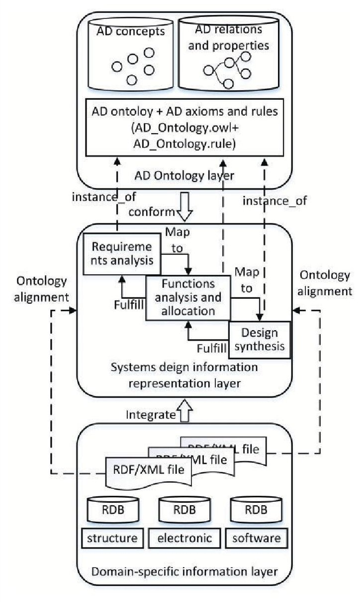

Figure 10. A framework for systems design information representation based on the AD semantic model. AD: axiomatic design; RDB: relational database; RDF: resource description framework.

concepts, relations, and properties are encoded by an OWL-based editor, Protégé (http://protege.stanford.edu), to generate an AD_Ontology.owl file. In addition, the SWRL editor in Protégé is used to create the "if... then... " rules formally defined in IndA class and rules and IndA class and rules sections.

Although ontology supports inference, it does not provide the reasoning rules. This paper uses the Protégé editor to create.

## (2) Systems design information representation layer

Within the systems design information representation layer designers guided by the AD methodology organize the AD Ontology instances into three phases of a systems design process: the system requirements analysis phase, the system functions analysis and allocation phase, and the design synthesis phase illustrated in Figure 12.

Instances of $ \mathrm{O_{CR}} $ provide the system requirement analysis phase with instance source. A systems design process starts from analyzing requirements which examines, evaluates, and translates the external

inputs into a set of functional and performance requirements. It links with the system functions analysis and allocation to form the function domain.

Instances of $ \mathrm{O}_{\mathrm{F R}} $ $ \mathrm{O}_{\mathrm{D P}} $ , and $ \mathrm{O}_{\mathrm{I N D}} $ give the system functions analysis and allocation phase of the instance source. This activity bridges the gap between the high level set of FRs and the detailed set of DPs fulfilling these functions based on the zigzag mapping process of the AD ontology. In the iterative process, design matrices in different hierarchical levels should be constructed to implement the Independence Axiom so as to identify design couplings as long as the Independence Axiom is violated. Functional architectures are the input to the design synthesis activity.

The instance source of the design synthesis phase is instances of $ \mathrm{O_{DS}} $ and $ \mathrm{O_{INFO}} $ . In this activity, the functional architectures and their associated requirements are transformed into different DS. Then, a designer can select the optimal alternative based on the Information Axiom.

## (3) Domain-specific information layer

Paramount to the success of systems design is the integration with domain-specific DPs from the mechanical, electric/electrical, software engineering, etc., which is achieved by the semantic mapping technology in this layer. For example, in the design of a solar wing, the design of the arrangement, circuit layout, and a number of solar batteries need knowledge from electronic engineering. Besides, the structural design of the substrate and the connection frame, the design of the deriving part and the actuating part of the pressing mechanism, deploying mechanism, orientating mechanism, and locking mechanism need knowledge from mechanical engineering. Apart from the above information, the design of the orientation mechanism also needs knowledge from control engineering in order to control the deployed solar array to face the sun when the satellite moves in accordance with required orbit attitude.

The data source of systems design ontology and domain-specific ontology is considered to be a relational database (RDB) like the Interface Data Sheet (IDS) that provides mechanical, electronic, and thermal control data for the systems design. For instance, after the flat spiral spring is selected as the driving force for the deployment of a solar wing in systems design, designers from the structure design department carry out elaborate analysis to specify dimensions, pretightening forces, and other DPs according to design requirements from the systems design. In addition, the flat spiral spring should be assembled to the corresponding hinges whose design must coordinate with electrical interfaces in order to satisfy requirements of the cable layout and the bracket mounting. Therefore, data from mechanical design should also be integrated with DPs from the electronics and electrical domain.

<!-- PDF_PAGE: 16 -->

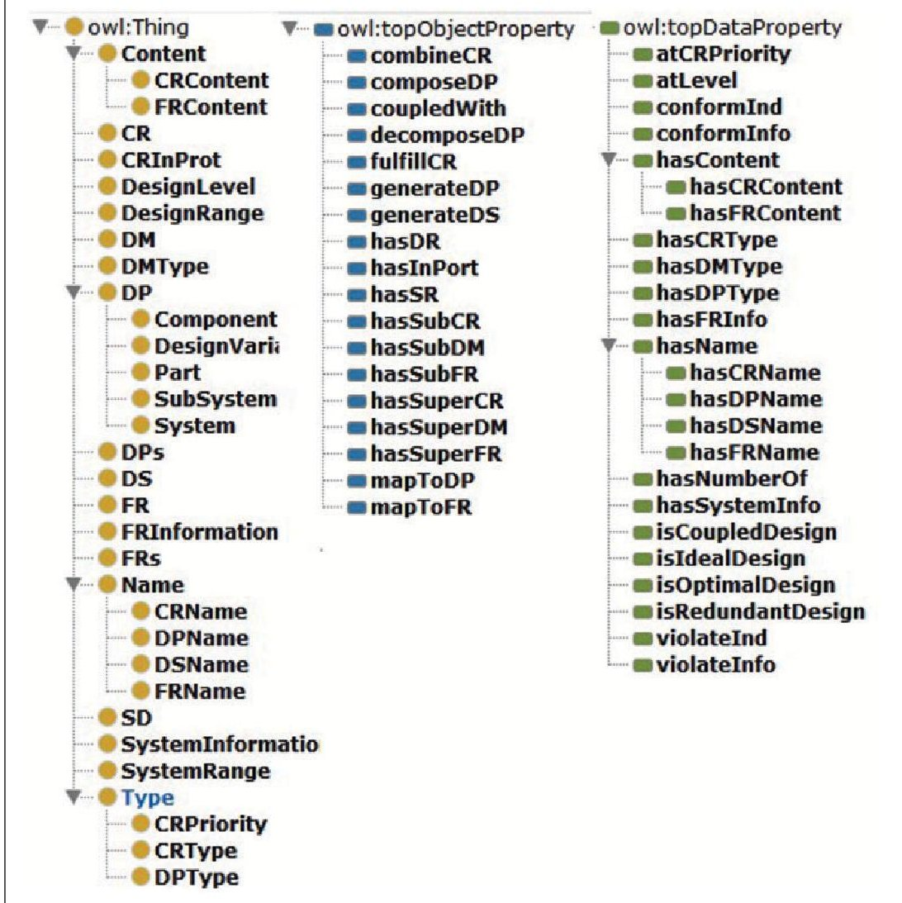

Figure 11. Classes and properties of AD ontology created by Protégé.

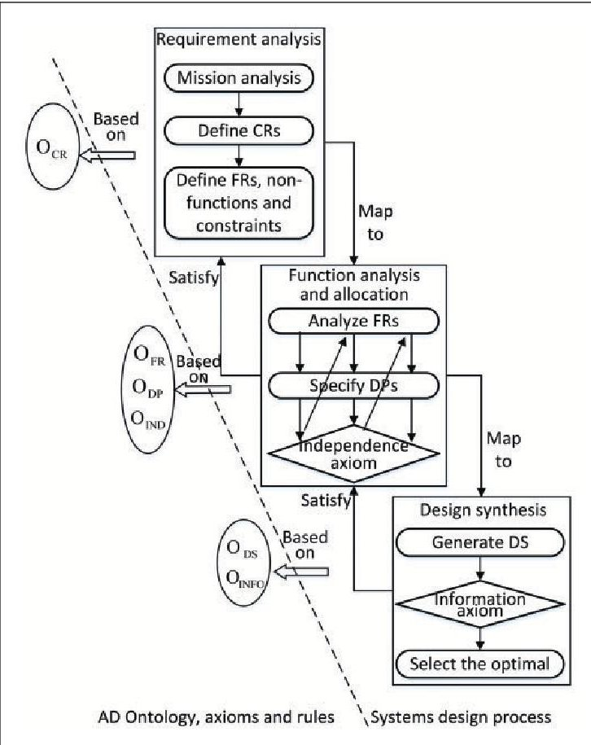

Figure 12. A systems design process based on the axiomatic design ontology. DS: design solution; DP: design parameter; CR: customer requirement; FR: functional requirement.

A semantic information layer (SIL) proposed by Song et al. $ ^{27} $ is used to align different ontologies for sharing and reusing domain-specific information. As shown in Figure 13, a dynamic alignment approach in SIL is designed to match different ontologies. The ontology alignment includes two main phases: finding the correspondences and setting up connections.

For the first phase, the ontology extraction rules listed in Table 7 allow a designer to map tables in the RDB of a particular domain to classes, relations, and properties in the initial ontology. Because OWL2 is created on the basis of RDF and RDFS, extracted ontology instances of AD can be expressed in RDF/XML files.

For setting up the connections phase, pairs of elements from different ontologies are matched by examining several conditions to decide which matcher to apply, such as the string-based matcher, the taxonomy-based matcher, and the alignment reuse matcher. $ ^{27} $ The last step is to align the systems design ontology with the domain-specific ontology by identifying the semantic similarity based on a suitable matcher.

## Demonstration

## Solar array design based on the AD semantic model

The electrical power subsystem is responsible for generating, storing, and transmitting electricity.

<!-- PDF_PAGE: 17 -->

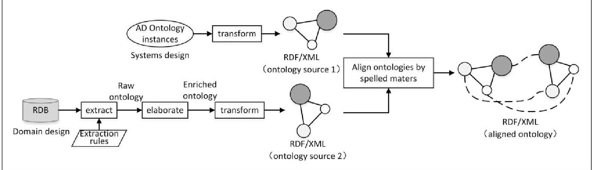

Figure 13. Data integration between systems design and domain design by the dynamic and multistrategies ontological mapping. RDB: relational database; RDF: resource description framework.

Table 7. Ontology extraction rules.

<table border="1"><tr><td>RDB(from)</td><td>OWL(to)</td></tr><tr><td>Table</td><td>Class</td></tr><tr><td>Column</td><td>Property</td></tr><tr><td>Rows</td><td>Instance</td></tr><tr><td>Primary key</td><td>owl:inversFunctionalProperty
owl:minCardinality
rdf:datatype =“&amp;xsd:int”</td></tr><tr><td>Foreign key</td><td>owl:objectProperty</td></tr><tr><td>Check</td><td>owl:hasValue</td></tr><tr><td>Unique</td><td>owl:inversFunctionalProperty</td></tr><tr><td>Not null</td><td>owl:minCardinality
rdf:datatype =“&amp;xsd:int”</td></tr><tr><td>Similarity check</td><td>owl:sameAs</td></tr><tr><td>Hierarchy</td><td>rdfs:subClassOf</td></tr></table>

Solar panels are the most widely used source of electrical power thanks to their excellent characteristics such as the high power, light weight, convenient configuration, high reliability, etc. $ ^{31} $

According to the different types of application, solar arrays are categorized into the body-mounted type and the deployable type. Solar cells of a bodymounted solar array are mounted on the surface of the satellite body. However, it is currently applicable only for a miniaturized satellite because of the limitation of mountable area. Elsewise, a deployable solar array operates outside the satellite body so that it is able to provide more power. The most widely used deployable solar array is the folding solar wing with rigid substrates. $ ^{31} $

A solar wing is a typical type of mechatronic system that aims at providing sufficient electricity for the normal operation of equipment and payloads of a satellite. Moreover, the mechanical design of the solar wing is also significant because solar panels and their circuit layout are not only assembled within the structures of the solar wing, but are also kept in a functioning state by various mechanisms.

Figure 14 shows the general construction of a folding solar wing with rigid substrates from the folded state (a) to the partial deployed state (b) and the full deployed state (c) and (d). Structures of a solar wing contain substrates which support the solar batteries, the circuit components, and the connection frame which connects solar panels with the satellite body. Mechanisms of a solar wing refer to movable components and parts that are responsible for pressing, releasing, deploying, locking, and orientating the solar wing. $ ^{32} $

Systems design of a solar wing is conventionally conducted in the mission analysis phase and the solution feasibility analysis phase followed by detailed design. $ ^{33} $ However, during conventional systems design, function analysis and allocation do not follow design axioms. $ ^{34} $

A solar wing is composed of a large number of components that involve multiple domains and perform various functions; so, systems design information should be able to represent design intent, to consider functional couplings, to make reasonable decisions with regard to design axioms, and to integrate with information concerning the structure, electronic, control, and other relevant domains.

Figure 15 shows a graphical view of the reasoning framework, illustrating the relationships between the AD ontology and rules with the Drools rule engine that supports the execution of SRWL rules in Protégé SWRL Drools tab. In each iterative process, information of requirement analysis, function analysis, and design synthesis are documented as individuals and properties of AD ontology by Protégé ontology editor. Corresponding SWRL rules and appropriate OWL knowledge are transferred to the Drools rule engine, which runs and then passes the inferred knowledge back to Protégé.

Requirements analysis. Basic CRs of a solar wing include:

CR1: providing electricity for the satellite to operate normally (the power supply requirement).

<!-- PDF_PAGE: 18 -->

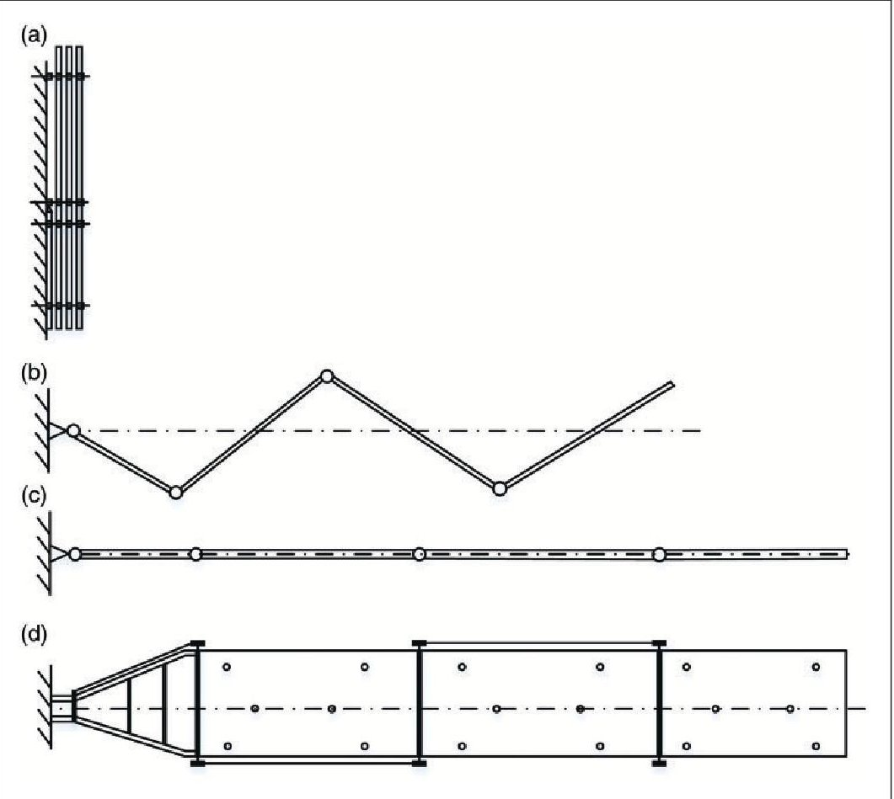

Figure 14. Construction of a solar wing.

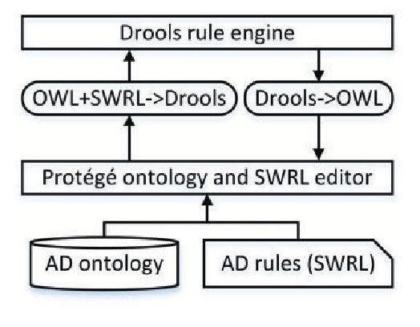

Figure 15. Reasoning framework with Protégé and Drools rule engine.

AD: axiomatic design.

CR2: protecting the electrical power subsystem from being destroyed (the protection requirement).

CR3: the weight of the electrical power subsystem should satisfy the constraint of the launch vehicle (the weight constraint)

CR4: the reliability requirement.

CR5: performing required actions to guarantee that the electrical power subsystem works normally (the execution requirement).

As shown in Figure 16, every requirement has its corresponding CRName, CRContent, Priority, CRType, and CRInport (Figure 16 only shows CR2 and CR3 in detail). For instance, the CR2 (the protection requirement) contains two sub-requirements: requirement for providing installation space and

position (CR21), and the strength and rigidity requirement (CR22). The InPort of CR2 is the structure design department; it has a high Priority and belongs to the FR. Figure 17 shows partial instances of these CRs documented in a RDF/XML file.

Additionally, CR1 and CR5 are also FRs, which should be further analyzed and allocated to DPs.

Functions analysis and allocation. Functional CRs of a solar wing are mapped to the following FRs:

FR1: providing electrical power (the power supply function).

FR2: the support function.

FR3: executing predefined actions (the executive function).

Then, design teams from mechanical, electronic/ electrical and control engineering put forward DPs that are able to fulfill the above functions based on their experience.

DP1: the solar array subsystem.

DP2: the power structures subsystem.

DP3: the power mechanisms subsystem.

Designers use Protégé to capture information as instances of concepts, properties, and relations defined in the AD ontology. Figure 18 represents instances of the functions analysis and allocation in the first design level and they are also documented in the RDF/XML file.

<!-- PDF_PAGE: 19 -->

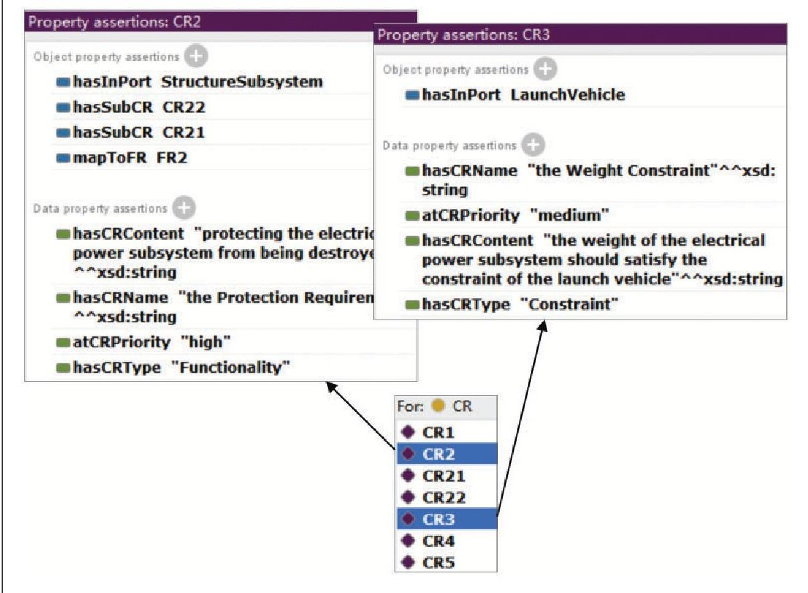

Figure 16. Customer requirements of the solar wing design.

Figure 17. Instances of a solar wing customer requirement in a resource description framework/XML file.

Designers then search for coupled functions based on the Independence Axiom. DP2 and DP3 both have relationships with the power supply requirement (FR1), because DP2 provides the electrical power with required installing space, position, strength, and stiffness; DP3 enables the electrical power to achieve required operating states. Figure 19 shows the design matrix in the first design level where an "X" represents a relationship between a DP and a FR, and an "O" means that a DP and a FR are independent of one another.

Using the SWRLDroolsTab in Protégé, Rules 1 and 3 are translated and executed by the Drools engine. The result is shown in Figure 19, the current design matrix, that is, DM1, is triangular, which indicates that FRs at the first design level conforms to the Independence Axiom.

FRs should be elaborated by the zigzag mapping approach of the AD ontology. DPs at the first design level are mapped into the second design level through the "zMapToFR" relation as corresponding FRs that are further mapped to DPs in the same level.

<!-- PDF_PAGE: 20 -->

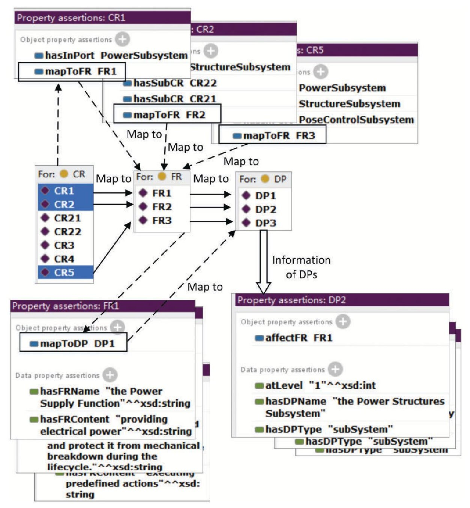

Figure 18. The first level function analysis and allocation.

Designers then construct the design matrix, as shown in Figure 20, by means of identifying relationships between DPs and FRs.

It could be seen from the design matrix in Figure 20 that direct relationships exit between FR11 and DP21, DP33, DP34, and DP35. The reasons are illustrated here: the substrates (DP21) provide solar cells with the required installing environment, strength, and stiffness, so quality of the substrate has a great influence on the electricity conversion efficiency. As for the deploying mechanism (DP33) whose function is to unfold the solar array to the best mission phase, however, if the solar array is not fully deployed, the electricity convention efficiency would reduce. In regard to the locking mechanism (DP34), the reason why it would impact the electricity convention efficiency is that a defect in it leads to a sharp vibration of the solar array. The orientating mechanism (DP35) which continuously rotates to keep the solar panels oriented toward the sun impacts the electricity convention performance as well.

Additionally, DPs in the design matrix in Figure 20 that have direct relationships with the pressing function (FR31) include the releasing mechanism (DP32), which releases the pressing state of the solar array by destroying the pressing function, and the deploying mechanism (DP33) whose pretightening force influences the performance of the pressing process. For example, it is very difficult for the pressing mechanism to be released when the pretightening force is over tight.

Moreover, the reason why there is a relationship between the pressing mechanism (DP31) and the releasing function (FR32) is that if DP31 is too invulnerable, the difficulty of fulfilling FR32 increases. Besides, a direct relationship exists between the kinetic energy of the deploying mechanism (DP33) and the instantaneous impact of the locking process (FR34).

Rule 2 defined in IndA class and rules section is executed by the inference engine Drools helps the designer to identify coupled relationships and the

<!-- PDF_PAGE: 21 -->

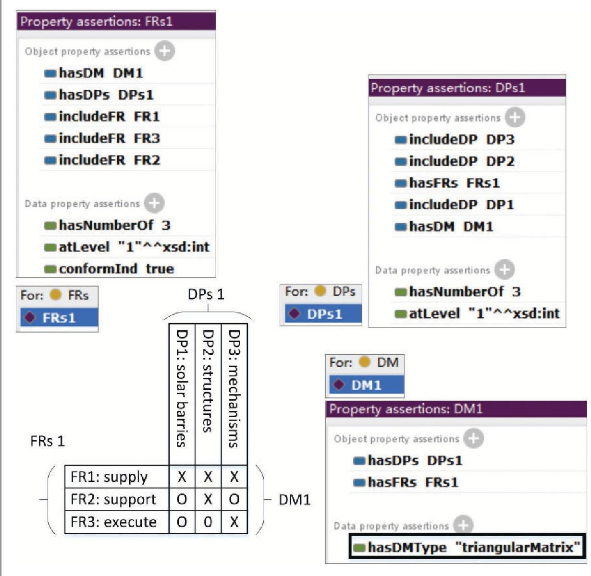

Figure 19. Design matrix at the first design level.

reason why they happens. What deserves most attention in the matrix is an impacting loop (i.e., a functional coupling), represented by a dashed ellipse in Figure 20. It is generated between FR31 and FR32 and due to a conflict between the strength of DP31 and the capacity of DP32 for destroying DP31.

In order to decouple the systems design at the second design level, designers should analyze the acceptable value of the force destroying DP31 considering the reliability of DP31 before the solar array is released. As a result, the design matrix in Figure 20 is transformed to a triangular matrix and the original coupled design becomes a decoupled one.

Design synthesis. Integrating systems design information with domain-specific information provides alternative DPs for designers. For instance, DP21 for fulfilling corresponding FR21 can be rigid substrates (DP21-1), semi-substrates (DP21-2), or flexible substrates (DP21-3). DP32 for fulfilling FR32 can be cutters (DP32-1) or explosive bolts (DP32-2).

Figure 21 illustrates the ontology alignment that integrates systems design ontology with the structure and mechanism design ontology. In the first place,

designers extract ontological classes, properties (e.g., DP21 and DP32) and their instances (e.g., DP21-1, DP21-2, DP21-3, DP32-1, and DP32-2) from relevant RDBs according to the ontology extraction rules listed in Table 7. Secondly, the string-based matcher allows designers to map the systems design ontology into the corresponding structure and mechanism ontology. After that, designers select different DPs to generate different DSs by the relation "generateDS."

Rule 9 defined in InfoA class and rules section is executed by Drools rule engine which shows information content of DP21-1 and DP32-1 are both 1. Therefore, they are selected as the optimal DS. The optimal DS is the one conforming to the Information Axiom. For instance, as for the substrate (DP21), compared with rigid substrates (DP21-1), deploying mechanisms of semi-substrates (DP21-2), and flexible substrates (DP21-3) are more complicated, which leads to an increment of corresponding information content. In regard to the releasing mechanism (DP32), if designers select explosive bolts (DP32-2), much time is spent on inspecting others from the same production batch in order to guarantee the reliability of the

<!-- PDF_PAGE: 22 -->

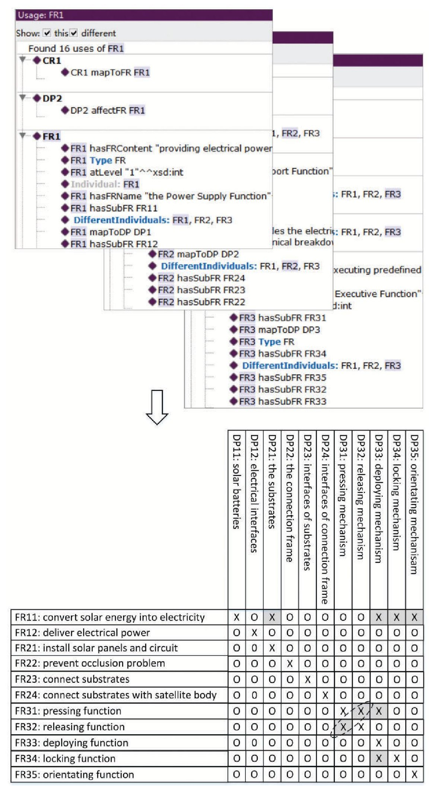

Figure 20. Design matrix in the second design level.

<!-- PDF_PAGE: 23 -->

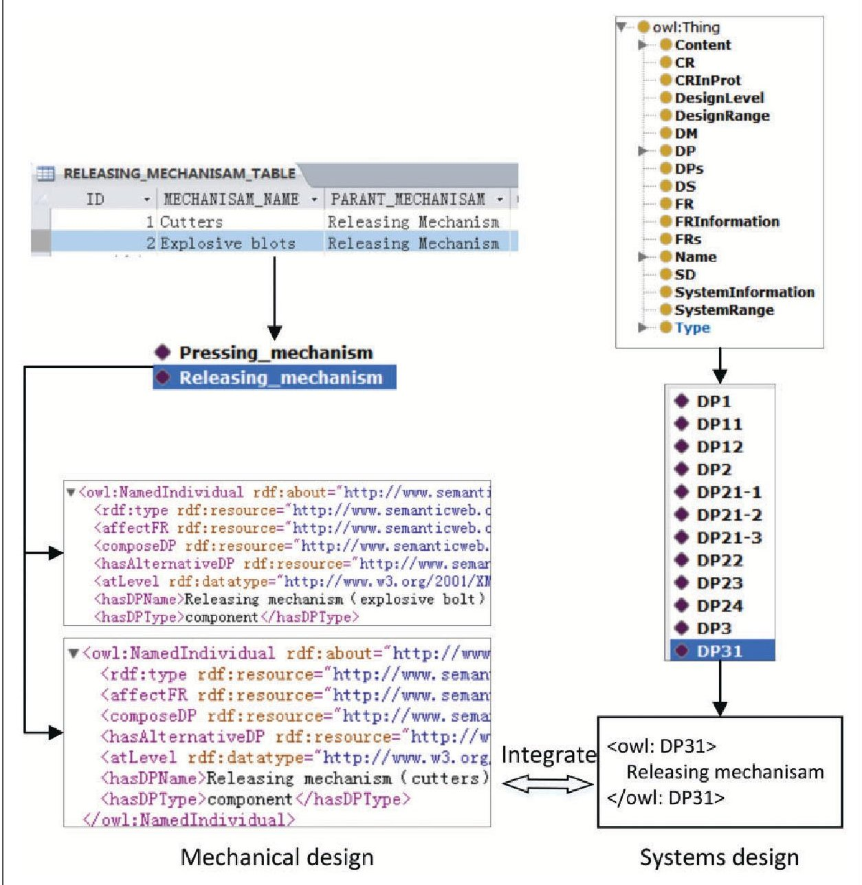

Figure 21. Integrating domain-specific information by ontology alignment.

selected explosive bolts. On the contrary, by simply adding more cutters (DP32-1) the same level of reliability can also be achieved.

A similar integration approach shown in Figure 21 is available for the elaborative design of DP21-1 and DP32-1 as well, such as dimension specification and mechanical interfaces design.

Iterating the functions analysis and allocation phase and the design synthesis phase based on the AD semantic model enables designers to complete the systems design representation model. Due to the paper's limitation, the entire design matrix is not shown. Instead, Figure 22 gives the third level systems design matrix satisfying design axioms and conforming to the design matrixes at higher design levels.

## Discussion

In the above systems design of a solar wing, CRs, FRs, DPs, DSs, and their semantic relations and properties are explicitly represented and documented based on the proposed AD ontology-based systems design approach, and an iterative and traceable

systems design process from the requirements analysis phase to the design synthesis phase is constructed.

The Independence Axiom and the Information Axiom have the ability to help designers identify functional couplings and generate the optimal design solution. Design intent is represented and deduced when predefined rules automatically determines relationships between FRs and DPs, functional couplings among FRs and whether DPs satisfy the Information Axiom.

Another advantage is that ontological instances of the solar wing systems design are captured in RDF/ XML files by the Protégé editor as a medium to integrate with data from multiple domains. After that, designers select different DPs to generate different DSs by the relation "generateDS." Therefore, the elaborative domain-specific design of DPs conforming to design axioms can be concurrently developed with systems design information without waiting for the detailed scheme design phase. For example, the AD ontology can be integrated with SysML diagrams by translating stereotype extending blocks, relationships and value properties of SysML into OWL classes,

<!-- PDF_PAGE: 24 -->

<table border="1"><tr><td rowspan="16"></td><td colspan="3">FR1</td><td colspan="5">FR2</td><td colspan="11">FR3</td></tr><tr><td rowspan="3">FR11</td><td colspan="2">FR12</td><td colspan="3">FR21</td><td rowspan="3">FR22</td><td rowspan="3">FR23</td><td rowspan="3">FR24</td><td colspan="2">FR31</td><td colspan="2">FR32</td><td colspan="4">FR33</td><td colspan="2">FR34</td><td colspan="2">FR35</td></tr><tr><td>FR121</td><td>FR122</td><td>FR212</td><td>FR211</td><td>Prevent occlusion problem</td><td>Fr231</td><td>Fr232</td><td>Fr321</td><td>Fr322</td><td>Fr331</td><td>Deploy the solar wing by unfolding</td><td>Break the pressing parts</td><td>Deploy with a required velocity</td><td>Provide a driving force</td><td>Provide a driving force</td><td>Keep the array stay stable</td><td>Accept the locking state</td><td>Lock the solar wing</td></tr><tr><td>Convert solar energy into electricity</td><td>To coordinate with mechanisms</td><td>To coordinate with structures</td><td>Provide assembling interfaces</td><td>Provide assembling space</td><td>Prevent occlusion problem</td><td>Provide assembling interfaces</td><td>Provide assembling space</td><td>Looseness-proof function</td><td>Press substrates and connection frame</td><td>Connect substrates with satellite body</td><td>Connect substrates with satellite body</td><td>Connect substrates with satellite body</td><td>Connect substrates with satellite body</td><td>Connect substrates with satellite body</td><td>Connect substrates with satellite body</td><td>Connect substrates with satellite body</td><td>Connect substrates with satellite body</td><td>Connect substrates with satellite body</td></tr><tr><td rowspan="2">DP12</td><td>DP121</td><td>Cable layout of substrates and connection frame</td><td>O</td><td>X</td><td>O

Figure 22. Design matrix at the third design level.

object properties, and datatype properties. With the querying and reasoning ability of AD ontology, a system engineer can obtain information and check the consistency of the SysML-based system model effectively. Moreover, when AD ontology is translated into SysML conceptual model, the system engineer can further represent the system behavior consistently.

However, designers criticized the intensive manual work required for building a model. In reality, designers were unwilling to spend so much time in creating ontology instances. More importantly, experienced designers said that they would not select a design largely based on the degree of independency and coupling among requirements and solutions, and they preferred referencing similar cases of previous design or believing their experience. In addition, compared with symbolized modeling languages like UML and SysML, engineers point out that ontologies lack the ability to describe mathematical relations effectively, for instance, when using the Information

Axiom, a designer should manually compute the information content of a DP in order to infer the optimal DS. They suggested a few improvement ideas for future work, such as linking the model to available information databases, and building AD ontologies for common cases in order to reuse or reference them rather than creating new ones. For example, component taxonomy $ ^{35} $ can be used as a language database for the AD ontology because the component taxonomy is a function-based component classification while AD ontology contains the mapping between FR and DP. Component taxonomy is a framework for archiving, searching, or reusing component knowledge during the system design process. Some scholars listed more than 100 basic set of mechanical components to present the definition of the common components in engineering design. Therefore, the taxonomy provides a common language for designers to refer to the same function, and it offers function-based design synthesis which can be done through AD ontology as well.

<!-- PDF_PAGE: 25 -->

## Conclusions and future work

This paper builds a semantic representation of general concepts along with relations and properties of AD principles in order to define systems design models to be both user-understandable and machine-readable. In contrast with other AD researches, the proposed approach formalizes the axiomatic systems design by taking advantage of the ontology. In conclusion, this paper contributes the following.

(1) Explicitly represents semantics of AD principles, introduces the Semantic Web technology into the AD information representation, and proposes an AD semantic representation model, the AD ontology.

(2) Gives a formal definition of reasoning rules for the Independence Axiom and the Information Axiom, which lays the foundation for automatic validation of decisions.

(3) A framework for capturing systems design semantic information and aligning with domain-specific information based on the AD ontology has been developed.

Systems design knowledge tends to be more standard to improve communication between practitioners. However, the systems design information is still captured manually. Although ontology modeling tools, such as Protégé, enable designers to document ontological instances, it is difficult for designers to modify corresponding elements when design information changes. So much time is spend on building the model.

In the future, we will carry out in-depth research on:

(1) Linking available information databases to the AD ontology to created reusable cases.

(2) Managing design changes to predict the change impact in the AD ontology-based systems design.

## Acknowledgements

Sincere thanks are expressed here for the great support from China Academy of Space Technology (CAST), so the build of system modeling framework is accurate, and for Prof. Vincent Thomson for his English correction of the manuscript.

## Declaration of Conflicting Interests

The author(s) declared no potential conflicts of interest with respect to the research, authorship, and/or publication of this article.

## Funding

The author(s) disclosed receipt of the following financial support for the research, authorship, and/or publication of this article: This work is funded by the International Graduate Exchange Program of Beijing Institute of Technology.

## References

1. Rockwell J, Grosse I, Krishnamurty S, et al. A semantic information model for capturing and communicating design decisions. J Comput Inf Sci Eng 2010; 10: 031008.

2. Huysentruyt J and Chen D. Contribution to the development of a general theory of design. In: 8th international conference of modeling and simulation. Hammamet, Tunisia: IEEE, 2010.

3. Kapurch SJ. NASA systems engineering handbook. Collingdale: DIANE Publishing, 2010, pp.5-16.

4. Hoffmann P. Model-based systems engineering best practices. Beijing: Aviation Industry Publishing House, 2014, pp.3-18.

5. Farid A and Suh N. Axiomatic design in large systems: complex products, buildings and manufacturing systems. New York: Springer, 2016, pp.3-42.

6. Xiaobo R, Cai C and Liu Y. Current research situation and problem analysis of axiomatic design. Chin J Mech Eng 2008; 44: 1-11.

7. Kulak O, Cebi S and Kahraman C. Applications of axiomatic design principles: a literature review. Expert Syst Appl 2010; 37: 6705-6717.

8. Hong E and Park G. Collaborative design process of large-scale engineering systems using the axiomatic design approach. Proc IMechE, Part C: J Mechanical Engineering Science 2011; 255: 2174-2188.

9. Hehenberger P, Poltschak F, Zeman K, et al. Hierarchical design models in the mechatronic product development process of synchronous machines. Mechatronics 2010; 20: 864-875.

10. Zhang Y, Luo X, Li J, et al. A semantic representation model for design rationale of products. Adv Eng Inform 2013; 27: 13-26.

11. Antonio G and Van H. A semantic web primer. Massachusetts: The MIT Press, 2004.

12. Gruber T. A translation approach to portable ontology specifications. Knowl Acquis 1993; 5: 199-220.

13. Richard C, David W and Markus L. RDF 1.1: concepts and abstract syntax. Available at: https://www.w3.org/ TR/rdf11-concepts (2014, accessed 15 October 2016).

14. Dan B and Guha R. RDF Schema 1.1. Available at: https://www.w3.org/TR/rdf-schema/ (2014, accessed 15 October 2016).

15. Michael K, Chris W and Deborah L. OWL Web Ontology Language Guide. Available at: https://www. w3.org/TR/owl-guide/ (2004, accessed 17 October 2016).

16. Ian H, Peter F, Harold B, et al. SWRL: a semantic web rule language combining OWL and RuleML. Available at: https://www.w3.org/TR/owl-guide/ (2004, accessed 17 October 2016).

17. Henson G and Matthew W. Current state of ontology in engineering systems. 1st ed. [ebook] Gaithersburg, pp.1-3. Available at: http://www.omgwiki.org/MBSE/lib/exe/fetch.php?media = mbse:oat:graves-currentstate-ontology_.pdf (2012, accessed 17 October 2016).

18. Schmit M, Briceno S, Collins K, et al. Semantic design space refinement for model-based systems engineering. In: 2016 Annual IEEE Systems Conference (SysCon), 2016, pp.1-8. Orlando, FL: IEEE.

19. Romero B, Coudert T, Vareilles E, et al. Case-based reasoning and system design: an integrated approach based on ontology and preference modeling. Artif Intell Eng Des Anal Manuf 2014; 28: 49-69.

<!-- PDF_PAGE: 26 -->

20. Zhuochen S. Knowledge base representation with axiomatic design rules for concept level up implement in ontological framework. Master thesis, Clemson University, 2013.

21. Suh N. The principles of design. New York: Oxford University Press, 1990.

22. Malaek S, Mollajan A, Ghorbani A, et al. A new systems engineering model based on the principles of axiomatic design. J Ind Intell Inf 2014; 3: 143-151.

23. Suh N. Axiomatic design: advances and applications. New York: Oxford University Press, 2001.

24. Chen Y, Chen Y, Chu H, et al. On technology for functional requirement-based reference design retrieval in engineering knowledge management. Decis Support Syst 2008; 44: 798-816.

25. Li Z, Raskin V and Ramani K. Developing engineering ontology for information retrieval. J Comput Inf Sci Eng 2008; 8: 011003.

26. Kim K, Manley D and Yang H. Ontology-based assembly design and information sharing for collaborative product development. Comput Aided Des 2006; 38: 1233-1250.

27. Song F, Zacharewicz G and Chen D. An ontology-driven framework towards building enterprise semantic information layer. Adv Eng Inform 2013; 27: 38-50.

28. Ferdinand M, Christian Z and David T. Lifting xml schema to owl. In: International conference on web engineering. Berlin, Heidelberg: Springer, 2004, pp.354-358.

29. Zhicheng Z. Communication satellite engineering. Beijing: China Astronautic Publishing House, 2014, pp.281-300.

30. Dengyun Y and Jianzhong Y. The spacecraft mechanism technology. Beijing: Science and Technology of China Press, 2011, pp.39-42.

31. Janjun Y. Structure design and analysis of satellite volume 2. Beijing: China Astronautic Publishing House, 2009, pp.210-246.

32. Weizhi T and Jingang H. Spacecraft systems engineering. Beijing: Science and Technology of China Press, 2009, pp.124-156.

33. Patel MR. Spacecraft power systems. Cleveland: CRC Press, 2004, pp.153-183.

34. Castet JF and Joseph H. Satellite and satellite subsystems reliability: statistical data analysis and modeling. Reliab Eng Syst Saf 2009; 94: 1718-1728.

35. Kurtoglu T, Campbell M, Arnold C, et al. A component taxonomy as a framework for computational design synthesis. J Comput Inf Sci Eng 2009; 9: 011007.