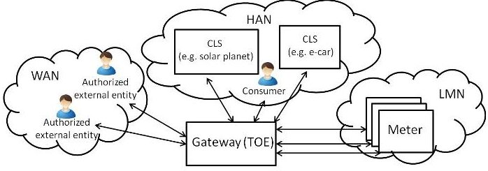
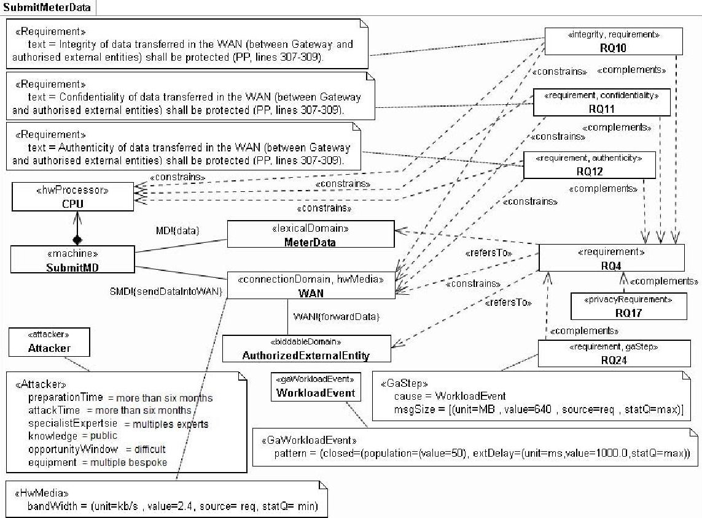
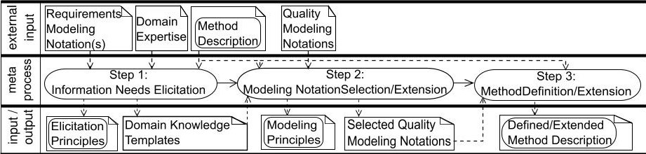
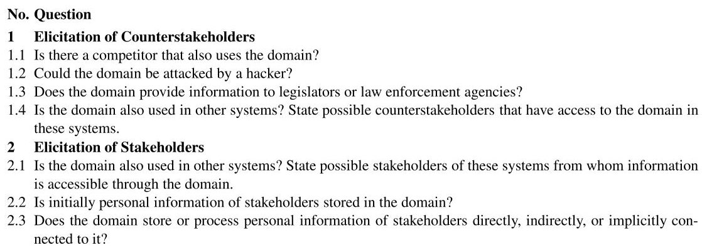
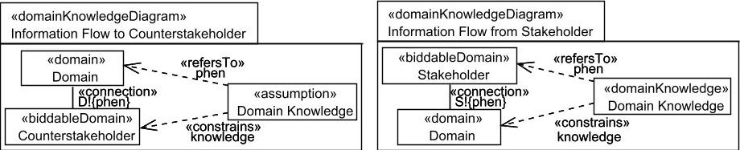
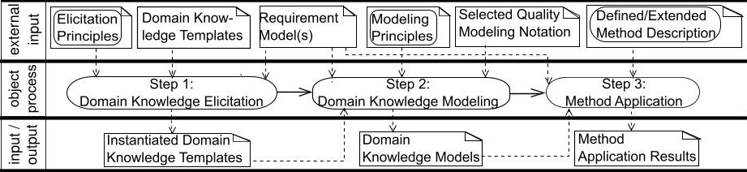

<!-- PDF_PAGE: 1 -->

# A Structured Approach for Eliciting, Modeling, and Using Quality-Related Domain Knowledge

Azadeh Alebrahim, Maritta Heisel, and Rene Meis

Paluno – The Ruhr Institute for Software Technology, Germany

{firstname.lastname}@paluno.uni-due.de

Abstract. In requirements engineering, properties of the environment and assumptions about it, called domain knowledge, need to be captured in addition to exploring the requirements. Despite the recognition of the significance of capturing and using the required domain knowledge, it might be missing, left implicit, or be captured inadequately during the software development. This results in an incorrect specification. Moreover, the software might fail to achieve its quality objectives because of ignored required constraints and assumptions. In order to analyze software quality properly, we propose a structured approach for eliciting, modeling, and using domain knowledge. We investigate what kind of quality-related domain knowledge is required for the early phases of quality-driven software development and how such domain knowledge can be systematically elicited and explicitly modeled to be used for the analysis of quality requirements. Our method aims at improving the quality of the requirements engineering process by facilitating the capturing and using of implicit domain knowledge.

Keywords: Quality requirements, domain knowledge, problem frames, knowledge management, requirements engineering.

## 1 Introduction

The system-to-be comprises the software to be built and its surrounding environment structured as a collection of domains such as people, devices, and existing software [1]. The environment represents the part of the real world into which the software will be integrated. Hence, in requirements engineering, properties of the domains of the environment and assumptions about them, called domain knowledge, need to be captured in addition to exploring the requirements [2,3]. Note that we do not mean application domain under the term domain, but entities in the environment that are relevant.

Despite the recognition of the significance of capturing the required domain knowledge, it might be missing, left implicit, or be captured inadequately during the software development process [1]. Domain knowledge is often undocumented and tacit in the minds of the people involved in the process of software development [4]. The common ad-hoc nature of gaining domain knowledge is error-prone. Hooks and Farry [5] report on a project where 49% of requirements errors were due to incorrect domain knowledge. Capturing inadequate assumptions about the environment of the flight guidance software led to the crash of a Boeing 757 in Colombia in December 1995 [6].

Several requirements engineering methods exist, e.g., for security. Fabian et al. [7] conclude in their survey about these methods that it is not yet state of the art to consider

<!-- PDF_PAGE: 2 -->

domain knowledge. The software development process involves knowledge-intensive activities [8]. It is an open research question of how to elicit domain knowledge as part of the software development process correctly for effective requirement engineering [9]. Lamsweerde [1] and Jackson [10] underline the importance of eliciting domain knowledge in addition to the elicitation of requirements to obtain correct specifications. However, there is sparse support in capturing and modeling domain knowledge.

In this paper, we propose a method for capturing implicit and quality-relevant domain knowledge, and making it explicit for reuse in a systematic manner during software development. Our approach consists of a meta-process and an object-process which are structured in the steps eliciting, modeling, and using domain knowledge. Both processes are independent from any specific tool or notation. This facilitates the integration of the processes into requirements analysis and design processes. The meta-process is applied for a given software quality together with a quality analysis method only once to define how to elicit, model, and use the relevant domain knowledge for the specific software quality and the given analysis method. Results of previous applications of the meta-process for the same software quality together with a different analysis method can be reused. The object-process is applied for a given software project. The domain knowledge is elicited, modeled, and used using the principles that are output of the meta-process for the software quality and quality analysis method under consideration.

We illustrate the application of the meta-process using three quality analysis methods that were already developed for eliciting, modeling and using quality-relevant domain knowledge. These methods are the Quality Requirements Optimization (QuaRO $ ^{1} $ ) method [11], which analyzes and detects interactions between security and performance requirements based on pairwise comparisons, the Problem-Oriented Performance Requirements Analysis (POPeRA) method [12], which identifies and analyzes potential performance problems, and the Problem-based Privacy Analysis (ProPAn) method [13,14], which identifies privacy threats on the requirements analysis level. We will illustrate the object-process using a smart grid scenario as given application and our three methods as output of the meta-process.

The benefit of our method lies in improving the quality of the requirements engineering process. This is achieved by providing a systematic method that facilitates the capturing and modeling of implicit domain knowledge as reusable artifacts.

In the following, Sect. 2 introduces the smart grid scenario and Sect. 3 the background of our work. Sections 4 and 5 describe the meta- and object-process, which are our main contributions. Sect. 6 discusses related work, and Sect. 7 concludes.

## 2 Introducing the Smart Grid Application

In this section, we introduce the real-life case study "smart grids" adapted from the NESSoS project $ ^{2} $ . To use energy in an optimal way, smart grids make it possible to couple the generation, distribution, storage, and consumption of energy. Smart grids use

<!-- PDF_PAGE: 3 -->

Fig.1. The context of a smart grid system based on [15]

## Table 1. An excerpt of relevant terms for the smart grid

Gateway represents the central communication unit in a smart metering system. It is responsible for collecting, processing, storing, and communicating meter data.

Meter data refers to readings measured by the meter regarding consumption or production of a certain commodity.

Meter represents the device that measures the consumption or production of a certain commodity and sends it to the gateway.

Authorized could be a human or IT unit that communicates with the gateway from outside the gateway boundaries external through a WAN. The roles defined as external entities that interact with the gateway and the meter are, for entity example, consumer, grid Operator, supplier, gateway operator, a gateway administrator.

WAN (Wide Area Network) provides the communication network that connects the gateway to the outside world. Consumer refers to the end user or producer of commodities (electricity, gas, water, or heat).

CLS (Controllable Local Systems) are systems containing IT-components in the Home Area Network (HAN) of the consumer that do not belong to the Smart Metering System but may use the Gateway for dedicated communication purposes.

information and communication technology (ICT), which allows for financial, informational, and electrical transactions. For the smart grid, different quality requirements have to be taken into account. Detailed information about the energy consumption of the consumers can reveal privacy-sensitive data about the persons staying in a house. Hence, we are concerned with privacy issues. A smart grid involves a wide range of data that should be treated in a secure way. Additionally, introducing new data interfaces to the grid (smart meters, collectors, and other smart devices) provides new entry points for attackers. Therefore, special attention should be paid to security concerns. The number of smart devices to be managed has a deep impact on the performance of the whole system. This makes performance of smart grids an important issue. Figure 1 shows the context of a smart grid system based on a protection profile that was issued by the Bundesamt für Sicherheit in der Informationstechnik [15]. First, define some terms specific to the smart grid domain taken from the protection profile represented in Table 1.

Due to space limitations, we focus in this paper on the functional requirement "The smart meter gateway shall submit processed meter data to authorized external entities. (RQ4)”，security requirements "Integrity (RQ10)/Confidentiality (RQ11)/Authenticity (RQ12) of data transferred in the WAN shall be protected”，performance requirement "The time to retrieve meter data from the smart meter and publish it through WAN shall be less than 5 seconds. (RQ24)”，and privacy requirement "Privacy of the consumer data shall be protected while the data is transferred in and from the smart metering system. (RQ17)". We derived these requirements from the protection profile [15].

<!-- PDF_PAGE: 4 -->

## 3 Problem-Oriented Requirements Engineering

This section outlines basic concepts of the problem frames approach proposed by Michael Jackson [10]. We illustrate our process using quality analysis methods that are based on problem frames as requirements engineering method. Note that our proposed process can also be applied using any other requirements engineering approach.

Requirements analysis with problem frames proceeds as follows: to understand the problem, the environment in which the machine (i.e., software to be built) will operate must be described first. To this end, we set up a context diagram consisting of machines, domains and interfaces. Domains represent parts of the environment which are relevant for the problem at hand. Then, the problem is decomposed into simple subproblems that fit to a problem frame. Problem frames are patterns used to understand, describe, and analyze software development problems. An instantiated problem frame is a problem diagram which basically consists of a submachine of the machine given in the context diagram, relevant domains, interfaces between them, and a requirement. The task is to construct a (sub-)machine that improves the behavior of the environment (in which it is integrated) in accordance with the requirement.

We describe problem frames using UML class diagrams [16], extended by a specific UML profile for problem frames (UML4PF) proposed by Hatebur and Heisel [17]. A class with the stereotype machine represents the software to be developed. Jackson distinguishes the domain types biddable domains (represented by the stereotype BiddableDomain) that are usually people, causal domains (CausalDomain) that comply with some physical laws, and lexical domains (LexicalDomain) that are data representations. To describe the problem context, a connection domain (ConnectionDomain) between two other domains may be necessary. Connection domains establish a connection between other domains by means of technical devices. Figure 2 shows the problem diagram for the functional requirement RQ4. It describes that smart meter gateway submits meter data to an authorized external entity. The submachine SubmitMD is one part of the smart meter gateway. It sends the MeterData through the causal domain WAN to the biddable domain AuthorizedExternalEntity. When we state a requirement we want to change something in the world with the machine to be developed. Therefore, each requirement expressed by the stereotype requirement constrains at least one domain. This is expressed by a dependency from the requirement to a domain with the stereotype constrains. A requirement may refer to several domains in the environment of the machine. This is expressed by a dependency from the requirement to these domains with the stereotype refersTo. The requirement RQ4 constrains the domain WAN, and it refers to the domains MeterData and AuthorizedExternalEntity.

In the original problem frames approach, the focus is on functional requirements. We extended the UML-based problem frames approach by providing a way to attach quality requirements to problem diagrams [18]. We represent quality requirements as annotations in problem diagrams. Since UML lacks notations to specify and model quality requirements, we use specific UML profiles to add annotations to the UML models. We use a UML profile for dependability [17] to annotate problem diagrams with security requirements. For example, we apply the stereotypes <<integrity>>, <<confidentiality>>, and <<authenticity>> to represent integrity, confidential-

<!-- PDF_PAGE: 5 -->

Fig.2. Problem Diagram for submitting meter data to external entities

ity, and authenticity requirements as it is illustrated in Figure 2. To annotate privacy requirements, we use the privacy profile [13] that enables us to state that the privacy of a stakeholder shall be preserved against a counterstakeholder using the stereotype $ \llap{privacyRequirement}\gg $ . To provide support for annotating problem descriptions with performance requirements, we use the UML profile MARTE (Modeling and Analysis of Real-time and Embedded Systems) [19]. We annotate each performance requirement with the stereotype $ \llap{gaStep}\gg $ to express a response time requirement. In the problem diagram for submitting meter readings (Figure 2), the functional requirement RQ4 is complemented by the following quality requirements: RQ10 (integrity), RQ11 (confidentiality), RQ12 (authenticity), RQ17 (privacy), and RQ24 (performance).

## 4 Structured Meta-Process for Eliciting, Modeling, and Using Domain Knowledge

This section describes the meta-process composed of three steps for eliciting, modeling, and using domain knowledge for a specific software quality shown in Figure 3. The starting point is the domain expertise that exists for the software quality at hand. The meta-process is conducted for a specific software quality optionally together with a quality analysis method. Once we have elicited and modeled domain knowledge for a

<!-- PDF_PAGE: 6 -->

Fig.3. Meta-process for eliciting, modeling, and using domain knowledge

specific software quality in steps one and two, we use it in step three by extending the given quality analysis method or defining a new one that uses the elicited and modeled domain knowledge for analyzing quality requirements. The modularity of the meta-process allows us to reuse the outputs from previous applications of the meta-process for a meta-process that considers the same software quality. We consider three methods QuaRO [11], POPeRA [12], and ProPAn [13], as mentioned in Section 1. The artifacts in the top of Figure 3 represent the external inputs for the steps of the method. Those in the bottom of the figure represent the output of the steps providing input for further steps and/or for the object-process (see Section 5). The rounded rectangles in the input and output notes indicate that the artifact describes a procedure that later can be executed. In the following, we describe each step of the meta-process followed by its application to the software qualities performance, security, and privacy.

Step 1: Information Needs Elicitation. This step is concerned with eliciting the relevant information that has to be collected when dealing with specific software qualities. The source of information is the domain expertise. This expertise can stem from "developers of the software product, software engineering textbooks and other types of documentation, external information which is available to the public (e.g. IEEE standards), existing documents in the organization, formal or informal (guidelines, books, procedures, manuals), results of empirical work (controlled experiments, case studies), and published experience reports (e.g. lessons learnt)” [20]. Optionally, a requirements modeling notation that is used in the application, and a method description of a quality analysis method that shall be extended could be further inputs if existing and needed.

We extract the information needs for the software quality from the domain expertise with respect to the optionally given method description. We document these information needs as structured templates called Domain Knowledge Templates. These templates have later to be instantiated in the first step of the object-process. In addition to the domain knowledge templates, the output of step 1 provides guidance how to elicit relevant domain knowledge systematically. We call such guidance Elicitation Principles. An optionally given requirements modeling notation can be used to be referred to in the elicitation principles. Domain knowledge templates represent what domain knowledge has to be elicited, and elicitation principles represent how this domain knowledge has to be elicited. Elicitation principles are used as an input for the first step of the object-process and describe how this step has to be carried out.

In the following, we show applications of the meta-process for the software qualities performance, security, and privacy. In all shown applications, we use the UML-based problem frames (see Section 3) as the requirements modeling notation.

<!-- PDF_PAGE: 7 -->

Table 2. Domain knowledge template for performance and mapping to the MARTE profile

Quality: Performance

<table border="1"><tr><td colspan="4">Domain Knowledge Template</td><td>Mapping to MARTE</td></tr><tr><td colspan="2">Domain Knowledge Description</td><td>Possible Values</td><td colspan="2">Value Property</td></tr><tr><td colspan="5">For each Problem Diagram</td></tr><tr><td colspan="2">Number of concurrent users</td><td>Natural</td><td colspan="2">GaWorkloadEvent. pattern. population</td></tr><tr><td colspan="2">Arrival pattern</td><td>ArrivalPattern</td><td colspan="2">GaWorkloadEvent. pattern</td></tr><tr><td colspan="2">Data size</td><td>DataSize(bit,Byte,KB,...)</td><td colspan="2">GaStep.msgSize</td></tr><tr><td colspan="5">For each Causal Domain</td></tr><tr><td rowspan="2">Memory</td><td>capacity</td><td>DataSize(bit,Byte,KB,...)</td><td colspan="2">HwMemory.memorySize</td></tr><tr><td>latency</td><td>Duration(s,ms,min,hr,day)</td><td colspan="2">HwMemory.timing</td></tr><tr><td rowspan="2">Network</td><td>bandwidth</td><td>DataRate(b/s,Kb/s,Mb/s)</td><td colspan="2">HwMedia.bandWidth</td></tr><tr><td>latency</td><td>Duration(s,ms,min,hr,day)</td><td colspan="2">HwMedia.packetTime</td></tr><tr><td rowspan="2">CPU</td><td>speed</td><td>Frequency(Hz,kHz,MHz,GHz)</td><td colspan="2">HwProcessor.frequency</td></tr><tr><td>Number of cores</td><td>Natural</td><td colspan="2">HwProcessor.nbCores</td></tr></table>

Applying step 1 for performance. To elicit the domain knowledge that performance analysts require to analyze performance for early software development phases (POPeRA and QuaRO methods), we make use of the Domain Expertise presented by Bass et al. [21,22]. Performance is concerned with the workload of the system and the available resources to process the workload [21]. The workload is described by triggers of the system, representing requests from outside or inside the system. Workload exhibits the characteristics of the system use. It includes the number of concurrent users and their arrival pattern. The arrival pattern can be periodic (e.g. every 10 milliseconds), stochastic (according to a probabilistic distribution), or sporadically (not to capture by periodic or stochastic characterization) [22]. Processing the requests requires resources. Each resource has to be described by its type in the system, such as CPU, memory, and network, its utilization, and its capacity, such as the transmission speed for a network.

The developed Domain Knowledge Template for performance is shown in Table 2. The columns "Domain Knowledge Description" and "Possible Values" show the domain knowledge to be elicited for performance and its possible values. The column "Value" has to be filled out in the first step of the object-process. Once we have captured the information needs for performance analysis as domain knowledge templates, we have to give guidance how to elicit them (Elicitation Principles). The first part of the domain knowledge template for performance contains information relevant for each problem diagram that contains a performance requirement. The second part of the template shows the domain knowledge to be elicited for each causal domain that is part of a problem diagram with a performance requirement. We iterate over these causal domains in the requirement models (lexical and machine domains are special types of causal domains). For each domain, we have to check if it represents or contains any hardware device that the system is executed on or any resource that can be consumed by the corresponding performance requirement. If this is the case, the resource has to be specified as indicated in the domain knowledge template. For each resource type (CPU, network, memory), we have to state if the resource is already existing in the requirement models or it is not modeled yet.

Applying step 1 for security. To guarantee security, we need domain knowledge about the type of possible attackers that influence the restrictiveness of a security

<!-- PDF_PAGE: 8 -->

Table 3. Domain knowledge template for security and mapping to the dependability profile

Quality: Security

<table border="1"><tr><td colspan="2">Domain Knowledge Template</td><td></td><td colspan="2">Mapping to profile</td></tr><tr><td>Domain Knowledge Description</td><td>Possible Values</td><td>Value</td><td>Property profile</td><td>(Dependability</td></tr><tr><td>Preparation time</td><td>one day, one week, two weeks,...</td><td></td><td>Attacker.preparationTime</td><td></td></tr><tr><td>Attack time</td><td>one day, one week, two weeks,...</td><td></td><td>Attacker.attackTime</td><td></td></tr><tr><td>Specialist expertise</td><td>laymen, proficient, expert,...</td><td></td><td>Attacker.specialistExpertise</td><td></td></tr><tr><td>Knowledge of the TOE</td><td>public, restricted, sensitive, critical</td><td></td><td>Attacker.knowledge</td><td></td></tr><tr><td>Window of opportunity</td><td>unnecessary/unlimited, easy,...</td><td></td><td>Attacker.opportunity</td><td></td></tr><tr><td>IT hardware/software or other equipment</td><td>standard, specialized, bespoke,...</td><td></td><td>Attacker.equipment</td><td></td></tr></table>

requirement. Different types of attackers can be considered. For example, a software attacker targets at manipulating the software, whereas a network attacker aims at manipulating the network traffic. To describe the attacker we use the properties as described by the Common Methodology for Information Technology Security Evaluation (CEM) [23] (Domain Expertise) for vulnerability assessment of the TOE (target of evaluation i.e., system-to-be). The properties to be considered (according to CEM) are given in the Domain Knowledge Template shown in the first column of Table 3.

Now, we describe the Elicitation Principles that support us in capturing domain knowledge. One attacker should be identified for each modeled security requirement. It should be checked if such an attacker for each security requirement exists. If not, we have to identify a suitable attacker according to the related security requirement. The domain knowledge template has to be instantiated for each attacker.

Applying step 1 for privacy. One limitation of the Problem-based Privacy Analysis method (ProPAn) [13] (Method Description) is that it can only reason about stakeholders and counterstakeholders that are part of the requirement model. But often stakeholders of personal information are not directly interacting with a software and hence maybe overlooked by the requirements engineer. Thus, there is the need to elicit privacy relevant domain knowledge, namely, the indirect (counter)stakeholders of the domains of the context diagram. Therefore, we performed the meta-process (see Figure 3) for the ProPAn-method (method description). Due to the fact that ProPAn is based on the problem frames approach, we have it as a requirements modeling notation in the meta-process. Based on the stakeholder analysis literature [24,25] (Domain Expertise), we developed domain knowledge templates in the form of extensible questionnaires [14]. The questionnaires shall help the requirements engineer in cooperation with domain experts to identify indirect (counter)stakeholders and indirect or implicit relationships between domains. An indirect stakeholder is a biddable domain that is not already part of the context diagram and from whom personal information is possibly stored or processed in the system-to-be. An indirect counterstakeholder is also a biddable domain that is not already part of the context diagram and may gain information about entities through a domain of the context diagram. Table 4 contains the questionnaire for causal and lexical domains. The Elicitation Principle means that one has to answer for each domain of the requirement model the questions of the corresponding questionnaire.

<!-- PDF_PAGE: 9 -->

## Table 4. Domain knowledge elicitation questionnaire for causal and lexical domains

Step 2: Modeling Notation Selection/Extension. The aim of this step is to select a suitable notation for modeling quality-relevant domain knowledge in a way that it can be used for the requirements analysis and integrates into the optionally given requirements modeling notation. According to the elicited domain knowledge from the previous step, we investigate whether there are existing Quality Modeling Notations for the software quality that are sufficient for integrating the domain knowledge into the existing requirement models. In such a case, we select an appropriate notation. Otherwise, we have to extend existing notations with required artifacts or define a new one. The Selected Quality Modeling notation will be applied to the requirement models in the object-process in order to support the modeling of domain knowledge. In addition, we obtain Modeling Principles as output of this step. They provide guidance for the translation of the domain knowledge elicited in the domain knowledge templates of the previous step into the selected quality modeling notation.

Applying step 2 for performance We selected the UML profile for Modeling and Analysis of Real-Time and Embedded systems (MARTE) [19] adopted by OMG consortium for modeling performance-related domain knowledge (Selected Quality Modeling Notation). It extends the UML modeling language to support modeling of performance and real-time concepts. They make use of the stereotypes from the MARTE profile to express the domain knowledge that was elicited in the first step of our method. Expressing domain knowledge as stereotypes helps us to integrate domain knowledge in the existing requirement models. In the case that we are concerned with a hidden resource, the hidden resource has to be modeled explicitly as a causal domain. It additionally has to be annotated with a performance relevant stereotype from the MARTE profile representing the kind of resource it provides. The column "Mapping to MARTE" in Table 2 shows how the domain knowledge elicited in step one can be mapped to the MARTE stereotypes and attributes (Modeling Principles).

Applying step 2 for security. We chose the dependability profile (Selected Quality Modeling Notation) proposed by Hatebur and Heisel [17] for modeling security-related domain knowledge identified in the previous step. We make use of the stereotype $ \ll\mathrm{a t t a c k e r} \rrangle $ and its attributes to express the attackers and their characteristics. Each identified attacker has to be modeled explicitly as a biddable domain. The stereotype $ \ll\mathrm{a t t a c k e r} \rrangle $ has to be applied to it. The attacker is then assigned to the

<!-- PDF_PAGE: 10 -->

Fig.4. Domain knowledge patterns for the modeling of privacy-relevant domain knowledge

corresponding security requirements which are also provided by the dependability profile. The column "Mapping to profile" in Table 3 shows how the elicited security-specific domain knowledge can be integrated in the requirement models using the stereotypes and attributes from the dependability profile (Modeling Principles).

Applying step 2 for privacy. For the domain knowledge extension of ProPAn as presented in [14], we do not need to select or extend a Quality Modeling Notation. We are able to represent the possible information flows stemming from indirect stakeholders and possible access relationships of counterstakeholders using domain knowledge diagrams, which are already provided by the UML4PF profile. To assist the modeling process of the privacy-relevant domain knowledge, we identified two "domain knowledge frames" (shown in Figure 4) for the two types of questions in the questionnaire. These can easily be instantiated using the answers of the questionnaires. The Domain is instantiated with the domain for which the questionnaire was answered and the (Counter)Stakeholder with the elicited (counter)stakeholder (Modeling Principles).

Step 3: Method Definition/Extension. This step aims at defining or extending a method for quality requirements analysis. The methods QuaRO and POPeRA are examples for newly defined methods, where quality-relevant domain knowledge has to be considered from the beginning of the analysis process. The ProPAn method is an example for extending an existing method with quality-relevant domain knowledge. In case of extending an existing method, the Method Description has to be considered as input. Additionally, we take the selected quality modeling notations into account for defining a new method or extending an existing one.

Applying step 3 for performance. We defined the POPeRA method [12] (Defined Method Description) for detecting and analyzing potential performance problems. The method first identifies performance-critical resources using the modeled performance-relevant domain knowledge. Next, it identifies problem diagrams, where the inbound requests exceed the processing capacity of the performance-critical resource because of a high workload. These resources represent potential bottlenecks.

Applying step 3 for security and performance. The QuaRO method (Defined Method Description) uses the structure of problem diagrams to identify the domains, where quality requirements might interact. When the state of a domain can be changed by one or more sub-machines at the same time, their related quality requirements might be in conflict. Modeling domain knowledge regarding security and performance allows us to detect additional domains, where security and performance might conflict. Resources modeled by domain knowledge represent such conflicting domains. The reason

<!-- PDF_PAGE: 11 -->

Fig. 5. Object-process for eliciting, modeling, and using domain knowledge

is that the achievement of security requirements requires additional resources affecting the achievement of performance requirements negatively. Modeling the attacker and its characteristics determines the strength of the security mechanism to be selected, which affects the resource usage. Please note that the modularity of the proposed meta-process allowed us to reuse the results of step 1 and step 2 of the meta-process for performance for the definition of the QuaRO method.

Applying step 3 for privacy. The domain knowledge diagrams created by instantiation of the domain knowledge patterns are integrated into the graph generation algorithms of ProPAn. Analogously to the graph generation rules based on problem diagrams, there is also possibly an information flow from a referred to each constrained domain in domain knowledge diagrams. Additionally, counterstakeholders that are constrained in a domain knowledge diagram may be able to access information from the referred domains (Extended Method Description). Thus, more possible privacy threats can be detected as in the original ProPAn method.

## 5 Structured Object-Process for Eliciting, Modeling, and Using Domain Knowledge

In this section, we describe the object-process composed of three steps for eliciting, modeling, and using domain knowledge for selected software qualities and a specific software application. We use the outputs of the meta-process (see Section 4) as inputs of the corresponding steps of the object-process to analyze the respective quality properties. Figure 5 illustrates the steps of the object-process.

In the following, we describe each step of the object-process followed by its application to the software qualities performance, security, and privacy and the concrete software application smart grid that we introduced in Section 2.

Step 1: Domain Knowledge Elicitation. To elicit quality-relevant domain knowledge for a specific software application to be developed, we instantiate Domain Knowledge Templates (output of the first step of the meta-process). For the instantiation, we make use of the Elicitation Principles (also output of the first step of the meta-process) and the given Requirement Model of the specific software application. The elicitation principles provide guidance for the instantiation of the domain knowledge templates for the given requirement models. As output, we obtain Instantiated Domain Knowledge Templates that serve as input for the modeling step (step 2).

<!-- PDF_PAGE: 12 -->

Applying step 1 for performance. For each performance requirement, we instantiate the Domain Knowledge Template for performance (see Table 2) according to the information contained in the existing documents for the smart grid application [15,26]. We exemplify the instantiation of the template for the performance requirement RQ24 which complements the functional requirement RQ4.

According to the elicitation principles (see Section 4), we have to iterate over the causal domains that are part of a problem diagram containing the respective performance requirement to identify relevant resources. In Figure 2, the causal domain WAN represents a performance-specific resource, namely a network resource. The machine domain SubmitMD contains the hidden resource CPU, which is not modeled yet. To fill the properties for the column "value" in Table 2, we need additional information that is missing in the Protection Profile [15] and Open Meter [26] documents. Hence, we looked for the necessary domain knowledge in the existing literature such as [27]. Based on this search, we assume that there are almost 50 electricity providers $ ^{3} $ in Germany that receive meter readings from the gateway. As the number of concurrent users is not further specified in the documents under consideration, we take the worst case, which is 50 concurrent users as "value" for the number of concurrent users and closed as "value" for the arrival pattern. Data size of meter readings to be transmitted to the gateway is relevant for the property data size. It can be between 1 KB and 16 MB [27]. It varies according to the period of time, in which meter data has to be sent to authorized external entities. It amounts to 1 KB by immediate sending of meter data after reading and 16 MB by sending meter data every two hours. This would be between 40 KB and 640 MB for 40 smart meters. Hence, the "value" is 640 MB. According to the documents from the Open Meter project, for the external communication a Power Line Communication (PLC) can be used. In this case, the minimum speed must be 2.4 Kbps for a reliable communication ("value" for the property bandWidth). The rest of properties is either unknown or irrelevant for the requirement RQ24.

Applying step 1 for security For eliciting security-relevant domain knowledge, we have to instantiate the Domain Knowledge Template for each identified attacker once (Elicitation Principle). We identified three network attackers for three security requirements RQ10, RQ11, and RQ12. The reason is that the meter data to be transmitted through the network WAN can be manipulated by a network attacker (see Figure 2). There is no information in the Protection Profile [15] about the attacker that the system must be protected against. Therefore, we assume that the system must be protected against the strongest attacker. Hence, we select for each property in the domain knowledge template for security the strongest one to obtain values for the column "Value". By doing this, we obtain instances of the domain knowledge template shown in Table 3.

Applying step 1 for privacy. We answered the questionnaires (Domain Knowledge Templates) for all domains of the context diagram of the smart grid (Elicitation Principle) and identified various indirect stakeholders and counterstakeholders. For example, due to questions 1.2 and 1.4 we found out that controllable local systems (CLS) could be attacked by hackers or provide personal information to malicious producers of CLS, e.g. usage profiles of e-cars.

<!-- PDF_PAGE: 13 -->

Step 2: Domain Knowledge Modeling. In this step, we model the domain knowledge that we elicited in the previous step. For modeling domain knowledge and integrating it in the existing requirement models, we make use of the Instantiated Domain Knowledge Templates. By means of Modeling Principles, we annotate the Requirement Models with elicited domain knowledge. We use the Selected Quality Modeling Notation for annotating requirement models. As a result, we obtain Domain Knowledge Models which ideally are integrated into the existing requirement model.

Applying step 2 for performance. We use the MARTE stereotypes <<hwMedia>>, <<gaStep>>, <<hwProcessor>>, and <<gaWorkloadEvent>> (Selected Quality Modeling Notation) for modeling the performance-specific domain knowledge captured in the Instantiated Domain Knowledge Template. This is done according to the Modeling Principles given by the mapping shown in Table 2. The modeled domain knowledge is shown in Figure 2.

Applying step 2 for security. In this step, we model the network attacker and its characteristics according to the Instantiated Domain Knowledge Template, if it is not modeled yet. We model the network attacker explicitly as a biddable domain for the confidentiality requirement RQ11 (Modeling Principles). Then, we apply the stereotype <attacker> from the dependability profile which is the Selected Quality Modeling Notation selected in step 2 of the meta-process. We assign the attributes of the stereotype <attacker> using mapping provided by Table 3 (Modeling Principles). The attacker and its properties are shown in Figure 2.

Applying step 2 for privacy. Because of ProPAn's tool support $ ^{4} $ , the elicited indirect (counter)stakeholders (Instantiated Domain Knowledge Templates) of the smart grid scenario are automatically modeled by instantiating the domain knowledge patterns according to the answers of the questionnaires (Modeling Principles).

Step 3: Method Application. The third step is concerned with applying a specific quality analysis method (Defined/ Extended Method Description), we defined or extended in the third step of the meta-process. The given Requirement Models and the Domain Knowledge Models obtained from the previous step are used as inputs.

Applying step 3 for performance. By applying the POPeRA method (Defined/Extended Method Description) we identified CPU as a performance-critical resource (see Figure 2). Such resources are modeled as domain knowledge in the problem diagrams Domain Knowledge Models) where the software might fail to achieve the performance requirements. Then, using the identified performance-critical resource CPU, we analyzed whether the processing capacity of CPU suffices to satisfy the performance requirement RQ24 and other requirements that have to be achieved using this resource with regard to the existing workload (modeled as domain knowledge). We identified CPU as potential bottleneck.

Applying step 3 for security and performance. By applying the QuaRO method (Defined/ Extended Method Description), we identified potential interactions among

<!-- PDF_PAGE: 14 -->

security and performance requirements. Performance requirement RQ24 might be in conflict with security requirements RQ10, RQ11, and RQ12 (see Figure 2).

Applying step 3 for privacy. As mentioned in the application of step 2 for privacy, we identified hackers and malicious producers of CLS as indirect counterstakeholders of the CLS (Domain Knowledge Models) and analyzed the privacy threats that possibly exist in the smart grid scenario for the stakeholder customer and counterstakeholder hacker (Defined/Extended Method Description). The analysis shows that there is possibly a privacy threat originating from a hacker or a malicious producer via the HAN using a CLS. This privacy threat is not covered by an assumption or threat in the protection profile [15]. Hence, our extended method now finds relevant privacy threats that previously have been overlooked.

## 6 Related Work

There exist only few approaches dealing with capturing and representing knowledge needed for a successful consideration of software qualities in software development.

Zave and Jackson [2] identify four areas in which the foundation of the requirements engineering discipline is weak. One of these areas is domain knowledge. Among others, the authors emphasize the importance of capturing domain knowledge for the satisfaction of requirements. However, they do not provide a structured way or specific notations to model domain knowledge, and only consider functional requirements.

According to Probst [28], the goal of knowledge management (KM) is the improvement of processes and capabilities by utilizing knowledge resources such as skills, experience, routines, and technologies. The author proposes a KM model that structures the KM process as activities identification, acquisition, development, distribution, preservation, and use of knowledge, called building blocks of KM. The steps of our method can be easily mapped to these building blocks. Knowledge identification identifies which knowledge and expertise exists. This is a prerequisite for conducting our method. It leads to identify the need for capturing, modeling, and using domain knowledge. Knowledge acquisition is concerned with obtaining knowledge from involved stakeholders, domain experts, or using documents. This activity corresponds to the step information needs elicitation in our meta-process. Knowledge development aims at producing new knowledge. It can be related to the step domain knowledge elicitation in the object-process. The objective of knowledge distribution is to make the knowledge available and usable. This activity corresponds to the step modeling notation selection in the meta-process. Knowledge preservation avoids the loss of gained expertise by preserving the knowledge after it has been developed. This building block can be mapped to the step domain knowledge modeling which stores the captured domain knowledge in requirement models. Consequently, the knowledge has to be deployed in the production process (knowledge use). This is achieved in our method in the steps method definition and method application. The mapping of the steps of our method to the KM building blocks shows that we followed successfully the concepts involved in the field of KM.

There exist several approaches for the elicitation of domain knowledge in the field of domain engineering [29,30]. These approaches focus on the development of reusable

<!-- PDF_PAGE: 15 -->

software and therefore also on the analysis of the application domain. During the domain analysis phase, domain knowledge is systematically collected and documented. In the field of domain engineering the term "domain" corresponds to the term "system" in Jackson's terminology. In this paper, we collect and document domain knowledge in a more fine-grained way which allows us analyzing software quality requirements.

Peng et al. [31] present a method for the analysis of non-functional requirements based on a feature model. This method elicits the domain knowledge before the analysis of non-functional requirements. In contrast, we suggest to elicit the required domain knowledge for a specific software quality. We think that our method leads to a more complete and targeted elicitation of domain knowledge.

In the NFR framework [32], knowledge about the type of NFR and the domain has to be acquired before using the framework. This knowledge is captured to understand the characteristics of the application domain and to obtain NFR-related information to be used for identifying the important NFR softgoals. Examples of such domain knowledge are organizational priorities or providing terminologies for different types of NFRs. This kind of domain knowledge differs from ours, as it is used as initial information to identify the goals and requirements. The knowledge we capture and model is more fine-grained and is required in addition to the quality requirements. Moreover, we provide a systematic method for capturing and modeling domain knowledge, whereas the NFR framework does not provide any guidelines on how to acquire such knowledge.

## 7 Conclusions

For an adequate consideration of software quality during requirements analysis, we have to identify and to take into account the quality-specific domain knowledge. By means of three different requirement analysis methods, we have pointed out the need for eliciting, modeling, and using domain knowledge. Hence, to avoid requirements errors due to incorrect domain knowledge, domain knowledge should be considered with the same emphasis as requirements during requirements analysis.

In this paper, we proposed a structured method consisting of a meta-process and an object-process for eliciting, modeling, and using quality-specific domain knowledge at the requirements analysis level.

The meta-process is quality-dependent. It therefore has to be carried out once for each kind of quality requirement to be considered. To facilitate the reuse of captured and modeled domain knowledge, we provide individual templates and guidelines suitable for each kind of quality requirement. These templates and guidelines are reusable if the same quality shall be considered, but in a different notation or for a different analysis method. Additionally, all outputs of the meta-process can be reused by instantiation of the object-process and applying it to a concrete software application.

We instantiated the first two steps of the meta-process for three kinds of quality requirements, namely performance, security, and privacy. Then, we showed how the elicited and modeled domain knowledge can be used in the three methods POPeRA, QuaRo, and ProPAn in the third step of the meta-process. We instantiated the objectprocess with the corresponding outputs of the meta-process to apply our methods POPeRA, QuaRo, and ProPAn on the concrete software application smart grid.

<!-- PDF_PAGE: 16 -->

Our approach is independent from any specific tool or notation. Hence, it can easily be integrated into existing requirement analysis methods. Our proposed method helps requirements engineers to develop processes for the consideration of quality requirements in a structured way and independently of the tools or notations they use.

As future work, we plan to develop further quality analysis methods using the proposed meta-process. Furthermore, we want to investigate to which extent the outputs of meta-processes carried out for different modeling notations differ and how they are related. In addition, we strive for empirically validating our method to determine the effort spent for executing the method and to further improve the elicitation templates.

## References

1. Lamsweerde, A.: Requirements Engineering: From System Goals to UML Models to Software Specifications. Wiley (2009)

2. Zave, P., Jackson, M.: Four dark corners of requirements engineering. ACM Trans. Softw. Eng. Methodol. 6, 1-30 (1997)

3. van Lamsweerde, A.: Reasoning about alternative requirements options. In: Borgida, A.T., Chaudhri, V.K., Giorgini, P., Yu, E.S. (eds.) Conceptual Modeling: Foundations and Applications. LNCS, vol. 5600, pp. 380-397. Springer, Heidelberg (2009)

4. Prieto-Díaz, R.: Domain analysis: an introduction. SIGSOFT Softw. Eng. Notes 15(2), 47-54 (1990)

5. Hooks, I.F., Farry, K.A.: Customer-centered Products: Creating Successful Products Through Smart Requirements Management. AMACOM (2001)

6. Modugno, F., Leveson, N., Reese, J., Partridge, K., Sandys, S.: Integrated safety analysis of requirements specifications. In: Requirements Engineering, pp. 65-78 (1997)

7. Fabian, B., Gurses, S., Heisel, M., Santen, T., Schmidt, H.: A comparison of security requirements engineering methods. Requirements Engineering - Special Issue on Security Requirements Engineering 15, 7-40 (2010)

8. Robillard, P.N.: The Role of Knowledge in Software Development. Commun. ACM 42, 87- 92 (1999)

9. Niknafs, A., Berry, D.M.: The impct of domain knowledge on the effectiveness of requirements idea generation during requirements elicitation. In: Proc. of the 20th IEEE Int. RE Conf., pp. 181-190 (2012)

10. Jackson, M.: Problem Frames. Analyzing and structuring software development problems. Addison-Wesley (2001)

11. Alebrahim, A., Choppy, C., Faßbender, S., Heisel, M.: Optimizing functional and quality requirements according to stakeholders' goals. In: Mistrik, I. (ed.) Relating System Quality and Software Architecture, pp. 75-120. Elsevier (2014)

12. Alebrahim, A., Heisel, M.: A problem-oriented method for performance requirements engineering using performance analysis patterns. In: FGCS (submitted, 2014)

13. Beckers, K., Faßbender, S., Heisel, M., Meis, R.: A problem-based approach for computer-aided privacy threat identification. In: Preneel, B., Ikonomou, D. (eds.) APF 2012. LNCS, vol. 8319, pp. 1-16. Springer, Heidelberg (2014)

14. Meis, R.: Problem-Based Consideration of Privacy-Relevant Domain Knowledge. In: Hansen, M., Hoepman, J.-H., Leenes, R., Whitehouse, D. (eds.) Privacy and Identity 2013. IFIP AICT, vol. 421, pp. 150-164. Springer, Heidelberg (2014)

15. Kreutzmann, H., Vollmer, S., Tekampe, N., Abromeit, A.: Protection profile for the gateway of a smart metering system. Technical report, BSI (2011)

<!-- PDF_PAGE: 17 -->

16. UML Revision Task Force: OMG Unified Modeling Language (UML), Superstructure (2009), http://www.omg.org/spec/UML/2.3/Superstructure/PDF

17. Hatebur, D., Heisel, M.: A UML profile for requirements analysis of dependable software. In: Schoitsch, E. (ed.) SAFECOMP 2010. LNCS, vol. 6351, pp. 317-331. Springer, Heidelberg (2010)

18. Alebrahim, A., Hatebur, D., Heisel, M.: Towards systematic integration of quality requirements into software architecture. In: Crnkovic, I., Gruhn, V., Book, M. (eds.) ECSA 2011. LNCS, vol. 6903, pp. 17-25. Springer, Heidelberg (2011)

19. UML Revision Task Force: UML Profile for MARTE: Modeling and Analysis of Real-Time Embedded Systems (2011), http://www.omg.org/spec/MARTE/1.0/PDF

20. Land, L., Aurum, A., Handzic, M.: Capturing implicit software engineering knowledge. In: Proceedings of the 2001 Australian Software Engineering Conference, pp. 108-114 (2001)

21. Bass, L., Klein, M., Bachmann, F.: Quality attributes design primitives. Technical report, Software Engineering Institute (2000)

22. Bass, L., Clemens, P., Kazman, R.: Software architecture in practice. Addison-Wesley (2003)

23. International Organization for Standardization (ISO) and International Electrotechnical Commission (IEC): Common Evaluation Methodology 3.1. ISO/IEC 15408 (2009)

24. Sharp, H., Finkelstein, A., Galal, G.: Stakeholder Identification in the Requirements Engineering Process. In: DEXA Workshop, pp. 387-391 (1999)

25. Alexander, I.F., Robertson, S.: Understanding Project Sociology by Modeling Stakeholders. IEEE Software 21(1), 23-27 (2004)

26. Remero, G., Tarruell, F., Mauri, G., Pajot, A., Alberdi, G., Arzberger, M., Denda, R., Giubbini, P., Rodrguez, C., Miranda, E., Galeote, I., Morgaz, M., Larumbe, I., Navarro, E., Lassche, R., Haas, J., Steen, A., Cornelissen, P., Radtke, G., Martnez, C., Orcajada, K.H., Wiedemann, T.: D1.1 Requ. of AMI. Technical report, OPEN meter proj. (2009)

27. Deconinck, G.: An evaluation of two-way communication means for advanced metering in Flanders (Belgium). In: Instrumentation and Measurement Technology Conference Proceedings (IMTC), pp. 900-905 (2008)

28. Probst, G.J.B.: Practical Knowledge Management: A Model that Works. Prism (1998)

29. Kang, K.C., Cohen, S.G., Hess, J.A., Novak, W.E., Peterson, A.S.: Feature-Oriented Domain Analysis (FODA) Feasibility Study. Technical report, Carnegie-Mellon University Software Engineering Institute (November 1990)

30. Frakes, W., Prieto-;Diaz, R., Fox, C.: DARE: Domain analysis and reuse environment. Annals of Software Engineering 5(1), 125-141 (1998)

31. Peng, X., Lee, S., Zhao, W.: Feature-Oriented Nonfunctional Requirement Analysis for Software Product Line. Journal of Computer Science and Technology 24(2) (2009)

32. Chung, L., Nixon, B., Yu, E., Mylopoulos, J.: Non-functional Requirements in Software Engineering. Kluwer Academic Publishers (2000)