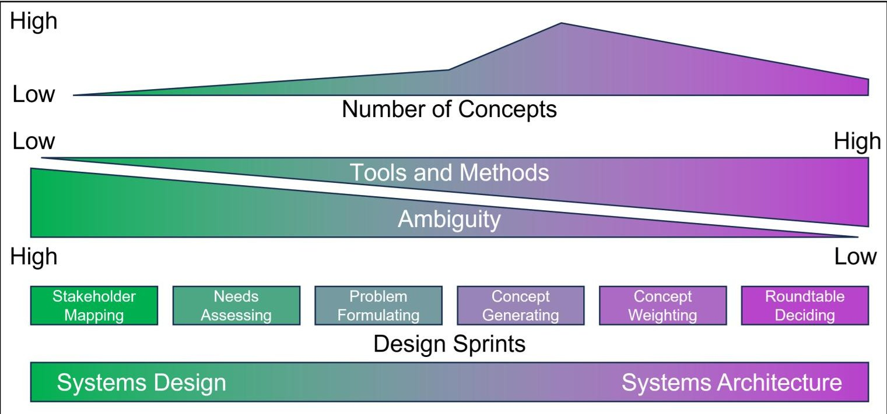
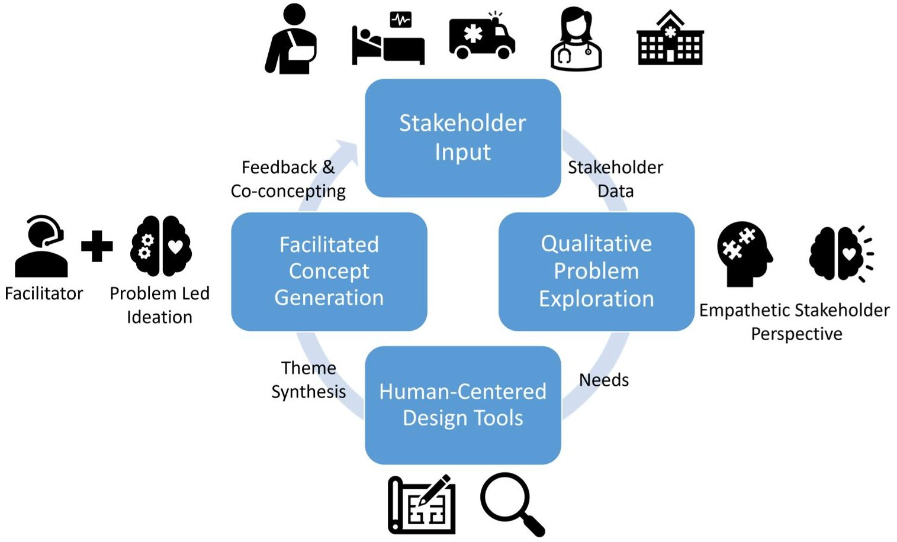
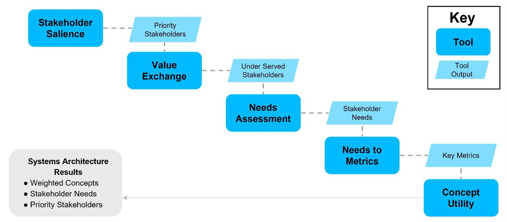
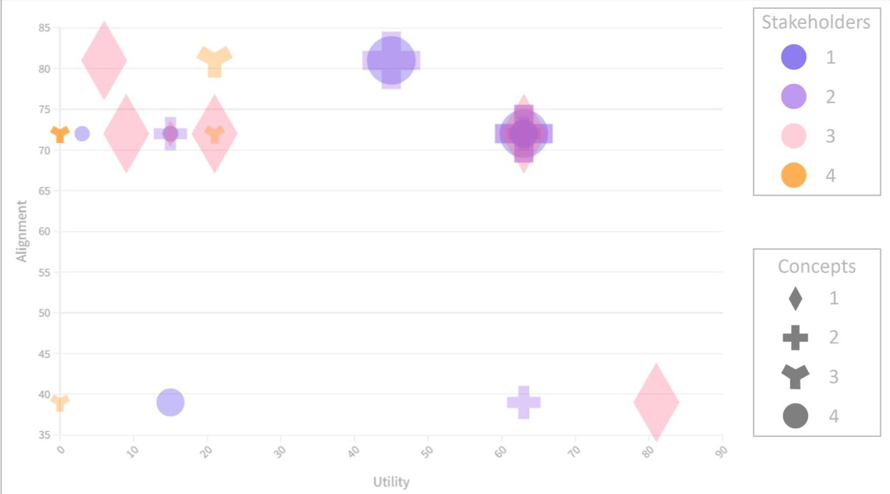

<!-- PDF_PAGE: 1 -->

# Enhancing Innovation in Technical Teams: A Study of Design Thinking and Systems Architecture Integration

by

Warren V. Anderson

B.S., Earth Science, University of Utah, 2009 M.S., Geology, University of Utah, 2012

Submitted to the System Design and Management Program in partial fulfillment of the requirements for the degree of

MASTER OF SCIENCE IN ENGINEERING AND MANAGEMENT

at the

MASSACHUSETTS INSTITUTE OF TECHNOLOGY

September 2023

$ \textcircled{c} $ 2023 Warren V. Anderson. All rights reserved.

The author hereby grants to MIT a nonexclusive, worldwide, irrevocable, royalty-free license to exercise any and all rights under copyright, including to reproduce, preserve, distribute and publicly display copies of the thesis, or release the thesis under an open-access license.

Authored by: Warren V. Anderson

System Design and Management Program

August 11, 2023

Certified by: Donna H. Rhodes Principal Research Scientist, Sociotechnical Systems Research Center, Thesis Supervisor

Accepted by: Joan Rubin Executive Director, System Design & Management Program

<!-- PDF_PAGE: 2 -->

<!-- PDF_PAGE: 3 -->

# Enhancing Innovation in Technical Teams: A Study of Design Thinking and Systems Architecture Integration

by

Warren V. Anderson

Submitted to the System Design and Management Program on August 11, 2023

in Partial Fulfillment of the Requirements for the Degree of

MASTER OF SCIENCE IN ENGINEERING AND MANAGEMENT

## ABSTRACT

With increasing discoveries in technology and new emerging markets, large enterprises and agencies see a rising demand for innovation. As a result, the roles and responsibilities of technical experts, including engineers and scientists, in these organizations are growing. Technical experts are being pushed to expand their capabilities beyond solution evaluation and into divergent concept exploration space. Additional tools and skills support are needed to assist these technical experts in this new approach.

NASA's Aeronautics Research Mission Directorate (ARMD) is dedicated to transforming aviation to meet the nation's and the world's future needs. The Convergent Aeronautics Solution (CAS) project was developed to accelerate ARMD's innovation capabilities. The CAS project is designing a bespoke innovation framework that fits its culture and mission through human-centered design and leveraging tools from systems architecture to address complex societal problems through aviation. This thesis investigates how to influence the technical experts using the CAS project as a case study in addition to interviews conducted with team members.

This real-world case study provided a unique opportunity to observe a large agency. This thesis discusses three insights that emerged from this research into how to support new technical teams during ideation. First, embrace the natural tendency of technical experts to generate concepts. While systems architecture and human-centered design prescribe exploring the problem before developing concepts, it is better to make some space for the technical experts to propose ideas. Second, concept generation and the ideation process can benefit from an experienced facilitator(s) to help keep the team in a generative mindset. Teams new to the ideation process need assistance while they gain experiential learning of this new approach. Finally, this early lifecycle exploration of the problem and the stakeholder's needs

<!-- PDF_PAGE: 4 -->

can be ambiguous and challenging. The tools and methods of human-centered design and systems architecture can help structure the approach for problem formulation, interpreting the stakeholder's needs, and generating transformative solutions.

Thesis supervisor: Donna H. Rhodes Title: Principal Research Scientist Sociotechnical Systems Research Center

<!-- PDF_PAGE: 5 -->

## Acknowledgments

I want to thank Donna Rhodes for being my thesis advisor. Without your support and mentorship, I would not have had the courage to approach this subject. Collaborating with you on this work has been one of my most fulfilling academic experiences. Thank you for your patience and guidance.

I want to thank my mentor at NASA, Elizabeth Rieken. Thank you for the opportunity to participate in this project; your candor and trust in me were genuinely inspiring. Your unwavering determination gave me hope when things looked uncertain. I admire your leadership and thank you for all your support.

To Rachel Best, I would like to thank you for teaching me new ways to influence and learn about others. Your feedback and encouragement have challenged me and helped me grow in new ways. Thank you for taking a chance on me; this opportunity would not have been possible without you.

Kathleen Bond, working with you has been a pleasure. Your skill in leading groups and creating a collaborative atmosphere is profound. Thank you for your patience and for helping me learn from my errors.

To Eric Brubaker, thank you for all your help and support in setting me up with NASA IT and security. I could not have done this without you.

A special thanks to CAS team members for being open and inviting when I joined the project. Working with you confirmed all my beliefs about the quality and character of the engineers that work at NASA. I want you to know that I truly cherish all the lessons I learned from you.

I want to thank Chadwick Holmes for our countless discussions about this research. Without your mentorship and guidance, I would not have succeeded in this research or my time here at MIT. Thank you again for giving your time and knowledge when I needed it most.

Justin Dargis, thank you for all our conversations about this research. You kept me focused on what is most important and made me believe this was achievable.

I want to acknowledge my fellow cohort members who helped me test the systems ar-

<!-- PDF_PAGE: 6 -->

chitecture sprint and provided feedback. Thank you for taking the time to help make this research a success.

Finally, I would like to thank all my personal and professional mentors that have helped me over the years. Your unwavering optimism and thirst for knowledge inspire me to accept new challenges and explore new opportunities. Thank you for all your support and encouragement.

<!-- PDF_PAGE: 7 -->

## Dedication

I would like to dedicate this thesis to my wife, Chelsea and my son, Archer. Thank you so much for the time and sacrifices that you gave to make this possible. I could not have done this without your love and support.

<!-- PDF_PAGE: 8 -->

<!-- PDF_PAGE: 9 -->

## Contents

# Title page 1

# Abstract 3

# Acknowledgments 5

# Dedication 7

# List of Figures 13

# List of Tables 15

## 1 Introduction 17

1.1 Research Motivation 17

1.2 Research Questions 18

1.3 Research Approach 18

1.4 Research Scope 19

1.5 Research Contributions 20

1.6 Thesis Structure 20

## 2 Background 22

2.1 Systems Engineering 22

2.2 Systems Architecture 24

2.2.1 Scope of Systems Architecture 24

2.2.2 Role of a Systems Architect 25

2.2.3 Impact of Systems Architecture on Innovation 27

2.3 Enterprise-Enabled Innovation 27

2.4 Behaviors of Engineers 28

2.5 Human-Centered Design 29

2.6 Tools and Templates 30

<!-- PDF_PAGE: 10 -->

2.6.1 Stakeholder Salience 30

2.6.2 Value Exchange 30

2.6.3 Concept Weighting 31

3 Research Opportunity 32

3.1 Convergent Aeronautics Solutions Team at NASA 32

3.2 Addressing Complex Societal Problems Through Aviation 33

3.3 Using a Systems Thinking Approach 33

3.4 Developing a Culture of Innovation Exploration 34

3.5 Design Thinking and Systems Architecture for Innovation 36

4 Analysis of Data 38

4.1 Research Questions Recap 38

4.2 Case Study Selection 39

4.3 Research Design 40

4.4 Stakeholder-Led Exploration 41

4.4.1 Human-Centered Design Sprints 42

4.4.2 Products of the CAS Discover Phase 43

4.4.3 Challenges 43

4.5 Systems Architecture 44

4.5.1 Architecture Sprints 44

4.5.2 Architecture Sprint Products 47

4.5.3 Challenges 47

4.6 Integration of Human-Centered Design and Systems Architecture 49

4.7 Post-Sprint Interviews 50

4.8 Findings from Post-Sprint Interviews 51

5 Conclusions and Future Work 53

5.1 Creating Space for Concepting 53

5.2 Structuring the Ambiguous Front End with Tools and Methods 54

5.3 Facilitator and Systems Architect Role 55

5.4 Challenges for a Novice Team 56

5.5 Implications for Future Research 57

References 59

<!-- PDF_PAGE: 11 -->

# A Interview Questions 62

A.1 Interview Preface 62

A.2 Interview Questions 63

A.2.1 Systems Architecture Questions 63

A.2.2 Questions About the Systems Architecture Tools Used 63

A.2.3 Questions About the Systems Architecture Sprint 63

A.2.4 Questions About the Human-Centered Design Sprints 64

<!-- PDF_PAGE: 12 -->

<!-- PDF_PAGE: 13 -->

## List of Figures

3.1 CAS project approach, as envisioned by the author, to addressing healthcare and Emergency Medical Services (EMS). 37

4.1 As envisioned by the author, a simplified illustration of the stakeholder-led problem exploration and human-centered design process. 41

4.2 Systems architecture sprint process illustration. 45

4.3 Example of weighted concept infographic display. With Utility on the X-axis and Alignment shown on the Y-axis. Markers are colored by the stakeholder, shaped by the different concepts, and sized by the desirability of the concept. 48

<!-- PDF_PAGE: 14 -->

<!-- PDF_PAGE: 15 -->

## List of Tables

2.1 Behaviors of engineers that could inhibit innovation. 28

2.2 Behaviors of engineers that could enable innovation. 29

<!-- PDF_PAGE: 16 -->

<!-- PDF_PAGE: 17 -->

## Chapter 1

## Introduction

Innovation starts early in the system's lifecycle when the stakeholders and their needs are still being discovered. It is a time of much ambiguity and uncertainty as the data is often qualitative and the needs are subjective to the customer's opinions. In this stage, ideation is free to explore new and divergent concepts because the system's requirements have yet to be fully established. Through this exploration comes the possibility of uncovering transformative opportunities.

## 1.1 Research Motivation

Much has been written about the need for innovation in large enterprises and how leadership can influence their teams (Lakhani et al., 2023; Ou, 2021). This research goes deeper by examining how to enhance innovation in teams of technical experts within established companies or agencies. These technical experts, including engineers and scientists, are vital to the design and development of today's complex sociotechnical systems. How can these technical experts be supported as they navigate the ambiguity of this early lifecycle exploration for transformative solutions?

Therein lies the motivation for this research. Technical professionals demonstrate a disciplined approach in establishing system requirements and optimizing solutions. However, transformative innovation demands divergent thinking, and an innate understanding of the stakeholders and their needs is essential. This approach allows for a more thoughtful exploration of the problem from the stakeholders' perspectives before concept generation. Such methods may be more challenging for technical professionals who tend to prioritize singular solutions rather than exploring a range of concepts to address system-level issues.

The research aims to bridge this gap by applying human-centered design and systems architecture tools and methods. The objective is to support teams of technical professionals

<!-- PDF_PAGE: 18 -->

in maintaining a solution-neutral mindset during the early evaluation of complex system problems. While recognizing the impracticality of a one-size-fits-all approach, the research seeks to gain valuable insights into the rhetorical and heuristic precepts that enable systems thinking in this context. Understanding these underlying principles can pave the way for technical teams to be more effective in stakeholder-led approaches for ideation.

## 1.2 Research Questions

This thesis examines the behaviors of professional engineers in taking a systems architecture and human-centered design approach for transformative innovation. The research attempts to gain insights into the following questions:

1. How can systems architecture and human-centered design methods help technical experts remain solution-neutral during problem exploration?

2. In organizations with strong technical cultures, what systems architecture tools or human-centered design approaches could help technical experts stay focused on the needs of the stakeholders?

3. In what way are tools and templates useful in helping technical experts stay in a more generative mindset?

4. How do design sprints impact technical experts' appreciation for systems architecture or human-centered design approaches as an innovation strategy?

## 1.3 Research Approach

This research began with an interest in how systems thinking and solution-neutral concept generation can lead to innovation. A literature review of papers, articles, textbooks, handbooks, and academic theses on the subject gave a deeper appreciation of how different systems and design methods are used to approach early system lifecycle exploration. This review expanded the scope to include problem exploration and ideation using human-centered design and systems architecture methods.

There was a good amount of literature on why innovation is essential for an enterprise and what they could do to adopt these methods. However, less literature was found about how teams and individuals could implement and apply these changes. Since these enterprises tend to be more technical with scientific and engineering teams, a general question emerged: how do technical experts explore problems and generate concepts?

<!-- PDF_PAGE: 19 -->

A partnership with NASA's Convergent Aeronautics Solution (CAS) project was formed after learning about their goals of developing a discovery process based on the stakeholder needs for problem-led exploration. This mutually beneficial collaboration enabled the research questions of this thesis to be studied while also aiding the CAS project objectives.

The research questions began to evolve and expand as the context and background knowledge grew through the continued involvement with the CAS project. Utilizing the CAS project as a real-world case study, this research aimed to explore the impact of different approaches on early system lifecycle exploration. Additionally, one-on-one interviews were conducted to understand how this problem-led approach was perceived among the project participants.

By integrating systems architecture, human-centered design, and other methods, the CAS project adopts a unique approach to transformative innovation tailored to the organization's culture and mission. Observing their early efforts in designing their strategy provided a distinct opportunity to uncover a meaningful understanding of what impacts the behaviors and perceptions of the participants. Interpretive analysis of the available data and reflections with the project leaders were used to address the research questions, highlight the project successes, and document the challenges still ahead.

## 1.4 Research Scope

As a government agency, NASA has a mission to innovate for the benefit of humanity. Because of this, they are in a unique position to explore for transformative innovation with less concern for profitability and more diligence in where they apply their technical resources. This, in turn, impacts the scope of this research; it concentrates on large, well-established, US-based organizations with strong technical capabilities. This is distinct from the other types of entrepreneurial startups or new venture companies that are not the focus of this research.

This research investigates the early stages of systems thinking and problem exploration, where innovation is the primary purpose. While there are many early lifecycle exploration and ideation approaches, this research focused on a select set of methods and tools available from human-centered design and systems architecture.

The combination of human-centered design and systems architecture is a unique approach. This thesis examines the benefits and drawbacks of merging the methodologies and highlights the advantages of involving technical experts. Additionally, this research seeks to understand the importance of bringing technical expertise to enhance the innovation process. It explores the habits and mindset of professional engineers as they take a stakeholder-driven

<!-- PDF_PAGE: 20 -->

perspective in problem exploration and concept generation.

## 1.5 Research Contributions

Established enterprises continue to see the value in adopting faster innovation practices to keep pace with the speed of environmental changes around them (Noble, 2021). In response to this, the roles and responsibilities of technical teams continue to increase alongside the growing complexity of the systems they manage and develop. This is despite the fact that the mentality and culture of these large enterprises are unlike a startup or venture capital organization. Perhaps the most severe issue is that large enterprises are trying to apply the same practices as startups and expecting similar results from their technical teams. (Ou, 2021)

The research presented in this thesis gives a better example of how a large agency is developing their own approach that recognizes and embraces its culture and strategy. They acknowledge the need for faster innovation and are supporting their technical experts on a path of problem-led concept generation.

Findings from this thesis highlight how human-centered design and systems architecture tools and methods can be shaped and tuned for leading technical teams on a more structured approach to innovation. The research investigates the natural tendencies of technical experts and proposes strategies to focus on the tendencies that invoke a more generative and explorative mindset.

## 1.6 Thesis Structure

Chapter One provides an introduction to the research questions and motivation detailed in the following chapters.

Chapter Two prepares the background information regarding systems engineering, systems architecture, and human-centered design methods referenced in this thesis. It also provides contextual knowledge about the behavior of technical professionals and the environments where they operate.

Chapter Three describes why the Convergent Aeronautics Solution (CAS) project at NASA was selected as the case study for this research. It highlights the strategic vision of NASA's Aeronautics Research Mission Directorate (ARMD) and the approaches they are developing to foster transformative innovation.

<!-- PDF_PAGE: 21 -->

Chapter Four gives the necessary framework for how the data for this research was collected and analyzed. This chapter also discusses the themes and insights derived from the interpretive analysis.

Chapter Five summarizes the key learning from this research and proposes several avenues for continued research.

<!-- PDF_PAGE: 22 -->

## Chapter 2

## Background

"Engineering is concerned more with quantifiable costs, architecting more with qualitative worth. Engineering aims for technical optimization, architecting for client satisfaction. Engineering is more of a science, and architecting is more of an art"

- (Emes et al., 2012, Maier and Rechtin, 2000)

## 2.1 Systems Engineering

As the demand for products to add functionality and to integrate with other products has increased, so has the complexity of those products. Product engineers usually manage or mitigate complexity in stable environments. Still, with the accelerated rate of technological development and a constantly evolving market landscape, it can be challenging to maintain or develop new products. Systems engineering was born from this need to manage complexity and remain agile when the technology or market demands change. The systems engineer facilitates interdisciplinary collaboration and addresses conflicting requirements and priorities. (Honour, 2004; Kossiakoff et al., 2020; Walden, David et al., 2015)

According to the NASA handbook on systems engineering, it is a methodical, multidisciplinary approach to systems design, realization, technical management, operations, and retirement (Hirshorn et al., 2017). The system is "a set of interrelated components working together towards some common objective" (Kossiakoff et al., 2020). Systems engineering is meant to take a holistic view of the systems; from an internal perspective of how all the components fit and interact together and an external perspective of how it interacts with the surrounding environment and impacts other systems. This vantage point sometimes requires a transdicipline and integrated approach to managing the system and its complexity

<!-- PDF_PAGE: 23 -->

(INCOSE, 2019).

The role of the systems engineer is usually to design a system that meets the needs and requirements of the stakeholders while managing the development and integration of the system and its components. Once developed, the systems engineer usually transitions to a systems management and maintenance role to ensure that it continues to meet the needs and objectives. If the system reaches its end of life, the systems engineer could also help facilitate its retirement or decommissioning. (Kossiakoff et al., 2020)

A system's progression from concept, design, development, operation, and eventually decommissioning are all part of the systems engineering project life cycle (Walden, David et al., 2015). Systems engineering recognizes several methods to help guide the life cycle of complex systems. Methodologies such as waterfall, spiral, the "V," also known as "verify and validate," and others are all powerful practices that systems engineers can employ depending on the nature and circumstance of the system they manage (Kossiakoff et al., 2020; Walden, David et al., 2015). While the approach and benefits of the various methods may differ, they usually share stages that typically follow a pattern of concept developing, designing, building, and deploying.

The focus of this thesis is on the concept development phase of systems engineering and how the needs of the stakeholders help guide the development requirements and the design specifications. The steps involved in starting the systems engineering process by choosing a concept and then developing it differs depending on which handbook or textbook is followed. Both the NASA and the International Council on Systems Engineering (INCOSE) handbooks on systems engineering recommend that the process begins by defining the needs or discovery of an opportunity. The key stakeholders are determined from there, and the system requirements are established based on their needs. INCOSE defines this as the concept phase, where a preliminary high-level concept is chosen to help facilitate a starting point once the system requirements are known. INCOSE recognizes that this concept will require refinement but is helpful in framing conversations around cost, schedule, and concept of operations (ConOps). NASA takes this one step further by recommending Project PrePhase A: Concept Studies, where the goal is to explore several ideas and create a portfolio of concepts that can be assessed based on the system requirement and ConOps. (Hirshorn et al., 2017; Walden, David et al., 2015)

Kossiakoff et al., 2020 describe this phase as concept development and break it into three steps: the needs analysis, the concept exploration, and the concept definition. The needs analysis seeks to identify whether a new system is needed or if a practical approach exists to satisfy the requirements. Also, part of the needs analysis is a discussion on the technical and economic feasibility of the system. Following the needs analysis, the concept exploration step

<!-- PDF_PAGE: 24 -->

can begin. Kossiakoff et al., 2020 note that a considerable amount of preliminary concept definition has often occurred before the phase formally begins. After the concept exploration step, the system performance requirements are expected to be defined, and feasible candidate system concepts have been identified. The final step in this phase is the concept definition, where a concept is selected with defined specifications and functional or physical structure.

Systems engineers have increasingly recognized the need for the role of a systems architect in translating stakeholder needs into a system vision. The idea behind this is to understand better the concept's boundaries, performance requirements, and functions. With this understanding, systems engineers can be more effective at concept generation and defining requirements. At the same time, the systems architect will be able to ensure that the selected concept definition still satisfies the broader system vision.

## 2.2 Systems Architecture

Systems architecture is a broad term with different meanings to different audiences (Emes et al., 2012). For this discussion, systems architecture will adhere to the definition initially set forth by Rechtin, 1991. Systems architecting is the process of creating a system that effectively balances the stakeholders' interests with the available resources and technology. The method of systems architecture strives to make the necessary conditions for systems engineering while providing innovative concepts for success. The foundations of systems architecting are a systems approach, a purpose orientation, a modeling methodology, practical communication, and certification. (Maier and Rechtin, 2000; Rechtin, 1991)

While the focus of this thesis is primarily interested in the tools and methods used by systems architecture to generate concepts and weigh them against the needs of the stakeholders, the overall influence of the systems architecture on product development is also essential to understand. Systems architects are responsible for translating the needs of the customer, stakeholder, or market into the system vision that is then used to help inform the systems engineers and designers of the form and functionality they seek to achieve. (Crawley et al., 2016; Kossiakoff et al., 2020)

## 2.2.1 Scope of Systems Architecture

Systems architecture is the discipline of defining and designing the behavior of a system. It exists at the fuzzy front end or ambiguous space that is idea conception. It is not easy to define the scope of systems architecture because it is the method by which an idea is brought into focus and given a scope. Systems architecture helps define the system by giving form

<!-- PDF_PAGE: 25 -->

to function; it helps identify the boundaries, structure, behavior, and integration. Systems architecture aims to align the system with the stakeholder needs, optimize performance, and manage complexity. It seeks to achieve this by applying the principles of systems-level thinking to gain perspective, and it outlines the tools needed for the practical management of the system, its components, and their relationships. (Crawley et al., 2016; Maier and Rechtin, 2000; Rechtin, 1991)

To help communicate the system vision to the stakeholders and the system and design engineers, systems architecture frequently employs models. These models can be physical analogs but could also be in the form of simplified system representations via diagrams or graphics. Illustrating the systems architecture provides meaningful abstractions to convey and collaborate on complex systems among stakeholders, such as architects, designers, domain experts, and end-users. Models can help all the parties involved have a similar mental concept of the system. From the model, the architect can begin to balance tradeoffs between the competing demands of different stakeholders, such as cost and performance reliability and maintainability. (Crawley et al., 2016; Maier and Rechtin, 2000; McDermott and Salado, 2019)

## 2.2.2 Role of a Systems Architect

As mentioned in section 2.2.1, the systems architect works at the fuzzy front end or the ambiguous space at the beginning of a project. Their role starts with understanding the needs of the stakeholders. This is no easy task, as sometimes the stakeholders cannot articulate their latent needs. The systems architecture aims to translate what the stakeholders want into metrics by which the system performance can be measured and quantified. To do this, the systems architect goes through a series of steps.

1. Stakeholder prioritization - the term stakeholder is frequently overused and overgeneralized. The systems architect takes things further by classifying the stakeholders. This can help them understand stakeholders' weight, influence, input, or interaction with the system. (Crawley et al., 2016; Mitchell, 2021)

2. Stakeholder needs to goals - this is where the art of systems architecture lies. With the highest priority or influential stakeholders in mind, the systems architect translates their needs into the system's goals. The architect's methods vary, but all require an empathetic perspective of the stakeholder to better understand their concerns, challenges, and objectives. (Crawley et al., 2016; Kouprie and Visser, 2009)

3. System goals to metrics - in this step, the architect needs to render the art into the

<!-- PDF_PAGE: 26 -->

engineering by converting the goals from the stakeholders into the metrics or requirements of the system. This step is essential to help generate concepts, explore tradeoffs in the design choices, and evaluate the overall performance of the systems. (Crawley et al., 2016; Rechtin, 1991)

Once the goals and metrics of the system are defined, the systems architect can begin to explore concepts that could satisfy the system's needs. As mentioned in the section above, a systems architect helps define the system by giving form to function. They seek to describe the broader function of the system without explicitly describing the form to achieve the system's goals. Systems architects use the term solution-neutral to describe this broader system function. By remaining solution-neutral, there is more opportunity for innovative concept ideation than if the architect tried to define the solution at the beginning of a project. The solution-neutral statement can be used for developing a portfolio of concepts that could satisfy the system's goals. (Crawley et al., 2016)

With a portfolio of concepts, the systems architect can now begin weighing the concepts against the goal and metrics of the system. Some concepts may satisfy the needs of a particular group of stakeholders more than others. Alternatively, the cost to design or build a particular concept may be much greater than another. This comes back to the systems architect to help select or merge concepts to best meet the system's needs. That is to say, some inherent tensions or tradeoffs need to be considered from the concept to the components and interfaces. To translate these tradeoffs, the systems architect must be skilled at employing a tradespace analysis. A tradespace analysis is a heuristic method that enables communication between the stakeholders and the systems engineers. The metrics employed vary depending on the project goals, but some common examples are cost, complexity, feasibility, and utility. The objective of the tradespace analysis is to settle on a concept but not to begin optimizing. (Crawley et al., 2016; Kossiakoff et al., 2020; Maier and Rechtin, 2000; Ziemer et al., 2013)

Finally, it is worth noting that the role of the systems architect is iterative. There are still many unknowns that will emerge as the concept continues to take shape. The architect may need to repeat the process, but they should always strive to maintain that systems-level perspective. The objective is to meet the goals and objectives of the system, not to begin allocating resources, cutting costs, or optimizing. That is the role of the systems engineer and project manager.

<!-- PDF_PAGE: 27 -->

## 2.2.3 Impact of Systems Architecture on Innovation

Concept development requires that the team remains solution-neutral at the design phase's onset. Through divergent idea generation, the team explores unknown opportunities before narrowing in on a solution. The systems architecture has a well-defined prescriptive method to generate concepts. It begins with a solution-neutral function and generates concepts by adding instruments to specialized operands and processes (Crawley et al., 2016). The potential benefit of remaining solution-neutral comes from its inherent ability to drive exploration of alternative operands and processes that would likely not have been considered if a more traditional systems engineering approach of identifying the simplest solution had been employed. In this way, remaining solution-neutral enables more innovative concepts to be explored without immediately being dismissed. This also can help facilitate more meaningful discussions about the portfolio of concepts that will often lead to creative ways to build upon or combine certain concepts in ways that the engineers may not have thought of previously.

## 2.3 Enterprise-Enabled Innovation

Much has been written about how an enterprise, its values, and its management can foster or hinder innovation and creativity. While this research focuses more on team integration dynamics and individual contributions to innovation, it is worth noting how the enterprise and its leadership play a role. Ou, 2021, details the upstream effects of leadership and the enterprise that enable or hinder innovation. Effectively setting and communicating the strategic vision of the enterprise is an essential first step toward establishing a culture of innovation. Building on this foundation, the next step depends on the team manager, setting the structure and tone for collaboration. There are many ways in which a team can be structured depending on the needs of the team, the project, and the culture of the enterprise (Ou, 2021). However, without the proper foresight from the team manager, it is unlikely that the team will be able to achieve the explorative innovation sought by the enterprise. Additionally, leadership needs to create space and time for innovation; it is doubtful that compelling idea exploration can occur if all the technical experts have an overloaded work schedule (Menzel et al., 2007).

The enterprise itself may be influencing innovation in how it rewards and challenges its innovators. If their engineers are accustomed to being praised for their ability to find the faults and flaws in a project or program, then it is unlikely that they will seek new solutions at higher risk. This will all result in the attitude that technical experts bring into any collaborative innovation team working environment. (Noble, 2021)

<!-- PDF_PAGE: 28 -->

## 2.4 Behaviors of Engineers

This thesis is interested in exploring how teams of engineers and their behaviors impact innovation. Given the limitations of this master's thesis, we are restricting the scope to focus primarily on innovation teams in large enterprises with well-established systems engineering practices and professionals. This section is meant to highlight the behaviors of engineers and how they impact innovation but also touches on the enabling environment needed by an enterprise that wishes to foster innovation.

Engineers innovate constantly; they are trained and mentored to continually improve the product, process, or method (Ou, 2021). This type of activity can also be referred to as optimization or exploitive innovation (Noble, 2021). The other type of innovation, the one that disrupts by addressing an unforeseen gap in the market or satisfies a stakeholder's needs in a way they did not realize, is called explorative innovation (Noble, 2021). This type of explorative ideation or innovation can be in tension with many ways that engineers have been mentored in or practice their discipline. Table 2.1 outlines some of the dominant behaviors inherent in engineers that could inhibit this explorative ideation that can lead to innovation.

<table border="1"><tr><td>Behavior</td><td>Source</td></tr><tr><td>Lower extraversion scores- hindering social skills and effective communication.</td><td>Williamson et al.,2013</td></tr><tr><td>Adaptive and focus on more practical, less risky solutions with a promise of immediate efficiency.</td><td>Yilmaz et al.,2020</td></tr><tr><td>Less conscientious and lower customer service orientation.</td><td>Williamson et al.,2013</td></tr><tr><td>Problematic interpersonal relationships and less agreeable in professional communication situations.</td><td>Van Der Molen et al.,2007</td></tr><tr><td>Tend to think more analytically than intuitively.</td><td>Reis,2022</td></tr><tr><td>Lack an understanding of the customer and market needs.</td><td>Menzel,2008</td></tr><tr><td>Can become strongly attached to a concept and have difficulty seeing the value of alternatives.</td><td>Ou,2021</td></tr></table>

Table 2.1: Behaviors of engineers that could inhibit innovation.

This is not to discount the many strengths engineers possess that can enable disruptive

<!-- PDF_PAGE: 29 -->

innovations. Table 2.2 outlines some of the dominant behaviors inherent with engineers that could enable this disruptive innovation. However, there is a tendency for engineers to trend more toward solution optimization over solution-neutral ideation because of their behavioral nature, discipline, and even how their enterprise environment recognizes and rewards them.

<table border="1"><tr><td>Behavior</td><td>Source</td></tr><tr><td>Willing to experiment and generate new knowledge rather than just follow existing best practice approaches.</td><td>Menzel,2008</td></tr><tr><td>Flexibility in thinking, ability to switch back and forth between mental modes of analysis and intuition.</td><td>Reis,2022</td></tr><tr><td>Have a long-term orientation to a vision of the future and risk-taking ability.</td><td>Menzel,2008</td></tr><tr><td>Are open-minded and adaptable to new ideas and innovations.</td><td>Ou,2021</td></tr></table>

Table 2.2: Behaviors of engineers that could enable innovation.

## 2.5 Human-Centered Design

As the complexity of systems increases, so do the challenges for teams in finding innovative solutions. Human-centered design is an approach that goes beyond just listening to the customer. It can help teams empathize with the stakeholder's needs while ensuring that potential solutions consider their ethical and responsible implications (Kouprie and Visser, 2009; Ray et al., 2022).

Seidel and Fixson, 2013, identified some of the more common methods used in the design process as needfinding, brainstorming, and prototyping. Needfinding places value in considering the needs of the stakeholder before the solution. One approach to this is empathy in design which can also be used to understand better the potential desirability of a solution to the stakeholder (Kouprie and Visser, 2009; Moore et al., 2021). The term brainstorming here is defined as a formal framework for concept generation. This generating process advocates for divergent concept alternatives and postpones converging on only a few solutions too early (Dekker, 2020). Finally, prototyping, as used in human-centered design, is a means to continue exploring and learning rather than validating a concept (Seidel and Fixson, 2013).

<!-- PDF_PAGE: 30 -->

## 2.6 Tools and Templates

"The basic idea behind all of these techniques is to simplify problem-solving by concentrating on its essentials. Consolidate and simplify the objectives. Stay within guidelines. Put to one side, minor issues likely to be resolved by the resolution of major ones. Discard the nonessentials. Model (abstract) the system at as high a level as possible, then progressively reduce the level of abstraction. In short, Simplify!"

- (Maier and Rechtin, 2000)

Ambiguous brainstorming by individuals can be overly taxing on an individual's cognitive load. In contrast, a more structured and goal-direct approach to concept generation requires less cognitive load and helps control judgment and convergent thinking. (Shealy et al., 2020)

The following sections give the background on the tools selected to assist in the systems architecture portion of this research. While recognizing that these are not the only systems architecture tools available, these were chosen for their fit and purpose of the project.

## 2.6.1 Stakeholder Salience

The term stakeholder is frequently used and can have a broad spectrum of definitions depending on the audience. The stakeholder salience tool designed by Mitchell, 2021 provides a heuristic method of classifying stakeholders based on their power, legitimacy, or urgency. Using this classification from the perspective of the systems architect or designer allows them to convert the ambiguous term stakeholder to an actionable category. Mitchell, 2021, defines the attributes of each stakeholder, by describing where the overlapping areas of a pseudo-Venn diagram of the three classes are.

For the purposes of this study, it was not necessary to subdivide them by attributes due to the low number of system stakeholders considered in this project. Instead, each stakeholder was rated on a high, medium, and low scale for each class. In doing so, this heuristic tool enables the division between the latent and priority stakeholders whose needs are most important.

## 2.6.2 Value Exchange

There are several ways in which the value exchange tool can be utilized. In this case, it provided a visual representation of the stakeholder's importance and the current system's performance to that stakeholder (Nightingale and Rhodes, 2015). This tool complements the

<!-- PDF_PAGE: 31 -->

stakeholder salience classification by using the ranking output from the high, medium, and low rating scores given to the priority stakeholders. Then the current system's performance in meeting the stakeholder's needs is rated on a scale of one to five.

The resulting plot of stakeholder priority versus current system performance should help identify those important stakeholders currently underserved by the system. Additionally, it can also highlight where the system is overserving lower-priority stakeholders. This may lead to a discussion about reallocating resources or emphasis on those overserved stakeholders. (Nightingale and Rhodes, 2015)

## 2.6.3 Concept Weighting

The weighting tool allows a semi-quantitative method of visualizing a concept's utility, desirability, and alignment to the underserved stakeholders. The tool used in this research is based on a simplified version of the tool presented by Holmes et al., 2022. From the perspective of each underserved stakeholder, each possible concept is then rated on a high, medium, low, or NA scale for three metrics. The utility metric is a consolidated list of stakeholders' needs. The desirability metric measures the stakeholder's willingness to accept the concept. Finally, the alignment metric measures the enterprise's overall fitness and mission. Collecting these values enables a series of tradespace visualization dashboards for comparing the value of each concept to the individual stakeholders.

<!-- PDF_PAGE: 32 -->

## Chapter 3

## Research Opportunity

The Convergent Aeronautics Solutions (CAS) team at NASA is in the process of redefining how they explore for transformative solutions. A partnership between MIT and the CAS team provided an opportunity for investigating the thesis research questions. This partnership afforded a unique research opportunity to test some of the systems architecture and design tools and methods in a real-world scenario while also contributing to the efforts of the CAS team.

## 3.1 Convergent Aeronautics Solutions Team at NASA

NASA's Aeronautics Research Mission Directorate (ARMD) is dedicated to transforming aviation to meet the nation's and the world's future needs. The ARMD vision and strategy are aimed at the next 25 years and beyond, focusing on safe, efficient, flexible, and sustainable air transportation (NASA ARMD, 2019). The Convergent Aeronautics Solution (CAS) project was developed to accelerate ARMD's responsiveness to new discoveries and emerging markets in aviation. The CAS mission is to seek transformative innovation through novel concept ideation and feasibility assessment to determine if additional investment is warranted. Additionally, the CAS process is meant to utilize a convergent method for integrating multiple disciplines and partners both within and external to NASA. The goal is to seek additional benefits by leveraging expertise and technology inside and outside the aeronautics field. (Lopez, 2018)

The CAS project recognizes that to rapidly conceive and test the feasibility of transformative concepts; they need to adopt a more agile approach, similar to a venture capital or startup culture (Lopez, 2018). At the same time, they are maintaining decades strategy horizon while testing the feasibility of a concept in 2.5 years or less. To achieve this shift in culture and behavior, the CAS project is developing a discovery process based on stakeholder

<!-- PDF_PAGE: 33 -->

needs and strategic foresight for problem-led exploration.

The CAS project utilizes tools and methods from systems thinking, human-centered design, and other disciplines to address complex societal problems through aviation. The team and leadership at CAS recognize that this cultural and behavior shift will take time. They are experimenting with different formats and methods to implement the change while exploring complex societal challenges that may have transformative solutions tied to aviation. (Rieken, Brubaker, et al., 2023)

## 3.2 Addressing Complex Societal Problems Through Aviation

Complex societal problems such as climate change, transportation, and healthcare are challenging because of their interdisciplinary nature and complicated interconnected systems. They are difficult to address because of the diverse stakeholders involved and the ethical considerations surrounding them (Norman and Stappers, 2015; Rieken, Brubaker, et al., 2023). NASA is uniquely poised to address complex societal problems. Their technical depth enables them to envision future technological capabilities with applications in aviation and aerospace. NASA's mission is to "explore the unknown in air and space, innovate for the benefit of humanity, and inspire the world through discovery" (Blodgett, 2018). This means that NASA can focus on the needs of society with less concern for the return on investment or profitability of a product or solution. Finally, because it is a federal agency, it can more easily work with other agencies and policymakers to remove barriers and drive alignment to solve problems. One of the problem areas that CAS is currently investigating is how innovation in aviation might contribute to solutions that reduce strain on the Emergency Medical Services (EMS) system. (Rieken, Brubaker, et al., 2023)

## 3.3 Using a Systems Thinking Approach

The primary sources of this information came from personal discussions with the CAS project team members and observations that the author made during the design sprints. Additionally, the American Institute of Aeronautics and Astronautics (AIAA) Aviation conference paper "Approaching Complex Societal Problems Tied to Aviation" by Rieken, Brubaker, et al., 2023 details the CAS project motivation, approach, and learnings of their work.

CAS project leadership selected the complex societal systems of healthcare access and EMS and began formulating their approach to identify problem areas and stakeholder needs.

<!-- PDF_PAGE: 34 -->

NASA has a well-established systems engineering practice as an agency and experienced practitioners throughout (Hirshorn et al., 2017). For this project, systems engineers and other technical experts are asked to assist in taking on the role of a systems architect as described in section 2.2.2. Collaborating in short design sprints as teams, they worked together to translate the needs of the stakeholders into a future system vision.

The CAS project leadership takes systems architecting even further by not merely wanting to understand the utility of a concept to the stakeholders but also wanting to ensure that the solution is desirable to them. Leveraging the human-centered design approach in addition to the systems architecture, they are seeking to define solutions that users need, and also solutions they want or would be willing to accept. For example, during the problem formulation phase, the team learned how important protecting personal health information is to people. Suppose any potential concepts posed a potential or perceived risk of data privacy infringement. In that case, there is little chance that it would be successful even if it could address significant problems inherent in the system. (Rieken, Brubaker, et al., 2023)

To encourage innovation and open-ended exploration, the teams were not limited to generating concepts strictly related to aviation. The CAS project recognized that any potentially transformative concept still has value and could easily be shared with other departments or agencies later.

Once all of the concepts had been generated, a final sprint was organized to weigh the concepts on three criteria from the perspective of high-importance stakeholders who are underserved by the current systems. The concepts were scored, by the agile team, on three criteria beginning with the concept's utility to meet a stakeholder's needs. Again, taking an empathetic view, the technical team rated the desirability of the concept to be an appealing product or service to the users. Finally, they rated the alignment fit of the solution to be implemented within NASA ARMD. With the semi-quantitative measurement of utility, desirability, and alignment, the CAS project leadership will prepare for their "roundtable" decision gate to consider the proposed concepts. At the roundtable meeting, concepts will be selected to continue forward in an agile exploration environment where they rapidly prototype, test, and redesign. If not selected, they will be recycled for further refinement of the concept or shared with other agencies that may have a better alignment with resources and stakeholders.

## 3.4 Developing a Culture of Innovation Exploration

CAS continues to develop its innovation strategy through stakeholder-led problem exploration. Spending time on problem formulation can be challenging for engineers. Addition-

<!-- PDF_PAGE: 35 -->

ally, this work tends to be more qualitative than quantitative in its nature. The needs of the stakeholders can be ambiguous and ill-defined, especially for a complex societal problem. It takes time and dedicated effort to listen and build the context needed to uncover the sources of a problem. To combat this tendency, the CAS project team has taken a multi-pronged approach to keeping the engineers focused on the problem and the system before entering the concept generation phase. Through data gathering, stakeholder mapping, and interviews with subject matter experts, CAS dedicates time to formulating the problem before they begin concept solutions (Rieken, Brubaker, et al., 2023).

The term data gathering may be too general to describe the approach of the CAS organizers and engineers. In practice, they make space and time to listen to their stakeholders. People that have had experiences receiving medical services or had a family member or loved one that required specialized healthcare gave recorded testimonials that the CAS project members listened to and reviewed. The engineers were asked to reflect on the situations and stories they heard and then convert them into the needs and pain points of the people. This is all to help build an empathic perspective of the user that the engineers can draw from to reflect on the actual needs of the users, not just the assumption of their needs.

The work did not stop there; as part of a 360-degree review, the team then invited experienced subject matter experts in medical services to reflect on and discuss the observations and needs of the people requiring healthcare. Once the empathetic view had been established and verified, the engineers refined the problem statements. Next, they began envisioning futures where the individuals requiring healthcare would have ideal solutions to their problems.

It is at this point that the team can begin the concepting phase. CAS works to help keep the team in a creative mindset and encourages the team to create multiple concepts. The goal is to think of as many different ways to address a problem as the team can, regardless of whether the concept is aviation-based. The idea is that by generating as many concepts as possible, there is a higher likelihood that one of the concepts will be a transformative innovation. Or there could be an opportunity to combine some concepts into one transformative solution.

Keeping the engineers in this explorative innovation space also has its challenges. Brainstorming can be mentally exhausting, and it is easy to fall back into the natural habit of disregarding a proposal because it has been tried before or the technology does not exist. Again, the CAS project organizers have employed a multi-pronged approach to combat these tendencies. Some methods to aid this concept ideation were founded during the problem formulation phase. Through the empathetic perspective and futures-based exercises, some concepts will naturally emerge. To help the team stay focused on the users, their needs are

<!-- PDF_PAGE: 36 -->

always frequently revisited or posted for everyone to see during the ideation session. The team must also propose a short example of how a stakeholder would interact with a concept. The engineers are reminded to keep a 25-year perspective and consider situations and technologies that may not exist yet. Finally, the engineers again have the opportunity to discuss and reflect on the possible solutions with subject matter experts to enter into a co-creation of concepts.

While the tools and methods employed here are helpful, it is also worth acknowledging the environment the CAS project leaders have helped establish to foster transformative innovation. This experiment was designed to be consequence-free for the engineers participating. They were volunteers that understood that CAS was experimenting with how it approached problem formulation and while also working to address complex societal problems through aviation. The CAS project leaders also used a design sprint approach to limit the impact on the participants' time while encouraging continuous progress toward each sprint's goals. Each sprint session was run by a human-centered design team that helped facilitate the discussion and avoid conversations or thinking deviating away from explorative innovation. The facilitators also helped the engineers to be patient and trust the process, encouraging them to be comfortably lost in the qualitative exploration of stakeholder needs and context building. (Rieken, Brubaker, et al., 2023)

## 3.5 Design Thinking and Systems Architecture for Innovation

By crowdsourcing the role of the systems architects and design engineers from their current pool of systems engineers and technical experts, the CAS project enables the team to take a systems thinking perspective for transformative innovation. While this new role may be challenging for some members to adapt to, CAS believes that the overall benefits of collaborative innovation outweigh the challenges.

Figure 3.1 illustrates how the CAS team used the design sprints to separate the human-centered design and systems architecture efforts into distinct phases. It is important to note that early in the system exploration, the tools and methods provided to the team are oriented to allow for more open brainstorming. As the stakeholders and needs are more clearly understood, the structure of the tools and methods employed to direct the team's effort slowly increase.

Figure 3.1 also illustrates that concept emergence is largely postponed until the needs and problem formulation are more clearly understood. Concepts will naturally surface dur-

<!-- PDF_PAGE: 37 -->

ing the needs assessment and problem formulation. However, they are often placed in the "parking lot" until they can be co-creatively discussed with key stakeholders and the team in a dedicated sprint effort. During concept generating, no idea is out of scope or too far fetched to be added to the concept portfolio. It is only in the concept weighting phase that ideas are merged, refined, or recycled.

Figure 3.1: CAS project approach, as envisioned by the author, to addressing healthcare and Emergency Medical Services (EMS).

The CAS project recognizes that its approach is still evolving and that different problems often require different solutions. They are still experimenting with different approaches and methods, but by exercising systems thinking, they have shifted the project objectives from a solution focus to a mission focus.

<!-- PDF_PAGE: 38 -->

## Chapter 4

## Analysis of Data

This chapter provides a more detailed description of the case study and the interviews that were conducted and transcribed. It includes details of how the design sprints were structured and what tools were implemented to help promote the problem-solving and creative exploration of concepts. The phases of the design sprints and the integration process between the phases are illustrated. Finally, it discusses how the case study and interviews were qualitatively analyzed and interpreted to support the questions behind this thesis.

## 4.1 Research Questions Recap

Systems engineers and individuals with a technical background are well-disciplined in defining technical requirements and optimizing solutions. This canonical approach is essential, but transformative innovation requires a portfolio of concepts and a deeper understanding of the stakeholders and their needs. This explorative ideation is an ambiguous process that can be uncomfortable for people more accustomed to a technical or engineering paradigm. According to Williamson et al., 2013, this is likely due to their tendency to be more intrinsically motivated and have less customer-orientation

This research is interested in applying human-centered design and systems architecture tools and methods to assist teams of technical professionals in maintaining a solution-neutral mindset during the early phase of exploring complex system problems. The intent is not to define a universal approach that works for all teams or projects, but to gain insights by observing this specific use case and interviewing team members to better understand the rhetorical and heuristic precepts that enable systems thinking.

<!-- PDF_PAGE: 39 -->

## 4.2 Case Study Selection

Using the CAS project as a case study provided an exciting opportunity to observe the real-world applications of systems thinking to a very real and complex problem. Rather than try to organize a series of simulated sprints to support a theory of how to best lead and implement a systems approach, this case study required that the tools and methods be adapted to the project. The case study then illustrates one strategy to enable systems thinking and reflect on the strengths and weaknesses. It is important to note that the studied problems of healthcare and Emergency Medical Services (EMS) are the context of the research opportunity, not the focus of this thesis. The research is more concentrated on concept ideation and the evaluation process than in the concept's value.

The advantages of using the CAS project as a case study are that the problems these technical experts are trying to solve are real. While the term stakeholders is used frequently, it is important to remember that these individuals and communities are real people seeking a partner to improve a broken system. If successful, the team will have found an aviation solution that helps the betterment of humanity. So, the gravity of what the team is doing and whom they are impacting gives the sprints a weight of purpose that cannot be replicated in a simulated exercise. It is also interesting that the case study observes career professionals in a large enterprise and all the complexity that adds to the discussion, as opposed to an academic study involving students with less professional experience and context about how decisions may impact others or the organization.

There are drawbacks to using the CAS project as a case study for this research. It is harder to measure and quantify the application of the systems approach, and therefore analysis is more qualitative and interpretive. The participating project team members are inconsistent between sprints due to availability conflicts. Also, the priority is to deliver the CAS project efficiently and timely, so the research objectives must adapt to the project.

This research stands out due to its unique approach to attempting to learn from a real team who are working to address real problems. By closely observing the successes and challenges encountered during the implementation of a new problem exploration approach within the organization, valuable insights can be obtained. These insights have the potential to offer significant relevance to future research endeavors and to organizations seeking to implement similar cultural shifts and changes.

<!-- PDF_PAGE: 40 -->

## 4.3 Research Design

The CAS project serves as the backdrop for this research, focusing on the intricate societal issue of healthcare and EMS through the lens of systems thinking. The project involves collaborative teams engaging in a series of five design sprints, applying systems thinking methods and tools to foster transformative innovation.

Two design sprints had already been completed at the time of this research commencement. Upon establishing research questions and aligning the thesis with the CAS project, the author had the opportunity to observe and document the virtual meetings portions of two subsequent design sprints. Furthermore, during the final design sprint, the author actively contributed by customizing tools and methods used in the sprint. In addition, the author played a role in facilitating the sprint by aggregating data and creating interactive data visualizations to assist the team in their discussions and decision-making processes.

To assess the first two design sprints that had already occurred, CAS granted access to digital recordings of the web-based portions of the sprints. Additional data was provided in the form of reports and qualitative surveys collected from citizens and healthcare professionals, as well as the digital whiteboards the teams used to collaborate during the sprints. These digital whiteboards proved to be of exceptional value in gaining insights into the design team's tools, methods, stakeholders, and thought processes during these sessions. The project leaders and facilitators also coauthored Rieken, Brubaker, et al., 2023 and Rieken, Bond, et al., 2023, which elaborate on the objectives and learnings from these early sprints.

Once research for this thesis began, three additional sprints took place. The same data was made available for interpretation as was provided in the previous sprints. Real-time analysis of the web-based portions of these sprints was made through observations and note-taking. There were also discussions with the CAS leadership after the sprints that provided further background on the efforts and status of the project. Additional contextual information was obtained for the final sprint through planning meetings with CAS leadership and the facilitation team.

A qualitative approach to the case study data analysis was chosen for this research. This choice was motivated by multiple factors, including the type of dataset available and the research framework centered on a real-world project. A qualitative approach was deemed more suitable due to the nature of the project and research objectives. Furthermore, the research places greater emphasis on understanding the innovation process as a support for technical professionals rather than quantifying the number of concepts generated or the hours spent in brainstorming sessions.

In addition to the case study, semi-structured interviews were conducted with six team

<!-- PDF_PAGE: 41 -->

members after the final design sprint for interpretive analysis. Together the interviews and the data collected from the use case were explored for thematic trends and behavioral observations to support or challenge the questions behind this research.

## 4.4 Stakeholder-Led Exploration

The exploration workshop aims to enable technical professionals to take a stakeholder's perspective in the early discovery phase of problem exploration and framing. It ensures the team spends more time at the front end of a project, trying to understand the problem before generating solutions. This enables the team to delay concept generation until they have a clearer understanding of the problem and the stakeholder's needs. Ideally, this investment in the stakeholder's perspective would have a cascading effect on concept selection and later during the systems engineering product development. (Rieken, Bond, et al., 2023)

Figure 4.1 is a simplified diagram to illustrate the relationships, actions, iterative nature of the stakeholder-led problem exploration, and human-centered design process discussed in section 4.4.1.

Problem Statements, Desires, and Barriers

Figure 4.1: As envisioned by the author, a simplified illustration of the stakeholder-led problem exploration and human-centered design process.

<!-- PDF_PAGE: 42 -->

## 4.4.1 Human-Centered Design Sprints

The specific human-centered design methods employed during the project are not the focus of this research. What is essential to understand is the intent of the tools and how the sprints were used to foster a stakeholder perspective before concept generation. Additionally, once concept generation began, a stakeholder perspective was maintained by revisiting the problem-led thinking.

The facilitators' tools had two key features. 1) They were simple in their arrangement. The team could easily use the tools with a short 5 to 10-minute description and example. 2) They kept the focus on the stakeholders and not the solution. Through prompting questions like "What is this person's health situation?" or "What are their top frustrations, problems, or unsolved needs?" the focus remains on the stakeholder. With these tools, the team of professional engineers spends time independently performing deep dives into large data sets of qualitative surveys and interviews collected from civilians and healthcare professionals. They then resurface to share their learnings with the team and collaboratively identify the needs of the stakeholders.

Again, remember that this is a systems thinking approach to a complex societal problem. The team takes time to consider the needs that have been identified and begin to recognize the emergent themes behind them. From the theme synthesis, the team then begins to explore the problems and prioritize which ones are the more important to their stakeholders.

With an initial needs analysis and problem exploration of the system completed, the team can now turn their attention to concepting. Here again, the team is given a simple template to follow that helps keep the concept focused on the stakeholder's needs. The team is usually split into two or more groups to ideate using the needs, understanding of the problem, and their technical engineering background to generate first-draft concepts. If this were a typical agile approach to concepting, the process would end here. The CAS discovery process takes it a step further by inviting subject matter experts, in this case, healthcare professionals, into the sprints for questions, feedback, and co-concepting. In this way, the project team can accelerate testing the market's desire for a solution or gain insights into potential barriers to implementation.

Throughout the design sprints, the facilitators remind the team(s) of the needs and problem statement when needed. While a portion of their role is to ensure that the sprints proceed in a timely fashion, most of their impact comes from the collaborative environment and behavioral mindset they invoke. They are creating space for those who are less inclined to talk and ensuring constructive dialogue. These skills become especially applicable during concepting sessions with the engineers. The facilitators help to ensure that ideation stages

<!-- PDF_PAGE: 43 -->

are generative and not evaluative. This topic of generative and evaluative will be discussed more in section 4.4.3.

## 4.4.2 Products of the CAS Discover Phase

The goal of the CAS project problem exploration is not a comprehensive list of technical validation requirements. The goal of working with this team of technical experts is to take an empathetic viewpoint of the system stakeholders through an iterative process to assess their unmet needs. The focus is on understanding the problems from the stakeholder's perspective before generating concepts. It goes beyond evaluating the current products and processes in search of ways to optimize or improve effectiveness and searching for system-level impact points or leverage points for avenues to implement new technologies or interfaces. The leverage points are evaluated on the impact on the system and the desire that concept will improve the status quo for the stakeholders.

An advantage to approaching the problem by assessing the stakeholder's needs is the ability to translate those needs into concepts or solutions that the stakeholder will desire. To clarify, desire is different from the utility of a solution. Desire is a determination of if the stakeholder would willingly accept or even ask for a solution. Examples of desire would be related to trust, equality, and privacy. A solution may be innovative, but it is unlikely to become transformative if the market or stakeholders do not desire and adopt it.

## 4.4.3 Challenges

What is a generative vs. evaluative mindset? Highly technical engineers are well-trained in solution evaluation and less accustomed to generating early-stage concepts in a collaborative environment. Engineers are trained to present solutions that they can defend or a hypothesis that is based on evidence. Developing early-stage concepts in a collaborative environment can be a new experience for some of these engineers. Other engineers are revered for their ability to find the flaws in a solution, looking for errors in the system that could compromise safety or functionality. These behaviors are encouraged, rewarded, and vital to systems engineering product development. However, these behaviors can hinder an ideation session because the goal is to generate a portfolio of concepts that start a conversation about possible solutions. Tools or templates can be helpful, but to influence the behavior of the technical team to shift from evaluative to generative takes a combination of a collaborative environment and frequent prompts from the facilitators and project leaders to remind and help course correct.

Another meaningful insight is the natural tendency of engineers to drift towards the solution space when tasked with needs assessment and problem exploration. Specifically,

<!-- PDF_PAGE: 44 -->

they have an inclination to focus on optimization or exploitive solutions that seek to resolve a particular problem rather than expanding their view towards a systems-wide perspective (Noble, 2021). This is an extension of the previous statement, where engineers tend to have an evaluative mindset. Again, frequent prompts from the facilitators and project leaders are helpful in reminding the team to stay in a generative mindset. During the sessions the facilitators recognized that engineers have a desire to ideate. Rather than discouraging it, the design facilitators have created space and opportunities for them to generate concepts, but do so in a way that emphasizes the generative behaviors and future needs of the stakeholders.

Those who are new to stakeholder needs exploration can sometimes lack the context needed to understand the value of spending all this time on needs assessment and problem exploration. It can also be challenging for those with some basic experience in other design methods, as the tools and processes are frequently changing. While the goals remain the same, each project will require a different approach and adaptation.

## 4.5 Systems Architecture

After the design sprints, the project leaders had a list of stakeholders, their needs, and a portfolio of concepts to improve the complex societal problem of healthcare and EMS through aviation. The systems architecture sprint aims to prioritize which concepts should be considered at the roundtable or phase gate for further funding. While many systems architecture tools are available to assist with this task, the time available, project scope, and the team's limited background with systems architecture, all played a role in designing the sprint.

Given the size of the system under consideration, there was an extensive list of stakeholders; the project leadership wished to understand better which stakeholders were core to the system and which would benefit most from the concepts in the portfolio. Finally, they wanted to measure the overall fitness within ARMD. Was this a concept that needed aeronautics skills and resources, or should it be proposed to another team or federal agency?

## 4.5.1 Architecture Sprints

Preparing and planning for the architecture sprint was done collaboratively between the facilitators and project leaders. Eight team members that had participated in previous design sprints volunteered for the architecture sprint. Due to the sprint team's limited time and background with the systems architecture tools, they were required to act as systems architects to help limit the sprint's scope. Assuming the systems architect's role, they

<!-- PDF_PAGE: 45 -->

narrowed the number of stakeholders from 31 to 17 and the number of concepts from 48 to 6.

The tools selected to address the goals of the architecture sprint were stakeholder salience, stakeholder value exchange, converting needs to metrics, and concept weighting. Figure 4.1 illustrates how the outputs from each tool provided the inputs required for the following tool in cascading effect toward the final works. The sprint was designed to be broken into two half-day working sessions with a kickoff meeting and an office hour beforehand. The kickoff meeting and office hours were established to provide a high-level overview of the architecture sprint's tools, goals, and scope. While the tools selected were intended to be user-friendly, the team felt it was important to build familiarity with them so that the sprint could focus on the goals and less on the tools themselves.

Figure 4.2: Systems architecture sprint process illustration.

The details of the stakeholder salience tool are covered in section 2.5. For this sprint, the team was asked to evaluate 17 stakeholders on their power, legitimacy, and urgency on a high, medium, low, or NA scale. This exercise aimed to narrow the stakeholders down to the top 10 core stakeholders. The teams were split into two groups and separated into virtual breakout rooms. Each team had a facilitator in the room to help guide and answer questions. Once the allotted time was up, the team was given a short break before reconvening for a group discussion. With all eight team members together, each group asked one of the members to discuss their thinking and rationale behind the rating of each stakeholder group. The ratings of the two groups were combined and as a collective team, they chose the most essential stakeholders they wanted to consider moving forward. This ended up being 13 stakeholders instead of 10; the team felt strongly that they wanted to continue with three

<!-- PDF_PAGE: 46 -->

additional stakeholders.

To help the team collaborate in real-time and visually see the score of their decisions, a digital spreadsheet was prepared and shared with the team. The teams used these spreadsheets as a way to guide them through the use of the systems architecture tools. At the end of each exercise, the data from the workbook was combined in a parent spreadsheet to lead team discussions and build consensus.

The team was then asked to rate the current performance of the EMS system for each of the 13 core stakeholders using the value exchange tool. The teams were again broken into two groups with a facilitator to help guide them through the use of the tool. For this tool, the groups were asked to rate the current performance of the EMS system on a scale of 1-5, with one being very low performance of the current system and five being very high performance. Using the digital spreadsheet, the teams could visually see the impact of their rating on a xy scatter plot next to the table. On the X-axis, the plot showed the stakeholder's priority, calculated on a weighted scale from the stakeholder salience tool. On the Y-axis, the current system performance was shown. Once the groups had completed this exercise, the team reconvened for each group to discuss their results. For this group discussion, a combined plot of each group's results was displayed to highlight their similarities and differences.

The goal of this stakeholder value exchange was to identify four stakeholders that were being underserved by the current system. Using the plots and the ratings as a discussion point, the team engaged in a constructive debate about which four stakeholders should be chosen. Interestingly, the team saw the tool as a helpful guide for eliminating four of the stakeholders and unanimously selected two to move forward. Of the remaining seven, the team found selecting an additional two stakeholders challenging. Ultimately, the facilitators pushed the team to vote on them so the sprint could progress.

Acting as the systems architects, the project leaders and facilitators met to assess the needs of the four stakeholders selected. The needs were converted to metrics using the knowledge of the needs assessment done in the design sprints. This interpretive assessment was deemed too difficult to do with a team that had never been through a similar exercise. However, it was recognized that there could be additional benefit in exploring this with a team in the future as knowledge of the systems architecture practices become more familiar in the project.

With the four underserved stakeholders selected and their needs converted to metrics, the teams could now begin weighting the concepts. Again, the team was split into two groups and each group was assigned two stakeholders. With the help of the facilitators, the groups scored each concept from a stakeholder's perspective. Beginning with the utility, each concept was scored on a high, medium, low, and NA scale. Examples of the utility metric

<!-- PDF_PAGE: 47 -->

include effectiveness, improved patient care, and overall impact on the system performance. Next, the concept was rated on the desirability that the stakeholder would willingly accept or ask for it. This desirability was carried over from the knowledge gained during the design work. Once the groups had completed the exercise for each stakeholder, the data was collected, and the team regrouped.

As a team, they were then asked to rate the overall alignment of each concept. On a high, medium, and low scale, each concept was scored on its alignment with NASA and separately on its alignment with ARMD. Finally, the team also scored each concept's overall approachability. They used their knowledge and backgrounds to assess the potential political and legal barriers. This was designed to illuminate any potentially easier concepts to make a meaningful impact sooner if a proof of concept was proven viable.

## 4.5.2 Architecture Sprint Products

At the conclusion of the architecture sprint, the team delivered a weighted score for each concept from the perspective of underserved stakeholders by their utility and desirability. They also had a combined weighted score of the concept's alignment and approachability. While recognizing that these scores are all subjective, they enable visual infographics displays of the data. Not only does this help facilitate meaningful discussions, but it has the benefit of helping the team visualize the tradeoffs between the three attributes. Figure 4.3 represents the possible infographic displays that can be made with this data. Note that all the names and values have been modified for data privacy.

Unfortunately, the sprint ran low on time, so the data and infographics discussion was truncated. They were only shown a preview of the various ways the data could be displayed and had a short Q&A. However, the results of the concept weighting and the story that can be told through the infographics are being considered for use at the round table discussion with ARMD leadership.

## 4.5.3 Challenges

Practice improves the ability of the team to shift towards systems thinking. It builds context about how and why the tools and methods are useful can lead to more thoughtful discussion about the stakeholders or concepts rather. Especially when the engineers have seen and understand the outcomes of their efforts. Even with the extra time spent in the kickoff meeting and office hours, there is no substitute for hands-on experiential learning with these tools.

Once the team generated the data, they had no problem using the visualizations as

<!-- PDF_PAGE: 48 -->

Figure 4.3: Example of weighted concept infographic display. With Utility on the X-axis and Alignment shown on the Y-axis. Markers are colored by the stakeholder, shaped by the different concepts, and sized by the desirability of the concept.

a conversation piece to assist with decision making. In several instances, they chose to ignore certain parts of a display because they knew the context behind how the figure was generated. In this way, the visualization served as a discussion point, but the team was still empowered to make decisions if they disagreed with the outputs. In other words, the technical team recognized the subjective nature of the values. They could make decisions about the stakeholders that suited the needs of the project and the greater system without being beholden to the tool's recommendations.

Furthermore, the team found it easier to critique the spreadsheet and data visualizations than to directly object to a colleague's statement. These workbooks and plots can act as boundary objects to help ease some defensiveness. This could also be due to the fact that they were working in small groups. Rather than becoming firmly attached to an idea and having difficulty seeing the value of alternatives, the team collaborated with each other using the spreadsheet to test other possibilities.

Separating the team into two groups had negative and positive consequences. On the one hand, it helped reduce groupthink and ensured everyone had more time and opportunities to contribute to the discussion. On the other hand, there was more difficulty in getting the entire team to agree on the four underserved stakeholders. It is unclear if this was because

<!-- PDF_PAGE: 49 -->

they became anchored to the stakeholders they thought were most important or if the tool forced them to make an unnecessary cut-off when the other stakeholders had as much value in being included.

Building group consensus on selecting the four important and underserved stakeholders was difficult. While agreeing upon the most and least important ends of the stakeholder spectrum proved simple, defining the cut-off line between those falling near the middle was challenging. The facilitation was key in helping the group reach an agreed consensus. Though it was mildly uncomfortable, the facilitators encouraged open discussions and constructive conflict, and through it, the team gained a better perspective of the stakeholders.

## 4.6 Integration of Human-Centered Design and Systems Architecture

There is no distinct phase gate or shift between human-centered design and systems architecture work. The project blends the two approaches depending on the objectives of the sprint. The objectives of the two disciplines overlap, although they may differ in their practices. The CAS project has proven to be a unique application of systems thinking in its structured approach to using human-centered design to assess the complexity of a societal issue and then shift to a systems architecture analysis of the concepts for portfolio optimization.

The final tool builds off the human-centered design method of taking the stakeholder's perspective and the systems architecture tool of converting the needs to metrics. It was used to rate a concept's desirability and utility from an underserved stakeholder's perspective. In this way, the technical team is asked to take an empathetic view and rate the concepts from the stakeholder's perspective. This would not have been possible without the contextual knowledge built into the project's early problem exploration and framing stages.

A notable omission from the concept rating was the feasibility. It is part of NASA's culture to invest in future technologies that are as yet unproven. They recognize that transformative innovation requires technological development that can take decades. In doing so, they have genuinely embodied a systems thinking approach. This is done by asking what the market needs or what the market wants, not by dismissing a problem because it cannot be solved with the current technology.

While challenges were encountered during the human-centered design and systems architecture sprints, the overall approach to using these methods was positive. The tools, templates, and collaborative environment positively impacted shifting the technical team's behavior towards a more generative mindset. While there is still learning to improve this

<!-- PDF_PAGE: 50 -->

combined sprint approach practice, skilled facilitation helps deliver consistent results and maintain a systems thinking perspective.

## 4.7 Post-Sprint Interviews

Six semi-structured one-on-one interviews were conducted for interpretative analysis one to two weeks after the final design sprint. These interviews intended to explore themes and patterns in the participants' experiences related to the research questions. Another aspect was to better understand the team's perspective as they went through the design process and uncovered any unforeseen elements that could improve future CAS projects.

Each of the interviewees volunteered to participate. Their decision to be interviewed was not tied to CAS nor any measure of their contributions to the project. In accordance with the Ethical Principles and Guidelines for the Protection of Human Subjects of Research, at the beginning of the interview, each person was explicitly told that their participation was voluntary and that they were free to withdraw. A complete list of interview preface statements that the volunteers read can be found in Appendix A.

Individuals that were invited to be interviewed had all participated in two or more design sprints. Their backgrounds were a mixed range of experience levels from early career with 1 to 9 years of experience, mid-career with 10 to 14 years of experience, to senior level with 15+ years of experience. While all of the participants had a foundation of a technical background, there was a range of experience with systems engineering from somewhat familiar, experienced with, and professionals whose role is or has been as a systems engineer. These individuals had consented to be part of the CAS project. They understood that they were part of an exercise to investigate complex societal issues as well as experiment with new approaches to problem formulation and concept exploration.

The participants were all asked a series of semi-structured open-ended questions. A complete list of the questions asked can be found in Appendix A. All of the interviews were conducted online using Microsoft Teams virtual meetings tool. Once the participants had read the preface questions and had agreed to proceed, the meeting was digitally recorded and automatically transcribed for later analysis. Due to the small number of interviewed participants, there is a need to ensure that their comments and reflections remain anonymous. For this reason, excerpts from individuals are intentionally withheld from this report. What is reported are the aggregated reflections from the participants.

<!-- PDF_PAGE: 51 -->

## 4.8 Findings from Post-Sprint Interviews

Overall, the engineers found that the project sprints were challenging and rewarding. The sprints offered a refreshing break from their typical roles and assignments while pushing them to collaborate in new ways. While some participants mentioned that they felt mentally exhausted at the end of each sprint, they saw the value in the problem exploration work being done.

All the participants agreed that the overall format was appropriate for the project. They noted that the design sprints were focused on more open exploration that allowed the necessary brainstorming to take place. They contrasted that with the more structured tool-based data analysis in the systems architecture sprint. Applying both disciplines helped the engineers see the system's problems become less diffuse over time.

The intentional focus on the stakeholders in the process was perceived as a departure from their typical NASA experiences. However, most engineers still felt comfortable adopting the stakeholders' perspective and weighing concepts from their standpoint. This was due to the time and effort spent in gaining a deep understanding through data exploration and discussions with healthcare SMEs. However, two engineers felt hesitant in making rating calls during the stakeholder salience and concept weighting, wanting the chance to validate their assumptions with the stakeholders directly.

The participants were in agreement that the systems architecture tools added value by allowing more open and constructive debate among the groups. The systems architecture tools were delivered at an appropriate level of detail, although opinions on their future use varied among engineers. Two of the engineers valued a more detailed end-to-end analysis approach instead of the higher-level rating system used in the stakeholder salience and concept weighting exercises.

The stakeholder salience tools required more background and explanation than the human-centered design templates. There was much discussion about the definitions of terms and debate about what contextual frameworks they should apply to inform the rating decisions. While the debate was partially focused on the tool instead of the stakeholders, half of the engineers interviewed noted that this early conflict drove a deeper understanding of the stakeholders and insight into the other group member's thought processes. Also, having had a rich discussion in the stakeholder salience exercise, the following exercises proceeded much smoother.

All interviewees expressed a desire for more time for discussion and collaboration but recognized the tradeoffs with resource allocation and the spirit of the agile approach. Several noted the facilitators' vital role in keeping the sprint moving forward and promoting a systems

<!-- PDF_PAGE: 52 -->

thinking viewpoint. They pointed out that the facilitation helped to set a more collaborative environment that encouraged more participation overall. Also, some participants still noted that the breakout groups had some instances of outsized persuasion and influence from particular team members. While the facilitators try to discourage this behavior, there is a degree to which it cannot be controlled in a group discussion. Finally, the interviewees acknowledged that the presence of a diverse group of backgrounds and experience levels helped broaden perspectives and encourage new ideas.

The facilitators also had a chance to debrief after the architecture sprint. They noted challenges in how they had to adapt the tools during the session. For example, the participants felt less inclined to leave a cell blank even if there was no requirement for that field to be filled out. In the second part of the session, the spreadsheet was modified to allow a NA value to be applied. In this case, the use of NA was more openly accepted than simply leaving a blank cell. In another instance, the facilitators needed to simplify the number of desirability attributes to be ranked. This was primarily due to the fact that the discussions in the team breakout sessions were taking considerably longer than had been expected.

The key takeaway from the facilitators is that it took longer than anticipated for the team to become comfortable with using the tools. This is likely due to the fact that this was the team's first time weighing concepts from this systems architecture approach. This presents an opportunity for improving the user experience with the spreadsheet and allocating more time for future teams to practice and understand the objectives of each step in the process. Additionally, this supports the need for experienced facilitators to adapt the tools and methods to the situation while mentoring the team in its application.

<!-- PDF_PAGE: 53 -->

## Chapter 5

# Conclusions and Future Work

Integrating human-centered design and systems architecture is a unique approach to transformative innovation for complex systems. This case study involved a real-world project with a group of professional technical experts. The study observed the CAS project team's approach to problem exploration and concept ideation. Systems architecture was then leveraged to assist the CAS team in evaluating concepts based on their utility, desirability, and alignment.

This research explores the challenges related to transformative innovation for teams of professional technical experts, including engineers and scientists. Ideation and innovation have been studied from the perspective of enterprise and the environment for decades. However, it appears that there has been less research from the perspective of experienced technical people collaborating in teams. This study addressed part of this apparent research gap by observing which systems and human-centered design tools or methods can help these engineers and scientists remain in an explorative ideation mindset.

## 5.1 Creating Space for Concepting

Human-centered design emphasizes that need-finding or problem exploration is a critical step that must be completed before brainstorming can begin. Similarly, systems architecture stresses the need to understand the stakeholders and their problems before generating concepts. The paradigm for both disciplines prescribes formal frameworks for understanding the system and the needs before ideation.

Those who are practiced with the canonical approaches of either discipline are familiar with the advantages and adhere to the prescribed methods for understanding the system and the needs before ideation begins. However, those unfamiliar with the rhetorical theories behind human-centered design and systems architecture can struggle to foresee the value of

<!-- PDF_PAGE: 54 -->

participating in such a seemingly arduous process. This appears to be especially challenging for technical experts who are highly adept at problem-solving.

CAS worked with contractors skilled in human-centered design to assist in developing their innovation strategy. Using the CAS project sprints, CAS and the contractors worked together to observe and experiment with different tools to help improve innovation. During the sprints, they recognized this tension between the human-centered design approach and the natural tendencies of the participating systems engineers and technical experts. Rather than combating this in the problem exploration sprints, they embraced the tendency and made space for concepting during the sprints. Through facilitation, the concepting was still tailored to exploring the system and stakeholders' needs. This helped the technical experts gain a sense of comfort while allowing for the ambiguous and qualitative exploration of complex societal problems.

## 5.2 Structuring the Ambiguous Front End with Tools and Methods

The early stages of investigating a complex system require a significant degree of ambiguity as the designer or architect sifts through data, interacts with stakeholders, and observes the system and its boundaries. The process is often nebulous and the data is qualitative or subjective. This early-stage investigation can feel uncomfortable to technical experts more accustomed to dealing with technical requirements, quantifiable data, and well-defined system boundaries. At the same time, these are the technical experts with the skill and knowledge needed to uncover innovative ways of applying technology to solve complex sociotechnical problems.

This research observed a real-world project that leveraged human-centered design and systems architecture tools and practices to assist technical experts in taking a systems thinking perspective in problem understanding and generative concept ideation. Defined tools and templates were again utilized with the sprint team members to provide a sense of comfort and direction while exploring the problem.

The key learnings from observation and feedback during the interviews are as follows.

1. Tools and templates need to be tailored for more open problem identification at the beginning of the process. The methods employed should provide guidance for technical professionals to take a stakeholder's perspective in the early discovery phase of problem exploration and framing.

<!-- PDF_PAGE: 55 -->

2. The tools and templates can be further structured later in the concept evaluation and formalized in the utility and alignment metrics.

3. Adding more structure to the tool needs to be balanced with ease and simplicity to learn and use the tool. The tools need to be simple or intuitive enough that the team can understand and begin using them in just a few minutes.

4. The methods and tools are there to drive conversation about the system or problem and not distract from the sprint's objective. Some interaction about the context or definition of the tool or method is helpful to align the team members' understanding, but this should be the exception, not the standard.

5. The tools can function as a boundary instrument that removes the onus from an individual and replaces the focus on the object. This boundary object helps the team members more openly debate a specific aspect of the tool rather than focusing on the comment or suggestion made by an individual.

6. The tools and methods must be tailored to the project. No one application of tools and steps will be suited for all projects.

## 5.3 Facilitator and Systems Architect Role

Determining which tools or methods to apply to the project falls on the designer and systems architect, referred to here as the sprint leads. Adequate time and effort are required from the sprint leads in preparation and tool selection, organizing the sprints strategically to achieve objectives, and fostering a collaborative environment. The sprint leads recognize the value of team sourcing innovation and respect the team's time. They make decisions about the sprint scope, guiding what should and should not be reviewed. The sprint leader must adapt to the team's behaviors while also keeping them focused on the higher-level strategic objective. Their primary responsibility is to facilitate systems thinking and have a clear understanding of the high-level enterprise strategy.

As the name implies, sprints are meant to be a fast-paced and focused effort from the team. The sprint concept seeks to balance the contextual background needed for the participants with the time required to generate the outputs that satisfy the objectives of the sprint. Too much time spent learning about the tools or the reasoning behind a particular method does not leave enough time for working on the problem. However, if not enough time is spent educating the participants on the purpose of the tools or strategy of the project, the participants are aimless in their efforts. The sprint lead's role is to right-size the amount of

<!-- PDF_PAGE: 56 -->

background based on the project's needs, available time, and the knowledge of each team member's experience and personality.

The sprint leads also use their knowledge of the team members to help foster an innovative environment. Their role can leverage the tools and methods to create opportunities for the team to engage collaboratively or constructively, depending on the sprint objectives. In doing so, the sprint leads can tactfully apply the precepts of human-centered design or systems architecture, but does not require the team to be fully trained in either discipline.

The sprint leads are empowered to guide the team. They have the capacity to redirect conversations if they begin to drift away from generative and toward a more evaluative state. Sprint leads also serve as helpful reminders and translators of the enterprise strategy for transformative innovation if there are questions or deviations from the objectives. In many ways, the sprint leaders play an essential role in helping influence the behavior of the technical experts in the sprint team.

## 5.4 Challenges for a Novice Team

Facilitation and tools helped the team members maintain a systems-level perspective during the sprints. However, several had difficulty in holding that perspective while also considering the future state of the complex sociotechnical system and the enterprise missions simultaneously. Again, it was helpful to have the sprint leads there to help course correct, but this was still a challenge. It is likely that this will improve naturally as the technical experts gain more experience and foresight into this innovation approach. This could also help uncover more transformative concepts as their attention becomes more fully engaged in the exercises and less on the process itself.

Occasionally, the team members evaluative mindset prohibited a more open brainstorming and collaboration. Given their backgrounds and the degree of technical excellence expected from these experts, they may not be accustomed to throwing out an idea that is not founded on solid data. Asking them to freely pitch an idea that is only partially formed in front of a peer or colleague may feel uncomfortable. This seemed to diminish as the sprints progressed, but they probably needed time to adjust to a more informal idea pitch.

The technical experts also needed to be reminded that there were no bad ideas during concept generation. The sprint leaders were present to assist in keeping the team members in the generative, not evaluative, mindset. A few discussions began deviating toward an evaluative manner when team members pointed out the technical challenges or potential barriers to testing or deploying a specific concept. While some debate was allowed, the sprint leads occasionally needed to interject and keep the sprint moving in a generative

<!-- PDF_PAGE: 57 -->

fashion.

The technical experts enjoyed the exercises and found them thought-provoking, but there did not appear to be much conviction to adopt some of the tools and practices immediately. One example would be the stakeholder work that was done in the design and systems architecture sprints. While the participants agreed that this focus on the stakeholders was a novel approach not typically done in other projects in which they had participated, few expressed interest in adopting it into their other projects.

This could be due to the fact that the technical experts still lack a holistic picture of the potential outcomes of this approach. With practice in another CAS project and a showcase of the outputs from this first project, the team could begin to better understand why this innovation approach was chosen. This will likely require a bottom-up and top-down reinforcement of the strategy and value to the organization.

It is important to note that the engineers that participated in the final architecture sprint volunteered to rejoin the project after having contributed to one or more of the design sprints. These early adopters seem more willing to take risks and try new approaches to problem-solving. It is unclear how likely other technical experts in the organization would be to adopt and participate in this type of problem exploration and concept discovery process.

This agile approach to innovation is a cultural shift that takes a dedicated effort from the ARMD leadership and its team members to adopt. It is likely that this transition will not take place overnight. It will be important to recognize those who participated in the CAS project and keep them informed as the concepts move forward after the roundtable meeting and continue to rapid prototype tests.

The engineers at ARMD enjoy a challenge and are working toward creating a better innovation strategy that works for their organization. They recognize the value of testing different approaches to problems and have a positive attitude about stepping out of their comfort zone. This is supported by the ARMD leadership, which recognizes the long-term benefits of uncovering a transformative innovation strategy that works for their organization. The organization follows a learning mindset in which they continue learning from their experiences and partner with others for improvement.

## 5.5 Implications for Future Research

The CAS project continues to develop its innovation strategy. Future research could benefit from continuing to follow the journey of the project and the participants in the next iteration. While the complex societal problem they investigate will be different, it would be interesting to observe what approaches and tools carry over from the previous investigation. Building

<!-- PDF_PAGE: 58 -->

on this theme, the participants could also be reinterviewed to see if their perceptions and understanding have improved with the background of seeing the value and process life cycle.

Working with the team at NASA has unveiled some interesting insights into how to enhance innovation in technical teams. However, unlike other enterprises, the NASA organization has a unique culture and mission. Another significant research opportunity would be to apply this approach of blending human-centered design and systems architecture to other enterprises and observe the differences between a highly technical team and a team with a more diverse mix of technical and non-technical members. Future research could also incorporate a mixture of mature companies and new startups by expanding on this comparison of teams.

For this CAS project, the facilitators were experienced in design and innovation strategy, but intentionally abstained from participating in the ideation process. Future research could explore the potential benefits and consequences of this approach. Expanding the scope of this research could include the benefits of using contractors to gain an outside perspective in expanding divergent concept generation.

Due to time constraints, this research was unable to follow the CAS project into the roundtable discussion. Learning from that phase gate could build semi-quantifiable tools or outputs to measure the value generated. This would be helpful for leadership to see the measurable impact of the project as well as a chance to investigate optimization opportunities in the innovation process.

<!-- PDF_PAGE: 59 -->

## References

Blodgett, R. (2018). Our Missions and Values. Retrieved June 24, 2023, from http://www.nasa.gov/careers/our-mission-and-values

Crawley, E., Cameron, B., & Selva, D. (2016). System architecture: Strategy and product development for complex systems. Pearson Higher Education, Inc.

Dekker, T. (2020). Design thinking [OCLC: 1224020731]. Taylor; Francis.

Emes, M., Bryant, P., Wilkinson, M., King, P., James, A., & Arnold, S. (2012). Interpreting "systems architecting". Systems Engineering, 15(4), 369-395. https://doi.org/10.4324/9781003154532

Hirshorn, S., Voss, L., & Bromley, L. (2017). NASA Systems Engineering Handbook (2nd ed.). https://ntrs.nasa.gov/citations/20170001761

Holmes, C., Zhang, Z., Mallison, B., Saldaña, S., Francis, J., & Moser, B. (2022). Prioritization of Digital Innovation Team projects using a utility model and tradespace analysis. Product Management & Development, 20(1), e20220010. https://doi.org/10.4322/pmd.2022.022

Honour, E. (2004). Understanding the Value of Systems Engineering. INCOSE International Symposium, 14(1), 1207-1222.

INCOSE. (2019). About INCOSE. Retrieved May 27, 2023, from https://www.incose.org/about-incose

Kossiakoff, A., Biemer, S., Seymour, S., & Flanigan, D. (2020). Systems engineering: Principles and practice (Third edition). John Wiley & Sons, Inc.

Kouprie, M., & Visser, F. (2009). A framework for empathy in design: Stepping into and out of the user's life. Journal of Engineering Design, 20(5), 437-448. https://doi.org/10.1080/09544820902875033

Lakhani, K., Hutter, K., & Pokrywa, S. (2023). Open Innovation at Siemens.

Lopez, I. (2018). Convergent Aeronautics Solutions Project [NTRS Document ID: 20180005552]. Retrieved June 24, 2023, from https://ntrs.nasa.gov/citations/20180005552

Maier, M., & Rechtin, E. (2000). The art of systems architecting (2nd ed). CRC Press.

<!-- PDF_PAGE: 60 -->

McDermott, T., & Salado, A. (2019). A perspective on systems thinking, architecting, and art. Systems Research and Behavioral Science, 36(5), 648-655. https://doi.org/10.1002/sres.2622

Menzel, H. (2008). Intrapreneurship-conductive culture in industrial R&D: The design of a simulation game to create awareness and provide insight. Technische Universiteit Eindhoven. https://doi.org/10.6100/IR633702

Menzel, H., Aaltio, I., & Ulijn, J. (2007). On the way to creativity: Engineers as intrapreneurs in organizations. Technovation, 27(12), 732-743. https://doi.org/10.1016/j.technovation.2007.05.004

Mitchell, R. (2021). Toward a Theory of Stakeholder Identification and Salience: Defining the Principle of Who and What Really Counts. The Academy of Management review, 22.4.

Moore, R., McGowan, A.-M., Jeyachandran, N., Bond, K., Williams, D., Cannon, D., & Rowan, C. (2021). Designing The Design Process for Early Problem Discovery for a Complex Aeronautics Systems Challenge. Proceedings of the Design Society, 1, 1163-1172. https://doi.org/10.1017/pds.2021.116

NASA ARMD. (2019). Strategic Implementation Plan. Retrieved June 24, 2023, from http://www.nasa.gov/aeroresearch/strategy

Nightingale, D., & Rhodes, D. (2015). Architecting the future enterprise. The MIT Press Noble, C. (2021). Powering Through The Turn: Finding Time for Concept Exploration Before Industry Stagnation. System Design and Management Program.

Norman, D., & Stappers, P. (2015). DesignX: Complex Sociotechnical Systems. She Ji: The Journal of Design, Economics, and Innovation, 1(2), 83-106. https://doi.org/10.1016/j.sheji.2016.01.002

Ou, S.-C. (2021). Innovating by Behaving: How to Adopt the Startup Culture in Large Companies. System Design and Management Program.

Ray, K., Cappuccilli, B., Hunter, J., Eichenauer, M., Sells, B., & Reid, T. (2022). Ethical Human Centered Design: Practical Approaches for Aerospace Engineering Education. https://doi.org/10.2514/6.2022-3711

Rechtin, E. (1991). Systems architecting: Creating and building complex systems. Prentice Hall.

Reis, J. (2022). Advanced Design: Universal Principles for All Disciplines. Springer International Publishing. https://doi.org/10.1007/978-3-030-95782-7

Rieken, E., Bond, K., Best, R., Burleson, G., & Brubaker, E. (2023). Perspective Taking STRIVES. ICED 23.

<!-- PDF_PAGE: 61 -->

Rieken, E., Brubaker, E., Best, Rachel, Bond, Kathleen, Burleson, Grace, & Simpson, Timothy. (2023). Approaching Complex Societal Problems Tied to Aviation. https://arc.aiaa.org/doi/10.2514/6.2023-3277

Seidel, V., & Fixson, S. (2013). Adopting Design Thinking in Novice Multidisciplinary Teams: The Application and Limits of Design Methods and Reflexive Practices. Journal of Product Innovation Management, 30(S1), 19-33. https://doi.org/10.1111/jpim.12061

Shealy, T., Gero, J., Hu, M., & Milovanovic, J. (2020). Concept generation techniques change patterns of brain activation during engineering design. Design science. https://doi.org/https://doi.org/10.1017/dsj.2020.30

Van Der Molen, H., Schmidt, H., & Kruisman, G. (2007). Personality characteristics of engineers. European Journal of Engineering Education, 32(5), 495-501. https://doi.org/10.1080/03043790701433111

Walden, David, Roedler, Garry, Forsberg, Kevin, Hamelin, Douglas, & Shortell, Thomas. (2015). Systems engineering handbook : A guide for system life cycle processes and activities (4th edition.). Wiley.

Williamson, J., Lounsbury, J., & Han, L. (2013). Key personality traits of engineers for innovation and technology development. Journal of Engineering and Technology Management, 30(2), 157-168. https://doi.org/10.1016/j.jengtecman.2013.01.003

Yilmaz, S., Jablokow, K., Daly, S., Silk, E., & Berg, M. (2020). Investigating Impacts on the Ideation Flexibility of Engineers. 121st ASEE Annual Conference and Exposition: 360 Degrees of Engineering Education. https://doi.org/https://doi.org/10.18260/1-2aA$20711

Ziemer, J., Ervin, J., & Lang, J. (2013). Exploring Mission Concepts with the JPL Innovation Foundry A-Team. https://doi.org/10.2514/6.2013-5431

<!-- PDF_PAGE: 62 -->

# Appendix A Interview Questions

## A.1 Interview Preface

1. Participation is voluntary and you are free to withdraw at any time.

2. You will be interviewed about your experience with the Experiment 3 workshop and your previous experience with other Experiment workshops that you may have participated in.

3. The interview will be recorded for transcription purposes only. The recordings and any other collected data will be securely stored on an encrypted server with all identifiers removed.

4. All data will be kept confidential; only people with access to the data will be myself and Elizabeth Rieken. The data will be destroyed after a period of 1 year.

5. Providing your background information is optional. Any identifying information you provide will be aggregated, masked, and anonymized for the thesis submission.

(a) If you are comfortable sharing, what is your experience level with Systems Engineering? (None, I have heard of it, I am somewhat familiar with, I am experienced with, I am a professional)

(b) If you are comfortable sharing, what is your career level? (Early 1-9, Mid 10-15, Senior 15+)

<!-- PDF_PAGE: 63 -->

## A.2 Interview Questions

## A.2.1 Systems Architecture Questions

1. Can you give me a high-level overview of how NASA takes a system from a need to concept to prototype and deployment?

2. At what stage in NASA Program/Project Life Cycle do you think the EMS services system development is in right now?

3. How novel is this problem formulation approach that you participated in, compared to what you have used in the past?

4. How did the tools you used in the Exp. 3 compared to how you would have approached the problem without a workshop?

5. What tools would you use to compare three early pre-phase A concepts?

## A.2.2 Questions About the Systems Architecture Tools Used

1. Which of the tools was the easiest to understand and begin using?

2. Which of the tools was the most difficult to understand and begin using?

3. Do you think that you would use any of the tools again?

(a) If so, at what stage would you apply it in the NASA Program Life Cycle?

4. How useful do you feel like the tools that we used in Exp. 3 were for this stage in the problem formulation?

5. Were the tools used at the right level of investigation detail for this stage in the development process? Were they too high-level or too detailed?

## A.2.3 Questions About the Systems Architecture Sprint

1. Did the Exp. 3 workshop foster collaboration and interaction among participants?

(a) Did you find value in discussing and refining ideas with others?

2. Are there any particular moments or discussions that stood out to you during the workshop? Why?

<!-- PDF_PAGE: 64 -->

3. Did you feel comfortable sharing your ideas and opinions during the workshop? Why or why not?

## A.2.4 Questions About the Human-Centered Design Sprints

1. What do you feel is the value of approaching a Program/Project from this problem exploration/formulation?

2. What do you feel is the downside or cost of approaching systems design from this problem exploration process?

3. Were there any challenges or obstacles you faced during the concept weighting process? How did you overcome them?

4. In previous workshops there was more of a collaborative ideation that had more openness to the method. Experiment 3 was different in that you were asked to rate and place a value on stakeholders and concepts. What were your thoughts on these two very different approaches?

5. What would you do differently?

6. Are there any other thoughts you would like to share?