<!-- PDF_PAGE: 1 -->

# A Technical Comparison of Three Low Earth Orbit Satellite Constellation Systems to Provide Global Broadband

Inigo del Portillo $ ^{a, *} $ , Bruce G. Cameron $ ^{b} $ , Edward F. Crawley $ ^{c} $

$ ^{a} $ Department of Aeronautics and Astronautics, Massachusetts Institute of Technology, 77 Massachusetts Avenue, Cambridge 02139, USA, portillo@mit.edu

$ ^{b} $ Department of Aeronautics and Astronautics, Massachusetts Institute of Technology, 77 Massachusetts Avenue, Cambridge 02139, USA, bcameron@mit.edu

$ ^{c} $ Department of Aeronautics and Astronautics, Massachusetts Institute of Technology, 77 Massachusetts Avenue, Cambridge 02139, USA, crawley@mit.edu

* Corresponding Author

## Abstract

The idea of providing Internet access from space has made a strong comeback in recent years. After a relatively quiet period following the setbacks suffered by the projects proposed in the 90's, a new wave of proposals for large constellations of low Earth orbit (LEO) satellites to provide global broadband access emerged between 2014 and 2016. Compared to their predecessors, the main differences of these systems are: increased performance that results from the use of digital communication payloads, advanced modulation schemes, multi-beam antennas, and more sophisticated frequency reuse schemes, as well as the cost reductions from advanced manufacturing processes (such as assembly line, highly automated, and continuous testing) and reduced launch costs. This paper compares three such large LEO satellite constellations, namely SpaceX's 4,425 satellites Ku-Ka-band system, OneWeb's 720 satellites Ku-Ka-band system, and Telesat's 117 satellites Ka-band system. First, we present the system architecture of each of the constellations (as described in their respective FCC filings as of September 2018), highlighting the similarities and differences amongst the three systems. Following that, we develop a statistical method to estimate the total system throughput (sellable capacity), considering both the orbital dynamics of the space-segment and the variability in performance induced by atmospheric conditions both for the user and feeder links. Given that the location and number of ground stations play a major role in determining the total system throughput, and since the characteristics of the ground segment are not described in the FCC applications, we then run an optimization procedure to minimize the total number of stations required to support the system throughput. Finally, we conclude by identifying some of the major technical challenges that the three systems will have to overcome before becoming operational. Keywords: communication satellites, low Earth orbit constellation, mega-constellation, space Internet, LEO

Keywords: communication satellites, low Earth orbit constellation, mega-constellation, space Internet, LEO broadband

## Acronyms/Abbreviations

CDF Cumulative distribution function

DRA Direct radiating array

DRM Dynamic resource management

EIRP Effective isotropic radiated power

FCC Federal Communications Commission

FoR Field of regard

FSPL Free Space Path Losses

GSO Geostationary satellite orbits

ISL Inter-satellite link

ITU International Telecommunications Union

LEO Low Earth orbit

LHCP Left-handed circular polarization

LoS Line of sight

MODCOD Modulation and coding scheme

NGSO Non-Geostationary satellite orbits

NSGA-II Non-dominated sorted genetic algorithm II

OISL Optical Inter-satellite links

RHCP Right-handed circular polarization

TT&C Telemetry, Tracking and Command

## 1. Introduction

## 1.1 Motivation

The idea of providing Internet from space using large constellations of LEO satellites has re-gained popularity in the last years. Despite the setbacks suffered by the projects proposed in the decade of the 90's [1], a new wave of proposals for large low Earth orbit (LEO) constellations of satellites to provide global broadband emerged between 2014 and 2016. A total of 11 companies have applied to the Federal Communications Commission (FCC) to deploy large-constellations in nongeostationary satellite orbits (NGSO) as a means to provide broadband services. These new designs range from 2 satellites, as proposed by Space Norway, to 4,425 satellites, as proposed by SpaceX. Due to the large number of satellites in these constellations, the name "mega-constellations" was coined to refer to these new proposals.

The main differences of these new megaconstellations compared to their predecessors from the 90's (e.g., Iridium, Globalstar, Orbcomm), are the

<!-- PDF_PAGE: 2 -->

increased performance that results from the use of digital communication payloads, advanced modulation schemes, multi-beam antennas, and more sophisticated frequency reuse schemes, as well as cost reductions from advanced manufacturing processes and reduced launch costs. In addition to reduced costs and increased technical capabilities, the increasing demand for broadband data, as well as the projections of growth of the mobility (aerial, maritime) markets, provided major incentives for the development of these systems.

Of the 11 proposals registered within the FCC, there are three that are in an advanced stage of development, with launches planned in the next 3 years: OneWeb's, SpaceX's, and Telesat's.

This paper reviews the system architecture of each of these mega-constellations, as described in their respective FCC filings (as of September 2018), and highlights the similarities and differences amongst the three systems. We then proceed to estimate the total system throughput using a novel statistical framework that considers both the orbital dynamics of the space-segment, the variability in performance induced by atmospheric conditions for the user and feeder links, and reasonable limits on the sellable capacity.

## 1.2 Literature review

Using large constellations of LEO satellites to provide global connectivity was first proposed in the 90's, fueled by the increasing demand for cellular and personal communications services, as well as general Internet usage. Among the LEO systems proposed, some were cancelled even before launch (e.g., Teledesic, Celestri, Skybridge), whereas others filed for bankruptcy protection shortly after the beginning of operations (e.g., Iridium, Globalstar, Orbcomm) [2].

Multiple technical reports were published (mostly by the constellation designers themselves) outlining the architecture of each of the proposed systems: Sturza [3] described the technical aspects of the original Teledesic satellite system, a 924 satellite constellation; Patterson [4] analyzed the 288 satellites system that resulted from downsizing the original proposal; the Iridium system was comprehensively described by Leopold in several papers[5-6]; and Globalstar's constellation was analyzed by Wiedeman [7].

From the comparative approach, Comparetto [8] reviewed the Globalstar, Iridium, and Odyssey systems, focusing on the system architecture, handset design and cost structures of each of the proposals. Dumont [9] studied the changes these three systems went through from 1991 to 1994. Evans [10] analyzed different satellite systems for personal communications in different orbits (GEO, MEO, and LEO), and later compared the different

proposals for Ka-band [11] and Ku-band [12] systems in LEO. The approaches followed in these references were mostly descriptive in nature, providing overviews on the architectures of the various LEO systems. On the other hand, Shaw [13] compared quantitatively the capabilities of the Cyberstar, Spaceway, and Celestri proposals assessing variables such as capacity, signal integrity availability, and cost per billable T1/minute.

The research related to the new LEO proposals is scarce and has focused on analyzing debris and impact probabilities [14, 15], as well as comparing the qualities of LEO and GEO systems in serving maritime and aeronautical users [16]. In particular, Le May [14] studied the probability of collision for SpaceX and OneWeb satellites operating in the current LEO debris environment, while Foreman [15] provided several policy recommendations to address orbital debris concerns after analyzing the number of encounters between satellites and space debris. Finally, McLain [16] compared the two aforementioned systems against multiple geostationary, very-high-throughput satellites, and concluded that the latter offer a simpler, less risky, and more economical path to providing large for the aeronautical and maritime industries.

This paper adopts a similar approach as Evans [10] to compare the proposals of OneWeb, Telesat, and SpaceX. We first describe each of the systems, and then, we conduct a comparative analysis for some additional aspects of the constellations. The second half of this paper is devoted to estimating the performance (in terms of total system throughput and requirements for the ground segment) of the three systems.

## 1.3 Paper objectives

The objectives of this paper are twofold. First, to present the system architecture on a consistent and comparable basis of OneWeb's, Telesat's, and SpaceX's constellations, while conducting a technical comparison between them; second, to estimate the total system throughput and requirements for the ground segment for each of the proposals using a statistical method that considers both the orbital dynamics of the space-segment and the variability in performance induced by atmospheric conditions both for the user and feeder links.

## 3.6 Paper structure

This paper is structured as follows: Section 2 discusses the different system architectures for the three systems conceived by Telesat, OneWeb and SpaceX; Section 3 introduces the methodology to estimate the total system capacity and derive the requirements for the ground segment.; Section 4 presents the results in terms of total system throughput and number of gateway and ground station locations required by each of the megaconstellations; Section 5 identifies the major technical

<!-- PDF_PAGE: 3 -->

challenges that we believe these systems still have to overcome before becoming operational; and Section 6 presents our overall conclusions.

## 2. System Architecture

This section compares Telesat's, OneWeb's, and SpaceX's systems, as described in their FCC fillings and press releases as of September 2018.

## 2.1 Telesat's system

Telesat's Ka-band constellation [17] comprises at least 117 satellites distributed in two sets of orbits: the first set (Polar Orbits) of 6 circular orbital planes will be at 1,000 km, $ 99.5^{\circ} $ inclination, with at least 12 satellites per plane; the second set (Inclined Orbits) will have at least 5 circular orbital planes, at 1,200 km, inclined at $ 37.4^{\circ} $ , with a minimum of 10 satellites per plane. While the Polar Orbits provides general global coverage, the second set focuses on the regions of the globe where most of the population is concentrated. Figure 1 depicts Telesat's constellation. The fields-of-regard (FoR) of the satellites in the Polar and Inclined Orbits are depicted in red and blue respectively. The minimum elevation angle for a user is 20 degrees.

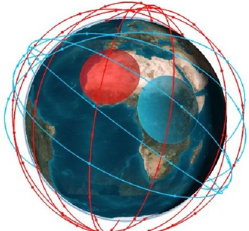

Fig. 1. Constellation pattern for Telesat's system. Blue corresponds to inclined orbits, red to polar orbits.

Adjacent satellites, whether within the same plane, within adjacent planes in the same set of orbits, and within the two orbital sets, will communicate by means of optical inter-satellite links. Because of the use of crosslinks, a user will be able to connect to the system from anywhere in the world, even when the user and a gateway are not within the line of sight of a satellite simultaneously.

Each satellite will be a node of an IP network and will carry on-board an advanced digital communications payload with a direct radiating array (DRA). The payload will include an on-board processing module with demodulation, routing, and re-modulation capabilities, thus decoupling up and downlink, which represents an important innovation upon current bent-pipe architectures. The DRA will be able to form at least 16

beams on the uplink direction and at least another 16 beams in the downlink direction, and will have beamforming and beam-shaping capabilities, with power, bandwidth, size, and boresight dynamically assigned for each beam to maximize performance and minimize interference to GSO and NGSO satellites. Moreover, each satellite will have 2 steerable gateway antennas, and a wide field-of-view receiver beam to be used for signaling.

The system is designed with several gateways distributed geographically across the world, each hosting multiple 3.5 m antennas. The control center in Ottawa will monitor, coordinate, and control the resource allocation processes, as well as the planning, scheduling and maintenance of the radio channels.

Telesat's constellation will use a bandwidth of 1.8 GHz in the lower spectrum of the Ka-band (17.8-20.2 GHz) for the downlinks, and a bandwidth of 2.1 GHz in the upper Ka-band (27.5-30.0 GHz) for the uplinks.

## 2.2 OneWeb's system

OneWeb's Ku+Ka-band constellation [18] comprises 720 satellites in 18 circular orbital planes at an altitude of 1,200 km, each plane inclined at $ 8 7^{\circ} $ . Figure 2, shows the constellation pattern of OneWeb's system.

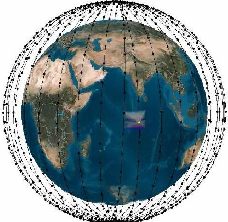

Fig. 2. Constellation pattern for OneWeb's system.

Each satellite will have a bent-pipe payload with 16 identical, non-steerable, highly-elliptical user beams. The footprint of these beams guarantees that any user will be within the line-of-sight of at least one satellite with an elevation angle greater than 55 degrees. Moreover, each satellite will have two gimballed steerable gateway antennas, one of which will be active, while the other will act as a back-up and handover antenna. Each user beam will have a single channel in Ku-band, which will be mapped to a channel in Ka-band. The channels in the return direction will have a bandwidth of 125 MHz, whereas those in the forward direction will have a bandwidth of 250 MHz.

<!-- PDF_PAGE: 4 -->

OneWeb's system employs the Ku-band for the user communications, and the Ka-band for gateway communications. In particular, the 10.7-12.7 and 12.75- 14.5 GHz band will be used for the downlink and uplink user communications respectively, while the 17.8-20.2 GHz and the 27.5-30.0 GHz bands will be used for the downlink and uplink gateway communications respectively.

The ground segment is envisioned to constitute 50 or more gateway earth stations, with up to ten 2.4 m gateway antennas each. On the user side, OneWeb's system was designed to operate with 30-75 cm parabolic dishes, phased arrays antennas, and other electronically steering antennas. Because the satellites do not use inter-satellite links, services can only be offered in regions where the users and a ground station are simultaneously within the line-of-sight (LoS) of the satellite.

## 2.3 SpaceX's system

SpaceX's Ku+Ka-band constellation [19] comprises 4,425 satellites that will be distributed across several sets of orbits. The core constellation, which will be deployed first, is composed of 1,600 satellites evenly distributed in 32 orbital planes at 1,150 km, at an inclination of $ 53^{\circ} $ (blue). The other 2,825 satellites will follow in a secondary deployment, and will be distributed as follows: a set of 32 planes with 50 satellites at 1,110 km and an inclination of $ 53.8^{\circ} $ (orange), a set of 8 orbital planes with 50 satellites each at 1,130 km and an inclination of $ 74^{\circ} $ (magenta), a set of 5 planes with 75 satellites each at 1,275 km and an inclination of $ 81^{\circ} $ (black), and a set of 6 orbital planes with 75 satellites each at 1,325 km and an inclination of $ 70^{\circ} $ (yellow). Figure 3 depicts the constellation pattern for SpaceX's mega-constellation

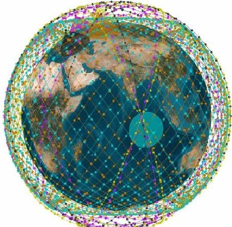

Fig. 3. Constellation pattern for SpaceX's system. Different orbit sets are represented with different colors.

Each satellite will carry on-board an advanced digital payload containing a phased array, which will allow each of the beams to be individually steered and shaped. The minimum elevation angle for a user terminal is $ 4 0^{\circ} $ , while the total throughput per satellite is envisioned to be 17- 23 Gbps, depending on the characteristics of the user terminals. Furthermore, the satellites will also have

optical inter-satellite links to ensure continuous communications, offer service over the sea, and mitigate the effects of interference.

The ground segment will be composed of 3 different types of elements: tracking, telemetry and commands (TT&C) stations, gateways antennas, and user terminals. On one hand, the TT&C stations will be scarce in number and distributed across the world, and their antennas will be 5 m in diameter. On the other hand, both the gateways and user terminals will be based on phase array technology. SpaceX plans to have a very large number of gateway antennas, distributed across the world close to or co-located with Internet peering points.

SpaceX's system will use the Ku-band for the user communications, and gateway communications will be carried out in Ka-band. In particular, the 10.7-12.7 GHz and the 14.0-14.5 GHz bands will be used for the downlink and uplink user communications respectively, while the 17.8-19.3 GHz and the 27.5-30.0 GHz bands will be used for the downlink and uplink gateway communications respectively.

## 2.4 Comparative assessment

This section compares the three proposed satellite systems further expanding the previous descriptions, and analyzing aspects that have not been addressed in the previous system descriptions.

2. 4.1 Orbital positions and number of satellites in line of sight

As shown in Table 1, all three systems have in common the use of circular orbits with similar radii, all of them in the 1,000-1,350 km range. However, while OneWeb uses a traditional polar-orbits configuration to provide global coverage, both SpaceX and Telesat use a multiple orbit-set configuration with some satellites placed in inclined orbits to provide coverage over the more densely populated areas of the planet, and others located in polar orbits to provide global coverage.

Table 1: Orbital parameters for the three systems

<table border="1"><tr><td>System</td><td colspan="2">Orbital planes</td><td>#plane</td><td>sat/plane</td><td>#sat.</td></tr><tr><td>OneWeb</td><td>1200km</td><td>(87.9°)</td><td>18</td><td>40</td><td>720</td></tr><tr><td rowspan="5">SpaceX</td><td>1,150km</td><td>(53°)</td><td>32</td><td>50</td><td rowspan="5">4425</td></tr><tr><td>1,110km</td><td>(53.8°)</td><td>32</td><td>50</td></tr><tr><td>1,130km</td><td>(74°)</td><td>8</td><td>50</td></tr><tr><td>1,275km</td><td>(81°)</td><td>5</td><td>75</td></tr><tr><td>1,325km</td><td>(70°)</td><td>6</td><td>75</td></tr><tr><td rowspan="2">Telesat</td><td>1,000km</td><td>(99.5°)</td><td>6</td><td>12</td><td rowspan="2">117</td></tr><tr><td>1,248km</td><td>(37.4°)</td><td>5</td><td>9</td></tr></table>

These differences in orbital positions, together with the fact that the total number of satellites in the constellation varies greatly among competing systems,

<!-- PDF_PAGE: 5 -->

Table 2. Comparison of bandwidth allocations for different types of links and different systems.

<table border="1"><tr><td colspan="8">User links</td><td colspan="8">Gateway links</td><td colspan="2">TT&amp;C</td></tr><tr><td></td><td colspan="4">Downlink</td><td colspan="4">Uplink</td><td colspan="4">Downlink</td><td colspan="4">Uplink</td><td>Downlink</td><td>Uplink</td></tr><tr><td></td><td>BWCH</td><td>#CH</td><td>BWTOT</td><td>k</td><td>BWCH</td><td>#CH</td><td>BWTOT</td><td>k</td><td>BWCH</td><td>#CH</td><td>BWTOT</td><td>k</td><td>BWCH</td><td>#CH</td><td>BWTOT</td><td>k</td><td>BWCH</td><td>#CH</td><td>BWTOT</td></tr><tr><td>Space X</td><td>250</td><td>8</td><td>2,000</td><td>4-5*</td><td>125</td><td>4</td><td>500</td><td>4-5*</td><td>250</td><td>9</td><td>2,250</td><td>1</td><td>500</td><td>8</td><td>4,000</td><td>1</td><td>150</td><td>150</td></tr><tr><td>OneWeb</td><td>250</td><td>8</td><td>2,000</td><td>2</td><td>125</td><td>4</td><td>500</td><td>2</td><td>155</td><td>16</td><td>2,480</td><td>1</td><td>250</td><td>16</td><td>4,000</td><td>1</td><td>70</td><td>200</td></tr><tr><td>Telesat</td><td>$\dagger$</td><td>$\dagger$</td><td>3,600</td><td>4*</td><td>$\textcircled{P}$</td><td>$\textcircled{P}$</td><td>4,200</td><td>4*</td><td>$\dagger$</td><td>$\dagger$</td><td>3,600</td><td>2</td><td>$\textcircled{P}$</td><td>$\textcircled{P}$</td><td>4,200</td><td>2</td><td>8</td><td>12</td></tr><tr><td></td><td>MHz</td><td>-</td><td>MHz</td><td>-</td><td>MHz</td><td>-</td><td>MHz</td><td>-</td><td>MHz</td><td>-</td><td>MHz</td><td>-</td><td>MHz</td><td>-</td><td>MHz</td><td>-</td><td>MHz</td><td>-</td><td>MHz</td></tr></table>

BW $ _{CH} $ : Channel bandwidth # $ _{CH} $ : Number of channels k: times frequency is reused on each satellite (reuse factor) BW $ _{tor} $ : Total bandwidth (*) Indicates values estimated by the authors. Telesat's lower $ ^{(\dagger)} $ and upper $ ^{(\mathbb{P})} $ Ka-band spectrum is shared between user and gateway links. The number of beams and the per-beam bandwidth is reconfigurable.

result in big differences in the average number of satellites within LoS for a given location. To partially compensate for this, Telesat - the system with the fewest number of satellites - will operate at lower elevation angles $ ( 2 0^{\circ} ) $ compared to SpaceX's and OneWeb's systems $ ( 4 0^{\circ} $ and $ 5 5^{\circ} $ respectively). This lower elevation angle might result in more frequent link blockages (due to foliage, buildings obstruction) and link outages (due to higher atmospheric attenuation). Figure 4 shows the average number of satellites within LoS (considering the minimum elevation angles reported in the FCC filings) for different latitude values.

Even though the number of satellites in Telesat's constellation is significantly smaller than in OneWeb's, the number of satellites within LoS is higher in the $ \pm 6 0^{\circ} $ latitude band, where most of the population concentrates. This happens because the minimum elevation angle of Telesat is considerably smaller than for OneWeb $ (2 0^{\circ} $ vs. $ 5 5^{\circ} $ ). Furthermore, it is worth noting that when the full SpaceX's system is deployed, more than 20 satellites will be within LoS in the most populated areas on Earth.

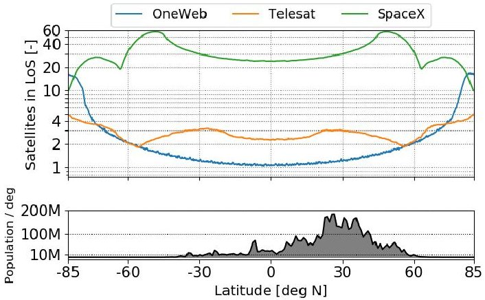

Fig. 4. Number of satellites in line of sight vs. latitude. Ku band TFS & FSS FSS 3SS (GSO) & FSS (NGSO) TFS & TMS & FSS) FSS

<table border="1"><tr><td colspan="7">SpaceX</td></tr><tr><td>CUD1</td><td>CUD2</td><td>CUD3</td><td>CUD4</td><td>CUD5</td><td>CUD6</td><td>CUD7</td><td>CUD8</td></tr><tr><td>10700</td><td></td><td>11700</td><td>12200</td><td>12750</td><td>13250</td><td>14000</td><td>14500</td></tr><tr><td colspan="8">Frequency [MHz]</td></tr></table>

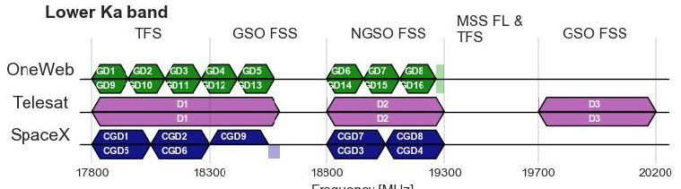

## 2.4.2 Frequency allocations

Figure 5 shows the frequency allocations for the different systems. For each system and frequency band, the top line represents RHCP allocations and the bottom line represents LHCP allocations. Table 2 compares the number of beams, bandwidth per beam, total bandwidth allocated per type of link and frequency reuse factor for each of the beams. The total bandwidth per satellite is computed multiplying the bandwidth per type of beam times the frequency reuse factor, which was estimated based on the total data-rates reported per satellite.

On one hand, both SpaceX and OneWeb use the Kuband spectrum for their satellite-to-user links (both uplink and downlink), whereas satellite-to-ground contacts are carried out in the Ka-band lower (downlink) and upper (uplink) spectrum. OneWeb uses RHCP polarization for the user downlinks, and LHCP for the user uplinks; SpaceX uses RHCP for both uplink and downlinks, with LHCP used for telemetry data. Furthermore, both systems use Ka-band for their gateway links: OneWeb uses 155 MHz downlink channels and 250 MHz uplink channels in both RHCP and LHCP; SpaceX uses 250 MHz downlink channels and 500 MHz uplink channels, also in both RHCP and LHCP.

On the other hand, Telesat's system uses only the Ka-band spectrum, and hence satellite-to-user and satellite-to-ground contacts need to share the same bandwidth. Given the flexibility of their digital payload, Telesat's system has the capability to dynamically allocate power and bandwidth for the user and gateway beams to mitigate interference.

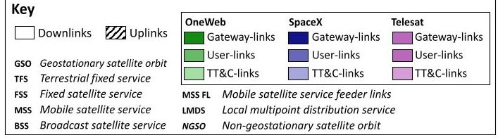

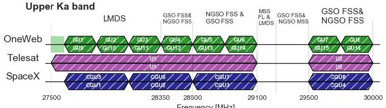

Fig. 5. Frequency band allocations for the three satellite systems

<!-- PDF_PAGE: 6 -->

Table 3. Comparison of beam characteristics for the three different systems

<table border="1"><tr><td colspan="4">User beam-Downlink</td><td colspan="4">Gateway beam-Downlink</td><td colspan="4">User beam-Uplink</td><td colspan="4">Gateway beams-Uplink</td></tr><tr><td></td><td>SpaceX</td><td>OneWeb</td><td>Telesat</td><td>SpaceX</td><td>OneWeb</td><td>Telesat</td><td></td><td></td><td>SpaceX</td><td>OneWeb</td><td>Telesat</td><td>SpaceX</td><td>OneWeb</td><td>Telesat</td><td></td><td></td></tr><tr><td>#beams</td><td>&gt;=8</td><td>16</td><td>&gt;=16</td><td>9</td><td>16</td><td>2</td><td>-</td><td></td><td>SpaceX</td><td>OneWeb</td><td>Telesat</td><td>SpaceX</td><td>OneWeb</td><td>Telesat</td><td></td><td></td></tr><tr><td>Steerable</td><td>Yes</td><td>No</td><td>Yes</td><td>Yes</td><td>Yes</td><td>Yes</td><td>-</td><td></td><td>Steerable</td><td>Yes</td><td>No</td><td>Yes</td><td>Yes</td><td>Yes</td><td>-</td><td></td></tr><tr><td>Shapeable</td><td>Yes</td><td>No</td><td>Yes</td><td>No</td><td>No</td><td>No</td><td>-</td><td></td><td>Shapeable</td><td>Yes</td><td>No</td><td>Yes</td><td>No</td><td>No</td><td>-</td><td></td></tr><tr><td>Area</td><td>2,800</td><td>75,000</td><td>960</td><td>780</td><td>3,100</td><td>960</td><td>km2</td><td></td><td>Area</td><td>2,800</td><td>75,000</td><td>960</td><td>780</td><td>3,100</td><td>960</td><td>km2</td></tr><tr><td>BW</td><td>250</td><td>250</td><td>-</td><td>250</td><td>155</td><td>-</td><td>MHz</td><td></td><td>BW</td><td>125</td><td>125</td><td>-</td><td>500</td><td>250</td><td>-</td><td>MHz</td></tr><tr><td>EIRP</td><td>36.71</td><td>34.6</td><td>37-39</td><td>39.44</td><td>38</td><td>30.6-39</td><td>dBW</td><td></td><td>Max. gain</td><td>37.1</td><td>-</td><td>41</td><td>41</td><td>-</td><td>31.8</td><td>dBi</td></tr><tr><td>Max gain</td><td>37.1</td><td>-</td><td>38</td><td>41</td><td>-</td><td>27.3</td><td>dBi</td><td></td><td>Max. G/T</td><td>9.8</td><td>-1</td><td>13.2</td><td>13.7</td><td>11.4</td><td>2.5</td><td>dB/K</td></tr><tr><td>Polarization</td><td>RHCP</td><td>RHCP</td><td>R/LHCP</td><td>R/LHCP</td><td>R/LHCP</td><td>R/LHCP</td><td>-</td><td></td><td>Polarization</td><td>RHCP</td><td>LHCP</td><td>R/LHCP</td><td>R/LHCP</td><td>R/LHCP</td><td>-</td><td></td></tr></table>

OneWeb's system has a bent-pipe architecture where each of the 16 user-downlink channels maps onto a Kaband gateway-uplink channel, and vice versa for the return direction. SpaceX's and Telesat's system architectures, however, allow for on-board demodulation, routing and re-modulation, thus effectively decoupling user and gateway links. This allows for them to: a) use different spectral efficiencies in the uplink and downlink channels, maximizing the overall capacity of their satellites, b) dynamically allocate resources for the user beams, and c) mitigate interference by selecting the frequency bands used. Due to this decoupling, we estimate that both systems can achieve spectral efficiencies close to 5.5 bps/Hz in their gateway links, which could result in frequency reuses of 4-5 times for SpaceX user links, and 4 times for Telesat user beams.

Given the differences in the satellite payloads onboard each of the systems, the beams on each of the satellites also have significant differences in terms of capabilities, shape, and area covered. Table 3 contains a summary of the beam characteristics for all three systems.

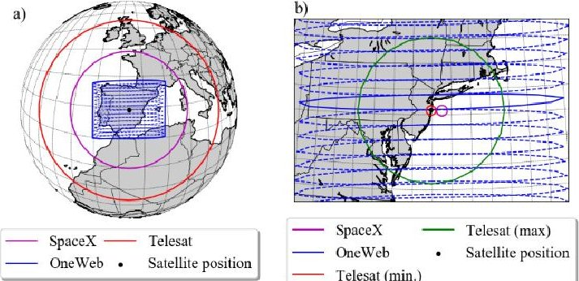

## 2.4.3 Beam characteristics

Fig. 6. A) Field of regard for a satellite flying over Spain for the three systems. B) Individual beam footprints for a satellite flying over New York. Projections as seen from the satellite.

Both SpaceX and Telesat have individually shapeable and steerable beams, versus OneWeb which has only fixed beams. SpaceX and Telesat use circularly shaped beams, whereas OneWeb's system uses highly elliptical beams. Figure 6-a) contains a comparison of the fields of-regard, while Figure 6-b) shows the -3dB footprint contours for the beams of each of the systems. Note the differences in terms of the areas covered by each satellite and beams: each of OneWeb's beams covers an

approximate surface area of 75,000 km $ ^{2} $ ; SpaceX's beams have a coverage area of $ \sim 2,800 \mathrm{~km}^{2} $ ; and Telesat's shapeable beam's coverage area can be adjusted between $ 960 \mathrm{~km}^{2} $ (Telesat min in Fig. 6-b) and $ 246,000 \mathrm{~km}^{2} $ (Telesat max in Fig. 6-b).

## 2.4.4 Deployment and prospective expansion strategy

Table 4 contains a summary of the launch characteristics of OneWeb's and SpaceX's megaconstellations, including satellites per launch and total number of launches. At the time of writing, Telesat has not released public information about their launch provider and satellite characteristics and thus no information regarding their system is included.

OneWeb plans to deploy its satellites through both contracts with Arianespace (using 21 Soyuz rocket launches) and Virgin Galactic (once its LauncherOne rocket is developed). Each Soyuz rocket will carry 34 to 36 satellites (depending on the rocket destination and launch site), and the contract with Arianespace also includes options for 5 more Soyuz launches and 3 extra Ariane-6 launches. Moreover, as of March of 2018 OneWeb filed a new petition to the FCC to expand their constellation by adding 1,260 satellites, to a total 1,980 satellite constellation. This expansion would double the number of planes (from 18 to 36) and increase the number of satellites per plane from 40 to 55 [20].

Table 4. Launch characteristics of OneWeb's and SpaceX's systems.

<table border="1"><tr><td></td><td>OneWeb</td><td colspan="2">SpaceX</td></tr><tr><td>Number satellites</td><td>720</td><td colspan="2">4425</td></tr><tr><td>Satellite mass</td><td>145kg</td><td colspan="2">386kg</td></tr><tr><td>Sat. launch volume</td><td>0.95x0.8x0.8(m3)</td><td colspan="2">1.1x0.7x0.7(m3)</td></tr><tr><td>First launch</td><td>Dec-2018</td><td colspan="2">2019</td></tr><tr><td>Start of service</td><td>2019</td><td colspan="2">2020</td></tr><tr><td>Launcher</td><td>Soyuz FG/Fregat</td><td>Falcon9</td><td>Falcon9 heavy</td></tr><tr><td>Launcher payload capacity(LEO)</td><td>7,800kg</td><td>9,500kg(reusable)</td><td>22,500kg(reusable)</td></tr><tr><td>Sats. Per launch</td><td>32-36</td><td>25*</td><td>64*</td></tr><tr><td>Num. launches</td><td>21</td><td>177*</td><td>70*</td></tr></table>

*Authors estimation based on launch vehicle weight and volume constraints.

SpaceX will launch their satellites using their own launch vehicles (either Falcon 9 or Falcon Heavy). SpaceX plans to utilize a two-staged deployment, with an

<!-- PDF_PAGE: 7 -->

initial deployment of 1,600 satellites (and the system beginning operations after the launch of the first 800 satellites), and a later deployment of the 2,825 remaining satellites. The initial deployment will allow SpaceX to offer services in the $ \pm 6 0^{\circ} $ latitude band, and once the final deployment is launched, global coverage will be offered.

Finally, in recent press releases Telesat has revealed that, depending on business results, they are considering expansions of their constellation by staged deployments that will bring up the total number of satellites progressively to 192,292,and finally 512.

In addition to their Ku-Ka band systems, all three companies have filed applications to launch larger constellations in Q/V-band, combining satellites in LEO and MEO. The description and analysis of these Q/Vband constellations is beyond the scope of this paper.

## 2.4.5 Funding and manufacturing

For financing their endeavors and manufacturing their satellites the three companies have also taken different approaches.

OneWeb has created a partnership in which a significant number of shares of the company are owned by Qualcomm (20.17%)，Softbank (19.98%)，and Airbus (13.34%) (among others) [21]，with each of their partners playing a specific role in the system design. For instance, Airbus is manufacturing the satellites; Qualcomm will provide OneWeb user base stations; Hughes Network Systems will provide the gateway equipment. In terms of financing, OneWeb raised $500 million from its strategic partners in an initial funding round, and SoftBank further invested a total of $1.5 billion in a private equity round [22].

SpaceX is using an in-house manufacturing strategy, with most parts of the satellite bus developed internally. Integration, assembly, and testing tasks will also be conducted in SpaceX's facilities. Even though SpaceX has not provided information about the funding prospects for their constellation, a recent $1B financing round has included Google and Fidelity [23].

Finally, most of Telesat's system design and manufacturing will be outsourced to different companies. Even though the manufacturer of their satellites has not been decided yet, they have in place contracts with Thales-Maxar and Airbus for each to further develop a system design and submit a firm proposal, whereas Global Eagle and General Dynamics Mission Systems will be in charge of developing their user terminals. In terms of financing, Telesat indicates in their FCC application that they are willing to invest "significant financial resources" (of their own) and suggested that

they will resort to the capital markets for additional funding.

## 3. Methodology and model description

This section presents the methods that we used to characterize the ground segment requirements and to estimate system performance. Figure 7 shows an overview of the models developed (grey-shaded, rounded boxes) and the inputs required (white boxes).

The methodology to estimate total system throughput (sellable capacity) consists of two steps. First, the locations and number of feeder gateways are computed by means of a genetic algorithm. Second, the ground segment locations are combined with atmospheric models, link budget models, and orbital dynamic models to statistically determine the total system throughput.

The rest of this section is devoted to describing each of these models and inputs: Section 3.1 presents the atmospheric models used; Section 3.2 presents the link budget assumptions and parameters; Section 3.3 presents the demand model used; Section 3.4 describes the methodology used to optimize the ground segment; and finally, Section 3.5 introduces the methodology used to statistically estimate the total system throughput.

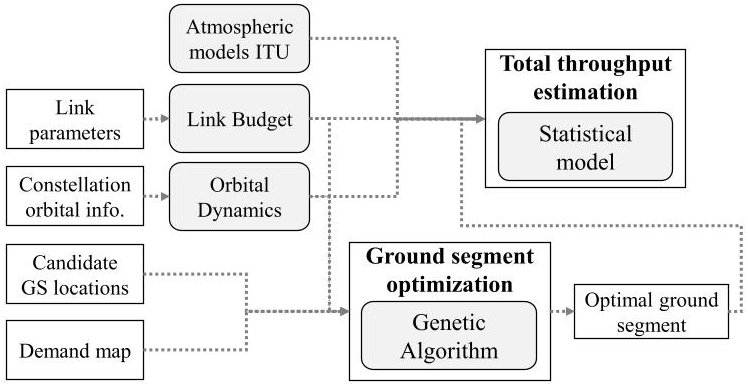

Fig. 7. Overview of the methodology employed to determine the ground segment location and estimate total system throughput.

## 3.1 Atmospheric models

Atmospheric attenuation is the main external factor that affects the performance of a communications link. At Ka-band frequencies, atmospheric attenuation can cause a reduction of the link capacity, sometimes even complete outages for non-negligible periods of time. To deal with the varying fades and maximize the link datarate at any point in time, adaptive coding and modulation strategies are commonly used. In other words, the modulation and coding scheme (MODCOD) is dynamically selected to maximize the spectral efficiency achievable under current weather conditions.

In this study, we implemented [24] the International Telecommunication Union (ITU) models for atmospheric attenuation for slant-path links following the

<!-- PDF_PAGE: 8 -->

guidelines provided in recommendation ITU-R P.618-13 [25], (which considers gaseous, clouds, tropospheric scintillation and rain impairments). These recommendations provide the attenuation contribution values due to each of the aforementioned events vs. the percentage of time those values are exceeded, (i.e., the cumulative distribution function (CDF) for the atmospheric attenuation contributions). In particular, recommendations ITU-R P.676-11 and ITU-R P.840-7 are used to compute the gaseous and clouds attenuations respectively, while the maps in recommendations ITU-R P.837-6, ITU-R P.838-3, and ITU-R P.839-4 are used to estimate the rainfall-rate, rain specific attenuation, and rain height respectively. For example, Figure 8 shows the total atmospheric attenuation experienced in Boston for the different frequency bands.

## 3.2 Link budget model

The link budget module is combined with the atmospheric models to compute the achievable data-rates for the uplink and downlink communications under different atmospheric conditions. Our codeimplementation for the link budget is parametric and is designed to allow for fast computation of the optimal MODCOD scheme for each combination of ground station and operating conditions. Moreover, it is designed

to handle both bent-pipe architectures, where a frequency translation occurs between uplink and downlink, as well as regenerative architectures, where the uplink and downlink links use different MODCOD schemes.

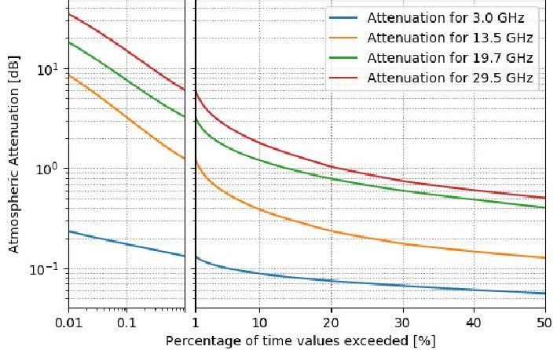

Fig. 8. Total CDF of atmospheric attenuation in Boston for different frequency bands. (Left panel in log-scale).

For our performance estimation model, we assumed that the modulation-coding schemes prescribed in the standard DVB-S2X [26], developed by the Digital Video Broadcast Project in 2014, are used, since it is the predominant standard for broadcasting, broadband satellite communication, and interactive services. The

Table 5: Beam link budgets for the gateway uplink (upper Ka-band) for the three systems considered. Different ranges and elevation angles considered (Atmospheric attenuation values for availability of 99.5 %)

<table border="1"><tr><td>Parameter</td><td>Telesat</td><td>OneWeb</td><td>SpaceX</td><td></td></tr><tr><td>Frequency *</td><td>28.5</td><td>28.5</td><td>28.5</td><td>GHz</td></tr><tr><td>Bandwidth *</td><td>2.1</td><td>0.25</td><td>0.5</td><td>GHz</td></tr><tr><td>Tx. Antenna D *</td><td>3.5</td><td>2.4</td><td>3.5</td><td>m</td></tr><tr><td>EIRP</td><td>75.9</td><td>63.2</td><td>68.4</td><td>dBW</td></tr><tr><td>MODCOD</td><td>64APSK3/4</td><td>256APSK32/45</td><td>256APSK3/4</td><td>-</td></tr><tr><td>Roll-off factor</td><td>0.1</td><td>0.1</td><td>0.1</td><td>-</td></tr><tr><td>Spectral eff.</td><td>4.1</td><td>5.1</td><td>5.4</td><td>bps/Hz</td></tr><tr><td>Path distance *</td><td>2439</td><td>1504</td><td>1684</td><td>km</td></tr><tr><td>Elevation Angle *</td><td>20</td><td>55</td><td>40</td><td>deg</td></tr><tr><td>FSPL</td><td>189.3</td><td>185.1</td><td>186.1</td><td>dB</td></tr><tr><td>Atmospheric loss</td><td>4.8</td><td>2.3</td><td>2.9</td><td>dB</td></tr><tr><td>Rx antenna gain *</td><td>31.8</td><td>37.8</td><td>40.9</td><td>dBi</td></tr><tr><td>System Temp.</td><td>868.4</td><td>447.2</td><td>535.9</td><td>K</td></tr><tr><td>G/T *</td><td>2.4</td><td>11.3</td><td>13.6</td><td>dB/K</td></tr><tr><td>Rx C/N0</td><td>25.6</td><td>32.5</td><td>32.4</td><td>dB</td></tr><tr><td>Rx C/ACI</td><td>27</td><td>27</td><td>27</td><td>dB</td></tr><tr><td>Rx C/ASI</td><td>23.5</td><td>27</td><td>27</td><td>dB</td></tr><tr><td>Rx C/XPI</td><td>25</td><td>25</td><td>25</td><td>dB</td></tr><tr><td>HPA C/3IM</td><td>25</td><td>30</td><td>30</td><td>dB</td></tr><tr><td>Rx Eb/(N0+I0)</td><td>11.4</td><td>13.3</td><td>13.3</td><td>dB</td></tr><tr><td>Req. Eb/N0</td><td>11.0</td><td>12.3</td><td>12.3</td><td>dB</td></tr><tr><td>Link Margin</td><td>0.36</td><td>1.03</td><td>1.02</td><td>dB</td></tr><tr><td>Data rate</td><td>9857.1</td><td>1341.1</td><td>2682.1</td><td>Mbps</td></tr><tr><td>Shannon limit</td><td>1.09</td><td>1.06</td><td>1.06</td><td>dB</td></tr></table>

Table 6: Beam link budgets, computed at the edge of the user downlink beam's footprints, for the three systems considered. (Atmospheric attenuation values for availability of 99 %)

<table border="1"><tr><td>Parameter</td><td>Telesat</td><td>OneWeb</td><td>SpaceX</td><td></td></tr><tr><td>Frequency*</td><td>18.5</td><td>13.5</td><td>13.5</td><td>GHz</td></tr><tr><td>Bandwidth*</td><td>0.25</td><td>0.25</td><td>0.25</td><td>GHz</td></tr><tr><td>EIRP*</td><td>36.0</td><td>34.6</td><td>36.7</td><td>dBW</td></tr><tr><td>MODCOD</td><td>16APSK28/45</td><td>16APSK2/3</td><td>16APSK3/4</td><td>-</td></tr><tr><td>Roll-off factor</td><td>0.1</td><td>0.1</td><td>0.1</td><td>-</td></tr><tr><td>Spectral eff.</td><td>2.23</td><td>2.4</td><td>2.7</td><td>bps/Hz</td></tr><tr><td>Path distance</td><td>2439</td><td>1504</td><td>1684</td><td>km</td></tr><tr><td>Elevation Angle*</td><td>20</td><td>55</td><td>40</td><td>deg</td></tr><tr><td>FSLP</td><td>185.5</td><td>178.6</td><td>179.6</td><td>dB</td></tr><tr><td>Atmospheric loss</td><td>2.0</td><td>0.41</td><td>0.53</td><td>dB</td></tr><tr><td>Rx antenna D*</td><td>1</td><td>0.75</td><td>0.7</td><td>m</td></tr><tr><td>Rx antenna gain</td><td>43.5</td><td>38.3</td><td>37.7</td><td>dBi</td></tr><tr><td>System Temp.</td><td>285.3</td><td>350.1</td><td>362.9</td><td>K</td></tr><tr><td>Rx C/N0</td><td>9.6</td><td>10.5</td><td>12.0</td><td>dB</td></tr><tr><td>Rx C/ASI</td><td>30</td><td>25</td><td>25</td><td>dB</td></tr><tr><td>Rx C/XPI*</td><td>25</td><td>20</td><td>22</td><td>dB</td></tr><tr><td>HPA C/3IM</td><td>20</td><td>30</td><td>25</td><td>dB</td></tr><tr><td>Rx Eb/(N0+I0)</td><td>5.5</td><td>5.9</td><td>6.7</td><td>dB</td></tr><tr><td>Req. Eb/N0</td><td>4.6</td><td>5.2</td><td>5.9</td><td>dB</td></tr><tr><td>Link Margin</td><td>0.85</td><td>0.76</td><td>0.82</td><td>dB</td></tr><tr><td>Data rate</td><td>558.7</td><td>599.4</td><td>674.3</td><td>Mbps</td></tr><tr><td>Shannon limit</td><td>1.49</td><td>1.49</td><td>1.46</td><td>dB</td></tr></table>

* Values extracted from FCC filings. Rest of the values estimated or derived from link budget equations.

Tx correspond to transmit value, Rx to reception value, and G/T is the gain to noise temperature factor of the antenna.

<!-- PDF_PAGE: 9 -->

standard defines the framing structure, channel coding, and a set of modulation schemes. In particular, more than 60 MODCODs are included, with modulations ranging from BPSK to 256-APSK and coding rates from $ _{1/4} $ to $ _{9/10}. $ We assumed a frame error rate (FER) was $ 10^{-7}, $ as suggested in the DVB-S2X implementation guidelines.

Furthermore, we assumed that the solid-state high power amplifiers (HPA) operate with an output back-off equal to the peak-to-average power ratio of the MODCOD (given as the ratio between the 99.9% percentile power and the average power) to avoid distortion due to saturation.

The rest of the parameters in the link budgets include the diameters, efficiencies, and noise temperatures of the transmitter and receiver antennas, as well as the values for the different losses over the RF chain and the carrier-to-interference values. We extract the values for these parameters from the link budget examples detailed on each of the applications filed with the FCC. Table 5 and Table 6 contain gateway and user link budget examples in the forward direction for each of the systems.

## 3.3 Demand model

To derive realistic estimates of the total system throughput, we developed a demand model that provides an upper bound to the maximum sellable capacity for any satellite at a given orbital position. Our demand model intentionally focuses on serving end users and serving as back-haul infrastructure to expand existing networks (e.g., cell-phone), as opposed to satisfying the demands of other markets (such as military, in-flight, marine, offshore connectivity, etc.). This decision was deliberate as most of the current LEO-constellation proposals emphasize offering global bandwidth access for end-users.

The demand model was generated as follow. For a given orbital altitude, we generated a gridded map (of resolution $ 0. 1^{\circ} \times0. 1^{\circ} $ in latitude and longitude) that determines the number of people covered by the beams of a satellite located in a particular orbital position, using the Gridded Population of the World v4 dataset, which estimates the population counts for the year 2020 over a 30-arc-second resolution grid [27] based on census data. We also take into account the minimum elevation angle constraints imposed by each of the satellites. Furthermore, we assumed that users in a region are evenly distributed across all the satellites within their LoS.

To compute the data-rate values for the demand (in Gbps), we assume that any of the satellites will capture at most 10% of the market at each cell of the grid, and that the average data-rate requested per user is 300 kbps (which amounts to ~100 GB a month). Finally, the demand is capped at the maximum data-rate per satellite

($\mathrm{R}_{b_{\mathrm{sat}}}^{\mathrm{max}}$ , see Section 4.2), as shown in Eq.1 (where $n_{FOV}$ is the number of satellites within LoS of a ground location).

$$
d _ {s a t} = \min \left(\mathrm {p o p} \cdot 0. 1 \cdot 3 0 0 k b p s / n _ {F O V}, \mathrm {R} _ {\mathrm {b} _ {\mathrm {s a t}}} ^ {\max }\right)
$$

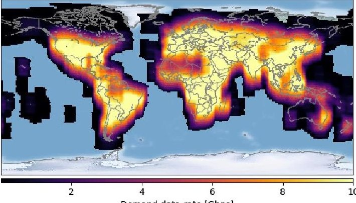

Fig. 9. User demand data-rate for different orbital positions.

Figure 9 shows the demand data-rate for OneWeb's constellation. The regions with higher demand are displayed in bright tone, while the regions with lower demand are in darker tones, and regions where demand is zero are not colored.

## 3.4 Ground segment optimization

A similar procedure to the one described in [28] is used to determine the ground station locations. We conduct an optimization procedure to maximize the following objective function,

$$
O = 0. 5 \cdot c o v _ {9 5} + 0. 5 \cdot c o v _ {9 9}.
$$

while minimizing the number of ground stations required. In Eq. 2, $ cov_{9 5} $ and $ cov_{9 9} $ represent the percentage of orbital positions that are covered by a ground station under atmospheric conditions present less than 5% and less than 1% of the time respectively. We assumed that the minimum elevation angle for a ground stations to communicate with a satellite is $ 10^{\circ} $

Mathematically, this optimization problem can be framed as a down-selecting problem, where we need to pick the N ground stations that offer the best performance. We consider a pool of 160 different locations spread across the world, which results in a search space of $ 2^{1 6 8} \sim 3. 8 \cdot 1 0^{4 9} $ points, which makes impossible its full enumeration and evaluation. Therefore the use of optimization algorithms is called for.

Given its structure, genetic algorithms are well suited to solve down-selecting problems [29]. We employ the Non-dominated Sorting Genetic Algorithm-II (NSGA-II) [30] an efficient multi-objective genetic algorithm, which operates as follows:

<!-- PDF_PAGE: 10 -->

1. Generate a random population of $ \mathrm{N_{p o p}} $ architectures (populated using random subsets of ground stations)

2. Evaluate the value of the objective function O (Eq. 2) for each of them.

3. Select N/2 architectures that are the "parents" on the next generation population, attending to the following criteria

a. Architectures with lower Pareto ranking are selected first.

b. Among architectures with similar Pareto ranking, those with lower crowding distance are selected first.

4. Apply the crossover genetic operator over the N/2 parent-architectures. The crossover operator takes as inputs two parents and produces two offspring. Every ground station present in each parent is assigned to one of their offspring with equal probability (i.e., we use uniform crossover over the ground stations on each parent). In total, N/2 offspring are produced from the N/2 parents.

5. Apply the mutation genetic operator over the N/2 parent-architectures and the N/2 offspringarchitectures. Mutation removes a ground station from an architecture with probability $ p_{\mathrm{remove}} $ , and adds a new ground station with probability $ p_{\mathrm{add}} $ The mutation operator is applied with probability $ p_{\mathrm{mut}} $

6. Repeat steps 2-5 until a termination criterion (i.e. maximum number of generations $ \mathrm{N}_{\mathrm{gen}} $ evaluated, no new architectures in the Pareto Front) is met.

Furtherтерном, we exploit the geographical structure of the problem to speed up the convergence of the optimization algorithm. Given that the selection of ground stations in one region has a small impact on which ground station are selected in another region, we divide the optimization in two phases. First, in phase A, we determine the optimal ground segment architectures for each of the 6 regions considered (Africa, Asia, Europe, North America, Oceania, and South America) using the NSGA-II algorithm described above $ \mathrm{N_{pop}}=200 $ $ \mathrm{N_{gen}}=200 $ . Second, in phase B, we apply our NSGA-II algorithm globally, but instead of generating a random population (step 1), we use the Pareto-front architectures from the region based optimization in phase A as the generating components for the initial population. In other words, a ground segment architecture for phase B is generated by choosing a Pareto-optimal ground segment architectures from each of the regions in phase A. This new population serves as the initial population for the phase B NSGA-II algorithm $ \mathrm{N_{pop}}=200 $ $ \mathrm{N_{gen}}=80 $ .

## 3.5 Total system throughput estimation

To evaluate the system throughput we developed a computational model that provides an upper bound to the maximum sellable capacity for each of the mega-

constellations. The need for this statistical model is due to the fact that 1) the system dynamics by which the number of customers and gateways within LoS of each satellite varies over time, and 2) the atmospheric conditions that introduce varying attenuation fading and thus, varying data-rates are also stochastic by nature.

The procedure to determine the total system throughput is as follows. First, we propagated the orbits of the satellites on the constellation for a day, using a 60 seconds time-step. Then, for each orbital configuration, we drew 10,000 atmospheric attenuation samples for each ground station, assuming that the atmospheric attenuation samples are statistically independent and distributed according to the probability distribution curve computed with the atmospheric model (for example, for Boston, the CDFs at different frequencies are shown in Figure 8. These samples were then used as inputs to the link budget module to estimate the achievable link datarates for each of the ground stations. Finally, the total system throughput is computed in two different ways, depending on whether the satellite has inter-satellite links.

If the constellation does not have inter-satellite links, the throughput of each satellite $ \left( \mathrm{TH}_{sat}\right) $ is computed according to Eq. 3, where $ d_{\mathrm{sat}} $ is the user-demand, and $ \sum_{i=0}^{N} R_{b}^{GS} $ represents the sum of the data-rate $ \left( R_{b}\right) $ of the N best performing ground stations. This is done for each orbital position and set of atmospheric conditions, resulting in 14.4 million samples. The total system forward capacity for each of the scenarios (we call a scenario a combination of orbital positions + atmospheric conditions) is computed by adding the throughput of each satellite.

$$
\mathrm {T H} _ {s a t} = \min \left(d _ {s a t}, \sum_ {i = 0} ^ {N} R _ {b _ {s a t}} ^ {G S}\right)
$$

On the other hand, if inter-satellite links are present, the following four-step procedure is followed to compute the total system throughput:

1) Compute the total system forward capacity that could potentially be transmitted using all the available feeder gateways.

2) Compute the CDF of the total system forward capacity by ordering the sum of the capacities of the feeder gateways.

3) Select a subset of 1,000 scenarios evenly spaced on the CDF curve to conduct further analysis taking into account the inter-satellite links.

4) For each of the selected scenarios:

a. Construct a network graph where the users on each satellite, the satellites themselves, and the ground stations are the nodes of the graph, and the RF links are the edges. The cost of the inter-satellite links is set to 1, while the cost of the rest of the links is set to 0. The capacity of each edge is determined by

<!-- PDF_PAGE: 11 -->

i. the demand captured by the satellite in the case of users-satellite links,

ii. the inter-satellite link data-rate in case of satellite-satellite links, and

iii. the gateway-link data-rate in the case of gateway-satellite links.

b. Solve the "minimum-cost, maximum-flow" problem and determine the flow from each satellite to the gateways.

c. Compute the total system throughput by adding the flows from all the satellites.

## 3.6 Summary of other assumptions

This section summarizes other assumptions made within our models.

- User demand is concentrated in land areas and is proportional to the population under reach by a satellite. Maritime or aeronautical demand is not considered.

- Customers with multiple satellites within LoS select one randomly to communicate with, and thus demand is evenly-distributed among satellites within LoS.

- Adaptive coding and modulation (ACM) is used on the satellite-gateway links, thus for any orbital position and atmospheric conditions the MODCOD that maximizes the throughput is selected.

- Satellites produce enough power to communicate at maximum EIRP whenever required.

- User terminals are not a limiting factor, as they are capable of tracking satellites continuously and communicating at the required data-rates.

- There are no outages caused by foliage, building obstruction, or other factors in the user links at any elevation angle.

- Performance degradation due to interference among LEO satellites from different constellations is not considered.

- Ground stations can be located over any land area. There are no political, landing rights, or geographical constraints to their placement.

- ISLs links can be used to route excess demand to other satellites. Only satellites in the same orbital set can communicate through ISL (both in-plane and cross-plane).

- There is no maximum number of hops that data can traverse through ISL, even though latency shall be minimized.

## 4. Results

This section presents the results for: a) the ground segment requirements for each of the systems and b) the total system throughput analysis, which, as mentioned in Section 3.3, corresponds to an upper bound estimation of the total sellable capacity in the forward direction. Within these results, we use the term ground station to refer to each of the sites that host one or more feeder

antennas, whereas the term gateway antenna refers to the actual dishes located at those sites. It is important to note that there is a limit on the number of gateway antennas per ground station, since there must be a minimum angular separation maintained between antenna pointing directions to prevent interference. Based on the minimum angular separation values found in the FCC filings of the three systems, a reasonable value for the maximum number of gateway antennas per site is 50, even though a high degree of coordination among antennas would be required to operate without interference. A more realistic scenario limits the number of antennas per ground station to 30.

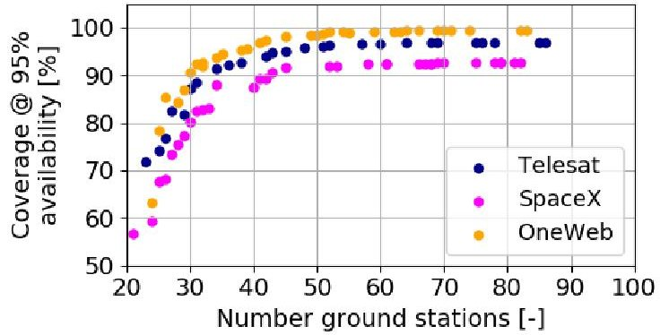

Fig. 10. Number of ground station locations vs. demand region coverage.

Figure 10 presents the Pareto fronts for the number of locations vs. demand region coverage for the three systems analyzed. It can be observed that OneWeb's system requires 61 ground stations to achieve full coverage, whereas Telesat's and SpaceX's systems cannot cover the whole demand region using only ground stations. This happens because given the larger fields-of-regard of the satellites, there are orbital positions where a satellite has some population within their FoR, even though the elevation angle to the corresponding ground station is too low to close the link for atmospheric conditions which are present 95% of the time. However, neither SpaceX's nor Telesat's systems need to achieve 100% coverage of the demand region, as ISL links can be used to route the data from satellites out of the coverage region to satellites that are actually within the coverage region.

One should also note that having 100% coverage of the demand region does not guarantee operation at maximum system capacity, as some ground stations might operate at lower data-rates due to low elevation angles. Conversely, not having total coverage of the demand region does not imply that the maximum system throughput cannot be attained, as satellites might use ISL to route data within the network. With that in mind, Figure 11 shows the estimated total system throughput vs. number of ground stations for the three systems analyzed. Average values (over time) are plotted using a continuous line, whereas the shaded region represents

<!-- PDF_PAGE: 12 -->

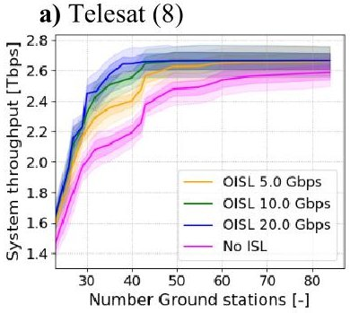

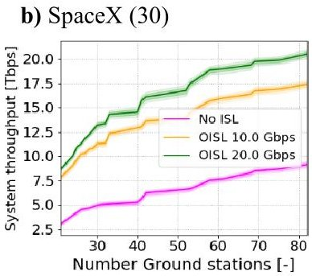

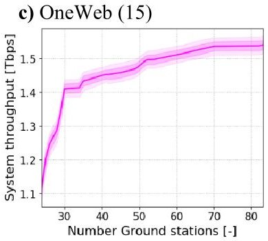

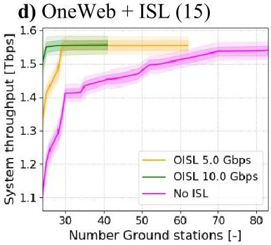

Fig. 11. Estimated total system forward capacity vs number of ground station locations for a) Telesat's, b) SpaceX's and c) OneWeb's systems. d) shows the estimated system forward capacity if OneWeb's systems included optical ISL (OISL). Values in parenthesis indicate the maximum number of gateway antennas per ground station location.

interquartile values (i.e., the capacity varies over time, and is contained within the shadow regions for 25-75 % of the time). ISL data-rates of 5,10, and 20 Gbps are considered for Telesat's and SpaceX's constellations, and are represented in orange, green and blue respectively. Magenta lines correspond to the performance of the systems without ISL.

From the graph, we can see that the maximum total system throughput for OneWeb's, Telesat's and SpaceX's constellations are 1.56 Tbps, 2.66 Tbps and 23.7 Tbps respectively. Moreover, it is shown that SpaceX's system is the system that benefits the most from the use of ISLs, and that it requires the largest number of ground stations to achieve its maximum capacity (a total of 123), due to the large number of satellites in their constellation. Interestingly, the number of locations required by the OneWeb's system (71) is larger than those required by Telesat (42), even though the maximum capacity of the former is lower. Figure 11-d) shows the same results for OneWeb's system if ISLs were added to the system design (4 ISL per satellite, 2 in-plane, and 2 cross-planes). It can be observed that the addition of ISLs significantly reduces the requirements of the ground segment; even with low ISL data-rates of 5 Gbps, the system can achieve maximum performance with as little as 27 ground stations.

Numerical values for the estimated total system throughput for each of the systems and different gateway and ground station scenarios are tabulated in Table 7. Using a ground segment with 50 ground station locations (and, as mentioned before, under reasonable assumptions

with regard to the maximum number of gateways per location), OneWeb's systems attains a capacity of 1.47 Tbps, while Telesat's and SpaceX's systems achieve 2.65 Tbps and 16.78 Tbps respectively.

Table 7: Estimated total system throughput (Tbps) for different ground stations and number of gateways.

<table border="1"><tr><td></td><td></td><td colspan="3">Telesat(8)</td><td colspan="3">OneWeb(15)</td><td colspan="2">SpaceX(30)</td></tr><tr><td>ISL(Gbps)</td><td></td><td>5</td><td>10</td><td>20</td><td>0</td><td>5$\dagger$</td><td>10$\dagger$</td><td>10</td><td>20</td></tr><tr><td rowspan="5">N65</td><td>30</td><td>2.17</td><td>2.33</td><td>2.46</td><td>1.42</td><td>1.56</td><td>1.56</td><td>11.29</td><td>13.20</td></tr><tr><td>40</td><td>2.40</td><td>2.56</td><td>2.64</td><td>1.46</td><td>1.56</td><td>1.56</td><td>12.15</td><td>14.59</td></tr><tr><td>50</td><td>2.62</td><td>2.65</td><td>2.65</td><td>1.47</td><td>1.56</td><td>1.56</td><td>13.96</td><td>16.78</td></tr><tr><td>65</td><td>2.65</td><td>2.66</td><td>2.66</td><td>1.53</td><td>1.56</td><td>1.56</td><td>16.37</td><td>17.38</td></tr><tr><td>80</td><td>2.65</td><td>2.66</td><td>2.66</td><td>1.54</td><td>1.56</td><td>1.56</td><td>17.38</td><td>20.51</td></tr></table>

$ N_{GS} $ : Number of ground station locations. Capacity values in Tbps. In parenthesis, the maximum number of gateways allowed at each ground station location. $ \dagger $ Hypothetical scenarios as OneWeb's system does not have ISLs.

Note that even though OneWeb's system has a significantly larger number of satellites than Telesat's, its total system capacity is lower. This is due to the following reasons:

- Spectrum utilization strategy: As described in Section 2.4.2, OneWeb's constellation only uses one of the polarizations in the Ku-band spectrum, with a reuse factor of 2. This results in a lower total available bandwidth for the user downlinks than SpaceX's and Telesat's systems. The user downlinks are, as explained next in this section, indeed the limiting factor in OneWeb's system.

a) Telesat (8)

- Orbital configuration and number of satellites in LoS: As shown in Section 2.4.1, both Telesat's and SpaceX's systems concentrate a set of satellites over

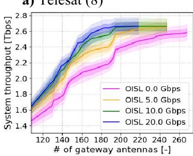

b) SpaceX (30)

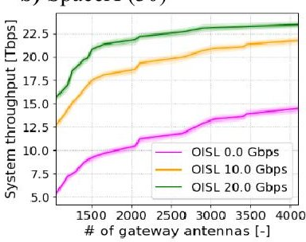

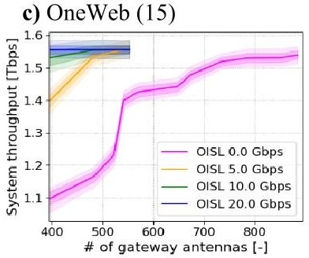

Fig. 12. Estimated total system throughput vs number of gateway for a) OneWeb's, b) Telesat's, and c) SpaceX's system.

<!-- PDF_PAGE: 13 -->

the most populated regions of the Earth, whereas OneWeb's use of polar orbits results in their satellites flying over uninhabited regions for longer periods of time. Moreover, regions with very high demands can be better served by SpaceX's and Telesat's systems since there are more satellites within LoS of such regions.

- Early saturation of beams: Since OneWeb lacks the flexibility to allocate resources dynamically to specific beams, some beams will be saturated even when the satellite as a whole is not saturated, which results in demand being dropped.

- Lack of ISL links: The lack of ISL links results in OneWeb's satellites not being able to always downlink their data to a ground station, especially for scenarios with a low number of ground stations. From Table 7, we see that if ISLs were used, the total system capacity could be 10%, 6% and 1% higher when 30, 50, and 65 ground station locations (respectively) are considered as compared with the no ISL case.

As mentioned before, OneWeb's system is heavily constrained by the satellite-to-user links, which is the main reason for its lower overall performance in terms of data-rate. Table 8 shows the average and peak data-rate per satellite in the forward direction, considering both the gateway-to-satellite and the satellite-to-user links. Since Telesat and SpaceX have digital payloads with demodulation and re-modulation capabilities, these two links can be decoupled and considered individually. There are significant differences among the average data-rates of the satellites from different constellations; Telesat's satellites achieve average data-rates close to 36 Gbps, thanks to the use of two independent gateway antennas; SpaceX achieve data-rates close to 20 Gbps (vs. 17-23 Gbps reported in SpaceX's FCC filing [19]), whereas OneWeb satellites average 8.8 Gbps (vs. previously reported 8 Gbps per satellite). The differences in these values are because the gateway-to-satellite links are the limiting factor for SpaceX and Telesat constellations, whereas OneWeb's satellites are limited by the satellite-to-user links. Both SpaceX and Telesat can use the highest available MODCODs (256APSK) in their gateway uplinks most of the time, while OneWeb's user links use 32-APSK as their highest spectral efficiency MODCOD.

Table 8: Maximum and average data-rate per satellite

<table border="1"><tr><td>Parameter</td><td>Telesat</td><td>OneWeb</td><td>SpaceX</td><td></td></tr><tr><td>Avg. Data-rate</td><td>35.65</td><td>8.80</td><td>20.12</td><td>Gbps</td></tr><tr><td>Max. Data-rate</td><td>38.68</td><td>9.97</td><td>21.36</td><td>Gbps</td></tr><tr><td>#Active gateway antennas</td><td>2</td><td>1</td><td>1</td><td>-</td></tr><tr><td>Limiting factor</td><td>GW uplink</td><td>User downlink</td><td>GW uplink</td><td>-</td></tr></table>

If we refer to the analysis of the number of gateways vs. throughput as shown in Figure 12, we observe that the

number of gateway antennas required by each of the mega-constellations to support the maximum total system throughput is 3,500,220, and 800 for SpaceX (assuming 20 Gbps ISL), Telesat (10 Gbps ISL) and OneWeb respectively. As expected, this number is heavily dependent on the number of satellites. From these graphs two main conclusions can be drawn: first, SpaceX's system is the one that benefits the most from the use of ISLs, whereas Telesat is the one that benefits the least (given the low number of satellites in their constellation); second, SpaceX's total capacity flattens out quickly after having more than 2,500 gateway antennas (using 20 Gbps ISL), which indicates that their system can afford significant savings by reducing the number of gateway antennas without this having a significant impact on its total system throughput (6% reduction). Finally, it is also noteworthy the gains that OneWeb's system stand to make if they had chosen to use ISLs; for a 500 gateway system their total capacity could increase 33%, from 1.2 Tbps to 1.6 Tbps. A total of 800 gateways would be required to achieve a similar capacity of 1.6 Tbps without ISLs.

Figure 13 shows the relationship between number of ground stations, number of gateway antennas, and system throughput for Telesat's and OneWeb's systems. It can be observed that for Telesat the system capacity is mainly driven by the number of gateway antennas (as there is little variation of throughput in the horizontal-direction), whereas for OneWeb the throughput depends on both the number of antennas and of ground station locations.

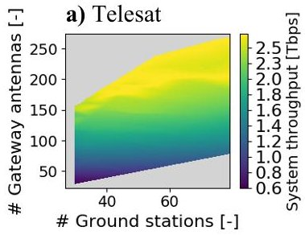

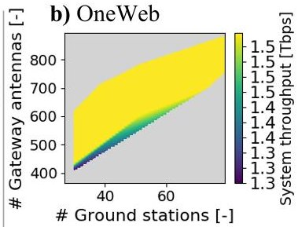

Fig. 13. Capacity vs. number of ground stations and number of gateway antennas for a) Telesat and b) OneWeb.

Finally, Table 9 contains a summary of the result values presented in this paper. It is interesting to compare the efficiency of these systems, in terms of average throughput per satellite, versus the maximum data-rate achievable per satellite. In that regard, Telesat's system achieves the highest efficiency with an average of 22.74 Gbps per satellite (58.8% of its maximum data-rate per satellite), whereas SpaceX and OneWeb achieve 5.36 Gbps and 2.17 Gbps (25.1% and 21.7% of their maximum per satellite capacity respectively). This difference in satellite efficiency is mainly due to two architectural decisions of Telesat's system: having dual active gateway antennas aboard the satellite, and having a lower minimum elevation angle on the user side.

<!-- PDF_PAGE: 14 -->

The lower portion of Table 9 shows the results for a hypothetical scenario where all three systems have 50 ground stations. Note how in this case SpaceX's system would be the most adversely affected, with its total throughput reduced by 30% to 16.5 Tbps, whereas OneWeb's system throughput would be reduced by 6% to 1.47 Tbps. Telesat's system would not be affected, since it only requires 40 ground stations to operate at maximum capacity.

Table 9: Summary of results for the three systems

<table border="1"><tr><td></td><td></td><td>Telesat</td><td>OneWeb</td><td>SpaceX</td><td></td></tr><tr><td rowspan="7">Results for max. system throughput</td><td>Num. satellites</td><td>117</td><td>720</td><td>4,425</td><td>-</td></tr><tr><td>Max. total system throughput</td><td>2.66</td><td>1.56</td><td>23.7</td><td>Tbps</td></tr><tr><td>Num. ground locations for max. throughput</td><td>42</td><td>71</td><td>123</td><td>-</td></tr><tr><td>Num. gateway antennas for max throughput</td><td>221</td><td>725</td><td>~3,500</td><td>-</td></tr><tr><td>Required number of gateways per ground station</td><td>5-6</td><td>11</td><td>30</td><td>-</td></tr><tr><td>Average data-rate per satellite (real)</td><td>22.74</td><td>2.17</td><td>5.36</td><td>Gbps</td></tr><tr><td>Max. data-rate per satellite</td><td>38.68</td><td>9.97</td><td>21.36</td><td>Gbps</td></tr><tr><td>Satellite efficiency</td><td>58.8</td><td>21.7</td><td>25.1</td><td>%</td></tr></table>

<table border="1"><tr><td></td><td colspan="4">Scenario with 50 ground stations</td></tr><tr><td rowspan="5">Results with 50GS</td><td>Capacity with 50GS</td><td>2.66</td><td>1.47</td><td>16.8</td><td>Tbps</td></tr><tr><td>Number of gateway antennas required</td><td>221</td><td>525</td><td>1,500</td><td>-</td></tr><tr><td>Average data-rate per satellite (real)</td><td>22.74</td><td>2.04</td><td>3.72</td><td>Gbps</td></tr><tr><td>Max. data-rate per satellite</td><td>38.68</td><td>9.97</td><td>21.36</td><td>Gbps</td></tr><tr><td>Satellite efficiency</td><td>58.8</td><td>20.5</td><td>17.4</td><td>%</td></tr></table>

## 5. Technical challenges

This section introduces five different technical challenges that will need to be overcome before these systems become operational.

## 5.1 Interference coordination

Given the large number of satellites deployed in each of the proposals, coordination to mitigate in-line events interference will be an important aspect for these. In-line interference can occur between an NGSO satellite and a GSO satellite (when LEO satellites cross the equator line and have beams pointing to the nadir direction), and between two close NGSO satellites of different constellations whose beams point to the same location and operate in the same frequency.

With regards to NGSO-GSO interference, each proposal has a different mitigation strategy. While OneWeb has proposed a progressive satellite pitch adjustment maneuver paired with selective disabling of beams, SpaceX and Telesat rely on the steerable and shapeable capabilities of their beams and the fact that multiple satellite are within LoS for users on the equator. In all cases, the objective is to ensure that the LEO-beams are not aligned to the GSO-satellites beams, so that a

minimum angular separation between beams is maintained (minimum discrimination angle).

For NGSO-NGSO in-line events, given the proposed frequency allocations, interference might occur between OneWeb's and SpaceX's downlink user-beams, as well as between OneWeb's, SpaceX's, and Telesat's gateways beams (both uplinks and downlinks). Furthermore, since Telesat's is a Ka-band only system, their user-beams might also interfere with the other systems' gateway beams. In cases of NGSO-to-NGSO in-line events, both controlling companies will need to coordinate to mitigate the interference, by using different frequency channels over the same spot, disabling beams, or splitting the spectrum. While both Telesat and SpaceX have by-design mechanisms to avoid interferences (e.g., multiple satellites in LoS, steerable and shapeable beams, dynamic bandwidth channelization), OneWeb's design lacks such flexibility and therefore it can only take a passive role in the coordination process.

## 5.2 Dynamic resource management

SpaceX and Telesat will each use a digital payload with a high degree of flexibility built-in. As previously mentioned, both systems plan to use this flexibility as a mechanism to avoid interference, but also to maximize the throughput of each individual satellite by allocating its resources to the beams covering the regions with the highest demands. Given the fast-paced changing environment (orbital position, interference from other systems, user demand, atmospheric attenuation, etc.) and the large number of beams and satellites involved, advanced dynamic resource allocation management (DRM) algorithms will need to be developed.

Furthermore, since multiple satellites in a constellation will have to coordinate (i.e., ensure coverage of all users without causing interference to external satellites), some of these DRM algorithms will need to be run in a control center which has knowledge of the internal state of each satellite and also an overview of the whole constellation state. Another set of DRM algorithms will then need to be run locally on-board of each satellite to handle the rapid changing environment of the satellites.

## 5.3 Launch schedule

Together, these three systems will add more than 5,000 satellites to LEO. Launching them into orbit would require approximately 100-150 dedicated rocket launches in the next 4 years, which would require a significant increase in the number of launches worldwide, (in particular the Soyuz and Falcon 9 rockets). In 2017 alone, the number of orbital launches worldwide was 91; 18 of them were Falcon 9 rockets and 15 were Soyuz rockets.

<!-- PDF_PAGE: 15 -->

In addition, even though at the time of writing all three companies have manufactured test satellites for their systems (SpaceX and Telesat have even launched them into orbit at the beginning of 2018), it is not clear whether the companies will be able to finalize the design and production of the satellites according to their planned schedules. In fact, some of the companies have already been forced to slightly delay their original launches and push back the beginning of operations.

## 5.4 System operations

The large number of satellites in mega-constellations impose new operational challenges in terms of collision avoidance and end-of-life disposal. In that regard, the ground infrastructure shall continuously monitor, track, and command hundreds of satellites, as well as to coordinate with other agencies and organizations with spacecraft flying in similar orbits (that may present a risk of collision). Moreover, since telemetry, internal state and network status signals from hundreds of NGSO satellites will need to be continuously monitored, a degree of automation higher than current state-of-the-art systems will be required.

## 5.5 User terminals

Affordable user terminals capable of tracking LEO satellites are a key component for widespread adoption and crucial to the business success of the three systems analyzed here. In the past, broadband LEO networks required expensive terminals composed of gimballed antennas (often a pair of them to guarantee continuous coverage), which limited their adoption to customers with high purchasing power, mainly within the enterprise market.

Electrically-steered flat panel antennas are a promising technology in this field, even though it is still unclear whether this technology will be available at the desired price-points when the constellations begin service. With respect to the design of the user terminals for each of the systems, Telesat-compatible terminals present the most stringent requirements, since their antennas will need to operate at elevation angles as low as $ 2 0^{\circ} $ (vs. $ 4 0^{\circ} $ and $ 5 5^{\circ} $ for SpaceX and OneWeb respectively).

## 6. Conclusions

This paper presents a comparison of the technical architecture of three large constellations of satellites in LEO to provide global broadband. After providing a description of the space and ground segment architectures for each of the systems, we compared some additional aspects of each constellation in detail. Then, we presented a method to a) determine the requirements in terms of number of ground stations and gateways in the ground segment for each of the systems, and b) estimate statistically the total system throughput. We

concluded the paper by emphasizing several technical challenges that will need to be overcome before these systems become operational, such as interference coordination, dynamic resource management, launch schedule, and operations.

The main conclusions of our analysis can be summarized as follows:

- The maximum total system throughput (sellable capacity) for OneWeb's, Telesat's and SpaceX's constellations are 1.56 Tbps, 2.66 Tbps and 23.7 Tbps respectively.

- A ground segment comprising of 42 ground stations will suffice to handle all of Telesat's capacity, whereas OneWeb will need at least 71 ground stations, and SpaceX more than 123.

- In terms of satellite efficiency (understood as the ratio between the achieved average data-rate per satellite and its maximum data-rate) Telesat's system performs significantly better than the competition ( $ \sim 59\% $ vs. SpaceX's 25% and OneWeb's 22%). This is due to: a) the use of dual active antennas on each satellite, and b) the lower minimum elevation angle required in their user links.

- OneWeb's system has a lower throughput than Telesat's, even though the number of satellites in the former is significantly larger. The main reason for this are the lower data-rate per satellite that results from OneWeb's low-complexity satellite design, spectrum utilization strategy, orbital configuration, and payload design, as well as the lack of use of ISLs.

- If ISLs were to be used in OneWeb's constellation, (even with modest data-rates of 5 Gbps), the number of ground stations required could be reduced by more than half to 27 ground stations.

To conclude, our analysis revealed different technical strategies among the three proposals. OneWeb's strategy focuses on being first-to-market, minimizing risk and employing a low-complexity space segment, thus delivering lower throughputs. In contrast, Telesat's strategy revolves around high-capable satellites and system flexibility (in diverse areas such as deployment, targeted capacity allocation, data-routing, etc.), which results in increased design complexity. Finally, SpaceX's system is distinctive in its size; although individually each satellite is not significantly more complex than Telesat's, the massive number of satellites and ground stations increases the risks and complexities of the overall system considerably.

## Acknowledgements

This work was supported by Facebook Inc. The content of this article does not reflect the official opinion of Facebook Inc. Responsibility for the information and views expressed herein lies entirely with the authors.

<!-- PDF_PAGE: 16 -->

## References

[1] Ashford, E.W., 2004. Non-Geo systems—where have all the satellites gone? Acta Astronautica, 55(3-9), pp.649-657.

[2] Christensen, C. and Beard, S., 2001. Iridium: failures & successes. Acta Astronautica, 48(5-12), pp.817-825.

[3] Sturza, M.A., 1995, February. The Teledesic Satellite System: Overview and design trades. In Proceedings of the Annual Wireless Symposium (pp. 402-409).

[4] Patterson, D.P., 1998, March. Teledesic: a global broadband network. In Aerospace Conference, 1998 IEEE (Vol. 4, pp. 547-552). IEEE.

[5] Leopold, R.J., 1992, November. The Iridium communications systems. In Singapore ICCS/ ISITA'92.'Communications on the Move' (pp. 451- 455). IEEE.

[6] Leopold, R.J., 1991, June. Low-earth orbit global cellular communications network. In Communications, 1991. ICC'91, Conference Record. IEEE International Conference on (pp. 1108-1111). IEEE.

[7] Wiedeman, R., Salmasi, A. and Rouffet, D., 1992, September. Globalstar-Mobile communications where ever you are. In 14th International Communication Satellite Systems Conference and Exhibit (p. 1912).

[8] Comparetto, G. and Hulkower, N., 1994. Global mobile satellite communications-A review of three contenders. In 15th International Communications Satellite Systems Conference and Exhibit (p. 1138).

[9] Dumont, P., 1996. Low earth orbit mobile communication satellite systems: A two-year history since WARC-92. Acta Astronautica, 38(1), pp.69-73.

[10] Evans, J.V., 1997. Satellite systems for personal communications. IEEE Antennas and Propagation Magazine, 39(3), pp.7-20.

[11] Evans, J.V., 1998, March. Proposed US global satellite systems operating at Ka-band. In Aerospace Conference, 1998 IEEE (Vol. 4, pp. 525-537). IEEE.

[12] Evans, J.V., 2000. The proposed Ku-band non geostationary communication satellite systems. Acta Astronautica, 47(2-9), pp.171-182.

[13] Shaw, G.B., Miller, D.W. and Hastings, D.E., 1999. The generalized information network analysis methodology for distributed satellite systems (Doctoral dissertation, Massachusetts Institute of Technology, Dept. of Aeronautics and Astronautics).

[14] Le May, S., Gehly, S., Carter, B.A. and Flegel, S., 2018. Space debris collision probability analysis for proposed global broadband constellations. Acta Astronautica.

[15] Foreman, V.L., Siddiqi, A. and De Weck, O., 2017. Large Satellite Constellation Orbital Debris Impacts: Case Studies of OneWeb and SpaceX Proposals. In AIAA SPACE and Astronautics Forum and Exposition (p. 5200).

[16] McLain, C. and King, J., 2017. Future Ku-Band Mobility Satellites. In 35th AIAA International Communications Satellite Systems Conference (p. 5412).

[17] Telesat Canada, Telesat Ka-band NGSO constellation FCC filing SAT-PDR-20161115-00108, Available at http://licensing.fcc.gov/myibfs/forwardtopublictabacti

on.do?file_number=SATPDR2016111500108 (2018/09/12).

[18] WorldVu Satellites Limited, OneWeb Ka-band NGSO constellation FCC filing SAT-LOI-20160428-00041. Available at http://licensing.fcc.gov/myibfs/forwardtopublictabaction. do?file_number=SATLOI2016042800041 (2018/09/12).

[19] Space Exploration Holdings, LLC, SpaceX Ka-band NGSO constellation FCC filing SAT-LOA-20161115- 00118, Available at http://licensing.fcc.gov/myibfs/forwardtopublictabaction.do?file_number=SATLOA2016111500118 (2018/09/12).

[20] WorldVu Satellites Limited, OneWeb Ka-band NGSO constellation expansion FCC filing SAT-MOD 20180319-00022, Available at http://licensing.fcc.gov/myibfs/forwardtopublictabaction. do?file_number=SATMOD2018031900022 (2018/09/12).

[21] Hanson, W.A. ed., 2016. In their own words: OneWeb's Internet constellation as described in their FCC form 312 Application. New Space, 4(3), pp.153-167.

[22] The Wall Street Journal, SoftBank to invest around $500 million more in OneWeb satellite-Internet venture, Available at https://www.wsj.com/articles/ softbank-to-invest-around-500-million-more-in-oneweb satellite-internet-venture-1512990003 (2018/09/12).

[23] The New York Times, Google and Fidelity Put $1 billion into SpaceX, Available at https://www.nytimes.com/2015/01/21/technology/google-makes-1-billion-investment-in-spacex.html (09/12/2018)

[24] del Portillo, I., 2017, ITU-Rpy: A python implementation of the ITU-R P. Recommendations to compute atmospheric attenuation in slant and horizontal paths, GitHub, Available at https://github.com/iportillo/ITU-Rpy/

[25] ITU, 2017, Propagation data and prediction methods required for the design of earth-space telecommunication systems, Recommendation ITU-R 618-13.

[26] Digital Video Broadcasting (DVB), 2014, Second generation framing structure, channel coding and modulation systems for broadcasting; Part2: DVB-SE extensions (DBVS2X), Tech. Rep., 6.

[27] C. CIESIN, 2005, Gridded population of the world version 4 (GPWv4): population density grids, Palisades, Socioeconomic Data and Applications Center (SEDAC), Columbia University.

[28] del Portillo, I., Cameron, B. and Crawley, E., 2018, March. Ground segment architectures for large LEO constellations with feeder links in EHF-bands. In 2018 IEEE Aerospace Conference (pp. 1-14). IEEE.

[29] Selva, D., Cameron, B. and Crawley, E., 2016. Patterns in system architecture decisions. Systems Engineering, 19(6), pp.477-497.

[30] Deb K., Pratap A., Agarwal S., and Meyarivan T., 2002, A fast and elitist multiobjective genetic algorithm: NSGAII, Evolutionary Computation, IEEE Transactions on, vol. 6, no. 2, pp. 182-197.