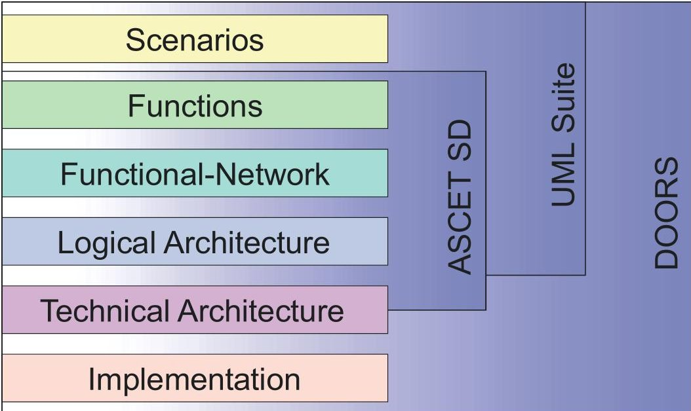
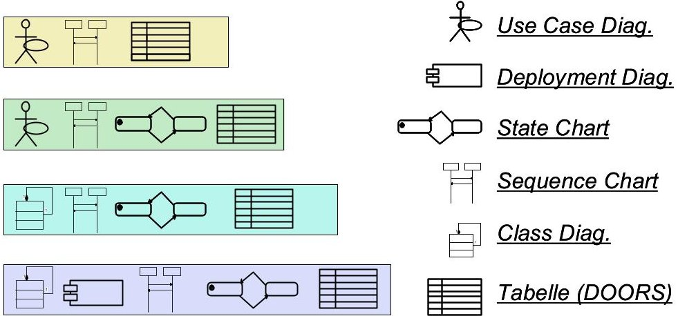

<!-- PDF_PAGE: 1 -->

# Abstraction levels of embedded systems

Peter Braun and Martin Rappl

Lehrstuhl für Software & Systems Engineering – Prof. Broy

Technische Universität München, Arcisstraße 21, D-80333 München, Germany

Tel.: +49 (0)89 - 289 - 25317; Fax.: +49 (0)89 - 289 - 25310

{braunpe|rappl}@in.tum.de

This paper describes abstraction levels as they are used in the project Automotive $ ^{1} $ for a component- and function-oriented development process of embedded systems. These abstraction levels build upon each other especially to fit the needs of software development activities of embedded systems in the context of automotive specific system development.

## Objectives

In late 1999 the Technical University of Munich and the BMW company launched the project Automotive with the aim to define a seamless, model based development process and to realize a tool chain to support this process. The elaborated concepts consider automotive specific requirements such as logically specified functions which are deployed on control unit networks. Some of these deployed functions have to fulfil hard real time constraints in safety critical applications which is another challenge. Furthermore the methodology has to support the close interlocking and the mutual influences of analysis and design activities during the specification of the logical functions, the underlying network of control units and the implementation techniques.

It is commonly accepted that the key potential for an improved development process lies in the early phases of development. Concepts for a managed transition from informal, mostly unstructured requirements specifications to model based analysis and design techniques are vital for development. Thereby work on different aspects of the requirements engineering process, work on a universal system model for embedded systems, and work on the representation of the system model by notations (UML and Ascet) are the focus of Automotive. The automotive modelling language (AML) will represent the results of this work.

The elaborated methodology for automotive specific requirements engineering facilitates the precise and complete documentation of requirements without

<!-- PDF_PAGE: 2 -->

contradictions on different level of abstractions. Documented requirements serve as a basis for all activities in the development process. Furthermore they are crucial for mastering change management, configuration management, and quality assurance.

In Automotive the vendors ETAS, Telelogic and QSS (Telelogic) realize a tightly integrated tool chain on the basis of their leading tools ASCET-SD, The UML Suite and DOORS for a widespread support of the methodical concepts. The tool chain is evaluated by associated industry partners (Robert Bosch, Adam Opel, ZF Friedrichshafen). Long-term aim of Automotive is to define a de facto standard for the methodical, model based design of embedded systems in the early development phase. The accompanying realization of the tightly integrated tool chain, the validation of the methodology and the particular constellation of the project partners including associated project partners provide best conditions for the integration of the methodology and the tools in the development process of companies, which are working on applications for embedded control unit networks.

## Model-based system development

During the development of embedded automotive systems graphical notations are used to model specific parts of the system. Building an integrated model is the main focus of a seamless, domain-specific system development. A system model contains all information about the logic of functions, the distributed control unit network, the actors, the sensors, and the environment. Those information are stored in different levels of detail. For a seamless development it is necessary to integrate those information strictly. In Automotive a metamodel-based approach is used.

In the next sections different abstraction levels are introduced. The defined abstraction levels facilitate multiple views upon the system on different technical levels.

## Abstraction levels of embedded systems

Abstraction levels define restrictive views upon the system model. A view within an abstraction level shows the system on a uniform technical level. In Automotive there are six different abstraction levels.

1. Scenarios

2. Functions

3. Functional-network

4. Logical system architecture

5. Technical system architecture

6. Implementation

The different levels of abstraction build upon themselves. Model information and logical dependencies defined in higher abstraction levels are included in lower ones. The information is successively refined with technical information of new information classes in lower abstraction levels. Those information-classes introduce new information and the information of those classes is related to information of

<!-- PDF_PAGE: 3 -->

higher abstraction levels. Furthermore there are consistency-constraints which ensure the integrity of the system-model.

The division of the system-model into abstraction levels takes into account that there are semantic properties which are characteristic for the considered abstraction. During system development the semantics has to take into account that the notations of different abstraction levels use different kinds of concepts. So for example in higher abstraction levels, systems are event driven where they depend on a common system-clock in more technical levels. The same is true for the change between asynchronous to synchronous communication models or for different kinds of communication e.g. multicasting and channel-based communication and the different understanding of time.

## Scenarios

The highest abstraction level describes systems with fewest amount of information in a big universality. Information described at this level are events and their causal dependencies. The information-class based upon the concept of events and their causal dependencies provides enough modelling power to describe scenarios. Scenarios are ordered sequences of events necessary to achieve a determined aim in a certain context. Scenarios describe exemplary use cases, "not use cases" showing how a system may not be used, possible exceptions, or test cases.

## Functions

The set of functions define building blocks of the developed system. In contrast to scenarios functions describe complete sequences. The view upon the function at this high abstraction level is independent of later used implementation techniques. Particularly functions are considered which are later assigned to actors, sensors, or the environment.

The set of functions is structured to allow navigation between the usually great number of different functions of a system. Several different hierarchical structures can be defined. Each hierarchical structure views at least a clipping of the functions of the whole system. Different hierarchies of the functions result from different levels of experience or different views upon a system of the developers. The composition of different functions to executable specification is not considered at this abstraction level. The focus is the identification of functions, and the structuring of behaviourspecifications, e.g. exemplary use-cases, informal descriptions or automata.

Dependencies between functions are not considered at this abstraction level. For the consideration of dependencies between the functions the knowledge about which functions are instantiated in the combination with other functions is missing. Examples for dependencies between functions is the knowledge about sequential execution or mutual exclusion of some functions.

<!-- PDF_PAGE: 4 -->

## Functional-network

The next abstraction level considers the instantiation of the defined functions to particular functional configurations. This leads to an enlargement of the namespace. The instances of functions are connected at this abstraction level. Mutual dependencies between different functions have to be defined and possible conflicts must be resolved. The definition of the mutual dependencies is a real refinement step in the sense of a design step which leads one step closer to an implementable systemmodel. At the level of functional-networks a first simulation of the overall system is possible. Also the logical architecture of the system is now defined. The communication between functions is event-driven and synchronous. There is only a global time. The communication between the functions is based upon multicasting.

## Logical system architecture

By developing the logical system-architecture the model is enlarged by information of orthogonal information-classes. Concurrently gained information from the functionalnetwork is refined. The new, orthogonal information-classes deal with the logical distribution (information about logical control units) and the information about actors and sensors in the environment. The communication is based on data-flow. It is important that time is split into a real time part (universal time) of the environment and into a system time part which has its own clocking. The adjustment of those different times is crucial for a proper work of the system. The adjustment is not done continuously. Instead it takes place at certain peaks. The peaks depend on the tolerance which is valid in weak real-time systems. Hard real-time systems do not permit tolerances at all. The communication between different components is synchronous. The step towards a clocked data-flow is essential. That is to say the event control of the higher abstraction levels is not longer used.

## Technical system architecture

The technical system architecture offers further information-classes describing concrete technical information. So the model is enriched with information e.g. about concrete bus-realisations. Further information describe control unit specifications and operating system descriptions. So it is possible to gain first performance estimates.

## Implementation

At this level the implementation of the model described in the abstraction levels above is done. This goes beyond the first prototypes which could be generated from the models gained above. For example often code has to be optimised for performance and size reasons. Beside this often adoptions to existing systems have to be made.

<!-- PDF_PAGE: 5 -->

## Abstraction levels in the context of Automotive

The focus of the project Automotive is set to the abstraction levels scenarios, functions, functional-networks, and logical system-architecture. Some aspects of the next deeper abstraction level, the technical system-architecture, are considered as well. The most technical level implementation is not in the focus of Automotive. The notations describing information of those abstraction levels are notations of the UML and the ASCET-SD (see Fig. 1 and 2).

Fig. 1: Abstraction levels

Fig. 2: Used Notations

<!-- PDF_PAGE: 6 -->

## Process model

The Automotive development process is tightly coupled with the notation of abstraction levels. A very simple waterfall process model will just use one arbitrary ordered sequence of abstraction levels. But this sequential processing sequence is not very realistic in the context of system development in the large. On the one hand often technical requirements of deeper abstraction levels are already given at the beginning of the process. On the other hand especially in the automotive context already existing systems (or even small parts of existing systems) have to be improved. Beside this, teamwork has to be considered. This leads to a process model similar to concurrent engineering. So, even at the beginning of the process, information corresponding to deeper abstraction levels can and should be used. The integrated metamodel will then ensure propagation (automatically or semi-automatically) of the corresponding information to the higher abstraction levels.

## Conclusion

The usability and further refinement of the abstraction levels and the process model presented in this paper is one aim of the research in the project Automotive. To get a pragmatic prototype showing the results of these research, popular commercial tools are integrated. The technical integration of the tools DOORS, UML Suite and ASCET-SD relies on a metamodel oriented approach. The Automotive modelling language (AML) is defined using a metamodel, which describes the abstract syntax of the AML language. So the metamodel concentrates on the concepts used in the AML. For the concrete notation of the AML, some notations provided by the UML, the ASCET-SD and DOORS are used. While the notations of the UML are used for the more abstract levels, ASCET-SD is a tool for the specification and code-generation of embedded systems. The requirements management and tracing tool DOORS will be used over the whole process.

## References

[BRS00] P. Braun, M. Rappl and J. Schäuffele: Softwareentwicklungen für Steuergerätenetzwerke - Eine Methodik für die frühe Phase, VDI-Berichte, Nr. 1547, 2000.

[BR00b] P. Braun and M. Rappl: Model based Systems Engineering - A Unified Approach using UML, Systems Engineering - A Key to Competitive Advantage for All Industries Proceedings of the 2nd European Systems Engineering Conference (EuSEC 2000), Herbert Utz Verlag GmbH, München, 2000.

[GR00] B. Gebhard and M. Rappl: Requirements Management for Automotive Systems Development, SAE2000, SAE Press 00PC-107, 2000.