<!-- PDF_PAGE: 1 -->

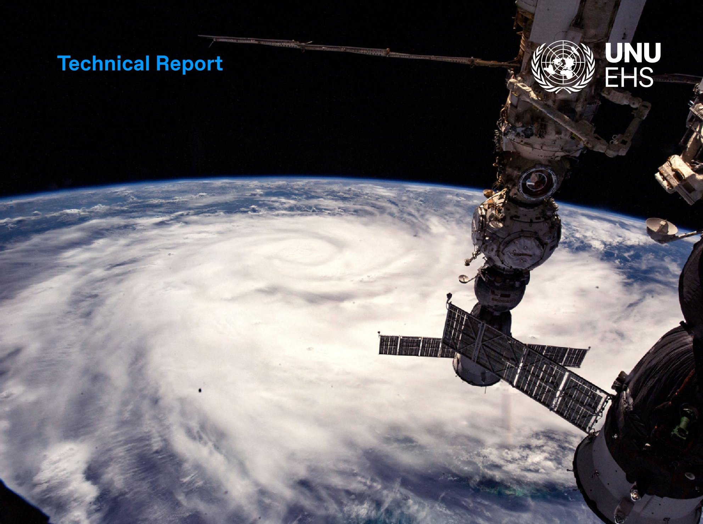

## Space debris

Authors: Caitlyn Eberle and Zita Sebesvari

Acknowledgements: We would like to thank David Dao and Carsten Montzka for their support in this research.

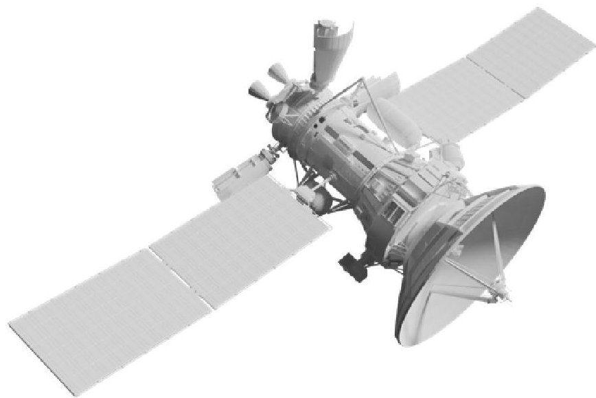

Risk Tipping Points

<!-- PDF_PAGE: 2 -->

## Table of Contents

1. Introduction 04

2. Risk tipping point 05

3. How did we get here? 07

3.1 Drivers 07

   3.1.1 Pollution 07

   3.1.2 Lack of regulations/enforcement 09

   3.1.3 Insufficient future planning 09

3.2 Root causes 10

   3.2.1 Global demand pressures 10

   3.2.2 Insufficient risk management 11

   3.2.3 Insufficient cooperation 12

   3.2.4 Colonialism 12

   3.2.5 Prioritizing profits 13

3.3 Influences 14

4. Where are we headed?

   Current and future impacts 15

4.1 The future we need to avoid 15

4.2 Infrastructure damage 16

4.3 Loss of safety 16

4.4 Loss of opportunities 16

4.5 Cultural heritage loss 17

5. The future we want to create 18

5.1 Avoid 18

5.2 Adapt 19

5.3 From Delay to Transform 19

6. Conclusion 21

7. References 22

<!-- PDF_PAGE: 3 -->

## Abbreviations

DOS United States Department of State

ESA European Space Agency

GEO geosynchronous Earth orbit

GPS global positioning system

IADC Inter-Agency Space Debris Coordination Committee

ISS International Space Station

ITC International Telecommunications Union

LEO low Earth orbit

MEO medium Earth orbit

NASA United States National Aeronautics and Space Administration

NRC United States National Research Council

UN United Nations

UNDRR United Nations Office for Disaster Risk Reduction

UNOOSA United Nations Office for Outer Space Affairs

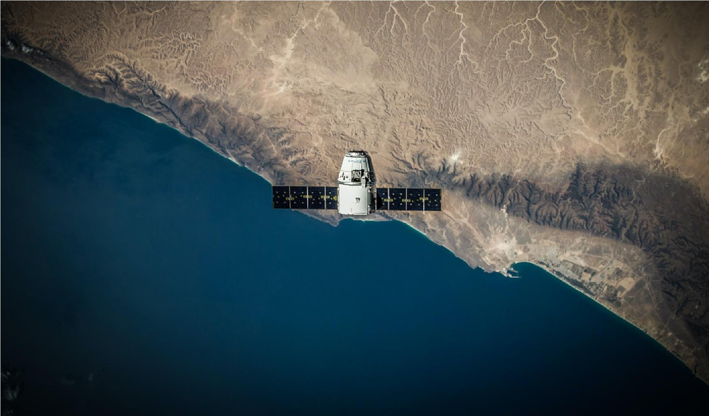

<!-- PDF_PAGE: 4 -->

# Graphical abstract

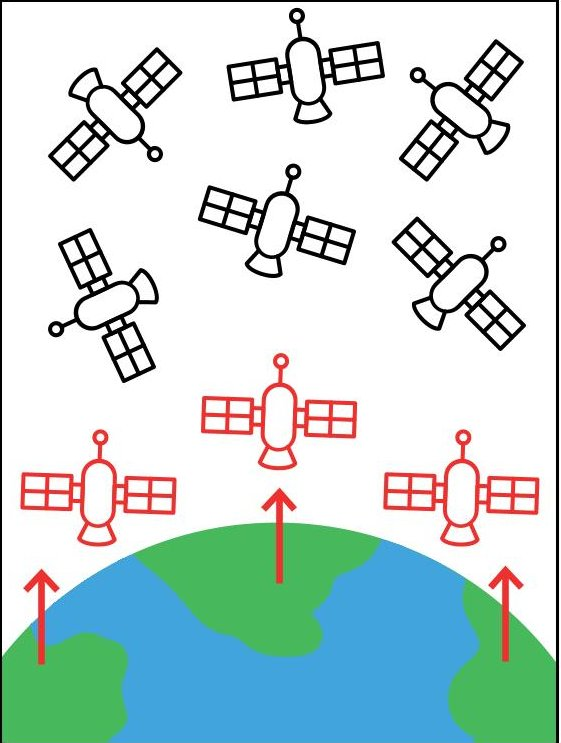

1. Increasing risk = Increasing number of objects in orbit around Earth

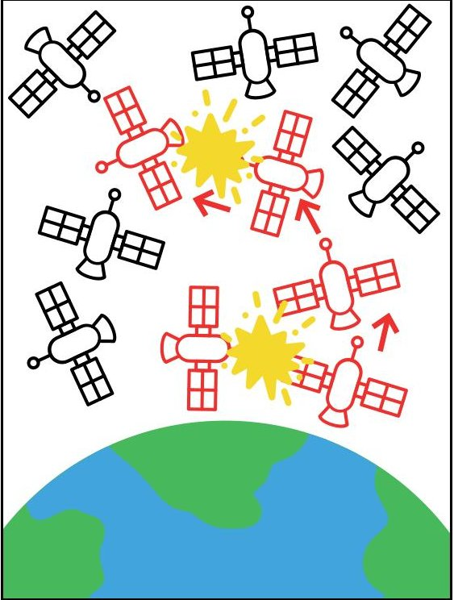

2. Tipping point = Critical density of objects in orbit causing a chain reaction of collisions

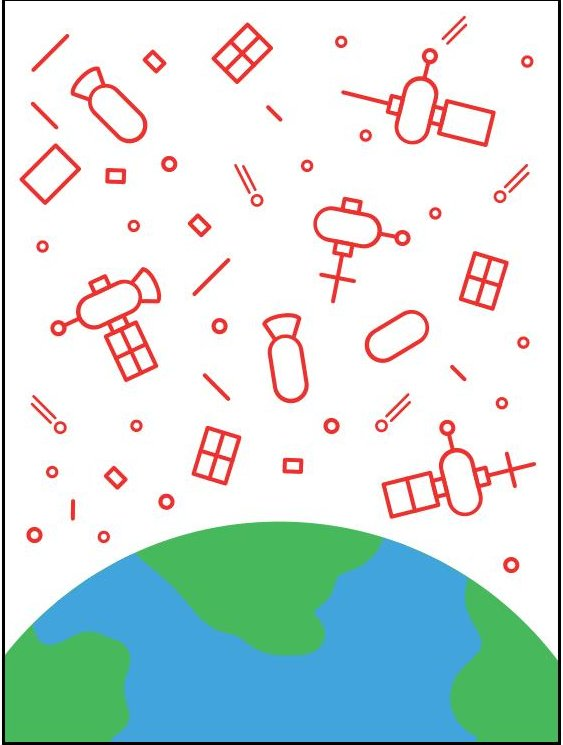

3. Tipped = Collisions result in a large number of fragments, rendering the orbit unusable

## 1. Introduction

Since the dawn of the "Space Age" in 1957, humans have successfully launched over 15,000 satellites into space (ESA, 2023d). At the time of writing, there are approximately 8,300 satellites actively orbiting the Earth, gathering and distributing vital data for space science, Earth observation, meteorology, disaster early warning systems, telecommunication and navigation. Satellites make our lives safer, more convenient and connected, and represent critical infrastructure that is now essential for a functioning society. However, as the number of satellites increases, so does the problem of space debris, posing a threat to both functioning satellites and the future of our orbit.

Space debris are "all man-made objects, including fragments and elements thereof, in Earth orbit or re-entering the atmosphere, that are non-functional" (UNOOSA, 2010), ranging in size from minuscule flecks of paint to massive chunks of metal. Ever since the first satellite, Sputnik, was launched in 1957, there has been more debris in orbit than operational satellites (ESA, 2023b). Currently, out of 34,310 objects tracked in orbit, only around 25 per cent are working satellites while the rest are junk, such as broken satellites or discarded rocket stages. Additionally, it is estimated that there are around 130 million pieces of debris too small to be tracked, measuring between 1 mm and 1 cm (ESA, 2023d). Given that these objects travel over 25,000 kilometres per hour (Mukherjee, 2021), even the smallest debris can cause significant damage.

<!-- PDF_PAGE: 5 -->

Importantly, though it is often written that satellites are launched "into orbit," there is not just one orbit that satellites can be launched into. There are many different orbital regimes, classified by how far they are from Earth's surface or how they move relative to Earth. The three main orbit classifications are geosynchronous orbit (GEO), medium Earth orbit (MEO) and low Earth orbit (LEO) (see Figure 1). Satellites in GEO are around 36,000 km above sea level and move to match the rotation of Earth, taking 24 hours to complete an orbit and providing services such as weather data and broadcast TV (Roberts, 2017; SES, 2020). Satellites in GEO at the equator always stay above the same spot on Earth's surface, known as geostationary orbit (U.S. Congressional Budget Office, 2023). Satellites in MEO are between 5,000 and 20,000 km above sea level, so their orbits vary widely. Many take around 12 hours to make a complete orbit and are often used for GPS navigation (Roberts, 2017; SES, 2020). Satellites in LEO are less than 2,000 km above sea level, complete an orbit in around 90 minutes and are used for remote sensing and, more recently, broadband Internet (Roberts, 2017; SES, 2020). Around 85 per cent of all operational satellites are in LEO, 12 per cent are in GEO and the remaining 3 per cent are in MEO (U.S. Congressional Budget Office, 2023).

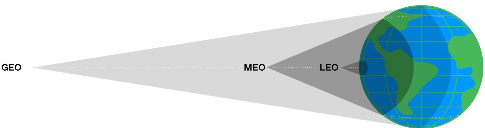

Figure 1: Schematic overview of orbital altitudes and coverage areas. Image adapted from (SES, 2020)

## 2. Risk tipping point

Under normal circumstances, many satellites in orbit undergo a process called "orbital decay," as the drag of gas molecules in the upper reaches of the atmosphere decelerates the satellites and brings them closer and closer to Earth, eventually burning up as they enter the atmosphere. This process can take anywhere from a few years to several centuries, depending on how far away the satellite is from Earth. In fact, it is estimated that 62 per cent of all satellite break-ups recorded since 1961 are still in orbit (Undseth and others, 2020). We can see a drastic increase of tracked objects through time in Figure 2. Each piece of debris left in orbit becomes an obstacle in the orbital "highway," making it increasingly difficult for functional satellites to avoid collisions, putting both existing and future infrastructure at risk.

Below a critical density, we can maintain zero population growth of orbital objects, maintaining a balance of the number of objects launched with the number that decay or are actively deorbited. However, with the number of objects currently in orbit and the increasing amount of planned launches, we are headed towards a tipping point.

<!-- PDF_PAGE: 6 -->

Monthly Number of Objects in Earth Orbit by Object Type

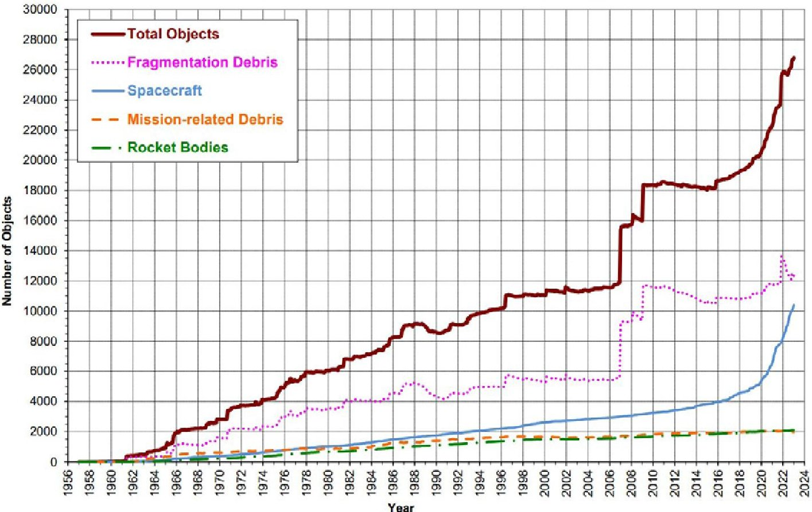

Figure 2: Monthly number of catalogued objects in Earth orbit by object type as of 3 February 2023 (NASA Orbital Debris Program Office, 2023).

If we reach a critical density of objects in orbit, then zero population growth will likely be impossible, as collisions between existing satellites would produce debris at a rate faster than they are removed by orbital decay (Kessler, 2000). When this happens, random collisions will create more and more debris that will cause a chain reaction of collisions, becoming self-sustaining and exponential until the entire population of satellites is reduced to subcritical sizes (ESA, 2023a). This self-sustained process is known as the "Kessler syndrome," named after a paper written by Donald Kessler and Burton Cour-Palais, explaining the theory of orbital debris growth from collisions alone rather than new launch activity (Aerospace Corporation, 2022).

Importantly, this tipping point may have already passed in certain orbits. As shown in Figure 3, the number of catastrophic collisions in orbit is set to increase significantly, given the current rates of launch traffic, explosions and disposal success. Even under a scenario of no further launches after 2022, the amount of space debris is projected to increase (ESA, 2023b), particularly for LEO (Pardini and Anselmo, 2021). Without significant effort to actively remove large debris and strict implementation of mitigation measures on new missions, these orbits will undoubtedly experience exponential debris growth (Pardini and Anselmo, 2021). Since this phenomenon is exponential, the tipping point of cascading collisions can be more accurately understood as continuous, a process that has already started and will increase in frequency as time progresses (Gini, 2012).

After this point, our orbits are set on a path to become unusable, filled with millions of shards of debris that could damage or destroy any future object launched into space (Greenbaum, 2020; Clormann and Klimburg-Witjes, 2022). This would threaten our ability to monitor, for example, the weather and environmental changes, and to receive early disaster warnings, as well as jeopardizing future opportunities provided by space-based infrastructure.

<!-- PDF_PAGE: 7 -->

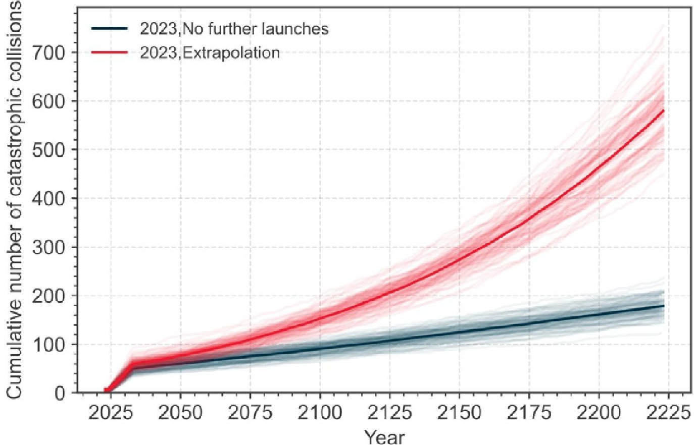

Figure 3: Number of cumulative collisions in LEO in the simulated scenarios of long-term evolution of the environment (ESA, 2023b).

## 3. How did we get here?

## 3.1 Drivers

## 3.1.1 Pollution

The issue of space debris is primarily one of pollution, as the debris generated from orbital activities actively pollutes our orbital environment. In the early years of the Space Age, humankind did not pay much attention to the debris generated from actions in space. In addition to derelict spacecraft and spent rocket stages, small objects were routinely ejected into orbit. Bolts, screws and springs would be released as satellites separated from the rockets that launched them. Astronauts have lost tools and cameras during space walks, and the Mir space station ejected more than 200 objects, mostly in the form of garbage bags (Johnson, 1998). However, most of the debris in orbit has occurred from satellite break-ups. From 1957 to 2022, there have been 643 confirmed on-orbit fragmentation events. The largest share of these fragmentations comes from propulsion-related explosions (ESA, 2023b). At the time of writing, there are 34,260 objects tracked in space, only 8,300 of which are functioning satellites (ESA, 2023d), meaning that 76 per cent of tracked objects in orbit are junk.

<!-- PDF_PAGE: 8 -->

# Technical Report

# Space debris

Disposal of satellites depends on how close they are to Earth's surface. Objects in LEO, the orbit most affected by space debris pollution, typically experience atmospheric drag. Small objects burn up in the atmosphere due to the friction from air molecules (Boag, 2019), but even this option causes pollution. Fine particles of heavy metals are often naturally left in the atmosphere by meteoroids; however, satellites re-entering the atmosphere deposit particles, particularly aluminium, at higher rates than normal (Boley and Byers, 2021). Large objects, however, cannot completely burn up in the atmosphere and will crash land back to Earth, potentially harming the planet's inhabitants (Boag, 2019). Some of these re-entries are controlled, and satellites or rocket bodies are purposefully landed in Point Nemo, a point in the Pacific Ocean that is far away from human civilization. It is estimated to contain between 250-300 spacecrafts (Boag, 2019). Other re-entries are uncontrolled and pose casualty and damage risks to people on the ground. For instance, in 2020, a rocket body weighing 18 tons re-entered the atmosphere and several pieces struck two villages and damaged several buildings along the Ivory Coast (Byers and others, 2022). Satellites in further orbits, such as GEO, do not experience atmospheric drag, and thus do not typically return to Earth. Instead, they are removed from the active GEO and pushed more than 300 kilometres further from Earth, into what is known as a "graveyard" orbit (Boag, 2019; Undseth and others, 2020).

The increasing amount of space debris in orbit also causes light pollution. Though large, intact satellites cause some interference, often appearing as streaks of light in astronomical observations, the cumulative effect of millions of debris pieces have a much larger effect (Hattenbach, 2023). Diffuse clouds of debris reflect and scatter light, causing an increase in overall sky brightness similar to light pollution seen in and around urban centres. However, unlike urban light pollution, this increase in sky brightness will cover the entire Earth. Research suggests that the cumulative effect of all objects in space have made the night sky 10 per cent brighter than it was before the Space Age began, exceeding a threshold that defines a location as "light polluted" set by the International Astronomical Union (Strauss, 2021; Kocifaj and others, 2021).

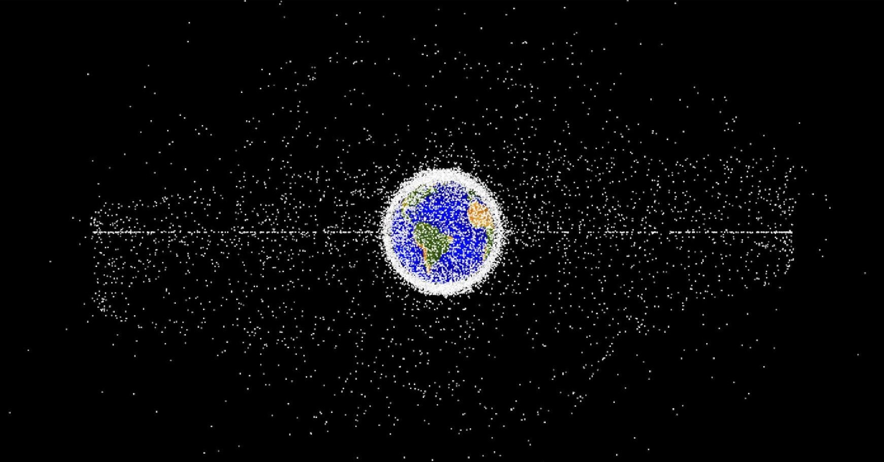

Computer-generated images of objects in Earth orbit being tracked as of January 2019. The orbital debris dots are scaled to optimize their visibility and are not scaled to Earth. Approximately 95% of the objects in this illustration are orbital debris, i.e., not functional satellites. $ \textcircled{c} $ NASA ODPO

<!-- PDF_PAGE: 9 -->

## 3.1.2 Lack of regulations/enforcement

There are a few conventions and agreements on the responsible use of outer space. The UN Outer Space Treaty of 1967 designates that signatories will "conduct exploration of [outer space] so as to avoid their harmful contamination..." (UNOOSA, 1966). Additionally, the Liability Convention of 1972 elaborates on part of the treaty to establish the responsibility certain states have in case launched objects cause damage (UNOOSA, 1971), while the Registration Convention of 1974 mandates that states maintain a registry of their launched objects (UNOOSA, 1974). Though these agreements deal with some aspects key to the issue of space debris, they do not address the need to reduce debris creation. Additionally, they are difficult to implement, as the origin of many objects cannot be determined and there is no clear definition of space debris at the international level (NRC, 1995). Only the recently signed Artemis Accords make explicit mention of orbital debris, mandating that signatories "commit to plan for the mitigation of orbital debris" and "commit to limit, to the extent practicable, the generation of new, long-lived harmful debris" (NASA, 2020). As of June 2023, there are 27 states signatory to the accords; however, they are explicitly a "non-binding set of principles" rather than enforceable regulations (DOS, 2023). Though some countries have national regulations, there are currently no binding international rules on space debris mitigation (Napper and others, 2023).

UNOOSA, IADC and many space agencies and governments have developed guidelines and best practices to slow down debris accumulation and stabilize the orbital environment. These include mitigation measures such as no intentional generation of debris (e.g. anti-satellite tests), no accidental explosions in orbit, performing collision avoidance where possible and a recommendation to deorbit satellites 25 years after the end of their orbital life (Undseth and others, 2020). However, these are only guidelines, and compliance with these measures is insufficient. Only 60 per cent of operators in all LEO abide by the guidelines, with less than 20 per cent compliance in orbits above 650 kilometres (Undseth and others, 2020). ESA's Annual Space Environment report notes that while adherence to space debris mitigation practices is slowly increasing, "successful implementation is still at a too low level to ensure a sustainable environment in the long-run" (ESA, 2023b).

## 3.1.3 Insufficient future planning

The issue of space debris and the potential damage it can cause is well known. The occurrence of the Kessler syndrome and exponential growth in the debris population is not a question of "if," but "when." However, there is a high degree of uncertainty when it comes to modelling future debris populations, since it depends on a multitude of variables, such as atmospheric density, solar radiation, collision energy and geometry and more (Dolado-Perez and others, 2015). As such, especially since the established guidelines are non-binding and the cost of implementation is often high, there is little incentive for countries or companies to put significant effort into deorbiting satellites (Undseth and others, 2020). Additionally, the benefits of taking precautionary action are not necessarily visible, as it is hard to prove why something did not happen. Therefore, operators and investors are reluctant to invest in space debris prevention and mitigation measures because the outcomes would be unnoticeable for decades or centuries, if they were noticed at all (Finkleman, 2017).

<!-- PDF_PAGE: 10 -->

## 3.2 Root causes

## 3.2.1 Global demand pressures

The demand for data and digitization of services has driven incredible advancements in satellite technology and its proliferation. While these advancements in more affordable and accessible technology allow for many actors to participate in the opportunities available in orbit, they also greatly exacerbate the risk to the orbital environment. For instance, CubeSats are extremely small satellites measuring 10 cm on each side and are relatively inexpensive allowing universities, citizen science groups, start-ups, artists and hobbyists the ability to design their own space-based projects. By design, CubeSats are not intended to be a permanent fixture in the LEO environment; they do not usually carry their own propulsion systems and are designed for lifespans as short as six months. Since they do not often have their own propulsion system, this means they cannot conduct avoidance manoeuvres and many CubeSats in higher orbits cannot actively deorbit (Undseth and others, 2020).

These advancements in technology have gone hand-in-hand with digitalization and the demand for high-speed Internet connectivity. As the world becomes more digitally connected and the Internet becomes critical infrastructure, the limits of terrestrial systems become more apparent. Rural areas, for instance, often have limited ground-based Internet infrastructure, so satellites can fill that gap and make the Internet more widely available. In fact, when the United States Federal Communications Commission (FCC) offered over $20 billion in subsidies to address the digital divide in rural communities in the U.S., this was followed by a rush of FCC filings for LEO satellite projects (Venkatesan and others, 2020). This demand for Internet access and digital services have increased the deployment of broadband mega-constellations of satellites, composed of thousands of satellites, with the aim to provide universal 5G Internet coverage around the world (Ravishankar and others, 2021). Prior to 2012, less than 100 objects were being launched into LEO annually. This rate increased to more than 400 in 2018, over 1,270 in 2020, and over 2,400 objects were launched in 2022 (UNOOSA, 2023). These mega-constellations have already radically changed the landscape of LEO, and will likely disrupt it even further in the future. Taking into account the published proposals from various actors, there will likely be around 100,000 satellites in orbit by 2030 (Lawrence and others, 2022). This number is likely to increase the risk to satellite operations in orbit even further. First, these mega-constellations will introduce millions of collision warnings and prompt hundreds of thousands of collision manoeuvres. For instance, the European Sentinel-2A satellite alone received more than 8,000 conjunction warnings between 2015 and 2017 (Undseth and others, 2020). Handling this volume of alerts and avoidance will be beyond human systems' capabilities, and will require assistance from artificial intelligence (Undseth and others, 2020). This will also require radical shifts in policies away from looking at single satellite risks to evaluating impacts and risks across an entire system (Boley and Byers, 2021). Additionally, the IADC predicted catastrophic collisions occurring in LEO every five to nine years, but this was before announcements of mega-constellations (Undseth and others, 2020). Modelling projections have shown that, even incorporating very good compliance with existing debris mitigation guidelines, adding one mega-constellation to the LEO environment will increase the number of catastrophic collisions by 50 per cent over the next 200 years (Lewis and others, 2017).

<!-- PDF_PAGE: 11 -->

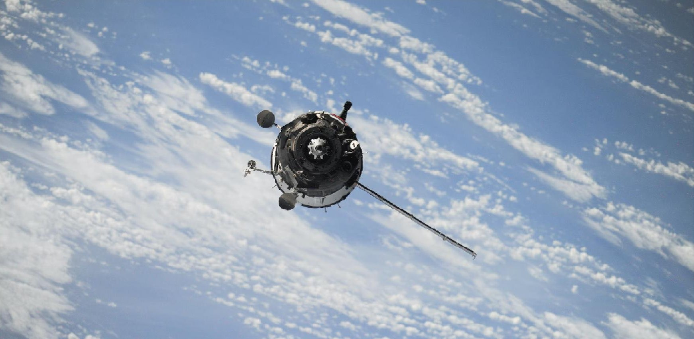

Satellite in orbit. $ \textcircled{c} $ NASA / Unsplash

## 3.2.2 Insufficient risk management

Mitigating the risk of on-orbit collisions involves a variety of approaches depending on the type of debris. Debris smaller than 10 cm currently cannot be tracked, so satellites are often designed with shielding to limit the damage. For instance, some parts of the ISS have shielding to withstand impacts from debris around 1 cm; however, typical satellites are not shielded this well and objects as small as 0.5 cm can cause significant damage (NRC, 2011). For trackable objects, active satellites can perform collision avoidance manoeuvres. However, this process is not without flaws. First, tracking systems are imperfect and cannot deliver a precise location for a tracked object. Instead, collision risk is determined using "uncertainty bubbles," providing operators with a probability of a conjunction between two objects (Peterson and others, 2018). The operator must weigh this probability of collision against the costs of conducting the manoeuvre. Not only does moving a satellite out of orbit expend precious fuel, it also often disrupts satellite services, so avoiding false alarms is essential (Peterson and others, 2018). Additionally, operators can receive thousands of alerts that end up being false alarms, leading to a higher likelihood that certain warnings are ignored (Peterson and others, 2018; Undseth and others, 2020). Generally, if the probability exceeds a certain threshold, usually above a 1 in 10,000 chance, then the operator will likely move the satellite to a safe distance while the threat passes. However, since this is a probability, there is still room for error. For example, the 2009 collision between the operational Iridium-33 satellite with the inactive Cosmos 2251 satellite had a 3 in 100,000 chance of impact and did not stand out from other alerts as noticeably dangerous (Peterson and others, 2018).

Collision risk between two active satellites requires direct communication between the satellite operators involved to ensure that a movement does not unintentionally cause damage (NRC, 2011). However, current communication between operators is inefficient, ad-hoc and voluntary (Boley and Byers, 2021; Unal, 2021). For instance, in 2019, ESA was forced to conduct an emergency manoeuvre of an Earth observation satellite to avoid collision with a SpaceX Starlink satellite. An apparent bug in SpaceX's paging system prevented proper communication about the potential collision, prompting the evasive action from ESA (O'Callaghan, 2019). This incident highlights the need

<!-- PDF_PAGE: 12 -->

for improved and standardized communication, as there are also no clear responsibilities or established rules for such a situation in terms of which operator needs to move to avoid the other. Collaboration is essential, however there are currently no objective mediators or analysts (Finkleman, 2017).

Importantly, these manoeuvres are only available to operational satellites that have manoeuvring capabilities. Many satellites, such as CubeSats, do not have this capability and, therefore, cannot move out of the way of danger (Buchs, 2021). Additionally, there are currently no means to mitigate the risk of collision between two inactive objects (Bonnal and others, 2020).

## 3.2.3 Insufficient cooperation

The risk of space debris is indiscriminate across all of Earth's orbits. As such, no singular nation or industry has the power or the resources to minimize the risk alone, even to protect their own interests in space. Collaboration is essential to regulate orbits, handle inactive satellites and deorbit missions, but this collaboration is often hindered by competition or legal and geopolitical challenges (Finkleman, 2017). Though some data sharing exists on an international level, various national security and intellectual property rules limit the sharing of certain data. In fact, access to data from more than half of unclassified Earth observation satellites is somehow restricted (Borowitz, 2017). This lack of cooperation not only hinders the global community's ability to tackle significant problems like climate change and disaster risk together, but also could contribute to an increase in the number of satellites in orbit. For instance, in the 1960s and 1970s, the United States developed a satellite constellation for a GPS to provide accurate positioning on Earth. However, when it was made available for civilian use in 1993, the U.S. government announced that the civilian signal would be less precise and subject to "selective availability," meaning it could be deliberately degraded or disabled and sharing could be halted at any time (Borowitz, 2021). In response, the European Commission officially called for establishing their own independent global navigation satellite constellation. By failing to share data, the United States created an incentive for other countries to develop their own satellite observation systems, increasing the overall satellite population (Borowitz, 2021).

The lack of cooperation in space increases the risk of space debris not only by increasing the number of satellites in orbit but also by limiting the ability to remove them. Though currently there are no ways to retrieve debris from space, even inactive satellites are considered private property, so nations would be limited to retrieving debris from their own space objects or risk a national security incident (Finkleman, 2017; Undseth and others, 2020). Even developing the technology to clean up debris is difficult. Any technology that is able to remove an inactive satellite or debris from orbit can also remove operational satellites, so there is a concern that some countries could mask their military intentions with legitimate commercial solutions to the space debris problem (Pekkanen, 2018; Wall, 2021).

## 3.2.4 Colonialism

Although the Outer Space Treaty ensures extra-terrestrial regions remain free for exploration and use by all countries, not every country has the ability to access them equally. Currently, only 10 countries and one intergovernmental organization have the capacity for orbital launches (Koop, 2022). Since only a select few countries and companies are able to afford direct access to space, the extractivism and pollution of the orbit disadvantages the rest of the

<!-- PDF_PAGE: 13 -->

planet that may endeavour to use it in the future (Venkatesan and others, 2020). The "space race" of the 1960s was something of a gold rush, as countries raced to stake their claim on-orbit and beyond. This has resurfaced in this age of "New Space," characterized by the emergence of commercial space interest as companies rush to dominate the outer space environment. The International Telecommunications Union (ITU) actually designated GEO as a "limited natural resource" in the 1970s and assigns positions and frequencies to prevent interference among satellites placed there (ITU, 2023). As a result, a coalition of developing nations declared sovereignty over the orbit. They argued that the Outer Space Treaty's designation of the orbits as freely available should not apply, since it incidentally puts the orbits in service of a few wealthy, powerful nations at the expense of those who do not yet have the capacity for orbital launches (Rand, 2019). Their claim of sovereignty was unsuccessful, but their fears were not unfounded: the most popular regions of GEO have already been claimed and have become so congested that there are few or no spots left to allocate to new actors (Gangestad, 2017). The same is becoming true for LEO, though there are no allocated spots in this orbit. Instead, the heavy and increasing use of these orbits by certain actors will eventually result in such a dangerous environment that it essentially excludes others from using them (Boley and Byers, 2021).

## 3.2.5 Prioritizing profits

Together with other resources like the high seas, the atmosphere and the Antarctic, outer space is considered part of the global commons; a type of common-pool resource that falls outside national jurisdictions but is available for all nations to access. As discussed in the theory of "The Tragedy of the Commons," these resources are particularly susceptible to overexploitation and degradation (Hardin, 1968). Individuals are free to take advantage of outer space for short-term gains that undermine the long-term sustainability of the resource for everyone since the costs of degradation or depletion are externalized and distributed among all users (Clancy, 1998). The potential profit to be made by sending satellites into orbit is immediate, while the potential damage they can cause is obscured and will take time to accumulate (Napper and others, 2023).

The global commons are particularly difficult to manage, and require international or supranational agreements to do so effectively. As discussed previously, there are no binding international regulations on debris mitigation. Having only guidelines on debris mitigation, rather than regulations that can be enforced, allows individual actors to save costs through non-compliance while also benefitting from the compliance of others (Boley and Byers, 2021).

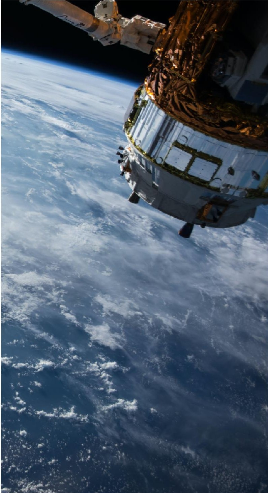

<!-- PDF_PAGE: 14 -->

Additionally, agreements on designating areas as global commons and managing them appropriately only work when all actors agree to recognize them as such. This has become particularly contentious in the use of outer space as there is no international agreement designating our orbits and outer space as a global commons. The Outer Space Treaty dictates that outer space "shall be free for exploration and use by all States without discrimination of any kind" and it "is not subject to national appropriation by claim of sovereignty, by means of use or occupation, or by any other means" (UNOOSA, 1966). However, this has not always been taken up by signatories of the treaty. In fact, the United States issued an executive order in 2020 stating explicitly that "the United States does not view [outer space] as a global commons" (Venkatesan and others, 2020). This was done explicitly for the purpose of "commercial recovery and use of space resources", as well as "expanding the economic sphere of human activity beyond the Earth" (Trump, 2020).

## 3.3 Influences

Reaching a space debris risk tipping point would also have cascading effects in other systems that may influence them to reach risk tipping points themselves. Besides providing critical monitoring of hazards to inform early warning systems, satellites are also relied upon to monitor changes in various Earth systems over time. If we reach a space debris risk tipping point, then we lose critical tools that helps us reduce risk in various other systems.

For instance, since groundwater resources sprawl under large areas of land, often crossing borders or political boundaries, terrestrial measurements are difficult and resource-intensive. Instead, satellites are often used to monitor groundwater and predict areas of water stress (Richey and others, 2015). Satellites in the Gravity Recovery and Climate Experiment (GRACE) and GRACE Follow-On (GRACE-FO) missions measure changes in Earth's gravitational pull. Changing groundwater storage masses affect Earth's gravity, so scientists can track those changes to create a more comprehensive picture of groundwater availability (Hicks, 2007). However, if these satellites are destroyed by a catastrophic collision, we would be left without the ability to monitor groundwater resources from above, limiting our ability to manage Groundwater depletion and increasing the risk of crossing that risk tipping point as well.

Similarly, empirical field measurements of mountain glacier mass balance and retreat are difficult and expensive to obtain. Satellites can provide remote sensing data over large regions, allowing scientists to monitor the entire surface of multiple glaciers and track it through time. Optical satellite imagery, like those of Landsat satellites, can allow mapping of glacier recession, while laser or radar data, like that of the ICESat and Cryosat missions, can detect glacier thinning (Davies, 2020). If we reach a space debris risk tipping point, we would lose the ability to track Mountain glaciers melting. While this would not directly influence reaching the tipping point, it would make keeping track of the problem more difficult and limit the risk management options.

Last, satellites also provide data to model and predict hazard risks. The Sentinel missions, for instance, provide high-resolution data for monitoring land cover, climate change and disasters (Phiri and others, 2020). If we lose these remote sensing and weather monitoring abilities, it will increase the uncertainty that is driving unaffordability of insurance in at-risk areas (Norwood, 2021), contributing to an Uninsurable future. Given the key role of satellites in early warning systems, losing our "eyes in the sky" can result in delayed, inaccurate or absent information about an oncoming hazard, increasing the likelihood of adverse impacts and increasing damages (Frqckiewicz, 2023).

<!-- PDF_PAGE: 15 -->

# 4. Where are we headed? Current and future impacts

## 4.1 The future we need to avoid

The risk of reaching a space debris tipping point is imminent. Model simulations run for the 2009-2012 timeframe predicted an average 30 per cent increase of debris in LEO over the next 200 years as catastrophic collisions occur every five to nine years. Importantly, these models were run based on an orbital environment that had not yet contended with the increasing prevalence of CubeSats or mega-constellations. The space industry is growing rapidly, with the number of satellites in orbit expected to increase from around 8,000 today to over 100,000 by 2030 (Pardini and Anselmo, 2021). In Figure 4, we can see that if we had stuck to the same satellite launch and disposal rates of 2005 and 2014, we would still likely reach a tipping point, but the orbital environment of 2021 paints a much riskier future. The following section outlines the potential impacts that become more probable as we head down this trajectory.

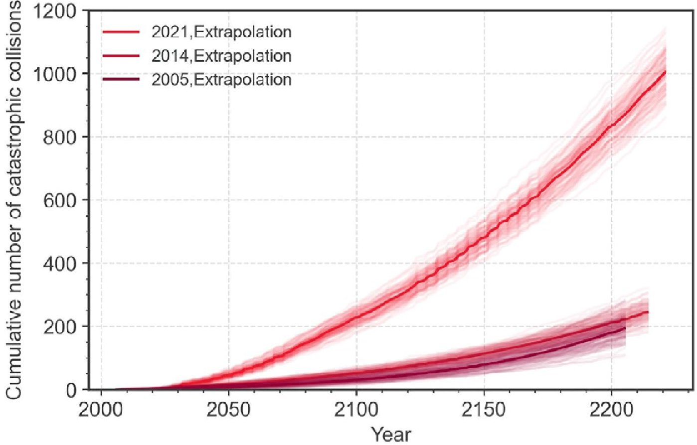

<!-- PDF_PAGE: 16 -->

## 4.2 Infrastructure damage

Reaching a space debris risk tipping point will first have impacts on our orbital infrastructure. Not only are satellites the principal victim of this tipping point, but they then also contribute to worsening the problem. A single collision can generate thousands of pieces of debris. In fact, the 2009 collision between Iridium-33 and Cosmos 2251 satellites was among the most catastrophic fragmentation events to date, creating around 2,300 trackable fragments (Buchs, 2021), of which many will likely remain in orbit for at least a century (Luke, 2021). Even non-catastrophic collisions can cause damage, as when several space shuttle windows had to be replaced due to damage from orbiting paint flecks (Garcia, 2021). The annual cost of damages associated with orbital debris was around $100 million in 2020 (Adilov and others, 2023).

## 4.3 Loss of safety

Satellites are critical tools for both monitoring and communication back on Earth. If we were to reach a space debris risk tipping point, these services would be unavailable, leaving us to rely on terrestrial systems only. In terms of monitoring, this would leave us somewhat blind to certain changes happening around us, increasing the risk of impacts that occur without warning. For instance, Sentinel-2 satellites rapidly provide essential high-resolution images that support the situational awareness of disaster relief efforts, helping responders identify impacted areas or set up supply routes (ESA, 2023c). This capability is not only relevant for weather monitoring, such as hurricane tracking, but also for long-term, large-scale changes such as the chemical composition of the atmosphere, rising sea levels or retreating ice sheets (Dujack, 2022). For communication and connectivity, losing satellites would significantly increase risk in places where there are fewer ground-based systems, such as the Southern hemisphere (Undseth and others, 2020), or where they have limited reach, especially in rural communities (Venkatesan and others, 2020). Having a diversity of options usually means more resilience to shocks, as there is usually an alternative to fall back on if a certain tool fails (UNDRR, 2023).

## 4.4 Loss of opportunities

Satellites and other orbital infrastructure also offer incredible opportunities to learn about and explore both our planet and our universe, but reaching a space debris tipping point would destroy these abilities. First, the interference from debris pollution (as discussed in Chapter 3.1.1) increases the chances of losing astronomical data. Any study relying on spectroscopy will find images streaked with satellite trails through the sky, especially at twilight (Rawls, 2023). Astrophysical signals are generally very faint, and the increasing number of objects in orbit makes it increasingly likely that these signals are lost in the noise. Additionally, astronomical phenomena may actually be discovered, but instead of being investigated, they may be attributed to satellite interference and dismissed (Barentine and others, 2023).

<!-- PDF_PAGE: 17 -->

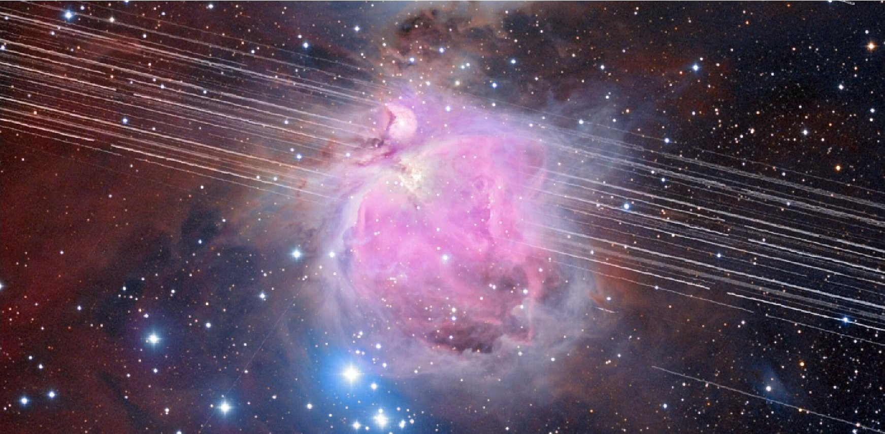

A long-exposure image of the Orion Nebula with a total exposure time of 208 minutes showing satellite trails in mid-December 2019. © A. H. Abolfath / NOIRLab

Satellites such as the Hubble telescope, which provided deep field images of the furthest reaches of the universe and allowed scientists to trace the formation of galaxies and map the presence of dark matter, would be destroyed. The ISS would no longer exist, and neither would the fundamental research they conduct on protein structures for disease research (Guzman, 2022). The knowledge we have generated so far is profound, but the possibilities of what we could learn in the future are beyond imagination. If we reach the tipping point and our orbits become unusable, we will not only lose the opportunities to continue using the existing infrastructure, but also any potential to send any replacements (Primack and Abrams, 2023).

## 4.5 Cultural heritage loss

The rush of actors into space and the corresponding pollution force humanity to think of the implications: to whom does space belong and who are the stakeholders in the night sky? The current activities in space allow for only one type of use to dominate, namely the provision of technological services. While very useful, this paradigm is slowly taking over other ways of using and valuing outer space. Dark night skies represent important cultural heritage and an intangible value for many people (Barentine and others, 2023). Mythology and storytelling of many ancient cultures and indigenous peoples often are based on the constellations. Many people rely on the stars for traditional navigation, such as the practice of wayfinding in Polynesian cultures (Venkatesan and others, 2020). Places with dark night skies also represent important spaces for amateur astronomy and astrotourism (Bjelajac and others, 2021). As we approach a space debris tipping point, more and more satellites and debris increase the night sky brightness. Already, there is no place on the planet, besides the polar regions, where this light pollution cannot be seen (Strauss, 2021).

<!-- PDF_PAGE: 18 -->

## 5. The future we want to create

To assess solutions for avoiding risk tipping points, we must consider these key questions: Does the solution attempt to prevent negative system changes or target adaptation to them? Does the solution work within the current system or drive a fundamental reimagining of the system? Answering these questions is critical for understanding how different actions advance risk reduction goals and yield varied outcomes, including potential consequences and trade-offs. To navigate this, we have developed the ADAT2 framework, which classifies solutions into four categories: Adapt-Delay, Adapt-Transform, Avoid-Delay, and Avoid-Transform — see the main report for details.

## 5.1 Avoid

Avoid actions alter the system to prevent crossing risk tipping points. Importantly, these actions will be ineffective if they are implemented after a space debris risk tipping point is reached. It will be nearly impossible to reverse course, so these actions need to be implemented proactively in order to be effective. One of the major actions that can be taken is the regulation of objects in orbit; to make the existing guidelines binding on an international level. Mechanisms should be developed to incentivize widespread national regulations based on international guidelines (Buchs, 2021). This includes, in particular, having an end-of-life plan for all orbital objects, and holding operators responsible for ensuring sustainable deorbiting. These measures ideally should be implemented during the design of the satellite — for example, including docking plates for easy capture or thrusters to assist atmospheric drag (O'Brien, 2021).

Other actions can be taken to limit the number of objects launched into orbit. Encouraging data sharing and transparency of information could limit the number of individual satellites that are sent up to provide the same services. Some experts propose imposing an annual fee or tax on satellite launches with the hope that it may discourage unnecessary accumulation of objects in orbit (Luke, 2021). Others propose setting up a multinational body to allocate slots to countries and companies in LEO similar to what is currently done in GEO (Dujack, 2022).

There is some indication that future technology could be developed to clean up our orbit, but it is not yet possible on a large-scale (Boag, 2019). However, this technology, known as Active Debris Removal (ADR), is currently being tested by various space agencies and companies to remove orbital debris, using nets, harpoons, ion beams, lasers and more (Ledkov and Aslanov, 2022).

<!-- PDF_PAGE: 19 -->

## 5.2 Adapt

Adapt actions reduce exposure to post-tipping point impacts and prepare for sustainable living within the new system. Though avoiding reaching the space debris risk tipping point that would be catastrophic for our satellite monitoring and communication infrastructure is ideal, there are adaptation options we can also pursue. For instance, we can choose to diversify our options instead of setting ourselves up to rely solely on satellites for the provision of certain services. As the proficiency of satellite technology has advanced, so has the dependency on the services they provide, leading to new vulnerabilities in case something goes wrong. Many satellite operators include planned redundancy in the form of backup satellites in case a single satellite is lost (Mureşan and Georgescu, 2015); however, plans do not often include a contingency for the complete destruction of infrastructure in orbit. Therefore, investing in and upgrading terrestrial infrastructure can supplement critical services provided by satellites (Mureşan and Georgescu, 2015) and serve as a backup in the event the risk tipping point is reached.

As mentioned previously, the risk tipping point of cascading collisions can be understood as a process that has already started and will increase in frequency as time progresses (Gini, 2012). As such, collision avoidance manoeuvres will become increasingly necessary for satellites to adapt to this risk tipping point. Currently, collision avoidance manoeuvres are planned and conducted by human operators, but the increasing numbers of satellites and debris will eventually make this impossible (Hobbs and Feron, 2020). As such, research and investments in automated space traffic management can help at least delay the impacts of such a tipping point for individual satellites. Artificial intelligence, particularly machine learning, is currently being explored as a tool to help automate space traffic management (Acciarini and others, 2021). Tracking debris is critical as well. The current Space Surveillance Network (SSN) is able to track around 20,000 objects larger than 10 cm, but this covers less than 0.02 per cent of the total estimated debris population (Undseth and others, 2020). Advancements are being made to track more and smaller pieces of debris more accurately. For instance, in 2020, the United States declared a new, more sensitive radar, known as "Space Fence," operational, which will be able to track up to 200,000 objects (Mola, 2016). Better tracking systems for debris are a prerequisite for successful debris removal operations, which are relevant in all avoid and adapt scenarios.

## 5.3 From Delay to Transform

Whether we take actions to adapt to or avoid the oncoming space debris risk tipping point, these actions can only take us so far. Since the root causes and drivers of the problem are so diverse, it will require an equally diverse solution package of actions addressing multiple angles at once. For instance, turning guidelines for debris mitigation into enforceable regulations is critical. However, research has shown that, even assuming 90 per cent compliance with existing guidelines, stabilization of LEO would also require the active removal of between 5 and 20 objects per year (Liou and Johnson, 2009). Notably, these estimations were calculated when the LEO environment had around 17,000 tracked objects, while the number now has more than doubled (Liou and others, 2010). If we only implement solutions to clean up debris and incentivize appropriate action, these actions will face constant pressure from the behaviours, values and systems that have created the problem in the first place. As such, these adapt and avoid solutions must be taken up not only to delay the tipping point or its worst impacts, but they need to work towards transforming the systems that created this risk tipping point in the first place.

<!-- PDF_PAGE: 20 -->

# Technical Report

## Space debris

For instance, designing our satellites with an end-of-life plan is a great first step, but this does not fundamentally transform our orbital infrastructure to be more sustainable. Satellites are still designed to be destroyed, and the prevailing mindset is that they are essentially disposable. Instead, we could transform our system towards a world without waste, where each satellite is valued and taken care of. They would not be placed in "graveyard orbits," disintegrated in the atmosphere or plunged into the ocean to become a different kind of problem. Instead, they would be safely retrieved, then repaired, reused or recycled, while limiting the amount of waste we generate in the process. For instance, developments are being made to make satellites reusable by installing foldable heat shields to protect satellites and allow them to re-enter the atmosphere without disintegrating (Space Forge, 2023).

Many of the solutions also require different stakeholders to work together, so fostering a community of trust, cooperation and communication will help to create binding agreements that are respected and adhered to for years to come. For instance, establishing a tax on launches or allocating orbital slots must be done in an equitable way, with respect and acknowledgement of the needs of many actors, or else they risk further marginalization of certain actors from space. ADR solutions can be used as anti-satellite weapons (Wall, 2021), so the development of that technology needs to be undertaken in a collaborative and transparent way that actors are able to trust each other. Data sharing also requires transparency and cooperation, so that all nations can make use of gathered information and trust its comprehensiveness.

There must be an acknowledgement and respect of other uses of space, including research, exploration and cultural heritage, to ensure that the outer space is truly a global commons. With the issue of light pollution and the need for dark skies, there are certain technologies being tested to reduce satellite reflectivity using visors or low-albedo coatings (Lalbakhsh and others, 2022). However, to truly preserve the diverse and potential future uses of space for generations to come, reducing the amount of satellites and debris in orbit is critical.

<!-- PDF_PAGE: 21 -->

## 6. Conclusion

Just as the satellites are hurtling around the planet, we are heading towards a tipping point for space debris where the risk to our orbital infrastructure will increase dramatically. Our actions and behaviours, such as a lack of binding regulations and prioritizing profits has brought us to this point where we can see the risky future ahead of us. However, reaching a space debris risk tipping point is not inevitable. By understanding the problem and its potential consequences, we can find solutions that address the root causes of the problem in an interconnected way, using many solutions at once to tackle the problem from all angles. We have the benefit of seeing the risk tipping point ahead of us and can choose to turn away from the brink. We can lead ourselves to a brighter future where our orbital infrastructure is intact, resilient and sustainable.

<!-- PDF_PAGE: 22 -->

## 7. References

Acciarini, Giacomo, and others, eds. (2021). Kessler: a Machine Learning Library for Spacecraft Collision Avoidance. 8th European Conference on Space Debris. Darmstadt. April 20-23.

Adilov, Nodir, and others (2023). An estimate of expected economic losses from satellite collisions with orbital debris. Journal of Space Safety Engineering, vol. 10, No. 1, pp. 66-69. DOI: 10.1016/j.jsse.2023.01.002

Aerospace Corporation (2022). A Brief History of Space Debris. Available at https://aerospace.org/article/brief-history-space-debris

Barentine, John C., and others (2023). Aggregate effects of proliferating low-Earth-orbit objects and implications for astronomical data lost in the noise. Nature Astronomy, vol. 7, No. 3, pp. 252-58. DOI: 10.1038/s41550-023-01904-2

Bjelajac, Dajana, Bojan Derčan, and Sanja Kovačić (2021). Dark skies and dark screens as a precondition for astronomy tourism and general well-being. Information Technology & Tourism, vol. 23, No.1, pp. 19-43. DOI: 10.1007/s40558-020-00189-9

Boag, Skye (2019). The Lifespan Of Orbiting Satellites. Available at https://www.euspaceimaging.com/the-lifespan-of-orbiting-satellites/

Boley, Aaron C., and Michael Byers (2021). Satellite mega-constellations create risks in Low Earth Orbit, the atmosphere and on Earth. Scientific Reports, vol. 11, No. 1, art. 10642. pp. 1-8. DOI: 10.1038/s41598-021-89909-7

Bonnal, Christophe, and others (2020). Just in time collision avoidance - A review. Acta Astronautica, vol. 170, pp. 637-51. DOI: 10.1016/j.actaastro.2020.02.016

Borowitz, Mariel (2017). Open Space: The Global Effort for Open Access to Environmental Satellite Data. Information policy series. Cambridge, Massachusetts: The MIT Press

___ (2021). An Interoperable Information Umbrella: Sharing Space Information Technology. Strategic Studies Quarterly, vol. 15, No. 1, pp. 116-32. Available at https://www.airuniversity.af.edu/Portals/10/SSQ/documents/Volume-15_Issue-1/Borowitz.pdf

Buchs, Romain (2021). Collision risk from space debris: Current status, challenges and response strategies. International Risk Governance Center. DOI: 10.5075/EPFL-IRGC-285976

Byers, Michael, and others (2022). Unnecessary risks created by uncontrolled rocket reentries. Nature Astronomy, vol. 6, No. 9, pp. 1093-97. DOI: 10.1038/s41550-022-01718-8

Clancy, Erin A. (1998). The Tragedy of the Global Commons. Indiana Journal of Global Legal Studies, vol. 5, No. 2, pp. 601-20. Available at https://www.repository.law.indiana.edu/ijgls/vol5/iss2/12

Clormann, Michael, and Nina Klimburg-Witjes (2022). Troubled Orbits and Earthly Concerns: Space Debris as a Boundary Infrastructure. Science, Technology, & Human Values, vol. 47, No. 5, pp. 960-85. DOI: 10.1177/01622439211023554

Davies, Bethan (2020). Observing glacier change from space. Available at https://www.antarcticglaciers.org/glaciers-and-climate/glacier-recession/observing-glacier-change-space/

Dolado-Perez, Juan C., Carmen Pardini, and Luciano Anselmo (2015). Review of uncertainty sources affecting the long-term predictions of space debris evolutionary models. Acta Astronautica, vol. 113, pp. 51-65. DOI: 10.1016/j.actaastro.2015.03.033

Dujack, Stephen R. (2022). The Dire Effects of Space Pollution. Available at https://www.eli.org/vibrant-environment-blog/dire-effects-space pollution

European Space Agency (2023a). About space debris. Available at https://www.esa.int/Space_Safety/Space_Debris/About_space_debris

<!-- PDF_PAGE: 23 -->

___ (2023b). Annual Space Environment report. Available at https://www.sdo.esoc.esa.int/environment_report/Space_Environment_ Report_latest.pdf

___ (2023c). Sentinel Online - Emergency Management, 12 September. Available at https://sentinels.copernicus.eu/web/sentinel/ missions/sentinel-2/thematic-areas-and-services/emergency

___ (2023d). Space debris by the numbers. Available at https://www.esa.int/Space_Safety/Space_Debris/Space_debris_by_the numbers

Finkleman, David (2017). The Dilemma of Space Debris. Available at https://www.americanscientist.org/article/the-dilemma-of-space-debris

Fråckiewicz, Marcin (2023). The Importance of Satellites in Disaster Management. Available at https://ts2.space/en/the-importance-of satellites-in-disaster-management/

Gangestad, Joseph W. (2017). Orbital Slots for Everyone? Available at https://aerospace.org/sites/default/files/2018-05/OrbitalSlots_0.pdf Garcia, Mark (2021). Space Debris and Human Spacecraft. Available at https://brewminate.com/space-debris-and-human-spacecraft/

Gini, Andrea (2012). Don Kessler on Envisat and the Kessler Syndrome. Available at http://www.spacesafetymagazine.com/space-debris/kesslersyndrome/don-kessler-envisat-kessler-syndrome/

Greenbaum, Dov (2020). Space debris puts exploration at risk. Science, vol. 370, No. 6519, p. 922. DOI: 10.1126/science.abf2682

Guzman, Ana (2022). 20 Breakthroughs from 20 Years of Science aboard the ISS. Available at https://www.nasa.gov/mission_pages/station/research/news/iss-20-years-20-breakthroughs

Hardin, Garrett (1968). The Tragedy of the Commons. Science, vol. 162, No. 3859, pp. 1243-48. DOI: 10.1126/science.162.3859.1243

Hattenbach, Jan (2023). Satellites and Space Debris Are Polluting Our Night Skies. Available at https://skyandtelescope.org/astronomy-news/satellites-and-space-debris-are-polluting-our-night-skies/

Hicks, Gloria (2007). Getting at Groundwater with Gravity. Available at https://www.earthdata.nasa.gov/learn/sensing-our-planet/getting-at groundwater-with-gravity

Hobbs, Kerianne L., and Eric M. Feron, eds. (2020). A Taxonomy for Aerospace Collision Avoidance with Implications for Automation in Space Traffic Management. AIAA Scitech 2020 Forum. Orlando, Florida. 6-10 January.

International Telecommunication Union (2023). WRS-22: Regulation of satellites in Earth's orbit. Available at https://www.itu.int/hub/2023/01/ satellite-regulation-leo-geo-wrs/

Johnson, Nicholas L. (1998). Monitoring and Controlling Debris in Space. Scientific American, vol. 279, No. 2, pp. 62-67. Available at https:// www.jstor.org/stable/26070599

Kessler, Donald J. (2000). Critical Density of Spacecraft in Low Earth Orbit: Using Fragmentation Data to Evaluate the Stability of the Orbital Debris Environment. JSC #28949 and LMSEAT #33303. Houston, Texas: Lockheed Martin Space Operations Company.

Kocifaj, M., and others (2021). The proliferation of space objects is a rapidly increasing source of artificial night sky brightness. Monthly Notices of the Royal Astronomical Society: Letters, vol. 504, No.1, pp. L40-L44. DOI: 10.1093/mnrasl/slab030

Koop, Avery (2022). Visualized: Which Countries are Dominating Space? Available at https://www.visualcapitalist.com/visualized-which- countries-are-dominating-space/

Lalbakhsh, Ali, and others (2022). Darkening Low-Earth Orbit Satellite Constellations: A Review. Institute of Electrical and Electronics Engineers Access (IEEE Access), vol. 10, pp. 24383-94. DOI: 10.1109/ACCESS.2022.3155193

<!-- PDF_PAGE: 24 -->

Lawrence, Andy, and others (2022). The case for space environmentalism. Nature Astronomy, vol. 6, No. 4, pp. 428-35. DOI: 10.1038/s41550-022-01655-6

Ledkov, Alexander, and Vladimir Aslanov (2022). Review of contact and contactless active space debris removal approaches. Progress in Aerospace Sciences, vol. 134, art. 100858. DOI: 10.1016/j.paerosci.2022.100858

Letizia, Francesca, Benjamin Bastida Virgili, and Stijn Lemmens (2023). Assessment of orbital capacity thresholds through long-term simulations of the debris environment. Advances in Space Research, vol. 72, No. 7, pp. 2552-69. DOI: 10.1016/j.asr.2022.06.010

Lewis, H. G., and others (2017). Sensitivity of the Space Debris Environment to Large Constellations and Small Satellites. Journal of the British Interplanetary Society, vol. 70, pp. 105-17. Available at https://www.bis-space.com/membership/jbis/2017/JBIS-v70-no02-04-February-April- 2017_44mfdo.pdf

Liou, J.-C., and Nicholas L. Johnson (2009). A sensitivity study of the effectiveness of active debris removal in LEO. Acta Astronautica, vol. 64, 2-3, pp. 236-43. DOI: 10.1016/j.actaastro.2008.07.009

Liou, J.-C., Nicholas L. Johnson, and N. M. Hill (2010). Controlling the growth of future LEO debris populations with active debris removal. Acta Astronautica, vol. 66, 5-6, pp. 648-53. DOI: 10.1016/j.actaastro.2009.08.005

Luke, Charlotte (2021). What is Space Junk and How Does It Affect the Environment? Available at https://earth.org/space-junk-what-is-it-whatcan-we-do-about-it/

Mola, Roger (2016). How Things Work: Space Fence. Available at https://www.smithsonianmag.com/air-space-magazine/how-things-work space-fence-180957776/

Mukherjee, Supantha (2021). Q+A What is space debris and how dangerous is it? Available at https://www.reuters.com/lifestyle/science/qa- what-is-space-debris-how-dangerous-is-it-2021-11-16/

Mureşan, Liviu, and Alexandru Georgescu (2015). The Road to Resilience in 2050: Critical Space Infrastructure and Space Security. The RUSI Journal, vol. 160, No. 6, pp. 58-66. DOI: 10.1080/03071847.2015.1123948

Napper, Imogen E., and others (2023). Protect Earth's orbit: Avoid high seas mistakes. Science, vol. 379, No. 6636, pp. 990-91. DOI: 10.1126/science.adg8989

NASA Orbital Debris Program Office (2023). Orbital Debris Quarterly News, vol. 27, No.1. Available at https://orbitaldebris.jsc.nasa.gov/ quarterly-news/pdfs/odqnv27i1.pdf

National Aeronautics and Space Administration (2020). The Artemis Accords: Principles for Cooperation in the Civil Exploration and Use of the Moon, Mars, Comets, and Asteroids for Peaceful Purposes. Available at https://www.nasa.gov/wp-content/uploads/2022/11/Artemis-Accords signed-13Oct2020.pdf

Norwood, Peter (2021). Insuring the uninsurable: Tackling the link between climate change and financial instability in the insurance sector. Available at https://www.finance-watch.org/wp-content/uploads/2021/07/finance-watch-report-insuring-the-uninsurable-july-2021-2.pdf

O'Brien, Kieran (2021). Sweeping Up Space: The End-of-Life Solution - Astroscale. Available at https://astroscale.com/sweeping-up-space-the end-of-life-solution/

O'Callaghan, Jonathan (2019). SpaceX Declined To Move A Starlink Satellite At Risk Of Collision With A European Satellite. Available at https://www.forbes.com/sites/jonathanocallaghan/2019/09/02/spacex-refused-to-move-a-starlink-satellite-at-risk-of-collision-with-a european-satellite/

Pardini, Carmen, and Luciano Anselmo (2021). Evaluating the impact of space activities in low earth orbit. Acta Astronautica, vol. 184, pp. 11-22. DOI: 10.1016/j.actaastro.2021.03.030

<!-- PDF_PAGE: 25 -->

Pekkanen, Saadia (2018). Why space debris cleanup might be a national security threat. Available at https://theconversation.com/why-space debris-cleanup-might-be-a-national-security-threat-105816

Peterson, Glenn, Marlon Sorge, and William Ailor (2018). Space Traffic Management in the Age of New Space. Available at https://aerospace. org/sites/default/files/2018-05/SpaceTrafficMgmt_0.pdf

Phiri, Darius, and others (2020). Sentinel-2 Data for Land Cover/Use Mapping: A Review. Remote Sensing, vol. 12, No. 14, DOI: 10.3390/ rs12142291

Primack, Joel R., and Nancy Ellen Abrams (2023). Star Wars Forever? — A Cosmic Perspective. Available at http://physics.ucsc.edu/cosmo/ UNESCOr.pdf

Rand, Lisa R. (2019). The Politics of Space Junk. Perspectives on History. Available at https://www.historians.org/research-and-publications perspectives-on-history/summer-2019/politics-of-space-junk

Ravishankar, Channasandra, and others (2021). Next-generation global satellite system with mega-constellations. International Journal of Satellite Communications and Networking, vol. 39, No.1, pp. 6-28. DOI: 10.1002/sat.1351

Rawls, Meredith (2023). Megaconstellations are changing the night sky forever, forcing astronomers to adapt. Available at https://www astronomy.com/science/megaconstellations-are-changing-the-night-sky-forever-forcing-astronomers-to-adapt/

Richey, Alexandra S., and others (2015). Quantifying renewable groundwater stress with GRACE. Water Resources Research, vol. 51, No. 7, pp. 5217-38. DOI: 10.1002/2015WR017349

Roberts, Thomas G. (2017). Popular Orbits 101, 14 June. Available at https://aerospace.csis.org/aerospace101/earth-orbit-101/

Société Européenne des Satellites (2020). GEO, MEO, and LEO: How orbital altitude impacts network performance in satellite data services, 27 October. Available at https://www.satellitetoday.com/content-collection/ses-hub-geo-meo-and-leo/

Space Forge (2023). Space Forge Enables Reusable Satellites as it Announces Revolutionary New Way of Returning from Space to Earth. Available at https://www.globenewswire.com/news-release/2023/05/15/2668846/0/en/Space-Forge-Enables-Reusable-Satellites-as-itAnnounces-Revolutionary-New-Way-of-Returning-from-Space-to-Earth.html

Strauss, Mark (2021). Orbital Debris Creates a New Problem: Light Pollution. Available at https://www.smithsonianmag.com/air-space magazine/bright-lights-big-problem-180977824/

Trump, Donald J. (2020). Executive Order on Encouraging International Support for the Recovery and Use of Space Resources. Available at https://trumpwhitehouse.archives.gov/wp-content/uploads/2020/04/Fact-Sheet-on-EO-Encouraging-International-Support-for-the Recovery-and-Use-of-Space-Resources.pdf

U.S. Congressional Budget Office (2023). Large Constellations of Low-Altitude Satellites: A Primer. Available at https://www.cbo.gov/publication/59175

Unal, Beyza (2021). Collision risks in space due to mega-constellations, 26 October. Available at https://www.chathamhouse.org/2021/10/ collision-risks-space-due-mega-constellations

Undseth, Marit, Claire Jolly, and Mattia Olivari (2020). Space sustainability: the economics of space debris in perspective. OECD Science, Technology and Industry Policy Papers, No. 87, DOI: 10.1787/a339de43-en

United Nations Office for Disaster Risk Reduction (2023). GAR Special Report: Measuring Resilience for the Sustainable Development Goals. Available at https://www.undrr.org/gar/gar2023-special-report

<!-- PDF_PAGE: 26 -->

United Nations Office for Outer Space Affairs (1966). Resolution 2222 (XXI). Treaty on Principles Governing the Activities of States in the Exploration and Use of Outer Space, including the Moon and Other Celestial Bodies. Available at https://www.unoosa.org/oosa/en/ourwork/ spacelaw/treaties/outerspacetreaty.html

___ (1971). Resolution 2777 (XXVI). Convention on International Liability for Damage Caused by Space Objects. Available at https://www.unoosa.org/oosa/en/ourwork/spacelaw/treaties/liability-convention.html

___ (1974). Resolution 3235 (XXIX). Convention on Registration of Objects Launched into Outer Space. Available at https://www.unoosa.org/oosa/en/ourwork/spacelaw/treaties/registration-convention.html

___ (2010). Space Debris Mitigation Guidelines of the Committee on the Peaceful Uses of Outer Space. V.09-88517. Vienna. Available at https://www.unoosa.org/pdf/publications/st_space_49E.pdf

___ (2023). Annual number of objects launched into space. Available at https://ourworldindata.org/grapher/yearly-number-of-objects-launched-into-outer-space#reuse-this-work

United States Department of State (2023). Artemis Accords. Available at https://www.state.gov/artemis-acccords/

United States National Research Council (1995). Orbital Debris: A Technical Assessment. Washington, D.C. The National Academies Press

___ (2011). Limiting Future Collision Risk to Spacecraft: An Assessment of NASA's Meteoroid and Orbital Debris Programs. Washington, D.C. The National Academies Press

Venkatesan, Aparna, and others (2020). The impact of satellite constellations on space as an ancestral global commons. Nature Astronomy, vol. 4, No. 11, pp. 1043-48. DOI: 10.1038/s41550-020-01238-3

Wall, Mike (2021). Kessler Syndrome and the space debris problem. Available at https://www.space.com/kessler-syndrome-space-debris