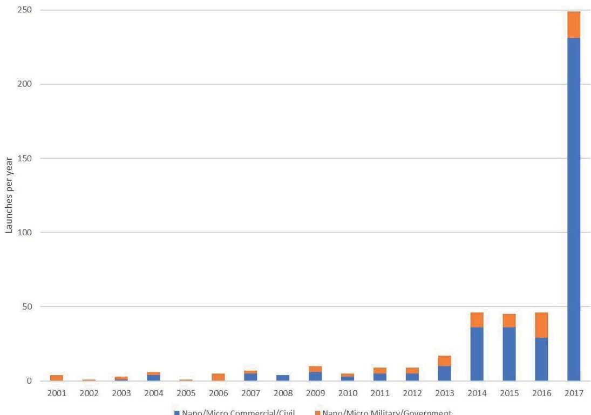
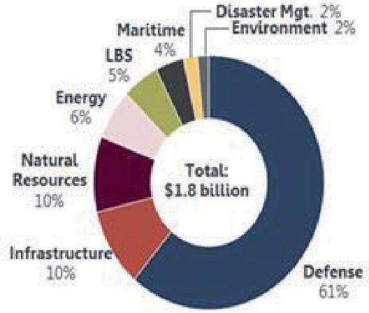
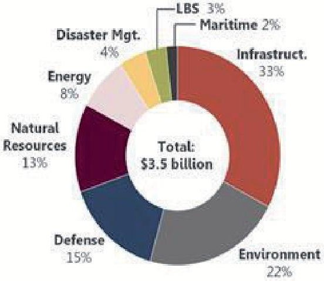
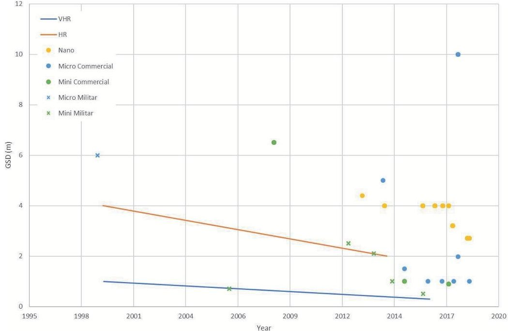
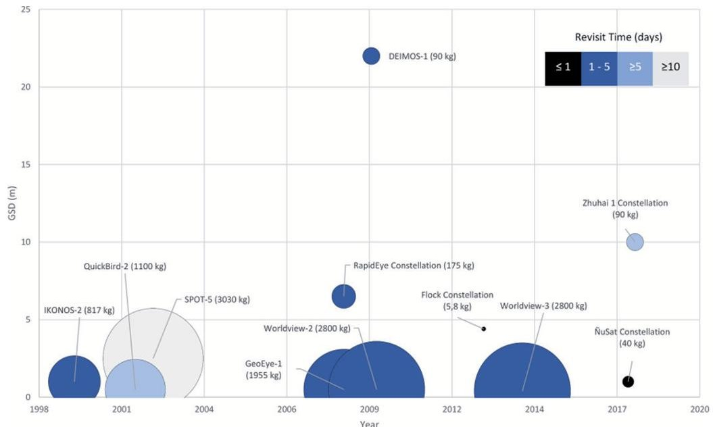
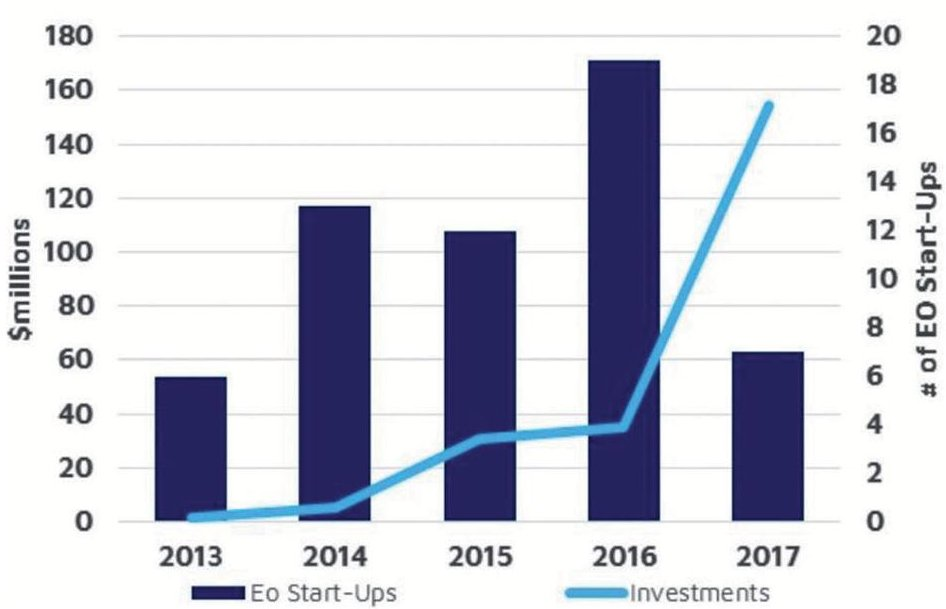

<!-- PDF_PAGE: 1 -->

Chapter

# Earth Observation Technologies: Low-End-Market Disruptive Innovation

Silvia Rodriguez-Donaire, Miquel Sureda,

Daniel Garcia-Almiñana, Eloi Sierra, Jose S. Perez, Peter C.E. Roberts, Jonathan Becdas, Georg H. Herdrich, Dhiren Kataria, Ronald Outlaw, Leonardo Ghizoni, Rachel Villain, Alexis Conte, Badia Belkouchi, Kate Smith, Steve Edmondson, Sarah Haigh, Nicholas H. Crisp, Vitor T.A. Oiko, Rachel E. Lyons, Stephen D. Worral, Sabrina Livadiotti, Claire Huyton, Luciana A. Sinpetru, Rosa M. Dominguez, David González, Francesco Romano, Yung-An Chan, Adam Boxberger, Stefanos Fasoulas, Constantin Traub, Victor Jungnell, Kristian Bay, Jonas Morsbøl, Ameli Schwalber and Barbara Heißerer

## Abstract

After decades of traditional space businesses, the space paradigm is changing. New approaches to more efficient missions in terms of costs, design, and manufacturing processes are fostered. For instance, placing big constellations of micro- and nano-satellites in Low Earth Orbit and Very Low Earth Orbit (LEO and VLEO) enables the space community to obtain a huge amount of data in near real-time with an unprecedented temporal resolution. Beyond technology innovations, other drivers promote innovation in the space sector like the increasing demand for Earth Observation (EO) data by the commercial sector. Perez et al. stated that the EO industry is the second market in terms of operative satellites (661 units), micro- and nano-satellites being the higher share of them (61%). Technological and market drivers encourage the emergence of new start-ups in the space environment like Skybox, OneWeb, Telesat, Planet, and OpenCosmos, among others, with novel business models that change the accessibility, affordability, ownership, and commercialization of space products and services. This chapter shows some results of the H2020 DISCOVERER (DISruptive teChnOlogies for VERy low Earth oRbit platforms) Project and focuses on understanding how micro- and nano-satellites have been disrupting the EO market in front of traditional platforms.

<!-- PDF_PAGE: 2 -->

Keywords: disruptive innovation, low-end market, micro- and nano-satellites new space, Earth Observation

## 1. Introduction

Although Earth Observation (EO) started as an activity exclusively affordable for governments or big players in space with vast financial resources to sustain expensive programmes, it is no longer an exclusive and expensive industry. It allows the emergence of start-ups and spin-offs from academia and emerging countries that are the foundations of the New Space. This phenomenon, known as the democratization of space, changes the accessibility, affordability, and commercialization of space products and services to companies of all types and sizes [1].

According to [2], New Space can be understood as a disruptive trend whose aim is to transform space into a commodity by taking advantage from the joint between Information Technology (IT) and EO. Even though its origins were in Silicon Valley, the trend is now extended worldwide.

Regarding the Union of Concerned Scientists (UCS) satellite database, 1980 operational satellites were orbiting the Earth at the end of April 2018, with 684 of these aimed to EO [3]. This represents a growth of 250% compared to January 2014, when there were only 192 active EO satellites. From this huge increase, it is clear that EO data acquisition is an emerging market. With the number of companies growing year-by-year and optimistic forecasts, it can be reinforced that "EO is on its earlier days and there are still a lot of improvements to do and problems to solve" [4].

Looking at the new EO-based markets, it is observed in [2,5] some signs of potential disruptive innovation in the space sector. Some technological drivers promote this innovation. For instance, low cost access to earth imagery; availability of high-quality spatial, spectral and temporal imagery; innovations in

Micro- and nano-satellites launched between 1997 and 2017, classified by sectors (own elaboration).

<!-- PDF_PAGE: 3 -->

computer science, like cloud computing and machine learning; and some specific programmes, like Copernicus, that transfer high technology development from governmental programmes to other industries and services.

Beyond technological drivers, other drivers promote the disruptive innovation in the space sector, such as the sharing economy, the increasing demand of the commercial sector—like smart cities—and the government interests in environmental monitoring. For example, Spaceflight offers companies a global launching opportunity, working with almost every launch vehicle provider on the planet.

All of these drivers encourage new companies—like Skybox, SpaceX, OneWeb, Telesat, Planet, and OpenCosmos, among others—to develop new business models that make space more accessible and affordable for nongovernmental organizations on shorter periods.

Figure1 summarizes the total number of micro- and nano-satellites launched per year between 2001 and 2017. Micro-satellites are loosely defined as any satellite weighting between 10 and 100 kg, while nano-satellites weight less than 10 kg. They have been classified by sectors to emphasize the huge increase of commercial micro- and nano-satellites launched in recent years compared to those launched by defense departments and governments.

## 2. Hypotheses: disruption in EO technologies

The term disruptive innovation was popularized in 2003 by Clayton M. Christensen, professor at Harvard Business School. In [6], he distinguished between sustaining and disruptive technologies and later, in [7], it replaced the term technology with innovation, since disruption does not come from technology but from businesses. According to [7], sustaining innovations foster improved product performance, while disruptive innovations bring to the market a very different value proposition, with a performance that is initially below the mainstream products, but with low prices or unique features that compensate for it.

Additionally, in [6], a distinction between low-end-market and new-market innovations is made. Low-end-market innovations are those that do not result in

<table border="1"><tr><td>Factors affecting innovation</td><td>Space situation</td></tr><tr><td>Challenging objectives and attractive environments(+)</td><td>Space missions remain technically very challenging and their components and technologies are still one-off prototypes, custom-designed,and optimized for specific missions</td></tr><tr><td>Closed sector(-)</td><td>Space is a closed sector with little exchange of resources outside of aerospace and defense.However,innovations,especially the disruptive ones,appear from the intersection of domains and disciplines</td></tr><tr><td>Risk adversity(-)</td><td>Space activities are high-risk efforts and they do not offer opportunities for error corrections after launch.This leaves little freedom for innovation and leads to a risk-averse culture</td></tr><tr><td>Highly skilled workforce(+)</td><td>Space workforce is highly educated and mobile and has a diverse cultural background</td></tr><tr><td>High entrance barriers and open competitive markets(-)</td><td>Without open competitive markets,space innovations are likely considered useless for businesses.Additionally,high entry barriers and huge launching costs reduce the stimuli of industrial and private sectors to invest in space innovations</td></tr></table>

## Table 1.

Factors affecting space innovation [5].

<!-- PDF_PAGE: 4 -->

better product performance but offer lower prices, such as Walmart and its cheap retailing malls. On the other hand, new-market innovations, like the iPod, serve new users who had not owned or used the previous generation of products.

Christensen approached disruptive innovations from the point of view of both management and industry. However, his recommendations are kept at industrial level. Despite his product performance and business strategy analysis, his definition does not identify the innovation characteristics, since they are intrinsic rather than external factors that change over time, like customer perception or government regulations.

In [5], the concept of innovation is applied to the space environment. The author stated that some factors would affect the likelihood of innovation within the European space sector. Table 1 summarizes these factors, dividing them between those that promote space innovation (+) and those that prevent it (-).

In [8], the previous concept of disruptive innovation is refined by identifying three innovation characteristics: functionality, discontinuous technical standards, and ownership models. His definition broadens the meaning of low-end market and new market innovations.

Low-end market innovations are those with discontinuous technical standards that disrupt markets by using new, less costly materials or new production processes in the creation of existing technologies [9,10] or new forms of ownership. These forms dictate how innovations are received in a marketplace, as they establish prices and innovation-related services among others [11].

New-market innovations are those with a disruptive functionality that provides the user with the ability to undertake a new behavior or accomplish a new task that was impossible before [12-14].

Taking the above signs of innovation in the space sector and following the strategy developed in [7,8], recent micro- and nano-satellite EO missions seem to show the key characteristics of disruptive innovation. Table 2 summarizes the characteristics of micro- and nano-satellites as disruptive innovations according to different authors.

By combining the above-presented characteristics of disruptive micro- and nano-satellite innovations with the main specificities of the EO space market, a set of six hypotheses for micro- and nano-space market disruption has been developed

<table border="1"><tr><td>Characteristics of disruptive innovations</td><td>Christensen and Raynor[7]</td><td>Summerer[5]</td><td>Nagy et al.[8]</td><td>Denis et al.[2]</td></tr><tr><td>High level of risk</td><td></td><td></td><td></td><td></td></tr><tr><td>Discontinuous technical standards(simplicity)</td><td></td><td></td><td></td><td></td></tr><tr><td>Accessibility</td><td></td><td></td><td></td><td></td></tr><tr><td>Enabling new market opportunities</td><td></td><td></td><td></td><td></td></tr><tr><td>Inferior performance</td><td></td><td></td><td></td><td></td></tr><tr><td>Performance improvement</td><td></td><td></td><td></td><td></td></tr><tr><td>Disruptive functionality</td><td></td><td></td><td></td><td></td></tr><tr><td>Affordability</td><td></td><td></td><td></td><td></td></tr><tr><td>Forms of ownership</td><td></td><td></td><td></td><td></td></tr></table>

Characteristics of micro- and nano-satellites as disruptive innovation in space [2, 5, 7, 8].

<!-- PDF_PAGE: 5 -->

Earth Observation Technologies: Low-End-Market Disruptive Innovation DOI: http://dx.doi.org/10.5772/intechopen.90923

<table border="1"><tr><td>Characteristics of disruptive innovations</td><td>Hypothesis to test</td><td>Hypothesis label</td></tr><tr><td>Standardization</td><td>The space sector has a low level of risk acceptance, which leaves little freedom for innovation. However, micro- and nano-satellites provide simplicity and standardization in terms of design and manufacturing, This leads to a higher level of risk acceptance and, consequently, more innovation</td><td>1</td></tr><tr><td>New market opportunities</td><td>Data accessibility and technology standardization are essential conditions to open new market opportunities</td><td>2</td></tr><tr><td>Performance</td><td>Micro- and nano-satellites improve their performance in a pace that meets market needs even though they have an inferior performance than those of traditional EO spacecraft</td><td>3</td></tr><tr><td>Affordability</td><td>Traditional, established space companies are ignoring the market due to very low-profit margins. This fact leaves room for new entrants with totally different business models. These new actors bet on low-cost technology to produce more affordable space systems for Earth Observation</td><td>4</td></tr><tr><td>Ownership forms</td><td>Recent evolutions in micro- and nano-satellite technologies are affecting the forms of ownership and operability of EO systems, which were formerly owned by governments or public organizations</td><td>5</td></tr><tr><td>Disruptive functionality</td><td>Micro- and nano-satellite missions offer disruptive functionalities that provide novel products or services that were unthinkable or impossible with traditional spacecraft missions</td><td>6</td></tr></table>

Table 3.

Summary of studied hypothesis related to the disruptive innovation characteristics.

and presented in Table 3. In this section, all mentioned characteristics are tested to verify if the authors' hypotheses are true in order to clarify whether micro- and nano-satellites are disruptive for the EO market.

## 3. Analysis: disruption in EO technologies

In this section, the analysis of the six hypotheses stated in Table 3 for micro- and nano-space market disruption has been done. The first hypothesis is related to space market standardization, the second hypothesis is related to market opportunities, the third hypothesis is related to micro- and nano-satellite performance, the fourth hypothesis is related to the affordability of the new space technologies for EO, the fifth hypothesis is related to the forms of ownership and operability of EO systems, and finally, the sixth hypothesis is related to disruptive functionalities that provide novel products.

## 3.1 Hypothesis 1: micro- and nano-satellite simplicity and standardization

In mainstream space platforms, each of design, development, and test campaign tends to be almost unique, custom-made for the specific mission. Long project

<!-- PDF_PAGE: 6 -->

durations and high costs are consequences of the complexity that implies the need of guaranteeing the maximum quality, hence the minimum risk for the mission.

On the other hand, micro- and nano-satellite constellations are based on the concept of standardization, which opens up the possibility of using commercial electronic components and the choice of numerous technology suppliers. In that way, it is possible to create less expensive satellites in shorter periods. Depending on the specifications, a micro-satellite can be built and placed in orbit for a few million euros and a nano-satellite for almost a quarter million. In comparison, the cost of a large satellite can rise to 500 million euros [4,15].

Apart from the cost and size, the main benefit of micro- and nano-satellites is the time required to design and implement each model. As an average, a micro- or a nano-satellite can be designed, manufactured, and launched within less than 2 years [4,15]. This means that large constellations of small satellites can be regularly renewed with state-of-the-art systems, ensuring optimal performance even if some units are lost or fail. This is not the case of conventional satellites, which are developed and launched within expensive and long projects that last between 5 and 10 years and, accordingly, cannot afford any failure in the platform without risking the entire mission.

Particularly worthy of mention is the recent emergence of many dedicated micro-launchers designed to place small satellites in orbit. So far, micro- and nano-satellites are launched at marginal costs as "piggyback" payload alongside traditional spacecraft. However, new micro-launcher concepts may be responsible for providing simplicity and standardization to the whole process, lowering launch costs if they demonstrate reliability and good performance [1].

For the stated reasons, H1 can be supported, since micro- and nano-satellite design and manufacturing is focused on simple and standard equipment that eventually may increase the linked risk acceptance.

## 3.2 Hypothesis 2: new market opportunities

H2: Data accessibility and technology standardization are essential conditions to open new market opportunities.

EO is a promising, fast-growing field boosted by a wide range of applications across various economic sectors, including precision farming, natural resource monitoring, oil and gas exploration, meteorology, civil protection, insurance, and urban monitoring [1]. The emergence of low-cost micro- and nano-satellites enabled EO start-ups to attract new markets interested in their tremendous amount of accessible and affordable high-resolution images. Additionally, more and more countries invest in their EO capacity, confirming the soft power dimension of space but also opening new market opportunities for international or regional cooperation [1].

Not only space is becoming more accessible through new launch technology, but also data from programs like US Landsat and Europe's Sentinel program are already available to all. This allows third parties to develop new services and applications over high-quality databases supported by different funding programs. For instance, OneAtlas updated the base map of the whole world with high-resolution imagery without taking any picture or OneWeb plan to use small spacecraft technology to make satellite Internet available on a global scale.

It is clear that some of these new markets are recently gaining access to EO data because it is cheaper than before. However, a very important entry barrier was also the traditional space companies themselves, because data owned and controlled by defense and public organizations were not available at any price.

<!-- PDF_PAGE: 7 -->

Earth Observation Technologies: Low-End-Market Disruptive Innovation DOI: http://dx.doi.org/10.5772/intechopen.90923

Figure 2.

Commercial EO data market in 2017 (left) and value-added services market in 2017 (right) [1].

In Figure 2, it can be seen that in the year 2017, defense represented more than 60% of the commercial data market ($1.8 billion), with infrastructure and natural resources verticals accounting a similar share to each other. These three vertical markets represented 80% of the commercial data market in 2017. Looking to the future, Euroconsult forecasts that the market for commercial EO data is expected to reach $3 billion (5% of the Compound Annual Growth Rate (CAGR)) in 2026 [1].

In the short term, growth is expected to continue to be driven by the defense, with ongoing regional unrest and growing Image Intelligence needs of countries without proprietary military systems. By 2026, the defense is expected to represent 46% of the total market value ($1.7 billion). Therefore, although defense will continue to be the major client for EO imagery, their share will reduce in the coming years. Other applications, such as maritime, infrastructure, and resource monitoring will support growth in the long term. Together with defense, these applications should have a 5% CAGR through 2026. Emerging applications in these sectors such as critical infrastructure monitoring and precision agriculture benefit from more capable satellite systems (i.e., a combination of higher ground resolution with higher temporal resolution). Location-Based Services (LBS) applications, including financial and insurance services, have been slow to develop, but the longer-term outlook for these services remains positive with the availability of new satellite capacity. For LBS applications, greater emphasis is expected to be put on integrated product offerings, emphasizing requiring the development of change detection analytics. In terms of revenue generation by data type, VHR optical is expected to remain the most significant in terms of data sales. More moderate-resolution datasets will be challenged by the availability of free solutions and low-cost systems offering comparable data.

According to [1], in 2016, the market for Value-Added Services (VAS) was $3.5 billion. This discounts the purchase of commercial data to develop geospatial solutions. Key markets for VAS do not mirror those for commercial data sales. Defense, while representing 61% of the commercial data market, only represents 15% of the VAS market; conversely, infrastructure and engineering (which incorporated cartography, cadastre, etc.) is only 10% of the commercial data market but 33% of the value-added market.

According to [1], the reasoning for this is relatively straightforward: defense end-users purchase data with much value-added analytics performed in-house. On the other hand, lower-cost, coarser resolution, and lower geolocation accuracy data can be leveraged with value-adding to form greater value products and services. Environmentmonitoring users, for instance, procure limited commercial data but are developing

<!-- PDF_PAGE: 8 -->

solutions using scientific and coarse resolution data, for example, pollution/aerosol monitoring and climate modeling. Many infrastructure applications for mapping also can be developed by using Landsat and Sentinel data that are free of charge.

In [1], it is also forecast that data also add to the belief that by making coarser resolution data free, the value-added services industry can leverage this to build greater value services with the potential for two very different businesses: a "high-end" data market to support defense and free/low-cost data sources to support commercial and civil government applications.

For these reasons, H2 would also be supported, since new market opportunities are growing and standardization has been proven as H1.

## 3.3 Hypothesis 3: micro- and nano-satellites performance

H3: Micro- and nano-satellites improve their performance in a pace that meets EO market needs despite having an inferior performance than those of traditional EO spacecraft.

EO optical imaging satellite performance is defined in terms of spatial and temporal resolution. Spatial resolution relates to the level of detail obtained from an image and can be measured by the Ground Sample Distance (GSD), which is the distance between adjacent pixel centers measured on the ground.

Figure 3 shows the evolution of EO micro- and nano-satellite GSD in the last 20 years. The solid lines depict how the concepts of Medium Resolution (MR), High Resolution (HR), and Very High Resolution (VHR) evolved through time. While MR has maintained constant around 15 m, HR and VHR have decreased to 2 and 0.3 m, respectively.

Dots in Figure 3 represent GSD values for the EO micro- and nano-satellites analyzed in this research (see Appendix A for details on the data analysis methodology). Cross marks prove that between 1999 and 2013 governmental and defense were almost the only micro- and nano-satellites devoted to obtaining HR and VHR images of the earth. However, 2013 marks a turning point in the EO market, with

Figure 3. Evolution of EO satellite GSD during the period 1999-2018 (own elaboration).

<!-- PDF_PAGE: 9 -->

Figure 4. GSD, year of launching, mass, and revisit time of EO micro- and nano-satellites (own elaboration).

the irruption of private start-ups launching small space platforms able to achieve resolutions from 4 to 1 m [15].

Nano-satellites can obtain GSD below 3 m, thanks to new sensor technologies and the use of Low Earth Orbit and Very Low Earth Orbit (LEO and VLEO). In the range of micro-satellites, GSD around 1 m can be achieved, with perspectives of values even lower in the next years. These values are small enough to have a great interest for many commercial applications, mainly in the agriculture, transportation, energy, and infrastructure markets [1].

If the temporal resolution is also taken into account, micro- and nano-satellites show their huge potential for EO commercial applications. Satellite's revisit time is the time elapsed between observations of the same point on Earth's surface. Figure 4 summarizes GSD, year of launching, mass, and revisit time of EO micro- and nano-satellites. The amount of satellites displayed in Figure 4 is smaller than in Figures 1 and 3 because the information about revisit time was not available for many satellites (see Appendix A for details on the data analysis methodology). Besides, revisit time of Flock (Planet) and NuSat (Satellogic) constellations is calculated using their final future configuration.

In Figure 4, each circle represents a satellite or a constellation of identical satellites. GSD and launching year can be measured in both axes, while the circle gives information about the mass and revisit time (the bigger, the more massive and the darker, the shortest revisit time). Looking at the characteristics of different satellites, it is easy to see that Flock and the NuSat constellations are the only platforms able to provide revisit times lower than one day. This capability makes their data more appealing than any of the other platforms, even having a slightly less spatial resolution. The key for this performance is the possibility to design, launch, and operate constellations of more than 100 satellites, something which seems only possible, thanks to the reduced costs associated to micro- and nano-satellite technology considering the several hundred million dollar cost of traditional EO satellites. These massive micro- and nano-satellite constellations are aiming to transform EO imagery into a commercial product (e.g., analytical solutions from the big data obtained from the constellations), taking benefit of their almost high resolution and their high revisit time.

<!-- PDF_PAGE: 10 -->

For all these arguments, H3 would be supported, as performance is increasingly high in new satellites and constellations, whilst it is still far from conventional satellites.

## 3.4 Hypothesis 4: affordability of the new space technologies for EO

H4: Traditional, established space companies are ignoring the market due to very low-profit margins. This fact leaves room for new entrants with totally different business models. These new actors bet on low-cost technology to produce more affordable space systems for Earth Observation.

During the last decades of the twentieth century, EO systems were mainly dedicated platforms owned and operated by public organizations or governments, often at a national level. This status quo was sustained by economic and policy barriers to space commerce. Traditionally, costs associated with satellite development and operation have been extremely high, both at LEO and Geostationary Orbits (GSO). However, platform standardization, continued progress in technology miniaturization, and Components Off-The-Shelf (COTS) are not only leading to cheaper satellite development and launch but also reducing manufacturing time. The possibility of using many small satellites in a constellation is enabling near real-time Earth Observation and addressing the issue of temporal resolution. Consequently, increasingly large amounts of data are being gathered every day.

This novel combination of price reduction and data generation has created in the last decade new business opportunities favoring the emergence of new space companies dedicated to the EO market. These companies base their innovative business models on the generation of near real-time high-resolution images (close to 1 m [15]) that are sold in user-oriented data access platforms (around $1/km $1/km

It is important to note that this new model is mainly ruled by start-ups with substantial investment capacity. Figure 5 depicts the evolution of investment and the number of start-ups founded in the EO market between 2013 and 2017. It can be seen that almost 60 EO companies were funded in these 5 years. More significantly, the solid line clearly shows an increase in the investment, from less than 5 million

EO Start-Ups and Investments, 2013-2017

Figure 5. Earth Observation start-ups and investments during the period 2013-2017 (source [15] and own elaboration).

<!-- PDF_PAGE: 11 -->

dollars in 2013 and 2014 to almost 160 million dollars in 2017. According to [15], one of the reasons why new start-ups have been so successful in raising capital may well be because it challenges traditional space enterprises at technology implementation deployment of spacecraft, innovation in the business model, etc. Some of these new start-ups that embrace open-innovation and knowledge sharing are Planet, Satellogic, PLD Space, Deimos, and GomSpace, among others [2, 5].

For all these reasons, H4 would be supported, since new dealers in the space sector are mainly new companies rather than stablished ones.

3. 5 Hypothesis 5: forms of ownership and operability of EO systems

H5: Recent evolutions in micro- and nano-satellite technologies are affecting the forms of ownership and operability of EO systems, which were formerly owned by governments or public organizations.

These new opportunities foster innovation and commercial growth, but they also leave room to establish a legal framework. That regulation would aim to maintain a safe and predictable space environment that allows us to face correctly the rapid changes of technology without interrupting the innovation freedom of the space sector.

The disruption in the space market extends the technological improvements. For instance, an increment in the supply of EO imagery would have implications for new business models, lower costs and more flexible ownership models for commercializing imagery.

Emerging start-ups and spin-offs in the space sector are transforming the operability of EO systems owned by governments or public organizations. This transformation extends from the satellites themselves to the data processing and finally the data analysis that represents VAS to commercial and public organizations.

The idea of a "sharing economy" implies a revolution in the ownership of space imagery. All users have access to relevant and free data under a distributed ownership scheme. This trend is being driven by multiple technological innovations, for example, reusable launchers (e.g., SpaceX), online platforms where users can combine different data (e.g., Blacksky), or launcher service platform (e.g., Spaceflight). Nevertheless, there are questions over the sustainability of this ownership model, especially for commercial organizations that need to generate profit. Additionally, there are certain applications related to security or defense where such a sharedownership model may not be appropriate.

Radiant Earth Foundation is trying to address some of these challenges, such as building a place where the development community can go for earth imagery and geospatial data and with access to market analytics, best practices guides, return of investment methodologies, and discussion of policy issues.

For all these reasons, H5 would also be supported, since new dealers from H4 are also defining new forms of ownership and service.

3. 6 Hypothesis 6: disruptive functionality

H6: Micro- and nano-satellite missions offer disruptive functionalities that provide novel products or services that were unthinkable or impossible with traditional spacecraft missions.

Although nano- and micro-satellites are dramatically changing the EO market, it cannot be said that they are providing novel products or services to the final data users. Satellite imaging has been used since the early 1970s when the Landsat program started. As stated before, the irruption of new start-ups with novel business

<!-- PDF_PAGE: 12 -->

models is not based on the generation of new data, but on the accessibility to it and complementing traditional space business models.

Therefore, considering that hypothesis 2 and 4 proved to be true, micro- and nano-satellites in the EO market can be categorized as low-end-market disruptive innovations. This hypothesis is also supported in [15], in which it is stated that new space business models do not drastically change satellite EO business, since both fulfill a similar kind of customer needs. What New Space businesses provide against traditional ones are accessibility, affordability, and commercialization of space products or services to commercial and noncommercial companies.

H6 is therefore not fulfilled.

## 4. Conclusions

New Space has usually been considered as a disruptive market. Some technological drivers like low-cost, high-quality image, among others, promote innovation, and they encourage new companies to develop new business models that make space more accessible and affordable for nongovernmental organizations on shorter development periods.

This chapter is measuring how disruptive the micro- and nano-satellite innovations are within the EO space market, under a series of hypotheses based on established standards for disruptive innovation [2,5,7,8].

As a result, we have observed that micro- and nano-satellite technologies represent a low-end-market disruptive innovation, since they standardize the production process that reduces the cost of design and manufacturing phases. Additionally, thanks to this standardization, the forms of ownership and operability of EO platforms have changed to a private model. This allows the establishment of lower prices and creation of innovative services that not only open new market opportunities for new business models and data accessibility by commercial companies, but also improve the space market performance even though they have inferior characteristics than those provided by traditional EO spacecraft. As a consequence of all this, it cannot be said that micro- and nano-satellites drastically change satellite EO business, but they provide an accessible and affordable data to commercial and noncommercial companies against traditional ones.

## Acknowledgements

The DISCOVERER project has received funding from the European Union's Horizon 2020 research and innovation program under grant agreement No 737183.

## Appendix: quantitative data analysis

Most of the data analyzed in this paper were obtained from the Union of Concerned Scientists (UCS) database [1]. This Web includes a listing of nearly 2000 operational satellites orbiting around Earth. Based on this information, only satellites with Earth Observation purposes were selected, which lead to a final number of 394 EO satellites usable for our research. From all these, Figures 3 and 4 only picture information about those with spatial and temporal resolution values available. The list of used data can be found in Table 4.

<!-- PDF_PAGE: 13 -->

Earth Observation Technologies: Low-End-Market Disruptive Innovation DOI: http://dx.doi.org/10.5772/intechopen.90923

<table border="1"><tr><td>Name</td><td>User</td><td>Launch date</td><td>Launch mass(kg)</td><td>GSD(m)</td><td>Revisit time(days)</td></tr><tr><td>DLR Tubsat</td><td>Government</td><td>26/05/1999</td><td>45</td><td>6</td><td>—</td></tr><tr><td>IKONOS-2</td><td>Commercial</td><td>24/09/1999</td><td>817</td><td>1</td><td>2.25</td></tr><tr><td>Terra</td><td>Government</td><td>18/12/1999</td><td>4864</td><td>15</td><td>—</td></tr><tr><td>QuickBird-2</td><td>Commercial</td><td>01/10/2001</td><td>1100</td><td>0.5</td><td>7</td></tr><tr><td>Bird 2</td><td>Government</td><td>22/10/2001</td><td>92</td><td>25</td><td>—</td></tr><tr><td>SPOT-5</td><td>Government</td><td>04/05/2002</td><td>3030</td><td>2.5</td><td>26</td></tr><tr><td>BeijinGalaxy-1</td><td>Civil</td><td>27/10/2005</td><td>50</td><td>39</td><td>—</td></tr><tr><td>EROS B1</td><td>Military/commercial</td><td>25/04/2006</td><td>350</td><td>0.7</td><td>—</td></tr><tr><td>RapidEye Constellation</td><td>Commercial</td><td>29/08/2008*</td><td>175</td><td>6.5</td><td>3.25</td></tr><tr><td>GeoEye-1</td><td>Commercial</td><td>01/09/2008</td><td>1955</td><td>0.5</td><td>3</td></tr><tr><td>HJ-1</td><td>Government</td><td>05/09/2008</td><td>470</td><td>30</td><td>—</td></tr><tr><td>Saudisat-2</td><td>Government</td><td>29/07/2009</td><td>35</td><td>15</td><td>—</td></tr><tr><td>DEIMOS-1</td><td>Government</td><td>29/07/2009</td><td>90</td><td>22</td><td>2</td></tr><tr><td>Worldview-2</td><td>Commercial</td><td>01/10/2009</td><td>2800</td><td>0.5</td><td>2.4</td></tr><tr><td>Alsat</td><td>Government</td><td>12/07/2010*</td><td>116</td><td>2.5</td><td>—</td></tr><tr><td>BKA 2</td><td>Government</td><td>22/07/2012</td><td>473</td><td>2.1</td><td></td></tr><tr><td>Landsat-8</td><td>Government</td><td>11/02/2013</td><td>2623</td><td>15</td><td>—</td></tr><tr><td>DubaiSat-2</td><td>Government</td><td>21/11/2013</td><td>300</td><td>1</td><td>—</td></tr><tr><td>Zhuhai 1 Constellation</td><td>Commercial</td><td>26/04/2014*</td><td>90</td><td>10</td><td>5</td></tr><tr><td>Rising-2</td><td>Civil</td><td>24/05/2014</td><td>41</td><td>5</td><td>—</td></tr><tr><td>Flock Constellation</td><td>Commercial</td><td>19/06/2014*</td><td>5</td><td>4</td><td>1</td></tr><tr><td>Aurora</td><td>Commercial</td><td>19/06/2014</td><td>25</td><td>15</td><td>—</td></tr><tr><td>Worldview-3</td><td>Commercial</td><td>01/08/2014</td><td>2800</td><td>0.4</td><td>2.75</td></tr><tr><td>ASNARO 1</td><td>Government</td><td>06/11/2014</td><td>500</td><td>0.5</td><td>—</td></tr><tr><td>CBNT-1</td><td>Commercial</td><td>10/07/2015</td><td>91</td><td>1,5</td><td>—</td></tr><tr><td>DMC 3</td><td>Commercial</td><td>10/07/2015*</td><td>447</td><td>1</td><td>—</td></tr><tr><td>LAPAN A2</td><td>Government</td><td>24/09/2015</td><td>68</td><td>5</td><td>—</td></tr><tr><td>Bison Sat</td><td>Civil</td><td>08/10/2015</td><td>1</td><td>43</td><td>—</td></tr><tr><td>Athenoxat-1</td><td>Commercial</td><td>16/12/2015</td><td>6</td><td>25</td><td>—</td></tr><tr><td>BIROS</td><td>Government</td><td>22/06/2016</td><td>110</td><td>42.4</td><td>—</td></tr><tr><td>BlackSky Pathfinder</td><td>Commercial</td><td>26/09/2016</td><td>44</td><td>1</td><td>—</td></tr><tr><td>Worldview-4</td><td>Commercial</td><td>01/11/2016</td><td>2485</td><td>0.3</td><td>4.5</td></tr><tr><td>CE-SAT-1</td><td>Commercial</td><td>22/06/2017</td><td>50</td><td>1</td><td>—</td></tr><tr><td>Skysat</td><td>Commercial</td><td>31/10/2017*</td><td>110</td><td>0.9</td><td>—</td></tr></table>

Table 4. List of satellites used in Figures 3 and 4 [3, 16-19].

<!-- PDF_PAGE: 14 -->

## Author details

Silvia Rodriguez-Donaire $ ^{1} $ , Miquel Sureda $ ^{1} $ , Daniel Garcia-Almiñana $ ^{1*} $ , Eloi Sierra $ ^{1} $ Jose S. Perez $ ^{2} $ , Peter C.E. Roberts $ ^{3} $ , Jonathan Becedas $ ^{4} $ , Georg H. Herdrich $ ^{5} $ Dhiren Kataria $ ^{6} $ , Ronald Outlaw $ ^{7} $ , Leonardo Ghizoni $ ^{8} $ , Rachel Villain $ ^{2} $ Alexis Conte $ ^{2} $ , Badia Belkouchi $ ^{2} $ , Kate Smith $ ^{3} $ , Steve Edmondson $ ^{3} $ , Sarah Haigh $ ^{3} $ Nicholas H. Crisp $ ^{3} $ , Vitor T.A. Oiko $ ^{3} $ , Rachel E. Lyons $ ^{3} $ , Stephen D. Worral $ ^{3} $ Sabrina Livadiotti $ ^{3} $ , Claire Huyton $ ^{3} $ , Luciana A. Sinpetru $ ^{3} $ , Rosa M. Dominguez $ ^{4} $ David González $ ^{4} $ , Francesco Romano $ ^{5} $ , Yung-An Chan $ ^{5} $ , Adam Boxberger $ ^{5} $ Stefanos Fasoulas $ ^{5} $ , Constantin Traub $ ^{5} $ , Victor Jungnell $ ^{8} $ , Kristian Bay $ ^{8} $ Jonas Morsbol $ ^{8} $ , Ameli Schwalber $ ^{9} $ and Barbara Heißer $ ^{9} $

1 UPC-BarcelonaTECH ESEIAAT, Terrassa, Barcelona, Spain

2 Euroconsult, Paris, France

3 The University of Manchester, Manchester, United Kingdom

4 Elecnor Deimos Satellite Systems, Puertollano, Spain

5 Institute of Space System, University of Stuttgart, Stuttgart, Germany

6 Mullard Space Science Laboratory (UCL), Dorking, United Kingdom

7 Christopher Newport University, Newport News, VA, United States of America

8 Gomspace AS, Aalborg East, Denmark

9 Concentris Research Management GmbH, Fürstenfeldbruck, Germany

*Address all correspondence to: daniel.garcia@upc.edu

## IntechOpen

© 2020 The Author(s). Licensee IntechOpen. This chapter is distributed under the terms of the Creative Commons Attribution License (http://creativecommons.org/licenses/ by/3.0), which permits unrestricted use, distribution, and reproduction in any medium, provided the original work is properly cited.

<!-- PDF_PAGE: 15 -->

Earth Observation Technologies: Low-End-Market Disruptive Innovation DOI: http://dx.doi.org/10.5772/intechopen.90923

## References

[1] Perez S et al. Prospects of Earth Observation Overview. Euroconsult. DISCOVERER H2020 Deliverable; 2018

[2] Denis G, Claverie A, Pasco X, Darnis J, de Maupeou B, Lafaye M, et al. Towards disruptions in Earth observation? New Earth Observation systems and markets evolution: Possible scenarios and impacts. Acta Astronautica. 2017;137:415-433. DOI: 10.1016/j.actaastro.2017.04.034

[3] UCS Satellite Database [Internet]. Union of Concerned Scientists. 2019. Available from: https://www.ucsusa.org/nuclear-weapons/space-weapons/satellite-database [Accessed: 13 May 2019]

[4] Kramer H. Observation of the Earth and Its Environment. Berlin: Springer; 2002

[5] Summerer L. Signs of potentially disruptive innovation in the space sector. International Journal of Innovation Science. 2011;3(3):127-140. DOI: 10.1260/1757-2223.3.3.127

[6] Christensen C. The Innovator's Dilemma. New York, NY: Harper Business; 2011

[7] Christensen C, Raynor M. The Innovator's Solution: Creating and Sustaining Successful Growth. 1st ed. Boston: Harvard Business Review Press; 2013

[8] Nagy D, Schuessler J, Dubinsky A. Defining and identifying disruptive innovations. Industrial Marketing Management. 2016;57:119-126. DOI: 10.1016/j.indmarman.2015.11.017

[9] Rogers E. Diffusion of Innovations. 4th ed. New York: Free Press; 1995

[10] Swanson E. Information systems innovation among organizations. Management Science.

1994;40(9):1069-1092. DOI: 10.1287/ mnsc.40.9.1069

[11] Merges R, Reynolds G. The proper scope of the copyright and patent power. Harvard Journal on Legislation. 2000;37:45

[12] Abernathy WJ, Utterback JM. Patterns of industrial innovation. Technology Review. 1978;80:40-47

[14] Dahlin K, Behrens D. When is an invention really radical? Research Policy. 2005;34(5):717-737. DOI: 10.1016/j. respol.2005.03.009

[13] Anderson P, Tushman M. Technological discontinuities and dominant designs: A cyclical model of technological change. Administrative Science Quarterly. 1990;35(4):604. DOI: 10.2307/2393511

[15] Nagendra N, Segert T. Challenges for new space commercial earth observation small satellites. New Space. 2017;5(4):238-243. DOI: 10.1089/ space.2017.0014

[16] EO Portal Directory [Online]. EO Sharing Earth Observation Resources Available from: https://directory. eoportal.org/web/eoportal/satellite missions [Accessed: 19 May 2019]

[17] Planet SA [Online]. California: Planet Labs. 2019. Available from: https://www.planet.com/ [Accessed: 19 May 2019]

[18] Digital Globe SA [Online]. Westminster: DigitalGlobe Headquarters. 2019. Available from: https://www.digitalglobe.com/ [Accessed: 19 May 2019]

[19] Satellite Imaging Corporation [Online]. Houston: Satellite Imaging Corporation Headquarters. 2019. Available from: https://www.satimagingcorp.com/ [Accessed: 19 May 2019]