<!-- PDF_PAGE: 1 -->

# IN-SPACE SERVICING, ASSEMBLY AND MANUFACTURING FOR THE NEW SPACE ECONOMY

Alec J. Cavaciuti, Joseph H. Heying, and Joshua Davis

Technological progress in spacecraft life extension, debris removal, space operations autonomy, and robotics will disrupt the traditional paradigm of spacecraft design, acquisition, launch, operations, and maintenance. A new generation of spacecraft designed specifically for In-space Servicing, Assembly, and Manufacturing (ISAM) is leading this charge towards a new space economy. Within the next few years, spacecraft refueling will be demonstrated and commercial fueling depots may emerge to enable increased on-orbit maneuverability and orbital anomaly recovery. In the following years, spacecraft that regularly undergo on-orbit hardware upgrades—a strategic capability identified by the commercial, civil, and military satellite sectors—may become commonplace. Current space enterprise operations have demonstrated sustained operational, mission, and business viability without ISAM, but ISAM holds great promise for improved resiliency and flexibility, faster technology advancement, and expanded space ecosystems beyond geosynchronous Earth orbit (GEO).

The traditional model of relying on satellites with decades-old hardware and technology may give way to ISAM-enabled capabilities and architectures designed for orbital modification, on-orbit refueling and upgrade, and debris removal. However, due to the integrated nature of ISAM technologies, industry and government collaboration will be necessary to ensure the development and adoption of interoperability standards. There are many obstacles to overcome before an active, self-sustaining on-orbit economy is established, but recent demonstrations, developments, and investments in ISAM technologies will pave the path forward.

<!-- PDF_PAGE: 2 -->

# In-space Servicing, Assembly, and Manufacturing (ISAM)

ISAM refers to a broad suite of on-orbit activities conducted by a space vehicle that could involve:

- An up-close inspection of another resident space object (RSO)

- Intentional and beneficial changes to another RSO

- Physical attachment of two space objects together

- The manufacture of hardware on-orbit

<table border="1"><tr><td>Advantages</td><td>Challenges</td></tr><tr><td>Extends the lifetimes and increases performance of satellites through inspection, refuel, repair, and upgrade capabilities which could contribute to greater return on investment.
Contributes to space industry sustainability or “circular economy” of space through reusing, repairing, refurbishing, and recycling existing materials and products.
Reduces orbital congestion through deorbit technology and by extending the lifetimes of existing satellites, which reduces the need for the launch of new orbital assets.
Enables flexible next-generation architectures and in-space assembly of structures.</td><td>The space sector has not yet established a successful ISAM demonstration track record to drive down risk for operational client space objects.
The current legal framework is not always sufficient to address liability, and faults can be difficult to assess and attribute.
Inexpensive, short-lifetime satellites and reduced launch costs can make replacement cheaper than servicing for some applications.
Industry lacks consensus for interoperability and interface standards.
The dual-use nature of ISAM technology could create opportunities for anti-satellite capabilities, which are counterproductive to space sustainability goals.</td></tr></table>

## Introduction

This paper describes the current state of the In-space Servicing, Assembly, and Manufacturing (ISAM) industry, including market and growth challenges. The paper also describes how various satellite industry players are responding to these challenges with new technologies, architectures, and business models to drive adoption and advance the ISAM state of play. A 2019 publication titled "On-orbit Servicing: Inspection, Repair, Refuel, Upgrade, and Assembly, of Satellites in Space" (by Joshua P. Davis, John P. Mayberry, and Jay P. Penn of The Aerospace Corporation) served as the basis and inspiration for this paper.

ISAM activities can occur on-orbit, on the lunar surface, or on other celestial bodies. The White House defines ISAM as "a suite of capabilities...in the areas of servicing—the in-space inspection, life extension, repair, or alteration of a spacecraft after its initial launch, which includes but is not limited to: visually acquire, rendezvous and/or proximity operations, docking, berthing, relocation, refueling, upgrading, repositioning, undocking, unberthing, release and departure, reuse, orbit transport and transfer, and timely debris collection and removal;

assembly—the construction of space systems in space using pre-manufactured components; and manufacturing—the transformation of raw or recycled materials into components, products, or infrastructure in space."1

## Background and History

Satellites are uniquely alone in their environment. They are launched with everything they need for their entire mission, from initial operational capability (IOC) to end of life. This has been the norm of civil, commercial, and military spacecraft design since the launch of Sputnik on October 4, 1957. Over time, this has led to fully redundant designs and prolonged mission lifetimes because the ability to physically upgrade, refuel, reboost, or repair older orbiting satellites has not existed.

Since the early days of space, the National Aeronautics and Space Administration (NASA) has frequently performed rendezvous and docking, similar to what is needed for ISAM operations, but only with a significant human-in-the-loop presence. In the decades that have since followed, in-space autonomy and robotics have

<!-- PDF_PAGE: 3 -->

progressed alongside a maturing vision of an in-space economy, enabling the feasibility of practical robotic ISAM concepts. In the last 15 years, the United States government (USG), commercial sectors, foreign governments, and international organizations have taken a strong interest in developing robotic ISAM capabilities, removing part of the human presence from ISAM operations. $ ^{2} $ The commercial sector has begun to leverage these technologies as the first step towards an ISAM enabled in-space economy. The following is a brief chronology of ISAM mission operations:

- 1961-1972: Gemini and Apollo demonstrated rendezvous, proximity operations, and docking (RPOD).

- 1973-1974: Skylab demonstrated on-orbit repairs to fix critical components.

- 1984: Solar Maximum Mission took advantage of a modular design using orbital replacement units (ORUs) to streamline the on-orbit repair process.

- 1993-2009: Hubble Space Telescope "Hubble" was serviced five times, which included replacement of circuit boards, the addition of hardware to correct a mirror flaw, regular upgrades of the scientific instruments, and the installation of a device to facilitate deorbit at the end of mission lifetime. $ ^{3} $

- 1998-Present: The International Space Station (ISS) was assembled on-orbit and is continually replenished with propellant, supplies, and new modules to enhance its capabilities and provide new science opportunities. Commercial resupply missions to the ISS continuously promote technological growth of RPOD activities due to the consistent need to dock. $ ^{4} $

- 2007: The Defense Advanced Research Projects Agency's Orbital Express demonstrated a full end-to-end robotic satellite servicing mission, the first of its kind. The mission included autonomous docking, fuel transfer, and ORU change-out—essentially removing humans from the equation.

- 2018-Present: SpaceLogistics $ ^{*} $ Mission Extension Vehicle-1 (MEV-1) became the first commercial servicer spacecraft to perform a docked life extension procedure upon an out-of-operation commercial satellite, Intelsat IS-901. $ ^{5} $ This was followed by the MEV-2's docking to Intelsat IS-1002 on April 12, 2021 the first ever docking of a servicer spacecraft to an operational satellite in GEO. $ ^{6} $ Commercial organizations and university-led missions, both internationally and domestically, have shown success including, but not limited to, Astroscale's End-of-Life-Service by Astroscale-demonstration (ELSA-d), Orbit Fab's Tanker-001 Tenzing, and the University of Surrey's RemoveDEBRIS.

- Near Future: Both international and domestic governmental and commercial ISAM demonstrations are expected to continue through the 2020s with growing funding leading to IOC. Examples include NASA's On-orbit Servicing, Assembly, and Manufacturing-1 and -2 (OSAM-1 and OSAM-2), The Defense Advanced Research Projects Agency's Robotic Servicing of Geosynchronous Satellites (RSGS), Japan Aerospace Exploration Agency's Commercial Removal of Debris Demonstration (CRD2) program, European Space Agency's ClearSpace-1, Astroscale's Life Extension In-Orbit (LEXI), and many more highlighted in Appendix B.

USG initiatives and national strategy play an important role in the early stages of establishing ISAM technologies and architectures to match international progress made in the field. In late 2020, the U.S. created a new On-Orbit Servicing, Assembly, and Manufacturing (OSAM) National Initiative to encourage technological progress in governmental and commercial OSAM. One of the initiative's near-term goals proposes capability assessments to further determine technological gaps and influence how governmental agencies invest in ISAM developments. $ ^{7} $ In April of 2022, the In-space Servicing, Assembly, and Manufacturing (ISAM) National Strategy, a product of the ISAM Interagency Working Group of the

<!-- PDF_PAGE: 4 -->

National Science and Technology Council, was released on behalf of the White House. The National Strategy establishes six goals that chart a course towards realizing opportunities enabled by ISAM and addresses three challenges associated with realizing these opportunities. $ ^{8} $ ISAM National Strategy intends to improve USG stakeholder collaboration, generate a demand signal, and accelerate the establishment of standards. Together, the OSAM National Initiative and ISAM National Strategy plan to accelerate the adoption of more robust ISAM capabilities, maintaining the U.S.' role as a leader in the global commons of space.

As ISAM continues to foster more attention domestically, other countries such as China are demonstrating operational capabilities and progress. For instance, a few months after its launch in October 2021, China's SJ-21 satellite rendezvoused and docked with the Beidou-2 G2 satellite in GEO and moved the satellite 3,000 km above the GEO belt before returning to its original orbit. Beidou-2 G2 failed in orbit in between 2009 and 2010 and may have partially disintegrated while in free-drift. $ ^{9} $ SJ-21's actions to move the failed satellite out of harm's way appears to be a successful demonstration of debris cleanup capabilities. However, these same capabilities are viewed by some as a demonstration of potential on-orbit offensive capabilities. $ ^{10} $

The development of exhaustive, widely agreed upon ISAM terminology is in its early stages. Official, defined terminology is needed and plays a crucial role in establishing a cross-industry, unified understanding of various ISAM aspects and activities. Indeed, even the appropriate term for these space applications is being debated, with both ISAM and OSAM appearing in headlines. The mere fact that the industry is still grappling with a common lexicon is a symptom of the industry sector's early stages of evolution. The term ISAM serves a broader meaning and addresses more functionalities

beyond on-orbit operations. For the scope of this paper, authors will refer to ISAM instead of OSAM. However, the term OSAM also appears in this document, particularly as various experts use this term and are quoted in this paper. Fortunately, the Consortium for Execution of Rendezvous and Servicing Operations (CONFERS) and other groups are working on a formal lexicon. $ ^{11} $ We define today's ISAM nomenclature in Appendix A with the assistance of CONFERS lexicon, although these terms continue to evolve and change.

## Moving Toward an Active ISAM Space Architecture

For many successful legacy spacecraft, end of life corresponds with a depletion of resources and, in some instances, a hardware failure. The resulting spacecraft decommissioning halts mission operations and inhibits future revenue generation. Chris Kunstadter, Head of Global Space at AXA XL, notes that since 2000, 80 GEO satellites have suffered major anomalies that could have benefited from on-orbit servicing (OOS); 41 percent had a failure in the first two months of life, terminating an asset that was otherwise expected to provide value for over 15 years. $ ^{12} $ These first two months are when spacecraft experience the most lifetime risk due to component infant mortality and deployment failures during on-orbit checkout. Reviving decommissioned spacecraft with OOS reintroduces these capabilities back into the enterprise, creating more economically sustainable business models. The inclusion of ISAM infrastructure to actively support continued orbit operations through refueling, repairs, and upgrades could serve as a disruption to the way the government and commercial sectors plan mission lifetimes and develop mission goals.

Table 1 highlights examples in which an ISAM architecture could have assisted in diagnosing on-orbit anomalies and helped to resolve these spacecraft issues.

<!-- PDF_PAGE: 5 -->

<table border="1"><tr><td colspan="2">Table 1: Examples of Common Satellite Anomalies</td></tr><tr><td>Intelsat-28 May 2011</td><td>Intelsat-28&#x27;s West C-band antenna reflector failed to deploy. This critical anomaly resulted in a $146 million insurance claim and a significant loss of capability.13A servicing spacecraft with robotic arms could have approached Intelsat-28 and repaired the antenna, potentially restoring the spacecraft&#x27;s full operational capacity.</td></tr><tr><td>SES-14 January 2018</td><td>Société Européenne des Satellites (SES) launched SES-14 on Ariane 5 and experienced a launch anomaly that affected the spacecraft&#x27;s trajectory. The spacecraft&#x27;s on-board propulsion system performed an impromptu burn, preserving the intended trajectory to GEO, but limiting propellant for standard orbital operations and reserves.14A servicer spacecraft with refueling capabilities could refuel SES-14 and mitigate the impacts of the unplanned propellant burn.</td></tr><tr><td>Intelsat-29e July 2019</td><td>Intelsat-29e suffered a voltage anomaly followed by a communication system failure, resulting in satellite loss three years into its 15-year design life. The total loss is estimated to have cost Intelsat $382 million, an amount that could have been reduced if an OOS architecture with repairing capabilities existed.15</td></tr><tr><td>SXM7 January 2021</td><td>Sirius XM&#x27;s SXM7 experienced a technical failure during on-orbit checkout less than two months after launch, resulting in the loss of the $220 million spacecraft. OOS inspection could have assisted in a quicker and more accurate diagnosis of spacecraft anomalies and subsequent on-orbit repair.16</td></tr></table>

There is growing interest in on-orbit anomaly resolution capabilities from industry leadership. Months after Intelsat-28's launch and malfunction, Intelsat's General President, Kay Sears, stated that "Intelsat would have paid to have [a robotic-servicing vehicle] come over and at least look at the Intelsat New Dawn satellite to see what the problem was." A "maintenance man" in space, as she calls it, which orbits the Earth and could rendezvous with troubled satellites, inspect them, and perform necessary repairs, would provide commercial satellite companies valuable information and potentially save millions of dollars each year. $ ^{17} $

Beyond returning space assets to full operational capacity and preserving revenue potential, ISAM can help mitigate

the increasing complexity of crowded orbits, the looming risk of debris impact, and consequential loss of high value assets or their high value orbital slots. According to European Space Agency's Space Debris Office, 36,500 human-made items of greater than 10 cm in size are estimated to currently be in orbit. $ ^{18} $ These objects, most of which occupy low Earth orbit (LEO), are large enough to critically damage spacecraft, resulting in even more debris and possible spacecraft loss. Some of these objects are nonoperational GEO satellites. Kunstadter commented, "Over 650 GEO satellites are active today, of which at least 120 are operating beyond their design life. Satellite failures in the congested GEO arc pose serious threats to valuable operational satellites. OSAM will enable proper and timely retirement of satellites." $ ^{19} $

Lower launch costs to LEO and GEO have encouraged companies to launch more space vehicles, thereby increasing orbital density and risk of collision. From Titan IV to SpaceX's Falcon 9, launch costs to LEO have decreased from $24,700 per kg to just $2,720 per kg nearly a tenfold reduction. $ ^{20} $ Lower launch costs and rideshare options, combined with shorter satellite lifetimes and higher satellite production rates, have made it more economically attractive to launch replacement satellites rather than performing on-orbit repair - as seen with proliferated LEO constellations. However, U.S. National Space Traffic Management Policy, Space Policy Directive-3, provides guidelines for ensuring that the space environment is secure and safe for commercial and civil space traffic. For this reason, the space sector should see increased emphasis on satellite deorbiting services as the space environment becomes more congested. ISAM serves as a necessary countermeasure to increased collision risk and orbital debris concerns and may find a way into various future satellite architectures.

## Developing an Active ISAM Space Architecture

Although there is not yet a uniform fleet of servicer spacecraft, demonstrations by NASA, The Defense Advanced Research Projects Agency (DARPA), and the commercial sector aim to increase technical maturity to reduce mission risk and pave the path for governmental and commercial investment in ISAM-integrated missions. These developments, in tandem with increased servicing

<!-- PDF_PAGE: 6 -->

frequency to unprepared client space objects, will increase the adoption of ISAM technology and will likely drive the industry to a tipping point in which a commercially viable ISAM architecture becomes a reality.

The Chicken-and-Egg Dilemma: Servicers and Clients. The commercial servicing market must now build a user base to connect two sides of the market where each side depends upon the prior existence of the other. This is known as the chicken-and-egg dilemma and is a common business problem when introducing a new commercial platform to an industry. For the ISAM market, this involves:

- Servicing Companies (Servicers) - need an adequate, addressable market to justify the substantial capital investment required to develop servicer spacecraft capable of performing operations on client satellites and integrating their capabilities into new missions. Servicers would also benefit from a degree of regulatory certainty, established norms, and standardized interfaces (see section Legal and Regulatory Considerations) that give investors greater confidence in orderly market development benefitting from appropriate governmental awareness and oversight.

- Satellite Companies (Clients) - need to see an operational history of successes and must become confident enough in OOS providers to add flown and proven interface features to prepare their satellites to allow for OOS.

Demonstration missions that showcase ISAM technologies are believed to be one way out of this preliminary market challenge. Tethers Unlimited's Chief Technologist, Robert Hoyt, stresses that "demonstration drives adoption." Hoyt believes that "[o]perational programs are extremely reluctant to utilize unproven technologies, so asking them to adopt an entirely new system architecture before it has flight heritage is a herculean task." As a result, "This presents a chicken-and- egg problem where it is difficult to secure opportunities to

fly new OSAM capabilities because there is no 'customer pull', and there is no customer pull because the OSAM architecture is not flight proven. There is, therefore, a need for dedicated flight demonstrations of OSAM capabilities both to prove that the technology works and to establish that there are on-orbit services available so that operational customers can start adopting them into their critical path."21

Another way to establish ISAM technological resiliency and reliability is to incorporate ISAM into mission plans and absorb the risk associated with utilizing the new technology. For some spacecraft missions, ISAM is central to mission performance and requires prepared satellites. These missions have the potential to accelerate the rest of the ISAM industry. For example, Hubble and the ISS both required ISAM and, as a result, significant efforts and investments were made to service these missions. Currently, NASA is developing future concepts and architectures such as Gateway and crewed Mars missions that will require significant use of ISAM. They are looking to the commercial sector to provide those services, much as they do today for the ISS. In March 2020, NASA selected SpaceX for the Gateway Logistics Services contract to provide Gateway with payloads, science experiments, and other key cargo. $ ^{22} $ This practice of incorporating prepared spacecraft into mission operations such as docking, refueling, and resupplying can serve as a catalyst for future investments into the ISAM industry.

Key Technologies, Demonstrations, and Innovation Leaders. Multiple major developments in the robotic ISAM space have taken place over the past two decades. Many commercial and governmental organizations are planning additional ISAM technology demonstrations which aim to establish ISAM-enabled architectures upon which future missions can build. Table 2 highlights five key recent and near-future U.S. ISAM technologies and missions. An expanded "baseball card" table lists recent, upcoming, and ongoing ISAM developments (Appendix B).

<!-- PDF_PAGE: 7 -->

# Table 2: Key Recent and Near-Future U.S. Technologies and Missions

MEV-1 and MEV-2 (SpaceLogistics)

OSAM-1 (NASA, Maxar, Tethers Unlimited)

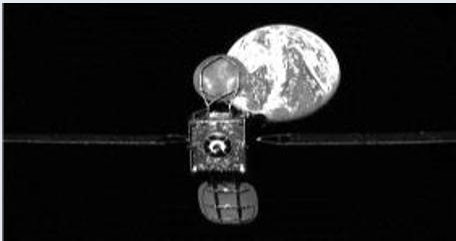

Image source: Northrop Grumman

2020-2021: MEV-1 (Mission Extension Vehicle-1) launched October 2019 and docked to IS-901 in February 2020. MEV-2 launched in August 2020 and docked to IS-10-02 in April 2021. Today, both are providing five-year life extension services to their respective Intelsat satellites, including propulsion and pointing control. When those service contracts are complete, the MEVs can undock to provide services for a new client.

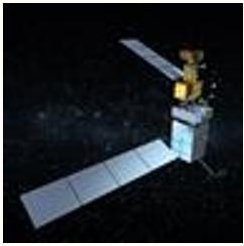

Image source: NASA

OSAM-2 (NASA, Redwire)

Mid-2020s: NASA's On-orbit Servicing, Assembly, and Manufacturing-1 (OSAM-1) consists of two robotic arms designed to refuel an unprepared client space object, and a third arm that will construct a communications antenna to demonstrate on-orbit assembly (OOA). OSAM-1 will utilize Tethers Unlimited's MakerSat payload to manufacture a 10-meter carbon fiber beam on-orbit. $ ^{23} $

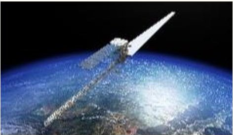

RSGS (DARPA, SpaceLogistics)

Image source: Redwire Space

Mid-2020s: OSAM-2 will demonstrate the feasibility of using additive manufacturing technology (3D printing) and advanced robotics to build two beams on a free-flying satellite. The first beam will unfurl a surrogate solar array, and the second beam will be used to characterize additively manufactured structures in low Earth orbit. $ ^{24} $

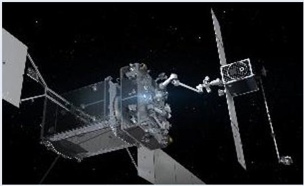

Image source: Northrop Grumman

Mid-2020s: The Robotic Servicing of Geosynchronous Satellites (RSGS) program is a public-private partnership between DARPA and SpaceLogistics. The Naval Research Laboratory (NRL) will supply dexterous robotic arms and SpaceLogistics will supply a spacecraft bus which leverages technologies developed for MEV and a commercial launch vehicle. The mission goal is to demonstrate robotic inspection, upgrade, and repair capabilities on operational GEO satellites. $ ^{25} $

## Legal and Regulatory Considerations

While the technical aspects of ISAM are rapidly advancing, the legal nature of these activities has led to certain complications. Naturally, ISAM missions incur more complex legal considerations than most other spacecraft activities due to the more frequent interactions between multiple spacecraft and the stakeholders they represent.

Liability. The Outer Space Treaty of 1967 $ ^{26} $ and the Space Liability Convention of 1972 $ ^{27} $ are the current international laws governing ISAM, though not explicitly. These principles, governing activities in the exploration and use of outer space and published by the United Nations (UN), discuss in depth the responsibilities of launching states and the liabilities involved in outer space activity. However, these documents do not cover all the

<!-- PDF_PAGE: 8 -->

legal need of the ISAM missions such as MEV-1. $ ^{28} $ Due to the success of recent OOS missions such as the MEVs efforts to regulate ISAM are underway. Since outer space liability doctrines govern these efforts, updates and changes to these documents may take place in the near future. $ ^{29} $

Norms and Safe ISAM Operations. The development of reliable and recurring ISAM operations will bring about significant changes to current space utilization methods. The purpose of these advancements is largely to improve the collaborative nature and sustainability of global space operations. However, there exists the possibility that these powerful technologies will serve as a catalyst for many new mission types including those that may exploit ISAM technologies, such as space robotics systems, for nefarious use. While further work is needed to define best practices and responsible behaviors for the security of satellites and in-space operations, the UN General Assembly Resolution 75/36 seeks to develop an understanding of international security considerations regarding actions and activities resulting in perceived threatening behavior, apparent interference, or attacks. $ ^{30} $

Within this context, CONFERS has emphasized the need for norms based on concepts such as keep-out volumes that aid to define procedures for collision avoidance maneuvers and approach of client space objects. Adhering to norms, guidelines, and accountability requirements will help discern between benign and malicious actors and will encourage a safer environment for future use of ISAM technologies.

Radio Frequency Spectrum Allocation and On-orbit Licensing. Currently, the Federal Communications Commission (FCC) does not delineate between launch/reentry and on-orbit activity when defining the radio frequency spectrum allocation for space communications. Due to the lack of spectrum allocation precedent, the FCC and National Oceanic and Atmospheric Administration (NOAA) had to provide ad hoc operating licenses needed for OOS activities during the MEV-1 mission. $ ^{31} $ Progress is being made, however, as NASA and multiple commercial entities (such as Axiom and Astroscale) have requested the FCC to open a Notice of Proposed Rulemaking to standardize spectrum allocation specifically for OOS activity. $ ^{32} $ The National Environmental Satellite Data and Information Service

(NESDIS) also made efforts in 2020 by establishing formal licensing procedures for private remote sensing space systems. $ ^{33} $ While launch/reentry and on-orbit activities have similarities in their spectrum licensing needs, a separation of the two mission operations would better streamline spectrum allocation for both commercial and governmental OOS missions. Moreover, OOS activities are typically shorter in duration than spacecraft being launched and operated in the current paradigm, so many regulatory hurdles could likely be overcome with new spectrum allocation processes.

Standards. Standard interfaces can directly promote the proliferation of the ISAM industry. Standardized plug-and-play capabilities have benefited many industries, such as home computers. Desktop computers are highly modular systems with hardware and software standard interfaces. These standard interfaces enable a wide variety of easily interchangeable hardware options, reducing consumer costs. The same trend is likely to occur in the space economy. The definition of industry-wide standard interface specifications, similar to a Universal Serial Bus (USB) on a computer, would likely reduce the barriers of entry, increase competition, and decrease satellite acquisition and maintenance costs.

Draft documentation regarding RPOD/OOS standards are currently being developed by organizations such as the International Organization for Standardization (ISO) and CONFERS. The Draft International Standard ISO/DIS 24330 intends to lay a foundation of OOS Concept of Operations (ConOps) as well as safety assurance measures when developing OOS/RPOD capabilities. $ ^{34} $ These steps, as well as future domestic initiatives taken by the U.S. Space Force and other national space entities, will help move the industry towards standardization adoption.

While longer-term standardized interfacing will need to consider mechanical, electrical, data, and thermal subsystems for modular and replaceable elements, refueling interfaces are the current priority in standards development. In-space refueling is a prime example of an ISAM technology that could be enabled by standardized interfaces, much like the automotive industry's use of gas caps and fuel pump standards. However, opinions vary on how exactly these standards will find their way into the ISAM industry. Joe Anderson, Vice President of Business Development and Operations at SpaceLogistics, noted that

<!-- PDF_PAGE: 9 -->

"Commercial space has led the industry as customers for the life extension of existing unprepared satellites, but it is my belief that... the National Security Space will, and must, lead the way with development and deployment of satellites that are prepared for refueling; and commercial space will follow when the infrastructure is present." Although the prospect of ISAM standards in space is not fully defined, this dynamic landscape is promoting a renaissance of forward-thinking space environment, mobility, and logistics developments that could change the current paradigm.

## Game Changer Lifecycle: Market and Technology Phases

Robotic ISAM advancements have reached a tipping point of technical feasibility, acceptable mission risk levels, and business case viability. Governmental and commercial entities, both inside and outside of the U.S., are beginning to field prototypes for robotic servicer spacecraft and commercial ISAM. These near-term activities are now influencing future spacecraft system design and space segment architectures. In fact, plans for future space systems are beginning to look drastically different from today's systems and architectures. $ ^{35} $ Figure 1 lays out the expected path of ISAM technology maturation and market adoption. A description of the chart is as follows:

Research and Development "R&D" Phase. Many technologies that have direct terrestrial applications, such as robotic arms for manufacturing and medical use, have already received ample R&D funding for their development. Other diverse technologies for specific space environment applications, such as fluid transfer systems designed for operation in microgravity, are more reliant on entities such as NASA for technology maturation. In fact, NASA's space exploration efforts have been the driving R&D force for ISAM to date, including human spaceflight, Lunar and Martian landers and rovers, and space stations that have required significant amounts of consistent RPOD and servicing activities.

The commercial, defense, and international sectors' growing interest in developing ISAM technology has resulted in additional R&D efforts. For example, NASA's "Tipping Point" program funds industry-developed cryogenic fluid management technology. In October 2020,

NASA awarded four companies-Eta Space, Lockheed Martin, SpaceX, and United Launch Alliance (ULA)a combined total of over $250 million for this effort. $ ^{36} $ In March 2022, DARPA began funding eight teams for their Novel Orbital Moon Manufacturing, Materials, and Massefficient Design (NOM4D) program with goals of developing space-based manufacturing methodologies. $ ^{37} $ Internationally, the European Union's Horizon 2020 program $ ^{38} $ is funding OOS activities through the development of the EROSS European Robotic Orbital Support Services (EROSS) and EROSS+ programs supported by a multitude of commercial partners. $ ^{39} $

Demonstration "Demo" Phase. There are already a range of past demonstrations for robotic servicing applications, both domestically and internationally. Looking ahead, governmental organizations such as NASA, European Space Agency (ESA), Japan Aerospace Exploration Agency (JAXA), and DARPA, and many commercial companies are committing large investments to demonstrate robotic ISAM capabilities. Throughout the early-to-mid 2020s, the commercial sector may begin to offer regular services to enhance existing satellites. (See Appendix B for examples).

Standardized interfaces across various ISAM technologies will allow for plug-and-play capabilities and will lower the build and operating costs of ISAM. Many organizations and companies are working to develop interface demonstrations for this purpose. In a recent attempt at standardization, Lockheed Martin has released technical specifications for the Mission Augmentation Port, which aims to serve as an open-source, non-proprietary interface standard for which other companies can design compliant interfacing technology. $ ^{40} $ Standardization demos will be a key technology trigger that will help to mature ISAM to the next market phase, "growth." With widespread standards adoption, and integration of cooperative interfaces into operations, the ISAM market has great potential to expand quicker than ever before. However, advancing beyond the demo phase to the growth phase might be difficult if ISAM demos suffer failures, either technically or programmatically.

Market Growth Phase. Once demo missions show consistent success, the space industry will likely experience rapid growth of ISAM capabilities. The space

<!-- PDF_PAGE: 10 -->

insurance business may further encourage the growth of an ISAM-enabled new space economy by adjusting space insurance premiums based upon a satellite's ability to mitigate risk and allow repair in lieu of spacecraft replacement. However, this will require satellite customers to commit to a ConOps that includes servicing. $ ^{41} $ Governmental regulators may also require or offer incentives for ISAM-ready satellites to address debris mitigation concerns.

Conversely, maintaining ISAM in a market growth phase could be difficult. For instance, satellite underwriters may not feel confident with understanding and quantifying risk for ISAM-ready satellites. Industry stakeholders may find it more straightforward and cost-effective to launch numerous cheaper satellites that can be easily replaced. For these cases, ISAM may prove to be too expensive for the high-quantity, proliferated LEO environment. Yet, gaining governmental commitment to the mitigation of space debris and the requirement of ISAM-ready satellites might prove challenging. However, the proactive development of norms and regulations with involvement and consensus from international leaders may help to reduce ISAM skepticism.

Market Maturity Phase. As ISAM reaches market maturity, these technologies and their clients will be pervasive throughout the space industry. It is expected that manufacturers of larger spacecraft systems will transition to modular architectures to accommodate ISAM for their customers. NASA plans to continue development of large structures in space, such as Gateway, $ ^{42} $ that require module assembly in lunar orbit—as well as future flagship observatories, such as the Large Ultraviolet Optical Infrared (LUVOIR) telescope. $ ^{43} $ These space structures will be ISAM-ready, with regular servicing and upgrading baselined into the operations.

During this mature market phase, satellites will be launched with the expectation that they will be refueled. The satellites will be modular to allow for frequent or as-needed technology insertion. For noncritical missions, reliability requirements may be relaxed resulting in lower development, assembly, integration, and test costs due to the availability of on-orbit repairability. However, to reach this mature market phase, space sector stakeholders (government and commercial) must demonstrate a commitment to space sustainability.

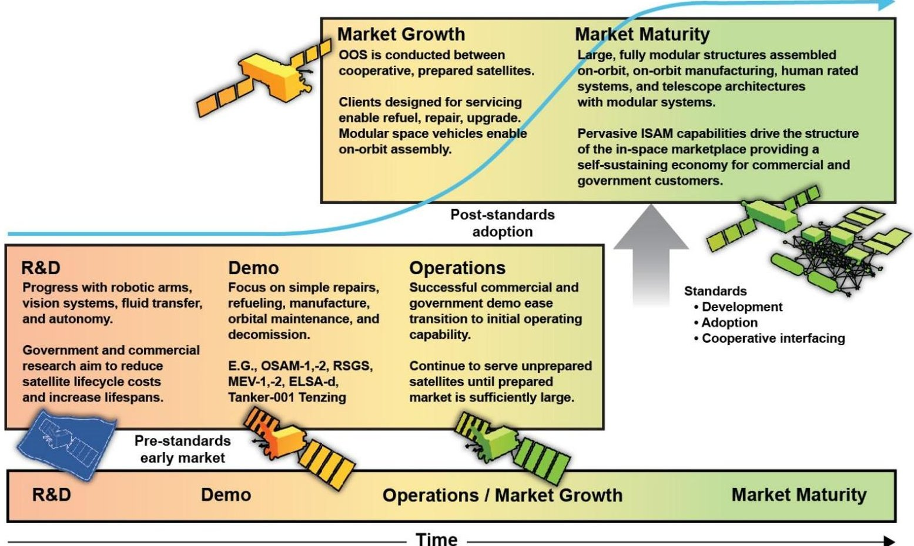

Figure 1: ISAM Market Maturation Path. At any point in time, various ISAM-related technologies might exist at different market maturity phases. However, most ISAM technologies will not advance beyond early market phases until stakeholders agree on and adopt interoperability standards into their designs and business models.

<!-- PDF_PAGE: 11 -->

ISAM Market Drivers: Maneuverability, Modularity, and Space Sustainability While ISAM is still in its infancy, the potential market implications, even in the near-term, are enormous. The commercial sector's investments in ISAM have contributed to current near-term growth. SpaceLogistics, Astroscale, Redwire Space, and numerous other companies are working to bring commercial servicer spacecraft to market. Over time, the capabilities of the ISAM market will expand, growing from the near-term MEV, OSAM-1, and RSGS-like capabilities into complex space architectures that rely on refueling, upgrading, assembly, and manufacturing.

Near term, satellite services will likely be limited to inspection, orbit modification, and orbit maintenance of legacy unprepared satellites, and refueling of minimally prepared satellites. Longer term, demonstrations showcasing other ISAM capabilities such as upgrade, repair, and assembly will usher in a broader market potentially overtaking the need for refueling, inspection, and orbit modification due to the increasing complexity of in-space technology and operations in the deeper future.

In-Space Maneuverability: Orbit Maintenance and Modification, and Refueling. Satellites living beyond their design life have become the norm, and operators are reluctant to decommission functional satellites simply because they are running low on fuel. Space assets whose functionality is solely limited by a lack of fuel can still provide value to governmental and commercial operators once these consumables are replenished. Some estimates show that more than 50 percent of GEO satellites will experience operational impacts due to fuel depletion. $ ^{44} $ Refueling these satellites allows for operators to maintain orbital slot position with their own propellant systems extending lifetimes. This capability is extremely valuable for governmental and commercial satellite operators. During the Space Tech Conference in May 2018, SES and Intelsat discussed their ability to monetize value from aging spacecraft, and how both companies were looking to integrate OOS life extension capabilities into their business models going forward. $ ^{45} $

Recent investments in this area reflect customer confidence in the value of these servicing technologies. In February 2022, SpaceLogistics announced a launch agreement with SpaceX and the first sale of a Mission

Extension Pod (MEP). Under this agreement, the Mission Robotic Vehicle (MRV) will be launched in spring 2024 with plans to install an MEP on a satellite owned by Australian company Optus. $ ^{46} $ Also, in March 2022, it was announced that the U.S. Air Force and U.S. Space Force invested $ 6 million into Orbit Fab's Rapidly Attachable Fluid Transfer Interface (RAFTI) for refuel of U.S. military satellites. $ ^{47} $

Adam Harris, Vice President of Business Development at Orbit Fab states, "Refueling spacecraft enables endless maneuver and allows for robust and resilient [Department of Defense] (DoD) space architectures." He emphasizes that "the future winners in the space economy will design their spacecraft with refueling from the beginning. Whether those missions dip into the atmosphere, change orbit planes, or accomplish massive assembly in orbit for trips to other planets, refueling allows those new mission areas to exist." Finally, he points out that "refueling is also a key enabler to allow operators to maneuver away from impending threats and respond with unprecedented agility."48

Refueling reintroduces station keeping back into spacecraft operations and allows for drifted spacecraft to move into their intended orbits, extending lifetimes. Space tugs and servicers can perform these orbit maintenance and modification operations as well by "ferrying" client satellites instead. These space vehicles may be more suited for satellites unprepared for refueling or those that do not require a complete refuel service. Still these services delay novel satellite purchases, maintain assets in valuable GEO slots, and prolong the life of productive and profitable space vehicles. With a robust infrastructure of life extension servicers, a secondary market in older-but functional spacecraft may emerge, similar to the used car market. Companies or governments unable or unwilling to purchase new satellites instead might buy used ones whose orbits have been maintained or can be modified to meet new mission needs.

Modular Spacecraft Design. As the success of ISAM materializes, satellite designs will begin to incorporate prepared servicing features such as standard quick disconnect refueling valves; machine vision-friendly fiducials; grapple fixtures; and common structural, power, data, and fluid interfaces. Spacecraft currently being acquired are already studying serviceability features and,

<!-- PDF_PAGE: 12 -->

by the end of the 2020s, it is likely that all large satellite acquisitions will require prepared designs for servicing. $ ^{49} $ In fact, the USG has begun showing interest in this area, as the Defense Innovation Unit (DIU) announced in March 2022 the Modularity for Space Systems (M4SS) project, which includes three prototypes in development by Tethers Unlimited, Maxar Technologies, and Motiv Space Systems. $ ^{50} $

While designing for full serviceability means a change in current satellite design practices, it has been shown that modular designs can be cost-neutral compared to traditional highly integrated designs when considering more than a single satellite purchase. $ ^{51} $ The increased cost of modular system design is largely offset during the assembly, test, and integration phases of the acquisition cycle. While modular designs tend to increase satellite dry mass compared to highly optimized designs, weight penalties can be recovered by the benefits of ISAM.

Modular satellites designed for upgradability and refueling have distinct advantages. For example, refuellable vehicles can be launched with less propellant than needed for the entire mission, saving hundreds of kilograms in launch weight, and increasing the launch vehicle payload mass margins. In addition, modularity reduces the need for expensive weight optimization activities as mass margins degrade over the development cycle. The ability to add or replace components on-orbit means that satellites could potentially be designed with less redundancy on their noncritical components. Furthermore, satellites could launch without a noncritical component or payload if their production is late, thereby maintaining launch schedules on-orbit assembly activities could install the missing elements later. This enhanced flexibility may also alter the paradigm of spacecraft mission assurance, reducing the need to perform lengthy and costly test campaigns by relying on the ability to repair and replace failed components on-orbit.

Modular designs also allow for easier and more efficient transfer for assembly. Current designs for on-orbit transfer vehicles (OTVs) are already considering the modularity of these systems to develop more dynamic and user-friendly payload delivery. Much like the international sea freight industry and its use of standardized shipping containers, OTVs and space tugs can deliver on-orbit key components

for assembly (See section Next Generation Space Economy: On-orbit Manufacture and Assembly) $ ^{52} $

A Functional Space Enterprise: Inspection, Repairability, Upgradability, and Space Sustainability. Since the early days of space operations, satellite inspection has been highly valued amongst governmental and commercial satellite operators. However, much of inspection is done by ground-based systems which have various limitations, such as atmospheric conditions and spacecraft locations relative to ground sensors. $ ^{53} $ Robust on-orbit inspection capabilities circumvent these limitations and provide unabated inspection, including the assessment of spacecraft anomalies. This capability not only benefits the mission user by beginning the process of addressing on-orbit failures and complications, but also the satellite insurance market. $ ^{54} $ Insurance companies can use servicer spacecraft to aid in the inspection of insured satellites, assisting in the evaluation of satellite anomaly claims worth hundreds of millions of dollars. Once inspection has been completed, additional servicer spacecraft can perform OOS activities, repair the satellite if necessary, and restore capability.

At the Space Tech Conference in May 2018, both SES and Intelsat commented on their desire to purchase satellites with 30-year lifetimes, but with payloads that could be upgraded every five years. $ ^{55} $ Regular payload reconfiguration or upgrade would require a servicer spacecraft unless the upgrades could be performed entirely through software updates, which is unlikely to be sufficient over a 30-year time span. This effort would be entirely reliant on satellite servicing, as an extremely long-lived satellite bus would require routine maintenance and refueling. With the ability to upgrade hardware, not only can lifetimes be extended, but satellites can improve their functionality as hardware technology progresses during their lifetimes.

A satellite that can replace or upgrade its payload every few years has the potential to significantly reduce the cost of space activities, opening new markets to price sensitive customers. Long-life platforms that provide power, propulsion, pointing, thermal control, and other satellite bus functions could host payloads for a variety of customers with varying lifetimes and generate new revenue streams. Customers would be able to lease time

<!-- PDF_PAGE: 13 -->

on these space platforms, thereby reducing capital expenditures and risk by virtue of foregoing a highly integrated spacecraft for one dedicated mission.

## Next Generation Space Economy: On-orbit Manufacture and Assembly

Chief Growth Officer and Executive Vice President of Space Infrastructure at Redwire Space, Al Tadros believes, "In LEO, GEO, and beyond, missions that use OSAM are beginning to demonstrate that spacecraft which are intentionally designed with in-space assembly and maintenance features are best positioned to accelerate humanity's expansion into space and global leadership in the sustainable use of space."56

The ISS is a perfect example of the altruistic expansion into space enabled by ISAM, in particular on-orbit assembly. The football field-sized structure was assembled by the international space community over the past three decades and has been continuously occupied since 2000. As servicing activities become more complex and space architectures begin to incorporate serviceability, a robust space economy will emerge. As a result, the cost and risk of OOA and on-orbit manufacturing (OOM) will likely decrease $ ^{57} $ and the ISS may be viewed as a model of future OOA developments.

Satellites manufactured and assembled in space have significant technical advantages over those manufactured and assembled on the ground—the clearest being freedom from the limitations of launch vehicle constraints. $ ^{58} $ Today, spacecraft must fit within the volume restrictions of the launch vehicle fairing, $ ^{59} $ within the mass-to-orbit capability of the system, and be designed to withstand the vibrational and acoustic loads imparted during launch-a period of minutes that drives design considerations into a system whose mission life is measured in years. Next generation large-scale missions, such as new space stations or space telescopes intended for scientific discovery, may exceed a launch vehicle's physical constraints, thus requiring OOA like the ISS. Even SpaceX's Starship fairing, with a proposed 9-meter diameter, would not accommodate an entire structure the size of the ISS. $ ^{60} $ Additionally, satellites with large deployable structures, such as the James Webb Space Telescope (JWST), have significant design restrictions due to the launch vehicle fairing volume limitations. With a

robust OOA infrastructure, systems could launch large telescope apertures like JWST separately or in pieces for assembly in space. $ ^{61} $ Assembly, however, is not just limited to flagship missions. NASA and industry are working on concepts that include partial assembly of "traditional" satellites on-orbit, which entails replacing deployable structures with disassembled structures to maximize packaging efficiencies, $ ^{62} $ as well as assembly of entire satellites from modular components. $ ^{63} $

Terrestrial Applications for In-Space Manufacturing. Beyond assembly on-orbit, the space industry is looking towards on-orbit manufacturing as having enormous potential for utility much closer to home. Companies like Redwire are exploring the manufacturing of materials in space for terrestrial applications, such as fiber-optic cables, ceramics, and 3D printed polymers and crystals. $ ^{64} $

A satellite manufactured on-orbit can take advantage of materials that cannot be exposed to air. It can also avoid the structural limitations of being built in a standard gravity environment, and the intense acoustic environment during launch. ISAM's intrinsic modularity and design freedom without the bounds of Earth's surface gravity has the potential to redefine the standard view of a satellite.

## Conclusion

Despite more sophisticated designs and longer lifetimes, satellites today are the same lonely outposts that have existed since the Sputnik era. To keep up with advancing technological needs and the influx of companies attempting to enter the LEO and GEO environment, satellites will need to adapt. But market attitudes are shifting, and on-orbit robotic capabilities have reached an inflection point. While NASA will continue to need servicing for the ISS, Gateway, and other concepts, it is key operational and economic objectives from commercial space operations and governmental mission needs that are accelerating ISAM demand. Today, satellite owners and operators are exploring how to leverage these capabilities to enhance their existing constellations and to prepare their next generation of spacecraft for the coming paradigm shift. Looking to the future, a communal ecosystem of satellites will become more resilient, longer lasting, and flexible as they will be designed to rely upon a fleet of helpful servicing companions.

<!-- PDF_PAGE: 14 -->

## APPENDIX A-DEFINITIONS AND ACRONYMS

## CONFERS Approved Definitions

Abort. An action which stops an onboard process and, if necessary, initiates an alternate process to put the servicer spacecraft and client space object in a safe and collision free state.

Approach Volume. An agreed-upon three-dimensional space centered on the passive vehicle (Client Space Object or Servicing Vehicle) in which unintentional contact is possible within the passive anomaly recovery time and ranging and active relative orbit control is needed for safety. Synonym for Proximity Operations Control Volume.

Berthing. (verb) The act of effecting a rigid connection between a Servicing Spacecraft and a Client Space Object with the aid of a robotic arm.

Client. An entity/organization procuring the service.

Capture. (verb) The act of establishing a physical connection between two space objects.

Client Space Object (prepared and unprepared). The space object being serviced by the servicer spacecraft. An example of a prepared client space object is a space vehicle equipped with a gas cap compatible with a servicing spacecraft's refueling nozzle. An unprepared client space object does not offer features designed to aid in acquisition, tracking, rendezvous, mating, and/or servicing activities, though there may be information transfer between the servicer spacecraft and client space object. Examples of unprepared client space objects are legacy satellites, derelict rocket bodies, and pieces of orbital debris.

Collision Avoidance Maneuver. An operation executed by a space object relative to another space object to avoid contact for a specified amount of time.

Combined Stack Attitude Control. An on-orbit service in which the servicer spacecraft maintains attitude stability for the combined stack.

Combined Stack. A combined client space object and servicer spacecraft after Docking or Berthing.

Docked Life Extension. On-orbit services enabling increased duration of client operations as a combined stack.

Docking. (verb) When a servicing spacecraft executes a controlled trajectory to affect a rigid connection with a Client Space Object.

Inspection. Sensing of a Client Space Object by a servicer spacecraft.

Keep-Out Volume. A minimum 3D volume of space around the client space object. The volume is based on navigational uncertainty of each Rendezvous, Proximity Operations and Docking (RPOD) phase or any operational volume into which a servicer spacecraft may not enter without approval.

On-Orbit Assembly (OOA). On-orbit activities to physically attach objects to each other. Examples include constructing a space station or large telescope, combining satlets to create a satellite, and adding a reflector dish to an existing satellite. Assembly can overlap with upgrade, depending on the operation.

On-Orbit Servicing (OOS). Activities by a servicer spacecraft or servicing agent on a client space object which require rendezvous and/or proximity operations. OOS activities include non-contact support, orbit modification (relocation) and maintenance, refueling and commodities replenishment, upgrade, repair, and debris mitigation.

Prepared. Configured with navigation fiducials and/or grapple/capture interfaces and/or servicing interfaces. An example of a prepared client space object is a space vehicle equipped with a gas cap compatible with a servicing spacecraft's refueling nozzle.

<!-- PDF_PAGE: 15 -->

Proрипity Operations. Orbital maneuvers performed between a servicer spacecraft and a client space object on a relative planned path within a predefined Approach Volume.

Proximity Operation Control Volume. Synonym for Approach Volume.

Relocation. Changing the orbit of the Client Space Object by a Servicing Vehicle.

Rendezvous. Process wherein two space objects (artificial or natural body) are intentionally brought close together through a series of orbital maneuvers at a planned time and place.

Servicer. An entity/organization that provides On-Orbit Servicing operations.

Servicer Spacecraft. Spacecraft performing the servicing action.

Servicing Operations. Action provided by Servicer Spacecraft to the Client Space Object, including, but not limited to, inspection, capture, docking, berthing, relocation, refueling, life extension, removal, combined stack control, repair, upgrade, assembly, manufacturing, undocking, unberthing, release.

Acronyms

CNES Centre National D'Etudes Spatiales

CONFERS Consortium for Execution of Rendezvous and Servicing Operations

ConOps Concept of Operations

CRD2 Commercial removal of Debris Demonstration

DARPA Defense Advanced Research Projects Agency

DIU Defense Innovation Unit

DLR Deutsches Zentrum für Luft- und Raumfahrt (German Aerospace Center)

DOD Department of Defense

ELSA-d End-of-Life-Service by Astroscale-demonstration

ELSA-M End-of-Life Services by Astroscale-Multi

EROSS European Robotic Orbital Support Services

ESA European Space Agency

ETS-VII Engineering Test Satellite VII

FCC Federal Communications Commission

GEO Geosynchronous Equatorial Orbit

GRIP Grappling & Resupply Interface for Products

GSFC Goddard Space Flight Center

IOC Initial Operational Capability

ION InOrbit Now

ISAM In-space Servicing, Assembly, and Manufacturing

ISO International Organization for Standardization

ISS International Space Station

JAXA Japan Aerospace Exploration Agency

JWST James Webb Space Telescope

LEO Low Earth Orbit

LEXI Life Extension In-Orbit

LiDAR Laser Imaging, Detection, and Ranging

LUVOIR Large Ultraviolet Optical Infrared

M4SS Modularity for Space Systems

MEP Mission Extension Pod

MEV Mission Extension Vehicle

MSFC Marshall Space Flight Center

NASA National Aeronautics and Space Administration

NESDIS National Environmental Satellite Data and Information Service

<!-- PDF_PAGE: 16 -->

NOAA National Oceanic and Atmospheric Administration

NOM4D Novel Orbital Moon Manufacturing, Materials, and Mass efficient Design

NRL Naval Research Laboratory

OMV Orbital Maneuvering Vehicle

OOA On-orbit Assembly

OOM On-orbit Manufacturing

OOS On-orbit Servicing

ORU Orbital Replacement Unit

OSAM On-orbit Servicing, Assembly and Manufacturing

OSSIE Orbit Solutions to Simplify Injection and Exploration

OTV Orbital Transfer Vehicle

R&D Research and Development

RAFTI Rapidly Attachable Fluid Transfer Interface

RPO Rendezvous and Proximity Operations

RPOD Rendezvous, Proximity Operations, and Docking

RSGS Robotic Servicing of Geosynchronous Satellites

RSO Resident Space Object

SES Société Européenne des Satellites

SOARS Spacecraft On-orbit Advanced Refueling and Storage

SNC Sierra Nevada Corporation

SPIDER Space Infrastructure Dexterous Robot

SSO Sun-synchronous Orbit

TRL Technology Readiness Level

ULA United Launch Alliance

UN United Nations

USB Universal Serial Bus

USG United States Government

USSF United States Space Force

## APPENDIX B - ISAM Baseball Cards

Recent, Ongoing, and Upcoming ISAM Missions and Services End-to-end robotic autonomous OOS was first demonstrated by DARPA's Orbital Express in 2007. This mission followed up the success of the remote-operated Japanese Engineering Test Satellite VII (ETS-VII) demonstration mission conducted in 1997, which displayed rendezvous and docking operations. $ ^{65} $ With over 25 years since ETS-VII and more than 15 years since Orbital Express's successful mission, a significant amount of work has been done to advance the technologies and develop a viable ISAM market. Table 5 highlights recent ongoing and upcoming ISAM technologies and is not an exhaustive list of all flight concepts. There exist many smaller companies in the early stages of technology design and funding who have been left out-however, many of the technology and market leaders throughout the space industry are highlighted.

<!-- PDF_PAGE: 17 -->

Astroscale ELSA-d/ELSA-M $ ^{6 6, 6 7} $ (Tokyo, Japan)

Industry Leaders

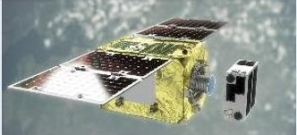

Image Source: Astroscale

Axiom Space Axiom Station (Houston, TX)

Image Source: Axiom Space

End-of-Life Services by Astroscale demonstration/Multiple. ELSA-d a 2021-2022 demonstration of Astroscale's servicer and client satellites repeatedly docking and releasing. ELSA-M aims to leverage these capabilities to service multiple clients per mission.

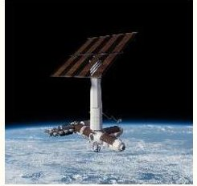

Axiom Space's commercial space station is under construction. Through a unique partnership with NASA, the first Axiom module is expected to dock with the International Space Station in 2024. Additional modules will launch each year. Axiom Station will become an independent commercial space station prior to the end of life of the ISS.

Northrop Grumman/ SpaceLogistics MEV-1,MEV-2 $ ^{69} $ (Dulles,VA)

Image Source: Astroscale

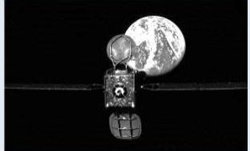

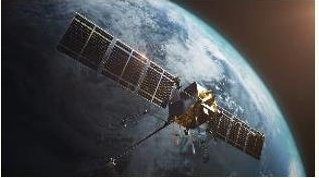

Image Source: Northrop Grumman

Astroscale LEXI $ ^{68} $ (Tokyo, Japan)

Orbit Fab Tanker-001 Tenzing $ ^{71} $ (San Francisco, CA)

Image Source: Maxar

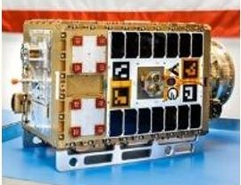

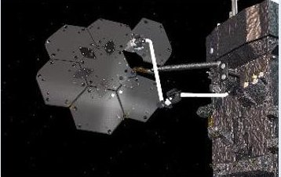

## Maxar SPIDER (OSAM-1) (Westminster, CO)

MEV-1 (Mission Extension Vehicle-1) launched in October of 2019 and docked to IS-901 in February 2020. MEV-2 launched in August 2020 and docked to IS-10-02 in April 2021. Today, both offer five-year life extension services to their respective Intelsat satellites and provide propulsion and pointing control. The MEVs can also undock and provide services for future clients.

Image Source: Orbit Fab

Life Extension In-orbit. Servicer to provide life extension by acting as the propulsion system for client. By using four robotic arms, this technology can optimally position itself to provide stationkeeping, attitude control, and other orbital relocation services. LEXI can dock/undock with clients, allowing servicing to multiple clients per mission.

Northrop Grumman/ SpaceLogistics MRV/MEP $ ^{70} $ (Dulles, VA)

Space Infrastructure Dexterous Robot (SPIDER). Demo on OSAM-1 will robotically assemble seven individual components into one large antenna reflector. Enables on-orbit assembly.

Tanker-001 launched in June 2021 and deployed in sun-synchronous orbit. World's first on-orbit operational fuel depot. Designed for green propellant High-Test Peroxide (HTP) compatibility. Development time of less than one year.

Image Source: Northrop Grumman

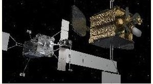

Redwire Space Archinaut (OSAM-2) (Jacksonville, FL)

The Mission Robotic Vehicle (MRV) will be a commercial servicing spacecraft with advanced robotics technology. The primary purpose will be the installation of Mission Extension Pods (MEPs) to provide propulsion augmentation. The MRV is also designed to address inspection and repair, relocations, propulsion augmentation, and replacement of parts and systems. Planned launch in 2024.

Image Source: Redwire Space

OSAM-2 will demonstrate the feasibility of using additive manufacturing technology (3D printing) and advanced robotics to build two beams on a free-flying satellite. The first beam will unfurl a surrogate solar array, and the second beam will be used to characterize additively manufactured structures in LEO.

<!-- PDF_PAGE: 18 -->

Table 3: ISAM Baseball Cards

## U.S. Civil and Government Efforts

## DARPA RSGS $ ^{7 2} $ (Arlington, VA)

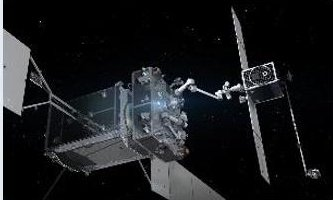

Image Source: Northrop Grumman/SpaceLogistics

## NASA GSFC OSAM-1 $ ^{7 4} $ (Greenbelt, MD)

Image Source: NASA

Robotic Servicing of GEO Satellites. DARPA has partnered with Northrop Grumman/SpaceLogistics to develop and deploy a robotic servicer or MRV. Naval Research Laboratory (NRL) will integrate robotic payload elements including manipulator arms. Launch planned for 2023.

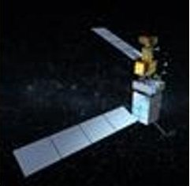

Mission to demonstrate refueling a satellite in space, assembling a communications antenna, and manufacturing a beam. Partnered with Maxar and Tethers Unlimited, Inc. Launch no earlier than 2025.

## Defense Innovation Unit Orbital Outpost $ ^{73} $ (Mountain View, CA)

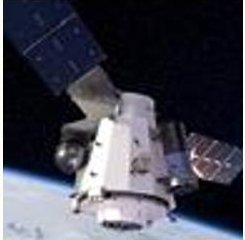

Image Source: SNC

## NASA MSFC OSAM-2 $ ^{7 5} $ (Huntsville, AL)

Selected Sierra Nevada Corporation (SNC), NanoRacks, and Arkisys for Phase I contracts for the Orbital Outpost. It will be a self-contained, free-flying spacecraft capable of supporting assembly, microgravity experiments, logistics, manufacturing training, and hosted payloads.

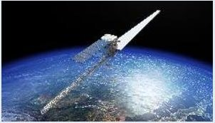

Image Source: Redwire Space

Demonstration mission to 3D print two 10-m long beams on-orbit using Redwire's Archinaut technology, onto one of which a solar array will unfurl. Public-private partnership that includes Northrop Grumman and NASA's Jet Propulsion Laboratory. Launch no earlier than 2024.

Non-U.S. Civil and Governmental Efforts

<table border="1"><tr><td>ESA
ClearSpace-176
(Renens, Switzerland)
Image Source: ClearSpace</td><td>ESA selected ClearSpace for first ever debris removal of an ESA-owned item. ClearSpace-1 will use an experimental, four-armed robot to capture a Vega Secondary Payload Adapter (Vespa) left behind by ESA&#x27;s Vega launcher in 2013. Expected launch in 2025 or 2026.</td><td>ESA
TITAN77
(Torun, Poland)
Image Source: ESA</td><td>The TITAN project advances the development of a robotic arm for satellite servicing. Under the ESA contract, a prototype of a multi-articulated robotic arm will be developed for the future deorbiting and servicing of in-orbit satellites by PIAP Space.</td></tr><tr><td>European Commission
EROSS+
(Cannes, France)
Image Source: Thales Alenia</td><td>European Robotic Orbital Support Services. Technology demonstration led by Thales Alenia Space dedicated to life extension, refueling, inspection, controlled debris reentry, and other operations. On-orbit demonstration expected by 2026.</td><td>JAXA
CRD278
(Tokyo, Japan)
Image Source: Astroscale</td><td>Astroscale&#x27;s Active Debris Removal by Astroscale-Japan (ADRAS-J) has been contracted for the initial phase of JAXA&#x27;s Commercial Removal of Debris Demonstration (CRD2) program. A public-private collaboration, Phase 1 of this program is expected to launch in 2023. Once Phase 1 displays non-cooperative RPO capabilities, Phase 2 plans to demonstrate the removal of a launch vehicle&#x27;s second stage in fiscal year 2025.</td></tr></table>

<!-- PDF_PAGE: 19 -->

Table 3: ISAM Baseball Cards

Commercial

<table border="1"><tr><td colspan="4">Commercial</td></tr><tr><td>Atomos
Quark OTV79,80
(Denver, CO)
Image Source: Atomos</td><td>Developing Quark Orbital Transfer Vehicle (OTV) to deliver satellites inserted into rideshare or lower orbits to their desired orbits utilizing high-power electric propulsion and advanced RPO techniques. Expected launch in 2023.</td><td>D-Orbit
ION Satellite Carrier81,82
(Como, Italy)
Image Source: D-Orbit</td><td>An OTV designed for the last-mile delivery of CubeSats and microsats of mass up to 150kg and to perform in-orbit experiments of hosted payloads. Four successful missions as of Q1 2022, with over 70 payloads delivered to orbit.</td></tr><tr><td>Exolaunch
Reliant83
(Berlin, Germany)
Image Source: Exolaunch</td><td>Reliant OTV comes in a Standard and Pro model to transfer satellites to different orbital altitudes. Reliant Pro will also have modular satellite upgrade and debris collection abilities. Testing and flight qualification to begin in 2022.</td><td>Exotrail
Space Van84
(Massy, France)
Image Source: Exotrail</td><td>CNES is providing funding for the development of this electrically propelled vehicle designed to deliver nano and microsatellites to their final orbits. Expected launch in 2024.</td></tr><tr><td>Momentus
Vigo/Ardo/Fervoride
(Santa Clara, CA)
Image Source: Momentus</td><td>Family of three orbital transfer vehicles or “space tugs” are designed to deliver payloads of 200-20,000kg into desired orbits to meet customer needs. They will enable Momentus&#x27; goal of providing in-space infrastructure services. Vigoride-3, an experimental space tug was launched May 2022.</td><td>Moog
OMV85
(Elma, NY)
Image Source: Moog</td><td>Large family of Orbital Maneuvering Vehicles (OMVs) designed to serve as a modular platform for payload hosting and deployment. They will be able to serve as space tugs to conduct orbit raising maneuvers for hosted payloads.</td></tr><tr><td>Nanoracks
Outpost
(Houston, TX)
Image Source: Nanoracks</td><td>The Outpost program aims to repurpose the upper stage of launch vehicles for use as platforms for robotic manufacturing, servicing, etc. These platforms intend to be controllable and function across multiple orbits.</td><td>Obruta
RPOD Kits/Service Pods86,87
(Ottawa, Ontario)
Image Source: Obruta</td><td>RPOD Kit serves as a low-cost interface to provide a “turnkey solution” for inspection, refuel, orbital relocation, and other capabilities. This modular product aims to provide cheap access to docking in order to lower barriers to entry in the OSAM market. Service pods to be used for all aspects of OOS and privately hired to service customer clients.</td></tr></table>

<!-- PDF_PAGE: 20 -->

# Table 3: ISAM Baseball Cards

## Commercial

<table border="1"><tr><td>SCOUT
SCOUT-Vision88,89
(Alexandria, VA)
Image Source: SCOUT</td><td>Observational payload launched in June 2021 as part of Orbit Fab&#x27;s Tenzing refueling depot. Its capabilities enable Tenzing to &quot;detect, identify, and model observed objects it encounters in orbit.&quot;</td><td>Skyrora
Space Tug90,91,92
(Edinburgh, Scotland)
Image Source: Skyrora</td><td>Skyrora&#x27;s Space Tug, designed to transport 350 kg into a 500 km SSO, has the potential to remove space debris, conduct inspections, and fix faulty satellites. Skyrora aims to be the first launcher from British soil.</td></tr><tr><td>Spaceflight
Sherpa
(Seattle, WA)
Image Source: Spaceflight</td><td>Developed in 2020, the Sherpa line of four OTVs are designed to provide final delivery to rideshare customers&#x27; desired orbits. Includes delivery to LEO, GEO, and low-Lunar orbits. Spaceflight has launched more than 50 customer payloads across three Sherpa OTVs, including the industry&#x27;s first ever electric OTV. Sherpa-ES, pictured left, is planned to launch on the GEO Pathfinder mission in 2023.</td><td>Starfish Space
Otter Space Tug93
(Seattle, WA)
Image Source: Starfish Space</td><td>Small and affordable space tug designed to complete life extension, active debris removal, and autonomous transportation services.</td></tr><tr><td>StartRocket
Foam Debris Catcher94
(Moscow, Russia)
Image Source: StartRocket</td><td>Debris mitigation technology designed to extrude a web of polymer foam to capture and deorbit space debris. Aiming for 2022 launch.</td><td>University of Surrey
RemoveDEBRIS95,96
(Guildford, England)
Image Source: University of Surrey</td><td>University-led mission launched in 2018 to test net, harpoon, dragsail, and LiDAR vision technologies for debris removal. These demonstrations concluded in early 2019.</td></tr><tr><td>Tethers Unlimited
GAUNTLET97
(Bothell, WA)
Image Source: Tethers Unlimited</td><td>Integrated modular robotics payload to attach to the body of a spacecraft. Consists of robotic arms, payload connectors, servicing interface, and machine vision to enable servicing architecture on heritage pacecraft.</td><td>Tethers Unlimited
MakerSat97
(Bothell, WA)
Image Source: Tethers Unlimited</td><td>Payload attached to NASA&#x27;s OSAM-1 mission with goals of demonstrating in-space manufacture of a 10-meter carbon fiber boom. Will verify beam structural properties on orbit.</td></tr></table>

Image Source: Tethers Unlimited

Image Source: Tethers Unlimited

<!-- PDF_PAGE: 21 -->

# Table 3: ISAM Baseball Cards

## Commercial

## UARX Space OSSIE $ ^{98,99} $ (Nigrán, Spain)

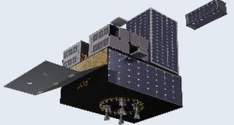

Image Source: UARX Space

Orbit Solutions to Simplify Injection and Exploration. Modular and scalable orbital transfer vehicle designed to provide precise orbital injection and inclination changes for CubeSats and small spacecraft. Can deliver to Earth orbits, the moon, and beyond. Cooperation agreement signed with the German Aerospace Center (DLR) in early 2021.

## Zero-G Horizons Technologies SOARS (Daytona Beach, FL)

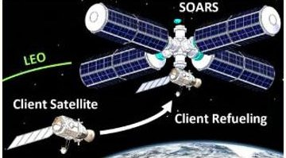

Image Source: Zero-G Horizons Technologies

Spacecraft On-Orbit Advanced Refueling and Storage. Funded by a Phase II NASA SBIR contract to develop on-orbit cryogenic and hypergolic fuel depots to provide satellite refuel technology. Utilizes novel fluid transfer interfaces and adaptive rotational controls to enable efficient liquid-gas separation and transfer in microgravity environments. SOARS will be demonstrated onboard the ISS in late 2022 or 2023.

## Altius Space Machines DogTag $ ^{1 0 0} $ (Broomfield, CO)

## Commercial Standard Interfacing Efforts

Image Source: Altius Space Machines

## Astroscale Docking Plate $ ^{1 0 1} $ (Tokyo, Japan)

Low-cost, light weight grappling interface weighing. Designed with various grappling techniques (magnetic, electrostatic, adhesive, and mechanical) to enable servicing Includes optical fiducials to aid navigation and docking during servicing operations. DogTags on-orbit with One Web satellites.

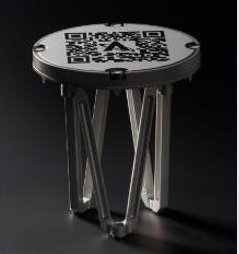

Image Source: Astroscale

Low-cost standardized docking plate designed to be attached to client satellites, proactively enabling on-orbit servicing. Aims to enable refueling, relocation, and end-of-life deorbit capabilities. The plate is customizable with a range of sizes and mounting options.

## Altius Space Machines MagTag $ ^{1 0 0} $ (Broomfield, CO)

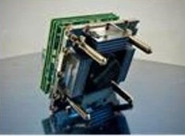

Image Source: Altius Space Machines

Low-profile magnetic connecting power/data interface to enable module attachment. Prepares clients for a variety of servicing types, including upgrade, repair, inspection, etc. Applications can vary from CubeSats to large spacecraft.

## Orbit Fab RAFTI/GRIP $ ^{1 0 2} $ (San Francisco, CA)

Image Source: Orbit Fab

Rapidly Attachable Fluid Transfer Interface. Equips spacecraft with refueling capabilities, enabling satellite life extension services. Interfaces with the GRIP active docking and refueling system allows fluid transfer (which can occur at full system pressure). Includes three alignment markers for cooperative docking.

<!-- PDF_PAGE: 22 -->

## Acknowledgments

The authors would like to thank key ISAM innovators and experts who were willing to share their industry insight including Astroscale U.S.'s Dave Fischer, Dave Hebert, Clare Martin, Charity Weeden; AXA XL's Chris Kunstadter; Nanorack's Chris Cummins; Orbit Fab's Adam Harris, Dalton Hayes; Redwire Space's Al Tadros; SpaceLogistics' Joseph Anderson; and Tethers Unlimited's Robert Hoyt.

Thank you to Rebecca Reesman for her invaluable help on RPO and OOS topics, Robin Dickey for her expertise in space norms and standards, and Audrey Allison for her expertise on ISAM spectrum allocation. Thank you to peer reviewers John P. Mayberry, Harrison Wight, Gregory Richardson, and Lance Hrivnak. Finally, a big thank you to The Aerospace Corporation's Center for Space Policy and Strategy and Karen Jones, who served as this paper's editor.

## About the Authors

Alec J. Cavaciuti is an associate member of the technical staff, supporting civil space program management and programmatic assessments. Cavaciuti has a bachelor's degree in aerospace engineering from Purdue University.

Joseph H. Heying is an associate member of the technical staff, specializing in project engineering and supporting programmatic assessments, with an emphasis on technology demonstrations. Heying has a bachelor's degree in aerospace engineering from Purdue University and is pursuing a master's degree in space systems engineering at Johns Hopkins University.

Joshua P. Davis is a senior project engineer providing support to various civil and national security customers, including development of in-space transportation and in-space servicing, assembly, and manufacturing concepts and architectures for DOD applications. Davis has bachelor's degrees in mechanical engineering and aeronautical science and engineering from the University of California and a master's degree in astronautical engineering from the University of Southern California.

## About the Center for Space Policy and Strategy

The Center for Space Policy and Strategy is dedicated to shaping the future by providing nonpartisan research and strategic analysis to decisionmakers. The Center is part of The Aerospace Corporation, a nonprofit organization that advises the government on complex space enterprise and systems engineering problems.

The views expressed in this publication are solely those of the author(s), and do not necessarily reflect those of The Aerospace Corporation, its management, or its customers.

For more information, go to www.aerospace.org/policy or email policy@aero.org.

$ \textcircled{2} $ 2022 The Aerospace Corporation. All trademarks, service marks, and trade names contained herein are the property of their respective owners. Approved for public release; distribution unlimited. OTR2022-00778

<!-- PDF_PAGE: 23 -->

## References

$ ^{1} $Executive Office of President of the United States, "In-Space Servicing, Assembly, and Manufacturing National Strategy," Product of ISAM Interagency Working Group of the National Science & Technology Council, April 2022.

$ ^{2} $ "On-Orbit Satellite Servicing Study Project Report," NASA GSFC, October 2010,

https://nexis.gsfc.nasa.gov/images/nasa_satellite%20servicing_ project_report_0511.pdf

$ ^{3} $ Rob Garner, "About - Hubble Servicing Mission", NASA, 15 January 2021

https://www.nasa.gov/mission_pages/hubble/servicing/index.html

4 "Commercial Resupply Servicers Overview," NASA, August 2018,

https://www.nasa.gov/mission_pages/station/structure/launch/ overview.html.

5 "SpaceLogistics," Northrop Grumman, August 2021 https://www.northropgrumman.com/space/space-logistics services/

"Northrop Grumman and Intelsat Make History with Docking of Second Mission Extension Vehicle to Extend Life of Satellite." Northrop Grumman Newsroom, 12 April 2021 news.northropgrumman.com/news/releases/northrop-grumman and-intelsat-make-history-with-docking-of-second-mission extension-vehicle-to-extend-life-of-satellite.

$ ^{7} $ Foust, Jeff. "New Initiative to Promote Satellites Servicing and In-Space Assembly Technologies." SpaceNews, 3 Nov. 2020, https://spacenews.com/new-initiative-to-promotesatellite-servicing-and-in-space-assembly-technologies/

$ ^{8} $ National Science & Technology Council, "In-Space Servicing, Assembly and Manufacturing National Strategy", In-Space Servicing, Assembly and Manufacturing Interagency Working Group, April 2022

$ ^{9} $ Jones, Andrew. "China's Shijian-21 Towed Dead Satellite to a High Graveyard Orbit." SpaceNews, 27 Jan. 2022,

spacenews.com/chinas-shijian-21-spacecraft-docked-with-and towed-a-dead-satellite/.

$ ^{1 0} $Ibid.

$ ^{11} $ CONFERS, January 2022, https://www.satelliteconfers.org/ $ ^{12} $ Kunstadter, Christopher. Space Insurance Update, AXA XL, Slide 32, 13 Jan. 2022.

$ ^{13} $ Rivera, Alejandro and Alphonso Stewart. Study of Spacecraft Deployables Failures.

14 "Ariane v Anomaly Left Sats in Wrong Orbits but They Will Still Reach GEO Slots." NewSpace Global, 26 Jan. 2018, newspaceglobal.com/ariane-v-anomaly-left-sats-wrong-orbits they-will-still-reach-geo-slots/.

15 Henry, Caleb. "Intelsat Pins Intelsat-29e Failure on External Event, Readies Replacement Order." SpaceNews, 31 July 2019 https://spacenews.com/intelsat-pins-intelsat-29e-failure-on external-event-readies-replacement-order/

16 "How Much Did the Loss of SXM-7 Satellite Cost SiriusXM?" Insideradio.com, 30 Apr. 2021,

www.insideradio.com/free/how-much-did-the-loss-of-sxm-7 satellite-cost-siriusxm/article_b7d6bb44-a985-11eb-8395- b7c8c4bbcb52.html.

17 Leone, Dan. "Next NASA Robotic Satellite Servicing Demo Pushed to August." SpaceNews, 4 June 2012, spacenews.com/next-nasa-robotic-satellite-servicing-demo-pushed-august/.

18 "Space Debris by the Numbers." ESA, 20 September 2021 www.esa.int/Safety_Security/Space_Debris/Space_debris_by_the_numbers.

19 Kunstadter, Christopher. Interview. Conducted by Joseph Heying and Alec Cavaciuti, 9 February 2022.

$ ^{20} $ Jones, Harry W., "The Recent Large Reduction in Space Launch Cost," 48th International Conference on Environmental Systems, July 2018.

$ ^{21} $ Hoyt, Robert. Interview. Conducted by Joseph Heying and Alec Cavaciuti, 22 November 2021.

$ ^{22} $ Potter, Sean. "NASA Awards Artemis Contract for Gateway Logistics Services." NASA, NASA, 27 March 2020,

www.nasa.gov/press-release/nasa-awards-artemis-contract-forgateway-logistics-services.

23 Jenner, Lynn. "NASA's On-orbit Servicing, Assembly, and Manufacturing 1 Mission Ready for Spacecraft Build", NASA, May 6, 2021, https://www.nasa.gov/image-

feature/goddard/2021/nasa-s-on-orbit-servicing-assembly-and manufacturing-1-mission-ready-for-spacecraft/)

24 Harbaugh, Jennifer. "On-Orbit Servicing, Assembly, and Manufacturing 2 (OSAM-2)," March 5, 2021 https://www.nasa.gov/mission_pages/tdm/osam-2.html

25 "Northrop Grumman's Wholly Owned Subsidiary,

Northrop Grumman's Wholly Owned Subsidiary, SpaceLogistics, Selected by DARPA as Commercial Partner for Robotic Servicing Mission." Northrop Grumman Newsroom news.northropgrumman.com/news/releases/northrop grummans-wholly-owned-subsidiary-spacelogistics-selected by-darpa-as-commercial-partner-for-robotic-servicing-mission.

26 Treaty on Principles Governing the Activities of States in the Exploration and Use of Outer Space, including the Moon and Other Celestial Bodies (Outer Space Treaty), Jan. 27, 1967.

$ ^{27} $ Convention on International Liability for Damage Caused by Space Objects, Nov. 29, 1971.

28 Henry, Caleb. "FCC begins approval of Orbital ATK satellite-servicing mission for Intelsat-901," SpaceNews, December 2017, https://spacenews.com/fcc-begins-approval-of- orbital-atk-satellite-servicing-mission-for-intelsat-901/.

29 Reesman, Rebecca and Rogers, Andrew. "Getting in Your Space: Learning from Past Rendezvous and Proximity Operations," Center for Space Policy and Strategy, May 2018, https://aerospace.org/paper/your-space-rendezvous-and proximity-operations-lessons.

30 United States of America National Submission to the United Nations Secretary General Pursuant to UN General Assembly

<!-- PDF_PAGE: 24 -->

Resolution 75/36. "Reducing space threats through norms, rules and principles of responsible behaviours," April 29, 2021.

31 Henry, Caleb. "FCC begins approval of Orbital ATK satellite-servicing mission for Intelsat-901."

$ ^{32} $ Cummings et al., "Reply Comments of Astroscale U.S. Inc., Axiom Space Inc., Atomos Space, Sierra Space Corp., and Scout Inc.", FCC, 10 September 2021

33 "Licensing of Private Remote Sensing Space Systems." Federal Register, 20 May 2020, www.federalregister.gov/documents/2020/05/20/2020 10703/licensing-of-private-remote-sensing-space-systems.

$ ^{34} $ "ISO/DIS 24330: Space Systems - Rendezvous and Proximity Operations (RPO) and On Orbit Servicing (OOS) - Programmatic principles and practices", International Organization for Standardization, 27 July 2021

$ ^{35} $ Nguyen, Tien M. "Future Satellite System Architectures and Practical Design Issues: An Overview." IntechOpen, IntechOpen, 13 May 2020,

www.intechopen.com/chapters/72147.

36 "2020 NASA Tipping Point Selections," NASA, 14 October 2020,

https://www.nasa.gov/directorates/spacetech/solicitations/tipping_points/2020_selections

37 "DARPA Kicks off Program to Explore Space-Based Manufacturing." Darpa.mil, 23 Mar. 2022, www.darpa.mil/news-events/2022-03-23.

38 "ESA and EU Sign Contribution Agreement on Horizon 2020 Space Activities." ESA, 16 Apr. 2019,

www.esa.int/About_Us/Corporate_news/ESA_and_EU_sign_C ontribution_Agreement_on_Horizon_2020_space_activities. 39 "On-Orbit Servicing." EROSS-H2020, eross-h2020.eu/.

40 Erwin, Sandra. "Lockheed Martin Releases Open-Source Satellite Interface for On-Orbit Docking." SpaceNews, 4 Apr. 2022, spacenews.com/lockheed-martin-releases-open-source satellite-interface-for-on-orbit-docking/.

41 Reesman, Rebecca. "Assurance through Insurance and Onorbit Servicing," Center for Space Policy and Strategy, 16 February 2018, https://csps.aerospace.org/papers/assurance-through-insurance-and-orbit-servicing

42 Crusan, Jason. "Future Human Exploration Planning: Lunar Orbital Platform-Gateway and Science Workshop Findings," NASA, March 2018,

https://www.nasa.gov/sites/default/files/atoms/files/20180327-crusan-nac-heoc-v8.pdf.

43 "The LUVOIR Final Report" NASA GSFC, August 2019, https://asd.gsfc.nasa.gov/luvoir/reports/LUVOIR_FinalReport 2019-08-26.pdf

44 Hibbard, Rustie L. "Satellite On-Orbit Refueling: A Cost Effectiveness Analysis" Naval Postgraduate School, September 1996, https://core.ac.uk/download/pdf/36724990.pdf.

45 Werner, Debra. "How long should a satellite last: five years, ten years, 15, 30?," SpaceNews, May 2018. https://spacenews.com/how-long-should-a-satellite-last/.

46 "SpaceLogistics Announces Launch Agreement with SpaceX and First Mission Extension Pod Contract with Optus." Northrop Grumman Newsroom, 21 February 2022 https://news.northropgrumman.com/news/releases/spacelogistic s-announces-launch-agreement-with-spacex-and-first-mission extension-pod-contract-with-optus

47 Erwin, Sandra. "Orbit Fab gets $12 million to integrate refueling port with military satellites." SpaceNews, 17 March 2022, https://spacenews.com/orbit-fab-gets-12-million-to-integrate-refueling-port-with-military-satellites/

48 Harris, Adam. Interview. Conducted by Joseph Heying and Alec Cavaciuti, 16 November 2021.

49 Erwin, Sandra. "Space Force Looking at What It Will Take to Refuel Satellites in Orbit." SpaceNews, 13 Apr. 2022, spacenews.com/space-force-looking-at-what-it-will-take-to-refuel-satellites-in-orbit/.

$ ^{50} $ "Department of Defense to prototype Robotic Arms for Modular Space Systems." Defense Innovation Unit, 7 March 2022, https://www.diu.mil/latest/modularity-for-space-systemsm4ss-press-release

$ ^{51} $ Rossetti, Dino, et al. "Spacecraft Modularity for Serviceable Spacecraft," 2015 AIAA SPACE Forum, September 2015.

$ ^{52} $ Lim, Daniel. "Intermodal Space Transportation to Foster Ubiquitous Space Access" 16th Reinventing Space Conference, 30 Oct 2018, BIS-RS-2018-31.

53 Woffinden, David C. "On-Orbit Satellite Inspection: Navigation and [Delta]v Analysis." MIT Library, 6 Aug. 2004, dspace.mit.edu/handle/1721.1/28862, 17-19.

54 Reesman, Rebecca. "Assurance Through Insurance and On- Orbit Servicing."

55 Werner, Debra. "How long should a satellite last: five years, ten years, 15, 30?"

56 Tadros, Al. Email to Joseph Heying, Alec Cavaciuti, Joshua Davis, and Karen Jones. 15 February 2022.

57 Jones, Karen and Piskorz, Danielle. "On-Orbit Assembly of Space Assets," Center for Space Policy and Strategy, 16 February 2018, https://csps.aerospace.org/papers/orbitassembly-space-assets. 58 Ibid.

59 O'Quinn, Carrie and Piskorz, Danielle. "Setting the Standard: Launch Units for the Smallsat Era," Center for Space Policy and Strategy, 1 June 2018,

https://aerospace.org/paper/setting-standard-launch-units smallsat-era.

60 "SpaceX." SpaceX, www.spacex.com/vehicles/starship/#:~:text=The%20Starship% 20payload%20fairing%20is.

$ ^{61} $ "NASA's Exploration & In-Space Services." NExIS, 2022, nexis.gsfc.nasa.gov/osam/index.html/.

62 "NASA's Dragonfly Project Demonstrates Robotic Satellite Assembly Critical to Future Space Infrastructure Development," NASA, September 2017, https://www.nasa.gov/mission_pages/tdm/irma/nasas-

<!-- PDF_PAGE: 25 -->

dragonfly-project-demonstrates-robotic-satellite-assembly-critical-to-future-space.html.

63 Werner, Debra. "Satlets: crazy idea or ingenious concept? This week's test on ISS will offer clues," SpaceNews, October 2017, https://spacenews.com/satlets-crazy-idea-or-ingenious concept-this-weeks-test-on-iss-will-offer-clues/.

64 "Fiber Optics: Best in Class Fluoride-Based Fiber for Medical, Telecom, and Research," Made In Space, Inc., August 2018, http://madeinspace.us/mis-fiber/.

$ ^{65} $ "Engineering Test Satellite VII 'KIKU-7' (ETS-VII)." JAXA, global.jaxa.jp/projects/sat/ets7/index.html.

66 "Astroscale's ELSA-d Successfully Demonstrates Repeated Magnetic Capture." Astroscale, 25 Aug. 2021 astroscale.com/astroscales-elsa-d-successfully-demonstrates repeated-magnetic-capture/.

$ ^{67} $ "ELSA-M - Astroscale, Securing Space Sustainability." Astroscale, astroscale.com/elsa-m/.

69 "Northrop Grumman and Intelsat Make History with Docking of Second Mission Extension Vehicle to Extend Life of Satellite."

$ ^{68} $ "Key Capabilities of Our Life Extension In-Orbit (LEXITM) Servicer." Astroscale U.S., 5 Oct. 2021, astroscale-us.com/lexilife-extension-capabilities/.

70 Erwin, Sandra. "Northrop Grumman to Launch New Satellite-Servicing Mission in 2024." SpaceNews, 21 Feb. 2022, spacenews.com/northrop-grumman-to-launch-newsatellite-servicing-mission-in-2024/.

$ ^{71} $ "Products." Orbit Fab, www.orbitfab.com/products.

72 "Parts Come Together This Year for DARPA's Robotic In Space Mechanic." DARPA, 17 July 2021. www.darpa.mil/news-events/2020-07-17.

73 "Three Companies Studying 'Orbital Outpost' Space Station Concepts for Defense Department." SpaceNews, 19 July 2020, spacenews.com/three-companies-studying-orbital-outpost-space-station-concepts-for-defense-department/.

74 "NASA's Exploration & In-Space Services - OSAM-1." NExIS, 2020, nexis.gsfc.nasa.gov/OSAM-1.html.

$ ^{75} $ Harbaugh, Jennifer. "On-Orbit Servicing, Assembly, and Manufacturing 2 (OSAM-2)."

76 "ClearSpace One - a Mission to Make Space Sustainable." Clearspace, clearspace.today/.

"TITAN - PIAP Space." PIAP Space, 16 Sept. 2021. piap.space/projects/titan-project/.

78 "Astroscale Selects Rocket Lab to Launch Phase I of JAXA's Debris Removal Demonstration Project." Astroscale, 21 Sept. 2021, astroscale.com/astroscale-selects-rocket-lab-to-launch-phase-i-of-jaxas-debris-removal-demonstration-project/.

79 "Atomos Space - Satellite Orbit Raising and Precision Placement." Atomos Space, www.atomospace.com/.

80 "Investments into Atomos Space Garners Million$ for OTV Tech Development - SatNews." SatNews, 17 Jan. 2022 news.satnews.com/2022/01/17/investments-into-atomos-space-garners-million-for-otv-tech-development/.

81 "D-Orbit S.p.A., a Market Leader in Space Logistics, to Combine with Breeze Holdings Acquisition Corp. And Become a Publicly Listed Company." PR Newswire, www.prnewswire.com/news-releases/d-orbit-spa-a-marketleader-in-space-logistics-to-combine-with-breeze-holdingsacquisition-corp-and-become-a-publicly-listed-company 301469586.html#:~:text=Proven%20Business%20Model%20with%20a.

82 "Satellite Launch and Deployment." D-Orbit, www.dorbit.space/.

83 "Exolaunch Introduces Eco Space Tug Program."

Exolaunch, exolaunch.com/news-block-30.html

84 Henry, Caleb. "French Startup Exotrail Raises $13 Million for Propulsion, Space Software and On-Orbit Transport Systems." SpaceNews, 16 July 2020, spacenews.com/french-startup-exotrail-raises-13-million-for-propulsion-on-orbit transport-systems/.

85 Inc, Moog. "Orbital Maneuvering Vehicle." Moog www.moog.com/markets/space/omv.html. 86 "Products." Obruta, www.obruta.com/products.

HUMAN POTENTIAL." GlobeNewswire News Room, 28 July 2021, www.globenewswire.com/en/news-

release/2021/07/28/2270492/0/en/SPACE-DEMO-DAY-BROADENS-THE-SCOPE-OF-HUMAN-POTENTIAL.html.

88 "SCOUT Is on Orbit!" SCOUT, scout.space/news/scout-is on-orbit.

89 "SCOUT - a New Vision for Spaceflight." SCOUT, scout.space/.

90 "Skyrora's 'Space Tug' Gives Space Sustainability Dream a Lift" Skyrora, 7 May 2021, www.skyrora.com/post/skyrora-space-tug-gives-space-sustainability-dream-a-lift.

91 "Space Tug." Skyrora, www.skyrora.com/space-tug#section-2.

92 Dorsey, Kristy. "Commercial Interest as Scottish Rocket Company Completes Space-like Testing." The Herald Scotland, 17 Nov. 2020,

www.heraldscotland.com/business_hq/18878562.scottishrocket-company-completes-testing-space-like-conditions/.

93 "Space Technology | Starfish Space | Giving Life to On- Orbit Services." STARFISH SPACE, www.starfishspace.com/starfish-technology.

$ ^{94} $ "Startrocket." Startrocket, startrocket.me/.

95 "RemoveDEBRIS Net Capture Experiment Successful" Surrey Satellite Technology Limited, 19 Sept. 2018 www.sstl.co.uk/media-hub/latest-news/2018/removedebrispace-junk-net-capture-success.

96 "RemoveDEBRIS" University of Surrey, www.surrey.ac.uk/surrey-space-centre/missions/removedebris. 97 Hoyt, Robert. Technologies for In Space Services [PowerPoint Slides]. Tethers Unlimited Inc., 2021. 98 "UARX Space." UARX Space, www.uarx.com/projects/ossie.php.

<!-- PDF_PAGE: 26 -->

99 "UARX Space Signs a Cooperation Agreement with DLR German Aerospace Center." UARX Space, 18 Feb. 2021 www.uarx.com/news/uarx-signs-cooperation-agreement-dlr german-areospace-center.

$ ^{100} $Technologies. Altius Space Machines, altius-space.com/technologies.html.

101 "Docking Plate - Astroscale, Securing Space Sustainability." Astroscale, astroscale.com/docking-plate/.

102 "Products." Orbit Fab, www.orbitfab.com/products.