<!-- PDF_PAGE: 1 -->

# EXPLORING THE RELATIONSHIP BETWEEN THE GROWING NUMBER OF SATELLITES AND SPACE DEBRIS IN LOW EARTH ORBIT, AND PEOPLE'S PERCEPTION OF SPACE DEBRIS ENVIRONMENTAL IMPACTS

By Muin F. Bogari

Seong Dae Kim Associate Professor of Engineering Management University of Tennessee at Chattanooga (Chair)

Wolday D. Abrha Assistant Professor of Engineering Management University of Tennessee at Chattanooga (Committee Member)

Curtis Coker Campbell Adjunct Professor of Computer Science University of Tennessee at Chattanooga (Committee Member)

<!-- PDF_PAGE: 2 -->

# EXPLORING THE RELATIONSHIP BETWEEN THE GROWING NUMBER OF SATELLITES AND SPACE DEBRIS IN LOW EARTH ORBIT, AND PEOPLE'S PERCEPTION OF SPACE DEBRIS ENVIRONMENTAL IMPACTS

By Muin F. Bogari

A Thesis Submitted to the Faculty of the University of Tennessee at Chattanooga in Partial Fulfillment of the Requirements of the Degree of Master of Engineering Management

The University of Tennessee at Chattanooga Chattanooga, Tennessee

May 2023

<!-- PDF_PAGE: 3 -->

Copyright © 2023

Muin Fouad A. Bogari

All Right Reserved

<!-- PDF_PAGE: 4 -->

## ABSTRACT

The rapid increase of satellite deployments to Earth's orbits is causing an increase in the number of space debris and inactive satellites in Earth's orbits which poses a growing threat of orbital collisions. Orbital collisions can trigger a domino effect, known as the Kessler syndrome, which can cause uncontrolled continuous orbital collisions. This research utilizes documented data on approximately 65,000 Anthropogenic Space Objects in Earth's orbit dating from the first ASO launched in 1957 to April 1st, 2022. The research study provides a comprehensive analysis of all monitored ASOs in Earth's orbit by presenting and exploring the current state of space debris and its relationship to the active satellites in Earth's orbit. The findings of this study will contribute to ongoing efforts to address the challenges of space debris, uncontrolled reentry, and orbital impacts, and promote a sustainable space environment.

<!-- PDF_PAGE: 5 -->

## DEDICATION

This research is dedicated to all those who have inspired, supported, and encouraged me throughout my academic journey. I am forever grateful to my family, whose unwavering love and encouragement have been my anchor in life. Your sacrifices and understanding have made it possible for me to pursue my academic dreams. To my teachers and mentors, who have imparted their knowledge and wisdom, and guided me through the challenges of research, I extend my heartfelt appreciation. Your patience and guidance have been invaluable in shaping my academic growth. To my friends, who have provided me with the motivation, support, and encouragement to persevere, I thank you. Your unwavering belief in my abilities has been a source of inspiration. Finally, I dedicate this research to those with a passion for learning and discovery. May this research contribute in some small way to our collective understanding of space and inspire others to pursue their academic passions.

<!-- PDF_PAGE: 6 -->

## ACKNOWLEDGEMENTS

I would like to acknowledge and thank my academic advisor Dr. Seong Dae Kim, who provided invaluable guidance, support, and patience during the research process. I would like to thank the members of the thesis research committee who provided tremendous support, encouragement, and support throughout the research final process and research defense. I offer my appreciation to Dr. Moriba Jah for his work and research in Astrophysics and for providing the time to meet with me to introduce me to the emerging issue of space debris. My gratitude to Dr. Jonathan McDowell for his catalogs, meetings with me, and his immense research in Astrophysics. Finally, I would like to thank my family for their patience and understanding. Also, I am thankful for my friends who provided their support and have been a constant source of inspiration. Thank you all for your contributions to this work, and for being a part of this astronomical journey.

<!-- PDF_PAGE: 7 -->

## TABLE OF CONTENTS

ABSTRACT...iv

DEDICATION...v

ACKNOWLEDGEMENTS...vi

LIST OF FIGURES...ix

LIST OF TABLES...xi

LIST OF ABBREVIATIONS...xii

CHAPTER

I. INTRODUCTION...1

1.1 Space...1

1.2 Satellites...5

    1.2.1 Satellite Communication...7

    1.2.2 Satellite Navigation...9

    1.2.3 Satellite Imagery...10

    1.2.4 Satellite Constellation...11

    1.2.5 Small Satellites...15

1.3 Earth’s orbits...16

    1.3.1 Low Earth Orbit (LEO)...16

    1.3.2 Medium Earth Orbit (MEO)...17

    1.3.3 Geosynchronous Orbit (GEO)...17

1.4 Space Debris...18

1.5 Environmental Impacts...20

1.6 National Security...22

1.7 Objectives of the Study...24

<!-- PDF_PAGE: 8 -->

1.8 Scope of the Study ...24

1.9 Layout of the Thesis ...25

II. LITERATURE REVIEW ...26

III. METHODOLOGY ...31

3.1 Data Origin ...31

    3.1.1 UCS Satellite Database ...31

    3.1.2 Dr. Jonathan McDowell Space Catalog ...32

3.2 Data Processing ...32

3.3 Data Visualization ...33

IV. RESULTS AND DISCUSSION ...35

4.1 Active Satellites ...35

4.2 Space Debris ...44

V. CONCLUSION AND RECOMMENDATIONS ...50

REFERENCES ...52

ATTACHMENTS ...56

A. UCS ACTIVE SATELLITES DATASET

B. DR.MCDOWELL SATCOM DATASET

C. SPACE DEBRIS SURVEY QUESTIONS

VITA ...57

<!-- PDF_PAGE: 9 -->

## LIST OF FIGURES

Figure 1.1 Earth's orbits and Kármán line (NOAA,2023)...3

Figure 1.2 The Sputnik satellite was 183 pounds and shape of a basketball...4

Figure 1.3 Satellite uplink, downlink, and crosslink. Credits: D. Stojce (2019)...8

Figure 1.4 Satellite communication signal scintillation...9

Figure 1.5 Landsat 8 satellite monitoring algal bloom...11

Figure 1.6 A rosette constellation shape...12

Figure 1.7 A teledesic's geodesic constellation shape...12

Figure 1.8 Size one-unit 1U of CubeSat, 10x10x10 Centimeters...15

Figure 1.9 Earth orbits and distance from Earth in kilometers...16

Figure 2.1 Space objects growth overtime, and events causing objects to hike...26

Figure 2.2 Visualization of objects tracked in low Earth orbit (LEO)...27

Figure 4.1 Top 5 countries by active satellites in Earth orbit...35

Figure 4.2 Number of active satellites per Earth orbits...37

Figure 4.3 Percentage of active satellites in each Earth orbit...38

Figure 4.4 Launch mass of the active satellites...39

Figure 4.5 Mass in Earth orbit forecast from the year 2000 baseline...40

Figure 4.6 Average active satellite inclination in degrees...42

Figure 4.7 Active satellite launch sites per country...43

<!-- PDF_PAGE: 10 -->

Figure 4.8 FAA licensed space launch sites in USA ... 43

Figure 4.9 Space debris reentry to Earth's atmosphere by country ... 44

Figure 4.10 Number of space debris in Earth's orbits vs. space debris re-entry to Earth's atmosphere ... 45

Figure 4.11 Space debris types that reentered Earth... 46

Figure 4.12 Indicates the average life of the active satellites in each Earth orbit... 47

Figure 4.13 Space debris percentage in each Earth orbit... 47

Figure 4.14 Survey responses if the government should address space debris issue ... 48

Figure 4.15 Survey responses if private entities should address space debris issue ... 49

<!-- PDF_PAGE: 11 -->

## LIST OF TABLES

Table 1.1 Planned communication constellations...13

Table 1.2 Popular satellite constellation numbers and increase...14

Table 4.1 Satellite categories by mass and approximate costs...41

<!-- PDF_PAGE: 12 -->

# LIST OF ABBREVIATIONS

AI, Artificial Intelligence

ASO, Anthropogenic Space Object

ESA, European Space Agency

EOS, Earth Observation System

FAA, Federal Aviation Administration

GNSS, Global Navigation Satellite Systems

GPS, Global Positioning System

ICAO, International Civil Aviation Organization

ISS, International Space Station

LEO, Lower Earth Orbit

NOAA, The National Environmental Satellite Data, and Information Service

NASA, National Aeronautics and Space Administration

MEO, Medium Earth Orbit

MIT, Massachusetts Institute of Technology

GEO, Geosynchronous Earth Orbit

SSN, Space Surveillance Network

UCS, Union of Concern Scientists

UNOOSA, United Nations Office of Outer Space Agency

<!-- PDF_PAGE: 13 -->

## CHAPTER I INTRODUCTION

## 1.1 Space

Space has been a fascination and a challenge to explore in the eyes and minds of humanity since the beginning of history. The Babylonians created a system of astrology and were able to predict astronomical events such as lunar eclipses. The ancient Greeks made multiple contributions to the field of astronomy. The Greek philosopher and mathematician, Pythagoras, believed that the Earth was a sphere and that the planets and stars were held in place by invisible spheres (Ely, 2012).

According to NASA, space is recognized as the environment above the Earth's atmosphere, where celestial bodies such as planets, stars, and galaxies are located. The Earth's atmosphere is the area immediately above the Earth's surface where aircraft and other vehicles operate. The limit between Earth's atmosphere and space is an arbitrary limit that is not welldefined and varies at different locations on Earth (NASA, 2023).

Ascending from the Earth's surface into the atmosphere brings a decrease in temperature until a certain point when the temperature starts to increase again. The atmosphere is divided into several layers based on the reversals in temperature gradients, which are referred to as "pauses" and used to define spheres of the atmosphere (McDowell, 2018).

<!-- PDF_PAGE: 14 -->

The above layer is called the mesosphere which is composed of carbon dioxide (CO2). The follwing layer is called the thermosphere and is predominantly affected due to solar radiation absorption, which ionizes the atoms to behave differently than those in the lower layers. The composition of the atmosphere in the thermosphere is different from the lower layers (McDowell, 2018).

Finally, the exosphere layer has a very low density and matter that behaves like gases (McDowell, 2018). Between the mesosphere and thermosphere lies a line that separates Earth's atmosphere from space known as the Kármán line (NASA, 2023). The Kármán line is 100 kilometers (62.1 miles) above mean sea level, beyond the line atmosphere starts to become exceedingly thin, and objects orbiting the planet encounter little to no air resistance. The biggest advocates for the Kármán line are the Fédération Aéronautique Internationale (FAI). FAI are world famous for organizing space sports and spaceflights (Córdoba, 2006). Space statistics and activities are documented by FAI. FAI maintains a scoreboard that records various types of space activities. The categories on the scoreboard include accumulated space flight time, distance traveled, and total space-time, and the rankings are listed in descending order from highest to lowest. While the Kármán line is 100 kilometers above Earth, NASA and the United States military consider flights above 80 kilometers as space travel. Different boundaries of space were discussed in "The never ending dispute: Delimitation of air space and outer space" a 1996 book by Goedhart. Where different countries and institutions consider space to start anywhere from 30 kilometers and others at higher elevations. There is no international policy or agreement on where space starts above the country's jurisdiction (Goedhart, 1996). The National Environmental Satellite Data and Information Service (NESDIS), which operates the environmental

<!-- PDF_PAGE: 15 -->

and meteorological satellites considers the defined Karmen line as a boundary of space. (NOAA, 2016).

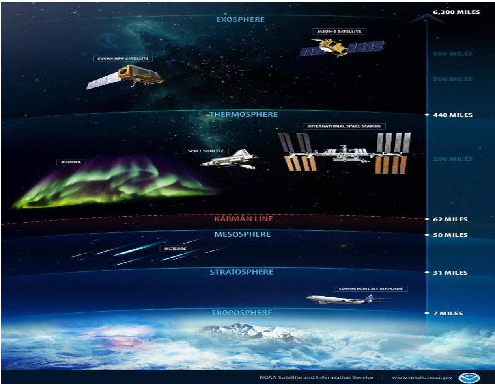

Figure 1.1 Earth's orbits and Kármán line (NOAA,2023)

The first satellite were launched in 1957, by the Soviet Union, the Sputnik 1 satellite which became the first anthropogenic object to orbit low Earth orbit (LEO). As of the first crewed mission Yuri Gagarin, from the Soviet Union, spent a total of 108 minutes in space orbiting Earth in 1961. Project Apollo scored the US as the first country to set a crewed journey to the moon. Neil Armstrong was the first person to step onto the Moon's surface in 1969. Additionally, in the 1960s and 1970s, NASA initiated the Mariner program which involved

<!-- PDF_PAGE: 16 -->

launching a sequence of robotic spacecraft that studied planets such as Venus, Mars, and Mercury. As the space race ended, countries and organizations raced to put more anthropogenic objects into the Earth's orbit. Low Earth orbit has become a bustling center of activity for various nations conducting research on the International Space Station and deploying an increasing number of satellites. Additionally, multiple unmanned spacecraft have been deployed to explore space beyond Earth's orbits. These unmanned spacecrafts are probes that have uncovered a diverse array of fascinating findings (National Geographic, 2023).

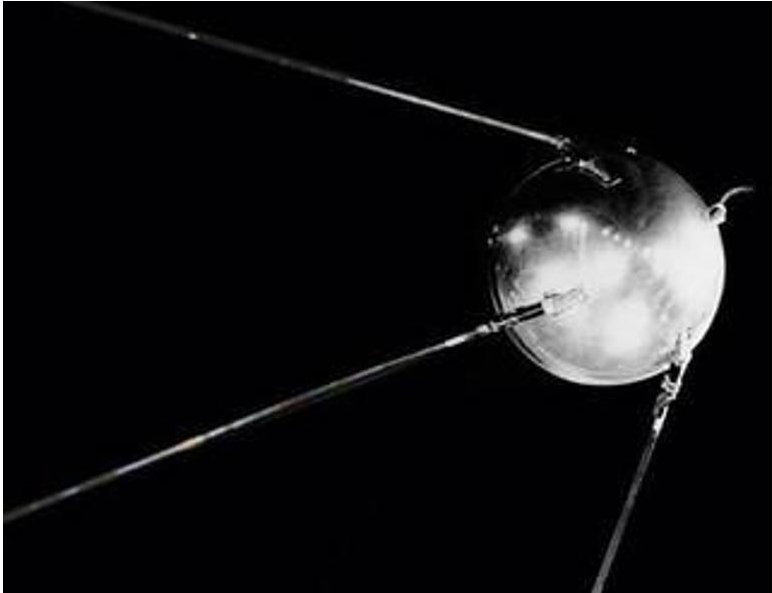

Figure 1.2 The Sputnik satellite was 183 pounds and shape of a basketball

The International Space Station (ISS) was first inaugurated in 1998 as the beginning of a new era of exploration and advancement in space. The ISS is a home for international crew who work and stay in low Earth orbit. ISS has research facilities that include biomedical, life sciences, and material sciences laboratories. The station is comprised of numerous interlocking components that were constructed on Earth and constructed in multiple stages. The completed modules include habitations, logistics modules, and other types. The electrical power from four extensive solar arrays provides the necessary energy to operate. The ISS is considered an

<!-- PDF_PAGE: 17 -->

important platform for scientific research that cannot be accomplished on Earth (Lawrence et al, 1996).

One of the most significant discoveries in space exploration is the existence of other planets. Exoplanets were discovered and have fueled the curiosity of finding life elsewhere in the universe. Many of the exoplanets were discovered by the Kepler Space Telescope launch by NASA in 2009. Researchers are actively employing diverse techniques to uncover additional planets and celestial objects. Another major discovery in space is the presence of black holes, which are believed to have formed from the remnants of dead stars and have tremendous gravitational strength which affect space around it. Installed on ISS in 2011, the Alpha Magnetic Spectrometer is a particle detector, that has been instrumental in studying cosmic rays and their effects. In addition to these discoveries, space exploration has also led to numerous technological advancements. The development of satellite technology has revolutionized telecommunications, weather forecasting, and navigation. The exploration of space has also led to advancements in materials science, robotics, and energy production (Borucki et al., 2010).

## 1.2 Satellites

An object, either natural or man-made, that revolves around a planet or star is referred to as a satellite. For instance, the moon orbits the Earth while the Earth revolves around the sun, making both bodies natural satellites. Many manmade satellites orbit Earth and carry out tasks like Earth observation, communication, navigation, and scientific study. Earth observation satellites capture photographs of the world that are utilized in planning, natural resource management, disaster management, and weather forecasting. Space,

<!-- PDF_PAGE: 18 -->

the Sun, planets, and other celestial entities are all studied by scientific research satellites, which yield priceless information and insights into the unknown space world (NASA, 2014).

Satellites can detect and collect data from locations in space that are unreachable to observatories on Earth. Before satellites were invented, TV broadcasts could not transmit very far. Television signals cannot follow the curvature of the Earth; instead, they travel in straight lines and quickly disperse into space. Signals were also obstructed by mountains or buildings which required a substitution of cables to be laid across vast distances or underwater. After the invention of the satellites, signals and other transmittals are sent up to the satellites, where they are instantly relayed back to various locations on Earth in real-time. Satellites are available in a wide range of sizes and designs, ranging from small CubeSats that are hand fist size to massive communication satellites that can be the size of multiple story buildings. This diversity in size and configuration enables satellites to serve a variety of applications, including communication, navigation, remote sensing, and scientific research. All satellites share two basic features: an antenna and a power supply. Satellites rely on antennas to transmit and receive data, often communicating with Earth or sensing deep space. To power the satellite, a solar panel or battery is usually utilized, with solar panels generating electricity by harnessing sunlight. NASA's satellite fleet includes a range of sophisticated instruments, such as cameras and sensors, that are utilized to observe and gather data on various Earth features such as land, air, and water. For data collection on space and the cosmos, these sensors are oriented outwards into space (NASA, 2014).

A satellite's purpose can be for military, civilian, or commercial use. Earth's ecosystem climate, and other natural occurrences like weather patterns, ocean currents, and atmospheric

<!-- PDF_PAGE: 19 -->

composition are all studied by scientific research satellites. These satellites may be equipped with spectrometers, magnetometers, and cameras to gather data for research in areas including oceanography, atmospheric science, and geology (Dunbar, 2014). Television, radio, and telecommunications services employ communications satellites to transmit and receive messages. There are many uses of communication satellite technology it can facilitate inventory management for large manufacturing firms and department stores, enable banking services, and payment authorizations, support pay-at-the-pump gas purchases, and live video streaming (UCSUSA, 2015).

## 1.2.1 Satellite Communication

The satellite communication system enables the transfer of data and telemetry from and to Earth. The reception is composed of two segments: the ground segment, which encompasses multiple terminals on Earth, and terminals in space, which encompasses one or more spacecraft and their corresponding communication payloads.

The communication system has three main functions: uplink, which involves receiving commands from Earth; downlink, which entails transmitting data down to Earth, and crosslink or inter-satellite link, which involves transmitting or receiving information between two satellites (NASA).

<!-- PDF_PAGE: 20 -->

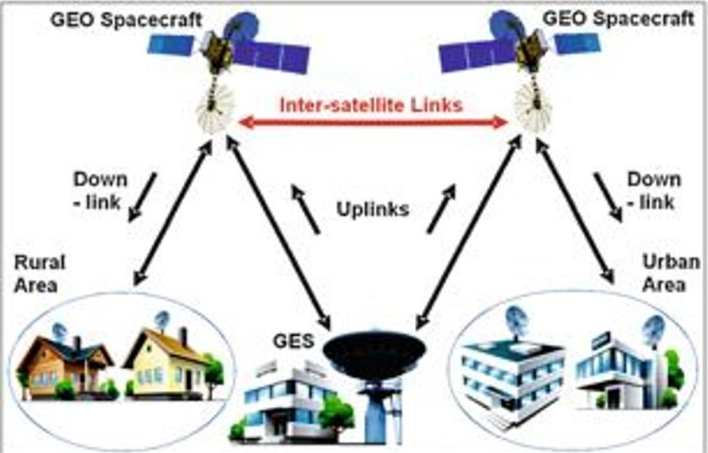

Figure 1.3 Satellite uplink, downlink, and crosslink. Credits: D. Stojce (2019)

The Earth's weather patterns, including temperature, humidity, and cloud cover, are studied by weather satellites. The creation of weather predictions and the monitoring of extreme weather phenomena like tornadoes and hurricanes also use this data. The distinctive and invaluable feature of environmental satellites is their capacity to observe the Earth from a distance, offering meteorologists the ability to actively watch the storm's creation and route. This attribute, known as "imaging," is beneficial for all storm types, but it was particularly crucial during the initial stages of environmental satellite development when they were primarily used for monitoring and predicting hurricanes. The lack of this capability made it difficult to forecast the paths of powerful storms over oceans, resulting in catastrophic outcomes such as the 1900 Galveston Hurricane, which claimed approximately 8,000 lives. At that time, weather forecasters in Galveston had limited resources for determining the exact location of the hurricane in the Gulf of Mexico or making precise predictions about its future movement to alert residents. They mainly relied on information from sources on land and a small number of ships at sea (NOAA, 2017).

<!-- PDF_PAGE: 21 -->

## 1.2.2 Satellite Navigation

Satellite navigation provides a reliable and precise method for determining location and time, with applications in various fields, such as aviation, transportation, and surveying. Satellite navigation relies on global satellites positioned in medium earth orbit to transmit radio signals over a network for information. Although the 31 GPS satellites owned and operated by the United States are widely known and used, three other constellations offer comparable services. The Russian Federation operates the GLONASS system, while the European Union and China have developed the Galileo and BeiDou systems, respectively. The GPS satellites emit signals that receivers utilize, alongside signals from a minimum of four other satellites, to calculate their precise location and time. These satellites are equipped with atomic clocks that offer extremely precise time data, which is encoded and transmitted in the signal. The receiver utilizes the data and information from the signal to compute the positions of the satellites and make appropriate modifications to attain precise positioning. Nevertheless, the receiver must also consider the signal's propagation delays and slowdowns caused by the ionosphere and the troposphere. With measurements from at least three satellites, including latitude, longitude, and altitude, and with a fourth signal, it can determine the time without an atomic clock (FAA, 2023). Figure 1.4 illustrates the satellite and ground receiver interaction.

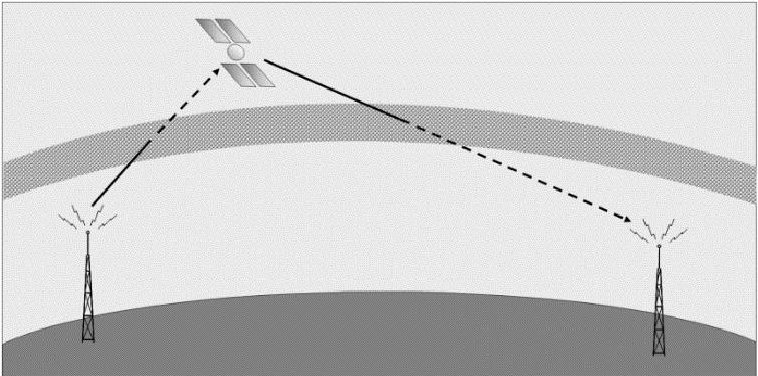

Figure 1.4 Satellite communication signal scintillation

<!-- PDF_PAGE: 22 -->

## 1.2.3 Satellite Imagery

Remote sensing satellites use electromagnetic energy to capture imagery of natural phenomena on Earth's surface and atmosphere. It has evolved from military use during the Cold War with low-resolution images to high-resolution data of Earth's lands and seas. The latest addition to satellite remote-sensing technology is the laser, primarily utilized for mapping topography and ice sheets, and to measure atmospheric features and the Earth's surface through fluorescence. Specific substances like chlorophyll fluoresce naturally occur at distinct wavelengths, which can be used to estimate the amount of plant life in a particular region, such as an algal bloom in water as shown in Figure 1.5. Fluorescence is also beneficial in the study of the atmosphere. The Calipso satellite operated by NASA utilizes a remote sensing method called Light Detection and Ranging (LiDAR). The green and infrared LiDAR measures the backscattered reflectance or fluorescence of clouds, which yields information on not only cloud altitude but also aerosol properties. By using this technique, Calipso detected a considerable plume of sulfur dioxide that other sensors would have overlooked (Tatem et al., 2007).

Satellites such as NASA and USGS Landsat 8 can recognize the occurrence of an algal bloom in lakes or rivers when viewed from space. Although the data analysis process is complex, researchers are simplifying it so that resource managers throughout the country can leverage satellite data to detect potential issues. Satellite data on climate variables like weather temperature, precipitation, and vegetated regions are globally consistent and have significant applications in researching water and resource locations. The data also aids in conservation planning by inferring species' present and future distributions. Satellite imagery is vital for ecologists and epidemiologists to assess habitats and disease distribution (Tatem et al., 2007).

<!-- PDF_PAGE: 23 -->

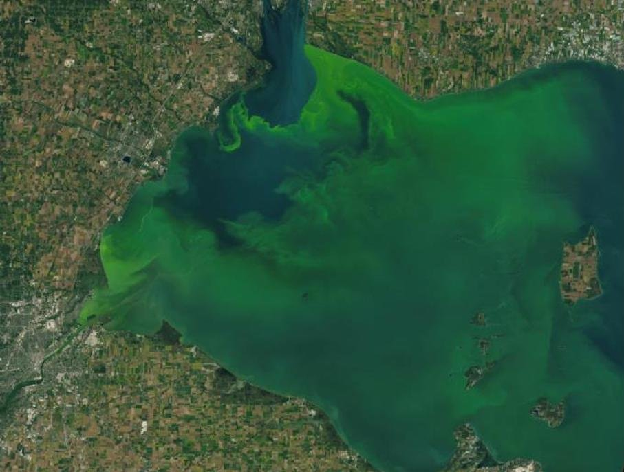

Figure 1.5 Landsat 8 satellite monitoring algal bloom

## 1.2.4 Satellite Constellation

In 2000, the Cluster mission became the first satellite constellation to collect three dimensional simulation data on the magnetosphere. The Cluster comprises of four satellites that configure themselves into different shapes, including a tetrahedron. The Earth-Observation System (EOS) is a satellite constellation network of 17 satellites that conduct multiple remote sensing and research operations (Sieg, 2004). Satellite constellations boost connections between nodes by introducing close connections between each node. Closeness can be very useful in routing traffic between nodes without overburdening a particular satellite.

The rosette constellation, which overlaps satellite coverage in various orbital planes, provides optimal coverage in mid-latitudes where the majority of the human population is located, allowing for multiple satellite visibility from a single ground terminal. However, it does not cover the poles. Figure 1.6 illustrates the rosette constellation where the straight lines represent intersatellite links indicating network connectivity between satellites. (Zhang, 2003).

<!-- PDF_PAGE: 24 -->

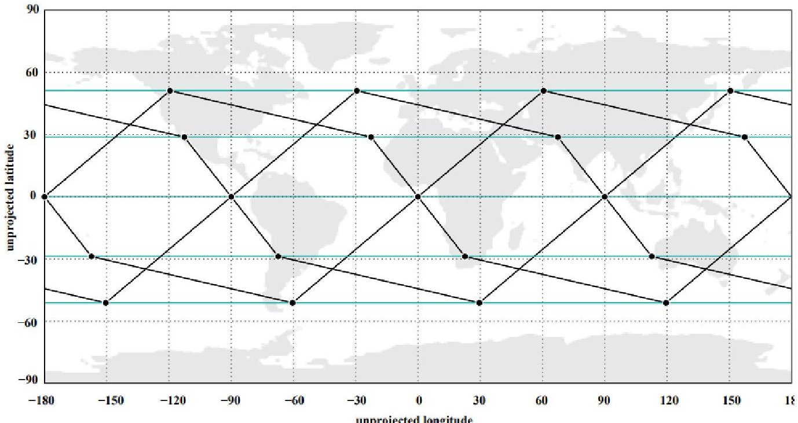

Figure 1.6 A rosette constellation shape

According to Henderson (1999), teledesic's geodesic constellation enables each satellite located at the network's edge to maintain constant connection along the seam cross section.

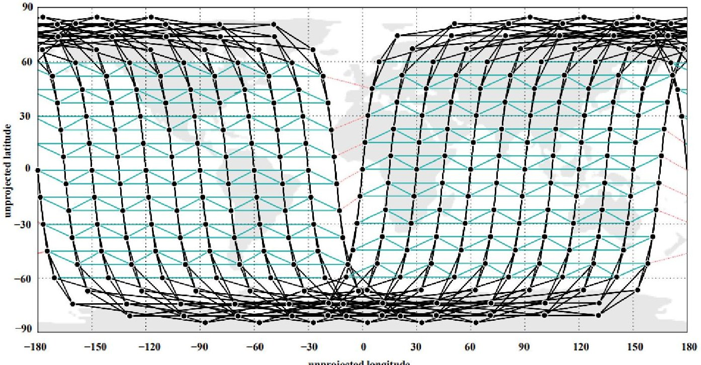

Figure 1.7 A teledesic's geodesic constellation shape

<!-- PDF_PAGE: 25 -->

The illustration depicts the layout of a teledesic proposal in a simulated scenario captured at a specific moment. The design comprises an eight-sided geodesic pattern of connections between satellites, which can be seen throughout except for a region where there are fewer links at the orbital seam. The satellites are arranged in a "star" configuration, with their orbital planes emanating from a central point around the pole. (Wood, 2003).

Table 1.1 Planned communication constellations

<table border="1"><tr><td>Satellite Operator</td><td>Proposed Satellites</td><td>Satellite Design Life(Years)</td></tr><tr><td>OneWeb</td><td>&gt;2000</td><td>7-10</td></tr><tr><td>SpaceX Starlink</td><td>12000</td><td>5-7</td></tr><tr><td>Boeing</td><td>&gt;3000</td><td>10-15</td></tr><tr><td>Telesat</td><td>292-512</td><td>10</td></tr><tr><td>Kepler Communications</td><td>140</td><td>10</td></tr><tr><td>LEOSat</td><td>84</td><td>10</td></tr></table>

OneWeb and SpaceX have presented In Table 1.1, the most ambitious proposals for LEO communications proliferated constellations. OneWeb has accumulated over $1.7 billion in investments to construct a first-generation constellation of 648 satellites, expected to be operational by 2020. In addition, the company intends to expand the constellation with another 2,000 satellites in the future. Meanwhile, SpaceX's Starlink proliferated constellation is even more ambitious, with over 4,000 satellites planned for the first generation. Furthermore, SpaceX has received U.S. Government approval for a final constellation of nearly 12,000 satellites. Boeing, Telesat, Kepler Communications, and LeoSat, including established businesses and smaller startups, have proposed other proliferated constellation projects. Although new ventures are still in their early stages, the possibility of significant amounts of communications bandwidth

<!-- PDF_PAGE: 26 -->

from LEO mega-constellations, as well as fewer high-throughput GEO communications satellites. As a result of the satellite constellation model, traditional communication satellite providers are postponing the purchase of new satellites that may not be able to compete in the future space business environment (Hallex et al, 2020).

The upcoming plans from companies such as OneWeb, Boeing, and SpaceX would result in a significant increase in the number of new satellites, exceeding five times the current population. Table 3 summarizes these proposals and the percentage increase compared to the current population. However, these companies are not the only ones interested in this emerging market, as the FCC is currently reviewing applications for a total of 18,470 satellites, including the 720 already licensed for OneWeb. Satellite constellations increase the availability and connectivity of user coverage. Although such systems could have substantial benefits for life on Earth, it remains uncertain whether the current regulatory framework can manage the significant increase in the number of Earth-orbiting spacecraft, particularly concerning orbital debris management (Pultarova, 2017).

Table 1.2 Popular satellite constellation numbers and increase

<table border="1"><tr><td>Proposing Organization</td><td>Total Number of Spacecraft in constellation (before spares)</td><td>Percentage Increase over Existing Operational Satellite Population</td><td>Status</td></tr><tr><td>OneWeb</td><td>720</td><td>49.35%</td><td>Licensed</td></tr><tr><td>Boeing</td><td>2956</td><td>202.60%</td><td>Pending</td></tr><tr><td>SpaceX</td><td>4425</td><td>303.29%</td><td>Pending</td></tr><tr><td>Total</td><td>8101</td><td>555.24%</td><td></td></tr></table>

<!-- PDF_PAGE: 27 -->

## 1.2.5 Small Satellites

Small spacecraft typically weigh less than 180 kilograms and have a size comparable to that of a large kitchen fridge. However, it is important to note that there is still considerable variation in size and mass (Spremo, 2023). Minisatellites have a mass of 100-180 kilograms, while microsatellites weigh between 10-100 kilograms. Nanosatellites fall into the range of 1-10 kilograms, while picosatellites weigh between 0.01-1 kilograms. The smallest of these are femtosatellites, which have a mass of 0.001-0.01 kilograms. CubeSats are a type of nanosatellite that is very small compared to conventional satellites. These small satellites typically come in one unit (1U) size, dimensioning 10x10x10 cms, although larger sizes such as 1.5U, 2U, 3U, 6U, and 12U are also available. The CubeSat format has evolved into a thriving industry, with collaboration among government, industry, and academic institutions leading to the development of increasingly sophisticated capabilities. CubeSats are now used as low-cost satellite alternatives for conducting scientific activities and executing space missions that involve multiple networks of satellites (NASA, 2018).

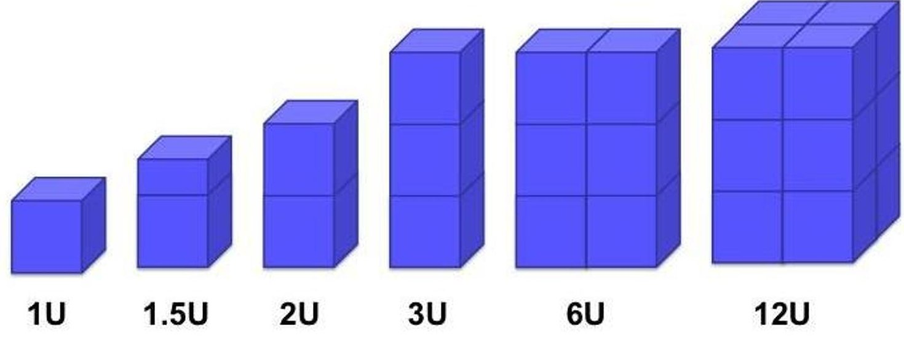

Figure 1.8 Size one-unit 1U of CubeSat, 10x10x10 Centimeters

<!-- PDF_PAGE: 28 -->

## 1.3 Earth's orbits

Earth's orbits are mainly classified into three categories: geostationary Earth orbit (GEO), medium Earth orbit (MEO), and low Earth orbit (LEO). In GEO we can find weather satellites and certain communication satellites. Geostationary Earth orbit is the farthest from Earth, satellites designed to navigate and observe Earth are kept in medium Earth orbit, while scientific satellites, including NASA's, primarily operate in low Earth orbit (NASA, 2009). Figure 1.6 illustrates the three types of orbits around Earth and the distance in km for each orbit. The circular nature of an orbit makes analysis easier. The circular orbit of a satellite can be characterized by its orbital time, radius, altitude, and velocity, which together describe its motion (Riebeek, 2006).

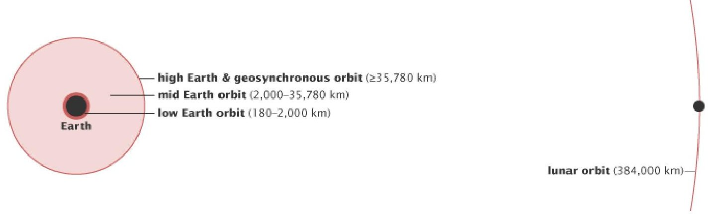

Figure 1.9 Earth orbits and distance from Earth in kilometers

## 1.3.1 Low Earth Orbit (LEO)

Low Earth orbit (LEO) means the region of space between the Earth's surface and a height of about 2,000 kilometers (1,200 miles), or 160 kilometers (100 miles). Because of its proximity to the Earth and potential for a variety of scientific and economic uses, it is a crucial zone for space research. LEO is renowned for having orbital periods that are generally between 90 and two hours long. LEO is perfect for uses like Earth observation, remote sensing, and satellite-based

<!-- PDF_PAGE: 29 -->

communication due to its quick orbit, which enables regular views of the Earth's surface. For instance, the ISS circles Earth in low-Earth orbit at an altitude of around 408 kilometers (254 miles). Another benefit to LEO is that it offers relatively easy access for space missions. Compared to other regions of space, such as geostationary orbit or lunar orbit, LEO requires less energy to reach, making it an ideal starting point for missions to other parts of the solar system (ESA, 2020).

## 1.3.2 Medium Earth Orbit (MEO)

Medium Earth orbit is an orbital zone that spans from the Earth's low orbit to the geostationary orbit. Unlike GEO, which requires satellites to maintain a constant location on Earth's surface, satellites in medium Earth orbit are free to move in a range of paths around the Earth. Various types of satellites make use of Medium Earth orbit for a different range of purposes. One common use of MEO is for navigation satellites and communication satellites. From commercial airliners to personal smartphones the use of multiple satellites in medium makes it a highly effective system for global navigation and communication.

## 1.3.3 Geosynchronous Orbit (GEO)

Satellites are commonly used to receive signals from a fixed position above the Earth, known as geostationary orbit. The selection of a satellite's orbit depends. When a satellite is placed at a higher altitude, its orbital time also increases. For instance, at a height of 35,790 km, a satellite takes 24 hours to complete one orbit around the Earth. This orbit is referred to as a geosynchronous orbit as it remains in sync with the Earth's orbit. The satellite in a geosynchronous orbit rotates in the same sense of rotation as the Earth, completing one orbit in approximately 24 hours. This allows the satellite to orbit at the same angular velocity as the

<!-- PDF_PAGE: 30 -->

Earth therefore, the satellite remains in a stationary position relative to the Earth (Sandeep et al, 2015).

## 1.4 Space debris

When the first satellite was launched and human-space colonization started, people did not think about the possibility of the negative impacts of satellites on Earth. Over the years, human space activities have resulted in the creation and proliferation of debris in orbit, known as space debris. This term refers to non-functional materials abandoned in space without any usage (Smirnov, 2002). NASA defines space debris as an artificial object that no longer serves a functional or operational purpose, including spacecraft, fragmentations, launch vehicle stages, and mission-related debris (2021). The Department of Defense's global Space Surveillance Network (SSN) identified more than 27,000 pieces of orbital debris that exist in the LEO and exert a threat to human spaceflight missions (NASA, 2021)

The North American Aerospace Defense Command (NORAD) keeps an updated database known as the Space Object Catalog. This database comprised information regarding all rocket launches and objects that reached orbit, including satellites, protective shields, and upper stages of launch vehicles. Space debris is a combination of naturally occurring meteoroids and human-made debris that no longer serves a useful purpose, referred to as orbital debris. Additionally, there are approximately half a million pieces of debris about the size of a marble that pose a potential threat to human space flight and robotic missions. Even though there is a considerable number of debris that is too minuscule to be detected/tracked, its impact can still be detrimental. Due to the extreme speed at which both spacecraft and debris travel (about 15,700 mph), even a collision with a small piece of debris can cause significant issues. Paint flecks have

<!-- PDF_PAGE: 31 -->

caused damage to space shuttle windows in the past, and such orbital debris remains a major risk to both manned and unmanned spacecraft. There have been instances of orbital debris causing damage to satellites, including the 1996 collision between both French-owned active satellites and French space debris that was caused by an explosion in the 1980s. Another instance is the collision between a nonfunctioning Russian spacecraft and a working U.S. commercial spacecraft in 2009, which resulted in over 2,300 objects of different sizes of space debris (NASA, 2015).

At the 2022 World Economic Forum, the CEO of Astra, Chris Kemp was interviewed about the future of his company. Mr. Kemp shared that if a rocket isn't 100% reliable but 95% reliable at 10x lower cost than a 100% reliable rocket, then he can launch 10 more rockets. Mr. Kemp as a business sees that making cheaper less reliable rockets is better than investing and recruiting talent to make his rockets reusable or 100% reliable. If more businesses follow Mr. Kemp to gain a share of the booming space industry, it will increase the chances of failed rockets and one-use rockets which will generate more space debris (Linda, 2022).

NASA has well-established guidelines to deal with possible collisions involving the International Space Station, specifying the conditions that require evasive action to protect the crew in case of a high-risk collision threat caused by space debris. To identify such threats, NASA defines an imaginary box around the station measuring 30 miles by 30 miles and 2.5 miles tall. In the event of a known piece of tracked debris that may pose a risk of entering this box, Houston and Moscow's Mission Control centers collaborate to determine the appropriate course of action. If there is enough warning, the ISS can initiate a maneuver to avoid a potential collision. Typically, collision avoidance maneuvers involve a slight increase in the station's

<!-- PDF_PAGE: 32 -->

orbital altitude, with a velocity increment of less than 1 m/s. Since 1999, the ISS has made 29 maneuvers to avoid debris and satellites (NASA, 2021).

According to the NASA Orbital Debris Program in 2003, a considerable number of debris is unable to withstand the intense heat that occurs during reentry, and as a result, only certain components can survive. These surviving components are most likely to fall into bodies of water, such as oceans, or areas with low population densities. There have been no confirmed reports of any severe harm or significant property damage resulting from debris reentry (NASA Orbital Program, 2003). When space debris and inactive satellite constellations fall back to Earth, they may introduce unexplored chemical elements into the atmosphere, unlike meteors which mainly consist of rock made up of oxygen, magnesium, and silicon. The first generation of Starlink satellites, for instance, is predicted to contribute to increasing green gas emissions in the atmosphere by 2.2 tons. It's worth noting that while meteoroids have only a small amount of aluminum, these satellites are primarily composed of aluminum (Boley, 2021). Some numbers of space debris do not burn up on reentry which causes it to land on Earth's surface or water (Sgobba, nd).

## 1.5 Environmental Impacts

To construct vast arrays of communication satellites in low Earth orbit, corporations are launching satellites at an unprecedented rate. As of March $ 30^{\mathrm{th}} $ ,2021, the number of functioning and inactive satellites in LEO has grown by more than 50%, reaching around 5000. SpaceX intends to launch an 11,000-satellite Starlink constellation. Other companies, including OneWeb, Amazon, Telesat, and Chinese state-owned firm GW, have comparable plans. Despite gradual

<!-- PDF_PAGE: 33 -->

changes, the current governance structure for LEO is insufficient to manage such extensive satellite systems (Venkatesan et al., 2020).

The presence of numerous satellites and rocket bodies in the Low Earth Orbit (LEO) increases the chances of creating more space debris upon collisions or explosions. These fragmentations enlarge the cross-sectional area of orbiting material, increasing the likelihood of collisions over time. The Kessler Syndrome is when a cascade effect of collision occurs and continues due to multiple bouncing bodies nearby that can generate more space debris (Kessler et al, 1978). Currently, there are more than 12,000 trackable debris pieces in LEO, with a typical size of 10 cm or more. There are also around one million inferred debris pieces, with sizes as small as 1 cm, all of which pose a threat to satellites, spacecraft, and astronauts due to their high-speed orbits intersecting. Simulations indicate that LEO is already in the early stages of the protracted Kessler Syndrome, but active debris removal could manage it. The proliferation of low-cost satellites and the addition of satellite mega-constellations further strain the environment. (Boley et al., 2021).

The Earth's orbit is increasingly congested with space debris, satellites, and the emergence of satellite 'mega-constellations'. This high volume of man-made objects poses a risk to both professional and amateur astronomy efforts. Additionally, there is a trend towards privatization and industrialization of Earth's space orbit in particular LEO, and the plans to further increase the number of satellites. Some estimates suggest that over 100,000 satellites will be in our skies by 2030. While technological advancements are beneficial, allowing improved communication and global connectivity, and better monitoring of Earth, these developments also present many challenges. There is a concern that marginalized communities are excluded from

<!-- PDF_PAGE: 34 -->

decision-making processes related to near-Earth space, and the increasing number of visible satellite constellations contributes to light pollution, obstructing our view of the night sky. While satellite constellations can disconnect us from our traditional understanding of the universe through personal observation of the night sky (Venkatesan et al., 2020).

Launch vehicles' orbital debris is a significant contributor to the problem of pollution in space, which encompasses various forms of interference with scientific observations across the electromagnetic spectrum, including radio-frequency interference. This interference can, for example, disrupt radio astronomy observations, as stated by the Office of Technology Assessment in 1990. Not only can orbital debris hamper the performance of scientific experiments, but it can also inadvertently result in their destruction (OTA, 1990).

## 1.6 National Security

The United States' capability to monitor ballistic missiles can be hindered in numerous ways due to space debris. The monitoring of Ballistic missiles heavily relies on space-based assets, such as satellites that detect missile launches, track their paths, and transmit vital data to ground-based stations. However, space debris poses a severe risk to these satellites as it can damage or destroy them, resulting in an interruption in data transmission or rendering them ineffective altogether. Even a tiny fragment of debris moving at high speeds can cause substantial damage to a satellite, resulting in a loss of critical information. Space debris has the potential to produce false signals, which may be mistaken for missile launches or other threats. Such false alarms can lead to confusion and increase the likelihood of unintentional conflicts or escalation, posing a risk to national security (Defense Intelligence Agency, 2022).

<!-- PDF_PAGE: 35 -->

A vast amount of space debris can significantly impede the ability to monitor ballistic missiles accurately and react to potential threats, potentially jeopardizing national security. The deployment of weapons capable of destroying satellites could significantly increase space debris. These weapons would create additional debris during their operation in orbit and upon deorbiting, increasing the risk of creating more space junk. The U.S. Air Force Space Command is responsible for tracking objects larger than 10 centimeters in diameter in Earth's orbit, and it conducts reentry assessments to predict objects' reentry destination and time (Defense Intelligence Agency, 2022).

The national security uses for military and defense satellites include communications, navigation, surveillance, and reconnaissance. They are frequently run by government organizations and classified, making them inaccessible to the public. The Advanced Extremely High Frequency (AEHF) satellite system is used by the US Air Force for security and defense purposes (The U.S. Air Force, 2023).

The US government emphasizes the significance of space in terms of strategy, which implies that space resources are crucial to the country and can affect its security, economic welfare, as well as public health, and safety. The US has pledged to safeguard its space infrastructure, establish standards for the safety and security of the space environment, and promote the development of technologies that improve the cyber-security and resilience of space assets (ESA, 2007).

According to John F. Huth, the Defense Intelligence Officer for Space and Counterspace at the United States Defense Intelligence Agency, a new unclassified report titled "Challenges to Security in Space 2022" has been released. This report is an updated version of a similarly titled

<!-- PDF_PAGE: 36 -->

report released in 2019, and it focuses on the space and counter space programs of China, Russia, North Korea, and Iran, which could pose significant challenges to the interests of the United States or its partners.

## 1.7 Objectives of the Study

i. Data analysis of active satellites and space debris

ii. Overview of the recent increase of new satellite launches in Earth orbits.

iii. Overview of the constant increase of space debris and inactive satellites in Earth's orbits.

iv. Study the space debris in orbit and reentering Earth.

v. Overview of the environmental impacts and people's perception of growing orbital objects.

## 1.8 Scope of the Study

This research analyzes data of the monitored space objects and focuses on low Earth orbit objects. Space objects include active satellites, space debris in orbit, and space debris reentering Earth's atmosphere. The study used two different sources; one source is the active catalogs satellite catalog from the Union of Concern Scientists (UCS). The $ 2^{\mathrm{nd}} $ from Dr. Jonathan McDowell's SATCAT and GEO catalogs were transformed to Excel format to be processed and cleaned before being evaluated using Tableau. The selecting and discarding of the data were done at the stage of raw data filtering. This research is also focused on the environmental impacts of space debris and people's perception.

<!-- PDF_PAGE: 37 -->

## 1.9 Layout of the Thesis

The remainder of this thesis is organized as follows: In Chapter 2, literature review, we explain and mention the relevant support information related to this research topic. We summarize and cite previous research work and publications by other authors in this field area and describe how we improve upon these works. In Chapter 3, methodology, we describe the origin of the data, processing of the data and data visualization methods. In Chapter 4, results and discussion, we present our data analysis and visualization of the active satellites and space debris. Finally, in Chapter 5, the conclusion and recommendation of this thesis are presented.

<!-- PDF_PAGE: 38 -->

## CHAPTER II LITERATURE REVIEW

"The Case for Space Environmentalism" by Lawrence at et al is a comprehensive article that explores the issue of space debris and the need for a more environmentally responsible approach to space activities. The article stresses the urgency of the problem, noting that the growth of space debris threatens to make space exploration increasingly challenging and dangerous. The article provides a detailed overview of the problem of space debris, discussing the various types of debris and their potential impact on space exploration. It also highlights the unpredictability of space debris and the difficulty of establishing best practices for debris mitigation and removal, due to the lack of international standards and regulations governing space activities (Lawrence et al., 2022).

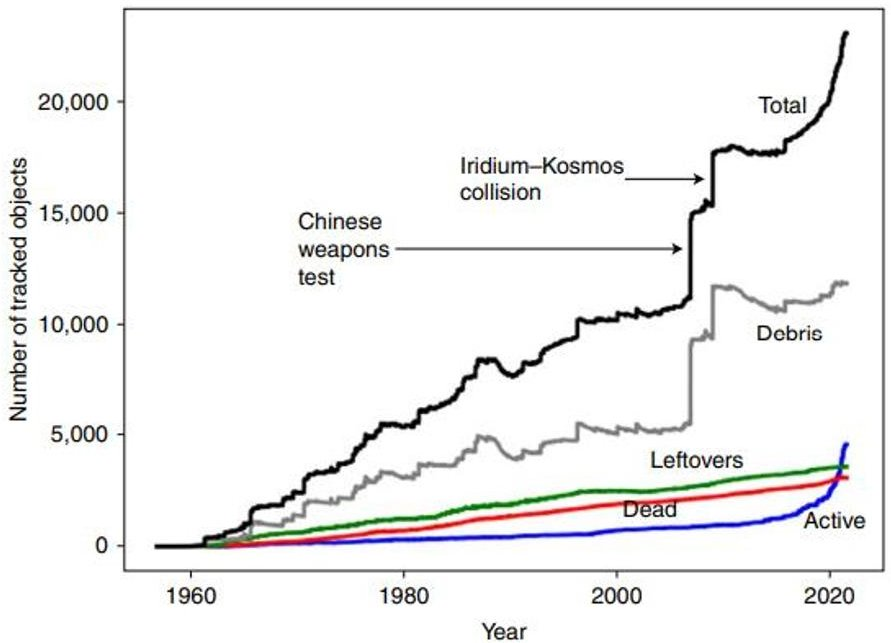

Figure 2.1 Space objects grow overtime, and events causing objects to hike

<!-- PDF_PAGE: 39 -->

In addition to discussing the problem of space debris, the article also explores various strategies for mitigating and removing debris. These include designing spacecraft to be more durable and resistant to collisions, using lasers or other technologies to actively remove debris, and establishing international standards and regulations. The article emphasizes the significance of international agreement in addressing the space debris danger and argues for a more comprehensive approach to space environmentalism and recognizes space as a resource. Throughout the article, McDowell uses graphs and diagrams to illustrate the scale and scope of the space debris. Figure 2.1 shows the growth of space debris over time. The graph demonstrates the increase of ASO in orbit around Earth has been steadily increasing since the launch of Sputnik in 1957. Another diagram illustrates the different types of space debris and their potential impact on space exploration, while a third visual shows examples of spacecraft designs and technologies that could be used to mitigate and remove debris (Lawrence et al., 2022).

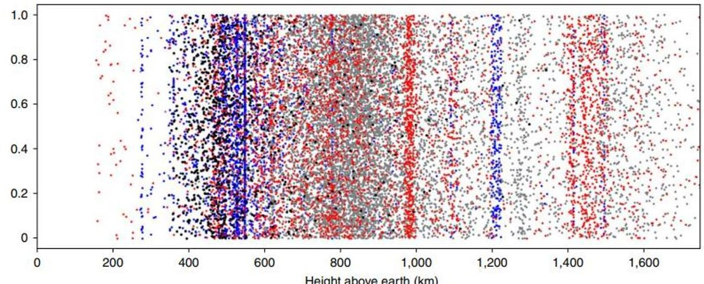

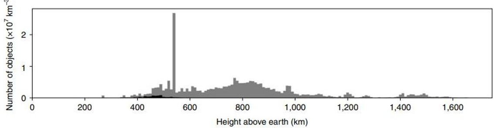

Figure 2.2 Visualization of objects tracked in low Earth orbit (LEO)

<!-- PDF_PAGE: 40 -->

The visualization in Figure 2.2 shows the current objects tracked in low Earth Orbit (LEO). The y-axis of the top graph represents a random number between 0 and 1, to flatten the data for plotting purposes. Active satellites are represented by blue dots, while red dots represent space debris. The image depicts various types of debris, including derelict satellites, rocket bodies, and other large parts represented by blue dots. Additionally, smaller debris down to approximately 10 cm in size is shown as grey dots. Black dots represent simulated debris resulting from the recent destruction of Kosmos 1408 by a Russian weapon test, simulated by H.G. Lewis. The data for the other points are obtained from the General Catalog of Artificial Space Objects (Lewis et al., 2019). The grey bars indicate all tracked objects and the black bars represent the simulated Kosmos 1408 objects. The height of the bars represents the average of apogee and perigee, relative to a mean Earth radius of 6,378 km. (Lewis et al., 2019).

"Orbiting Debris: A Space Environmental Problem" is a report published by the Office of Technology Assessment (OTA) in October 1990, which explores the impacts of ASO and its potential impact on space activities. The report provides a comprehensive overview of the problem of ASO in Earth orbit and the various types of ASO. The report discusses the sources of space debris, including abandoned spacecraft, rocket stages, and other objects that have been left in orbit. It also highlights the potential impact of space debris on space activities, such as damaging spacecraft and posing a risk to astronauts during spacewalks. One of the key findings of the report is the need for more accurate tracking and cataloging of space debris (OTA, 1990).

A multinational body should be consulted to coordinate efforts to detect and monitor space debris as well as to create and put into practice plans for debris reduction and removal. The report also explores various strategies for mitigating and removing debris, such as designing spacecraft

<!-- PDF_PAGE: 41 -->

to be more resistant to collisions, the use lasers, or other technologies to actively remove debris and establishing regulations and standards for space activities to minimize the creation of debris. The establishment of international regulations and standards for space activities would help reduce the number of debris created and improve the safety of space activities. The report also recommends that countries and organizations involved in space activities should share data on space debris, to better understand the problem and develop more effective solutions (OTA, 1990).

The report notes the potential danger posed by large objects in orbit, such as defunct satellites, which may create multiple ASOs. There is a need for collaboration among different sectors, including the government, industry, and scientific communities, to address the issue of space debris. The report highlights the importance of public awareness and education on the issue, as well as the need for more funding to support research and development of new technologies for debris mitigation and removal (OTA, 1990).

The presence of space debris can potentially endanger the space environment by contaminating the upper atmosphere and potentially affecting Earth's climate. There are various debris mitigation and removal techniques, including passive and active approaches. Passive approaches involve reducing the number of debris created by limiting the release of debris during spacecraft launches and operations, while active approaches focus on removing debris from orbit using various techniques, such as nets, harpoons, and lasers. The report notes that removing space debris from orbit is a challenging task, requiring advanced technologies and significant resources. Similarly, NASA has established the Orbital Debris Program Office, which is responsible for researching and developing new technologies for debris mitigation and removal, as well as for providing guidance and support to satellite operators to avoid collisions. The office

<!-- PDF_PAGE: 42 -->

also works with other organizations and agencies to promote international cooperation and coordination on debris-related issues (OTA, 1990).

Over the years, the sustainability of the space environment has become a major cause for concern, particularly due to the rising quantity of space debris that has gathered in Earth's orbit. The European Space Agency (ESA) has reported that there are more than 34,000 objects larger than 10 cm currently orbiting the Earth, and this number is projected to increase further as more space missions are launched (ESA, 2021).

One notable effort toward sustainable space practices is the Space Sustainability Rating (SSR) system proposed by Nasir, Paracha, and Wu (2020). The SSR is a composite indicator that evaluates satellite mission sustainability based on various factors, sustainability performance, the disposal plan, and the use of sustainable materials and technologies in the satellite's construction. The SSR provides a framework for future space missions based on their sustainability rating, with higher scores indicating greater sustainability (Nasir et al, 2020).

The proposed space sustainability rating system builds on the growing concern over space debris and its potential impact on the Earth's atmosphere. The SSR is a step towards fulfilling this goal. The SSR is not the only effort toward sustainable space practices. The Massachusetts Institute of Technology (MIT) has also been working on developing sustainable practices for space activities. In 2019, MIT launched a new research initiative called the Space Enabled Research Group, which focuses on designing and implementing sustainable solutions for space activities. The initiative has developed a set of principles for sustainable space activities, including designing for a circular economy, prioritizing the use of renewable resources, and minimizing the creation of debris (MIT, 2021).

<!-- PDF_PAGE: 43 -->

## CHAPTER III METHODOLOGY

3. 1 Data origin

The study is dependent on two main sources of data. The first source was the active satellites catalog which is acquired from the Union of Concern Scientists (UCS) website. The second source of data is from Dr. Jonathan McDowell's space-tracked catalogs published daily on his website.

## 3.1.1 UCS Satellite Database

The UCS Satellite Database is a free resource that provides an updated list of active satellites orbiting Earth up to the launch date of $ 30^{\mathrm{th}} $ April 2022. The database is refreshed every quarter and is accessible at www.ucsusa.org/satellite_database. Proper acknowledgment of the database should be given when using it in written materials. The UCS catalog only includes active satellites and excludes space debris.

The UCS database contains information that was sourced from publicly available websites belonging to corporations, scientific organizations, governments, militaries, nongovernmental entities, and academic institutions. The database's sources exclude copyrighted material, commercial databases, and the Orbital Information Group (OIG) of NASA. Sources used for the UCS Satellite Database include the Office of Outer Space Affairs of the United Nations, along with other resources. Orbital data for certain military satellites may be estimated

<!-- PDF_PAGE: 44 -->

or acquired from http://www.globalsecurity.org. The database was created and updated by UCS Global Security Program Researcher, Teri Grimwood.

## 3.1.2 Dr. Jonathan McDowell Space Catalog

The second source where the data of active satellites, inactive satellites, space debris, and reentries to Earth orbit are taken from Dr. Jonathan McDowell's catalog http://www.planet4589.org/space/. Dr. Jonathan McDowell is an astrophysicist who works at the Chandra X-ray Center, which is a part of the Harvard-Smithsonian Center for Astrophysics. He holds a bachelor's degree in mathematics and a Ph.D. in Astrophysics from the University of Cambridge in England. Dr. McDowell has written several scientific publications on a range of subjects such as black holes, quasars, X-ray sources in galaxies, and the extragalactic background light of the universe. Along with his research work, he also edits a free online newsletter called "Jonathan's Space Report," which provides technical details on various space objects. Dr. McDowell also contributes as an editor for Sky and Telescope Magazine. His achievements in astronautics culture and popularization have earned him several awards. He is a Fellow of the Royal Astronomical Society and an American Astronomical Society Fellow.

## 3.2 Data processing

The data obtained from the Union of Concerned Scientists that was in the UCS Satellite Database is available for download in both Excel and tab-delimited text formats. It provides basic information about satellites and their orbits but is not designed for locating individual satellites. The database lists the official names of government and military satellites, as well as the names of commercial and civil satellites. Its columns provide information on the satellite's name, country/organization of UN registry, operator/owner, users, purpose, detailed

<!-- PDF_PAGE: 45 -->

purpose, class and type of orbit, the longitude of position in GEO, perigee, apogee, eccentricity, inclination, period, launch mass, dry mass, power, launch date, expected lifetime, contractor, country of contractor, launch site, launch vehicle, COSPAR number, NORAD number, and comments. The data had to be adjusted and processed to differentiate Earth orbits, and countries of deployment, and to appropriately filter the needed research study data without legitimately changing the dataset. For the full UCS dataset used refer to Attachment A.

The data obtained from Dr. Jonathan McDowell's catalog was in HTML format which needed to be processed to transform it into Excel file format. The HTML format was copied and pasted into a text file then the text file was filtered, and each prospected column was delimited by a comma. Then the text file was imported into Excel and transformed the commas to individual columns using the converted text to columns wizard. Attached in Attachment B is the full dataset of Dr. Mcdowell's SATCOM.

## 3.3 Data Visualization

The data visualization from the above datasets that were cleaned and processed and then visualized using Tableau. Tableau is a software for data visualization and data analysis developed by the Salesforce software company. Tableau can be leveraged to interactively connect, visualize, and disseminate data. The software offers connectivity to various data sources, including spreadsheets, databases, cloud services, and others. With the software, users can transform data into visually appealing and interactive presentations, such as maps, charts, and graphs. Tableau also offers a variety of analytical tools that enable the users to explore and receive better data analysis, such as filters, calculations, and dashboards. In addition, it has built-

<!-- PDF_PAGE: 46 -->

in sharing and collaboration features, which allow users to share their visualizations with others and collaborate on them in real time.

Tableau is widely used in various industries, including finance, healthcare, government, and education, for tasks such as data analysis, reporting, and decision-making. Its popularity is due in part to its ease of use and ability to quickly create visualizations that are both informative and engaging. Overall, Tableau is a powerful tool for data visualization and analysis, that allows users to turn their data into actionable insights. The significance of data visualization is clear: it assists users in perceiving, engaging with, and gaining a deeper comprehension of data. Regardless of its complexity, a suitable visualization can unify all viewers, irrespective of their proficiency level, and facilitate better communication and understanding.

<!-- PDF_PAGE: 47 -->

## CHAPTER IV RESULTS AND DISCUSSION

## 4.1 Active Satellites

Satellites play a crucial role in modern-day communication, navigation, and earth observation. The number of operating satellites has been increasing over time, with various countries and organizations launching new satellites for different purposes. Figure 4.1 represents the results of this research study of active satellite data with cut-off data on 4/30/2022, focusing on the total number of operating satellites, and their distribution among the top 5 owners' countries.

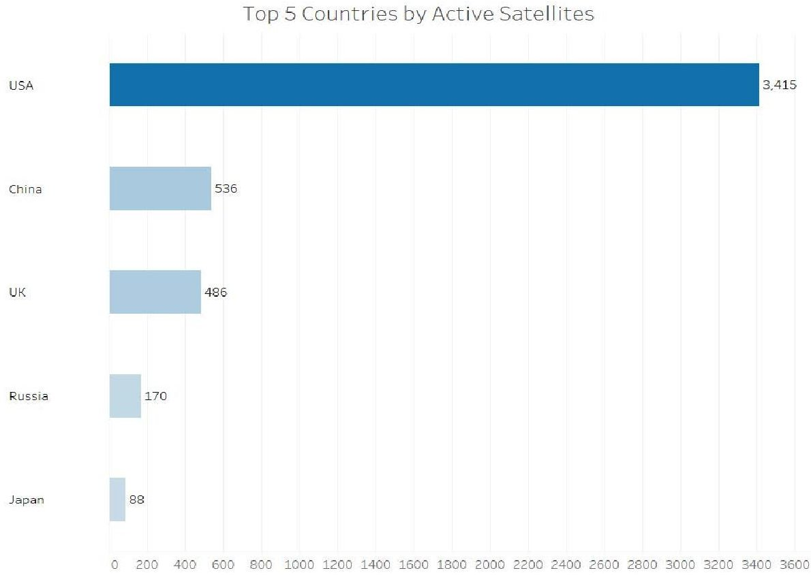

Figure 4.1. Top 5 countries by active satellites in Earth orbit

<!-- PDF_PAGE: 48 -->

The vertical y-axis of the bar chart above represents the countries with the most active satellites in orbit, while the horizontal x-axis would represent the number of active satellites. Research analysis reveals that as of 4/30/2022, there were 5,465 operating satellites in orbit around the Earth. This represents a significant increase from previous years and is a testament to the growing importance of satellites in modern-day society. The majority of operating satellites are owned and operated by the United States, with a total of 3,415 satellites. China is the second-largest contributor to the number of operating satellites, with 536 satellites. The United Kingdom (UK) is in third place with 486 satellites, followed by other countries. This distribution highlights the dominance of the United States in the space industry and its continued investment in satellite technology.

Another source that shows the United States has the most active satellites in Earth orbit is the Satellite Industry Association's (SIA) annual report. According to the 2021 report, the United States had a total of 1,327 commercial satellites and 1,135 military satellites in orbit, as well as 31 civil and 172 government satellites, bringing the total number of active satellites to 2,665. However, this number is likely an underestimate as it only includes satellites with a mass greater than 50 kilograms and does not include small satellites. The SIA is a trade association that represents commercial satellite companies in the United States. Their annual report provides an overview of the global satellite industry, including market trends, revenues, and satellite deployments. As of the end of 2021, the number of satellites in Earth's orbit reached a total of 4,852, which represents a significant increase of 179% compared to the number of satellites in orbit five years ago (SIA, 2021).

<!-- PDF_PAGE: 49 -->

This research study shows in Figure 4.2 that most operating satellites are in low Earth orbit (LEO), with a total of 4,700 satellites. This orbit is commonly used for earth observation and communication purposes. The second-largest orbit type is geostationary Earth orbit (GEO), with 565 satellites. GEO orbit is commonly used for communication and weather observation functions. There are also 140 satellites in medium Earth orbit (MEO), which is commonly used for global positioning system (GPS) satellites, and remote sensing applications.

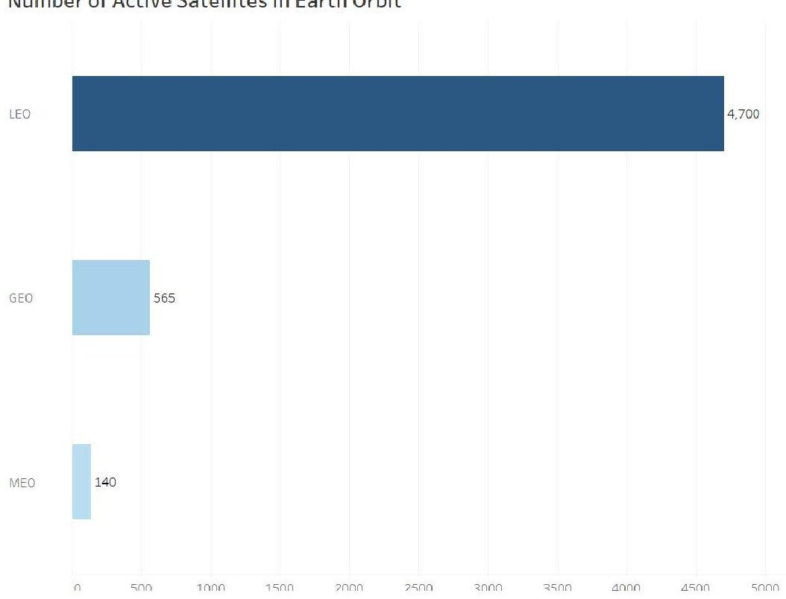

Figure 4.2. Number of active satellites per Earth orbits

The vertical y-axis of the bar chart above represents Earth's orbits with the most active satellites in LEO, while the horizontal x-axis would represent the number of active satellites in each orbit. The year 2019 report of the Scientific and Technical Subcommittee of the United Nations Office for Outer Space Affairs (UNOOSA), includes information on various aspects of space activities, including the number of active satellites in Earth orbit. According to the report, as of 31 December 2018, there were a total of 20,000 cataloged objects in orbit around the

<!-- PDF_PAGE: 50 -->

Earth. Of these, 1,700 were listed as active satellites, while the rest were classified as space debris. The report indicates that 92% of all objects are in low Earth orbit.

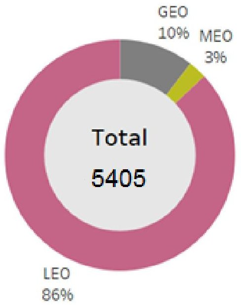

Figure 4.3 Percentage of active satellites in each Earth orbit

This study analysis shows the active satellites are 86% in LEO, 3% in MEO, and 10% in GEO. As shown in Figure 4.3. Which confirms the claims of UNOOSA's report.

This research study evaluates the active satellite in orbit by April 2022, which includes the launch mass in kg of all the launches of the active satellites. As shown in Figure 4.4, the USA has the heaviest payload followed by China and Russia. This data is concurrent with the USA's number of active satellites compared to other nations. This launch weight does remain in Earth's orbit, or reenter Earth's atmosphere, it also includes the active satellite, rocket body, and other components.

<!-- PDF_PAGE: 51 -->

Launch Mass (kg.) of all the Active Satellites in Earth Orbit ranked by the highest 10 Countries

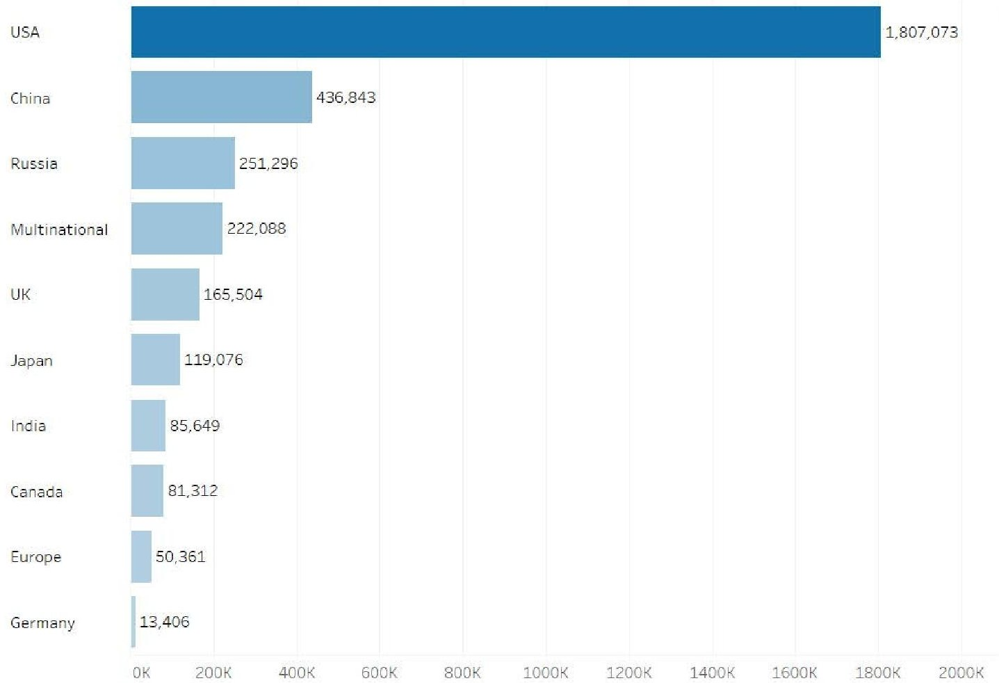

Figure 4.4 Launch mass of the active satellites

It is expected that the weight of payloads will increase over time and thus the issue of space debris will require more effort. A quadratic function was employed to model the total mass launched per year into Low Earth Orbit (LEO). The function takes the form:

$$
\mathrm {M t o t} (t) = \mathrm {M} 2 0 0 0 \cdot \left(1 + \alpha (t - 2 0 0 0) ^ {\wedge} 2\right)
$$

<!-- PDF_PAGE: 52 -->

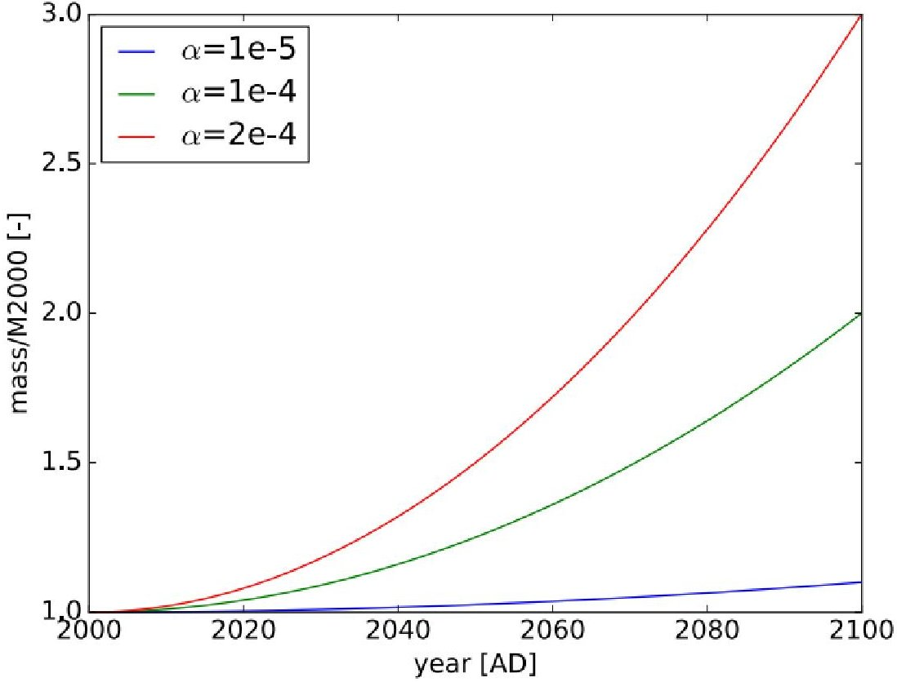

Figure 4.5 Mass in Earth orbit forecast from the year 2000 baseline

Retrieved from Klima, 2018 Figure 4.5 illustrates the mass to orbit, which is the total amount of mass launched annually into LEO relative to the baseline mass launched in the year 2000 (M2000), for various values of $ \alpha $ . For instance, the green line indicates a doubling of the annual mass to orbit over the next century. Here, it represents the year AD, and M2000 = 200,000 kg is the total mass launched in the year 2000, which serves as the baseline. The quadratic function is used as a heuristic approach to combine two factors: Two factors contributing to the increase in the total mass launched per year are the enhanced launch capabilities and the trend towards miniaturization of spacecraft components (Stuart et al., 2017).

Minimizing spacecraft components and advancements in satellite technology have contributed to a reduced need for launching large masses into LEO. As these effects cannot be modeled with certainty, a simple function with only one parameter, $ \alpha $ , was chosen. The value of

<!-- PDF_PAGE: 53 -->

$ \alpha $ enables the adjustment of the growth rate. Reasonable values for $ \alpha $ may be around $ 1 0^{\wedge}-4 $ resulting in a doubling of the annual mass to orbit over the next 100 years. In contrast, $ \alpha=1 0^{\wedge}-3 $ corresponds to a twenty-fold increase (Stuart et al., 2017). Negative values of $ \alpha $ correspond to a decrease in the mass launched over time, which may be due to advancements in technology that eliminate the need for launching large masses or a marked downturn in space activities (Klima, 2018).

Table 4.1 Satellite categories by mass and approximate costs

<table border="1"><tr><td>Category</td><td>Mass,kg</td><td>Cost,USD</td></tr><tr><td>Large satellite</td><td>&gt;1000</td><td>0.1-2B</td></tr><tr><td>Medium satellite</td><td>500-1000</td><td>50-100M</td></tr><tr><td>Minisatellite</td><td>100-500</td><td>10-50M</td></tr><tr><td>Microsatellite</td><td>10-100</td><td>2-10M</td></tr><tr><td>Nanosatellite</td><td>1-10</td><td>0.2-2M</td></tr><tr><td>Picosatellite</td><td>0.1-1</td><td>20-200K</td></tr><tr><td>Femtosatellite</td><td>&lt;0.1</td><td>0.1-20K</td></tr></table>

From this research study, the active satellite inclination average angle per country is shown in Figure 4.6. The countries' average was calculated from the data of all active satellites per country. USA's average inclination is 59, China's 72, and UK's 81. There is a percentage uncertainty due to the different types of satellites and satellite constellations.

<!-- PDF_PAGE: 54 -->

Average of Inlication of the Active Satellites in Earth Orbit

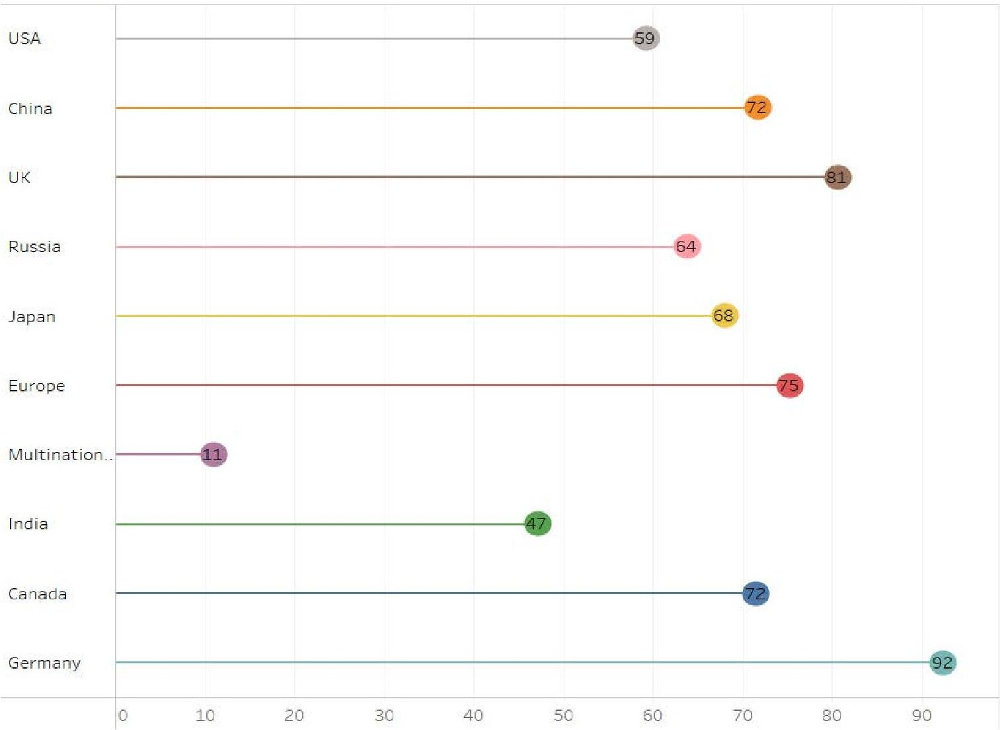

Figure 4.6 Average active satellite inclination in degrees

One-Web constellation operational orbit is a low Earth orbit at heights around 1170km and 88 inclinations (McDowell, 2020). Since One Web is a satellite company from the UK, the study average of UK of 81 seems reasonable. SpaceX, Starlink satellite constellation is operational and is orbiting in low Earth orbit at heights around 550 km and 53 inclinations, which is concurrent with our study average for the USA of 59 inclination (ESA, 2022).

According to this research analysis of the active satellites in Earth's orbit, USA recorded active satellites are deployed from 24 different US owned space launch sites.

<!-- PDF_PAGE: 55 -->

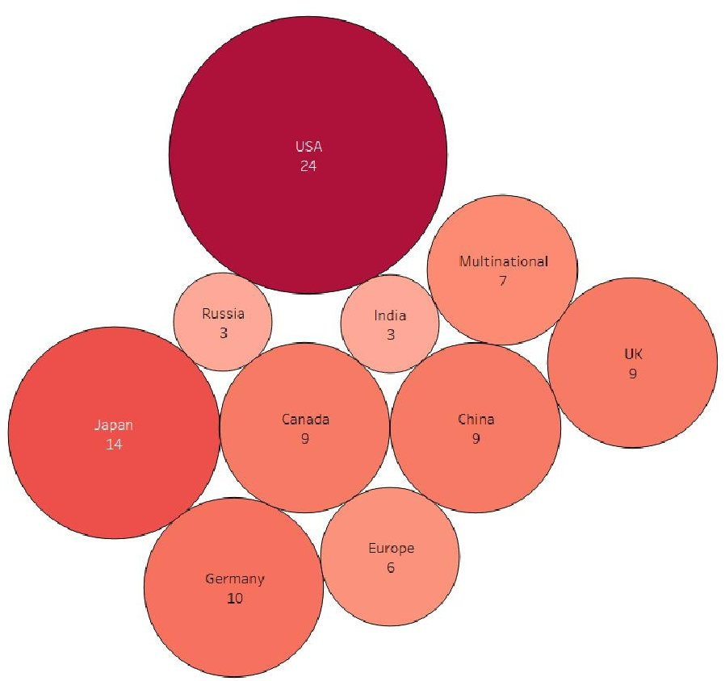

Figure 4.7 Active satellite launch sites per country

The information by FAA states there are 22 licensed space launch sites in the USA (FAA, 2022). See Figure 4.8 for the locations of the FAA-licensed sites, these sites are not include the non-disclosed launch sites.

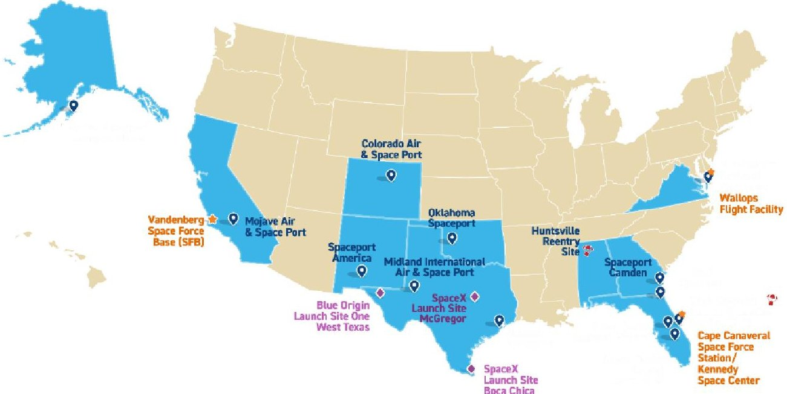

Figure 4.8 FAA licensed space launch sites in the USA

<!-- PDF_PAGE: 56 -->

## 4.2 Space Debris

Top 5 Countries with Re-Entry Debris in Earth Atmosphere

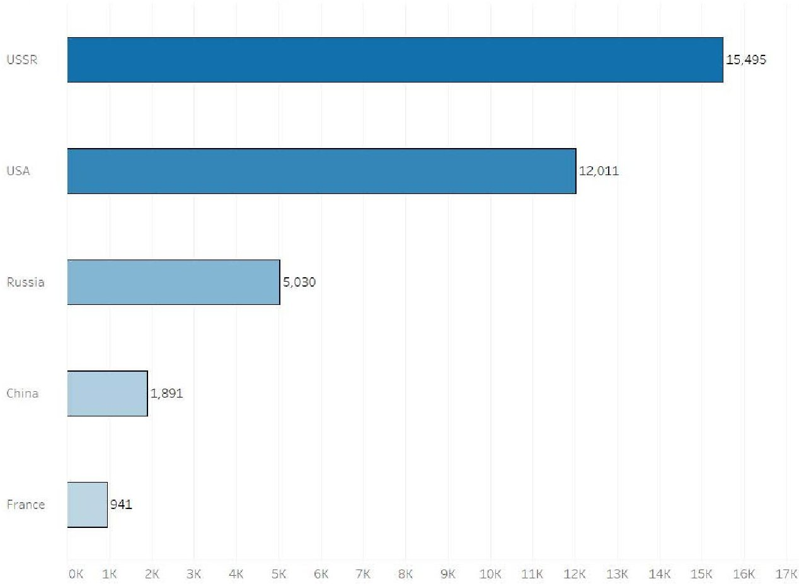

Figure 4.9 Space debris reentry to Earth's atmosphere by country

The vertical y-axis of the bar chart above represents the countries with the most space debris reentry, while the horizontal x-axis would display the quantity of re-entry debris. Figure 4.9 shows space debris reentry to Earth's atmosphere by country.

Based on this data, the bar chart shows the USSR with the most space debris reentry, followed by the USA and Russia. Since December 1957, the start of the space race, a total of 22,142 cataloged orbiting objects have re-entered the Earth's atmosphere as of the $ 3^{\mathrm{rd}} $ of April 2013. Currently, around 70% of re-entries of space debris objects from LEO are uncontrolled, accounting for roughly 50% of the returning mass, equivalent to 100 metric tons annually. On average, there is one uncontrolled re-entry of a spacecraft or rocket body every week, resulting in

<!-- PDF_PAGE: 57 -->

an average mass of around 200 kg. (Sgobba, 2016). The numbers of space debris are increasing exponentially due to more conducted space activities. According to this research study, figure 4.10 illustrates space debris reentries and space debris in Earth orbit are increasing exponentially as of April 2022.

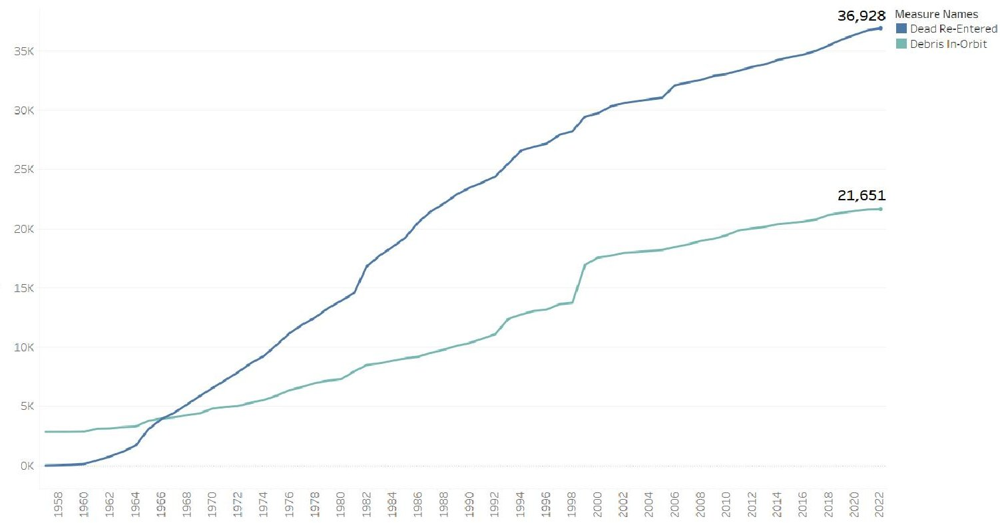

Figure 4.10 Number of space debris in Earth's orbits vs. space debris re-entry to Earth's atmosphere

As shown in this research study the space debris numbers are increasing, as the space industry grows. Figure 4.11 indicates 4 main different types of space debris that are monitored and bigger than 10 cm. According to NASA, The Earth is surrounded by more than 23,000 orbiting objects that are larger than a softball, and they move at a speed of up to 17,500 miles per hour. Even the tiniest piece of debris could damage a satellite or spacecraft at such high speeds. Furthermore, there are roughly 500,000 objects the size of a marble or larger, and around 100

<!-- PDF_PAGE: 58 -->

million parts of debris dimensioning at least 0.04 inches (1 millimeter) in size. There are also smaller debris pieces, measuring less than 0.04 inches in diameter.

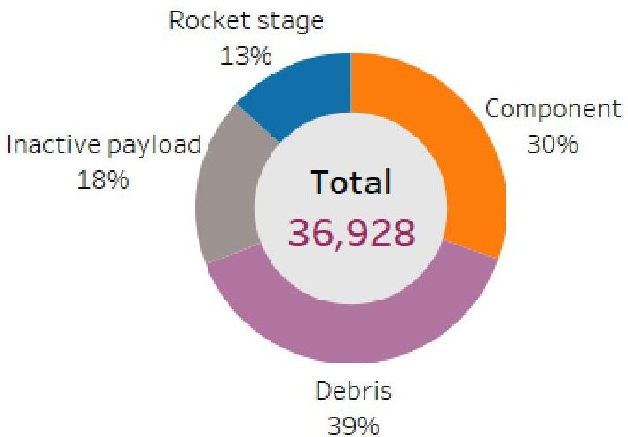

Figure 4.11 Space debris types that reentered Earth

Despite their size, even small paint flecks can be dangerous to spacecraft when moving at such high speeds. In some cases, very small particles of space debris have been known to cause damage to space shuttle windows, leading to their replacement. When it comes to robotic spacecraft functioning in low Earth orbit, debris measuring as little as one millimeter in size presents a significant risk to mission success.

<!-- PDF_PAGE: 59 -->

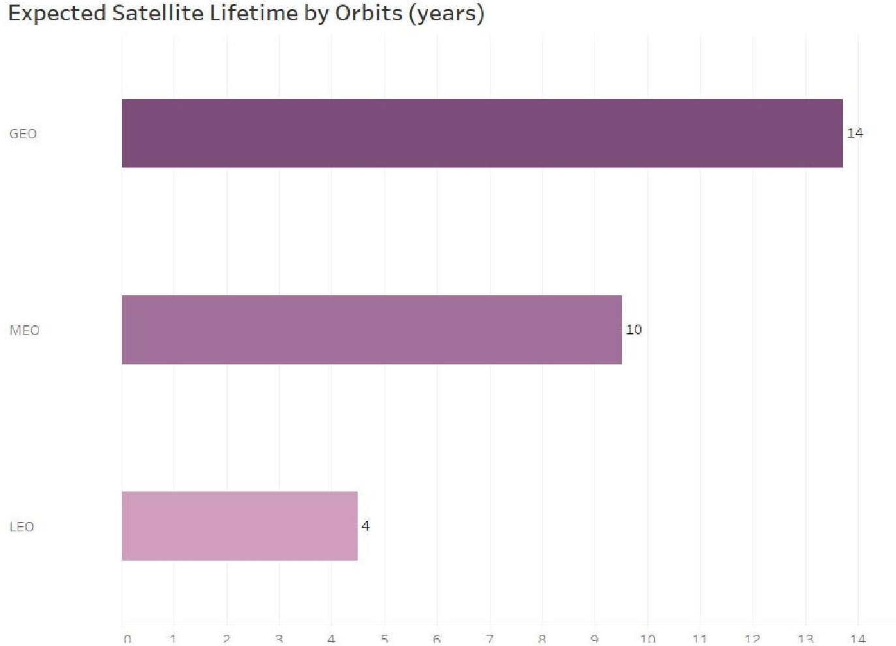

Figure 4.12 Indicates the average life of the active satellites in each Earth orbit

As indicated in Figure 4.12, the shortest usage of the satellite is in LEO, which increases the risk of further growing the number of inactive satellites and space debris. Figure 4.13 shows that most space debris is in LEO.

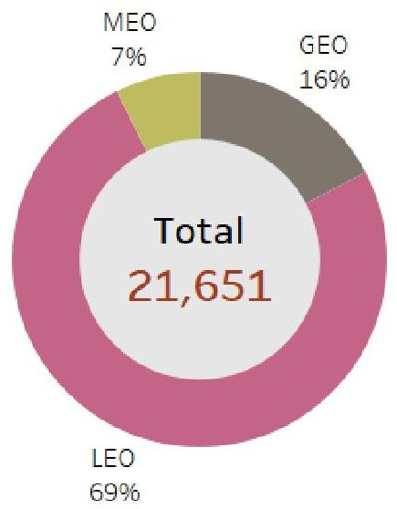

Figure 4.13 Space debris percentage in each Earth orbit

<!-- PDF_PAGE: 60 -->

The European Space Agency (ESA) has observed a continuous increase in the quantity of debris, as well as their collective weight and the debris influence area. The rise in space debris is attributable to multiple factors, including frequent breakups of spacecraft and rocket stages while in orbit, collisions, and increasing satellite deployments. As per ESA, collisions between debris and active satellites are expected to become the leading cause of space debris generation, surpassing explosions of spacecrafts or its components. Additionally, the quantity of "traffic" launched into LEO is changing considerably, primarily due to an upsurge in the number of new deployments of small satellites and satellite constellations. Tim Florer, the Head of ESA's Space Debris Office, has noticed that the acceleration in satellites launched into LEO is showing in their latest report.

Based on a survey distributed to the public who are 18 and older, many answered that government and private space entities should be responsible for the space debris concerns. As shown in Figures 4.14 and 4.15.

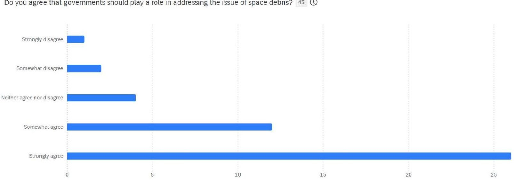

Figure 4.14 Survey responses if the government should address the space debris issue 26 out of 45 participants strongly agree that the government should address space debris.

<!-- PDF_PAGE: 61 -->

Do you agree private companies should also be responsible for mitigating the growth of space debris? 45

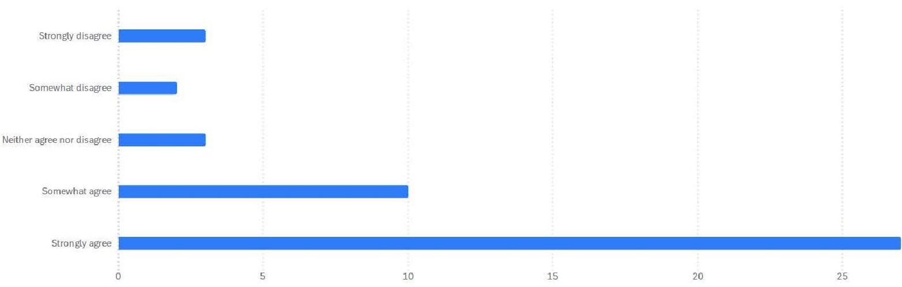

Figure 4.15 Survey responses if private entities should address the space debris issue

27 out of 45 participants strongly agree that private entities should address space debris. See Attachment C for the full space debris survey questions.

<!-- PDF_PAGE: 62 -->

## CHAPTER V CONCLUSION AND RECOMMENDATIONS

In conclusion, the amount of space debris is expected to increase due to the growing space activities and satellite deployments. Space debris poses a risk to both space activities and the long-term viability of our space environment. The quantity of space debris is being continuously monitored and tracked, but there are relatively smaller debris pieces that cannot be tracked and pose a potential risk to other ASOs. Orbital collisions due to space debris increasingly threaten ASOs in Earth orbit. In this research we evaluate active satellites and space debris from two separate sources of datasets. The results obtained from the two separate datasets are in align with previous research. The management and monitoring of the space objects are crucial to ensure the safety and sustainability of future space activities. Kessler syndrome is a concern due to the rapid growing number of space objects and debris. It is a theoretical scenario in which the density of the ASO in Earth's orbits become so congested that collisions between objects occur more frequently. As the number of space objects and debris continue to grow, the risk of a Kessler syndrome event also grows, highlighting the dire need for immediate measures to address the issue of space debris. Addressing the issue of space debris requires global collaboration to manage and mitigate space debris risks. Managing the space environment is becoming more critical to ensure long-term viability of space activities and sustainable space environment.

<!-- PDF_PAGE: 63 -->

The study recommends the following:

1. Increase the monitoring and cataloging of Anthropogenic space objects, to include smaller sizes of space debris and potential price on objects.

2. Catalog the objects and include the type of material, potential use for future circular economy benefit, and plan space debris removal program.

3. Implement the SSR rating for all future satellite deployments and introduce material that deteriorates when reentering Earth's atmosphere with minimal pollution.

4. Introduce higher taxes and regulations for the low Earth orbit and rank the most sought for inclination and height.

5. Continue monitoring and tracking anthropogenic space objects to better forecast movements, and direction and enable better decision-making for space operations.

6. Encourage international cooperation and coordination in space objects awareness, tracking, and effective response to the problem of space debris in LEO

7. Research and study future space object structural materials that can withstand collisions and if damaged the material does not shatter too many debris pieces.

<!-- PDF_PAGE: 64 -->

## REFERENCES

American Scientist. (2018, July 13). Fifty Years of Earth-observation Satellites. American Scientist. Retrieved March 6, 2023, from https://www.americanscientist.org/article/fifty years-of-earth-observation-satellites

Boley, A. C., & Byers, M. (2021). Satellite mega-constellations create risks in low Earth orbit the atmosphere, and on Earth. Scientific Reports, 11(1). https://doi.org/10.1038/s41598-021-89909-7

Borucki, W. J., Koch, D., Basri, G., Batalha, N., Brown, T., Caldwell, D., Caldwell, J. Christensen-Dalsgaard, J., Cochran, W. D., Devore, E., Dunham, E. W., Dupree, A. K., Gautier, T. N., Geary, J. C., Gilliland, R., Gould, A., Howell, S. B., Jenkins, J. M., Kondo, Y., ... Prsa, A. (2010). Kepler planet-detection mission: Introduction and first results. Science, 327(5968), 977-980. https://doi.org/10.1126/science.1185402

Defense Intelligence Agency, I. A. (2022, March). Defense Intelligence Agency. Challenges to Security in Space. Retrieved March 6, 2023, from https://www.dia.mil/Portals/110/Documents/News/Military_Power_Publications/Challenges_Security_Space_2022.pdf

De Córdoba, D. S. S. F. (2006, June 21). 100km altitude boundary for Astronautics. 100km Altitude Boundary for Astronautics | World Air Sports Federation. Retrieved February 19, 2023, from https://www.fai.org/page/icare-boundary

Dunbar, B. (2015, June 16). What is a satellite? NASA. Retrieved March 6, 2023, from https://www.nasa.gov/audience/forstudents/5-8/features/nasa-knows/what-is-a-satellite- 58.html

Ely, J. "Society, and Science: Ancient Astronomy." (2012). Undergraduate Honors Theses. Paper 31. https://dc.etsu.edu/honors/31

European Space Agency. (2022, April). ESA'S ANNUAL SPACE ENVIRONMENT REPORT. Paris, France; European Space Agency

European Space Agency. (2022, November 2). Space debris. European Space Agency. Retrieved March 5, 2023, from https://www.esa.int/Space_Safety/Space_Debris

<!-- PDF_PAGE: 65 -->

European Space Agency, (2020, March 30). Types of orbits. The European Space Agency. Retrieved March 6, 2023, from https://www.esa.int/Enabling_Support/Space_Transportation/Types_of_orbits#LEO

Federal Aviation Administration. (n.d.). Satellite Navigation - GPS - how it works. Satellite Navigation - GPS - How It Works | Federal Aviation Administration. Retrieved March 6, 2023, from https://www.faa.gov/about/office_org/headquarters_offices/ato/service_units/techops/nav services/gnss/gps/howitworks

Goedhart, R. F. (1996). The never-ending dispute: delimitation of air space and outer space (Vol. 4). Editions Frontieres.

Grant R. Cates, Daniel X. Houston, Douglas G. Conley, and Karen L. Jones, "Launch Uncertainty: Implications for Large Constellations,"

Hallex, A., Cottom, T. S. (2020, March 31). Proliferated commercial satellite constellations: Implications for national security. National Defense University Press. Retrieved March 6, 2023, from https://ndupress.ndu.edu/Media/News/News-Article- View/Article/2106495/proliferated-commercial-satellite-constellations-implications-for national-secu/

Kessler, D. J., & Cour-Palais, B. G. (1978). Collision Frequency of Artificial Satellites: The Creation of a Debris Belt. Journal of Geophysical Research: Space Physics, 83, 2637- 2646.

Klima R, Bloembergen D, Savani R, Tuyls K, Wittig A, Sapera A, Izzo D. Space Debris Removal: Learning to Cooperate and the Price of Anarchy. Front Robot AI. 2018 Jun 4;5:54. Doi: 10.3389/frobt.2018.00054. PMID: 33500936; PMCID: PMC7806007.

Lawrence, A., Rawls, M. L., Jah, M., Boley, A., Di Vruno, F., Garrington, S., Kramer, M., Lawler, S., Lowenthal, J., McDowell, J., & McCaughrean, M. (2022). The case for space environmentalism. Nature Astronomy, 6(4), 428-435. https://doi.org/10.1038/s41550-022-01655-6

Lawrence J. DeLucas, International space station, Acta Astronautica, Volume 38, Issues 48,1996, Pages 613-619, ISSN 0094-5765, https://doi.org/10.1016/0094-5765(96)00056-2. (https://www.sciencedirect.com/science/article/pii/0094576596000562)

Lacina, L. (2022, September 7). Astra's Chris Kemp: What's next for a free space economy. World Economic Forum. Retrieved March 6, 2023, from https://www.weforum.org/agenda/2022/09/chris-kemp-astra-free-space-economy/

Nasir, H., Paracha, A., & Wu, Z. (2020). Space Sustainability Rating: Designing a Composite Indicator to Incentivize Satellite Operators to Pursue Long-Term Sustainability of the Space Environment. Acta Astronautica, 170, 572-580. Doi: 10.1016/j.actaastro.2020.03.019.

<!-- PDF_PAGE: 66 -->

NASA. (2006, April 1). Instability of the Current Orbital Debris Population. Orbital Debris Quarterly News. Retrieved March 7, 2023, from https://orbitaldebris.jsc.nasa.gov/quarterly-news/

National Geographic. (n.d.). The history of space exploration. Education. Retrieved March 6, 2023, from https://education.nationalgeographic.org/resource/history-space-exploration/

National Satellite Information Service, no. (2016, February 22). Where is space? National Environmental Satellite, Data, and Information Service. Retrieved March 6, 2023, from https://www.nesdis.noaa.gov/news/where-space

Smirnov, N.N. (Ed.). (2002). Space Debris: Hazard Evaluation and Debris (1st ed.). CRC Press. https://doi.org/10.1201/9781482288193

Sieg, D., "Optimization of New 4 S/C Formations Considering Operational Constraints of the Extended Cluster Mission," Proceedings of the 18th International Symposium of Space Flight Dynamics, SP548, ESA, Paris, Oct. 2004, pp. 403-408.

Tereza Pultarova and Caleb Henry, "OneWeb Weighing 2,000 More Satellites," SpaceNews (February 24, 2017);

The National Environmental Satellite Data and Information Service. (2017, November 27). NOAA's eyes in the sky-after five decades of weather forecasting with environmental satellites, what do future satellites promise for meteorologists and society? World Meteorological Organization. Retrieved March 6, 2023, from https://public.wmo.int/en/resources/bulletin/noaa%E2%80%99s-eyes-sky-after-five decades-of-weather-forecasting-environmental

Massachusetts Institute of Technology AeroAstro. (2023, January 17). Retrieved March 6, 2023 from https://aeroastro.mit.edu/research/

Riebeek, H. (2009, September 4). Catalog of Earth Satellite Orbits. Earth Observatory. Retrieved March 6, 2023, from https://earthobservatory.nasa.gov/features/OrbitsCatalog

Satellite Industry Association, S. I. S. (2022, June 29). Commercial satellite industry growing as it continues to dominate expanding global space business - sia releases 25th Annual State of the Satellite Industry Report. Satellite Industry Association. Retrieved March 6, 2023, from https://sia.org/commercial-satellite-industry-growing-as-it-continues-to-dominate-expanding-global-space-business-sia-releases-25th-annual-state-of-the-satellite-industry-report/#:~:text=By%20the%20end%20of%202021,over%20the%20past%20five%20year

Smirnov, N.N. (Ed.). (2002). Space Debris: Hazard Evaluation and Debris (1st ed.). CRC Press. https://doi.org/10.1201/9781482288193

Sgobba, T. (n.d.). Space Debris Re-entries and Aviation Safety. INTERNATIONAL ACADEMY OF ASTRONAUTICS. Retrieved March 8, 2023, from https://iaaspace.org/wp-content/uploads/iaa/Scientific%20Activity/debris6.pdf

U.S., A. F. (2016). B-1B Lancer. Air Force. Retrieved March 6, 2023, from https://www.af.mil/About-Us/Fact-Sheets/Display/Article/104500/b-1b-lancer/

<!-- PDF_PAGE: 67 -->

UCUSA, U. C. S. U. S. A. (2015, January 15). What are satellites used for? Union of Concerned Scientists. Retrieved March 6, 2023, from https://www.ucsusa.org/resources/what-are-satellites-used

Wood, L., Satellite constellation networks, Internetworking and Computing over Satellite Networks. Springer, Boston, MA, 2003, p.13-34.

Venkatesan, A., Lowenthal, J., Prem, P., & Vidaurri, M. (2020). The impact of satellite constellations on space as an ancestral global common. Nature Astronomy, 4(11), 10431048. https://doi.org/10.1038/s41550-020-01238-3

Vishwakarma, Sandeep & Chauhan, Aradhana & Aasma, Shoeba. (2015). A Comparative Study of Satellite Orbits as Low Earth Orbit (LEO) and Geostationary Earth Orbit (GEO). SAMRIDDHI: A Journal of Physical Sciences, Engineering, and Technology. 6. 10.18090/samriddhi. v6i2.1559.

Zhang, Y Internetworking and Computing Over Satellite Network. (2003). Netherlands: Springer US.

<!-- PDF_PAGE: 68 -->

## ATTACHMENTS

Please refer to the attached files to view attachments A. B and C.

A. UCS ACTIVE SATELLITES DATASET

B. DR.MCDOWELL SATCOM DATASET

C. SPACE DEBRIS SURVEY QUESTIONS

<!-- PDF_PAGE: 69 -->

## VITA

Muin Bogari is a Civil Engineer who graduated with a Bachelor of Science degree in 2018 from California State University, Los Angeles. During my undergraduate studies, I acquired a solid foundation in various aspects of Civil Engineering, which I have since applied in my work in the industry. My passion for space has driven me to pursue a Master of Science degree in Engineering Management, with a research focus on space debris for the space environment. I am committed to making a positive impact on the space environment by developing methods to reduce space debris and mitigate its effects on space missions. My current research has motivated me to pursue a Ph.D. and become a researcher. I am eager to contribute to this rapidly evolving future and make meaningful contributions to society.