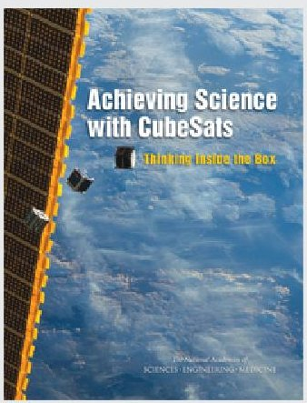
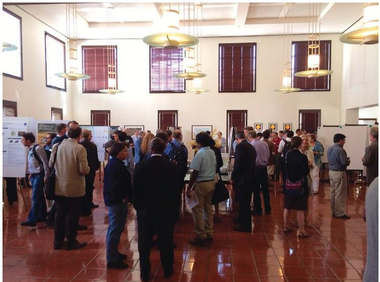
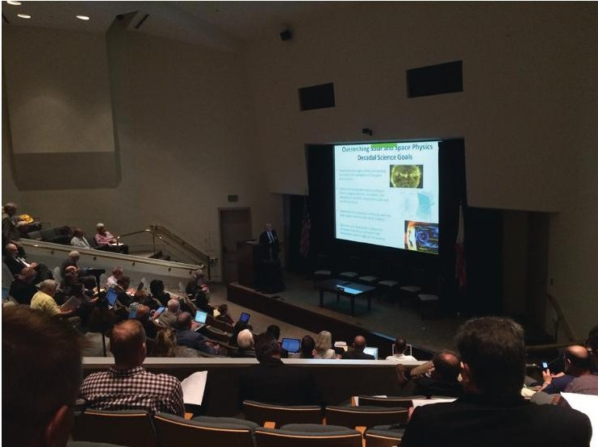

# Achieving science with CubeSats: Thinking inside the box

Authors: National Academies of Sciences, Engineering, Medicine

<!-- PDF_PAGE: 1 -->

This PDF is available at http://nap.naptionalacademies.org/23503

                                          Achieving Science with CubeSats:
                                          Thinking Inside the Box (2016)

                                          DETAILS
                                          130 pages | 8.5 x 11 | PAPERBACK
                                          ISBN 978-0-309-44263-3 | DOI 10.17226/23503

                                          CONTRIBUTORS
                                          Committee on Achieving Science Goals with CubeSats; Space Studies Board;
                                          Division on Engineering and Physical Sciences; National Academies of Sciences,
     BUY THIS BOOK                        Engineering, and Medicine

  FIND RELATED TITLES                     SUGGESTED CITATION
                                          National Academies of Sciences, Engineering, and Medicine 2016. Achieving
                                          Science with CubeSats: Thinking Inside the Box. Washington, DC: The National
                                          Academies Press. https://doi.org/10.17226/23503.

Visit the National Academies Press at nap.edu and login or register to get:
– Access to free PDF downloads of thousands of publications
– 10% off the price of print publications
– Email or social media notifications of new titles related to your interests
– Special offers and discounts

All downloadable National Academies titles are free to be used for personal and/or non-commercial
academic use. Users may also freely post links to our titles on this website; non-commercial academic
users are encouraged to link to the version on this website rather than distribute a downloaded PDF
to ensure that all users are accessing the latest authoritative version of the work. All other uses require
written permission. (Request Permission)

This PDF is protected by copyright and owned by the National Academy of Sciences; unless otherwise
indicated, the National Academy of Sciences retains copyright to all materials in this PDF with all rights
reserved.

<!-- PDF_PAGE: 2 -->

Achieving Science with CubeSats: Thinking Inside the Box

                           Achieving Science
                             with CubeSats
                                           Thinking Inside the Box

                                                 Committee on Achieving Science Goals with CubeSats

                                                                  Space Studies Board

                                                      Division on Engineering and Physical Sciences

                                           Copyright National Academy of Sciences. All rights reserved.

<!-- PDF_PAGE: 3 -->

Achieving Science with CubeSats: Thinking Inside the Box

                  THE NATIONAL ACADEMIES PRESS                                 500 Fifth Street, NW                    Washington, DC 20001

                  This activity is supported by Contract NNH11CD57B with the National Aeronautics and Space Administration, with support
                  from Lockheed Martin for printing additional copies of the report. Any opinions, findings, conclusions, or recommendations
                  expressed in this publication do not necessarily reflect the views of any organization or agency that provided support for the
                  project.

                  International Standard Book Number-13: 978-0-309-44263-3
                  International Standard Book Number-10: 0-309-44263-X
                  Digital Object Identifier: 10.17226/23503

                  Copies of this report are available free of charge from:

                  Space Studies Board
                  National Academies of Sciences, Engineering, and Medicine
                  500 Fifth Street, NW
                  Washington, DC 20001

                  Additional copies of this report are available from the National Academies Press, 500 Fifth Street, NW, Keck 360, Washington,
                  DC 20001; (800) 624-6242 or (202) 334-3313; http://www.nap.edu.

                  Copyright 2016 by the National Academy of Sciences. All rights reserved.

                  Printed in the United States of America

                  Suggested Citation: National Academies of Sciences, Engineering, and Medicine. 2016. Achieving Science with CubeSats:
                  Thinking Inside the Box. Washington, DC: The National Academies Press. doi:10.17226/23503.

                                            Copyright National Academy of Sciences. All rights reserved.

<!-- PDF_PAGE: 4 -->

Achieving Science with CubeSats: Thinking Inside the Box

                               The National Academy of Sciences was established in 1863 by an Act of Congress,
                               signed by President Lincoln, as a private, nongovernmental institution to advise the
                               nation on issues related to science and technology. Members are elected by their
                               peers for outstanding contributions to research. Dr. Ralph J. Cicerone is president.

                               The National Academy of Engineering was established in 1964 under the ­charter
                               of the National Academy of Sciences to bring the practices of engineering to
                               advis­ing the nation. Members are elected by their peers for extraordinary contri-
                               butions to engineering. Dr. C. D. Mote, Jr., is president.

                               The National Academy of Medicine (formerly the Institute of Medicine) was
                               established in 1970 under the charter of the National Academy of Sciences to
                               advise the nation on medical and health issues. Members are elected by their
                               peers for distinguished contributions to medicine and health. Dr. Victor J. Dzau
                               is president.

                               The three Academies work together as the National Academies of Sciences,
                               Engi­neering, and Medicine to provide independent, objective analysis and
                               ­advice to the nation and conduct other activities to solve complex problems
                                and inform public policy decisions. The Academies also encourage education and
                                research, recognize outstanding contributions to knowledge, and increase public
                                understanding in matters of science, engineering, and medicine.

                               Learn more about the National Academies of Sciences, Engineering, and Medi-
                               cine at www.national-academies.org.

                                           Copyright National Academy of Sciences. All rights reserved.

<!-- PDF_PAGE: 5 -->

Achieving Science with CubeSats: Thinking Inside the Box

                                        OTHER RECENT REPORTS OF THE SPACE STUDIES BOARD

                  Continuity of NASA Earth Observations from Space: A Value Framework (SSB, 2015)
                  Optimizing the U.S. Ground-Based Optical and Infrared Astronomy System (Board on Physics and Astronomy [BPA]
                      with the Space Studies Board [SSB], 2015)
                  Review of the MEPAG Report on Mars Special Regions (SSB, 2015)
                  Sharing the Adventure with the Student: Exploring the Intersections of NASA Space Science and Education: A Work-
                      shop Summary (SSB, with the Board on Science Education, 2015)
                  The Space Science Decadal Surveys: Lessons Learned and Best Practices (SSB, 2015)

                  Evaluation of the Implementation of WFIRST/AFTA in the Context of New Worlds, New Horizons in Astronomy and
                      Astrophysics (BPA with SSB, 2014)
                  Opportunities for High-Power, High-Frequency Transmitters to Advance Ionospheric/Thermospheric Research:
                      Report of a Workshop (SSB, 2014)
                  Pathways to Exploration: Rationales and Approaches for a U.S. Program of Human Space Exploration (Aeronautics
                      and Space Engineering Board [ASEB] with SSB, 2014)
                  Solar and Space Physics: A Science for a Technological Society: An Overview (SSB, 2014)

                  Landsat and Beyond: Sustaining and Enhancing the Nation’s Land Imaging Program (SSB, 2013)
                  Lessons Learned in Decadal Planning in Space Science: Summary of a Workshop (SSB, 2013)
                  Review of the Draft 2014 Science Mission Directorate Science Plan (SSB, 2013)
                  Solar and Space Physics: A Science for a Technological Society (SSB, 2013)

                  Assessment of a Plan for U.S. Participation in Euclid (BPA with SSB, 2012)
                  Assessment of Planetary Protection Requirements for Spacecraft Missions to Icy Solar System Bodies (SSB, 2012)
                  Earth Science and Applications from Space: A Midterm Assessment of NASA’s Implementation of the Decadal Survey
                      (SSB, 2012)
                  The Effects of Solar Variability on Earth’s Climate: A Workshop Report (SSB, 2012)
                  NASA’s Strategic Direction and the Need for a National Consensus (Division on Engineering and Physical Sciences,
                      2012)
                  Report of the Panel on Implementing Recommendations from the New Worlds, New Horizons Decadal Survey (BPA
                      and SSB, 2012)
                  Technical Evaluation of the NASA Model for Cancer Risk to Astronauts Due to Space Radiation (SSB, 2012)

                  Assessment of Impediments to Interagency Collaboration on Space and Earth Science Missions (SSB, 2011)
                  Panel Reports—New Worlds, New Horizons in Astronomy and Astrophysics (BPA and SSB, 2011)
                  Recapturing a Future for Space Exploration: Life and Physical Sciences Research for a New Era (SSB and ASEB, 2011)
                  Sharing the Adventure with the Public—The Value and Excitement of “Grand Questions” of Space Science and
                       Exploration: Summary of a Workshop (SSB, 2011)
                  Vision and Voyages for Planetary Science in the Decade 2013-2022 (SSB, 2011)

                                              Limited copies of SSB reports are available free of charge from:

                                                                        Space Studies Board
                                                                    National Research Council
                                                            The Keck Center of the National Academies
                                                           500 Fifth Street, NW, Washington, DC 20001
                                                                   (202) 334-3477/ssb@nas.edu
                                                             www.nationalacademies.org/ssb/ssb.html

                                           Copyright National Academy of Sciences. All rights reserved.

<!-- PDF_PAGE: 6 -->

Achieving Science with CubeSats: Thinking Inside the Box

                                     COMMITTEE ON ACHIEVING SCIENCE GOALS WITH CUBESATS

                  THOMAS H. ZURBUCHEN, University of Michigan, Chair
                  BHAVYA LAL, IDA Science and Technology Policy Institute, Vice Chair
                  JULIE CASTILLO-ROGEZ, California Institute of Technology
                  ANDREW CLEGG, Google, Inc.
                  PAULO C. LOZANO, Massachusetts Institute of Technology
                  MALCOLM MACDONALD, University of Strathclyde
                  ROBYN MILLAN, Dartmouth College
                  CHARLES D. NORTON, California Institute of Technology
                  WILLIAM H. SWARTZ, Johns Hopkins University
                  ALAN TITLE, Lockheed Martin
                  THOMAS WOODS, University of Colorado
                  EDWARD L. WRIGHT, University of California, Los Angeles
                  A. THOMAS YOUNG, Lockheed Martin Corporation (retired)

                  Staff
                  ABIGAIL A. SHEFFER, Program Officer, Study Director
                  KATIE DAUD, Research Associate
                  DIONNA J. WILLIAMS, Program Coordinator
                  JAMES ALVER, Lloyd V. Berkner Space Policy Intern
                  THOMAS KATUCKI, Lloyd V. Berkner Space Policy Intern

                  MICHAEL H. MOLONEY, Director, Space Studies Board and Aeronautics and Space Engineering Board

                                                                        v

                                           Copyright National Academy of Sciences. All rights reserved.

<!-- PDF_PAGE: 7 -->

Achieving Science with CubeSats: Thinking Inside the Box

                                                            SPACE STUDIES BOARD

                  DAVID N. SPERGEL, Princeton University, Chair
                  ROBERT D. BRAUN, Georgia Institute of Technology, Vice Chair
                  JAMES G. ANDERSON, Harvard University
                  JAMES P. BAGIAN, University of Michigan
                  JEFF M. BINGHAM, Consultant
                  PENELOPE J. BOSTON, New Mexico Institute of Mining and Technology
                  MARY LYNNE DITTMAR, Dittmar Associates, Inc.
                  JOSEPH FULLER, JR., Futron Corporation
                  THOMAS R. GAVIN, Jet Propulsion Laboratory, California Institute of Technology
                  NEIL GEHRELS, NASA Goddard Space Flight Center
                  SARAH GIBSON, National Center for Atmospheric Research
                  WESLEY T. HUNTRESS, JR. Carnegie Institution of Washington (retired)
                  ANTHONY C. JANETOS, Boston University
                  CHRYSSA KOUVELIOTOU, The George Washington University
                  SAUL PERLMUTTER, Lawrence Berkeley National Laboratory
                  LOUISE M. PROCKTER, Johns Hopkins University, Applied Physics Laboratory
                  MARK H. THIEMENS, University of California, San Diego
                  MEENAKSHI WADHWA, Arizona State University
                  THOMAS H. ZURBUCHEN, University of Michigan

                  Staff
                  MICHAEL H. MOLONEY, Director
                  CARMELA J. CHAMBERLAIN, Administrative Coordinator
                  TANJA PILZAK, Manager, Program Operations
                  CELESTE A. NAYLOR, Information Management Associate
                  MARGARET KNEMEYER, Financial Officer
                  SU LIU, Financial Assistant

                                                                        vi

                                           Copyright National Academy of Sciences. All rights reserved.

<!-- PDF_PAGE: 8 -->

Achieving Science with CubeSats: Thinking Inside the Box

                                                                    Preface

                       Small satellites called CubeSats (i.e., satellites built in increments of 10 cm cubes—1 cube is called 1U or
                  “unit,” two cubes together are 2U, and so on) historically have been used mostly as teaching tools and technol-
                  ogy demonstrations. However, recently proposed and selected flight projects are showing that technologies have
                  matured enough so that CubeSats can potentially address important science goals as well. CubeSats are now part
                  of a trend toward an increasingly diverse set of platforms for pursuing space and Earth sciences. In recognition
                  of this trend, the National Aeronautics and Space Administration (NASA) and the National Science Foundation
                  (NSF) requested in 2014 that the National Academies of Sciences, Engineering, and Medicine conduct an ad hoc
                  review of the scientific potential of the CubeSat platform and make recommendations to improve the capabilities
                  of the platform to enable its use by the scientific community. The Committee on Achieving Science Goals with
                  CubeSats was formed and began work on its task (see Appendix A for the full statement of task).
                       Particular challenges for the committee were the relative newness of use of the CubeSat platform for science
                  and the rapid pace of change in the relevant technologies, potential CubeSat missions, and the increasing interest
                  from a variety of potential users within the research, educational, and commercial communities. As of the end of
                  2015, 425 CubeSats had been launched; more than 100 of those were during the course of this study. Therefore,
                  the input processes for the committee were designed to be as inclusive as possible of new ideas and results. The
                  committee also requested that each of NSF’s CubeSat project teams, as well as the GeneSat and O/OREOS project
                  teams, provide a list of their publications, including conference presentations, to ensure that the ­committee was
                  aware of current results and also those that were not yet published. The committee would like to thank NASA
                  and NSF and the members of their CubeSat teams for their responsiveness to these requests. All CubeSat launch and
                  mission data analyzed for the report were up to date on December 31, 2015. Publication analyses were performed
                  by January 15, 2016.
                       The committee held its first meeting on June 22-23, 2015, in Washington, D.C., followed by a writing meeting on
                  October 22-23 and a policy-focused meeting on October 30, both in Washington, D.C. At the policy-focused meet-
                  ing, the committee heard perspectives from the Office of Science and Technology Policy and discussed orbital debris
                  and space situation awareness, spectrum availability, and current issues regarding the International Traffic in Arms
                  Regulations (ITAR). Panelists and speakers were present from NASA, NSF, the Department of Defense, the Federal
                  Communications Commission, the Joint Space Operations Center, the Federal Aviation Administration, the National
                  Telecommunications and Information Administration, the Universities Space Research ­Association, the Secure
                  World Foundation, and Analytical Graphics, Inc.’s Center for Space Standards and Innovation.

                                                                          vii

                                           Copyright National Academy of Sciences. All rights reserved.

<!-- PDF_PAGE: 9 -->

Achieving Science with CubeSats: Thinking Inside the Box

                  viii                                                                                                         PREFACE

                       The committee also sought to understand this rapidly changing environment via three focused input events.
                  As part of their second meeting, the committee held a community symposium on September 2-3, 2015, in Irvine,
                  California. This meeting included a combination of keynote speakers who presented the history and current state
                  of CubeSat science and technology and panels of scientists and engineers who discussed the future of the platform
                  in their expertise areas. Science discipline areas included Earth science, solar and space physics (also referred to as
                  heliophysics), planetary science, and astronomy and astrophysics. Other panels discussed technology for CubeSats,
                  CubeSats for technology development, industry capabilities, and CubeSats in education. In addition to the invited
                  speakers and panelists, the committee held a call for poster presentations, asking the community to bring their
                  best ideas for science, mission concepts, and technology development. More than 125 participants attended the
                  symposium, and 60 posters were submitted (Figure P.1). To round out the relevant science disciplines, the Space
                  Studies Board’s standing Committee on Biological and Physical Sciences in Space hosted a keynote and panel
                  discussion for their discipline during their meeting on October 27-29, 2015, in Irvine, California. The Committee
                  on Achieving Science Goals with CubeSats attended the session via web conference. To gain an international per-
                  spective, members of the committee were hosted by the International Space Science Institute (ISSI) at their forum
                  on Performing High-Quality Science on CubeSats on January 19-20, 2016, in Bern, Switzerland. The committee
                  would like to thank the staff of ISSI, and in particular, Rafael Rodrigo, Rudolf von Steiger, Maurizio Falanga,
                  and Jennifer Fankhauser-Zaugg.
                       This report summarizes the history of CubeSats and reflects the rapidly changing environment of the ­CubeSat
                  platform, and consequently, it focuses on recommendations for near-term actions as well as on strategies for enhanc-
                  ing the scientific usefulness of CubeSats without overly restraining the spirit of innovation that characterizes the
                  broad community of CubeSat users.

                  FIGURE P.1 Attendees at the committee’s community input symposium on September 2-3, 2015, in Irvine, California, at the
                  poster session (left) and during a keynote presentation (right). SOURCE: Courtesy of Abigail Sheffer.

                                           Copyright National Academy of Sciences. All rights reserved.

<!-- PDF_PAGE: 10 -->

Achieving Science with CubeSats: Thinking Inside the Box

                                             Acknowledgment of Reviewers

                       This report has been reviewed in draft form by individuals chosen for their diverse perspectives and techni-
                  cal expertise. The purpose of this independent review is to provide candid and critical comments that will assist
                  the institution in making its published report as sound as possible and to ensure that the report meets institutional
                  standards for objectivity, evidence, and responsiveness to the study charge. The review comments and draft
                  manuscript remain confidential to protect the integrity of the deliberative process. We wish to thank the following
                  individuals for their review of this report:

                       Michael Bartone, Intelligence Advance Research Projects Activity,
                       Claude Canizares, Massachusetts Institute of Technology,
                       Elizabeth Cantwell, Arizona State University,
                       David Klumpar, Montana State University,
                       Michael Ladisch, Purdue University,
                       Stephen Mackwell, Universities Space Research Association, and
                       Marcia McNutt, American Association for the Advancement of Science.

                       Although the reviewers listed above have provided many constructive comments and suggestions, they were
                  not asked to endorse the conclusions or recommendations, nor did they see the final draft of the report before its
                  release. The review of this report was overseen by Marcia Rieke, University of Arizona, who was responsible for
                  making certain that an independent examination of this report was carried out in accordance with institutional
                  procedures and that all review comments were carefully considered. Responsibility for the final content of this
                  report rests entirely with the authoring committee and the institution.

                                                                           ix

                                           Copyright National Academy of Sciences. All rights reserved.

<!-- PDF_PAGE: 11 -->

Achieving Science with CubeSats: Thinking Inside the Box

                                           Copyright National Academy of Sciences. All rights reserved.

<!-- PDF_PAGE: 12 -->

Achieving Science with CubeSats: Thinking Inside the Box

                                                                 Contents

                  SUMMARY                                                                                         1

                  1    INTRODUCTION                                                                               6
                       What Are CubeSats?, 6
                       Rationale for the Creation of the Committee on Achieving Science Goals with CubeSats, 7
                       History and Growth of CubeSats, 8
                       Growth of the Community, 12
                       The Current NSF and NASA CubeSat Programs, 12
                       Future NASA CubeSat Programs, 18
                       Other U.S. Government Programs, 19
                       CubeSat Success and Reliability, 21

                  2    CUBESATS—A DISRUPTIVE INNOVATION                                                          24
                       CubeSats as a Disruptive Platform, 24
                       Implications, 27

                  3    CUBESATS AS A TOOL FOR EDUCATION AND HANDS-ON TRAINING                                    28
                       Why CubeSats for Education and Training?, 28
                       Education and Training Programs, 29
                       Summary for CubeSats for Education, 32

                  4    SCIENCE IMPACT AND POTENTIAL                                                              33
                       Overview, 33
                       Solar and Space Physics, 35
                       Earth Science and Applications from Space, 39
                       Planetary Science, 43
                       Astronomy and Astrophysics, 46
                       Biological and Physical Sciences in Space, 50
                       Summary of CubeSats in Science, 52

                                                                        xi

                                           Copyright National Academy of Sciences. All rights reserved.

<!-- PDF_PAGE: 13 -->

Achieving Science with CubeSats: Thinking Inside the Box

                  xii                                                                                       CONTENTS

                  5     TECHNOLOGY DEVELOPMENT: CURRENT STATUS AND FUTURE DIRECTION                              55
                        Commercial Players and Their Relevance to Science and Technology Development, 55
                        Technology Areas, 60

                  6     POLICY CHALLENGES AND SOLUTIONS                                                          71
                        CubeSat Orbital Debris, 71
                        CubeSat Communication, 75
                        Launch as a Choke Point, 80
                        Other CubeSat-Related Policy Challenges, 82

                  7     CONCLUSIONS AND FUTURE PROGRAM RECOMMENDATIONS                                           83
                        Evolution from a Novel Educational Tool to a Standardized Commercial Platform, 83
                        Science Promise of CubeSats, 84
                        Programmatic Recommendations, 85
                        Technology Investments, 87
                        Policy, 88
                        Best Practices to Guide Ongoing CubeSat Development, 89

                  APPENDIXES

                  A     Statement of Task                                                                        93
                  B     CubeSat Publications—Descriptive Statistics                                              94
                  C     Additional Technology and Policy Details                                                101
                  D     Biographies of Committee Members and Staff                                              107
                  E     Abbreviations and Acronyms                                                              113

                                           Copyright National Academy of Sciences. All rights reserved.

<!-- PDF_PAGE: 14 -->

Achieving Science with CubeSats: Thinking Inside the Box

                                                                 Summary

                        This report examines the current state and science potential of CubeSats—defined by the committee as a
                  spacecraft sized in units, or U’s, typically up to 12U (a unit is defined as a volume of about 10 cm × 10 cm × 10
                  cm) that is launched fully enclosed in a container. Although the concept of launching a “canisterized” secondary
                  payload has existed since the space shuttle program, two university groups formally introduced the concept of
                  CubeSats in 1999 as an educational platform, seeking to give students hands-on experience building, launching,
                  and operating spacecraft. Over the 15 years since their introduction, CubeSats have been shown to share many
                  characteristics of disruptive innovations, such as rapid improvement of capabilities and finding niche uses in
                  research, commercial, and homeland and national security communities. Accordingly, the National Aeronautics
                  and Space Administration (NASA) and the National Science Foundation (NSF) asked the National Academies of
                  Sciences, Engineering, and Medicine to establish an ad hoc committee to explore the current state of CubeSats
                  and examine the potential of the use of CubeSats to obtain high-priority science data. The full statement of task
                  for the Committee on Achieving Science Goals with CubeSats is reprinted in Appendix A.
                        The rapid speed of CubeSat development has been enabled, in part, by fast “fly-learn-refly” cycles—in
                  which two flight models are developed and the second model is modified and launched if issues arise during the
                  first flight—comparatively low development costs, miniaturized electronics, and timely availability of affordable
                  launch opportunities. A pioneering CubeSat-based research program launched in 2008 within NSF’s Division of
                  Atmospheric and Geospace Sciences was responsible for the first systematic support of CubeSat-based science
                  investigations and led to a growing engagement with universities. Furthermore, a growing commercial sector for the
                  use of CubeSats for Earth observations and remote sensing has also helped to spur rapid technology development.
                  Commercial demand has given rise to a fast-growing component-supplier industry. These commercial users and
                  suppliers are now major drivers of technology development for CubeSats, and many technologies or subsystems
                  can be purchased “off the shelf” by groups that seek to use CubeSats to address science objectives.
                        Since 2010, the use of CubeSats for science has grown especially rapidly due to NSF’s program and because
                  of an increase of interest within various NASA programs. More than 80 percent of all science-focused CubeSats
                  have been launched from 2012 to 2016. Similarly, more than 80 percent of peer-reviewed papers describing new
                  science based on CubeSat data have been published in the past 5 years. The committee’s review of a subset of
                  these papers is discussed in Chapter 4 and Appendix B.
                        The committee concluded that CubeSats have already produced high-value science. CubeSats are useful as
                  instruments of targeted investigations to augment the capabilities of large missions and ground-based facilities,

                                                                          1

                                           Copyright National Academy of Sciences. All rights reserved.

<!-- PDF_PAGE: 15 -->

Achieving Science with CubeSats: Thinking Inside the Box

                  2                                                                                   ACHIEVING SCIENCE WITH CUBESATS

                  and they enable new kinds of measurements and have the potential to mitigate gaps in measurements where con-
                  tinuity is critical.
                       The committee developed a list of sample science goals for CubeSats (Chapters 4 and 7). Many of these goals
                  address targeted science, often in coordination with other spacecraft, or use “sacrificial,” or high-risk, orbits that lead
                  to the demise of the satellite after critical data have been collected. Other goals relate to the use of CubeSats as con-
                  stellations or swarms deploying tens to hundreds of CubeSats that function as one distributed array of measurements.
                       The committee also concluded that although all space science disciplines can benefit from innovative CubeSat
                  missions, CubeSats cannot address all science objectives and are not a low-cost substitute for all platforms. Activi-
                  ties such as those needing large apertures, high-power instruments, or very-high-precision pointing most likely
                  will always require larger platforms because of the fundamental and practical constraints of small spacecraft. Also,
                  large spacecraft excel at large-scale investigations when, for example, several instruments need to be collocated.
                  CubeSats excel at simple, focused, or short-duration missions and missions that need to be comparatively low cost
                  or that require multipoint measurements.
                       The set of science goals where the use of CubeSats would be enabling is evolving too quickly for the committee
                  to create a comprehensive list, and the committee was not tasked with prioritizing CubeSat missions. However, the
                  following examples, from those listed in Chapter 4, provide a sampling of high-priority science goals that could
                  potentially be pursued using CubeSats:

                       • Solar and space physics, Earth science and applications from space—Exploration of Earth’s atmospheric
                  boundary region. CubeSats are uniquely suited because of their expendability to explore the scientific processes
                  that shape the upper atmospheric boundary using short-lifetime, low-altitude orbits.
                       • Earth science and applications from space—Multipoint, high temporal resolution of Earth processes.
                  ­Satellite constellations in low Earth orbit could provide both global and diurnal observations of Earth processes that
                   vary throughout the day, such as severe storms, and are currently under-sampled by Sun-synchronous observatories.
                       • Planetary science—In situ investigation of the physical and chemical properties of planetary surfaces or
                   atmospheres. Deployable (daughter-ship) CubeSats could expand the scope of the motherships with complementary
                   science or site exploration.
                       • Astronomy and astrophysics, solar and space physics—Low-frequency radio science. Interferometers made
                   of CubeSats could explore the local space environment and also galactic and extragalactic sources with spatial
                   resolution in ways not accessible from Earth.
                       • Biological and physical sciences in space—Investigate the survival and adaptation of organisms to space.
                   CubeSats offer a platform to understand the effects of the environment encountered in deep space, such as micro-
                   gravity and high levels of radiation.

                       To unlock the science potential of CubeSats or missions relying on CubeSat technology, federal investments
                  continue to be crucial, especially in areas that will not see commercial investment. Both NSF and NASA have
                  active CubeSat programs. NSF’s program has the dual goals of supporting small satellite missions to advance
                  space weather-related research and of providing opportunities to train the next generation of experimental space
                  scientists and aerospace engineers. As of 2015, NSF had launched 8 science-based CubeSat missions (consisting
                  of 13 CubeSat spacecraft) and has 7 missions (11 CubeSat spacecraft) in development. The committee believes
                  that the program has been successful with regard to both goals and that NSF’s current program continues to be
                  valuable. The program is particularly well aligned with the goals and recommendations of the 2013 decadal survey
                  for solar and space physics, Solar and Space Physics: A Science for a Technological Society (National Research
                  Council, The National Academies Press, Washington, D.C.); however, other disciplines at NSF, such as Earth
                  science and astronomy and astrophysics, could also benefit from the scientific and educational opportunities that
                  CubeSats provide.

                  Recommendation: The National Science Foundation (NSF) should continue to support the existing ­CubeSat
                  program, provide secure funding on a multiyear basis, and continue to focus on high-priority science and
                  the training of the next generation of scientists and engineers. In particular, NSF should consider ways to

                                           Copyright National Academy of Sciences. All rights reserved.

<!-- PDF_PAGE: 16 -->

Achieving Science with CubeSats: Thinking Inside the Box

                  SUMMARY                                                                                                          3

                  increase CubeSat opportunities for a broad range of science disciplines going beyond solar and space ­physics,
                  with financial support from those participating disciplines.

                       Although most CubeSat science results published today have come from NSF-sponsored investigations,
                  that is expected to change. NASA’s programs, which are distributed throughout the agency, thus far have placed
                  greater emphasis on maturing new technologies. However, NASA provided a large increase in opportunities to
                  propose science-based CubeSat missions in 2013. As of 2015, NASA had launched a total of 18 CubeSat missions
                  (34 spacecraft) with science and technology objectives. Each of the four NASA Science Mission Directorate sci-
                  ence divisions, at least two other directorates, and at least five NASA centers are developing CubeSat missions.
                  Additionally, some of the science divisions and centers may have more than one funding opportunity for CubeSats.
                       The committee observed that CubeSat activities within NASA programs have remained largely ­independent—
                  perhaps, not surprisingly, as a result of rapid growth in the use of CubeSats—and a lack of coordination has
                  impacted NASA’s ability to communicate a clear strategic plan and vision on the role of CubeSats for scientific
                  exploration internally within NASA and to the community. The explosion of interest in the deployment of CubeSats
                  has led to some management challenges that have the potential to stifle the impact that CubeSats can have for
                  science. Newcomers seeking NASA support for CubeSat missions have difficulty navigating the rapidly evolv-
                  ing and varied programs, technologies, and funding opportunities at the agency. Interested partners in academia,
                  government, and industry may have difficulty finding and creating collaborations. In addition, because of the
                  disaggregated nature of CubeSat programs at NASA, programs have begun to duplicate efforts in some areas—for
                  example, communication and propulsion technology development—and are not systematically sharing lessons
                  learned. Technology development by industry is evolving equally rapidly and is underleveraged in many govern-
                  ment programs, including at NASA.
                       CubeSats have proven their usefulness in the pursuit of science, most notably demonstrated by the increase
                  in the publication of scientific papers. Thus, it is now time for NASA to respond by increasing coordination
                  of their CubeSat programs for science and science-enabling technology, with the goal of further increasing the
                  overall scientific return and advancing sophisticated uses of CubeSats, such as large constellations. An additional
                  level of management is needed that can continue to encourage innovation—in all of the science disciplines and at
                  different costs—but also can reduce duplication in common technology areas by targeting resources to the most
                  promising developments.

                  Recommendation: NASA should develop centralized management of the agency’s CubeSat programs for
                  science and science-enabling technology that is in coordination with all directorates involved in CubeSat
                  missions and programs, to allow for more efficient and tailored development processes to create easier
                  interfaces for CubeSat science investigators; provide more consistency to the integration, test, and launch
                  efforts; and provide a clearinghouse for CubeSat technology, vendor information, and lessons learned. The
                  management structure should use a lower-cost and streamlined oversight approach that is also agile for
                  diverse science observation requirements and evolutionary technology advances.

                     The goal of this increased management focus is to leverage NASA’s investments to maximize scientific output.
                  However, it is equally important to encourage innovation by maintaining a variety of programs.

                  Recommendation: NASA should develop and maintain a variety of CubeSat programs with cost and risk
                  postures appropriate for each science goal and relevant science division and justified by the anticipated
                  science return. A variety of programs are important to allow CubeSats to be used for rapid responses to
                  newly recognized needs and to realize the potential from recently developed technology.

                      For example, a solar and space physics-focused CubeSat with a short development cycle and lower cost might
                  be able to take rapid advantage of a technological breakthrough. On the other hand, a CubeSat flying as part of a
                  planetary science mission might be developed on the same timescale as the larger spacecraft of the mission and
                  require higher reliability, which is typically associated with higher cost.

                                           Copyright National Academy of Sciences. All rights reserved.

<!-- PDF_PAGE: 17 -->

Achieving Science with CubeSats: Thinking Inside the Box

                  4                                                                                 ACHIEVING SCIENCE WITH CUBESATS

                      One critical benefit of NASA’s engagement in CubeSats is the role of CubeSats in training students, early
                  career project scientists, engineering teams, and project managers. Care must be taken to not inadvertently stifle
                  such training opportunities as CubeSats evolve toward more capable science missions and as the proposed new
                  management structure is implemented.

                  Recommendation: NASA should use CubeSat-enabled science missions as hands-on training opportunities to
                  develop principal investigator leadership, scientific, engineering, and project management skills among both
                  students and early career professionals. NASA should accept the risk that is associated with this approach.

                       There is one type of mission class that is of high priority for multiple disciplines and that deserves focused
                  investment and development—the creation of swarms and constellations of CubeSats. Many high-priority science
                  investigations of the future will require data from constellations or swarms of 10 to 100 spacecraft that, for the first
                  time, would have the spatial and temporal coverage to map out and characterize the physical processes that shape
                  the near Earth space environment. Historically, the cost associated with large constellations has been prohibitive,
                  but the time is ripe to develop this capacity.

                  Recommendation: Constellations of 10 to 100 science spacecraft have the potential to enable critical mea-
                  surements for space science and related space weather, weather and climate, as well as some astro­physics
                  and planetary science topics. Therefore, NASA should develop the capability to implement large-scale
                  constellation missions taking advantage of CubeSats or CubeSat-derived technology and a philosophy of
                  evolutionary development.

                      The capacity to do science with CubeSats strongly depends on the technological capabilities available to the
                  investigators. These capabilities, which have the most impact on the ability of CubeSats to enable high-priority
                  science and are currently limiting the use of CubeSats in some science applications, are the subject of the next
                  recommendation.

                  Recommendation: NASA and other relevant agencies should invest in technology development programs
                  in four areas that the committee believes will have the largest impact on science missions: high-bandwidth
                  communications, precision attitude control, propulsion, and the development of miniaturized instrument
                  technology. To maximize their impact, such investments should be competitively awarded across the com-
                  munity and take into account coordination across different agencies and directorates, including NASA’s
                  Science Mission Directorate and Space Technology Mission Directorate, and between different NASA and
                  Department of Defense centers.

                       An additional area of technology development that is important to several disciplines is thermal control, a much
                  broader topic than those recommended above. Aspects of thermal control vary from maintaining low temperatures
                  for imaging spectrometers to creating a stable payload environment for biology experiments with live specimens.

                  Recommendation: As part of a CubeSat management structure, NASA should analyze private capabilities
                  on an ongoing basis and ensure that its own activities are well coordinated with private developments and
                  determine if there are areas to leverage or that would benefit from strategic partnerships with the private
                  sector.

                       The committee also examined the challenges regarding policy—in particular, the regulatory framework—that
                  could constrain the expansion of CubeSats for science applications. The following three challenges stand out:
                  (1) the reality and perception of science CubeSats as an orbital debris hazard, (2) the complexities and constraints
                  of radio spectrum availability, and (3) the availability of affordable launch opportunities. Chapter 6 of this report
                  quantifies and discusses these issues and recommends that they be addressed more comprehensively.

                                           Copyright National Academy of Sciences. All rights reserved.

<!-- PDF_PAGE: 18 -->

Achieving Science with CubeSats: Thinking Inside the Box

                  SUMMARY                                                                                                           5

                  Recommendation: NASA, with the National Science Foundation, and in coordination with other relevant
                  federal agencies, should consider conducting a review and developing a plan to address CubeSat-related
                  policies to maximize the potential of CubeSats as a science tool. Topics may include, but are not limited to,
                  the following: guidelines and regulations regarding CubeSat maneuverability, tracking, and end-of-mission
                  deorbit; the education of the growing CubeSat community about orbital debris and spectrum-licensing regu-
                  latory requirements; and the continued availability of low-cost CubeSat launch capabilities. It is important
                  to consider that current and new guidelines promote innovation, rather than inadvertently stifling it, and
                  ensure that new guidelines are science-based, equitable, and affordable for emerging players within the
                  United States and internationally.

                       In Chapter 2, the committee discusses the theory of disruptive innovation with respect to CubeSats and revisits
                  historic instances of disruptive innovations that originated in the federal research and development space. CubeSats
                  share many of the characteristics of disruptive innovations. History has shown that the likelihood of success and
                  economic impact of potentially disruptive innovations is difficult to predict in the early days of the disruption.
                  Currently, it seems that CubeSats will become an effective tool for a specific and eventually well-defined perfor-
                  mance envelope, similar to balloons or sounding rockets. However, it is possible that CubeSats will have a much
                  bigger impact and lead to new types of missions and scientific data and, perhaps, even lead to a more macroscopic
                  realignment of the space industry. The principles of disruptive innovations informed the above recommendations
                  and also led the committee to suggest the following best practices to guide the ongoing development of CubeSats:

                      • Avoid premature focus. Although the committee recommends a NASA-wide management structure to create
                  opportunities for new investigators and provide a clearinghouse for information and lessons learned, premature
                  top-down direction that eliminates the experimental, risk-taking programs would slow progress and limit potential
                  breakthroughs.
                      • Maintain low-cost approaches as the cornerstone of CubeSat development. It is critical to resist the creep
                  toward larger and more expensive CubeSat missions. Low-cost options for CubeSats are important because more
                  constrained platforms and standardization, coupled with higher risk tolerance, tend to create more technology
                  innovation in the long run.
                      • Manage appropriately. As missions grow more capable and expensive, management and mission assurance
                  processes will have to evolve. Yet, it is critical to manage appropriately, without burdening low-cost missions with
                  such enhanced processes, by actively involving CubeSat experts in policy changes and discussions as well as in
                  proposal reviews.

                                           Copyright National Academy of Sciences. All rights reserved.

<!-- PDF_PAGE: 19 -->

Achieving Science with CubeSats: Thinking Inside the Box

                                                                          1

                                                               Introduction

                                                             WHAT ARE CUBESATS?
                       Space-based observations have transformed our understanding of Earth, its environment, the solar system, and
                  the universe at large. During past decades, driven by increasingly advanced science questions, space observatories
                  have become more sophisticated and more complex, with costs often growing to billions of dollars. Although these
                  kinds of ever-more-sophisticated missions will continue into the future, small satellites ranging in mass between
                  500 kg to 0.1 kg—from microsatellites (10 kg-100 kg), nanosatellites (1-10 kg), and even picosatellites (0.1-1 kg)—
                  are gaining momentum as an additional means to address targeted science questions in a rapid, and ­possibly more
                  affordable, manner. Within the category of small satellites, CubeSats have emerged as a space-platform defined in
                  terms of (10 cm)3-sized units of approximately 1.3 kg each called “U’s.” Historically, CubeSats were developed as
                  training projects to expose students to the challenges of real-world engineering practices and system design. Yet,
                  their use has rapidly spread within academia, industry, and government agencies both nationally and internation-
                  ally (see Figure 1.1 for examples of CubeSats).
                       In particular, CubeSats have caught the attention of parts of the U.S. space science community, which sees this
                  platform, despite its inherent constraints, as a way to affordably access space and perform unique measurements
                  of scientific value. The first science results from such CubeSats have only recently become available; however,
                  questions remain regarding the scientific potential and technological promise of CubeSats in the future.

                       For the purpose of this study, the committee defines a CubeSat as a spacecraft sized in units, or U’s,
                       typically up to 12U (a unit is defined as a volume of about 10 cm × 10 cm × 10 cm) that is launched fully
                       enclosed in a container, enabling ease of launch vehicle system integration, thus easing access to space.

                                                                           6

                                           Copyright National Academy of Sciences. All rights reserved.

<!-- PDF_PAGE: 20 -->

damage itself.
                     Separation
Achieving Science with CubeSats:Electrical
                                   ThinkingConnector        communication and charging
                                                     allowsBox
                                              Inside the
                      between payload and launch vehicle prior to and during launch. It also
                      grounds the payload to the CSD
                      Dispenser Constrained Deployables greatly reduce the costs and
                      complexity of payload deployables like solar panels and antennas.
                      Largest Volume versus existing designs accommodates larger
                      payloads. Payloads have 15% more volume and can be 1 inch longer
                      than standard CubeSats.
                    INTRODUCTION
                      Unrestricted  External Shape eliminates need for four corner rails.                                                                                                                                      7
                      Safe/Arm Access on Front ensures payload access at all times via
                      CSD door.
                      Flight Validated in 2013.
                    A Fully Documented mechanical and electrical interfaces and CAD                       B
                      models available on request allowing rapid and low cost design.
                      Parametric Design commonality allows users easy understanding of
                      electro-mechanical interface for 3U, 6U, 12U and 27U sizes.
                      Cross Compatible with existing CubeSat standards via tab
                      attachment.

                                                 2. DESCRIPTION
                     These payloads are fully contained within a Canisterized Satellite                      C. Electrical Power Subsystem Figure 2-2: Payloads
                     Dispenser (CSD, canister or dispenser) during launch. A CSD                                 The power system for the iSAT spacecraft is well in excess of the
                     encapsulates the payload during launch and dispenses it on orbit. CSDs                  capabilities of the typical CubeSat. In this work, power generation is
                                                                                                             achieved using a relatively conservative approach of custom, passively
                     reduce risk to the primary payload and therefore maximize potential                                                           CONTENTS
                                                                                                             deployed solar panels. The solar panels are based on the Spectrolab 28.3%
                     launch opportunity. They also ease restrictions on payload materials and                efficiency ultra triple junction cells to provide 60W of power. The panels
                                                                                                     1.      areFeatures       and an
                                                                                                                  strung to provide    Benefits      .................................................
                                                                                                                                          open circuit   voltage of nearly 40V to permit                1
                     components. This specification currently encompasses four payload
                                                                                                     2.        Description
                                                                                                             recharging            ..................................................................
                                                                                                                          of the battery. MSFC has also designed         and manufactured               1
                     sizes, 3U, 6U, 12U and 27U.                                                             custom power management and distribution boards for iSAT. The power
                                                                                                     3.        Parameters
                                                                                                             distribution           .................................................................
                                                                                                                          board provides regulated DC voltages at     28V, +/- 15V, 12V,                2
                                                                                                     4.        Common
                                                                                                             5V and             Requirements
                                                                                                                      3.3V to meet the                  ..............................................
                                                                                                                                         needs of the various spacecraft  components. The      Figure 9.3 EM battery for testing.
                     The payloads incorporate two tabs running the length of the ejection axis.              power distribution board may also need to provide a 6V output for the IR
                                                                                                     5.        Electrical Schematic .................................................... 4
                     The CSD will grip these tabs, providing a secure, modelable, preloaded                  camera payload. In addition to providing power to the power distribution board, the battery also provides
                                                                                                     6.        Dimensions
                                                                                                             unregulated            .................................................................
                                                                                                                           power directly to the PPU. The power     management board includes circuitry 4 for peak power tracking,
                     junction. This is essential to accurately predict loads on critical
                                                                                                     7.        Discrete
                                                                                                             battery  chargingPayloads        .......................................................
                                                                                                                               control and health  monitoring.                                          7
                     components and instrumentation and prevent jiggling.                                        The battery was identified as a risk item in the original iodine Hall technology demonstration proposal. The
                                                                                                     8.        Designs        with    Tabs     Removed         .......................................  7
                                                                                                             battery selected is an industry-provided battery that uses lithium polymer cells. This type of battery cell has flight
                                                                                                     9.        Benefit
                                                                                                             heritage  on of    Tabs
                                                                                                                          multiple       ............................................................
                                                                                                                                    CubeSat and Air Force SmallSat     missions. For iSAT, the cell 8 choice is driven by the high
                     The payload may use the CSD to restrain deployables. The allowable                      energy density, the capability to provide a high current (~10A), and the ability to recharge quickly. MSFC
                                                                                                     10.       Predicting
                                                                                                             performed           Design
                                                                                                                         bread-board   batteryLimit
                                                                                                                                               testing Loads     .....................................
                                                                                                                                                       early in the project and is presently testing the9engineering model battery
                     contact zones are defined.
                                                                                                     11.       Tab
                                                                                                             pack,     Manufacturing
                                                                                                                    shown in figure            .....................................................11
                                                                                                                                      9. Complete testing to evaluate   performance and characterize the thermal and heat transfer
                                                                                                             aspects of the battery will be completed in the fall of 2014 prior to the PDR. The flight battery will have a volume
                                                                                                     12.       CSD Constrained Deployables ...................................14
                    A payload can be built to this specification without knowledge of the                    and mass is approximately 1/3 U and 0.77 kg respectively, with a maximum energy storage of 170 Whr.
                                                                                                     13. Payload Volume .........................................................15
                    specific dispenser within it will fly. Similarly, dispenser manufacturers will
                                                                                                     14. D.Typical
                                                                                                             StructuresApplications          ...................................................16
                                                                                                                          and Mechanical Subsystem
                    be ensured of compatibility with payloads that conform to this                           The iSAT structure is defined to meet the standard interface of a Planetary Systems Corporation 12U CubeSat

                    C                                                                                16. DiSAT vehicle
                                                                                                     15. deployer.
                                                                                                            Separation         Electrical
                                                                                                                     The iSAT structure       Connector
                                                                                                                                          maximum              Attachment
                                                                                                                                                     outer dimensions are          ..............19
                                                                                                                                                                           365mm x 229mm     x 212mm. After deployment, the
                    specification.
                                                                                                            Recommended               Testpassive
                                                                                                                         has spring loaded    and deployment mechanisms
                                                                                                                                                     Integration...........................19
                                                                                                                                                                               for the solar panels. The primary structure is
                                                                                                          fabricated from 7075 aluminum alloy with a hard anodized finish.
                                                                                                     17. Tips       and    Considerations          .............................................19
                                                                                                             The design challenges unique to iSAT include handling the thermal loads from the thruster, the potential
                                                                                                     18. shielding
                                                                                                            CAD needed
                                                                                                                     Models      ...............................................................20
                                                                                                                            for the electromagnetic interference / compatibility (EMI/EMC) environment, the overall power
                                                                                                     19. density   within the pacecraft and the packaging of a large number of components within the limited volume
                                                                                                            Additional       Information.................................................20
                                                                                                          available while still leaving clearances for standard connections. To meet these challenges the current design is
                                                                                                     20. based on two compartments, with the propulsion
                                                                                                            References.................................................................20
                                                                                                                                                             system in one compartment isolated from the rest of the vehicle.
                                                                                                     21. An   open mesh is used for the thruster
                                                                                                            Acknowledgements                        compartment to permit radiative cooling while the design leverages the
                                                                                                                                            ....................................................20
                                                                                                          compartment separation plate for EMI shielding. The design also allows useful viewing angles for the guidance,
                                                                                                     22. navigation
                                                                                                            Revision       History
                                                                                                                      and control      .........................................................20
                                                                                                                                  (GN&C) and payload optics . The   basic layout of the spacecraft is illustrated in figure 10.

                                                                                                                                         Figure 10.    Basic configuration illustration for iSAT.

                                                                                                                                                                     8
                                                                                                                                             American Institute of Aeronautics and Astronautics

                                      Figure 2-1: Payload Deploying from CSD
                    FIGURE 1.1 CubeSat examples: (a) NASA-sponsored MCubed and IPEX 1U onboard flight processing technology demon-
                    stration CubeSats (10 cm on a side). (b) The NSF-sponsored CSSWE 3U CubeSat designed to measure solar energetic protons
                     2002367C                3-Aug-2015                                              planetarysys.com         1 / 20
                    and Earth’s radiation belt electrons. (c) Containerized deployment systems, 6U shown, enable launch integration and access to
                    space. (d) The NASA-sponsored Iodine Satellite (iSAT) is a 12U technology demonstration mission to mature new propulsion
                    technologies. SOURCE: (a) Courtesy of NASA/JPL-Caltech. (b) Courtesy of X. Li, S. Palo, R. Kohnert, D. Gerhardt, L. Blum,
                    Q. Schiller, D. Turner, W. Tu, N. Sheiko, and C. S. Cooper, 2012, Colorado student space weather experiment: Differential flux
                    measurements of energetic particles in a highly inclined low Earth orbit, pp. 385-404 in Dynamics of the Earth’s Radiation
                    Belts and Inner Magnetosphere, Geophysical Monograph Series, Vol. 199 (D. Summers et al., ed.), American Geophysical
                    Union, Washington, D.C., doi:10.1029/2012GM001313, copyright 2013 John Wiley and Sons. (c) Courtesy of the Planetary
                    Systems Corporation. (d) Courtesy of NASA Marshall Space Flight Center.

                                                  RATIONALE FOR THE CREATION OF THE COMMITTEE ON
                                                       ACHIEVING SCIENCE GOALS WITH CUBESATS
                         This committee, under the auspices of the National Academies of Sciences, Engineering, and Medicine and
                    called for by the National Aeronautics and Space Administration (NASA) and National Science Foundation (NSF),
                    was charged to review the current state of the scientific potential and technological promise of CubeSats. This

                                                      Copyright National Academy of Sciences. All rights reserved.

<!-- PDF_PAGE: 21 -->

Achieving Science with CubeSats: Thinking Inside the Box

                  8                                                                                                  ACHIEVING SCIENCE WITH CUBESATS

                  assessment focuses on the platform’s promise to obtain high-priority science data, as defined in recent decadal
                  surveys1 in astronomy and astrophysics,2 Earth science and applications from space,3 planetary science,4 and
                  solar and space physics (heliophysics)5; the science priorities identified in the 2014 NASA Science Plan; and the
                  potential for CubeSats to advance biology and microgravity research. Using the study objectives from the commit-
                  tee’s statement of task (provided in Appendix A), the specific actions to the committee are listed below. Table 1.1
                  provides a “map” of the report.

                       1. Develop a brief summary overview of the status, capability, availability, and accomplishments of a selec-
                  tion of existing CubeSat programs in the government, academic, and industrial sectors.
                       2. Recommend any potential near-term investments that could be made (a) to improve the capabilities that
                  have a high impact on the increased science and technology return—thereby increasing the value of CubeSats to
                  the science community—and (b) to enable the science communities’ use of CubeSats.
                       3. Identify a set of sample priority science goals that describe near-term science opportunities—such as pro-
                  viding continuity of key measurements to mitigate potential gaps in measurements of key parameters—and that
                  can be accomplished given the current state of CubeSat capabilities.

                                                            HISTORY AND GROWTH OF CUBESATS

                                                                        An Educational Beginning
                       The promise of CubeSats for education and training (formal, informal, and early career development) is that they
                  are relatively affordable and that they provide easy access to space. This is achieved through standardized interfaces
                  and, especially, picosatellite deployment mechanisms that can be added to launch vehicles as secondary payloads.
                  The initial development of such a mechanism in the 1990s by Aerospace Corporation (i.e., the Orbiting Picosatel-
                  lite Automated Launcher (OPAL)) led Robert Twiggs (then at Stanford University) to develop the initial CubeSat
                  concept in early 1999. Jordi Puig-Suari from California Polytechnic State University (Cal Poly) at San Luis Obispo
                  helped refine this concept and created the specifications for the Poly Picosatellite Orbital Deployer (P-POD, canister)
                  (Figure 1.2). Eight OPAL-based picosatellites were launched in 2000-2001 on U.S. Minotaur-1 rockets.6 Six CubeSats
                  were first launched using the P-POD in 2003 aboard a Russian Rokot launch vehicle, with three more CubeSats aboard
                  a Kosmos-3M rocket in 2005. The larger P-POD displaced the smaller OPAL deployer, and most of the CubeSats
                  launched in 2006 to the present time have utilized the 3U P-POD or similar form-factor 3U and 6U deployers.
                       During the same time, CubeSat-specific technology developments began within universities, government agen-
                  cies, and industry with funding primarily from various agencies within the United States. In 2008, university groups
                  led nearly three-quarters of all CubeSats launched. Educational institutions that were focused both on engineering
                  of space systems and on space sciences were engaging preferentially in this novel activity. A partnership between
                  NASA and Santa Clara University led to the first science-based NASA CubeSat, a bacterial life support experi-
                  ment called GeneSat that was launched in December 2006. As technology has matured, the focus for CubeSats
                  has increasingly turned toward high-value commercial and science-focused missions.

                      1 The National Research Council (NRC) has conducted 11 decadal surveys in the Earth and space sciences since 1964 and released the latest

                  four surveys in the past 8 years. Through a rigorous process, a primary survey committee and thematic panels of community members construct
                  a prioritized program of science goals and objectives and define an executable strategy for achieving them. These reports play a critical role in
                  defining the nation’s agenda in that science area for the following 10 years, and often beyond (National Academies of Sciences, Engineering and
                  Medicine, 2015, The Space Science Decadal Surveys: Lessons Learned and Best Practices, The National Academies Press, Washington, D.C.).
                    2 NRC, 2010, New Worlds, New Horizons in Astronomy and Astrophysics, The National Academies Press, Washington, D.C.
                    3 NRC, 2007, Earth Science and Applications from Space: National Imperatives for the Next Decade and Beyond, The National Academies

                  Press, Washington, D.C.
                    4 NRC, 2011, Vision and Voyages for Planetary Science in the Decade 2013-2022, The National Academies Press, Washington, D.C.
                    5 NRC, 2013, Solar and Space Physics: A Science for a Technological Society, The National Academies Press, Washington, D.C.
                    6 The OPAL picosatellites—characteristic of the CubeSat standard that was developed later—are included in all statistics given they ­represent

                  the early development of the field.

                                                Copyright National Academy of Sciences. All rights reserved.

<!-- PDF_PAGE: 22 -->

Achieving Science with CubeSats: Thinking Inside the Box

                  INTRODUCTION                                                                                                                                  9

                  TABLE 1.1 Report Map of Objectives as They Are Addressed in Chapters 1-7
                                    Objective 1:                              Objective 2:                              Objective 3:
                                    Summary of Status                         Recommend Investments                     Identify Sample Priority Science Goals
                  Chapter 1         Accomplishments and status, NASA
                                    and NSF programs, mission success
                  Chapter 2         Interpretation of development as
                                    disruptive innovation
                  Chapter 3         Educational role
                  Chapter 4         Publication overview, ongoing             Identify technology gaps for high-        Sample priority science goals in each
                                    science programs and planned              priority science missions                 discipline
                                    missions
                  Chapter 5         Technological progress & growth
                                    of industrial sector
                  Chapter 6         Policy relevant data such as orbital      Identify policy challenges to future
                                    debris, communications, and               growth of CubeSats
                                    launch rates
                  Chapter 7                                                   Recommend near-term investments           Sample science priorities and
                                                                              for NSF, NASA                             constellation focus

                                                                          Growth of an Industry
                        The pace of CubeSat development accelerated rapidly in the mid-2000s with an expansion of both the
                  number and the type of organizations beyond those focused on education or technology development, as illus-
                  trated in Figure 1.3. During this time, NASA was increasing its investments in CubeSats primarily for technology
                  ­development (such as technology maturations toward higher technology readiness levels (TRLs)) and training
                   objectives. In 2007, the Geospace Science Section at NSF pioneered the role CubeSats could fulfill for space
                   weather research by establishing a funded program in 2008 that was focused on science and education. After 2010,
                   new commercial players were emerging as technology providers and also as companies developing and launching
                   entire CubeSat systems (for discussion of the commercial sector, see Chapter 6). In 2013 through 2015, the com-
                   mercial CubeSat launches provided approximately 55 percent of all CubeSats, university-led launches consisted of
                   approximately 21 percent, and government (military, NASA, and NSF) provided the remaining 24 percent. By the
                   end of 2015, 425 CubeSats had been launched, bolstered significantly by the growth of commercial applications for
                   CubeSats in Earth observation and communications. For example, 71 percent of the CubeSat launches in 2014 were
                   commercial Earth-imaging CubeSats for the U.S. firm Planet Labs, carried in NanoRacks or ISIPOD deployers.
                   Another factor contributing to the increasing number of CubeSat launches is the opportunity for ­CubeSats to fly
                   as secondary payloads on the frequent re-supply missions to the International Space Station (ISS). For example,
                   72 percent of the CubeSat launches in 2014 were to the ISS using the NanoRacks canister.7,8 Of the 425 CubeSats
                  launched, NASA and NSF have launched 19 CubeSats focused explicitly on science objectives, as discussed in
                  the section “The Current NSF and NASA CubeSat Programs.”

                    7 This report counts CubeSats integrated into a launch vehicle with a successful liftoff, even if they failed to deploy on orbit due to a sub-

                  sequent launch vehicle failure.
                    8 The statistics throughout this report include all CubeSat missions and associated spacecraft through December 31, 2015, except where

                  specifically noted. The most widely used sources are based on the following references: M. Swartwout, CubeSat Database, https://sites.google.
                  com/a/slu.edu/swartwout/home/cubesat-database#refs, adjusted and updated by the committee; Gunter’s Space Page, http://space.skyrocket.de/
                  doc_sat/cubesat.htm; and Earth Observation Portal Satellite Mission Database, https://directory.eoportal.org/web/eoportal/satellite-missions.
                  Data from these public sources were adjusted and updated by the committee with assistance from NASA and NSF within this report to correct
                  errors and to account for missing information.

                                               Copyright National Academy of Sciences. All rights reserved.

<!-- PDF_PAGE: 23 -->

Achieving Science with CubeSats: Thinking Inside the Box

                  10                                                                                   ACHIEVING SCIENCE WITH CUBESATS

                  FIGURE 1.2 Top: CubeSats placed into P-POD deployers. Bottom: Delta-2 rocket fairing with the Suomi-NPP spacecraft
                  and the integrated P-POD deployers (inside red circle) for NASA’s CubeSat Launch Initiative ELaNa-3 mission (Educational
                  Launch of Nanosatellites). A total of three deployers contain five CubeSat projects. SOURCE: Top: Courtesy of U.S. Air Force
                  photo/Jerry E. Clemens, Jr. Bottom: Courtesy of NASA/Don Kososka, VAFB.

                                           Copyright National Academy of Sciences. All rights reserved.

<!-- PDF_PAGE: 24 -->

Achieving Science with CubeSats: Thinking Inside the Box

                    INTRODUCTION                                                                                                                11

                                       140

                                       120
                                                                                                                             Technology (140)
                                       100
                                                                                                                             Science (41)

                  Number of CubeSats
                                        80
                                                                                                                             Imaging (151)

                                        60
                                                                                                                             Education (78)

                                        40
                                                                                                                             Communications (15)

                                        20

                                         0

                                                                     Year

                                        450

                                        400
                                                                                                                          University (131)
                                        350
                                                                                                                          NSF (13)
                                        300

                 Number of CubeSats
                                                                                                                          NASA (34)
                                        250
                                                                                                                          Military (55)
                                        200
                                                                                                                          Commercial (177)
                                        150
                                                                                                                          Other Civilian
                                                                                                                          Government (15)
                                        100

                                         50

                                             0

                                                                    Year

                    FIGURE 1.3 Top: The number of CubeSats launched per year by mission type. Bottom: The cumulative number of CubeSats
                    launched by organization. The sudden rise of CubeSat launches in 2013 is from all mission types and provider classes, and
                    the rises in 2014 and 2015 are primarily for the imaging CubeSat constellation by Planet Labs (commercial provider). Data
                    include 2000-2002 OPAL picosatellites characteristic of, but developed prior to, the CubeSat standard. SOURCE: Data from
                    M. Swartwout, St. Louis University, “CubeSat Database,” PistachioTables 2.6.3, February 2016, https://sites.google.com/a/slu.
                    edu/swartwout/home/cubesat-database#refs, adjusted and updated by the committee.

                                                 Copyright National Academy of Sciences. All rights reserved.

<!-- PDF_PAGE: 25 -->

Achieving Science with CubeSats: Thinking Inside the Box

                  12                                                                              ACHIEVING SCIENCE WITH CUBESATS

                                                           GROWTH OF THE COMMUNITY
                       The primary conferences regarding CubeSats have generally been the CubeSat Developer’s Workshop, held
                  annually in April at Cal Poly; the AIAA/USU Conference on Small Satellites; the 4S Symposium: Small Satellite
                  Systems and Services; and the European CubeSat Symposium. Although the CubeSat Developer’s Workshop and
                  the Conference on Small Satellites will enter their 13th and 30th years, respectively, the number of new CubeSat
                  meetings throughout the world has grown both in number and in attendance. Furthermore, specific meetings
                  addressing ongoing and proposed CubeSat science have been introduced, such as the NSF 2011 Workshop on
                  CubeSats for GEM and CEDAR Science, along with other GEM/CEDAR workshops, that represent important
                  venues for the geosciences community to share their CubeSat flight results. Other meetings include the iCubeSat
                  Workshops, Lunar Cubes Workshops, and Interplanetary Small Satellite Conferences that have been created to
                  focus exclusively on beyond-low Earth orbit (LEO) science exploration and technology maturation with ­CubeSats.
                  Furthermore, major scientific meetings have now incorporated CubeSats as part of the scientific agenda. The Ameri-
                  can Geophysical Union (AGU) had a total of 189 CubeSat-related oral and poster presentations from 2001-2015.
                  Only 3 submissions to AGU were found from 2001-2008, and the first dedicated science session on “The Scientific
                  Promise of Nanosatellites and CubeSats to Advance Geospace and Upper Atmospheric Science” was held in 2009
                  where a total of 31 topics were presented. This trend has increased with a total of 52 presentations at the 2015
                  AGU Fall meeting, representing the largest number to date, including a NASA-organized session under the theme
                  of Disruptive Technologies in Space called “Taking SmallSats to the Next Level, Enabling New Science.” Other
                  science meetings, such as the Lunar and Planetary Science Conference and the American Astronomical Society
                  have also held a growing number of CubeSat sessions with broad participation.
                       An illustration of the growth of the community is the attendance statistic at the Utah Conference on Small
                  Satellites, the leading conference for CubeSats and other small satellite platforms, which has tripled from 600 prior
                  to the launch of the first P-POD CubeSat in 2003 to more than 1,800 in 2015, as shown in Figure 1.4. While the
                  numbers do not necessarily reflect only growth of the CubeSat community, according to the conference organizers,
                  the rapid upticks of interest in 2003 and in 2013 were related to a broader engagement of science and engineering
                  groups and then commercial entities, respectively.
                       Student interest in CubeSats has moved from a community almost entirely of undergraduate students—mostly
                  from engineering-focused departments at U.S. universities—to nearly 50 percent graduate students who use these
                  platforms for engineering and scientific research. In fact, the Conference on Small Satellites provides a research
                  award for such graduate students, judged by sets of referees from private industry and federal agencies. Further-
                  more, the fraction of industry attendees has increased over time as well; several of the start-up entrepreneurs and
                  investors registering as “self” are using the conference to assess technology and market trends.
                       Given their affordability and short development life cycles, CubeSats have attracted global interest. For many
                  countries, such as Uruguay, CubeSats are the country’s first forays into space. However, as Figure 1.5 illustrates,
                  the United States currently is the dominant player in the community. Thirty-six different countries (led by Japan,
                  Germany, and Denmark) have launched at least one CubeSat. For most of these countries, the numbers are in
                  the single digits but are expected to grow. Figure 1.5 also shows the addition of countries by year (excluding the
                  United States for clarity). The first countries outside the United States to launch a CubeSat were Canada, Denmark,
                  and Japan (in 2003).
                       An interesting observation with respect to global launches of CubeSats is that although commercial actors
                  now dominate the United States, for other countries, the launches are almost entirely led by universities.

                                             THE CURRENT NSF AND NASA CUBESAT PROGRAMS
                      Pioneering CubeSats funded by NASA from 2006-2010, such as GeneSat, focused on space biology and were
                  developed by NASA’s Ames Research Center and partner organizations. Following these initial NASA-funded
                  developments, NSF has since led the nation in the development of science-driven CubeSat programs and, to date,
                  provides a large fraction of the flight heritage of science-driven missions. The NSF program of CubeSat-based
                  science missions for geospace and atmospheric research issued a first call for proposals in 2008. Thus far, five

                                           Copyright National Academy of Sciences. All rights reserved.

<!-- PDF_PAGE: 26 -->

Achieving Science with CubeSats: Thinking Inside the Box

                  INTRODUCTION                                                                                                                               13

                                         2000
                                         1800
                                         1600

                   Number of Attendees
                                         1400
                                         1200
                                         1000
                                         800
                                         600
                                         400
                                         200
                                           0

                                                                                             Year
                  FIGURE 1.4 Attendance at the AIAA/USU Conference on Small Satellites, considered the leading conference for CubeSat
                  and small spacecraft systems, has tripled over time. The upturn in participation in 2003 indicates when mostly university-
                  based CubeSat-focused teams began participating; 2013 indicates the inception of CubeSat commercial players affecting the
                  attendance. Participation from NASA and other federal agencies also increased. SOURCE: Attendance data courtesy of USU
                  Conference on Small Satellites organizers.

                  such calls have been issued, and the next solicitation is expected in the summer or fall of 2016. The number of
                  selected CubeSats is limited by the available budget, which is approximately $1.4 million/year, although supple-
                  mental funding from industry and other sources have contributed support. As of the end of 2015, NSF has launched
                  8 missions for a total of 13 CubeSats. According to the NSF program manager, all but one selected mission has
                  been successful at providing science measurements so far, although three of them required a reflight to address
                  a spacecraft anomaly. This includes Radio Aurora Explorer (RAX)-1, which was reflown as the RAX-2 mission
                  (see Figure 1.7). NSF has 7 missions with a total of 11 CubeSats in development. It is noteworthy how well NSF’s
                  CubeSat program aligns with the first recommendation of the 2013 decadal survey Solar and Space Physics: A
                  Science for a Technological Society.9 The survey recommended the implementation of the DRIVE10 initiative,
                  which called out very small satellite flight opportunities, including CubeSats, as a growth area for both NSF and
                  NASA. (See Chapter 4, “Solar and Space Physics” for details.)
                       The next significant increase for science-based CubeSat missions occurred in 2013, when NASA provided
                  multiple opportunities for the space science community to propose science-based CubeSat missions. During this
                  period, a significant increase in launches also occurred for NASA technology and NSF science CubeSats. As of
                  the end of 2015, NASA has launched 18 missions for a total of 34 CubeSats with science and technology objec-
                  tives. NASA has 39 missions for a total of 46 CubeSats in development (Table 1.2). Of the total NASA CubeSat
                  missions, 33 percent have goals that are science-based and 67 percent have goals that are technology-based. These

                       9         NRC, 2013, Solar and Space Physics: A Science for a Technological Society, The National Academies Press, Washington, D.C.
                       10 DRIVE stands for diversify, realize, integrate, venture, and educate.

                                                       Copyright National Academy of Sciences. All rights reserved.

<!-- PDF_PAGE: 27 -->

Achieving Science with CubeSats: Thinking Inside the Box

                    14                                                                                       ACHIEVING SCIENCE WITH CUBESATS

                                                        United Kingdom, 4
                                                            South Korea, 4
                                                                      Italy, 4      All Others, 50
                                                                Germany, 9
                                                               Denmark, 9

                                                               Japan, 18

                                                                                                     United States,
                                                                                                         327

                                       30

                                       25

                                       20                                                                                       Japan

                  Number of CubeSats
                                                                                                                                Denmark
                                                                                                                                Germany
                                                                                                                                Italy
                                       15                                                                                       South Korea
                                                                                                                                United Kingdom
                                                                                                                                Netherlands
                                                                                                                                Norway
                                                                                                                                Peru
                                       10                                                                                       Singapore

                                        5

                                        0
                                            2000 2001 2002 2003 2004 2005 2006 2007 2008 2009 2010 2011 2012 2013 2014 2015

                                                                                 Year

                    FIGURE 1.5 Number of CubeSats launched by country (top) and the number of CubeSats launched by year from 2000 through
                    2015, not including the United States (bottom). Only the top 10 countries by number of CubeSats launched are shown in the
                    key; however, all countries other than the United States (35 total) are represented in the figure. SOURCE: Data from M.
                    Swartwout, St. Louis University, “CubeSat Database,” PistachioTables 2.6.3, February 2016, https://sites.google.com/a/slu.
                    edu/swartwout/home/cubesat-database#refs, adjusted and updated by the committee.

                                                        Copyright National Academy of Sciences. All rights reserved.

<!-- PDF_PAGE: 28 -->

Achieving Science with CubeSats: Thinking Inside the Box

                  INTRODUCTION                                                                                                                                15

                  TABLE 1.2 Summary of CubeSat Statistics for NASA and NSF that Launched in 2006-2015 or are in
                  Development for Launch 2016-2018+
                  Launch Dates                    NASA Science                    NASA Technology                 NSF Science                     Total
                  2006-2015                       6 CubeSats (6 missions)         28 (12)                         13 (8)                          47 (26)
                  Planned                         14 (13)                         32 (26)                         11 (7)                          57 (46)
                  2016-2018+
                  Total                           20 (19)                         60 (38)                         24 (15)                         104 (72)

                  CubeSats (number of missions) by Science Category
                                                     Astronomy and      Biological and         Earth            Solar and          Planetary
                  Launch Dates      Technology       Astrophysics       Physical Science       Science          Space Physics      Science          Total
                  2006-2015         28 (12)          0 (0)              4 (4)                  1 (1)            14 (9)             0 (0)            47 (26)
                  Planned           32 (26)          1 (1)              4 (3)                  7 (3)            10 (10)            3 (3)            57 (46)
                  2016-2018+
                  Total             60 (38)          1 (1)              8 (7)                  8 (4)            24 (19)            3 (3)            104 (72)

                  NOTE: Some missions consist of more than one CubeSat, or the original single CubeSat was reflown. These CubeSat statistics include all launched
                  missions, including those that were lost due to launch failures. Launch dates from 2016-2018 are presented as a forecast of future activities.

                  projects span all four NASA Science Mission Directorate (SMD) science divisions, the Space Technology Mission
                  Directorate (STMD), the Human Exploration and Operations Mission Directorate (HEOMD), and NASA centers.
                  A total of 104 CubeSat spacecraft have launched or are in development under NASA and NSF support through
                  the year 2018 (see also Table 1.3 in the section “Future NASA CubeSat Programs”).11
                       Figure 1.6 shows the 47 total NASA and NSF CubeSats through 2015 where, cumulatively, 19 focused
                  explicitly on science objectives and 28 were technology-driven across both agencies. Examining these 19 sci-
                  ence CubeSats from NASA and NSF, there were 14 that focused on solar and space physics, 4 on biological and
                  physical science, 1 on Earth science, and none in astronomy and astrophysics or planetary science through 2015.
                  NASA’s current emphasis on technology is shown through the 28 CubeSats launched through 2015, but they were
                  driven by SMD science themes. All of the NSF missions were science-focused. In preparation for launches from
                  2016 to 2018, NASA has 32 technology-focused and 14 science-focused CubeSats in development, and NSF is
                  sponsoring 11 science-focused CubeSats. Of the 25 science CubeSats planned from 2016 to 2018 by NASA and
                  NSF, 1 is in astronomy and astrophysics, 4 are in space/microgravity science, 7 are in Earth science, 10 are in
                  solar and space physics, and 3 are in planetary science, where a number of these CubeSats will travel beyond
                  LEO. Selected NASA- and NSF-funded CubeSats, shown in Figure 1.7, also illustrate some of the diversity in
                  CubeSat science objectives.
                       NASA CubeSat programs are spread among STMD, SMD, and HEOMD and thus have a range of program
                  objectives. STMD describes the objectives for its CubeSat program as “focused technology development and
                  demonstration in relevant space environments,” furthering its existing objectives to develop flight hardware for
                  use by the other mission directorates. STMD missions are competitively selected through solicitations from the
                  Small Spacecraft Technology Program, and the directorate has funded 8 technology CubeSat missions (23 space-
                  craft) to date.
                       SMD describes its CubeSat vision as “cutting edge science, instrument technologies, and student flight inves-
                  tigations.” CubeSat programs are operated individually by each of SMD’s science divisions and solicited by NASA
                  Research Announcements through the Research Opportunities in Space and Earth Sciences (ROSES) system. In
                  2013, SMD received a new budget line item of $5 million per year as an additional means to support CubeSat sci-

                    11 Science categories were decided based upon funding programs and information available in the public domain without contacting each

                  CubeSat team.

                                               Copyright National Academy of Sciences. All rights reserved.

<!-- PDF_PAGE: 29 -->

Achieving Science with CubeSats: Thinking Inside the Box

                  16                                                                                  ACHIEVING SCIENCE WITH CUBESATS

                                         120
                                                                                                                 Planetary Science
                                         100
                                                                                                                 Solar and Space Physics

                    Number of CubeSats
                                         80
                                                                                                                 Earth Science
                                         60
                                                                                                                 Biological and Physical
                                         40                                                                      Sciences
                                                                                                                 Astronomy and
                                         20                                                                      Astrophysics
                                                                                                                 Technology
                                          0

                                                               Year

                                          35

                                          30

                   Number of CubeSats
                                          25

                                          20                                                                   NSF Science

                                          15                                                                   NASA Technology
                                                                                                               NASA Science
                                          10

                                           5

                                           0

                                                              Year

                  FIGURE 1.6 Top: Cumulative graph, by specific technology and science focus areas, of the 104 NASA- and NSF-funded ­CubeSat
                  spacecraft launched and planned through 2018. As of the end of 2015, no CubeSats have been flown for planetary science or
                  astronomy and astrophysics. Bottom: Distribution, by launch year, of the 20 NASA science, 60 NASA technology, and 24 NSF-
                  funded spacecraft launched and planned through 2018. SOURCE: Data from M. Swartwout, St. Louis University, “­CubeSat
                  ­Database,” PistachioTables 2.6.3, February 2016, https://sites.google.com/a/slu.edu/swartwout/home/cubesat-database#refs,
                   ­adjusted and updated by the committee.

                                               Copyright National Academy of Sciences. All rights reserved.

<!-- PDF_PAGE: 30 -->

Achieving Science with CubeSats: Thinking Inside the Box

                  INTRODUCTION                                                                                                                            17

                  FIGURE 1.7 Various CubeSat science examples. RAX-2, the Radio Aurora Explorer project, used ground-based radar pulses
                  to measure auroral scatter and reveal the structure of plasma in Earth’s ionosphere in high resolution. O/OREOS contained two
                  experiments to study the effects of the microgravity and radiation environment of Earth orbit on microorganisms and organic
                  molecules. Lunar IceCube will search for water ice deposits on the lunar surface using a compact infrared spectrometer called
                  BIRCHES. SOURCE: RAX-2: Courtesy of University of Michigan/Michigan Exploration Lab. O/OREOS: Courtesy of NASA/
                  Dominic Hart. Lunar IceCube: Courtesy of Morehead State University.

                  ence and technology validation missions.12 To date, the Earth Science Division has funded 13 CubeSat missions
                  (14 spacecraft), all for technology development with the goal to enhance capabilities for future small science mis-
                  sions. The Heliophysics Science Division has funded 7 CubeSat missions (7 spacecraft), all for science, including
                  ELFIN jointly with NSF.13 The Planetary Science Division (PSD), which currently includes astrobiology within
                  its purview, has funded 5 CubeSat missions (7 spacecraft), including two spacecraft under the SIMPLEx program
                  and the remaining five under direct PSD support. SIMPLEx separately awarded three additional CubeSat projects
                  for ground-based technology development. The Astrophysics Science Division only awarded one science CubeSat
                  thus far, through the Astrophysics Research and Analysis (APRA) program.
                       HEOMD competitively makes launch opportunities available to institutions that are NASA centers, U.S.
                  not-for-profit organizations, or U.S.-accredited educational institutions via the CubeSat Launch Initiative (CSLI).
                  CSLI, which has successfully launched 43 CubeSats as of the end of 2015,14 identifies opportunities for CubeSat
                  launches as secondary payloads and assists with the integration of CubeSats aboard launch vehicles. HEOMD
                  also directly sponsors CubeSats under the Advanced Exploration Systems (AES) program, which has funded 9
                  CubeSat missions (10 spacecraft) to date that support science in response to human exploration objectives such as
                  BioSentinel, Lunar Flashlight, and others. HEOMD is also working with the AES program to offer the opportunity
                  to deploy CubeSats into deep space aboard the inaugural launch of the Space Launch System planned in 2018.
                       NASA’s STMD Centennial Challenge Program has also sponsored the Cube Quest Challenge, which offers
                  $5.5 million to teams that can successfully design and build one or multiple CubeSats (with a total volume of 6U)
                  that can demonstrate advanced operations near and beyond the Moon. Organized across a series of three stages
                  (Ground Tournaments, Deep Space Derby, and Lunar Derby), the objective of the challenge is to incentivize
                  innovation in the development of CubeSat capabilities in communication, propulsion, navigation, and durability to
                  enable future deep space missions. Deep Space Derby and Lunar Derby prizes will be awarded based on metrics
                  for burst data rate, largest aggregate data volume, and spacecraft longevity at a minimum range of 4 million km
                  (Deep Space) or lunar orbit (Lunar), respectively. Deep Space Derby will also award prizes for the farthest com-

                    12 This does not include the TROPICS 12 CubeSat constellation science mission awarded through the Earth Venture Instruments-3 solicita-

                  tion announced in March 2016.
                     13 The ELFIN (Electron Losses and Fields Investigation) mission, originally a part of the University Nanosatellite Program, is now funded

                  jointly by NASA and NSF.
                     14 CSLI has successfully integrated 49 CubeSats as of December 2015, but 6 of those were lost due to the launch vehicle failures of the

                  2011 Taurus XL (3), 2014 Antares/Cygnus (1), and 2015 Super Strypi (2).

                                              Copyright National Academy of Sciences. All rights reserved.

<!-- PDF_PAGE: 31 -->

Achieving Science with CubeSats: Thinking Inside the Box

                  18                                                                                ACHIEVING SCIENCE WITH CUBESATS

                  FIGURE 1.8 This illustration shows the planned MarCO CubeSats flying past Mars as they receive the UHF entry-descent-
                  landing (EDL) telemetry from the InSight mission. MarCO will act as a bent-pipe relay to transmit the UHF signal back to
                  Earth in the X-band. The full-scale 6U MarCO model is compared to the 1/2-scale Mars Reconnaissance Orbiter (MRO) model
                  at the Jet Propulsion Laboratory. SOURCE: Courtesy of NASA/JPL-Caltech.

                  munication from Earth, while the Lunar Derby will award prizes for achieving at least one verifiable propulsive
                  lunar orbit. Cube Quest teams may be offered launch opportunities as secondary payloads aboard the NASA Orion
                  (EM-1) spacecraft atop the Space Launch System (planned for launch no earlier than 2018), provided a variety of
                  conditions are satisfied as described within the Cube Quest Challenge Operations and Rules document.

                                                       FUTURE NASA CUBESAT PROGRAMS
                       The growth in CubeSat usage as a tool for education, technology development, and science is unlikely to
                  abate in the near future. For example, two 6U interplanetary CubeSats, MarCO-1 and MarCO-2, are expected to
                  launch on the same Atlas-V launch vehicle with NASA’s InSight lander at the 2018 launch opportunity (Figure 1.8).
                  These spacecraft are designed to support a real-time 8 kbps UHF to X-band bent-pipe relay of transmissions from
                  InSight on entry-descent-landing through the Mars atmosphere, demonstrating new technologies (e.g., deep space
                  telecom, navigation and tracking via NASA’s Deep Space Network, and propulsion) and providing auxiliary com-
                  munications—potentially enabling CubeSat applications beyond Earth orbit. EM-1, the maiden flight of the Space
                  Launch System, is also expected to include a number of CubeSats as secondary payloads, lofting them to lunar and
                  heliocentric orbits for a variety of scientific purposes and technology demonstrations. Furthermore, 10 universi-
                  ties are currently exploring CubeSat science mission concepts that could potentially enhance the NASA Europa
                  Clipper mission concept under study. These, and other future opportunities, are partially enabled by accelerated
                  industry growth, which will likely lead to enhanced technological capabilities, standards, and, ultimately, science.
                       Table 1.3 summarizes all known NASA and NSF CubeSat missions and associated spacecraft per mission.
                  Although universities, industry, and NASA centers, including JPL, lead the NASA missions listed in Table 1.3,
                  the missions are classified by the program sponsor, with a separate category for missions funded internally by
                  NASA centers or JPL. Undoubtedly, there are many science and technology mission proposals beyond those that
                  are represented in Table 1.3 that have not been selected for funding.
                       There has been a rapid growth of CubeSat programs across NASA and in several NASA centers. Each of the
                  four Science Mission Directorate science divisions, at least two other directorates, and at least five NASA centers
                  are developing CubeSat missions. Additionally, some of the science divisions and centers may have more than
                  one funding opportunity for CubeSats. With the exception of the CubeSat Launch Initiative, CubeSat activities
                  within NASA’s programs have remained largely independent.

                                           Copyright National Academy of Sciences. All rights reserved.

<!-- PDF_PAGE: 32 -->

Achieving Science with CubeSats: Thinking Inside the Box

                  INTRODUCTION                                                                                                                                  19

                  TABLE 1.3 Known CubeSat Projects Funded by NASA or the National Science Foundation During Launch
                  Years 2006-2018
                                                            CubeSat                                     CubeSat
                  Funding Program                           Missions Launched                           Missions Planned                            Launch Years
                  NASA
                     Heliophysics                           MinXSS                                      CeREs, CuSP, ELFIN,a HeDI,                  2015-2018
                                                                                                        SORTIE, TBEx
                     Earth Science                          GRIFEX, IPEX, MCubed/COVE (2)               CIRAS, CIRiS, CubeRRT, HARP,                2011-2018
                                                                                                        IceCube, LMPC, MiRaTA,
                                                                                                        RainCube, RAVAN, TEMPEST-D
                     Planetary Science                      O/OREOS                                     INSPIRE (2), LunaH-Map, MarCO               2010-2018
                                                                                                        (2), Q-PACE
                                                                                                        Technology Development Only:
                                                                                                        DAVID, HALO, MMO
                     Astrophysics                                                                       HaloSat                                     2018

                     Advanced Exploration Systems           GeneSat, PharmaSat, SporeSat (2)            BioSentinel, EcAMSat, Lunar                 2006-2018
                     and Human Exploration and                                                          Flashlight, Lunar IceCube, NEA
                     Operations                                                                         Scout, Skyfire
                     Space Technology                       EDSN (8),b NODeS (2), OCSD-1,               CPOD (2), CSUNSat-1, ISARA,                 2013-2017
                                                            PhoneSat (5)                                iSAT, OCSD (2)
                     Centers (Internal)                                                                                                             2008-2018
                        Ames Research Center                PreSat,c TechEdSat (3)                      KickSat, TechEdSat-5
                        Ames Research Center and            NanoSail-D (2)
                        Marshall Space Flight Center
                        Goddard Space Flight Center                                                     CANYVAL-X, Dellingr, ESCAPE,
                                                                                                        RBLE
                        Jet Propulsion Laboratory           LMRST, RACEd                                ASTERIA, MITEE
                        Kennedy Space Center                                                            Cryocube, StangSat
                        NASA IV&V Facility                                                              STF-1
                  National Science Foundation
                                                            CADRE, CSSWE, CINEMA-1,                     ELFIN,a ISX, IT-SPINS, LAICE,               2010-2018
                                                            DICE (2), ExoCube, FIREBIRD (4),            OPAL, QBUS/QB50 (4), TRYAD (2)
                                                            Firefly, RAX (2)

                  NOTE: NASA has sponsored 57 missions (80 CubeSats total) and NSF has sponsored 15 missions (24 CubeSats total) for a total of 72 missions
                  with 104 CubeSats across NASA and NSF.
                     CubeSats are counted by individual spacecraft, but missions are counted once even if they involve a reflight or multiple spacecraft. Numbers in
                  parentheses after a mission name indicate the total number of CubeSat spacecraft counted in the mission. Acronyms are defined in Appendix E.
                  a The ELFIN (Electron Losses and Fields Investigation) mission, originally a part of the University Nanosatellite Program, is now funded jointly

                  by NASA and NSF.
                  b Super Strypi launch failure.
                  c Falcon-1 launch failure.
                  d Antares launch failure.

                                                           OTHER U.S. GOVERNMENT PROGRAMS
                      In addition to CubeSat work within NSF, NASA, universities, and industry, other government organizations
                  have been active in developing, sponsoring, and launching these systems. The University Nanosatellite Program
                  (UNP) (see Chapter 4), administrated by the Air Force Office of Scientific Research (AFOSR), the Air Force
                  Research Laboratory (AFRL), Space Missile Command (SMC), and the Department of Defense (DoD) Space Test

                                               Copyright National Academy of Sciences. All rights reserved.

<!-- PDF_PAGE: 33 -->

Achieving Science with CubeSats: Thinking Inside the Box

                  20                                                                             ACHIEVING SCIENCE WITH CUBESATS

                  FIGURE 1.9 The ELFIN CubeSat was part of the University Nanosatellite Program. SOURCE: Courtesy of the University
                  of California, Los Angeles.

                  Program (STP), provides a multiyear program for students to design, build, and fly a small satellite. Many of these
                  STP-funded missions have focused on flying new technologies, but there have been science selections as well. The
                  University of ­Colorado’s PolarCube, for example, will fly a radiometer to perform tropospheric temperature sound-
                  ings at 118 GHz O2 emission resonance. Furthermore. ELFIN from the University of California, Los Angeles, will
                  investigate the mechanisms responsible for the loss of relativistic electrons from the radiation belts (Figure 1.9).
                       The National Reconnaissance Office (NRO) has also been an active participant developing CubeSat buses,
                  providing rideshare opportunities to space with NRO primary payloads, and developing CubeSat missions for NRO
                  programs. Indeed, NASA CSLI selected CubeSats have regularly been deployed in space on NRO launches. In
                  2007, NRO, the Air Force, and NASA collaboratively determined that CubeSats could have a role in supporting
                  government applications. Shortly afterward, in 2008, NRO’s Advanced Systems and Technology Directorate pro-
                  vided funding to advance CubeSat subsystem and technology payloads. While the specifics of NRO’s developments
                  are not in the public domain, NRO has partnered with numerous organizations, indirectly enabling capabilities that
                  have supported the work of others for technology validation and science measurements. This includes 16 govern-
                  ment agencies, 5 major academic partners, and 6 commercial partners to date.
                       Additional government agencies, as discussed in Chapter 6, support CubeSat missions by providing a legal
                  and regulatory framework. For example, CubeSat operators are required to obtain radio licenses, either from the
                  National Telecommunications and Information Administration (NTIA) for federal government CubeSats or from
                  the Federal Communications Commission (FCC) for nonfederal CubeSats. Under Title 51 of the United States
                  Code, “National and Commercial Space Programs” (P.L. 111-314), private CubeSats involved in remote sensing
                  need to apply for a license from the National Oceanic and Atmospheric Administration (NOAA). In addition, the
                  Air Force Joint Space Operations Center (JSpOC) has provided the website spacetrack.org for the community
                  to acquire orbital position data for identification and tracking purposes of CubeSats in low Earth orbit. This has
                  been a valuable, free resource to ground operation teams and to the worldwide community of HAM (handheld
                  amateur radio) radio operators that often participate in tracking and decoding telemetry beacon transmissions from

                                           Copyright National Academy of Sciences. All rights reserved.

<!-- PDF_PAGE: 34 -->

Achieving Science with CubeSats: Thinking Inside the Box

                  INTRODUCTION                                                                                                                          21

                  CubeSats worldwide. Although the JSpOC capabilities were not originally designed for this purpose, their service
                  has directly helped enable the growth of CubeSats for Earth exploration missions.

                                                          CUBESAT SUCCESS AND RELIABILITY
                         During the course of this study, the committee heard a wide range of impressions about the success rate for
                  CubeSats and whether their reliability has improved since their early use as educational tools. Whether or not a
                  CubeSat achieves success is based on meeting mission objectives that can encompass science, technology, and
                  education. For the purposes of this analysis, a mission is defined as a full success when the CubeSat has operated
                  in-orbit nominally and has completed its mission objectives. A mission is defined as a partial success when the
                  CubeSat has completed commissioning, is in primary operations, and is taking actions to achieve primary mission
                  objectives.
                        An analysis of all CubeSats launched through 2015 indicates that 67 percent of them have been considered
                  successful in orbit if they achieved full success (33 percent) or partial success (34 percent) criteria (Figure 1.10).
                  This average 67 percent success rate for all CubeSats should be considered in the context of the expected reli-
                  ability design goals for NASA Class C/D missions at ~80 percent and NASA Class A/B and NOAA operational
                  missions at ~90 percent. With concerns about the lower reliability for CubeSats, an effective design practice often
                  adopted is a “fly-learn-refly” approach (used with Aerospace Corporation and also the NSF CubeSat program), in
                  which two flight models are developed and the second flight model is modified and launched if any issues arise
                  during the first flight. This CubeSat development approach may, in part, explain why CubeSat missions in the past
                  8 years (2008-2015) have been significantly more successful (full and partial success), at 71 percent, than in the
                  first 8 years (2000-2007), at 35 percent.
                        As perhaps expected, education-only CubeSats have had a lower success rate of 45 percent for in-orbit
                  performance compared to all CubeSats. When used as an educational tool, the science or technology objectives
                  of CubeSat missions are not usually considered the highest priority because most of the learning objectives are
                  achieved during the designing, building, and testing of the CubeSat. While the educational CubeSats may not be
                  listed as successful by the above definition of success, largely based on in-orbit performance, these CubeSats are
                  successful in meeting their educational objectives and play an important role in training the next generation of
                  space engineers and scientists.
                        The fly-learn-refly approach also seems justifiable from the analysis of small satellite success rates reported
                  by Richardson et al.15 The overall success rate for their sample of small satellites was approximately 84 percent,
                  as defined as the number of CubeSats to be fully successful and half the number of CubeSats that have partial
                  success. The study showed that there was no significant difference between CubeSats and small satellites that
                  are not consistent with the CubeSat form factor. The most important predictor for success in this study was the
                  experience of the team. Richardson et al. also indicated that the first satellite built by a development team has a
                  success rate of approximately 72 percent and that by the time the team had developed more than five spacecraft,
                  mission success was achieved in an average of 93 percent of all cases.
                        It is worthwhile to analyze the 15 NSF CubeSat science missions separately. The NSF CubeSats launched prior
                  to September 2015 include 8 CubeSat missions (13 spacecraft) with involvement from 14 different universities.
                  Of these NSF CubeSat spacecraft launched so far, none have been a complete failure; that is, all of them have
                  returned some science data. However, the RAX-1, CINEMA-1, and Firefly CubeSats have only fulfilled some of
                  their mission objectives due to a power issue for RAX-1 and communication issues for CINEMA-1 and Firefly.
                  The ExoCube CubeSat mission also experienced a communication problem, and while larger receiver antennas
                  on the ground allowed for receipt of some magnetometer data, it is considered unsuccessful until the team dem-
                  onstrates new science results from their mission. The RAX-2, DICE 1 and 2, CSSWE, and FIREBIRD 1, 2, 3,
                  and 4 have had full mission success, thus representing 8 of the 12 CubeSats (66 percent) that have deployed into

                    15 G. Richardson, K. Schmitt, M. Covert, and C. Rogers, 2015, “Small Satellite Trends 2009-2013,” Proceedings of the AIAA/USU Con-

                  ference on Small Satellites, Technical Session VII: Opportunities, Trends and Initiatives, SSC15-VII-3, http://digitalcommons.usu.edu/cgi/
                  viewcontent.cgi?article=3212&context=smallsat.

                                              Copyright National Academy of Sciences. All rights reserved.

<!-- PDF_PAGE: 35 -->

Achieving Science with CubeSats: Thinking Inside the Box

                      22                                                                                   ACHIEVING SCIENCE WITH CUBESATS

                                        120

                                        100

                                                                                                                              Number Launched

                   Number of Cubesats
                                         80

                                         60                                                                                   Number Deployed

                                         40                                                                                   Number Lost Due to
                                                                                                                              Launch Failure

                                         20

                                          0

                                                                       Year

                                        100%

                                         90%

                                         80%

                                         70%

                 Cubesats Succes Rate
                                         60%                                                                                   Deployed Missions:
                                                                                                                               Partial Success
                                         50%

                                         40%                                                                                   Deployed Missions:
                                                                                                                               Full Success
                                         30%

                                         20%

                                         10%

                                          0%

                                                                        Year

                      FIGURE 1.10 The number of launched CubeSats has increased steadily through 2012, followed by a significant increase in
                      2013 (top panel). Many CubeSats did not even have the chance of deployment in 2014 and 2015 due to launch vehicle failures
                      those years. The success rate for the deployed CubeSats is shown in the bottom panel. A mission is defined as a full success
                      when the CubeSat has operated in-orbit nominally and has completed its mission objectives. A mission is defined as a partial
                      success when the CubeSat has completed commissioning, is in primary operations, and is taking actions to achieve primary
                      mission objectives. SOURCE: Data from M. Swartwout, St. Louis University, “CubeSat Database,” PistachioTables 2.6.3, Feb-
                      ruary 2016, https://sites.google.com/a/slu.edu/swartwout/home/cubesat-database#refs, adjusted and updated by the committee.

                                               Copyright National Academy of Sciences. All rights reserved.

<!-- PDF_PAGE: 36 -->

Achieving Science with CubeSats: Thinking Inside the Box

                  INTRODUCTION                                                                                                                        23

                  orbit after launch with a full success rate.16 The success rate, which meets partial and full success criteria, for
                  the NSF CubeSats (including reflights) is at 11 of 12 (92 percent). For NASA science CubeSats, the success rate
                  (partial and full success criteria) is 83 percent through 2015. In the committee’s judgment, the strong motivation
                  for a successful mission—for the sake of science as well as adequate funding to address any preflight issues or
                  risks—are likely contributing to these high success rates for the NSF and NASA CubeSat-based science missions.

                    16 Note that 12 of the 13 NSF CubeSats that have launched also deployed into space, but CADRE (launched in December 2015) is awaiting

                  deployment from the ISS in 2016.

                                             Copyright National Academy of Sciences. All rights reserved.

<!-- PDF_PAGE: 37 -->

Achieving Science with CubeSats: Thinking Inside the Box

                                                                                   2

                                         CubeSats—A Disruptive Innovation

                       Technological innovation and the resulting scientific impact can relate to each other in a nonobvious way. It is
                  obvious that a better computer can solve more complicated calculations, enabling better models to be run, which hope-
                  fully leads to more scientific insights. Thus, increased science impact can directly come from improved technology.
                  There are, however, technology innovations that create a large impact in a nonobvious way: targeted application of
                  technology can lead to new science, even if that technology performs at a lower level than the advanced technologies
                  available. For example, a mass-spectrometer on a chip may have only 10 percent of the resolution and mass range
                  of traditional instruments, but it can be carried on a balloon to make targeted measurements of pollution in places
                  that traditional instruments cannot reach, leading to new science insights. Such targeted science applications often
                  have huge commercial potential as well. It is the purpose of this chapter to introduce the theoretical foundation of
                  disruptive innovation from innovation theory and to create a foundation for management recommendations later on.
                       In 1995, Clayton Christensen introduced the idea of disruptive innovation—distinguishing it from sustaining
                  innovation—and defined it as the “process by which a product or service takes root initially in simple applications
                  at the bottom of a market and then relentlessly moves up market, eventually displacing established competitors.”1
                  Figure 2.1 introduces the idea that has been used to describe many shifts in the economy, from the introduction
                  of personal computers (that disrupted the mainframe computer industry), to cellular phones (that disrupted fixed
                  line telephony), to smartphones (that continue disruption of multiple sectors, inter alia, computers, digital cameras,
                  telephones, and GPS receivers). The term “disruptive” has also been misapplied, where any innovation that shakes
                  up an industry or upsets previously successful incumbents is incorrectly called disruptive.
                       CubeSats meet many of the characteristics of a disruptive innovation. In this chapter, the committee discusses
                  how and what that might mean for the future development of the platform.

                                                       CUBESATS AS A DISRUPTIVE PLATFORM
                       Disruptive innovations have unique characteristics that distinguish them from other types of innovation. At
                  their start, for example, they have poorer performance than the current standard solution does. They are also sig-
                  nificantly cheaper than is the status quo and target underserved or new applications or users. Their performance

                    1 C. Christensen, “Disruptive Innovation,” http://www.claytonchristensen.com/key-concepts/, accessed March 23, 2016; C. Christensen,

                  1997, The Innovator’s Dilemma: When New Technologies Cause Great Firms to Fail, Harvard Business Review Press, Boston, Massachusetts.

                                                                                   24

                                             Copyright National Academy of Sciences. All rights reserved.

<!-- PDF_PAGE: 38 -->

Achieving Science with CubeSats: Thinking Inside the Box

                  CUBESATS—A DISRUPTIVE INNOVATION                                                                                                25

                                                                                                                    High end of
                                                                                                                    the market

                                                                                                                     Mainstream

                                       Performance
                                                                                                                    Low end of
                                                                                                                    the market

                                                                                     Time
                  FIGURE 2.1 The theory of disruptive innovation. The natural evolution of a given technology over time is toward higher
                  performance through sustaining innovations. Disruptive innovations start at the low end of performance, but can evolve toward
                  higher performance over time. SOURCE: Adapted with permission from “What Is Disruptive Innovation?” by Clayton M.
                  Christensen, Michael E. Raynor, and Rory McDonald, Harvard Business Review, December 2015. Copyright 2015 by Harvard
                  Business Publishing; all rights reserved.

                  improves rapidly and at low cost. They are typically introduced by a nonmainstream player, are advanced by an
                  enabling technology, and follow business models not typically followed by incumbents. Examining the CubeSat
                  paradigm along these dimensions indicates that CubeSats may be a disruptive innovation in the satellite sector. If
                  CubeSats are a disruptive technology, then that has implications for the best way to manage their growth.

                       • At the start, has poorer performance than the status quo. Just as the early cameras on mobile phones were
                  inferior to digital cameras but improved over time, CubeSats began with a threadbare set of capabilities, but today
                  those capabilities are beginning to improve as the technology matures and the number of users increases. Indeed,
                  some of the earliest CubeSats served rather limited on-orbit functions other than “beeping” back telemetry.
                       Significantly cheaper than the status quo. While it has poorer performance, a mobile phone at about $500
                  provides users with a computing interface at a lower cost than for most computers. Similarly, although they are
                  not as capable as traditional satellites, CubeSats are typically much cheaper than traditional satellites. Hardware
                  for a basic Sputnik-type CubeSat can be purchased for only a few tens of thousands of dollars.
                       • Targets underserved or new application/user. Just as 3D printers are bringing in nontraditional manufac-
                  turers, such as members of the do-it-yourself “maker movement” as users, CubeSats are introducing students and
                  other participants (e.g., information technology firms rather than aerospace firms) to space technology. TJ3Sat, for
                  example, was the first satellite in history to be built by high school students.2 CubeSats are also introducing new
                  functionalities (such as the ability to “stop and stare” at one bright Sun-like star to search for transiting exoplanets)
                  often not feasible with traditional satellites. Most of all, by virtue of being able to launch low-cost constellations
                  and swarms comprising hundreds or even thousands of data collection platforms, CubeSats have the potential to
                  introduce entirely new architectures and ways to conceptualize space science.

                    2 Thomas Jefferson High School for Science and Technology, “CubeSat Experimental Satellite for Educational Outreach,” https://www.

                  tjhsst.edu/students/activities/tj3sat/, accessed March 23, 2016.

                                                     Copyright National Academy of Sciences. All rights reserved.

<!-- PDF_PAGE: 39 -->

Achieving Science with CubeSats: Thinking Inside the Box

                  26                                                                                               ACHIEVING SCIENCE WITH CUBESATS

                       • Performance improves rapidly and at low cost. Initially seen as a toy, 3D printers have seen speeds increase
                  500-fold. Another example of technologies improving rapidly is the PC company Compaq increasing its revenue
                  more than tenfold and reaching parity with the industry leader, DEC, in only 12 years.3 Similarly, CubeSats that
                  began as platforms for education or technology demonstration are increasingly being sought to supplement and
                  supplant traditional satellites and spacecraft. NASA’s MarCO mission, for example, is an experimental capability
                  designed to provide additional real-time relay communications to Earth from NASA’s Mars-bound InSight mission
                  during entry, descent, and landing.4
                       • Typically introduced by a nonmainstream player. Streaming video was not introduced by any of the exist-
                  ing players in the home video market, but by a start-up firm, Netflix. Similarly, CubeSats did not emerge from
                  the research and development laboratories of the powerhouse space companies—Lockheed Martin, Boeing, and
                  Northrup Grumman—or even cutting-edge government laboratories; they were first proposed by researchers at
                  Stanford University and California Polytechnic State University (Cal Poly). Cal Poly, the institution where the
                  CubeSat standard was created, was not a household name in the aerospace sector. All five of the winners of the first
                  milestone of NASA’s Cube Quest Challenge are entrepreneurial entities within universities or relatively unknown
                  companies in the aerospace sector.
                       • Typically advanced by an enabling technology. Netflix streaming was propelled by ubiquitous broadband
                  Internet service. Similarly, CubeSats are being helped along by advances in non-space-related terrestrial, com-
                  mercial technology areas: software advances, processing power, data storage, camera technology, compression,
                  and solar array efficiency.
                       • Follow development models that are very different from those of incumbents. The Apple iPhone disrupted
                  the laptop sector by building a facilitated network connecting application developers with phone users. Similarly,
                  CubeSat platforms are being developed by university-based and private-sector entrepreneurs using low-cost off-the-
                  shelf components, small teams, rapid iterations, and high-risk postures. Planet Labs’ CubeSats have gone through
                  12 generations of design since the firm was established in 2010, and the company claims that 20 percent of its
                  CubeSats (called Doves) can fail in orbit without losing a meaningful amount of imaging capacity. This model is
                  unprecedented in the risk-averse satellite sector.

                       As with other fields, the small size and standardized form factor and interfaces of CubeSats are key ingredients
                  to accelerating innovation, rather than obstructing it.5 Standardization, in particular, ensures that CubeSats can
                  be easily inserted into launch vehicles, lowering the overall cost of integration and launch. Standardization also
                  allows companies to develop subsystems, such as powerboards, that can be useful for many CubeSat missions.
                       It is important to note that disruptive innovation often does not and need not replace the mainstream technol-
                  ogy. Laptops today do not replace high-performance computers at the Department of Energy (DOE), for example.
                  Large DOE computers excel at complex computations and speed, while laptops excel at affordability and ease of
                  use. Similarly, large spacecraft excel at large-scale investigations, when, for example, several instruments need
                  to be collocated. CubeSats excel at simple, focused, or short-duration missions and missions that need to be low
                  cost or that require multipoint measurements.
                       There are lessons to be drawn from the literature on managing disruptive innovations.6 It can be difficult to
                  manage disruptive innovations and traditional approaches in the same organization. Disruptive ideas prosper if

                    3 C. Christensen, M. Raynor, and R. McDonald, What is disruptive innovation?, Harvard Business Review, December 2015, https://hbr.

                  org/2015/12/what-is-disruptive-innovation.
                    4 Jet Propulsion Laboratory, “Mars Cube One (MarCO),” http://www.jpl.nasa.gov/cubesat/missions/marco.php, accessed April 15, 2016.
                    5 It is often believed that standards obstruct innovation. The literature on the topic, however, points to the opposite. See P. Swann, 2010,

                  “The Economics of Standardization: An Update,” https://www.gov.uk/government/uploads/system/uploads/attachment_data/file/461419/
                  The_­Economics_of_Standardization_-_an_update_.pdf; K. Blind, 2013, “The Impact of Standardization and Standards on Innovation,” https://
                  www.nesta.org.uk/sites/default/files/the_impact_of_standardization_and_standards_on_innovation.pdf; K. Blind and S. Gauch, 2009, Research
                  and standardization in nanotechnology: Evidence from Germany, Journal of Technology Transfer 34(3):320-342.
                    6 Deloitte, 2013, Public Sector, Disrupted: How Disruptive Innovation Can Help Government Achieve More for Less, http://www2.deloitte.

                  com/content/dam/Deloitte/global/Documents/Public-Sector/dttl-ps-publicsectordisrupted-08082013.pdf.

                                              Copyright National Academy of Sciences. All rights reserved.

<!-- PDF_PAGE: 40 -->

Achieving Science with CubeSats: Thinking Inside the Box

                  CUBESATS—A DISRUPTIVE INNOVATION                                                                                                     27

                  there are champions within such organizations who allow for experimentation and risk-taking but, at the same
                  time can also focus resources on promising applications, once their value becomes clear.7

                                                                           IMPLICATIONS
                       CubeSats share many characteristics of disruptive innovations similar to innovations in other sectors (PCs in
                  computing, 3D printing) in that they are initially more inexpensive than are traditional satellites, emerged outside
                  the mainstream industry, target new capabilities or new users, and initially showed poor (but growing) performance.
                       The theory of disruptive innovation, therefore, provides some best practices with respect to enabling CubeSat
                  innovations in support of science. A key element of disruptive innovation, and the principal reason for an often-
                  unexpected evolutionary path, lies in the cultural tensions that arise from its development. A novel and innovative
                  technology that is cheaper than are current systems is not always welcomed in organizations that are responsible
                  for these status quo systems. For such innovations to live up to their potential, the management of disruptive
                  innovations needs to be deliberate and cognizant of the issues that arise. Thus,

                      • CubeSat programs are likely to be best managed with a focus on decentralized development that enables
                  innovation via a wide variety of approaches. At the same time, this management needs to identify and focus
                  resources onto promising applications.
                      • At government agencies such as NASA, CubeSats may need a high-level champion who understands their
                  potential importance as they evolve in capability and scope, recognizing that major breakthroughs can also emerge
                  from outside of the government, especially if one or several CubeSat-based companies become commercially
                  successful.
                      • Although investment and technological development in the commercial sector may be substantial, CubeSats
                  may benefit from government support in areas such as standards development, deorbiting technologies, or other
                  areas of research and development that may not be supported by mainstream satellite actors, creating clarity and
                  growth for the entire sector.
                      • There are opportunities for the government to leverage commercial progress through the creation of public-
                  private partnerships, such as data-buys, and joint developments.
                      • CubeSats are likely to evolve in more than one way, depending on specific applications and value to
                  stakeholders. For CubeSats to achieve their potential, these evolutionary trajectories need to be recognized and
                  addressed. Prematurely limiting what CubeSats can become will likely limit their impact.

                       The balance of this report, especially the conclusions and recommendations proposed by the committee,
                  follow these principles and try to strike the balance between enabling where CubeSats are promising while also
                  remaining cognizant of the fact that these developments have to fit into the funding systems of NASA and NSF
                  and have to be balanced with other value systems and priorities.

                    7 Additional references: Z. Szajnfarber, M.G. Richards, and A.L. Weigel, 2011, Challenges to Innovation in the Government Space Sector,

                  Defense Acquisition University, July, http://www.dau.mil/pubscats/PubsCats/ AR%20Journal/arj59/Szajnfarber_ARJ59.pdf; C. O’Reilly III
                  and M. Tushman, 2013, Organizational ambidexterity: Past, present, and future, Academy of Management Perspectives 27(4):324-338; C.
                  Markides and W. Chu, 2009, Innovation through ambidexterity: How to achieve the ambidextrous organization, Chapter 19 in Handbook
                  of Research on Strategy and Foresight (L.A. Costanzo and R.B. MacKay, eds.), Edward Elgar Publishing, Cheltenham, U.K., http://www.­
                  elgaronline.com/view/9781845429638.xml; D. Wood, S. Pfotenhauer, W. Glover, and D. Newman, 2013, Disruptive innovation in public
                  service sectors: Ambidexterity and the role of incumbents, pp. 669-676 in Proceedings of the 8th European Conference on Innovation and
                  Entrepreneurship, Volume 2, Academic Conferences and Publishing International, Reading, U.K.

                                             Copyright National Academy of Sciences. All rights reserved.

<!-- PDF_PAGE: 41 -->

Achieving Science with CubeSats: Thinking Inside the Box

                                                                                    3

                                             CubeSats as a Tool for Education
                                                 and Hands-on Training

                                                WHY CUBESATS FOR EDUCATION AND TRAINING?
                       As discussed previously, CubeSats were first conceived as a hands-on education tool allowing students to
                  design and test small satellites and develop space missions. This teaching tool has now spread to many different
                  universities, especially those with aerospace and similar engineering departments.
                       This rapid adoption of active and hands-on learning techniques is consistent with a trend in science, tech-
                  nology, engineering, and mathematics (STEM) disciplines away from lecture-based teaching toward alternative
                  teaching models that show enhanced learning outcomes. Compared to lecture-based learning, average examination
                  scores of students with hands-on approaches are higher. According to Freeman et al. (2014), “average examina-
                  tion scores improved by about 6 percent in active learning sections, and . . . students in classes with traditional
                  lecturing were 1.5 times more likely to fail [their classes] than were students in classes with active learning.”1
                  There has been particular focus on team-based, hands-on, active-learning techniques, which provide opportuni-
                  ties for students to interact with complex problems—like the design and operation of a space mission—and to
                  do so as a multifunctional team. These engaged and team-based learning techniques have a positive impact on
                  retention of students in STEM fields. Such a net increase of STEM graduates was one of the top recommenda-
                  tions of the 2010 report Rising Above the Gathering Storm, Revisited: Rapidly Approaching Category 5 and a
                  matter of national competitiveness.2
                       One of the most challenging concepts to teach in aerospace engineering is the interdependent subsystems and
                  systems that make a successful space mission. Even though there are textbooks3 on the issue, active engagement in
                  system development is essential for a young scientist or engineer to understand how their work fits into a greater
                  whole. With few exceptions, the active development of a space system is generally beyond the range of opportuni-
                  ties offered by academia and can only be experienced through internship in industry. CubeSats offer an alternative
                  that has the benefits of typically shorter development lifetimes, a reduced set of requirements due to smaller system
                  complexity, shorter overall mission life, and typically a higher level of acceptable risk for the mission.

                    1 S. Freeman, S.L. Eddy, M. McDonough, M.K. Smith, N. Okoroafor, H. Jordt, and M.P. Wenderoth, 2014, Active learning increases student

                  performance in science, engineering, and mathematics, Proceedings of the National Academy of Sciences 111(23):8410-8415.
                    2 National Academy of Sciences, National Academy of Engineering, and Institute of Medicine, 2010, Rising Above the Gathering Storm,

                  Revisited: Rapidly Approaching Category 5, The National Academies Press, Washington, D.C.
                    3 Space Technology Library, 1999, Space Mission Analysis and Design, 3rd edition. Microcosm Press, El Segundo, Calif., and Kluwer

                  Academic Publishers, The Netherlands.

                                                                                    28

                                             Copyright National Academy of Sciences. All rights reserved.

<!-- PDF_PAGE: 42 -->

Achieving Science with CubeSats: Thinking Inside the Box

                  CUBESATS AS A TOOL FOR EDUCATION AND HANDS-ON TRAINING                                                                                   29

                       Currently, within U.S. universities more than a thousand students per year graduate with some educational
                  experience on a CubeSat project. This number of students is an estimate by the committee that is based on self-
                  reported numbers of nearly 50 different universities collected by the National Science Foundation (NSF) and the
                  Department of Defense (DOD), with the assumption of approximately 30 students per university. The total number
                  of participating students is almost certainly larger as more universities engage as part of the 52 NASA Space Grant
                  Consortia,4 which also includes some secondary school participation. Furthermore, elementary school students can
                  build a simple communication system with the Robert Twiggs’ CricketSat development kit, originally designed
                  to be flown as balloon experiments.5

                                                         EDUCATION AND TRAINING PROGRAMS

                                                                              U.S. Air Force
                       One of the first education-focused satellite development programs was the University Nanosatellite Program
                  (UNP), a joint program of the Air Force Research Laboratory’s Space Vehicles Directorate (AFRL/RV), the Air
                  Force Office of Scientific Research, and the American Institute of Aeronautics and Astronautics in 1999. To date,
                  the program has funded more than 32 small satellite and CubeSat missions. Starting primarily with micro- or nano-
                  satellites, UNP missions have followed the trend of terrestrial-based electronics described in Chapter 2: they have
                  shrunk in size while increasing in capability (missions have now moved from mostly 50 kg satellites to nano- and
                  picosatellites or CubeSats). The primary objective of this program is educational, in particular in systems engineer-
                  ing and overall engineering workforce development. It has been described as supporting the technical development
                  of the industrial aerospace workforce both in military schools and in a broader educational community. The second-
                  ary objective of this program is technology—the development of innovative, low-cost technologies of relevance
                  to DOD. The tertiary objective of this program is university development: for example, through support of space
                  hardware laboratories. During its program lifetime, approximately 5,000 students have been actively involved in
                  educational programs offered by the nanosatellite program; a snapshot of the most recent funding round is provided
                  in Table 3.1. The results are self-reported by 10 of the participating universities during 2013-2015 and are given
                  as examples of the effects of the UNP. During 2013-2015, the program primarily benefited undergraduate students
                  but has also seen impacts at the graduate level, indicated by a number of Ph.D. dissertations.
                       The UNP program is designed around 10 scheduled milestones mandatory for all participants, which include
                  6 design reviews, and 3 skill-building events with a focus on education and team development. The milestones
                  follow the design cycle generally used for space payloads, such as system concept reviews, system requirement
                  reviews, preliminary design review, and critical design review. Furthermore, the complete design is analyzed in
                  a proto-qualification review and, finally, a flight competition review. A critical part of this review process is that
                  students are present at all reviews conducted by external reviewers, and they also are the authors and owners of
                  the design documentation and design analyses.
                       The UNP is currently funded at approximately $1.25 million per year through both awards to universities and
                  the program office, which is responsible for program execution, mission assurance testing (i.e., environmental stress
                  screening) and launch coordination. Although a large number of mission concepts are developed through UNP, the
                  high level of competition and limited funds typically allow for only one mission to be selected to move forward
                  throughout the entire program. However, for the latest round of competition, the program has been restructured to
                  select as many missions as met the maturity and other criteria, resulting in 6 of the 10 schools moving into later
                  phases of the program. Of the initial missions to reach orbit (one was lost to a launch failure), all three met mini-
                  mum mission success. During 2016 and 2017, UNP is scheduled to launch eight student-built satellites through
                  the Space Test Program (three microsats and five CubeSats).

                    4 NASA, “About the Space Grant Program,” http://www.nasa.gov/offices/education/programs/national/spacegrant/about/index.html.
                    5 CricketSat was developed at Stanford University, but they no longer maintain the original websites. CricketSat kits can be purchased from

                  http://www.anasphere.com.

                                              Copyright National Academy of Sciences. All rights reserved.

<!-- PDF_PAGE: 43 -->

Achieving Science with CubeSats: Thinking Inside the Box

                  30                                                                                           ACHIEVING SCIENCE WITH CUBESATS

                  TABLE 3.1 Examples of the Educational Impact of the University Nanosat Program-Funded Nanosats at 10 of
                  the Participating Universities (2013-2015)
                  Undergraduate students                           306                         Ph.D. dissertations                               3
                  Graduate students                                 34                         Master theses                                    20
                  All students                                     340                         Journal publications                              7
                  Faculty/advisors                                  16                         Conference papers                                56
                                                                                               Presentations and posters                        75

                  SOURCE: Personal communication from David Voss, program manager, University Nanosatellite Program, to Thomas Zurbuchen, January 2016.

                                                                  National Science Foundation
                       Since 2008, the NSF Division of Atmospheric and Geospace Sciences has funded CubeSats (Figure 3.1)
                  focused on the advancement of science in space weather and also the educational benefits to participants. A 2013
                  report of the program characterizes those benefits as follows: “They allow students, through hands-on work on
                  real, exciting, end-to-end projects, to develop the necessary skills and experience needed to succeed in STEM
                  careers. CubeSat projects are also an effective tool to broaden the participation amongst underrepresented groups
                  in STEM research and education. The projects stimulate widespread excitement and involve a uniquely diverse
                  set of skills and interest. Therefore they appeal to a broader range of participants than more traditional science
                  and engineering projects.”6
                       The response of the atmospheric and geospace sciences communities has been significant. Since 2008, 5 NSF
                  CubeSat competitions have been carried out, and 15 missions have been funded for about $900,000 per mission
                  over a 3-year development period. Throughout its activity from 2008-2015, the program was supported by approxi-
                  mately $15.6 million. The program remains competitive, receiving an average of 25 proposals for each of the
                  calls, but typically there is only enough funding to select two or three investigations per call. Besides a thorough
                  proposal review, requirements dictated by launch acceptance, and minimal prescriptions for project management
                  (testing, review, documentation, etc.), each team is free to implement their educational and management processes.
                  The educational content, therefore, varies widely depending on the experience of a participating university and
                  the availability of experienced mentors or public-private partnerships that can support university teams during the
                  satellite design-build-test process.
                       According to the NSF report on the program7 and reports from various participating universities, CubeSat
                  developments tend to be appropriately sized for undergraduate and graduate students to work on for 1 to 3 years,
                  with individual subsystem team sizes typically being less than 5 students and the full mission team sizes typically
                  being less than 30. According to the report, there is particular interest among engineering students because CubeSat
                  programs are likely the only way for students to be involved with a spacecraft that will actually fly. Anecdotally,
                  over half of students working on CubeSats have gone on to positions focused on the aerospace industry. Some
                  NSF-funded projects have made a deliberate effort to include minorities, thus broadening the impact of this research
                  and educational program.
                       The curricular context of CubeSat design activities at universities varies from case to case. Many universities do
                  not have a formal CubeSat course curriculum; instead, the CubeSat projects tend to be integrated as student projects
                  within system engineering or spacecraft design courses. Students are often part of a multidisciplinary program or
                  are in aerospace engineering or other majors. As is common with most university CubeSat student projects, under­
                  graduate and graduate students put into practice their classroom learning through direct participation in the challenges
                  associated with spaceflight hardware design, fabrication, testing, and operations in space. Some individual students
                  spend multiple years engaged in CubeSat development while being mentored by professional engineers and scientists.

                    6 NSF and NASA, 2013, National Science Foundation (NSF) CubeSat-Based Missions for Geospace and Atmospheric Research Annual

                  Report, NP-2013-12-097-GSFC, Arlington, Va., http://www.nsf.gov/geo/ags/uars/cubesat/nsf-nasa-annual-report-cubesat-2013.pdf.
                    7 Ibid.

                                             Copyright National Academy of Sciences. All rights reserved.

<!-- PDF_PAGE: 44 -->

Achieving Science with CubeSats: Thinking Inside the Box

                  CUBESATS AS A TOOL FOR EDUCATION AND HANDS-ON TRAINING                                                                  31

                  FIGURE 3.1 Students are involved in all phases of CubeSat development and flight operations. Upper left: A student examines
                  CubeSat hardware. Upper middle: A student deploys a communication test for the MEROPE CubeSat. Upper right: A student
                  holds one of the DICE CubeSats. Bottom left: Students assemble the CADRE CubeSat. Bottom right: Professors and students
                  examine the RAX-1 engineering model. SOURCE: Upper left and middle: Courtesy of Montana State University. Upper right:
                  Courtesy of Utah State University. Bottom left: Courtesy of the University of Michigan and the Michigan eXploration Labora-
                  tory. Bottom right: Courtesy of the National Science Foundation.

                                                                           NASA
                      Approximately 60 percent of NASA-funded CubeSat programs also involve universities, often overlapping
                  with the set of universities funded through AFRL or NSF. Although educational objectives are most often not
                  primary to the NASA programs, both NASA program officials as well as participating institutions often name
                  them as an essential outcome. In addition to university student projects, NASA centers and the private sector use
                  CubeSats to provide valuable hands-on training for the future leaders in engineering, science, and management.
                  This experience is akin to hands-on training from working with rocket and balloon experiments, which provide

                                           Copyright National Academy of Sciences. All rights reserved.

<!-- PDF_PAGE: 45 -->

Achieving Science with CubeSats: Thinking Inside the Box

                  32                                                                              ACHIEVING SCIENCE WITH CUBESATS

                  experience with the full cycle of concept and requirement definitions that balance scientific goals and engineering
                  constraints, detailed design, reviews, fabrication, test, launch, and data analysis. In addition to hands-on train-
                  ing of NASA center staff, many of the NASA technology fellowship students have the opportunity to work on a
                  CubeSat project. On these smaller space-hardware projects, almost everyone is involved in hardware development
                  and testing. This is in contrast with large satellite projects, where most engineers, scientists, and managers do not
                  have the opportunity to ever touch the hardware because only NASA-certified technicians are permitted to handle
                  flight hardware.

                                                  SUMMARY FOR CUBESATS FOR EDUCATION
                       Every university, industry, and agency-based team that spoke to the committee stressed the benefits of educa-
                  tion and training using CubeSats that include, but are not limited to, providing hands-on hardware and software
                  development experience, education about satellite system engineering and technology, and cross-disciplinary
                  science and engineering training for students and early-career professionals. These educational programs help to
                  attract students into STEM fields and retain them. Furthermore, CubeSat programs provide training opportunities
                  for young scientists and engineers in NASA centers and the industrial sector, similar to balloon and rocket programs.

                  Conclusion: The teaching and training of satellite technology, engineering, and space science provided by CubeSat
                  programs are of high educational and leadership training value to participating educational institutions and for
                  early career scientists and engineers.

                                           Copyright National Academy of Sciences. All rights reserved.

<!-- PDF_PAGE: 46 -->

Achieving Science with CubeSats: Thinking Inside the Box

                                                                           4

                                                Science Impact and Potential

                                                                     OVERVIEW
                       This chapter discusses the scientific contributions and potential of CubeSats in the context of the science goals
                  set in the decadal surveys from each of five space science subdisciplines: solar and space physics, Earth science
                  and applications from space, planetary sciences, astronomy and astrophysics, and biological and physical sciences
                  in space. As described below, CubeSat mission concepts are highly varied in terms of complexity and scale, filling
                  a role that is distinct in each subdiscipline. For an example list of enabling technologies and potential applications
                  by discipline, see Table 5.1 in Chapter 5. CubeSats are also a platform for demonstration of new technologies that
                  may be used for missions of different sizes.
                       Before discussing each space science subdiscipline, the overall impact of CubeSats is considered, based on the
                  committee’s review of publications through the end of calendar year 2015. The number and quality of publications
                  are important measures of scientific output. As part of this study, the committee searched for publications using
                  a number of different sources. A detailed account of the methods and findings, including an analysis of Web of
                  Science, Scopus, and NASA/ADS, is provided in Appendix B. Figure 4.1 shows the number of publications as
                  a function of year using the search terms “CubeSat” or “CubeSats” in the NASA/ADS abstract service. About a
                  quarter of the papers (160 of 536) are in refereed journals. Although the primary focus of the committee was on
                  refereed publications, both refereed and non-refereed publications are shown in Figure 4.1. The number of refereed
                  publications is small and often lags missions by several years, thus, the inclusion of non-refereed publications
                  provides another measure of recent activity. The number of both non-refereed and refereed publications increased
                  rapidly between 2008 and 2015.
                       Not surprisingly, considering the distribution of CubeSat programs, 74 percent (118) of the 160 refereed
                  papers were engineering-focused, while only 26 percent (41) were science-focused, as classified by the commit-
                  tee. The 41 science papers were further classified by subfield (see Figure B.4 in Appendix B). The largest pres-
                  ence by far is in solar and space physics, which has also seen the largest number of science CubeSats launched,
                  primarily supported by the NSF-funded CubeSat program. Science papers from NASA-funded CubeSat science
                  missions are not expected until after they launch, starting in 2016 and later. Refereed publications in astronomy
                  and astrophysics or planetary sciences are mostly focused on the description of new measurement techniques or
                  data strategies enabled by CubeSats. The majority of space physics papers are published in relatively high-impact
                  journals. One paper was published in Nature, and several appeared in Geophysical Research Letters and Journal
                  of Geophysical Research: Space Physics.

                                                                           33

                                           Copyright National Academy of Sciences. All rights reserved.

<!-- PDF_PAGE: 47 -->

Achieving Science with CubeSats: Thinking Inside the Box

                  34                                                                                               ACHIEVING SCIENCE WITH CUBESATS

                                             160

                                             140

                                             120

                    Number of Publications
                                             100
                                                                                                                                    Refereed
                                             80
                                                                                                                                    Non-Refereed
                                             60

                                             40

                                             20

                                              0

                                                                                Year

                  FIGURE 4.1 Number of papers published, by year, 2000-2015, with the keyword “CubeSat” or “CubeSats” in both the title
                  and abstract in the Smithsonian Astrophysical Observatory (SAO)/NASA Astrophysics Data System (ADS). NOTE: For
                  details and limitations, refer to Appendix B. The count for 2015 may be incomplete because the search was conducted in
                  January 2016, and the databases sometimes lag the actual publication numbers. SOURCE: SAO/NASA ADS, http://www.
                  adsabs.harvard.edu/, accessed January 2016.

                                      In reviewing the scientific literature, the committee found the following:

                  Finding: The research interest in CubeSats is increasing with time, as demonstrated by the growing number of
                  publications. The majority of CubeSat-related publications are in non-refereed journals, but the number of refereed
                  papers is also increasing with time.

                  Finding: The majority (74 percent) of refereed papers is engineering-focused, but the number of science-related
                  papers is increasing over time. The majority of science papers is in the field of space physics and is based on
                  NSF-funded CubeSats.

                  Conclusion: CubeSats have already produced high-value science, as demonstrated by peer-reviewed publications
                  in high-impact journals.

                                                        Copyright National Academy of Sciences. All rights reserved.

<!-- PDF_PAGE: 48 -->

Achieving Science with CubeSats: Thinking Inside the Box

                  SCIENCE IMPACT AND POTENTIAL                                                                                                        35

                                                                 SOLAR AND SPACE PHYSICS

                                      Science Priorities in Solar and Space Physics—Decadal Survey Highlights
                      The most recent solar and space physics decadal survey, Solar and Space Physics: A Science for a Technological
                  Society,1 was published in 2013 and emphasized that the Sun-Earth system has to be understood as a coupled system.
                  The decadal survey outlined the following four key science goals:

                       • Determine the origins of the Sun’s activity and predict the variations of the space environment.
                       • Determine the dynamics and coupling of Earth’s magnetosphere, ionosphere, and atmosphere and their
                  response to solar and terrestrial inputs.
                       • Determine the interaction of the Sun with the solar system and the interstellar medium.
                       • Discover and characterize fundamental processes that occur both within the heliosphere and throughout
                  the universe.

                       The decadal survey also focused on the importance of the scientific foundations that improve the ability to
                  forecast the Earth’s space environment.
                       In addition to the baseline recommendation of completing the ongoing science program, the first recommen-
                  dation of the decadal survey was to implement the DRIVE initiative to “diversify” observing platforms in solar
                  and space physics, “realize” the scientific potential of already existing assets, “integrate” observing platforms into
                  successful investigations, “venture” forward with technology development, and “educate” the next generation.
                  CubeSats diversify by providing stand-alone, unique measurements and measurements that increase the science-
                  return of larger facilities; venture forward by driving technology development; and educate, as discussed in Chap-
                  ters 1 and 3. The DRIVE recommendation from the decadal survey identified flight opportunities for very small
                  satellites, including CubeSats, as a key growth area for both NASA and NSF.
                       The decadal survey also highlighted the importance of NASA’s Explorer program and proposed an expansion
                  of this program, again recognizing the importance of diversified observing platforms in space physics. With regard
                  to new strategic (larger) mission concepts, the review focused on an Interstellar Mapping and Acceleration Probe
                  (IMAP) to follow up on the Interstellar Boundary Explorer (IBEX) and take advantage of the overlap with the his-
                  toric Voyager missions; the DYNAMIC mission concept to focus on the variability of space weather driven by the
                  lower atmosphere weather on Earth; and MEDICI, which focuses on the magnetosphere-ionosphere-thermosphere
                  system and its coupling under heliospheric forcing. Both DYNAMIC and MEDICI concepts are multi-spacecraft
                  missions of the scale that has been demonstrated previously with missions such as THEMIS, Van Allen Probes, and
                  Magnetospheric Multiscale (MMS) (two to five spacecraft with masses ranging from approximately 100 to 1,000 kg).
                       The final recommendation for new mission concepts in the decadal survey was Geospace Dynamics Constella-
                  tion (GDC), which has been a high-priority science recommendation in space physics for many years. GDC would
                  be a constellation of at least six identical satellites in low Earth orbit providing simultaneous global observations
                  of the coupled atmosphere-ionosphere-magnetosphere system. GDC would make measurements critical for under-
                  standing how the ionosphere-thermosphere system of Earth responds to driving from above by the solar wind and
                  driving from below by the atmosphere. The notional GDC design presented in the decadal survey does not employ
                  CubeSats. However, a constellation mission on the scale of GDC is expensive to achieve using the current mission
                  paradigm and NASA Heliophysics projected funding profile. CubeSat-derived technology can benefit missions of
                  this scale, as demonstrated by the CYGNSS Earth science mission, a constellation of eight small spacecraft (not
                  CubeSats) measuring ocean surface winds associated with tropical cyclones (see Figure 4.4 below).
                       The decadal survey also described two future mission concepts that are not achievable within the next decade
                  because significant technology development is required. The Magnetospheric Constellation (MagCon) mission,
                  consisting of several tens of spacecraft measuring particles and fields, would provide a global view of how the
                  magnetosphere stores and releases energy in the magnetotail and accelerates particles that supply the radiation

                    1 National Research Council (NRC), 2013, Solar and Space Physics: A Science for a Technological Society, The National Academies Press,

                  Washington, D.C.

                                             Copyright National Academy of Sciences. All rights reserved.

<!-- PDF_PAGE: 49 -->

Achieving Science with CubeSats: Thinking Inside the Box

                  36                                                                                              ACHIEVING SCIENCE WITH CUBESATS

                  FIGURE 4.2 The Magnetospheric Constellation (MagCon) mission concept showing 36 spacecraft superimposed on a
                  magneto­hydrodynamic (MHD) simulation of Earth’s magnetosphere. Constellation missions of this scale require a new para-
                  digm. SOURCE: NASA Science and Technology Definition Team, 2004, Global Dynamics of the Structured Magnetotail:
                  Updated Synopsis of the Report of the NASA Science and Technology Definition Team for the Magnetospheric Constellation
                  Mission, http://www.phy6.org/MagCON.pdf.

                  belts. It would also provide the first set of space weather buoys, making space weather measurements much like
                  those at terrestrial weather stations (Figure 4.2). Magnetospheric Constellation and Tomography (MagCat) would
                  provide global imaging of the magnetosphere for the first time. Although the decadal survey did not specify the
                  size or geometry of spacecraft required to implement these concepts, missions such as MagCat and MagCon, which
                  require tens to hundreds of spacecraft, will never be achievable without a new development approach.

                                         The History and Current Role of CubeSats in Solar and Space Physics
                      CubeSats have shown their ability to produce high-priority science in space physics. For example, Radio
                  Aurora Explorer (RAX)-2 worked with ground-based radar to measure ionospheric irregularities2 (Chapter 1,
                  Figure 1.8); CSSWE has contributed to the understanding of radiation belt variability (Figure 4.3). A number of
                  other missions are inflight and returning science data or in development. Thus far, most of these successes come
                  from the NSF CubeSat program.
                      There are two general categories where CubeSats have the most potential to contribute to space physics
                  research: targeted science investigations with either unique orbits or new instruments and constellation missions.
                  Both CSSWE and RAX addressed targeted science questions that are part of the broad science goals outlined

                    2 H. Bahcivan, J.W. Cutler, J.C. Springmann, R. Doe, and M.J. Nicolls, 2014, Magnetic aspect sensitivity of high-latitude E region irregu-

                  larities measured by the RAX-2 CubeSat, Journal of Geophysical Research: Space Physics 119(2):1233-1249.

                                              Copyright National Academy of Sciences. All rights reserved.

<!-- PDF_PAGE: 50 -->

Achieving Science with CubeSats: Thinking Inside the Box

                  SCIENCE IMPACT AND POTENTIAL                                                                                                                                37
                                                 RESEARCH LETTER

                                               Extended Data Figure 2 | Data from the Colorado Student Space                     a latitude–longitude Mercator projection format showing that the electron
                  FIGURE 4.3 The Colorado          Student         Space      Weather   Experiment     (CSSWE)
                                                                                                          orbit. ThewasREPTlaunched    inedge
                                                                                                                                          2012.   CSSWE       has  been    used in
                                                                               26
                                            Weather    Experiment        CubeSat     mission in low-Earth                           inner     of the outer zone is well separated from the SAA (which is
                                            integrated little experiment (REPTile) .3.8 MeV electron data are portrayed in dominated for this energy range in REPTile by inner-zone protons)29.
                  tandem with the Van Allen Probes satellites and BARREL balloons to further understanding of the pace environment, one
                  of the four decadal survey29. science         goals.
                                                  Li, X. et al. First     CSSWE
                                                                      results         hasCubeSat:
                                                                              from CSSWE   so farcharacteristics
                                                                                                   resulted inofeight      peer-reviewed publications. Left: Miniaturized
                                                                                                                  relativistic
                  particle detector developed electrons
                                                   for CSSWE.                        CSSWEduring
                                                                           Right:environment
                                                               in the near-Earth                >3.8theMeV
                                                                                                       Octoberelectron      data shown in a latitude–longitude Mercator
                                                                                                                2012 magnetic
                                                  storms. J. Geophys. Res. Space Phys. 118, 6489–6499 (2013).
                  projection, illustrating the sharp inner boundary of high energy electrons in Earth’s radiation belts. SOURCE: Left: Courtesy
                  of the ­Laboratory for Atmospheric and Space Physics/University of Colorado, Boulder. Right: Reprinted by permission from
                  Macmillan Publishers Ltd: Nature, D.N. Baker, A.N. Jaynes, V.C. Hoxie, R.M. Thorne, J.C. Foster, and X. Li, An impenetrable
                  barrier to ultrarelativistic electrons in the Van Allen radiation belts, Nature 515:7528, copyright 2014, http://www.nature.com/
                  index.html.

                  in the decadal survey. These missions augmented larger missions (Van Allen Probes in the case of CSSWE) or
                  ground-based instrumentation (PFISR in the case of RAX), increasing the return on investment for large facilities.
                       Large constellations of CubeSats have not yet flown, even though they appear to be a natural application
                  of this disruptive technology to magnetospheric research. Traditional approaches for gathering multipoint data
                  often have cost estimates well beyond typical budgetary constraints for missions. The Edison Demonstration of
                  Smallsat Networks (EDSN) mission,3 consisting of eight CubeSats operating in a swarm configuration, was a first
                  attempt toward demonstrating larger constellations and inter-spacecraft network operations. The spacecraft were
                  ­successfully built but were lost when the launch vehicle failed in November 2015. There are several examples
                   of successful missions employing two CubeSats. Both FIREBIRD4 and Aerocube-65 used closely separated
                  spacecraft to study radiation belt losses. Aerocube-6 has successfully demonstrated the use of differential drag
                  for controlling spacecraft separation in low Earth orbit. These and other CubeSat missions under development
                  may be viewed as pathfinders to future space physics missions that will use many spacecraft to carry out critical
                  multipoint measurements necessary for understanding the coupled Sun-Earth system. CubeSats, or the technology
                  they enable, may be the most effective path toward large constellation missions. Future space physics constella-

                     3 J. Cockrell, R. Alena, D. Mayer, H. Sanchez, T. Luzod, B. Yost, and D.M. Klumpar, 2012, “EDSN: A Large Swarm of Advanced Yet

                  Very Affordable, COTS-based NanoSats that Enable Multipoint Physics and Open Source Apps,” Proceedings of the 26th Annual AIAA/
                  USU Conference on Small Satellites, Technical Session I: The Horizon, SSC12-I-5, http://digitalcommons.usu.edu/smallsat/2012/all2012/89/.
                     4 A.B. Crew, B.A. Larsen, D.M. Klumpar, E. Mosleh, H.E. Spence, J. Legere, J.B. Blake, L. Springer, M. Widholm, S. Driscoll, S. Longworth,

                  et al., 2012, Focusing on size and energy dependence of electron microbursts from the Van Allen radiation belts, Space Weather 10(11):1-3.
                     5 J.B. Blake, and T.P. O’Brien, 2016, Observations of small-scale latitudinal structure in energetic electron precipitation, Journal of Geo-

                  physical Research: Space Physics, accepted. doi:10.1002/2015JA021815.

                                                                                                 ©2014 Macmillan Publishers Limited. All rights reserved

                                                  Copyright National Academy of Sciences. All rights reserved.

<!-- PDF_PAGE: 51 -->

Achieving Science with CubeSats: Thinking Inside the Box

                  38                                                                                         ACHIEVING SCIENCE WITH CUBESATS

                  tions such as MagCon may require spacecraft of a different form factor or size than traditional CubeSats require,
                  but CubeSat-derived technology can play an important role in their development.
                       In addition to technology development that will enable constellation missions, CubeSats have already been
                  instrumental in demonstrating miniaturized sensors for use in space physics. For example, the energetic particle
                  detector flown on CSSWE is a miniaturized version of the REPT instrument on Van Allen Probes.

                                                   The Future of CubeSats in Solar and Space Physics
                       In the future, better and more capable miniaturized instruments will continue to enable targeted science. Concepts
                  are being developed that not only provide in situ measurements of energetic particles, plasmas, and fields but also
                  key observations of the Sun. For example, a scaled-down HMI (Helioseismic and Magnetic Imager), which provides
                  key insights into the evolution of the solar magnetic field, could be packaged to fit into a CubeSat, as could the
                  Polarimetric and Helioseismic Imager (SO/PHI) developed for the European Space Agency’s (ESA’s) Solar Orbiter
                  mission. Coronagraphs, ultraviolet (UV), and extreme ultraviolet (EUV) imagers could also be implemented as
                  CubeSats. These imaging applications will require developments in high-rate communication and pointing capability.
                       CubeSats can have short development cycles that allow for rapid response to targeted opportunities—for
                  example, augmenting larger missions such as CSSWE did for the Van Allen Probes. They can also be used in
                  hazardous orbits not accessible to traditional large observatories—for example, probing the atmospheric boundary
                  region and lower ionosphere (a few hundred kilometers in altitude) where orbital lifetimes are short.
                       As mentioned previously, constellations can enable transformational understanding of the dynamics and cou-
                  pling of the Earth’s magnetosphere, ionosphere, and atmosphere. Constellations of tens to hundreds of spacecraft
                  would provide significant advancements over missions like the MMS mission and the Van Allen Probes, allowing
                  for separation of temporal and spatial variation on fast enough timescales to resolve ­physical mechanisms. A con-
                  stellation of CubeSats or other small satellites could make fundamental discoveries about how the magnetosphere
                  stores, processes, and releases energy in response to the solar wind, as illustrated by the MagCon concept. 6 Another
                  example is a constellation of magnetographs spaced throughout Earth’s orbit that could provide magnetic maps
                  of the entire Sun, enhancing the forecast accuracy for solar outbursts.
                       In addition to constellations where multiple satellites are in different orbits, a swarm utilizes multiple satellites
                  flying in formation near each other in similar orbits. Formation flying with a positional knowledge of a meter or
                  less is now possible with CubeSats. Swarms could be used to study small-scale structure in the auroral accelera-
                  tion region, for example. Both constellations and swarms would require propulsion for placing the satellites into
                  their science orbits and for station keeping.

                                                     Summary: CubeSats in Solar and Space Physics
                       CubeSats and platforms taking advantage of CubeSat-derived technology have the potential to make a unique
                  contribution to the field of solar and space physics (heliophysics) and have already proven their value in obtaining
                  breakthrough science. The recommendations in the solar and space physics decadal survey emphasized diversifi-
                  cation and integration of platforms of different sizes. It also emphasized that the coupled Sun-Earth system must
                  be investigated using a system-science approach and highlighted the importance of multipoint measurements to
                  accomplish this. Advances in pointing, high-rate communication, sensor technology, and propulsion will enable
                  CubeSats and other small satellites to address a wide array of space physics science goals.

                  Conclusion: CubeSats have proven their ability to address the high-priority science goals outlined in the solar
                  and space physics decadal survey and are specifically mentioned there. In the area of solar and space physics,
                  CubeSats are particularly useful for achieving targeted science provided by novel measurements or augmentation
                  of larger facilities and for enabling constellation and swarm missions.

                    6 NASA Science and Technology Definition Team, 2004, Global Dynamics of the Structured Magnetotail: Updated Synopsis of the Report

                  of the NASA Science and Technology Definition Team for the Magnetospheric Constellation Mission, http://www.phy6.org/MagCON.pdf.

                                            Copyright National Academy of Sciences. All rights reserved.

<!-- PDF_PAGE: 52 -->

Achieving Science with CubeSats: Thinking Inside the Box

                  SCIENCE IMPACT AND POTENTIAL                                                                                                              39

                                                 EARTH SCIENCE AND APPLICATIONS FROM SPACE

                           Science Priorities in Earth Science and Applications from Space—Decadal Survey Highlights
                       The first Earth science and applications from space decadal survey7 (hereafter ESAS 2007) was published
                  nearly a decade ago, followed by a midterm review.8 The decadal survey was organized primarily around the
                  follow­ing questions central to Earth system science:

                       •   How is the global Earth system changing?
                       •   What are the sources of change in the Earth system and their magnitude and trends?
                       •   How will the Earth system change in the future?
                       •   How can Earth system science improve mitigation of and adaptation to global change?

                       Many of the recommendations of the Earth science decadal survey present rather well-defined missions and
                  investigations, many which have not yet flown, focusing on a range of science problems, including the Earth
                  radiation budget, surface and ice sheet deformation, land surface composition and vegetation type and structure,
                  atmospheric gas/aerosol composition, and ocean color. The decadal survey also recommended the creation of an
                  innovative, principal-investigator (PI)-led line of missions, the Earth Venture Class.
                       The second decadal survey in Earth science and applications from space, sponsored by NASA, the National
                  Oceanic and Atmospheric Administration (NOAA), and the U.S. Geological Survey (USGS), was initiated in fall
                  2015; a final report is anticipated in summer 2017 (ESAS 20179). The survey occurs against a backdrop of highly
                  constrained federal and agency budgets. In addition, for NASA, the survey context includes a backlog of missions
                  recommended by the 2007 survey report, increased responsibility—without commensurate budget increases—for
                  sustained or “continuity” measurements, and growing demands for the information products derived from Earth
                  observations. For NOAA, the survey context includes challenges in ensuring continuity of service from critical
                  operational systems, especially the polar-orbiting spacecraft that feed numerical weather prediction models. USGS
                  looks to ensure continuity of data from its Landsat series of spacecraft.
                       To meet current and future needs, the relevant agencies are challenged with the need to “accomplish more
                  with less.” Thus, for example, language in the survey’s task statement asks the steering committee to make their
                  recommendations to NASA cognizant of the likely emergence of new technologies; for NOAA and USGS, rec-
                  ommendations are to be made “with the expectation that the capabilities of non-traditional providers of Earth
                  observations continue to increase in scope and quality.”10

                            The History and Current Role of CubeSats in Earth Science and Applications from Space
                       CubeSats launched to date have primarily focused on education, technology development, solar and space
                  physics science (see “Solar and Space Physics” above), and commercial Earth imaging. Despite the fact that all
                  of the CubeSats that have flown thus far have done so in low Earth orbit (LEO), the Earth science community has
                  not yet exploited the potential that CubeSats have to offer either in terms of lower-cost, faster science return, or
                  unique observations that are made feasible by the platform (e.g., constellation measurements).
                       NASA’s Earth Science Technology Office (ESTO) has used CubeSats for Earth science technology develop-
                  ment with more than a dozen active CubeSat instrument subsystem development and technology flight maturation

                    7 NRC, 2007, Earth Science and Applications from Space: National Imperatives for the Next Decade and Beyond, The National Academies

                  Press, Washington, D.C.
                    8 NRC, 2012, Earth Science and Applications from Space: A Midterm Assessment of NASA’s Implementation of the Decadal Survey, The

                  National Academies Press, Washington, D.C.
                    9 For more information, go to the 2017 Decadal Survey for Earth Science and Applications from Space website at http://www.nas.edu/

                  esas2017, accessed April 29, 2016.
                    10 The statement of task of the 2017 Decadal Survey for Earth Science and Applications from Space is available at http://sites.nationalacad-

                  emies.org/DEPS/esas2017/DEPS_169443, accessed April 29, 2016.

                                              Copyright National Academy of Sciences. All rights reserved.

<!-- PDF_PAGE: 53 -->

Achieving Science with CubeSats: Thinking Inside the Box

                  40                                                                                            ACHIEVING SCIENCE WITH CUBESATS

                   projects.11 CubeSat technology development has also been funded internally at individual NASA centers. At the
                   same time, there has been significant commercial development of CubeSats for observations that have some over-
                   lap with Earth science objectives—namely, Earth surface imaging (e.g., Planet Labs, Skybox) and more recently
                   atmospheric sounding (e.g., PlanetIQ, Spire). The applicability of commercial Earth observations for Earth science
                   (e.g., purchase of science data as a service from commercial firms) depends on many factors, including duration
                   of data record, data resolution, and quality of calibrations.
                        Current technology CubeSat projects funded by NASA fall into two categories. The first is the use of the
                   platform to demonstrate technology destined for use on larger missions. The objective of the 3U ­CubeSat GRIFEX,
                   for example, was to verify the spaceborne performance of a state-of-the-art readout integrated ­circuit/focal plane
                   array that specifically targets the requirements of the Geostationary Coastal and Air Pollution Events (GEO-CAPE)
                   mission concept in ESAS 2007.12 Increasingly, however, a second category of technology ­CubeSats is being used to
                  prove technology intended for use in science payloads on future targeted CubeSat science missions themselves or as
                  constellation precursors. The Temporal Experiment for Storms and Tropical Systems Demonstration (­TEMPEST-D)
                  is a 6U mission currently developing a millimeter-wave radiometer for cloud precipitation that could fly as a part
                  of the TEMPEST CubeSat constellation as an Earth Venture mission concept.13 Another example is the ­Radiometer
                   Assessment using Vertically Aligned Nanotubes (RAVAN) 3U CubeSat that will demonstrate a payload that could
                   be incorporated into a CubeSat or hosted payload constellation for measuring Earth’s radiation budget.14
                        In March 2016, while the present report was being written, NASA, through its Earth Venture program,
                  selected the Time-Resolved Observations of Precipitation Structure and Storm Intensity with a Constellation of
                  Smallsats (TROPICS) investigation, which will be a constellation of 12 3U CubeSats studying the development
                  of tropical cyclones. This CubeSat constellation will be able to make rapid revisits, allowing its microwave
                  r­adiometers to measure temperature, humidity, precipitation, and cloud properties as frequently as every 21
                   minutes.15
                        CubeSat-derived technology is also enabling missions using platforms larger than the 12U CubeSat size limit
                   considered in this report. This is manifested in the Cyclone Global Navigation Satellite System (CYGNSS) Earth
                   Venture mission (Figure 4.4).16 CYGNSS is complementary to traditional spacecraft that measure winds. By going
                   from active to passive technology using GPS, CYGNSS requires significantly less power than does a spacecraft
                   using the traditional technique. This results in smaller, less costly spacecraft that are CubeSat derived, are larger
                   than 12U, and do not have standardized CubeSat dimensions, making a constellation feasible. The combined
                   measurements from multiple spacecraft provide higher time resolution, returning data on timescales relevant for
                   the development of storms.

                                                   Near-Term Future Science Opportunities for CubeSats
                                                       in Earth Science and Applications from Space
                      Even though not yet proven in flight, it is likely that CubeSats and missions derived from CubeSat technology
                  have the potential to address decadal survey Earth science goals through targeted investigations (e.g., CubeSats

                    11 NASA, “Earth Science Technology Office Portfolio,” http://www.estotechnology.us/techportfolio/, accessed April 8, 2016.
                    12 Jet Propulsion Laboratory, “GEO-CAPE ROIC In-Flight Performance Experiment (GRIFEX),” http://www.jpl.nasa.gov/cubesat/grifex.

                  php, accessed April 8, 2016.
                     13 S.C. Reising, T.C. Gaier, C.D. Kummerow, V. Chandrasekar, S.T. Brown, S. Padmanabhan, B.H. Lim, S.C. van den Heever, T.S. L’Ecuyer,

                  C.S. Ruf, Z.S. Haddad, et al., 2015, Overview of Temporal Experiment for Storms and Tropical Systems (TEMPEST) CubeSat constella-
                  tion mission, paper presented at IEEE MTT-S International Microwave Symposium, Phoenix, Arizona, http://ieeexplore.ieee.org/xpls/icp.
                  jsp?arnumber=7167136&tag=1.
                     14 John Hopkins Applied Physics Laboratory, “Johns Hopkins APL Will Launch RAVAN to Help Solve an Earth Science Mystery,” release

                  date December 10, 2013, http://www.jhuapl.edu/newscenter/pressreleases/2013/131210.asp.
                     15 NASA, “NASA Selects Instruments to Study Air Pollution, Tropical Cyclones,” release date March 10, 2016, http://www.nasa.gov/press-

                  release/nasa-selects-instruments-to-study-air-pollution-tropical-cyclones.
                     16 University of Michigan, “Cyclone Global Navigation Satellite System Mission,” updated August 3, 2015, http://clasp-research.engin.

                  umich.edu/missions/cygnss/.

                                             Copyright National Academy of Sciences. All rights reserved.

<!-- PDF_PAGE: 54 -->

Achieving Science with CubeSats: Thinking Inside the Box

                  SCIENCE IMPACT AND POTENTIAL                                                                                                 41

                  FIGURE 4.4 CYGNSS is a CubeSat-enabled mission scheduled to launch in 2016 as a constellation of 8 low Earth-orbiting
                  spacecraft (yellow dots) that analyze reflected GPS signals (dark blue lines) from water surfaces shaped by hurricane-associated
                  winds. Red lines indicate signals directly between the CYGNSS satellites and the GPS satellites (light blue dots further from
                  Earth). Each CYGNSS spacecraft, weighing about 25 kg (inset), will carry a delay-Doppler mapping instrument consisting of
                  a multi-channel GPS receiver, low-gain zenith antennas, and high-gain nadir antenna. CYGNSS measures the ocean surface
                  wind field associated with tropical cyclones by combining the all-weather performance of GPS-based bistatic scatterometry.
                  Blue lines on the Earth’s surface represent measurements of the wind speed that CYGNSS derives from the reflected GPS sig-
                  nal. CYGNSS will measure GPS reflectivity during their entire orbit and new applications focused on hydrology and tsunami
                  detection are currently being investigated. SOURCE: Courtesy of NASA/University of Michigan; inset courtesy of NASA/
                  Southwest Research Institute.

                  are being developed to measure solar irradiance and Earth’s energy budget) and by enabling new kinds of Earth
                  science observations.
                       Perhaps chief among these are multipoint or constellation-type Earth measurements, which provide much
                  greater temporal coverage than that possible with single, large spacecraft. A single spacecraft in LEO provides
                  high-spatial-resolution imaging, but poor temporal coverage; a single geostationary Earth orbit (GEO) spacecraft
                  provides diurnal temporal coverage, but at the expense of spatial resolution. A LEO constellation comprising several
                  or dozens of individual small spacecraft could provide both global spatial and high temporal resolution. The under-
                  standing of many Earth processes benefit from this kind of observation, including severe weather, cloud formation
                  and evolutionary processes, aerosols or air quality related measurements, atmospheric photochemistry, vegetation,

                                            Copyright National Academy of Sciences. All rights reserved.

<!-- PDF_PAGE: 55 -->

Achieving Science with CubeSats: Thinking Inside the Box

                  42                                                                                              ACHIEVING SCIENCE WITH CUBESATS

                  ocean color, and Earth outgoing radiation. Constellations of lower-cost spacecraft also can provide for replenish-
                  ment over time, allowing technology updates or replacement of failed spacecraft or instruments. To enable such
                  missions, a number of technological advances are required. These include the need for high-rate communication
                  and accurate pointing for high-resolution applications and propulsion needed for station keeping and establishment
                  of constellations.
                       As an example, CubeSats could offer valuable data for weather and climate forecasting and projections. Global
                  navigation satellite system-radio occultation (GNSS-RO) is a precise, cost-effective technique for measuring
                  Earth’s atmosphere from space, leveraging existing global navigation satellite systems,17 and providing atmospheric
                  measurements similar to those obtained from weather balloons, on a global scale. There are commercial efforts
                  under way utilizing CubeSat technology with the potential of making GNSS-RO measurements analogous to the
                  Constellation Observing System for Meteorology, Ionosphere, and Climate (COSMIC) mission, a constellation
                  of six 70-kg microsatellites that has been making atmospheric soundings of temperature, moisture, and pressure
                  in the troposphere and stratosphere using GNSS-RO for nearly a decade.18 CubeSat-enabled constellations could
                  deliver tens of thousands of occultations daily and make them available in near real time.
                       An area that is challenging for Earth science satellite observations is both absolute and relative calibration
                  between data sets, especially if the data are used for long-term data analysis for climate-related questions. Some
                  Earth science problems require determination of trends at the percent level per decade. It is not clear whether this
                  can be done inexpensively, but comparative measurements with enough lower-accuracy sensors may be possible.

                                                             Mitigation of Data Gaps with CubeSats
                      An application of CubeSats in Earth science is the potential to make observations that mitigate the gaps in
                  operational data from critical satellite systems, in part because of their lower cost and shorter development cycles.

                  Gaps in Weather Forecasting Data
                       Perhaps the most significant gap in satellite data is in observations critical for routine weather forecasting
                  and climate monitoring, the prediction of extreme weather, military operations, and the emergency response to
                  wildfires and other natural disasters. There will likely be a gap in data of 1 to 4 years between the National Polar-
                  orbiting Operational Environmental Satellite System (NPOESS) Preparatory Project (NPP) spacecraft and the next-
                  generation Joint Polar Satellite System (JPSS). There are also potential gaps in Department of Defense (DOD) and
                  European polar satellite programs that provide data for NOAA forecasts. Further, NOAA’s Geostationary Operational
                  Environmental Satellite (GOES) program faces a period of more than 1 year without a backup satellite on orbit.
                       A number of commercial efforts are developing CubeSat or small satellite constellations seeking to address
                  these gaps using the GNSS-RO sounding technique pioneered by the COSMIC mission. For example, Spire,
                  GeoOptics, and PlanetIQ are developing CubeSat-based GNSS-RO constellations.19

                  Surface Imagery
                        Landsat 8 has been operating since 2013, and Landsat 9 is not planned for launch until 2021. To help miti-
                  gate a possible loss of the thermal infrared sensor on L8 before L9 flies, the Class D Thermal Infrared Free Flyer
                  ­(TIR-FF) was considered as a possibility for launch in 2019. TIR-FF was part of the President’s fiscal year 2016
                   budget request for USGS, but it was not funded by Congress. TIR-FF would have been a low-cost thermal infrared
                   (TIR) free-flying small satellite—not a CubeSat—possibly larger than 12U, designed to ensure data continuity
                   by flying in formation with L8 and would have carried a microbolometer TIR sensor and cloud camera. If suc-

                    17 NRC, 1995, The Global Positioning System: A Shared National Asset, National Academy Press, Washington, D.C.
                    18 C.-J. Fong, D. Whiteley, E. Yang, K. Cook, V. Chu, B. Schreiner, D. Ector, P. Wilczynski, T.-Y. Liu, and N. Yen, 2011, Space and ground

                  segment performance of the FORMOSAT-3/COSMIC mission: Four years in orbit, Atmospheric Measurement Techniques Discussions 4:599-
                  638; University Corporation for Atmospheric Research, “COSMIC Program Office,” updated April 19, 2016, http://www.cosmic.ucar.edu/.
                    19 E. Hand, 2012, Microsatellites aim to fill weather-data gap, Nature 491(7426):650-651.

                                              Copyright National Academy of Sciences. All rights reserved.

<!-- PDF_PAGE: 56 -->

Achieving Science with CubeSats: Thinking Inside the Box

                  SCIENCE IMPACT AND POTENTIAL                                                                                                       43

                  cessful at providing data with sufficient quality, TIR-FF would have had the potential to fill this gap and lay the
                  groundwork for filling future gaps in imaging data using a targeted small spacecraft mission.

                  Solar Irradiance
                       The solar irradiance reaching Earth is an essential climate variable. The total solar irradiance (TSI) has been
                  measured continuously since the late 1970s. The SORCE mission is near the end of its mission life, and with the
                  loss of the Total Irradiance Monitor (TIM) on the Glory mission and the descope of the Total and Spectral Solar
                  Irradiance Sensor (TSIS) from JPSS-1, the Total Solar Irradiance Calibration Transfer Experiment (TCTE) mission
                  is bridging the gap for TSI. The TCTE mission is expected to end operations after an overlap period with another
                  TSIS, to be installed on the International Space Station (ISS) in 2017. Continuity of the solar irradiance record,
                  however, is precarious. Miniaturized total and spectral irradiance sensors are under development, suitable for flight
                  on CubeSats, and plans exist to use small spacecraft to enable a robust, overlapping solar irradiance record into
                  the future at a lower average operating cost than traditional measurements.

                                          Summary: CubeSats in Earth Science and Applications from Space
                      Most CubeSats in LEO today are commercial satellites that focus on remote sensing, imagery, and Earth
                  observation. The majority of NASA-funded CubeSats in Earth science to date are technology demonstrations. The
                  Earth science community is just starting to exploit CubeSats and CubeSat-derived small satellites as a platform for
                  doing science—for example, with the TROPICS and CYGNSS missions. CubeSats have the potential to provide
                  high-temporal-resolution measurements through constellations and to mitigate data gaps. To realize this potential,
                  technology developments in sensors and instruments—in particular in their calibration, high-rate communications,
                  and propulsion to set up and maintain constellations—are needed.

                  Conclusion: CubeSats provide technology demonstration for Earth science missions, but the Earth science com-
                  munity is just starting to exploit CubeSats and CubeSat-derived small satellites for science. CubeSats hold promise
                  for Earth science in several ways:

                       • CubeSats and CubeSat-associated technologies can enable targeted science and can augment existing
                  capabilities by providing particular Earth science measurements that take advantage of the CubeSat platform.
                       • CubeSats and CubeSat-associated technologies can provide unique science opportunities as constellations or
                  swarms by providing distributed, multipoint measurements for high-temporal-resolution, global-scale measurements.
                       • CubeSats or related systems have the potential to mitigate data gaps (e.g., JPSS, Landsat, TSIS) and provide
                  sustained measurements (including monitoring).
                       • CubeSats are potentially more responsive to observation needs and in the employment of new technologies,
                  owing to their shorter development cycles.

                                                                    PLANETARY SCIENCE

                                         Science Priorities in Planetary Science—Decadal Survey Highlights
                      The 2011 planetary science decadal survey, Vision and Voyages for Planetary Science in the Decade 2013-2022,20
                  revolved around the following three major themes:

                       • Building new worlds—understanding solar system origins,
                       • Planetary habitats—searching for the requirements for life, and
                       • Workings of solar system—revealing planetary processes through time.

                    20 NRC, 2011, Vision and Voyages for Planetary Science in the Decade 2013-2022, The National Academies Press, Washington, D.C.

                                            Copyright National Academy of Sciences. All rights reserved.

<!-- PDF_PAGE: 57 -->

Achieving Science with CubeSats: Thinking Inside the Box

                  44                                                                                             ACHIEVING SCIENCE WITH CUBESATS

                       Many of the objectives require close proximity observations with sophisticated instruments for elemental and
                  mineralogy measurements. Some observations pertaining to origin science and habitability may be obtained only
                  from in situ investigations and sampling. Some of these observations and targets are also of interest to human
                  exploration, planetary defense, and reconnaissance for in situ resource utilization.
                       The high-priority flagship missions recommended by the decadal survey include the first mission in a Mars
                  sample-return campaign, a mission to Europa addressing the planetary habitat goals, and a Uranus orbiter and probe.
                  The decadal survey’s highest recommendations included increasing the research and analysis (R&A) program and
                  the establishment of a technology development program, as well as strengthening the Discovery program, which
                  has produced significant and cost-effective science return operating in a PI mode. Priorities for the next PI-led
                  New Frontiers missions include a comet surface sample return, a Lunar South Pole-Aitken Basin sample return
                  mission, as well as three other missions.

                                    The History and Current Role of Deep Space CubeSats for Planetary Science
                        There are currently no deep space CubeSats in flight launched by NASA or NSF, hence no track record of
                  success, no heritage hardware, and no lessons learned. However, there are eight planetary CubeSat missions and
                  three non-flight planetary technology systems under development by NASA. Classification based on the commit-
                  tee’s databases, referenced in Chapter 1, are as follows: two technology and instrument demonstration missions
                  (INSPIRE, MarCO) at and beyond lunar orbit; three science (LunaH-Map, Q-PACE, Lunar Flashlight) and two
                  technology missions (Lunar IceCube, Skyfire) at or near the Moon; and one exploration science mission at a Near
                  Earth Asteroid (NEA) Scout—all to be launched in the 2016-2018 time frame. The three non-flight planetary
                  technology demonstrations are DAVID, HALO, and MMO.
                        Significant progress in electronics miniaturization in the past decade has led to increased interest for small
                  platforms, including CubeSats. JAXA’s Hayabusa mission carried the Minerva hopper (~1U in size, although with
                  a different geometrical shape) for in situ imaging of an NEA. Despite a failed deployment, Minerva demonstrated
                  its functionality by transmitting images of the mothership.21 In 2005, the CubeSat form factor was introduced into
                  planetary exploration concepts with the Planetary Hitchhiker,22 which would use an Evolved Expendable Launch
                  Vehicle (EELV) Secondary Payload Adapter (ESPA) as the main vehicle and t­elecom relay, dropping CubeSats at
                  multiple asteroids (this concept was not funded to move forward). Since then, a large number of CubeSat concepts
                  have been proposed and presented at conferences (e.g., Interplanetary SmallSat Conference, iCubeSat, ­LunarCubes),
                  based on the premise that enabling technologies and launch opportunities will soon become available. Interest for
                  developing efficient, long-range propulsion systems that could fit within the CubeSat form factor began during the
                  same period with the demonstration of solar sail deployment from the 3U NanoSail-D2 CubeSat in 2008.
                        Interest in deep space exploration concepts using independent CubeSats expanded in 2011 after Staehle et al.
                  published results from a NASA Innovative Advanced Concepts (NIAC) technology gap assessment study.23 This
                  was followed by the NASA/JPL INSPIRE24 technology demonstrator (3U), which is still awaiting launch. The
                  prospect of obtaining space-qualified CubeSat transponder, propulsion, and attitude control then led to the selec-
                  tion in 2013 of three CubeSat missions to be launched with the Space Launch System’s Exploration Mission 1
                  (EM-1) in 2018, which was focused on a range of science topics, including asteroid multiscale imaging, detection
                  of lunar water, and the effect of deep space radiation on plants.

                    21 T. Yoshimitsu, T. Kubota, and I. Nakatani, 2006, “MINERVA rover which became a small artificial solar satellite,” Proceedings of the

                  20th Annual AIAA/USU Conference on Small Satellites, Session IV: The Past & Coming Years, SSC06-IV-4, http://digitalcommons.usu.edu/
                  smallsat/2006/All2006/27/.
                     22 I. Garrick-Bethell, R.P. Lin, H. Sanchez, B.A. Jaroux, M. Bester, P. Brown, D. Cosgrove, M.K. Dougherty, J.S. Halekas, D. Hemingway,

                  P.C. Lozano, et al., 2013, Lunar magnetic field measurements with a CubeSat, Proceedings of SPIE 8739.
                     23 R.L. Staehle, D. Blaney, H. Hemmati, D. Jones, A. Klesh, P. Liewer, J. Lazio, M. Wen-Yu Lo, P. Mouroulis, N. Murphy, P.J. Pingree, et

                  al., 2013, Interplanetary CubeSats: Opening the solar system to a broad community at lower cost, Journal of Small Satellites 2(1):161-186.
                     24 A. Klesh, J. Baker, J. Castillo-Rogez, L. Halatek, N. Murphy, C. Raymond, B. Sherwood, J. Bellardo, J. Cutler, and G. Lightsey, 2013,

                  INSPIRE: Interplanetary Nano-Spacecraft Pathfinder in Relevant Environment, Proceedings of the 27th AIAA/USU Conference on Small
                  Satellites, Technical Session XI: Around the Corner, SSC13-XI-8, http://digitalcommons.usu.edu/smallsat/2013/all2013/127/.

                                              Copyright National Academy of Sciences. All rights reserved.

<!-- PDF_PAGE: 58 -->

Achieving Science with CubeSats: Thinking Inside the Box

                  SCIENCE IMPACT AND POTENTIAL                                                                                                    45

                  FIGURE 4.5 LunaH-Map is a 6U CubeSat that will enter a polar orbit around the Moon with a low altitude (5-12 km) perilune
                  centered on the lunar South pole. Left: Orbit ground track shown for entire 60 (Earth) day science phase: 141 passes over target
                  area initially (and periodically) centered on Shackleton Crater with close-approach of 5 km at each perilune crossing. Yellow
                  circle denotes LunaH-Map altitude of 8 km; green circle denotes LunaH-Map altitude of 12 km. Right: LunaH-Map carries
                  two neutron spectrometers that will produce maps of near-surface hydrogen (H). LunaH-Map will map H within permanently
                  shadowed craters to determine its spatial distribution, map H distributions with depth (<1 meter), and map the distribution of H
                  in other permanently shadowed regions (PSRs) throughout the South pole. SOURCE: NASA, “LunaH-Map: University-Built
                  CubeSat to Map Water-Ice on the Moon,” February 2, 2016. http://www.nasa.gov/feature/lunah-map-university-built-cubesat-
                  to-map-water-ice-on-the-moon. Courtesy of Craig Hardgrove, LunaH-Map principal investigator, NASA.

                       In 2015, NASA’s Planetary Science Division introduced the SIMPLEx (Small, Innovative Missions for Plan-
                  etary Exploration) program whose selections in September 2015 included LunaH-Map (Figure 4.5) and Q-PACE
                  (see Figure 4.7 in the “Astronomy and Astrophysics” section), a low-gravity laboratory in Earth orbit. Other mis-
                  sions in development include the Mars CubeSat One (MarCO) (Figure 1.9), a technology demonstration.
                       CubeSats have also been proposed as secondary payloads on bigger spacecraft to increase the science return
                  of the whole mission by acquiring complementary observations. In October 2014, ESA selected five CubeSat
                  concepts for further development to accompany the AIDA mission (Asteroid Impact and Deflection Assessment)
                  currently in Phase A.25

                                    Near-Term Future Science Opportunities for CubeSats in Planetary Science
                       CubeSats and platforms taking advantage of CubeSat technology have the potential to make unique contribu-
                  tions to planetary science by creating unique vantage points or multipoint measurements (e.g., in situ package(s)
                  complementary to an orbiter); exploring high-risk or uncharted regions; and serving as low-gravity laboratories. As
                  an example of exploring uncharted regions, NASA’s Planetary Science Division selected for study 10 university-led
                  concepts that would complement the Europa Clipper mission. CubeSats in LEO contribute to planetary exploration by
                  providing natural low-gravity laboratories (see the section “Other U.S. Government Programs”), as well as observation
                  platforms for astronomical observations of planetary bodies. Possible applications include the long-term monitoring of
                  planetary atmospheres (Jupiter, Mars) and the tracking of meteors as they break up upon entering Earth’s atmosphere.

                    25 European Space Agency, “CubeSat Companions for ESA’s Asteroid Mission,” release date November 2, 2015, http://www.esa.int/Our_­

                  Activities/Space_Engineering_Technology/Asteroid_Impact_Mission/CubeSat_ companions_for_ESA_s_asteroid_mission.

                                            Copyright National Academy of Sciences. All rights reserved.

<!-- PDF_PAGE: 59 -->

Achieving Science with CubeSats: Thinking Inside the Box

                  46                                                                                           ACHIEVING SCIENCE WITH CUBESATS

                       CubeSats can also be used as platforms for technology demonstration to enable future large missions. Two of
                  the Discovery-13 proposals selected for Phase A study (September 2014) included CubeSats. One would obtain
                  field measurements at an asteroid in coordination with its mothership while the other would obtain noble gas
                  measurements in Venus’s atmosphere, a high-priority objective of the 2011 decadal survey. Those technology
                  demonstration options, if funded, would include the development of a deep space deployer capable of sustaining
                  long cruise time and equipped with its own telecommunication and computer to limit the impact of the CubeSat on
                  the mothership. CubeSat-based constellation networks have also been suggested as part of the telecom infrastruc-
                  ture to support the human exploration of the martian system,26 which the MarCO mission plans to demonstrate.

                                                     Unique Challenges for Planetary Science CubeSats
                       Deep space CubeSat missions can have lower risk tolerance, and thus higher cost, than traditional CubeSats
                  (although they may still be cheaper than the traditional alternative for planetary science) due to the constrained
                  launch date and single launch opportunity typical of planetary missions. Therefore, the fly-learn-refly paradigm
                  also does not apply. Additionally, planetary protection requirements may apply, depending on the destination.
                  While these may be more easily implementable on CubeSats because of their small size, there is a perceived risk
                  of contamination of a mothership. Other perceived risks, such as post-deployment impact with a mothership or
                  pressurized containers, may pose a barrier to the use of CubeSats on future deep space missions.
                       The traditional CubeSat form factor is too restrictive for some planetary applications due to instrument or
                  aperture size, thermal control issues, and radiation environment. For example, it can be difficult to maintain low
                  temperatures for focal plane arrays and to maintain the thermal stability of optical systems in the presence of tightly
                  stacked electronics and frequent and long radio-communication passes needed for long-distance communication.
                  Free-flying planetary CubeSats can suffer from stringent limitations such as telecommunication back to Earth,
                  implying the need for a larger antenna or supporting communication infrastructure. Existing and upcoming pro-
                  pulsion systems can provide the change in velocity required to reach a variety of targets, but the very low thrust
                  implies flight times beyond the expected lifetime of CubeSat parts. Extra spacecraft volume may be required for
                  larger propulsion systems.

                                                          Summary: CubeSats in Planetary Science
                       Even though there are no active planetary CubeSats or published science results from CubeSats in planetary
                  science, there is demonstrated interest by the planetary science community, and multiple CubeSats are currently
                  under development. However, the traditional CubeSat form factor is often not viable for planetary science due to
                  telecommunications, propulsion, thermal, and other constraints.

                       Conclusion: CubeSats in planetary science have potential in three areas: creating unique vantage points or
                  multipoint measurements, exploring high-risk or uncharted regions, and serving as low-gravity laboratories. How-
                  ever, they can have unique challenges: the traditional form factor may not be appropriate, and there may be lower
                  risk tolerance due to the nature of single mission opportunities and potential risk to a mothership.

                                                            ASTRONOMY AND ASTROPHYSICS

                                   Science Priorities in Astronomy and Astrophysics—Decadal Survey Highlights
                      The science goals for 2012-2021 put forward in the astronomy and astrophysics decadal survey report New
                  Worlds, New Horizons in Astronomy and Astrophysics,27 called “Astro2010,” are the following:

                     26 A. Babuscia, K-M. Cheung, and C. Lee, Jet Propulsion Laboratory, “Augmenting and Evolving the Mars Relay Network Using a Constel-

                  lation of Identical CubeSats,” presentation to the Mars CubeSat/NanoSat Workshop, November 20, 2014.
                     27 NRC, 2010, New Worlds, New Horizons in Astronomy and Astrophysics, National Academy Press, Washington, D.C.

                                             Copyright National Academy of Sciences. All rights reserved.

<!-- PDF_PAGE: 60 -->

Achieving Science with CubeSats: Thinking Inside the Box

                  SCIENCE IMPACT AND POTENTIAL                                                                                                           47

                       • Cosmic dawn: searching for the first stars, galaxies, and black holes,
                       • New worlds: seeking nearby habitable planets, and
                       • Physics of the universe: advancing understanding of the fundamental physics of the universe.

                       The program envisioned to accomplish these goals primarily involved large observatories in space, such as
                  the Wide-Field InfraRed Survey Telescope (WFIRST), the gravitational wave observatory LISA, and the X-ray
                  observatory IXO. Large observatories such as these recommended missions and the James Webb Space Telescope
                  (JWST)—the top priority from the 2001 decadal survey28—are required for many applications due to the natu-
                  ral faintness of observation targets that can only be detected with sufficient collecting power. Also included in
                  Astro2010 was a major augmentation to the program of Explorer missions—small (i.e., hundreds of kilograms),
                  cost-capped, PI-led spacecraft that are competitively selected. Smaller efforts in space include technology devel-
                  opment for finding and characterizing nearby terrestrial exoplanets.

                                      The History and Current Role of CubeSats in Astronomy and Astrophysics
                       Due to the large distances of the objects studied in astronomy and astrophysics, telescopic observations are
                  needed. Space-based observations provide the ability to observe in wavelengths absorbed by the atmosphere or
                  ionosphere (e.g., ultraviolet, X ray, <50 MHz radio, and parts of the infrared), observe without interruptions due
                  to daylight and clouds, have very stable sensitivity and image quality, and observe without the distorting effect
                  of atmospheric turbulence. Like any spacecraft, CubeSats can potentially provide the access to space required for
                  these kinds of measurements, potentially at relatively low cost.
                       Astro2010 recognized that significant contributions have been made over the past decade by Explorer missions
                  such as WMAP, Swift, WISE, GALEX, and NuSTAR, which utilized small (hundreds of kilograms) spacecraft.
                  However, there is little mention of much smaller systems, such as CubeSats or nanosatellites, in the decadal survey.
                  Furthermore, the astrophysics community’s interest in the use of CubeSats has continued to lag behind that of
                  other NASA science divisions because there are unique challenges in astrophysics. Many applications require large
                  apertures for high angular resolution and sensitivity, precise attitude control, and large data rates. Nevertheless,
                  the interest in the use of CubeSats is growing, and there are a number of mission concepts that address Astro2010
                  science goals.
                       The aperture of an instrument hosted by a CubeSat typically is constrained by the CubeSat’s small size.
                  However, CubeSats can provide dedicated observations of specific targets, thus somewhat compensating for the
                  limited aperture size. Only a limited number of astronomy CubeSats have been selected to date, and none have
                  resulted in published scientific results.
                       The Cosmic X-ray Background Nanosatellite-1 (CXBN-1) is a 2U CubeSat that was launched by the NASA
                  CubeSat Launch Initiative’s ELaNa program in 2012 to make precise measurements of cosmic (diffuse) X-ray
                  (20-50 keV) background. The mission did not meet its science objectives due to a telemetry problem. However,
                  a follow-on mission (CXBN-2) was selected for a 2016 launch.
                       Other missions make use the of the “stop and stare” ability of CubeSats, where each CubeSat in an array can
                  be dedicated to observing a single object for long periods of time. The BRITE constellation (Figure 4.6) used this
                  technique to study stellar variability. ExoPlanetSat29 is a mission under development employing a suite of ­CubeSats
                  to make ultra-stable brightness observations of Sun-like stars to search for transiting exoplanets.

                    28 NRC, 2001, Astronomy and Astrophysics in the New Millennium, National Academy Press, Washington, D.C.
                    29 M.W. Smith, S. Seager, C.M. Pong, J.S. Villaseñor, G.R. Ricker, D.W. Miller, M.E. Knapp, G.T. Farmer, and R. Jensen-Clem, 2010,

                  ExoplanetSat: Detecting transiting exoplanets using a low-cost CubeSat platform, Proceedings of SPIE: the International Society for Optical
                  Engineering 7731:773127, http://hdl.handle.net/1721.1/61644.

                                              Copyright National Academy of Sciences. All rights reserved.

<!-- PDF_PAGE: 61 -->

Achieving Science with CubeSats: Thinking Inside the Box

                  48                                                                                         ACHIEVING SCIENCE WITH CUBESATS

                  FIGURE 4.6 The BRITE (Bright Target Explorer) constellation consists of six 20-cm cube satellites, each employing one of
                  two different optical filters to study variations in the intensity of massive stars. The periods of massive variable stars can range
                  from minutes to months and can be due to a range of factors, including changes in surface temperature, stellar magnetic fields,
                  etc. The goal of BRITE is to provide nearly continuous photometric data, with baselines up to 6 months, on all 286 stars that
                  are brighter than magnitude +3.5. So far, BRITE has demonstrated 52 arcsecond pointing stability over several months. Pre-
                  liminary results from the BRITE-Toronto CubeSat, which carries a startracker, show 15” pointing over a similar time frame.
                  SOURCE: Courtesy of the Space Flight Laboratory of the University of Toronto.

                                            Copyright National Academy of Sciences. All rights reserved.

<!-- PDF_PAGE: 62 -->

Achieving Science with CubeSats: Thinking Inside the Box

                  SCIENCE IMPACT AND POTENTIAL                                                                                                     49

                             Near-Term Future Science Opportunities for CubeSats in Astronomy and Astrophysics
                       Addressing many of the science goals set out in the decadal survey requires arcsecond or better pointing to
                  enable locking onto a astrophysical object or to allow integration of data from multiple exposures. The best Cube-
                  Sat pointing capability currently claimed is 11 arcseconds,30 although it has not yet been demonstrated in flight.31
                  The 10 cm optics that fit in a 1U form factor give a 1 arcsecond FWHM diffraction limit at visible wavelengths,
                  thus requiring arcsecond or better pointing for observations in the visible part of the spectrum. Several technology
                  demonstration missions are under way to improve CubeSat pointing capabilities. The Arcsecond Space Telescope
                  Enabling Research in Astrophysics (ASTERIA) is a JPL Phaeton early-career project to achieve arcsecond-level
                  line of sight pointing error and highly stable focal plane temperature control. If successful, missions such as this
                  will enable the high-precision photometry required for transiting exoplanet detection, for example.
                       Deployables offer a potential workaround for the size constraints of a CubeSat. A structure such as a solar
                  panel or antenna is folded up and housed in the CubeSat for launch and then unfolded into a larger structure after
                  orbit insertion. A deployable petal telescope is currently under development to enable larger apertures.
                       Swarms or constellations will enable interferometric applications, another workaround for the size-constraint
                  of a CubeSat. An interferometer at very low frequencies (<30 MHz) is currently being developed as a Chinese-
                  European collaboration. The DSL mission, consisting of 10-50 CubeSats in lunar orbit, could provide images at
                  frequencies not accessible from the ground and at significantly higher spatial resolution than ever achieved before
                  at these frequencies. This mission would conduct a full sky survey to study transients, map diffuse galactic emission,
                  possibly probe signals from the early universe, and address a number of other science goals. Precision guidance,
                  navigation, and control—or at least knowledge of the relevant quantities—are critical for enabling interferometers
                  at shorter wavelengths. In principle, interferometers could provide spacecraft separations larger than Earth, allowing
                  for higher spatial resolution than is currently available from Earth-based Very Long Baseline Interferometry (VLBI).
                       Finally, CubeSats are being used to demonstrate enabling technologies that may feed into the development
                  of the large missions of the future. The AAReST (Autonomous Assembly of a Reconfigurable Space Telescope)
                  mission is a proof of concept mission to demonstrate the autonomous assembly of a large primary mirror using
                  small independent spacecraft, each with a single mirror.32

                                                   Summary: CubeSats in Astronomy and Astrophysics
                       The small aperture size and pointing accuracy currently available with CubeSats has so far limited the use of
                  the platform for astronomy and astrophysics. However, CubeSats can currently achieve niche mission objectives.
                  They can be used as a dedicated spacecraft to stare at single bright targets for long periods of time, making them
                  ideal for studying sources that vary on a variety of timescales. CubeSat constellations create opportunities for
                  interferometry and other multi-aperture applications. Arcsecond pointing capability is needed to achieve many
                  science objectives such as exoplanet detection.

                  Conclusion: Although many astronomy and astrophysics science goals require larger mission platforms than
                  CubeSats, some science opportunities can be enhanced by the use of CubeSats. These include but are not limited
                  to the following:

                      1. Observations of variable sources including variable stars and transiting planets—a CubeSat can stare for
                  long time periods at targets of interest, for example;
                      2. Interferometry—CubeSats can form swarms and arrays that create new opportunities for multi-aperture
                  observations; and

                    30 The current Blue Canyon XACT appears to deliver 11 arcsecond 1-sigma 1-axis, which gives about 25 arcsecond FWHM.
                    31 The first on-orbit test of the BCT XACT Attitude Determination and Control System Technology will be on the MinXSS mission that

                  launched to the ISS in December, 2015.
                    32 K. Fesenmaier, 2013, Using space wisely, Engineering and Science 76(4):14-19, http://www.its.caltech.edu/~sslab/2013_Winter_Us-

                  ing_Space_Wisely.pdf.

                                            Copyright National Academy of Sciences. All rights reserved.

<!-- PDF_PAGE: 63 -->

Achieving Science with CubeSats: Thinking Inside the Box

                  50                                                                                               ACHIEVING SCIENCE WITH CUBESATS

                      3. Technology de-risking—CubeSats can be platforms for new technology development and testing of sensors
                  and system methodologies that will enable larger missions.

                                                  BIOLOGICAL AND PHYSICAL SCIENCES IN SPACE

                       Relevant Science Priorities in Biological and Physical Sciences in Space from the Decadal Survey
                      This section addresses other areas where CubeSats have proved or have the potential to advance scientific
                  knowledge, encompassing biology research in natural gravity and radiation environments and microgravity research
                  for material physics. A comprehensive list of science objectives are presented in the 2011 biological and physical
                  sciences in space decadal survey report Recapturing a Future for Space Exploration: Life and Physical Sciences
                  Research for a New Era.33 Some example objectives potentially relevant to CubeSats include the following:

                       • Plant and microbial growth and response to the space environment,
                       • Study of complex fluids and soft matter in the microgravity laboratory, and
                       • Advanced materials design and development for exploration.

                        Biology research is of particular interest to NASA because it helps characterize the impact of space envi-
                  ronment on a human crew while characterizing the potential limits of terrestrial biology to move beyond Earth.
                  Information of interest includes monitoring the metabolic activity and genome alteration of plants and possibly also
                  microbes and small animals. This information has intrinsic value to terrestrial biology in extraterrestrial environ-
                  ments and can also be extrapolated to predict the impact of long-term exposure to deep space on the human body.
                  It is also of interest to astrobiology in order to assess the potential for life to survive beyond Earth.
                        Spaceborne in situ laboratories also provide novel ways to approach fundamental and material physics ques-
                  tions. Indeed, it is very difficult to simulate microgravity on Earth over extended periods of time and expensive
                  to develop and run that type of experiment on the ISS. Moreover, there are advantages in that CubeSats can more
                  readily achieve longer periods of microgravity than on an operational platform such as the ISS. The need for
                  microgravity research is also explicitly called out in the planetary science decadal survey.34

                                  The History and Status of CubeSats in Biological and Physical Sciences in Space
                       Biology research in space motivated the early development of fully automated CubeSats, starting with ­GeneSat
                  in 2006, the first science CubeSat. GeneSat provided a life support environment and nutrients to bacteria and
                  tracked the production of proteins as a result of genetic activity. In 2007, NASA released a call for small payloads
                  for astrobiology research that received a large number of concepts and resulted in the selection of the O/OREOS
                  mission (Organism/Organic Exposure to Orbital Stresses) (Figure 1.8). More recently, NASA’s Advanced Explo-
                  ration Systems selected the BioSentinel 6U mission, led by NASA’s Ames Research Center, to pursue radiation
                  studies in an Earth trailing heliocentric orbit.
                       Two recent examples illustrate the value and potential offered by small and automated laboratories in space.
                  O/OREOS monitored the effects of space exposure on organic molecules and biological organisms, advancing the
                  state of the art by the first real-time analysis of the dynamic response of organics and biomarkers to direct solar
                  irradiation for long exposures under simulated and controlled environments.35 Another goal of the O/OREOS mis-

                    33 NRC, 2011, Recapturing a Future for Space Exploration: Life and Physical Sciences Research for a New Era, The National Academies

                  Press, Washington, D.C.
                     34 NRC, 2011, Vision and Voyages.
                     35 A. Mattioda, A. Cook, P. Ehrenfreund, R. Quinn, A.J. Ricco, D. Squires, N. Bramall, K. Bryson, J. Chittenden, G. Minelli, E. Agasid, et

                  al., 2012, The O/OREOS mission: First science data from the space environment viability of organics (SEVO) payload, Astrobiology 12(9):841-
                  853; A.M. Cook, A.L. Mattioda, A.J. Ricco, R.C. Quinna, A. Elsasser, P. Ehrenfreund, A. Ricca, N.C. Jones, and S.V. Hoffmann, 2014, The
                  Organism/Organic Exposure to Orbital Stresses (O/OREOS) satellite: Radiation exposure in low Earth orbit and supporting laboratory studies
                  of iron tetraphenylporphyrin chloride, Astrobiology 14(2):87-101.

                                              Copyright National Academy of Sciences. All rights reserved.

<!-- PDF_PAGE: 64 -->

Achieving Science with CubeSats: Thinking Inside the Box

                  SCIENCE IMPACT AND POTENTIAL                                                                                                          51

                                                                                      Patch Antenna

                                                                         CCDR, Comm and
                                                                         power boards.

                                                                              Solenoids

                                                                       Experiment Test Cell
                                                                       with LEDs and particle
                                                                       Reservoir.

                                                                                    Batteries

                                                                                     Camera

                  FIGURE 4.7 The goal of Q-PACE (CubeSat Particle Aggregation and Collision Experiment) is to explore the fundamental
                  properties of low-velocity (<10 m/s) particle collisions in a microgravity environment, via imaging, in an effort to better
                  understand the mechanics of early planetesimal development and accretion. This type of mission offers extended time in low
                  gravity. NOTE: See J. Colwell, J. Brisset, and A. Dove, 2015, “A CubeSat Microgravity Experiment on Collisions in the
                  Proto­planetary Disk,” presented at 5th Interplanetary CubeSat Workshop, Oxford, United Kingdom. SOURCE: Courtesy of
                  the University of Central Florida.

                  sion was to demonstrate the capability for CubeSats to autonomously perform in situ biological experiments in a
                  relevant environment at low cost. Q-PACE (Figure 4.7), currently under development and selected for launch under
                  the CSLI program in fall 2016, uses the microgravity environment to study the mechanics of early planetesimal
                  development and accretion, important for understanding solar system formation. A similar mission, called AOSAT36
                  (Asteroid Origins Satellite), is also under development, internally funded by the Arizona State University, selected
                  in 2015 for launch as part of the ELaNa program.
                       For many applications, a micro-laboratory lends itself to the advantages provided by the CubeSat standard.
                  Performance requirements (e.g., mass, power, pointing) are generally compatible with CubeSat resources. Data
                  downlink is manageable with a UHF or S-band patch antenna, although the small data rates limit the return of high-
                  quality science images (e.g., uncompressed). The observing sensors themselves have benefited from miniaturization
                  advances over the past decade and the introduction of new technologies (e.g., 3-D printing, micro-eletromechanical
                  systems), although the absence of off-the-shelf components in most cases require new technological and engineer-
                  ing solutions that may be resource intensive.

                    36 J. Thangavelautham, A. Thoesen, F. Gadau, G. Hutchins, E. Asphaug, and I. Alizadeh, 2014, Low-cost science laboratory in microgravity

                  using a CubeSat centrifuge framework, Proceedings of 65th International Astronautical Congress, http://space.asu.edu/IAC-2014-cubesat_­
                  centrifuge_laboratoryc.pdf.

                                             Copyright National Academy of Sciences. All rights reserved.

<!-- PDF_PAGE: 65 -->

Achieving Science with CubeSats: Thinking Inside the Box

                  52                                                                                          ACHIEVING SCIENCE WITH CUBESATS

                                              Near-Term Future Science Opportunities and Challenges for
                                                 CubeSats in Biological and Physical Sciences in Space
                       The missions discussed in the previous subsection have been developed for LEO, which simplifies their design.
                  Building on the success of the GeneSat, PharmaSat, and O/OREOS missions, NASA’s Ames Research Center is
                  now developing the Bio-Sentinel mission, which is scheduled to launch in 2018 with the first launch of the Space
                  Launch System on EM-1. This 6U CubeSat includes a 4U science payload that will track the degradation and
                  repair of yeast DNA as a result of radiation at the lunar orbit. This mission takes advantage of the space offered
                  by a 6U CubeSat to increase the number, quality, and control of the samples and monitor radiation with multiple
                  sensors.37 Experience gained from the development of CubeSat-based laboratories was also leveraged to develop
                  automated experiments that run on ISS NanoRacks without the need for crew monitoring.38
                       The implementation of CubeSat-based autonomous in situ laboratories comes with a number of challenges. The
                  small resources available to the science experiment limit the extent of testing and monitoring. The small CubeSat
                  form factor may introduce boundary effects in material physics experiments, which decreases the effective volume
                  usable for science observations. Low downlink rates may prevent the use of high-resolution imaging that would be
                  complementary to analytical measurement techniques, unless resources are traded between payload and telecommu-
                  nications. Automated experimental protocols are complex to implement and in many cases, require the introduction
                  of new technologies or engineering solutions that cannot be attained with commercial off-the-shelf components.39
                       Another major limitation that applies to both biological and, to lesser extent, material physics study is the
                  long lead time required for flying on certain rockets (e.g., EM-1), which would require that the specimens be left
                  under limited temperature control for periods of months and may also lead to contamination of the samples. This
                  hinders biology investigations using complex organisms (e.g., small animals, most mammalian cultures, multi­
                  cellular microorganisms). The long lead time may also impact the stability of reagents or drugs used as part of the
                  experiment. This aspect may be addressed with new approaches to thermal engineering and packaging, which in
                  turn adds to development complexity.
                       The scale of the CubeSat-based laboratory (~1U) is a constraint to the type of processes that can be simulated
                  and may pose boundary issues. Still, they offer a novel avenue for studying processes that would remain poorly
                  understood otherwise, due to the lack of access to low-gravity environments.

                                           Summary: CubeSats in Biological and Physical Sciences in Space
                      CubeSats offer a platform for investigating processes in environments that cannot be reproduced on Earth or
                  under constrained conditions. In particular, CubeSats can provide access to microgravity and relevant radiation
                  environments for extended periods of time.

                  Conclusion: CubeSats have already performed science in microgravity and biological sciences and continue to
                  offer opportunities for future investigations. However, the use of CubeSats as microgravity laboratories for live
                  specimens is limited by size constraints and the difficulty of maintaining life support during satellite integration
                  and launch delays.

                                                         SUMMARY OF CUBESATS IN SCIENCE
                      CubeSats play a different role in each science discipline, and therefore, there are a wide range of CubeSat mis-
                  sion concepts in terms of complexity and scale. The science potential of CubeSats has already been demonstrated

                    37 W. Nicholson, University of Florida, and T. Ricco, NASA Ames Research Center, “Biological Science in Space: Role of CubeSats (aka

                  Nanosatellites),” presentation to the committee, October 28, 2015.
                    38 NASA, “NanoRacks-Ames Fruit-Fly Experiment (NanoRacks-AFEX),” release date September 24, 2015, http://www.nasa.gov/­mission_

                  pages/station/research/experiments/1360.html.
                    39 W. Nicholson, University of Florida, and T. Ricco, NASA Ames Research Center, “Biological Science in Space: Role of CubeSats (aka

                  Nanosatellites),” presentation to the committee, October 28, 2015.

                                             Copyright National Academy of Sciences. All rights reserved.

<!-- PDF_PAGE: 66 -->

Achieving Science with CubeSats: Thinking Inside the Box

                  SCIENCE IMPACT AND POTENTIAL                                                                                        53

                  in the field of solar and space physics where CubeSats have delivered high-impact results and have augmented
                  larger facilities. In Earth science, CubeSats and CubeSat-enabled technologies have so far been underutilized for
                  science. However, the CYGNSS Venture-class mission heavily relies on CubeSat technology. A number of mis-
                  sions are under development in planetary science but have not yet flown. These missions can be higher cost and
                  have lower risk tolerance than traditional CubeSats do (although they may still be cheaper than the traditional
                  alternative for planetary science), and the fly-learn-refly paradigm generally does not apply. Most astronomy- and
                  astrophysics-themed CubeSat concepts are still notional, with many requiring significant advances in pointing
                  and other technologies to be scientifically useful. In biological and physical sciences in space, CubeSats comple-
                  ment research on the ISS and are the only viable alternative to the ISS as well, with the potential to provide access
                  to deep space environments.
                       Technology development continues to play an important role in promoting the use of CubeSats. In particular,
                  sensor development, optical, or other methods for high-rate communication, arcsecond pointing, and propulsion
                  will enable future capabilities and science applications.
                       The set of science goals where the use of CubeSats would be enabling is evolving too quickly to compre-
                  hensively list, and, per the statement of task in Appendix A, this committee has not been tasked with prioritizing
                  CubeSat missions. However, the following provides a sampling of high-priority science goals that could potentially
                  be pursued using the CubeSats:

                       • Solar and space physics, Earth science and applications from space—Exploration of Earth’s atmospheric
                  boundary region. CubeSats are uniquely suited because of their expendability to explore the scientific processes
                  that shape the upper atmospheric boundary using short-lifetime, low-altitude orbits.
                       • Solar and space physics—Measurement of plasma processes in the magnetosphere-ionosphere system. A
                  10-100 satellite constellation of CubeSats carrying magnetometers and plasma instrumentation can provide detailed
                  information about the spatial and temporal evolution of magnetospheric plasmas.
                       • Earth science and applications from space—Multipoint, high temporal resolution of Earth processes.
                  ­Satellite constellations in low Earth orbit could provide both global and diurnal observations of Earth processes that
                   vary throughout the day, such as severe storms, and are currently under-sampled by Sun-synchronous observatories.
                       • Earth science and applications from space—Mitigation of data gaps and continuous monitoring. Antici-
                   pated and potential gaps (caused by launch or instrument failures and budget constraints) in weather satellite data,
                   land surface imaging, and solar irradiance measurement may have the potential to be mitigated by observations
                   from small spacecraft enabled by CubeSat technology.
                       • Planetary science—Measuring the distribution of lunar water. CubeSat concepts could map the distribu-
                  tion of water on the Moon with a variety of complementary techniques, such as neutron spectroscopy and infrared
                  spectroscopy.
                       • Planetary science—In situ investigation of the physical and chemical properties of planetary surfaces or
                  atmospheres. Deployable (daughter-ship) CubeSats could expand the scope of the motherships with complementary
                  science or site exploration.
                       • Planetary science—Measurements of planetary magnetospheres. Constellation of CubeSats could provide
                  simultaneous fields and particle measurements at multiple sites in planetary magnetospheres. Such measurements
                  in the vicinity of large icy satellites could help determine the magnetic field induced in deep oceans.
                       • Astronomy and astrophysics—Search for extrasolar planets. A CubeSat could “stop and stare” for a long
                  time at one bright Sun-like star to search for transiting exoplanets.
                       • Astronomy and astrophysics, solar and space physics—Low-frequency radio science. Interferometers made
                  of CubeSats could explore the local space environment and also galactic and extragalactic sources with spatial
                  resolution in ways not accessible from Earth.
                       • Biological and physical sciences in space—Investigate the survival and adaptation of organisms to space.
                  CubeSats offer a platform to understand the effects of the environment encountered in deep space, such as micro-
                  gravity and high levels of radiation.

                                           Copyright National Academy of Sciences. All rights reserved.

<!-- PDF_PAGE: 67 -->

Achieving Science with CubeSats: Thinking Inside the Box

                  54                                                                             ACHIEVING SCIENCE WITH CUBESATS

                       The committee made the following conclusions related to science:

                  Conclusion: CubeSats have already produced high-value science as demonstrated by peer-reviewed publications
                  that address decadal survey science goals. CubeSats are useful as instruments of targeted investigations to augment
                  the capabilities of large missions and ground-based facilities, they are enabling new kinds of measurements, and
                  they have the potential to mitigate gaps in measurements where continuity is critical.

                  Conclusion: Although all science disciplines can benefit from innovative CubeSat missions, CubeSats cannot
                  address all science objectives and are not a low-cost substitute for all platforms. Some activities, such as those
                  needing large apertures, high-power instruments, or very-high-precision pointing, most likely will always require
                  larger platforms because of fundamental and practical constraints of small spacecraft.

                  Conclusion: Constellations of 10 to 100 satellites can provide transformational science, particularly in solar and
                  space physics and Earth science where high-cadence or multipoint measurements are essential for studying highly
                  coupled systems. Constellations or swarms may also provide important science capabilities in astronomy. CubeSats
                  provide a realistic and possible path toward such constellation missions.

                                           Copyright National Academy of Sciences. All rights reserved.

<!-- PDF_PAGE: 68 -->

Achieving Science with CubeSats: Thinking Inside the Box

                                                                                      5

                                               Technology Development:
                                           Current Status and Future Direction

                       CubeSats have significantly evolved during the past decade, which could be expected of a disruptive innovation,
                  described in Chapter 2. The science capabilities of CubeSats ultimately depend on their technological status. Due
                  to their geometrical and mass constraints, CubeSats provide a unique innovation platform from which to rethink
                  many engineering subsystems, especially in the context of modern developments in integrated sensors, as well as
                  advances in computational and communications technologies. Such development may have important consequences
                  beyond CubeSats for spacecraft of various sizes.1
                       Table 5.1 presents some of the CubeSat enabling technologies and examples of potential applications derived
                  from Chapter 4’s discussion of each science discipline. For many disciplines, advancement in propulsion and
                  high-bandwidth communications would be enabling. In particular, propulsion, which could enable significant new
                  science applications, has rarely been used with CubeSats. Thermal control, as well as electrical power generation,
                  storage, and management (although not listed for each discipline), are other challenging areas that are important for
                  the continued evolution of CubeSats. See Table 5.2 for a brief overview of the status and capabilities of CubeSat
                  technologies, from early CubeSats (past), to widely available and widely used systems (available), to capabilities
                  on the cusp of development or that may not yet be widely available (emerging).
                       Many highly capable CubeSat technologies are under development, and as is common in rapidly evolving
                  fields, notable gaps sometimes exist between flight-proven technologies and claimed performance levels. More-
                  over, the fast pace of the technology development, highly engaged academic and commercial communities, and
                  rapid and frequent flight opportunities allow closing of technology gaps at a much quicker pace than elsewhere
                  in the space sector.

                                               COMMERCIAL PLAYERS AND THEIR RELEVANCE TO
                                                 SCIENCE AND TECHNOLOGY DEVELOPMENT
                        Private industry is an important stakeholder in the CubeSat ecosystem—one that the government and scien-
                  tific community can leverage to promote its own cost-effectiveness. Figure 1.3 shows that 76 percent of CubeSats
                  launched in 2014 were commercial, and many technology developments in the sector are either made or driven by
                  commercial actors. Many of the companies active in the CubeSat sector, especially operators and launch providers,

                    1 As noted in previous chapters, more than three-quarters of publications related to CubeSats are in engineering and technology areas.

                                                                                      55

                                              Copyright National Academy of Sciences. All rights reserved.

<!-- PDF_PAGE: 69 -->

Achieving Science with CubeSats: Thinking Inside the Box

                  56                                                                                            ACHIEVING SCIENCE WITH CUBESATS

                  TABLE 5.1 CubeSat Enabling Technologies and Potential Applications for Each Science Discipline
                  Science Discipline          Enabling Technology                        Example Application
                  Solar and Space Physics     Propulsion                                 Constellation deployment and maintenance; formation flight
                                              Sub-arcsecond attitude control             High-resolution solar imaging
                                              Communications                             Missions beyond low Earth orbit
                                              Miniaturized field and plasma sensors      In situ measurements of upper atmosphere plasmas
                  Earth Science and           Propulsion                                 Constellations for high-temporal-resolution observation and
                  Applications from Space                                                orbit maintenance
                                              Miniaturized sensors                       Stable, repeatable, and calibrated data sets
                                              Communications                             High data rate
                  Planetary Science           Propulsion                                 Orbit insertion
                                              Communications                             Direct-to-Earth communications
                                              Radiation-tolerant electronics             Enhanced survival in planetary magnetospheres; long-duration
                                                                                         flight
                                              Deployables                                Enhanced power generation beyond Mars
                  Astronomy and               Propulsion                                 Constellations for interferometry; distributed apertures
                  Astrophysics                Sub-arcsecond attitude control             High-resolution imaging
                                              Communications                             High data rate
                                              Deployables                                Increase aperture and thermal control
                                              Miniaturized sensors                       Ultraviolet and X-ray imaging
                  Biological and Physical     Thermal control                            Stable payload environment
                  Sciences in Space

                  TABLE 5.2 Brief Overview of the Status and Capability of CubeSat Technology
                   Subsystem           Past                 Available                          Emerging                        Report Section
                   Attitude            ±10°                 ±0.5 - 1°                          ±0.002 – 0.01°                  Attitude and Orbit
                   determination                            Electromagnets, Sun and            Star trackers                   Determination and
                                                            Earth sensors                                                      Control, p. 60
                   Attitude controla   ±10°                 ±0.5 - 5°                          ±0.1° (± ~0.01° by 2017)        Attitude and Orbit
                                       Passive, magnetic    Reaction wheels, with limited      Reaction wheels, de-saturate    Determination and
                                       system and           de-saturation                      via propulsion systems          Control, p. 60
                                       hysteresis
                   Orbit               Two Line             2-way ranging. Accurate to         2-way Doppler ranging           Attitude and Orbit
                   determination       Element tracking:    <2 km, and GPS: ~10 m in                                           Determination and
                                       low accuracy         position and 1 m/s in velocity                                     Control, p. 60
                   Orbit control       None                 Differential drag, limited         Non-propulsive systems and      Orbit Determination
                                                            maneuvering                        low-capability propulsive       and Control, p. 60
                                                                                               systems
                   Communicationsb     <9.6 kbps            ~1 Mbps                            Up to 50 Mbps (100-600          Communication, p. 61
                                                                                               Mbps by 2017)
                   Propulsionc         None                 Cold gas and other simple          Chemical, Plasma, and           Mobility and
                                                            systems                            Electrospray systems            Propulsion, p. 62;
                                                                                                                               Deorbit Control
                                                                                                                               and Space Debris
                                                                                                                               Mitigation, p. 101

                                                                                                                                                continued

                                              Copyright National Academy of Sciences. All rights reserved.

<!-- PDF_PAGE: 70 -->

Achieving Science with CubeSats: Thinking Inside the Box

                  TECHNOLOGY DEVELOPMENT: CURRENT STATUS AND FUTURE DIRECTION                                                                          57

                  TABLE 5.2 Continued
                   Subsystem           Past                 Available                          Emerging                        Report Section
                   Electrical power    Body mounted         Deployable solar arrays:           Deployable, sun-tracking        Mobility and
                   generationd         cells                ~50 W on a 3U                      solar arrays: >75 W on a 3U     Propulsion, p. 62
                   Electrical power    <30 Whr              30 - 160 Whr                       >200 Whr                        Mobility and
                   storagee                                                                                                    Propulsion, p. 62
                   Thermal f           Passive              Passive and electrical heaters     Passive heat-pipes, thermal     Electrical Power,
                                                                                               louvers, deployable Sun         Energy Storage, and
                                                                                               shield; new active systems,     Thermal Control,
                                                                                               e.g., micro-cryocoolers         p. 63
                   Deployable          None                 Solar arrays and UHF/VHF           Ka-band antennas, gossamer      Deployable Systems,
                   systems                                  dipole antennas                    structures, and tethers         p. 64
                   Softwareg           Patchwork of         Migration custom processors        Real-Time Operating             Flight and Ground
                                       scripts and lack     to Linux-based systems.            Systems, multitasking,          Systems Software,
                                       of standards         Easing testing                     priority based scheduling       p. 68
                                                                                               and dynamic management
                   Data handling       Consumer grade       Multiple flight proven             Increases in reliability and    Data Handling,
                   and storage         electronics          solutions with SRAM and            performance, including          Processing, and
                                                            Flash storage                      radiation tolerance and         Autonomy, p. 68
                                                                                               mitigation
                   Systems and         Single, one-off      2-3 science platforms, plus        Off the shelf platforms         System Integration,
                   constellations      platforms with       commercial constellations          (Science constellations of      Platforms, and
                                       occasional re-                                          10+ and formation flying        Constellations, p. 69
                                       flights                                                 by 2017)
                   Ground segment      Based on systems derived or developed from within amateur community who can             CubeSat
                                       offer significant support. Inter-satellite links have flown. Operational costs can be   Communication, p. 75;
                                       a driver.                                                                               Tracking Technology
                                                                                                                               Options, p. 101
                   Launch              Ease of integration a key enabler. Dispenser a well-established standard isolating      Launch as a Choke
                                       from launch vehicle. Emerging small satellite launchers and even CubeSat-               Point, p. 80; Integration
                                       focused launch vehicles.                                                                with Launch Vehicle,
                                                                                                                               p. 103
                  a Further improvement challenging without propulsion systems.
                  b Significant improvement enabled by improved attitude control. Moving from UHF/VHF through S and X-band, to Ka-band

                  and low-power optical systems.
                  c Perhaps the least mature of the traditional sub-systems. Limited options due to volume and launch restrictions.
                  d More power can be generated on larger spacecraft (i.e., 6 or 12U, due to larger surface areas).
                  e Storage capabilities broadly tracking terrestrial capabilities using Lithium-ion and -polymer battery technology.
                  f Already an issue for certain science missions. As power density increases, thermal control will likely become an increasing

                  challenge.
                  g Lags hardware development.

                  NOTE: A listing of capabilities, from early CubeSats (past) to widely available and widely used systems (available). Capabili-
                  ties at the cusp of development or that may not yet be widely available (emerging) are also shown, along with technologies likely
                  to be flown and demonstrated by 2017. The table notes in what sections detailed information can be found.

                                              Copyright National Academy of Sciences. All rights reserved.

<!-- PDF_PAGE: 71 -->

Achieving Science with CubeSats: Thinking Inside the Box

                  58                                                                                              ACHIEVING SCIENCE WITH CUBESATS

                  are relatively new. A sign that these emerging players are an important element of the CubeSat ecosystem is the
                  fact that all five of the winners of the first milestone of NASA’s Cube Quest Challenge are entrepreneurial entities
                  within universities or relatively unknown companies in the aerospace sector.2
                        Currently, most CubeSat companies are headquartered in the United States, although the sector has global
                  participation. Spire, for example, has locations in the United States, the United Kingdom, and Singapore. Although
                  it is not possible to separate CubeSat companies from small satellite companies, conference attendance statistics
                  show that the dominant presence of both is from the United States. Nearly 600 companies were represented at the
                  2013 SmallSat Conference in Utah, of which approximately 75 percent were from the United States. However, as
                  evidenced in the SmallSat conference, global participation is increasing. A review of participation statistics in the
                  past 2 years shows that, excluding the United States, countries with the most industry presence are Japan and in
                  Europe, in particular the United Kingdom, the Netherlands, and Sweden. In 2015, companies from 13 countries
                  were represented that had not attended in 2014.
                        The commercial CubeSat sector is composed of a number of segments, such as the following:

                       • Firms that focus on hardware and software manufacturing and development, including manufacture of
                  components. Current examples include both established and newer firms such as Blue Canyon Technologies, Black
                  Swift Technologies, Maryland Aerospace Inc., Pumpkin Inc., SSBV Aerospace and Technology Group, Sinclair
                  Interplanetary, Tyvak Nano-Satellite Systems Inc., and Tethers Unlimited, Inc., in the United States and Clyde
                  Space, Gomspace, and Innovative Solutions in Space in Europe.
                       • Firms that focus primarily on operations and data services. Examples include Canopus Systems LLC,
                  Planet Labs, Spire, and Terran Orbital, who operate CubeSats alongside larger but still small spacecraft. Planet
                  Labs, for example, covers the entirety of the supply chain and manufactures its CubeSats, operates them, and sells
                  imagery.
                       • CubeSat-enabled companies that focus exclusively on downstream activities, such as image analysis
                  (examples include Mapbox, Orbital Analysis, and Windward), and use emerging techniques in big data (e.g., deep
                  learning) to analyze the petabyte-sized data sets to which CubeSat data are added.
                       • An emerging set of launch providers, often not exclusively focused on CubeSats, includes both brokers—
                  such as Spaceflight Industries, Tyvak, and Innovative Solutions in Space in Europe, that connect developers with
                  launchers—as well as launch providers such as SpaceX, new launch systems like Virgin Galactic’s LauncherOne,
                  or emerging small launcher companies like Rocket Labs. Of the 24 or so companies that can launch CubeSats as
                  primary and secondary payloads, fewer than 20 percent focus on CubeSats alone.

                       Most commercial CubeSats, and hence the companies operating them, are engaged in remote sensing and
                  Earth observation and technology demonstrations. Of the total commercial CubeSats (177 out of the 425 total
                  CubeSats launched since 2000), the vast majority are related to imaging (Figure 5.1). It is worth noting that most
                  of the 177 were launched in the past 2 years, and 150 were imaging satellites launched by Planet Labs. Planet
                  Labs plans to launch 250 CubeSats in 2016.
                       The sources of funds for CubeSat companies are varied and not generally publicly available or tracked. For
                  example, Planet Labs has raised almost $200 million in venture capital, while Spire has raised $66.5 million.3
                  Companies like Accion Systems and Phase Four, that are developing propulsion systems for CubeSats, have also
                  been funded all or in part by angel or venture funds. Many companies find the United States to be an ideal location
                  because of the better funding environment. For example, New Zealand’s Rocket Labs has moved its headquar-
                  ters to the United States for better access to investments and experienced partners. That said, companies in other

                     2 NASA’s Cube Quest is a competition to build flight-qualified, small satellites capable of advanced communication and propulsion near

                  and beyond the Moon. Teams that achieve top performance at high-speed data communications, navigation, and survival after achieving lunar
                  orbit or a minimum long-distance range from Earth compete for an unprecedented $5.5 million prize purse in NASA’s first ever in-space
                  challenge. Cube Quest is part of NASA’s Centennial Challenges Program, which accelerates technology by engaging nontraditional sources
                  in competition (see http://www.nasa.gov/directorates/spacetech/centennial_challenges/cubequest/nasa-awards-first-round-prizes-in-cube-quest-
                  challenge.html).
                     3 CrunchBase, “Spire,” https://www.crunchbase.com/organization/nanosatisfi#/entity, accessed April 7, 2016.

                                              Copyright National Academy of Sciences. All rights reserved.

<!-- PDF_PAGE: 72 -->

Achieving Science with CubeSats: Thinking Inside the Box

                  TECHNOLOGY DEVELOPMENT: CURRENT STATUS AND FUTURE DIRECTION                                                                            59

                                                                               Communication,
                                                                                   4                  Science, 1
                                                           Educational, 7

                                                    Technology, 15

                                                                                                    Imaging, 150

                  FIGURE 5.1 Distribution of commercial launches. More than three-quarters of the commercial CubeSats are focused on im-
                  aging. SOURCE: Data from M. Swartwout, St. Louis University, “CubeSat Database,” PistachioTables 2.6.3, February 2016,
                  https://sites.google.com/a/slu.edu/swartwout/home/cubesat-database#refs, adjusted and updated by the committee.

                  countries are also able to raise venture funds, such as Lithuania’s NanoAvionics, a seed stage company in Europe
                  that has raised €200,000.4
                       Overall, with only very few exceptions, these companies have emerged outside of the mainstream aerospace
                  community, which is consistent with the conclusion above that CubeSats are a disruptive innovation (see Chapter 2).
                  Like other disruptive innovations, CubeSats use deeply entrepreneurial paradigms and funding mechanisms and
                  new, often exploratory business models, making CubeSats a low-cost way to collect space-based data of com-
                  mercial interest.

                                                        Impact of Industry on Science-Based Missions
                       The increasing number of commercial CubeSats and other small satellites in development have many benefits
                  for science-based missions. First, commercial entities may be able to take greater levels of risk and test innovative
                  ideas. As an example, while the principles of GPS radio occultation were developed and tested within government,
                  firms like PlanetIQ and Spire were among the first to develop commercial applications based on them. Commercial
                  approaches also tend to be low cost, providing researchers with lower-cost options for data collection, enabling the
                  avenue of scientific data purchase. Lastly, commercial developments are able to create lower-cost components and
                  technologies and have created a sizable market for spacecraft components and subsystems. There are now a number
                  of vendors for off-the-shelf components, or those requiring minor modifications, useful for mission development.
                  Star trackers, attitude control systems, momentum wheels, transponders, and power supplies are examples of such
                  “stock” items, exploiting economies of scale not available to other space platforms to drive the price point down.
                  However, some long-lead-time items, such as solar arrays, do remain.

                    4 Practica Capital, “Practica Capital Invests 200,000 EUR in Space Start-Up Company NanoAvionics,” http://­practica.lt/en/news1/practica-

                  capital-invests-200000-eur-in-space-startup-company-nanoavionics/, accessed April 7, 2016.

                                              Copyright National Academy of Sciences. All rights reserved.

<!-- PDF_PAGE: 73 -->

Achieving Science with CubeSats: Thinking Inside the Box

                  60                                                                                               ACHIEVING SCIENCE WITH CUBESATS

                  Finding. Commercial firms are a driver of both innovative application and technology development in the ­CubeSat
                  sector. Commercial activity has accelerated the development of technologies—for example, attitude control,
                  making it more robust and reliable for use in science missions.

                                                                        TECHNOLOGY AREAS

                                                         Attitude and Orbit Determination and Control

                  Attitude Determination and Control
                       Perhaps the most significant improvement in CubeSat technology performance has been in attitude determi-
                  nation and control because this has, in turn, enabled the development and application of other subsystems, such
                  as enhanced communication.
                       Early CubeSats used simple, often passive attitude control systems such as permanent magnets or electromag-
                  nets, resulting in attitude control of order ±10 degrees in low Earth orbit (LEO). CubeSat attitude determination
                  techniques have significantly advanced in the past decade, with many of the techniques found on larger spacecraft
                  now also available on CubeSats. These include Sun and Earth sensors; angular rate sensors, including inertial
                  measurement units; and star trackers. Likewise, attitude control systems have improved, with systems such as
                  reaction wheels and control moment gyros now commercially available from a number of retailers. Consequently,
                  attitude determination has seen significant advances (Figure 5.2), with some CubeSat systems now claiming accu-
                  racy capabilities of <10 arcseconds, enabling theoretical 3-axis control to tens of arcseconds (<30-40 arcseconds).
                       The Optical Communication and Sensor Demonstration series of CubeSats (OCSD-A through C) aims to dem-
                  onstrate attitude control of ±0.1 degree (360 arcseconds),5 comparable to many small spacecraft platforms currently
                  used for Earth observation science missions. Furthermore, the MinXSS (Miniature X-ray Solar ­Spectrometer), due
                  for deployment from the International Space Station in early 2016,6 seeks to demonstrate attitude control in tens
                  of arcseconds using a commercially available Attitude Determination and Control System (ADCS), a potential
                  improvement of three orders of magnitude from early CubeSats.

                  Orbit Determination and Control
                       Many CubeSats depend on the observations made by the Joint Space Operations Center (JSpOC) (two-line
                  elements), which are available free of charge.7 However, some operators also use two-way ranging for increased
                  accuracy. Orbits derived from two-way UHF ranging data can be accurate to within 2 km within 24 hours of the
                  epoch.8
                       The onboard use of GPS is also becoming increasingly common for orbit determination, and it offers further
                  improvements in accuracy to around 10 m in position and 1 m/s in velocity in post-processing. It should be noted
                  that GPS is not used for attitude determination, as it can be on larger spacecraft, due to the challenge of gaining
                  sufficient separation between antennas.
                       Attitude control is typically realized through the use of a reaction wheel system; however, their utility remains
                  somewhat limited by the lack of a reactive propulsion system.9 This challenge extends to that of orbit control;
                  however, methods such as differential drag control have been used to gain orbit separation between spacecraft and
                  do offer some limited orbit-maneuvering capability.

                    5 S.W. Janson, R.P. Welle, T.S. Rose, D.W. Rowen, D.A. Hinkley, B.S. Hardy, S.D. La Lumondiere, G.A. Maul, and N.I. Werner, 2015, “The

                  NASA Optical Communication and Sensors Demonstration Program: Preflight Up-date,” Proceedings of the AIAA/USU Conference on Small
                  Satellites, Technical Session III: Next on the Pad, SSC15-III-1, http://digitalcommons.usu.edu/smallsat/2015/all2015/14/.
                    6 MinXSS successfully deployed from the ISS along with the CADRE CubeSat on May 16, 2016.
                    7 CelesTrak, updated March 3, 2015, http://www.celestrak.com/; Space-Track, https://www.space-track.org/auth/login/, accessed April 8, 2016.
                    8 Commercial tracking services are emerging. These may offer further improvements but also with a recurring cost.
                    9 Most systems rely on electromagnetic systems, such as torque rods.

                                              Copyright National Academy of Sciences. All rights reserved.

<!-- PDF_PAGE: 74 -->

Achieving Science with CubeSats: Thinking Inside the Box

                  TECHNOLOGY DEVELOPMENT: CURRENT STATUS AND FUTURE DIRECTION                                                                         61

                                           360000
                                            (10)

                                             3600
                   Best CubeSat Attitude
                                             (1)
                                                                                                                          CubeSat Missions

                         Accuracy
                                             360                                                                          Missions in Progress or
                     Arcsec (degrees)
                                                                                Many
                                            (0.1)                                                                        Proposed
                                                                               Science
                                                                               Missions
                                                                               Enabled

                                                 2006     2008    2010      2012        2014        2016          2018
                                                                            Year
                  FIGURE 5.2 Improvement of attitude control capabilities with time. Many scientific missions, especially in astrophysics,
                  would benefit from control below a few tens of arcseconds. SOURCE: Data from C. Frost, E. Agasid, D. Biggs, J. Conley,
                  A. Dono Perez, N. Faber, A. Genova, A. Gonzales, A. Grasso, J. Harpur, S. Hu, et al., Mission Design Division, 2014, Small
                  Spacecraft Technology: State of the Art, NASA Technical Report TP-2014-216648/REV1, NASA Ames Research Center, Mof-
                  fett Field, California, http://cmapspublic3.ihmc.us/rid=1NG0S479X-29HLYMF-18L7/Small_Spacecraft_Technology_State_
                  of_the_Art_2014.pdf.

                                                                            Communication
                       Communication systems have been limited historically by the external surface area on CubeSats, the avail-
                  able power, and attitude control. Furthermore, the availability of suitable ground stations and adequate spectrum
                  allocation means that communication is not only a technical issue but also a regulatory one. Many science mis-
                  sions in LEO can be accomplished with widely available antenna technology, as long as required data rates are
                  moderate. Note that commonly available data rates have increased from around 9.6 kbps to over 1 Mbps in recent
                  years. However, as missions become more sophisticated, it is expected that researchers and users will require faster
                  access to ever-increasing amounts of data. This would put additional pressure on the technological ­requirements of
                  CubeSat communication technology and in the development of ground stations. As an example, for the ­FIREBIRD
                  mission, only 0.5 percent of the high-rate data was received due to the limitations of the telemetry system. If the
                  mission had a radio with high enough bandwidth to retrieve all of the data, it would also have required signifi-
                  cantly more power.10
                       The introduction of interplanetary CubeSats has driven the development of high-performance radios also
                  capable of two-way communication (for command, navigation), such as the IRIS transponder developed for the
                  INSPIRE and MarCO missions. Large antennae are also required in order to enable data retrieval for several of
                  the deep space CubeSats under development or ready to launch, such as the Near Earth Asteroid (NEA) Scout
                  and MarCO missions that will all communicate from about 1 AU from Earth. MarCO uses technology developed
                  within ISARA (Integrated Solar Array and Reflectarray Antenna) technology demonstration mission.11

                     10 Personal communication, Alex Crew.
                     11 NASA, “Integrated Solar Array and Reflectarray Antenna (ISARA): Increasing CubeSat Downlink Data Rates to 100 Mbps,” release date

                  May 3, 2013, https://www.nasa.gov/directorates/spacetech/small_spacecraft/isara_project.html.

                                                     Copyright National Academy of Sciences. All rights reserved.

<!-- PDF_PAGE: 75 -->

Achieving Science with CubeSats: Thinking Inside the Box

                  62                                                                                          ACHIEVING SCIENCE WITH CUBESATS

                       A further potentially attractive solution for CubeSats would be the use of low-power optical communications.
                  This could alleviate some spectrum regulation concerns while providing potential for multiple gigabits-per-second
                  data rates. The NASA-sponsored, Aerospace Corporation-developed OCSD series plans to demonstrate data rates
                  up to ~600 Mbps using optical communications in 2016, using an 80 cm diameter ground station (telescope).12

                                                                     Mobility and Propulsion
                       Often, as secondary payloads, CubeSats are launched into an orbit selected by the primary launch payload, thus
                  posing a limitation on the type of orbital designs available for nonmobile CubeSats. Mobility enabled by onboard
                  propulsion (or other strategies discussed below) is, therefore, required to provide scientific CubeSats with the
                  ability to change, or maintain, their orbits once they are in space. Mobility also enables formation flying, orbital
                  deployment and maintenance of constellations, and an ability to compensate for atmospheric drag or ­trigger deorbit
                  at the satellite’s end of life. Mobility can be characterized by the effective change in satellite velocity, or delta-V
                  (ΔV). For example, in LEOs, a ΔV of 100 m/s provides a change of about 200 km in orbital altitude. Mobility also
                  complements the capability of CubeSats to control their attitude to the precision required by a particular mission
                  and would be required to dump stored momentum from the reaction wheels for CubeSats beyond LEO, when the
                  magnetic field of Earth can no longer be used. At present, limited mobility options exist without overly penalizing
                  the volume available to the payload.
                       Chemical and electric propulsion devices have been proposed and developed for CubeSats, each having
                  particular miniaturization and operational challenges. Chemical thrusters make use of reactions that increase the
                  kinetic energy of propellants. In general, the performance of chemical thrusters improves at higher temperatures and
                  pressures, both of which present a serious concern when launched as secondary payloads. To protect the primary
                  payload, CubeSats have to comply with the Launch Services Program Level Poly Picosatellite Orbital Deployer
                  (P-POD) and CubeSat Requirements Document (LSP-Req-317.01); a waiver is required to allow chemically reac-
                  tive substances and pressurized vessels over 1.2 atm in a CubeSat.
                       Electric propulsion has much higher fuel efficiency than chemical propulsion has but, in general, produces
                  lower forces. Given the small mass of CubeSats and assuming sufficient time to maneuver, electric propulsion
                  could be effective and consume small quantities of propellant. In general, electric propulsion does not use reactive
                  materials that could damage primary payloads, although most concepts with heritage from larger satellites still need
                  to carry pressurized vessels. Fuel efficiency is directly linked to the specific impulse (Isp) of a propulsion system;
                  as Isp increases, the amount of propellant needed will decrease exponentially (see Figure 5.3), as such chemical
                  propulsion systems have a lower Isp than do electric propulsion systems.
                       There are a few options at different stages of development that could circumvent the need for a launch
                  waiver. For example, the chemical thruster HYDROS developed by Tethers Unlimited burns hydrogen and oxygen
                  obtained from hydrolysis of water that is brought to space non-pressurized. Propulsion also has significant impact
                  on system volumes because high-performance propulsion systems are generally difficult to miniaturize to <2U
                  (two-unit) configurations. See Appendix C, Table C.1 for details on micro-propulsion options for CubeSats and
                  their technical maturity to date.

                  Non-Propulsive Mobility Techniques
                      Non-propulsive mobility techniques include all other forms that do not require the use of propellants. For
                  example:

                      • Differential drag can be used to control the relative separation between two or more spacecraft traveling
                  along the same nominal orbit while on their relatively long orbital decay (e.g., used on Aerocube-6).

                    12 Gunter’s Space Page, “OCSD A, B, C (AeroCube 7A, 7B, 7C / IOCPS A, B, C),” http://space.skyrocket.de/doc_sdat/aerocube-7-ocsd.

                  htm, accessed April 8, 2016; Aerospace, “Optical Communication and Sensor Demonstration (OCSD),” updated October 8, 2015, http://ocsd.
                  aerospace.org/.

                                             Copyright National Academy of Sciences. All rights reserved.

<!-- PDF_PAGE: 76 -->

Achieving Science with CubeSats: Thinking Inside the Box

                  TECHNOLOGY DEVELOPMENT: CURRENT STATUS AND FUTURE DIRECTION                                                                                                        63

                                                400
                                                                                                                Electrospray Thrusters
                                                                                                                Hall Thrusters
                                                350                                                             Ion Engines

                   CubeSat ΔV (m/s) for every
                                                                                                                Pulsed Plasma Thrusters
                                                300                                                             Vacuum Arc Thrusters
                                                                                                                                                                           5 kg
                                                                                                                                                                           CubeSat
                                                250
                                                                                                                                                                           10 kg

                      100g of propellant

                                                          Cold/Warm Gas Thrusters
                                                                                    Chemical Thrusters
                                                200                                                                                                                        CubeSat

                                                150                                                                                                                        15 kg
                                                                                                                                                                           CubeSat
                                                100

                                                50

                                                 0
                                                      0                                                        500                     1000              1500       2000
                                                                                                                            Specific Impulse (seconds)

                  FIGURE 5.3 Propulsive capabilities in terms of effective CubeSat velocity change for every 100 g of propellant. In general,
                  electric propulsion offers the best performance, but it is less developed (at lower technology readiness level). Cold/warm gas
                  thrusters are most commonly used but provide low efficiency; specific examples are provided in Table 5.2. SOURCE: Data
                  from C. Frost, E. Agasid, D. Biggs, J. Conley, A. Dono Perez, N. Faber, A. Genova, A. Gonzales, A. Grasso, J. Harpur, S. Hu,
                  et al., Mission Design Division, 2014, Small Spacecraft Technology: State of the Art, NASA Technical Report TP-2014-216648/
                  REV1, NASA Ames Research Center, Moffett Field, California, http://cmapspublic3.ihmc.us/rid=1NG0S479X-29HLYMF-
                  18L7/Small_Spacecraft_Technology_ State_of_the_Art_2014.pdf.

                       • Deployable structures to significantly increase drag, accelerating orbital decay and forcing reentry at the
                  satellite’s end of life (e.g., used on CYGNSS).
                       • Systems based on electromagnetic forces, like the Electro-Magnetic-Formation Flight (EMFF) where each
                  spacecraft includes orthogonal current coils that induce magnetic forces on its close neighbors to control relative
                  attitude and spacing.
                       • Electrodynamic tethers, which are long conductive wires that are deployed from the spacecraft and could
                  produce thrust or electrodynamic drag, depending on the direction of the electric current running along them while
                  interacting with Earth’s magnetic field.
                       • Solar sails making use of photon pressure to change the momentum of the spacecraft and enable propellant-
                  less mobility with potential applications for deep space CubeSats.

                                                                                                            Electrical Power, Energy Storage, and Thermal Control
                       Early CubeSats employed body-mounted solar arrays, generating an orbit average power of a few watts per
                  CubeSat unit. With the growth of CubeSats from 1U to 3U and beyond, the available orbit-averaged power from
                  body-mounted cells naturally increases. However, such mounting remains fundamentally limited; hence, the use of
                  deployable solar array panels has become increasingly common—enabled by the improvement in attitude control
                  systems discussed in the subsection “Attitude and Orbit Determination and Control.” Consequently, orbit average
                  powers of >50 W on a 3U CubeSat are now widely available.
                       Future solar cell power generation may theoretically reach efficiency values as high as 70 percent. However, to
                  fully tap the potential of such increases in efficiency in CubeSats, cells need to be compact enough (low mass and
                  volume), and efforts would likely be required to increase specific power. A potentially important future technology
                  could be combining deployable systems with flexible solar cells. Terrestrial systems of >20 percent efficiency are
                  available today, and so a 10 m2 deployed surface could generate >2 kW of power in Earth orbit.

                                                                                                         Copyright National Academy of Sciences. All rights reserved.

<!-- PDF_PAGE: 77 -->

Achieving Science with CubeSats: Thinking Inside the Box

                  64                                                                                             ACHIEVING SCIENCE WITH CUBESATS

                         Due to the low price point and efficiency, the use of Lithium-ion and Lithium-polymer batteries are relatively
                  standard within CubeSats. A number of retailers offer off-the-shelf products that typically incorporate heaters,
                  as well as protection against fire, thermal runaway, and other hazards. CubeSat Lithium-polymer batteries are
                  ­readily available at power densities of >150 Wh/kg. As such, onboard power storage in excess of 30 Whr is widely
                   ­available. Other units are available with storage levels up to 160 Wh, but they require greater volume, while some
                    units can be connected in parallel to achieve higher capacities.
                         Low technology readiness level (TRL) concepts exist for CubeSat-compatible radioisotope thermoelectric
                    generators. These concepts build on the principles developed for early artificial cardiac pacemakers, prior to
                    Lithium-ion batteries becoming widespread, replacing the plutonium-238 with a more accessible fuel such as
                    strontium oxide to produce around 5 mW at less than 7 percent efficiency. These devices could provide a useful
                    source of heat in the outer solar system, but they also increase the complexity of the thermal design and may have
                    possible issues with launch constraints.
                         Both onboard electrical power generation and storage have improved significantly since the first CubeSats.
                    Although the improvement has not been of the magnitude seen in attitude control systems, storage capabilities
                    continue to track terrestrial capabilities; however, peak power levels remain limited by battery discharge rates
                    due to thermal concerns.

                  Thermal
                       Given the power-intensive characteristics and densely packed dimensions of payloads, thermal control can
                  be a critical issue for many science missions; however, as the power density continues to increase, it is likely that
                  thermal control of CubeSats will become even more challenging. Historically, CubeSats have largely employed
                  passive thermal control techniques, including paint, thermal tape/straps, and Multi-Layer Insulation (MLI). Many
                  missions addressing biological science objectives, such as Pharmasa and O/OREOS, used MLI and coatings to
                  assist thermal regulation. Certain other passive techniques, such as heat-pipes or thermal louvers, have previously
                  been considered ill-suited to CubeSats but are becoming more feasible (see Dellingr CubeSat).13
                       Recent development in the area of thermal control for CubeSats with applicability to low-temperature pay-
                  loads, such as optical sensors and imaging spectrometers, include the concept of a deployable Sun shield, as
                  planned for the 3U CryoCube-1,14 which has an estimated launch date in 2016. This concept is anticipated to
                  support multi-month experiments using the attitude control system coupled with the Sun shield to attain temper-
                  atures of approximately 100 K, while active cooling will reduce this further to around 30 K. Other developments,
                  such as a pulse tube micro-cryocooler, are also being designed to fit within 0.5U and 0.345 kg.15 A deployable
                  radiator would offer the potential to dissipate significant amounts of heat; however, the concept is challenging
                  on a CubeSat.

                                                                          Deployable Systems
                       The widespread use of deployables on CubeSats for power generation with solar array panels, antennae, and
                  Sun shields has already been discussed.
                       Another area of active research is the deployment of large gossamer structures and large area instrumenta-
                  tion surfaces (Figure 5.4). The NanoSail-D2 CubeSat deployed a 10 m2 gossamer structure in 2011 to study the
                  deployment of such structures both for application in solar sailing and as a drag augmentation device to reduce
                  the orbit lifetime, hence, aiding adherence to space debris mitigation guidelines (discussed in Chapter 6). Similar
                  so-called drag-sails of varying architectures are commercially available to purchase.

                    13 NASA, “CubeSat Form Factor Thermal Control Louvers Project,” data sheet, http://techport.nasa.gov/view/14545, accessed November 15,

                  2015.
                    14 Sierra Lobo, “CryoCube,” http://www.sierralobo.com/cryocube/, accessed April 8, 2016.
                    15 J.R. Olson, P. Champagne, E. Roth, T. Nast, E. Saito, V. Loung, A.C. Kenton, and C.L. Dobbins, 2014, Microcryocooler for tactical and

                  space applications, AIP Conference Proceedings 1573:357-364.

                                              Copyright National Academy of Sciences. All rights reserved.

<!-- PDF_PAGE: 78 -->

Achieving Science with CubeSats: Thinking Inside the Box

                  TECHNOLOGY DEVELOPMENT: CURRENT STATUS AND FUTURE DIRECTION                                                               65

                  FIGURE 5.4 Top: The Planetary Society’s LightSail A 3U CubeSat technology demonstrator deployed a 32 m2 solar sail on
                  June 8, 2015. Bottom: Ground deployment test of the 1,200 m2 Sunjammer Solar Sail Demonstrator Mission in 2013. A space
                  deployment test is not currently planned. SOURCE: Top: Courtesy of the Planetary Society, http://sail.planetary.org, Creative
                  Commons Attribution-NonCommercial 3.0 Unported License. Bottom: NASA Marshall Space Flight Center, “NASA, Indus-
                  try Partner Test 20-Meter Solar Sail System,” July 26, 2005, http://www.nasa.gov/centers/marshall/ multimedia/photos/2005/
                  photos05-121.html.

                                           Copyright National Academy of Sciences. All rights reserved.

<!-- PDF_PAGE: 79 -->

Achieving Science with CubeSats: Thinking Inside the Box

                  66                                                                                            ACHIEVING SCIENCE WITH CUBESATS

                       The NEA Scout CubeSat mission, due to launch with the Orion EM1 mission on the maiden flight of the Space
                  Launch System (SLS) planned for 2018, will deploy gossamer structures in a solar sailing mode. The structure as
                  envisioned will be supported by four booms, giving a sail area of approximately 85 m2.
                       Electrodynamic tethers have been proposed to assist in end-of-life deorbiting by generating drag force through
                  an electromagnetic interaction with Earth’s magnetic field. Such tethers need to be deployed to lengths of hundreds
                  of meters to several kilometers and may require active electronics. Deploying a tether, especially from an ­inactive
                  and potentially tumbling spacecraft, is a challenging concept. The AeroCube-5 CubeSats are currently flying end-
                  of-life electrodynamic tethers, with expected activation in 2016.
                       There have also been recent developments in parabolic deployable mesh antennas to support interplanetary
                  CubeSat communications and development of active sensors such as radars (see Figure 5.5). Examples include the
                  0.5 m Ka-band Parabolic Deployable Antenna (KaPDA)16 developed for the NASA ESTO-sponsored RainCube
                  6U precipitation radar CubeSat (antenna stows within 1.5U), as well as the USC/ISI-designed 0.5 m deployable
                  antenna that flew on the Aeneas CubeSat as a technology demonstration from which KaPDA was derived.17

                                                                      Instruments and Sensors
                       The CubeSat form factor, power constraints, and thermal environments offer formidable challenges to the
                  development of sensors that can perform valuable science measurements as part of CubeSat missions. The devel-
                  opment of such instruments and novel sensors is thus a critical element for science CubeSats and, depending on
                  the science requirements, will involve instruments that measure field, plasmas, and particles at a variety of masses
                  and energies as well as electromagnetic radiation across the spectrum.
                       Often, heritage sensors have to scale down in size to fit within 1U of a CubeSat mission, leading to sensitivity
                  changes of 1/R2 or even 1/R3 for a scaling factor R, especially for sensors that collect particles or photons. The sensitiv-
                  ity of these sensors and their dynamic range are markedly reduced, especially if R > 2. Depending on the measurement
                  requirements, scaling heritage instruments therefore does not guarantee success, and often, new approaches need to
                  be considered to perform the measurements.18,19 CubeSat instrument builders are also reimagining their instruments
                  based on commercial off-the-shelf (COTS) parts. For example, the CINEMA mission used a COTS-based magneto­
                  resistive space magnetometer.20 New detectors for imaging leverage progress in semiconductor technologies—for
                  example, with the use of avalanche photodiodes. These enable the detection of very-low-intensity signals (i.e., down
                  to a single photon), which compensate for decreased aperture and are of particular interest for astrophysics and for
                  planetary imaging (e.g., during fast flyby or suboptimal illumination). An approach to the realization of very large
                  apertures for cosmology is via the coordination of a large array of antennas and the synthesis of their observations.
                  While the hardware is very simple (dipole antennas), science output relies on robust data handling and processing.
                  Other imaging techniques also rely on strong support from science software and command and data handling (C&DH)
                  systems, such as the cameras from Planet Labs and SkyBox, that use nonstandard techniques like time-delay integra-
                  tion and other super-resolution techniques that had been previously developed for microscopy.

                    16 J. Sauder, N. Chahat, R. Hodges, E. Peral, M. Thomson, and Y. Rahmat-Samii, 2015, “Ultra-Compact Ka-Band Parabolic Deployable

                  Antenna for RADAR and Interplanetary Communications,” Proceedings of the AIAA/USU Conference on Small Satellites, Technical Session
                  VI: Ground Systems and Communications, SSC15-VI-7, http://digitalcommons.usu.edu/cgi/viewcontent.cgi?article=3207&context=smallsat.
                    17 M. Aherne, J. Barrett, L. Hoag, E. Teegarden, and R. Ramadas, 2011 “Aeneas-Colony I Meets Three-Axis Pointing,” Proceedings of the

                  AIAA/USU Conference on Small Satellites, Technical Session XII: The Next Generation, SSC11-XII-7, http://digitalcommons.usu.edu/cgi/
                  viewcontent.cgi?article=1181&context=smallsat.
                    18 A.B. Crew, B.A. Larsen, D.M. Klumpar, E. Mosleh, H.E. Spence, J. Legere, J.B. Blake, L. Springer, M. Widholm, S. Driscoll, S.

                  Longworth, et al., 2012, Focusing on size and energy dependence of electron microbursts from the Van Allen radiation belts, Space Weather
                  10(11):1-3.
                    19 G.B. Andrews, T.H. Zurbuchen, B.H. Mauk, H. Malcom, L.A. Fisk, G. Gloeckler, G.C. Ho, J.S. Kelley, P.L. Koehn, T.W. LeFevere, S.S.

                  Livi, R.A. Lundgren, et al., 2007, The energetic particle and plasma spectrometer instrument on the MESSENGER spacecraft, pp. 523-556 in
                  The Messenger Mission to Mercury (D.L. Domingue and C.T. Russell, eds.), Springer, New York.
                    20 M.O. Archer, T.S. Horbury, P. Brown, J.P. Eastwood, T.M. Oddy, B.J. Whiteside, and J.G. Sample, 2015, The MAGIC of CINEMA: First

                  in-flight science results from a miniaturised anisotropic magnetoresistive magnetometer, Annales Geophysicae 33(6):725-735.

                                             Copyright National Academy of Sciences. All rights reserved.

<!-- PDF_PAGE: 80 -->

Achieving Science with CubeSats: Thinking Inside the Box

                  TECHNOLOGY DEVELOPMENT: CURRENT STATUS AND FUTURE DIRECTION                                                                          67

                  FIGURE 5.5 Deployed KaPDA mesh antenna based on an Aeneas design. SOURCE: Courtesy NASA/JPL-Caltech.

                        Of special importance to various science-based CubeSat missions are technologies that require a stable and
                  highly calibrated performance (i.e., for Earth observations), good thermal stability, especially at low temperatures
                  (i.e., for infrared observations and some microgravity science), and measurements that require distributed apertures
                  (i.e., for interferometry applications). The high-operating-temperature barrier infrared detector (HOT-BIRD21)
                  holds particular promise in that area with the novel combination of multiple alloys. HOT-BIRD has a thermal
                  sensitivity of 0.02°C and can be utilized for a variety of Earth, planetary, and astrophysical applications without
                  the need for active cooling.
                        In summary, most CubeSat instruments are not just smaller copies of heritage instruments built for flight.
                  Some instrument developments are evolutionary—focused on miniaturized sensors and science requirements
                  consistent with smaller sensitivity or dynamic range than their heritage systems. However, many CubeSat instru-
                  ments are revolutionary and use novel technology, they are COTS-based, or they use novel ways of detection or
                  analysis of data.

                    21 NASA and Tech Briefs Media Group, “High-Operating-Temperature Barrier Infrared Detector With Tailorable Cutoff Wavelength,” release

                  date February 1, 2011, http://www.techbriefs.com/component/content/article/ntb/tech-briefs/manufacturing-and-prototyping/9144.

                                             Copyright National Academy of Sciences. All rights reserved.

<!-- PDF_PAGE: 81 -->

Achieving Science with CubeSats: Thinking Inside the Box

                  68                                                                                             ACHIEVING SCIENCE WITH CUBESATS

                                                               Flight and Ground Systems Software
                       Numerous studies have contributed to a good general understanding of how to manage complexity in spacecraft
                  flight software development, but the emphasis has been on large missions with hundreds of contributors devel-
                  oped over many years.22 The development and evolution of flight software for CubeSats has been fundamentally
                  different­: teams are smaller, are more willing to adopt new technology, rely more on testing than on formal veri-
                  fication methods, and often produce complete flight software solutions consisting of a few thousand lines of code
                  as opposed to the millions of lines of code seen on large flight projects. The need for highly reliable, safe, and
                  effective flight software for CubeSats remains, but the rapid pace of change in this area has not yet produced a set
                  of widely adopted community standards. Identifying and developing flight software technology to address these
                  challenges for CubeSats remains unresolved. Many of the spacecraft flown thus far have utilized a patchwork of
                  scripts unsupported by an underlying CubeSat flight software architecture.
                       Software has progressed from custom hardware specific codes to integrated development environments,
                  including open-source software. In practice, however, operations are sequential, with minimal capabilities for
                  multitasking, scheduling, and priority-based actions. They remain highly impacted as changes are introduced to
                  address new required capabilities as the operational needs of flight systems mature. Real-time operating systems
                  are starting to address these challenges, increasing system responsiveness to support dynamic management of flight
                  system resources such as power consumption.23 Nevertheless, challenges still remain for the science community
                  developing new instruments that are not immediately compatible with such systems.
                       Many commercial hardware companies, such as Clyde Space, are including flight software systems that are
                  modular and compatible with their hardware bus and associated subsystems. However, custom software interfaces
                  may still be needed to integrate scientific payloads.
                       Specific areas where advances are needed include autonomy, robustness, extensibility, fault protection (toler-
                  ance and recovery), and auto-code generation. The ability to support high-performance multiprocessor architecture
                  for spacecraft operations and payload processing would also be enabling. Flight and ground software system veri-
                  fication and validation with dynamic resource optimization also is necessary as a means of managing spacecraft
                  resources effectively. In particular, for constellation and other advanced science opportunities, more capability
                  will be demanded of CubeSat flight software.24,25
                       There are new efforts to develop provably correct general-purpose CubeSat flight software, such as CubedOS,26
                  which is intended for use on the Lunar IceCube mission. While experimental, such efforts are trying to advance
                  the leading edge of how CubeSat flight software would be developed.27

                                                           Data Handling, Processing, and Autonomy
                      CubeSat development has benefited from the increasing availability of low-cost consumer electronics for
                  data processing and storage. Examples of this include CubeSats such as STRaND-1 and PhoneSat, which used
                  unmodified consumer-grade off-the-shelf smartphones.28 Science missions may, however, require systems with

                    22 NASA, 2009, NASA Study on Flight Software Complexity (D.L. Dvorak, ed.), http://www.nasa.gov/pdf/418878main_FSWC_Final_Report.

                  pdf.
                    23 A. Kalman, 2015, “How a Lightweight RTOS can Drive CubeSat Flight Software,” presented at CubeSat Developers’ Workshop, Utah

                  State University, http://digitalcommons.usu.edu/cgi/viewcontent.cgi?article=3290&context=smallsat.
                    24 C. Brandon, and P. Chapin, 2015, High integrity software for CubeSats and other space missions, Proceedings of 66th International

                  Astronautical Congress, http://web.vtc.edu/users/pcc09070/papers/brandon-chapin-IAC-2015.pdf.
                    25 G. Manyak, 2011, Fault tolerant and flexible CubeSat software architecture [Master’s thesis], California Polytechnic State University,

                  San Luis Obispo, California.
                    26 Vermont Technical College, “CubeSat Laboratory,” updated August 3, 2015, http://www.cubesatlab.org/CubedOS.jsp.
                    27 Communication and navigation control of multiple craft in swarms has been studied and implemented for autonomous underwater vehicles.

                  Such techniques may be applicable to CubeSats as well. W. Gao, Y. Liu, B. Xu, and Y. Che, 2014, An improved cooperative localization
                  method for multiple autonomous underwater vehicles based on acoustic round-trip ranging, paper presented at IEEE/ION Position, Location
                  and Navigation Symposium, Monterey, California, http://ieeexplore.ieee.org/xpl/articleDetails.jsp?tp=&arnumber=6851518&url=http%3A%
                  2F%2Fieeexplore.ieee.org%2Fxpls%2Fabs_all.jsp%3Farnumber%3D6851518.
                    28 The software was modified; however, the electronics were not. Both flew a Google NEXUS phone.

                                              Copyright National Academy of Sciences. All rights reserved.

<!-- PDF_PAGE: 82 -->

Achieving Science with CubeSats: Thinking Inside the Box

                  TECHNOLOGY DEVELOPMENT: CURRENT STATUS AND FUTURE DIRECTION                                                                         69

                  increased robustness and reliability, at the cost of reduced capability, with a wide range of such systems already
                  available for purchase.
                       The most common source of onboard memory is SRAM.29 However, other technologies are available, and
                  Flash is popular for mass storage. Consideration is also being given to levels of radiation tolerance as well as
                  mitigation techniques as CubeSat developers begin to develop missions beyond LEO.
                       Within the ground segment, once again the use of commercial hardware and software is more common than
                  in traditional space systems. Indeed, many are based on systems derived or developed from within the amateur
                  community and are dependent on a single antenna. However, drawing on the amateur community, a large ad hoc
                  network can be established—typically, clustered in North America and Europe. As more complex onboard com-
                  munication systems are developed, the CubeSat ground segment will need to keep pace.
                       A driver in all space missions is the operations cost; hence, automation significantly reduces CubeSat mis-
                  sion costs and risks. A further innovation in the ground segment is the GENSO (Global Educational Network
                  for Satellite Operations) concept, developed and maintained under the auspices of the European Space Agency
                  (ESA), which sought to provide educational CubeSat operators with access to a global network of ground stations
                  to maximise CubeSat utilization.
                       Inter-satellite communication hardware necessary for many constellation and formation flying missions has
                  been used by a number of organizations. This includes systems in both LEO (i.e., Globalstar terminals) and in
                  geostationary orbit. Data relays are therefore viable and flight-proven options to both reduce ground-segment setup
                  costs and, potentially, reduce data latency. Onboard data processing, autonomous systems, and navigation could
                  further reduce the burden and cost of the ground segment and mission operations in CubeSats.
                       For science missions using constellations or swarms of CubeSats, the issue of “fleet management” must be
                  considered. In particular, the ground segment to operate such a fleet must be carefully developed for both nominal
                  operations and for overcoming anomalies.

                                                      System Integration, Platforms, and Constellations
                       Given the number of science missions that can benefit from constellation architectures, several technolo-
                  gies for constellation networking are in development. The technologies required to enable constellations include
                  streamlined manufacturing, constellation launch and deployment, constellation operations, and data management
                  and analysis.
                       An early example of large swarms is the European QB50 project,30 where every CubeSat is independent but
                  will fly a common payload selected from a set of three options to study the lower thermosphere. Several European
                  developers offered QB50 compatible platforms (Figure 5.6). Extending this concept further, Clyde Space, based
                  in Scotland, is working with Outernet Inc., USA, as the anchor customer to further develop high-performance
                  off-the-shelf spacecraft buses.31 Other European and North American operators are also developing similar off-
                  the-shelf spacecraft buses. These off-the-shelf platforms are designed to be mission independent, giving them a
                  large operating envelope that is not optimised for any particular use. The development of high-performance, off-
                  the-shelf CubeSats is expected to drive down the unit cost, which in turn will reduce the cost of constellation and
                  swarming science mission concepts that seek to make rapidly repeating measurements.
                       Most CubeSats have been launched as secondary payloads; however, constellations launches are most likely
                  to occur in dedicated vehicles. Constellation setup and orbit maintenance have been discussed in the subsection
                  “Mobility and Propulsion.”

                    29 SRAM = Static random-access memory.
                    30 See the QB50 project website at https://www.qb50.eu/, accessed April 8, 2016.
                    31 Gov.UK, “CubeSats to provide telecomms through international partnership,” release date March 13, 2015, https://www.gov.uk/govern-

                  ment/news/cubesats-to-provide-telecomms-through-international-partnership.

                                              Copyright National Academy of Sciences. All rights reserved.

<!-- PDF_PAGE: 83 -->

Achieving Science with CubeSats: Thinking Inside the Box

                  70                                                                                   ACHIEVING SCIENCE WITH CUBESATS

                  FIGURE 5.6 The Picasso 3U CubeSat technology demonstration mission will use a miniaturized multispectral imager for
                  atmospheric “limb sounding” with the Sun as the light source, and a multineedle Langmuir probe sampling the electron density
                  of the space around it. Picasso is one of a number of CubeSat missions being backed by the In-Orbit Demonstration element of
                  the European Space Agency’s General Support Technology Programme. It will be launched in 2016 as part of QB50, a network
                  of 50 CubeSats to probe largely unexplored layers of Earth’s atmosphere. SOURCE: Courtesy of Clyde Space.

                      Constellations will rely on multielement autonomy, coordinated fleet navigation, and the development of
                  a variety of quality of service and routing techniques. Furthermore, enhanced intra-satellite communication
                  approaches may be required—for example, involving switchable-beam directional antennas for direct control of
                  data routing. Current science data management techniques (tracking instrument health, calibration changes, and
                  anomaly response) do not generally include more than 10 spacecraft.

                                           Copyright National Academy of Sciences. All rights reserved.

<!-- PDF_PAGE: 84 -->

Achieving Science with CubeSats: Thinking Inside the Box

                                                                                    6

                                               Policy Challenges and Solutions

                      There are several challenges that could adversely affect the development of science-focused CubeSats. The
                  principal ones include the reality and the perception of CubeSats generating orbital debris, spectrum challenges,
                  and difficulties related to obtaining affordable access to space. This chapter discusses each of these multifaceted
                  challenges, especially as they affect the future of CubeSats as science platforms.

                                                                  CUBESAT ORBITAL DEBRIS

                                                                  Background on Orbital Debris
                       Any object in orbit around Earth that no longer serves any useful purpose is referred to as orbital debris. This
                  includes spent rocket stages, old satellites, and fragments as small as paint particles.1 While there are only about
                  1,300 active spacecraft in orbit, there are estimated to be about 500,000 objects between 1 and 10 cm in diameter
                  and more than 100 million particles smaller than 1 cm that are not systematically tracked.2 Although the probability
                  of accidental collisions is low, at relative impact velocities greater than 35,400 km per hour, debris as small as half
                  a centimeter across can substantially damage a spacecraft.3
                       The U.S. Air Force’s Joint Space Operations Center (JSpOC) tracks about 23,000 objects in space larger
                  than around 10 cm in diameter and provides close approach warnings to all satellite operators. In 2014, JSpOC
                  provided an average of 23 “emergency” notifications per day (almost 700,000 possible collision warning notifica-
                  tions were provided throughout the year to satellite owners and operators4), and operators performed hundreds of
                  avoidance maneuvers to reduce risk of potential collisions. In addition, during 2014, NASA executed or assisted

                    1 J.-C. Liou, 2012, “The Near-Earth Orbital Debris Problem and the Challenges for Environment Remediation,” presented at the 3rd Inter-

                  national Space World Conference, Frankfurt, Germany, http://ntrs.nasa.gov/archive/nasa/casi.ntrs.nasa.gov/20120012893.pdf.
                    2 NASA Orbital Debris Program Office, “Orbital Debris Frequently Asked Questions,” updated March 2012, http://orbitaldebris.jsc.nasa.

                  gov/faqs.html.
                    3 SpaceRef Business, “NewSpace 2014 Conference—Day 3 Video,” posted July 28, 2014, http://spaceref.biz/organizations/space-frontier-

                  foundation/newspace-2014-conference---day-3-video.html.
                    4 U.S. Government Accountability Office, “Space Situational Awareness: Status of Efforts and Planned Budgets,” October 8, 2015, http://

                  www.gao.gov/assets/680/672987.pdf.

                                                                                    71

                                             Copyright National Academy of Sciences. All rights reserved.

<!-- PDF_PAGE: 85 -->

Achieving Science with CubeSats: Thinking Inside the Box

                  72                                                                                                                       ACHIEVING SCIENCE WITH CUBESATS

                                        300

                                        250

                                                                                                                                                           Deployed
                                        200

                   Number of CubeSats
                                                                                                                                                           In-Orbit
                                        150
                                                                                                                                                           De-Orbited
                                                                                                                                                           Cumulative
                                        100
                                                                                                                                                           Launch/Deployment
                                                                                                                                                           Failures

                                         50

                                          0
                                              2002   2003   2004    2005   2006    2007   2008   2009   2010   2011   2012   2013   2014   2015   2016

                                                                                                 Year

                  FIGURE 6.1 CubeSats deployed, in orbit, and deorbited each month going back to 2003, plus a cumulative total of CubeSats
                  deorbited. SOURCE: Figure courtesy of Emma Kerr and Malcolm Macdonald, University of Strathclyde; data courtesy of T.S.
                  Kelso, CelesTrak, http://celestrak.com/, accessed February 2016.

                  in the execution of more than two dozen collision-avoidance maneuvers by robotic spacecraft.5 Because of the
                  risk of collision, the International Space Station (ISS) has had to conduct 25 collision-avoidance maneuvers since
                  1999.6 NASA, analyzing data from six space agencies, estimates that there will be a catastrophic collision every
                  5 to 9 years. Managing orbital debris is therefore an important challenge for the entire space community.

                                                                                  CubeSats as an Orbital Debris Challenge
                       To date, CubeSats have not been a significant part of the orbital debris challenge. As Figure 6.1 shows, there
                  are about 155 CubeSats in low Earth orbit (LEO). As such, they comprise a very small fraction of objects 10 cm
                  and larger—approximately 1 percent of the current resident space objects catalog. Even with optimistic projections
                  with respect to CubeSat launches (see later this chapter), CubeSats will remain a very small fraction of objects in
                  space.7 Scientific CubeSats are an even smaller fraction (Figure 1.3), with much of the future growth expected to
                  be in the commercial sector.

                        5 J.-C. Liou, NASA, “USA Space Debris Environment, Operations, and Measurement Updates,” presentation to the 52nd Session of the

                  Scientific and Technical Subcommittee, Committee on the Peaceful Uses of Outer Space, United Nations, February 2-13, 2015, http://www.
                  unoosa.org/pdf/pres/stsc2015/tech-28E.pdf.
                    6 Ibid.
                    7 The number of debris objects larger than one centimeter will reach around 1 million in year 2020 (European Commission 2013). About

                  2,000-2,750 micro/picosatellites are projected to be launched through 2020. It is not known how many of these will be CubeSats.

                                                                   Copyright National Academy of Sciences. All rights reserved.

<!-- PDF_PAGE: 86 -->

Achieving Science with CubeSats: Thinking Inside the Box

                   POLICY CHALLENGES AND SOLUTIONS                                                                                                       73

                                     10,000,000

                                                                         ~80% of all >5 mm debris are
                                                                         in the 5-mm to 1-cm regime
                                                        5 mm
                                     1,000,000

                                            Degradation threat

                 Cumulative Number
                                            to operational S/C           1 cm

                                       100,000

                                                          Main threat to            5 cm                                     Main driver for
                                                         operational S/C                                                    population growth
                                        10,000                                                    10 cm

                                                                                                              50 cm
                                                                                                                            1m

                                         1,000
                                                  0.1                1                       10                         100
                                                                                Size (cm)
                   FIGURE 6.2 CubeSats, at scales of 10-30 cm, are not a primary target for remediation in low Earth orbit, indicated by red and
                   yellow bars. SOURCE: J.-C. Liou, NASA Johnson Space Center, “The Near-Earth Orbital Debris Problem and the Challenges
                   for Environment Remediation,” presentation to the 3rd International Space World Conference, Frankfurt, Germany, November
                   6-8, 2012, http://ntrs.nasa.gov/archive/nasa/casi.ntrs.nasa.gov/20120012893.pdf.

                        With one exception, a picosatellite release from a Peruvian 1U CubeSat, all CubeSat-related objects in orbit
                   are successfully tracked by JSpOC.8 To the best of the committee’s knowledge, while there have been some con-
                   junction warnings related to CubeSats, only one spacecraft has had to maneuver out of the way of a CubeSat. And
                   while the ISS has had several conjunctions or close approaches with CubeSats, only one has led to a ­maneuver,
                   indirectly.9 All NASA- and NSF-funded CubeSats have complied with the guideline that satellites deorbit within
                   25 years after mission completion.10 Also, the average lifetime of the 126 CubeSats that have decayed is approxi-
                   mately 290 days, with a max of 1,340 days and minimum of only 2 days. On the debris remediation front as well,
                   as Figure 6.2 shows, given the size distribution of objects, experts propose11 that the focus be on either large

                     8 Correspondence with JSpoC; NASA, Orbital Debris: Quarterly News Volume 19, Issue 3, July 2015, http://orbitaldebris.jsc.nasa.gov/

                   newsletter/pdfs/ODQNv19i3.pdf.
                     9 Personal correspondence with NASA; NASA, Orbital Debris: Quarterly News Volume 19, Issue 3, July 2015, http://orbitaldebris.jsc.nasa.

                   gov/newsletter/pdfs/ODQNv19i3.pdf.
                     10 In February 2007 and after a multiyear effort, the IADC (Inter-Agency Space Debris Coordination Committee), created under the aegis

                   of the United Nations’ Committee on the Peaceful Uses of Outer Space (COPUOS), adopted a set of space debris mitigation guidelines which
                   includes a 25-year deorbit requirement from low Earth orbit. The guidelines were accepted by the COPUOS in June 2007 and endorsed by
                   the United Nations in January 2008, http://www.unoosa.org/documents/pdf/spacelaw/sd/IADC-2002-01-IADC-Space_Debris-Guidelines-
                   Revision1.pdf.
                     11 J.-C. Liou, NASA, “Orbital Debris Mitigation Policy and Unique Challenges for CubeSats,” presentation to the committee on October 30,

                   2015.

                                                        Copyright National Academy of Sciences. All rights reserved.

<!-- PDF_PAGE: 87 -->

Achieving Science with CubeSats: Thinking Inside the Box

                  74                                                                                                  ACHIEVING SCIENCE WITH CUBESATS

                  objects (>100 cm, which can be tracked and may become a source of small objects) or very small ones (<1 cm,
                  where shielding can mostly mitigate effects), with secondary focus on CubeSat-sized objects (1-10 cm, which are
                  difficult to track and not easy to shield against) (Figure 6.2).
                       Despite the record to date of minimal CubeSat related conjunctions and debris avoidance maneuvers and no
                  collisions to date, and the recommendation by experts to focus on the far ends of the size spectrum rather than the
                  CubeSat range, as the number of CubeSats grow,12 there is growing concern that CubeSats may become a space
                  debris hazard.13 This could be an issue because, in theory, CubeSats do not necessarily have a lower collision
                  risk (collision probability is a function of the combined radius of the CubeSat and the larger body with which it
                  might collide, not just the smaller object).14 If there were to be a collision related to a CubeSat, even if it is not a
                  science CubeSat, it may be detrimental to all users of CubeSats as a science, technology, or commercial platform.
                       Given this risk, even a nonscience CubeSat involved in a collision may result in the creation of an ­onerous
                  regulatory framework and affect the future disposition of science CubeSats. Therefore, it befits the science com-
                  munity to take the risk of any conjunctions seriously—not just those of science CubeSats. In this section, the
                  committee briefly discusses the challenges CubeSats face with respect to orbital debris and what measures may be
                  considered to address these challenges. It is important to note here that these challenges apply to an even greater
                  extent to larger satellites, and thus, CubeSats can serve as an innovation platform for broader benefit.
                       There are three major orbital debris challenges related to CubeSats (for more technology-related details, refer
                  to Appendix C and Chapter 5). The first relates to mobility or maneuverability. Most CubeSats do not have onboard
                  propulsion. As a result, CubeSats cannot maneuver out of the way if they come across other space objects such
                  as the ISS. While is it not unusual for spacecraft to be non-maneuverable, this puts the onus of maneuvering out
                  of the way on the other object, which can become expensive for the operator. They have to expend more propel-
                  lant, which will shorten the spacecraft lifetime and reduce either science returns or commercial revenue, and their
                  insurance cost might increase,15 for example.
                       The second challenge relates to “trackability.” There is no specific requirement that any spacecraft carry active
                  (e.g., transponder) or even passive (e.g., RFID, retro-reflectors) tracking devices. Lack of such devices makes it
                  difficult to track them and presents an increased risk of collision. Tracking is even more important when CubeSats
                  are launched in clusters (e.g., from the ISS), because their separation times are long, which adds to the workload
                  of entities assigned to track space objects, such as JSpOC.
                       The third challenge relates to a CubeSat’s end of life. Most CubeSats today, by design or otherwise, stop
                  working after a few months or years of operation. However, they stay in orbit for a long time and not all are in
                  compliance with the 25-year guideline mentioned above.
                       It is worth noting that there are no domestic or international norms on maneuverability or the ability to track or
                  deorbit CubeSats or other satellites. Neither are there any agreed-upon norms as to how CubeSat constellations will
                  be designed, manufactured, deployed, or operated (beyond what is the case for all satellites), domestically or globally.

                    12 Planet Labs is expected to launch 250 CubeSats in 2016.
                    13 P. Marks, “CubeSat craze could create space debris catastrophe,” New Scientist, release date September 24, 2014, https://www.newsci-

                  entist.com/article/mg22329882-500-cubesat-craze-could-create-space-debris-catastrophe/; I. O’Neill, “CubeSats: A Space Junk Hazard?”,
                  Discovery News, release date September 30, 2014, http://news.discovery.com/space/cubesats-a-space-junk-hazard-140930.htm; S. Clark,
                  “NASA: Tracking CubeSats is easy, but many stay in orbit too long,” Spaceflight Now, release date July 30, 2015, http://spaceflightnow.
                  com/2015/07/30/nasa-tracking-cubesats-is-easy-but-many-stay-in-orbit-too-long/; J. Rotteveel, “Another View on CubeSats and Debris,”
                  SpaceNews Commentary, release date October 27, 2014, http://spacenews.com/42329another-view-on-cubesats-and-debris/; A. Anzaldua and
                  D. Dunlop, “Overcoming non-technical challenges to cleaning up orbital debris,” The Space Review, release date November 9, 2015, http://
                  www.thespacereview.com/article/2863/1; G. Harris, “Space debris expert warns of increasing CubeSat collision risk,” Phys Org, release date
                  September 30, 2014, http://phys.org/news/2014-09-space-debris-expert-cubesat-collision.html.
                    14 Indeed, analyses show that the collision risk between a large satellite and a CubeSat is not significantly lower than the risk between a large

                  satellite and a 1 m2 object. A.J. Abraham, and R.C. Thompson, The Aerospace Corporation, 2015, “CubeSat Collision Probability ­Analysis,”
                  presentation at the Small Payload Ride Share Association Conference, https://www.sprsa.org/sites/default/files/conference-presentation/­
                  Cubesat_Probability_Charts_v2.3.pptx.
                    15 According to the European Commission, satellite operators in Europe lose approximately $152 million per year due to collisions, and that

                  total is predicted to rise to about $228 million within the next decade. S. Cruddas, “Cleaning Up Space,” RAeS Quarterly, Summer 2015, Royal
                  Aeronautical Society Quarterly Newsletter, Washington D.C. Branch, http://raeswashingtondcbranch.cloverpad.org/Resources/­Documents/
                  RAeS_15_Summer_Quarterly_Newsletter.pdf, p. 12.

                                               Copyright National Academy of Sciences. All rights reserved.

<!-- PDF_PAGE: 88 -->

Achieving Science with CubeSats: Thinking Inside the Box

                  POLICY CHALLENGES AND SOLUTIONS                                                                                                               75

                                                                               Possible Actions
                       Operators, and others tasked with tracking space objects, propose several actions that can be taken, together or
                  individually, to address the potential challenge of orbital debris from CubeSats. The first action is to give ­CubeSats
                  some level of onboard propulsion to allow them to maneuver out of the way if needed, with all of the technical
                  challenges already discussed in Chapter 5 and Appendix C.
                       A second action is to ensure that CubeSats are trackable. This could be done with greater coordination between
                  operators and trackers (e.g., JSpOC) so the latter can track CubeSats more precisely (e.g., provide detailed infor-
                  mation on launch plans and payload deployment to ensure that individual CubeSats are quickly identified upon
                  separation or release from the payload deployer).16 Planet Labs publicly disseminates its ephemerides, which could
                  be one potential good practice to consider. Further orbital zoning has also been recommended to promote ease of
                  tracking. As discussed in the technology chapter above, the challenge can also be addressed by technology—for
                  example, the use of active and passive tracking devices (see Appendix C for more details).17
                       A third action is to ensure that, given the probability, however low, that they may collide with other objects,
                  CubeSats deorbit soon after they stop working instead of staying in orbit for the full, allowed lifetime of 25 years.18
                  In the domain of orbital debris removal, there are also proposals for active debris removal (ADR) or the active
                  rehabilitation (ADRe) of defunct spacecraft, but they apply less to CubeSats than they do to larger satellites.
                       Given that there is no CubeSat-specific domestic or international regime that can require CubeSats to be
                  maneuverable, trackable, or deorbited appropriately,19 it may be feasible to put voluntary agreements or standards
                  in place and have designers, manufacturers, or launchers impose requirements. It is important to note that the
                  CubeSat community is international, and U.S.-only rules will not suffice.20 For example, there are more U.S.
                  CubeSats launched on foreign vehicles (38 out of 108) than foreign CubeSats launched on U.S. vehicles (1 out
                  of 116). As a result, having U.S. launch providers impose rules will not shift the system. However, there may be
                  an opportunity for the United States, perhaps in coordination with Europe and Japan, to take a leadership role in
                  setting best practices.

                  Finding: Because CubeSats typically are not maneuverable, they are seen as orbital debris threats, especially
                  in near Earth orbits, with low Earth orbit being a special challenge because of the presence of the International
                  Space Station. CubeSats comprise less than a percent of all resident objects in space and are expected to remain
                  a small fraction, even as their number in space grows. The number of science-focused CubeSats is an order of
                  magnitude lower than that.

                  Conclusion: Although CubeSats are a very small fraction of all resident objects in space, the risk of a CubeSat
                  conjunction or collision is not insignificant. Thus, the CubeSat community has an opportunity to avoid potential
                  future problems by continuing to proactively engage in policy discussions and seek technological solutions, such
                  as low-cost means for CubeSats to be maneuverable, trackable, and deorbited appropriately.

                                                                    CUBESAT COMMUNICATION
                       In the United States, transmitting radio signals to or from a space object (including a CubeSat) requires regu-
                  latory approval. The requirement to obtain a license applies to all CubeSats that transmit, regardless of orbit or

                    16 Recommendations from a government representative.
                    17 Chapter 5 discusses some of these technologies.
                    18 Chapter 5 discusses some of these technologies.
                     19 Although there are domestic and international policies, guidelines and requirements related to orbital debris mitigation apply to all satel-

                  lites, including CubeSats. These include NASA Procedural Requirements for Limiting Orbital Debris, the U.S. Government Orbital Debris
                  Mitigation Standard Practices, the IADC Space Debris Mitigation Guidelines, and the UN Space Debris Mitigation Guidelines.
                     20 “International coordination would be required for any sustained effort to capture and remove debris because many nations have contributed

                  to the problem and the United Nations 1967 Outer Space Treaty states that space-based objects, including spent rocket boosters and satellite
                  fragments, belong to the nation or nations that launched them.” D. Werner, “NASA’s Interest in Removal of Orbital Debris Limited to Tech
                  Demos,” release date June 22, 2015, http://spacenews.com/nasas-interest-in-removal-of-orbital-debris-limited-to-tech-demos/.

                                               Copyright National Academy of Sciences. All rights reserved.

<!-- PDF_PAGE: 89 -->

Achieving Science with CubeSats: Thinking Inside the Box

                  76                                                                                                 ACHIEVING SCIENCE WITH CUBESATS

                  final destination. Simply put, it is illegal for a space object to emit any type of radio signal, or for an Earth station
                  to transmit to a satellite from the ground, without authorization.21 Unfortunately, the methods and procedures
                  for obtaining appropriate authorization are spread among voluminous rules and regulations issued by domestic
                  regulatory authorities and are also subject to additional regulations established through international treaties (see
                  Appendix C). Understandably, few CubeSat developers are familiar with the details of these rules, but discovery
                  too late in the development process creates substantial risk that a CubeSat project will be denied a ride to space.
                       CubeSat developers and operators face a number of challenges in obtaining the needed regulatory approvals.
                  Among them are the following:

                       • The timescale for obtaining satellite and Earth station licenses can be substantially longer than the develop-
                  ment cycle for a CubeSat. The filings to obtain satellite and Earth station licenses are not particularly streamlined,
                  and most CubeSat developers will have no prior experience navigating the process.
                       • Every desirable frequency in the radio spectrum is already being used. Satellite visibility covers a very
                  large footprint on the surface of Earth, so their transmissions must be coordinated over large areas with potentially
                  many other users.
                       • CubeSat developers tend to favor lower frequencies, where equipment is less expensive and more readily
                  available, but lower frequencies are the most congested parts of the radio spectrum. Even if a developer can obtain
                  coordination for the use of such frequencies, they will typically be faced with substantial interference from other
                  users when trying to receive weak signals from their satellite.
                       • Traditionally, the regulatory authorities prefer to know details of satellite orbits, such as elevations and incli-
                  nations, when filings are made, but these parameters may be uncertain for some CubeSats until late in the process.

                       Although the U.S. and international regulatory authorities are becoming more aware of the challenges facing
                  small satellite spectrum use, they have so far declined to change their rules to better accommodate these systems.
                  Instead, it is incumbent upon the CubeSat community to understand the challenges and opportunities of the
                  existing regulatory structure and to become more aware of how this structure will impact their development and
                  operational plans.

                                                                          CubeSat Spectrum Use
                      To date, CubeSat developers and operators have used a variety of options to obtain spectrum authorizations
                  (Appendix C provides some background information on spectrum related issues). In an examination of CubeSat
                  spectrum use from 2009 through March 2015,22,23 the following breakdown of licensing schemes was revealed:

                       • 53 percent were licensed as amateur radio satellites, through the Federal Communications Commission
                  (FCC);
                       • 26 percent were authorized under FCC experimental licenses;
                       • 9 percent were authorized as federal government satellites through the National Telecommunications and
                  Information Administration (NTIA);
                       • 6 percent were licensed through the FCC under a particular radio service other than amateur-satellite,
                  including Earth exploration-satellite, meteorological satellite, and space research services; and
                       • 6 percent were either not licensed or their license status could not be determined.

                    21 Station Authorization Required, 47 C.F.R.§ 25.102(a) (2010).
                    22 B. Klofas, and K. Leveque, 2013, “A Survey of CubeSat Communication Systems: 2009-2012,” http://www.klofas.com/papers/Klofas_

                  Communications_Survey_2009-2012.pdf; B. Klofas, “CubeSat Communications System Table,” updated March 10, 2015, http://www.klofas.
                  com/comm-table/.
                    23 The statistics include the Planet Labs Flock-1 release of 28 satellites counted as 1 instance of licensing as Earth Exploration. Such large-

                  scale commercial operations typically employ a team of legal experts that acquire licensing through the FCC under an appropriate service, an
                  option normally not available to the science-focused CubeSat developer because of expense and because timescale to deployment is usually
                  much shorter than for commercial operations.

                                               Copyright National Academy of Sciences. All rights reserved.

<!-- PDF_PAGE: 90 -->

Achieving Science with CubeSats: Thinking Inside the Box

                  POLICY CHALLENGES AND SOLUTIONS                                                                                       77

                       Each of these licensing schemes is discussed below.

                                                                      Amateur Radio Licensing
                      The amateur-satellite service is allocated many bands throughout the radio spectrum. Three particularly
                  popular bands for CubeSat use are 144-146 MHz, 435-438 MHz, and 1260-1270 MHz. The use of amateur radio
                  frequencies is, on the face of it, very appealing for the following reasons:

                       • Any individual may obtain an amateur radio license upon passing an examination. While the examination
                  is not particularly easy, it is well within the reach of students, educators, faculty, and technicians typically involved
                  in CubeSat projects.
                       • Licensed amateur radio operators are granted blanket authorization to use any appropriately allocated
                  amateur radio frequency. Therefore, CubeSat teams that include a licensed amateur radio operator can use that
                  operator to communicate with the satellite, with no additional licensing requirements, subject to a significant caveat
                  discussed below.
                       • Thousands of amateur radio operators in the United States, and many more abroad, possess suitable equip-
                  ment for listening to CubeSat transmissions. Therefore, an extensive and readily available worldwide network of
                  volunteer Earth stations is available.
                       • Amateur radio equipment (both for the satellite and for the Earth stations) is relatively inexpensive and
                  readily available.

                       However, there are several significant drawbacks to using the amateur-satellite service:

                       • Amateur radio communications are generally limited to transmissions necessary to exchange messages
                  with other stations in the amateur service.24
                       • Amateur radio licensees may not use amateur radio for any communications in which they have a ­pecuniary
                  interest.25 Therefore, amateur radio operators that are paid members of a CubeSat team or receive a ­stipend or
                  tuition are not abiding by the amateur radio rules.
                       • Amateur radio satellites must coordinate on an international basis through the International Amateur Radio
                  Union (IARU), a volunteer group, to avoid interference to existing amateur and planned operations.
                       • Limited bandwidth is available. Within the two most popular bands (144-146 and 435-438 MHz), only a
                  total of 5 MHz of bandwidth is available.
                       • With the limited bandwidth and the need to coordinate frequencies, the use of amateur-satellite spectrum for
                  CubeSats is not sustainable, given the anticipated growth in the number of CubeSat launches. The amateur-satellite
                  service has been accustomed to a handful of operational amateur satellites at one time. Dozens or hundreds more
                  CubeSats (both domestic and international) would overwhelm the available bandwidth at the lower frequencies.

                                                                       Experimental Licensing
                       The FCC provides for the issuance of experimental licenses for terms of 6 months to 5 years. Such authoriza-
                  tions may be provided for a variety of purposes, including the following that are relevant to CubeSats:26

                       •   Experimentations in scientific or technical radio research;
                       •   Experimentations under contractual agreement with the U.S. government, or for export purposes;
                       •   Communications essential to a research project; and
                       •   Technical demonstrations of equipment or techniques.

                    24 Station Authorization Required, 47 C.F.R.§ 97.111 (2010).
                    25 Station Authorization Required, 47 C.F.R.§ 97.113 (2010).
                    26 Station Authorization Required, 47 C.F.R.§ 5.3 (2010).

                                              Copyright National Academy of Sciences. All rights reserved.

<!-- PDF_PAGE: 91 -->

Achieving Science with CubeSats: Thinking Inside the Box

                  78                                                                                ACHIEVING SCIENCE WITH CUBESATS

                       The use of experimental licenses is advantageous for two main reasons:

                      • Authorizations are typically granted more expeditiously than for traditional licensing; and
                      • Experimental licenses may utilize any frequency in the spectrum, including government or nongovernment
                  frequencies, upon proper justification.

                       The use of experimental licenses has the significant drawback, however, that such operations are on a non-
                  interference basis. If such operations cause interference to other services, transmissions must be stopped until the
                  situation is rectified.27 Stations operating under experimental licenses must also accept interference caused to them
                  by stations operating under regular authority.
                       While approximately 26 percent of CubeSats (2009 through March 2015) have operated under experimental
                  licenses, many of these satellites utilized amateur radio spectrum. This licensing method leveraged the benefits
                  of using amateur radio spectrum while avoiding the limitations on the use of amateur communications for pay.

                                                                Federal Government Authorization
                       NTIA, instead of the FCC, authorizes transmissions from federal government stations. If a CubeSat qualifies
                  as a government satellite, it may utilize the NTIA process. What exactly constitutes a government satellite is not
                  precisely defined, however. Generally, considerations may include the following:

                       • What entity positively controls the transmissions emanating from the satellite and its associated Earth stations?
                       • Who funded the CubeSat?
                       • Who owns and operates the Earth station facilities?

                       The first consideration is important. Although a CubeSat may be fully funded by the National Science Founda-
                  tion (NSF) or NASA, if the satellite and Earth station transmissions are operated by an academic institution, and
                  thus NSF or NASA does not have full control, the satellite will not generally be considered a federal government
                  satellite. There are some methods to satisfy the requirement, however. For example, if the satellite is funded by
                  NSF and operated under a cooperative agreement where NSF retains full control of the satellite and Earth station
                  facilities, the CubeSat may be considered a federal government satellite and authorized through the NTIA process.
                       The main advantage to obtaining an authorization through NTIA is that the CubeSat developer may leave most
                  of the application process in the hands of government spectrum managers who perform such duties on a regular
                  basis. For example, a NASA-funded CubeSat, if determined to be a federal government satellite, could utilize
                  the standard NASA authorization process to obtain NTIA authorization, and this process is routine among NASA
                  spectrum managers. An additional advantage is that the satellite may utilize federal government frequencies, which
                  may be less congested than nongovernment frequencies are.
                       On the other hand, the NTIA authorization process can take a long time. Satellites must be certified first (a
                  process through which NTIA determines that the satellite and Earth stations meet all technical rules and that suf-
                  ficient spectrum resources are expected to be available). Only after the satellite and its Earth station(s) achieve
                  certification may a particular frequency be applied for. The process of certification followed by frequency assign-
                  ment can easily take more than 1 year, with the process involving collecting and submitting all relevant technical
                  information, followed by submission to NTIA by a government agency, followed by analysis and action by NTIA,
                  which, like most government agencies, has limited resources to deal with increasing workloads. The CubeSat
                  application goes into a general queue that can include applications for major systems, such as air traffic control
                  radars, federal law enforcement radio systems, weather satellites, general agency dispatch radio, and military
                  satellite constellations, among hundreds of other systems processed by NTIA on an ongoing basis.
                       Very early in the development process, CubeSat developers have to talk with their agency sponsors to deter-
                  mine whether federal government spectrum authorizations are an option.

                    27 Station Authorization Required, 47 C.F.R.§ 5.111(a)(2) (2010).

                                              Copyright National Academy of Sciences. All rights reserved.

<!-- PDF_PAGE: 92 -->

Achieving Science with CubeSats: Thinking Inside the Box

                  POLICY CHALLENGES AND SOLUTIONS                                                                                                    79

                                                               Licensing Under Satellite Services
                        Only a small fraction of CubeSat developers have opted for licensing under a recognized non-amateur satel-
                  lite service, such as the Earth exploration-satellite, space research, or meteorological-satellite services. ­Typically,
                  licensing under the FCC’s “regular” satellite licensing process is utilized by major satellite systems whose
                  development cycle takes years and whose satellite operations are expected to continue for many years. Although
                  such licensing has the advantage of providing firm interference protections and regulatory certainty, it is also the
                  most time-consuming, and potentially expensive, route to pursue, and operations generally are limited to bands
                  specifically allocated to these services, whether the licensee goes through the FCC or the NTIA processes. The
                  advantages of experimental licensing, as discussed above, typically outweigh the advantages of licensing under
                  a recognized satellite service.

                                                                              Unlicensed
                       In the early days of CubeSats, a small number were apparently flown without any frequency authorization
                  at all. The developers designed their satellites to utilize “unlicensed” or Industrial Scientific and Medical (ISM)
                  spectrum bands, such as those used for cordless phones, Wi-Fi, baby monitors, microwave ovens, and other ter-
                  restrial devices that operate without a license requirement. Unfortunately, this use is forbidden under FCC and
                  NTIA rules, as the concept of unlicensed or ISM spectrum use does not extend to space. All domestic CubeSats
                  and their affiliated Earth stations must be licensed.

                                                                Future Spectrum Requirements
                        As CubeSats and their associated science goals become increasingly sophisticated, bandwidth requirements are
                  likely to continue to grow. To date, most CubeSats have utilized downlink data rates similar to 1980s and 1990s
                  vintage computer modems, at 1 to 57 kbps, with most around 9.6 kbps.28 (One CubeSat program, by virtue of
                  access to a wider bandwidth satellite allocation, achieved ~2.6 or even 3.0 Mbps downlink speed, but that program
                  was unique29 and beset by regulatory and interference challenges.30)
                        For LEO CubeSats, these data rates effectively translate to low total data downloaded over the life of the satel-
                  lite, given the limited visibility of satellites from the surface of the Earth and, therefore, limited opportunities for
                  data download. The total lifetime throughput for typical operational CubeSats to date range from a few hundred
                  kilobytes to a few hundred megabytes.
                        In fact, total data throughput depends on signal bandwidth, and wider bandwidths are more challenging
                  to fit within existing spectrum constraints, especially at frequencies below 1 GHz that are favored by CubeSat
                  developers. It is reasonable to assume that as the science objectives of CubeSats become more ambitious, their
                  bandwidth requirements—and associated regulatory challenges—will also grow. The most obvious solution to
                  increased bandwidth requirements is to move to higher frequencies where more bandwidth is available, although
                  this is accompanied by its own challenges, among them the following:

                       •   Increased radio hardware cost,
                       •   The need for directional antennas and associated pointing requirements,
                       •   Lower power efficiency, and
                       •   Coordination with a larger number of other spectrum users within the larger bandwidth.

                    28 B. Klofas, and K. Leveque, 2013, “A Survey of CubeSat Communication Systems: 2009-2012,” http://www.klofas.com/papers/Klofas_

                  Communications_Survey_2009-2012.pdf.
                    29 NSF and NASA, 2013, National Science Foundation (NSF) CubeSat-Based Missions for Geospace and Atmospheric Research Annual

                  Report, p. 7, NP-2013-12-097-GSFC, Arlington, Va., http://www.nsf.gov/geo/ags/uars/cubesat/nsf-nasa-annual-report-cubesat-2013.pdf.
                    30 J. Gunther, C. Swenson, and C. Fish, 2013, “‘High Data Rate’ Communications for DICE,” presented at CubeSat Developers’ Workshop,

                  Cal Poly, http://mstl.atl.calpoly.edu/~bklofas/Presentations/ DevelopersWorkshop2013/GroundStation_Workshop_Gunther_DICE.pdf.

                                             Copyright National Academy of Sciences. All rights reserved.

<!-- PDF_PAGE: 93 -->

Achieving Science with CubeSats: Thinking Inside the Box

                  80                                                                                             ACHIEVING SCIENCE WITH CUBESATS

                  Conclusion: Spectrum licensing for CubeSats is required and can be complicated and time-consuming. The
                  increasing use of CubeSats for science will likely also increase the need for higher bandwidth, further complicat-
                  ing the licensing difficulty. This will remain a problem for the growing CubeSat community. CubeSat developers
                  will likely rely extensively on experimental licenses, because a permanent long-term solution for the CubeSat
                  “bandwidth crunch” is not in sight. Because experimental licenses are always issued on a noninterference basis,
                  their use will create an additional element of risk for CubeSat developers.

                                                                 LAUNCH AS A CHOKE POINT
                        As discussed above, since 2000, more than 400 CubeSats have been launched through one of the following
                  four alternatives: obtaining a rideshare or “piggyback” on board a vehicle with an established primary satellite;
                  buying a dedicated small launch vehicle; ridesharing with a group of CubeSats on a “cluster launch”; and being a
                  hosted payload permanently attached to another satellite. Roughly half of the launches to date have been just the
                  first option—secondary payloads—on just three vehicles: U.S.-based Antares and Minotaur rockets and Russia-
                  based Dneper. Going forward, however, the United States and Russia no longer have the nanosat launch market
                  duopoly. Since 2014, nearly 300 nano- and microsatellites have been launched by 12 launch vehicle families in
                  six countries (Figure 6.3).
                        Rideshares are often challenging for CubeSat operators because they have design constraints due to the “do
                  no harm” requirement for secondary payloads. There are other downsides to ridesharing. CubeSat operators have
                  no control over the orbit, and they have to go where the primary payload is going. Their schedule is also driven
                  by the schedule of the primary payload.31
                        Only a small fraction of rockets carry small satellites (in the past 5 years, less than 15 percent of attempted
                  launches had nano- or microsatellites [1-50 kg] payloads on board).32 Rideshares are not necessarily inexpensive
                  either. Launch costs vary from free to $10 million.33 For those CubeSats where the development cost in the range
                  of $10,000-$1,000,000, paying millions of dollars in launch costs is unrealistic.
                        Some low-cost opportunities for rideshare are emerging, especially for scientific payloads. The NASA
                  Launch Services Program runs the Educational Launch of Nanosatellites (ELaNa) program under the CubeSat
                  Launch Initiative (CSLI), run by the NASA Launch Services Program. CSLI provides competitive opportunities
                  for CubeSats to launch to the ISS, or as secondary payloads with other missions through the ELaNa program at
                  no cost to the CubeSat project. Pending the completion of the Space Launch System (SLS), there will also be
                  opportunities for beyond LEO CubeSat launches.34 On February 2, 2016, NASA announced that 13 science and
                  technology CubeSats would be carried on the first flight of the SLS launch, along with the SLS Orion crew vehicle
                  on a mission called EM-1.
                        Outside the government, the U.S. launch provider United Launch Alliance (ULA) recently announced a
                  program to provide competitive free rides on future launches for university-based CubeSats.35 Companies like
                  Spaceflight Industries, Tyvak Nanosatellite Systems, and Nanoracks in the United States, while they do not provide

                    31 E. Nightingale, L. Pratt, and A. Balakrishnan, 2015, The CubeSat ecosystem: Examining the launch niche, Proceedings of 66th Inter-

                  national Astronautical Congress, IAC-15,B4,5,3,x31157, October 12-16 2015, Jerusalem, Israel, available at https://www.ida.org/idamedia/
                  Corporate/Files/Publications/STPIPubs/2016/D-5678.ashx.
                    32 E. Buchen, 2015, “Small Satellite Market Observations,” Proceedings of the AIAA/USU Conference on Small Satellites, SSC15-VII-7,

                  http://digitalcommons.usu.edu/cgi/viewcontent.cgi?article=3215&context=smallsat.
                    33 C. Niederstrasser and W. Frick, 2015, “Small Launch Vehicles—A 2015 State of the Industry Survey,” Proceedings of the AIAA/USU

                  Conference on Small Satellites, Technical Session II: Launch, SSC15-II-7, http://digitalcommons.usu.edu/cgi/viewcontent.cgi?article=3176
                  &context=smallsat.
                    34 For the moment, this opportunity is for NASA only. However, it is important to note because it shows interest by NASA in furthering

                  the use of CubeSats beyond Earth orbit. E. Nightingale, L. Pratt, and A. Balakrishnan, 2015, The CubeSat ecosystem: Examining the launch
                  niche, Proceedings of 66th International Astronautical Congress, IAC-15,B4,5,3,x31157, October 12-16 2015, Jerusalem, Israel, available at
                  https://www.ida.org/idamedia/Corporate/Files/Publications/STPIPubs/2016/D-5678.ashx.
                    35 United Launch Alliance, “United Launch Alliance Reveals Transformational CubeSat Launch Program,” release date November 19, 2015,

                  http://www.ulalaunch.com/ula-reveals-transformational-cubesat-launch.aspx.

                                              Copyright National Academy of Sciences. All rights reserved.

<!-- PDF_PAGE: 94 -->

Achieving Science with CubeSats: Thinking Inside the Box

                  POLICY CHALLENGES AND SOLUTIONS                                                                                                    81

                     India              PSLV

                   Russia        Soyuz 2.1          Dnepr

                   Europe        Vega

                    China        Long March

                    Japan                  H-II

                       US                Antares                          Falcon 9                  M-I    D-II D-IV        Atlas V

                             0                2            4              6             8         10                   12             14             16
                                                                                   Launches
                                                                               (2013 - Aug. 2015)

                  FIGURE 6.3 Countries of Launch of nano- and micro-satellites. By the end of 2015, the United States has provided 14                        9
                  launches, compared to 15 by other countries. SOURCE: Courtesy of SpaceWorks Enterprises, Inc.

                  launch, act as a “one stop shop” or broker for launch coordination and integration.36 Several launch vehicles for
                  small satellites (including 4 that focus on CubeSats)—more than 20 according to recent compilations—are under
                  development.37 However, as was shown in the recent failure of the Super Strypi vehicle,38 there is no guarantee
                  that these firms will survive technological and financial challenges and be able to provide the services, especially
                  to the scientific community.
                       Despite the opportunities, there is a pent-up demand for affordable launch. The NASA CSLI has a waiting list
                  of 62 CubeSats awaiting launch while 43 of 105 selections have launched as of 2015.39 The new Venture Class
                  Launch Services (VCLS) program under CSLI is reducing the backlog via manifest of CubeSats on dedicated
                  launch vehicles such as those offered by FireFly Space Systems, Rocket Labs, and Virgin Galactic. If CubeSats
                  grow in number and utility as expected, low-cost launch availability will need to increase.

                  Conclusion: As of the end of 2015, most CubeSats have been deployed as secondary payloads on large rockets.
                  This can be cost-effective, but it is also limiting the variety of orbits available for science CubeSats. There are
                  many entities offering vehicles for launch of smaller payloads, including CubeSats. However, their success is
                  uncertain, and low-priced launch remains an elusive target for CubeSats. NASA supports the launch of scientific

                    36 There are international brokers as well. Two known ones are “The Group of Astrodynamics for the Use of Space Systems” and “Adaptive

                  Launch Solution.”
                    37 E. Nightingale, L. Pratt, and A. Balakrishnan, 2015, The CubeSat ecosystem: Examining the launch niche, Proceedings of 66th Inter-

                  national Astronautical Congress, IAC-15,B4,5,3,x31157, October 12-16 2015, Jerusalem, Israel, available at https://www.ida.org/idamedia/
                  Corporate/Files/Publications/STPIPubs/2016/D-5678.ashx.
                    38 NASA Spaceflight.com, “Super Strypi conducts inaugural launch—Fails during first stage,” release date November 3, 2015, http://www.

                  nasaspaceflight.com/2015/11/super-strypi-spark-inaugural-launch/.
                    39 NASA, “CubeSat Launch Initiative Selectees,” release date February 28, 2013, https://www.nasa.gov/directorates/heo/home/CSLI_­

                  selections.html#.VwfZF_krJhF.

                                               Copyright National Academy of Sciences. All rights reserved.

<!-- PDF_PAGE: 95 -->

Achieving Science with CubeSats: Thinking Inside the Box

                  82                                                                                 ACHIEVING SCIENCE WITH CUBESATS

                  and educational CubeSats, but there is a backlog of requests for launches. Thus, low-cost launch remains a barrier
                  for the deployment of scientific and educational CubeSats.

                                              OTHER CUBESAT-RELATED POLICY CHALLENGES
                       The CubeSats community is directly affected by rules of the International Traffic in Arms Regulations (ITAR)
                  that control the export and import of defense-related articles and services on the U.S. Munitions List (USML).
                  Whereas ITAR is often mentioned as a major hurdle for international science collaborations and also competitive-
                  ness, the issues are very difficult to assess at this time. It is too early to see the impact of recent (2014) changes in
                  the ITAR regime on the academic and educational CubeSat community. However, university representatives still
                  find them complicated, are concerned that students are missing opportunities to be exposed to the latest technolo-
                  gies, and believe that the compliance burden could hinder science, invention, business, and innovation, especially
                  between international partners or when including graduate students who are not U.S. born.
                       Planetary protection is another policy concern related to CubeSats for deep space or planetary science missions.
                  Planetary protection, a part of NASA exploration since the Apollo Era, deals with the practice of protecting solar
                  system bodies from Earth contaminants (forward contamination) as well as protecting Earth from extraterrestrial
                  contaminants that might be returned within the solar system (backward contamination). It is essential that space-
                  craft are not responsible for depositing or returning contaminants that would obscure the ability to conclusively
                  determine the existence of life elsewhere in addition to the need to protect Earth’s biome. NASA directives define
                  policy and procedures associated with inbound and outbound spacecraft, and at this current time, CubeSats need
                  to adhere to the requirements as specified for existing spacecraft systems. For the time being, for CubeSats, this
                  includes trajectory analysis to ensure that systems will not impact other solar system bodies and requirements for
                  spacecraft cleanliness that are dependent on type of mission, such as a flyby, orbiter, or lander, as well as the target
                  body such as a planet, moon, comet, or asteroid. JPL’s MarCO flyby mission to Mars has procedural requirements
                  that must be met for planetary protection.

                                           Copyright National Academy of Sciences. All rights reserved.

<!-- PDF_PAGE: 96 -->

Achieving Science with CubeSats: Thinking Inside the Box

                                                                         7

                       Conclusions and Future Program Recommendations

                                          EVOLUTION FROM A NOVEL EDUCATIONAL TOOL TO A
                                              STANDARDIZED COMMERCIAL PLATFORM
                        Previous chapters have described the evolution of CubeSats as an educational, technology development, and
                  science platform. The case has been made that CubeSats share many characteristics of disruptive innovations,
                  and consistent with that, the CubeSat platform is undergoing rapid development toward growing performance and
                  potential for enhanced science impact. Although CubeSats were introduced as a teaching tool, their evolution as
                  a technology and science platform has been rapid and caused, in part, by a fast “fly-learn-refly” process enabled
                  by comparatively low development cost and timely availability of affordable launch opportunities. Fueled by the
                  excitement of access to space, a newfound pioneering spirit, and sometimes even overenthusiastic optimism of
                  first adopters in academia, industry, and the government, the progress of CubeSats toward becoming a science
                  platform has been rapid. Since 2010, the use of CubeSats for science has grown exponentially. More than 80 per-
                  cent of all science-focused CubeSats have been launched in the past 4 years. Similarly, more than 80 percent of
                  the peer-reviewed papers describing new science results based on CubeSat data have been published in the past
                  5 years. Some of the disciplines where CubeSats appear to have much promise (i.e., Earth sciences) have only
                  recently begun exploring CubeSats as a scientific platform.
                        Since 2012, there has also been a rapid growth in commercial applications using CubeSats, with venture-
                  funded companies such as Planet Labs and Spire focusing on providing data products and services. The industry
                  supporting CubeSat components and technologies is also growing and taking advantage of the increased market
                  size by designing and selling CubeSat and small spacecraft buses, subsystems, and ground station services. These
                  commercial firms are now major drivers of development in technologies such as attitude control and propulsion,
                  as well as subsystems such as power boards and communication systems standardized to the CubeSat form factor.
                  Some of this technology can now be purchased off the shelf and is available for science teams that seek to employ
                  CubeSats to address science questions. Development kits are now available that provide an entry point for new-
                  comers, or such groups may partner with companies that sell spacecraft buses along with payload integration, test,
                  and mission operations. These advances in purchased spacecraft subsystems and common software now permit a
                  science-driven CubeSat mission to focus primarily on development of the science instrumentation.

                                                                         83

                                           Copyright National Academy of Sciences. All rights reserved.

<!-- PDF_PAGE: 97 -->

Achieving Science with CubeSats: Thinking Inside the Box

                  84                                                                               ACHIEVING SCIENCE WITH CUBESATS

                                                           SCIENCE PROMISE OF CUBESATS
                       Based on the review of the scientific literature and inputs from a broad range of scientific communities, the
                  committee concluded that CubeSats have already proven themselves to be an important scientific tool. CubeSats
                  can produce high-value science, as demonstrated by peer-reviewed publications that address decadal survey science
                  goals. They are useful as targeted investigations to augment the capabilities of large missions and ground-based
                  facilities, are enabling new kinds of measurements, and may have the potential to mitigate gaps in measurements
                  where continuity is critical. Although all science disciplines can benefit from innovative CubeSat missions,
                  ­CubeSats cannot address all science objectives and are not a low-cost substitute for all platforms.
                       Some activities, such as those needing large apertures, high-power instruments, or very-high-precision point-
                  ing, most likely will always require larger platforms because of fundamental and practical constraints of small
                  spacecraft. Also, large spacecraft excel at large-scale investigations, when, for example, several instruments need
                  to be collocated. CubeSats excel at simple, focused, or short-duration missions, missions that need to be low cost,
                  or those that require multipoint measurements.

                                                                 Sample Science Goals
                       Because of their size, cost, and length of development cycle, CubeSats can transform the conduct of space
                  science in two ways. First, they can enable some fraction of science traditionally done by larger and more expen-
                  sive platforms to be conducted in more cost-effective ways. Second, CubeSats can enable and support science not
                  feasible with traditional missions. It is via constellations of dozens or even hundreds of CubeSats where the most
                  transformational science might be enabled. In space physics and Earth science especially, high-cadence, simultane-
                  ous multipoint measurements are essential for studying complicated, highly coupled systems, and these kinds of
                  investigations so far have not been feasible. CubeSat-based constellations have the potential to provide important
                  and truly enabling science capabilities in astronomy and planetary sciences—for example, by using instruments
                  with distributed apertures such as radio interferometers.
                       The set of scientific goals where the use of CubeSats would be enabling is evolving too quickly for the
                  committee to create a comprehensive list, and this committee was not tasked with prioritizing CubeSat missions.
                  However, the following list, restated from Chapter 4, provides a sampling of high-priority science goals that could
                  potentially be pursued using CubeSats:

                       • Solar and space physics, Earth science and applications from space—Exploration of Earth’s atmospheric
                  boundary region. CubeSats are uniquely suited because of their expendability to explore the scientific processes
                  that shape the upper atmospheric boundary using short-lifetime, low-altitude orbits.
                       • Solar and space physics—Measurement of plasma processes in the magnetosphere-ionosphere system. A
                  10-100 satellite constellation of CubeSats carrying magnetometers and plasma instrumentation can provide detailed
                  information about the spatial and temporal evolution of magnetospheric plasmas.
                       • Earth science and applications from space—Multipoint, high temporal resolution of Earth processes.
                  ­Satellite constellations in low Earth orbit could provide both global and diurnal observations of Earth processes that
                   vary throughout the day, such as severe storms, and are currently under-sampled by Sun-synchronous observatories.
                       • Earth science and applications from space—Mitigation of data gaps and continuous monitoring. Antici-
                   pated and potential gaps (caused by launch or instrument failures and budget constraints) in weather satellite data,
                   land surface imaging, and solar irradiance measurement may have the potential to be mitigated by observations
                   from small spacecraft enabled by CubeSat technology.
                       • Planetary science—Measuring the distribution of lunar water. CubeSat concepts could map the distribu-
                  tion of water on the Moon with a variety of complementary techniques, such as neutron spectroscopy and infrared
                  spectroscopy.
                       • Planetary science—In situ investigation of the physical and chemical properties of planetary surfaces or
                  atmospheres. Deployable (daughter-ship) CubeSats could expand the scope of the motherships with complementary
                  science or site exploration.

                                           Copyright National Academy of Sciences. All rights reserved.

<!-- PDF_PAGE: 98 -->

Achieving Science with CubeSats: Thinking Inside the Box

                  CONCLUSIONS AND FUTURE PROGRAM RECOMMENDATIONS                                                                  85

                       • Planetary science—Measurements of planetary magnetospheres. Constellations of CubeSats could provide
                  simultaneous fields and particle measurements at multiple sites in planetary magnetospheres. Such measurements
                  in the vicinity of large icy satellites could help determine the magnetic field induced in deep oceans.
                       • Astronomy and astrophysics—Search for extrasolar planets. A CubeSat could “stop and stare” for a long
                  time at one bright Sun-like star to search for transiting exoplanets.
                       • Astronomy and astrophysics, solar and space physics—Low-frequency radio science. Interferometers made
                  of CubeSats could explore the local space environment and also galactic and extragalactic sources with spatial
                  resolution in ways not accessible from Earth.
                       • Biological and physical sciences in space—Investigate the survival and adaptation of organisms to space.
                  CubeSats offer a platform to understand the effects of the environment encountered in deep space, such as micro-
                  gravity and high levels of radiation.

                                                     PROGRAMMATIC RECOMMENDATIONS
                        As CubeSat-enabled missions evolve, the programs and management processes that currently fund and sup-
                  port them will have to evolve as well. The scientific potential offered by CubeSats continues to depend on invest-
                  ments in a number of programs, including the National Science Foundation (NSF), where the first CubeSat-based
                  science program originated; NASA, where most CubeSats programs reside currently; and the Department of
                  Defense Air Force Research Laboratory, which supports a large fraction of technology development and education
                  efforts. During the ongoing, rapid expansion of scope and capability of this disruptive platform, the programmatic
                  investments would benefit from continued broad access and also rapid dissemination of lessons learned among
                  the different agency programs and the commercial sector, both of which will be addressed in subsequent recom-
                  mendations to NSF and NASA.
                        The first such recommendation focuses on the CubeSat program that is part of NSF. This program has the dual
                  goals of supporting small satellite missions to advance space weather-related research and of providing opportuni-
                  ties to train the next generation of experimental space scientists and aerospace engineers. The committee believes
                  that the program has been successful with regard to both goals, and NSF’s current program continues to be valu-
                  able. The program is particularly well aligned with the goals and recommendations of the 2013 decadal survey in
                  solar and space physics; however, other disciplines at NSF, such as Earth science and astronomy and astrophysics,
                  could also benefit from the scientific and educational opportunities that CubeSats provide.

                  Recommendation: The National Science Foundation (NSF) should continue to support the existing CubeSat
                  program, provide secure funding on a multiyear basis, and continue to focus on high-priority science and
                  the training of the next generation of scientists and engineers. In particular, NSF should consider ways to
                  increase CubeSat opportunities for a broad range of science disciplines going beyond solar and space ­physics,
                  with financial support from those participating disciplines.

                       Although most science results published to date have come from NSF-sponsored CubeSat investigations, that
                  is expected to change within the next few years as a result of NASA’s increased interest in CubeSats. NASA is
                  developing at least 13 science-focused CubeSats, sponsored from five or more different NASA programs. Several
                  science communities are still in the very early phases of learning to design and operate CubeSats, while others
                  are actively developing promising science missions. The current diversification and rapid expansion of CubeSats
                  within NASA are characteristic of the early phase of disruptive innovation, as discussed in Chapter 2.
                       CubeSats have proven their usefulness in the pursuit of science, most notably demonstrated by the increase
                  in the publication of scientific results as described in Chapter 4 and Appendix B. The explosion of interest in the
                  deployment of CubeSats and proliferation of NASA programs that sponsor CubeSat missions has led to some
                  inefficiencies. For example, a university group interested in becoming involved with CubeSats might find it dif-
                  ficult to identify the best opportunities and NASA partners for the desired endeavor. Similarly, a company with
                  interesting new technologies does not have a clear pathway to make those products available to all of the different
                  teams. In addition, the committee encountered multiple instances where more than one mission team within NASA

                                           Copyright National Academy of Sciences. All rights reserved.

<!-- PDF_PAGE: 99 -->

Achieving Science with CubeSats: Thinking Inside the Box

                  86                                                                            ACHIEVING SCIENCE WITH CUBESATS

                  was independently developing the same technology: examples include laser communications, cold-gas propulsion
                  systems, and the ability to modify the orbits of multiple spacecraft by atmospheric drag.

                  Conclusion: The rapidly increasing potential of CubeSats as a platform for scientific discovery translates into
                  a need for better coordination and management at NASA. Spacecraft development, launch and radio license
                  ­approvals, technology development, and mission operations efforts to support scientific CubeSat missions are
                   being duplicated at multiple centers and at investigator facilities.

                       Other existing programs within NASA (e.g., the sounding rocket and balloon programs) provide examples
                  of possible management approaches. The committee believes that the following three aspects of those programs
                  are relevant to CubeSats: (1) the program office provides a single point of contact within NASA and support for
                  technical and policy related issues common to a given platform; (2) the program office creates an appropriate
                  level of oversight matched with the development cycle and risk profile of balloons and rockets, respectively; and
                  (3) the program office becomes a champion within NASA and the science community. However, one should not
                  push these analogies too far as CubeSat missions face different technical and programmatic challenges from those
                  of sounding rockets and balloons.

                  Recommendation: NASA should develop centralized management of the agency’s CubeSat programs for
                  science and science-enabling technology that is in coordination with all directorates involved in CubeSat
                  missions and programs, to allow for more efficient and tailored development processes to create easier
                  interfaces for CubeSat science investigators; provide more consistency to the integration, test, and launch
                  efforts; and provide a clearinghouse for CubeSat technology, vendor information, and lessons learned. The
                  management structure should use a lower-cost and streamlined oversight approach that is also agile for
                  diverse science observation requirements and evolutionary technology advances.

                       Centralized management should make it possible to increase the overall scientific return and advance sophis-
                  ticated uses of CubeSats such as large constellations. At the same time, it is important to encourage innovation
                  by maintaining a variety of programs.

                  Recommendation: NASA should develop and maintain a variety of CubeSat programs with cost and risk
                  postures appropriate for each science goal and relevant science division and justified by the anticipated
                  science return. A variety of programs are important to allow CubeSats to be used for rapid responses to
                  newly recognized needs and to realize the potential from recently developed technology.

                      For example, a solar and space physics-focused CubeSat with a short development cycle and lower cost might
                  be able to take rapid advantage of a technological breakthrough. On the other hand, a CubeSat flying as part of a
                  planetary science mission might be developed on the same timescale as the larger spacecraft of the mission and
                  require higher reliability, which is typically associated with higher cost.

                                                              Education and Training
                      One critical benefit of NASA’s engagement in CubeSats is the role of CubeSats in training students, early
                  career project scientists, engineering teams, and project managers. Care must be taken to not inadvertently stifle
                  such training opportunities as CubeSats evolve toward more-capable science missions and as the proposed new
                  management structure is implemented.

                  Recommendation: NASA should use CubeSat-enabled science missions as hands-on training opportuni-
                  ties to develop principal investigator leadership, scientific, engineering, and project management skills
                  among both students and early career professionals. NASA should accept the risk that is associated with
                  this approach.

                                           Copyright National Academy of Sciences. All rights reserved.

<!-- PDF_PAGE: 100 -->

Achieving Science with CubeSats: Thinking Inside the Box

                  CONCLUSIONS AND FUTURE PROGRAM RECOMMENDATIONS                                                                     87

                                                                     Constellations
                        There is one type of mission class that is of high priority for multiple disciplines and which deserves focused
                  investment and development—the creation of swarms and constellations for high-priority measurements. As dis-
                  cussed in detail in Chapter 4, constellations are of high priority in the decadal survey for solar and space physics,
                  a community that has evolved from single space missions to research that requires data from multiple missions,
                  toward an approach of two to five identical spacecraft that are analyzed as a constellation. Many high-priority
                  science investigations of the future require data from constellations or swarms of 10 to 100 spacecraft that, for the
                  first time, would have the spatial and temporal coverage to map out and characterize the physical processes that
                  shape the near Earth space. Constellations are also critical to Earth science, in which the number of spacecraft
                  relates directly to coverage and temporal evolution of a given phenomenon. Similarly, some constellation-based
                  missions have also been discussed for astrophysics or planetary applications. Because of these and several other
                  opportunities across the science disciplines for high-priority science by constellations and swarms, the time is ripe
                  to develop this new capacity. The Cyclone Global Navigation Satellite System (CYGNSS) Earth Venture mission
                  with eight LEO spacecraft—small, but not CubeSats—is an important step for science constellation development.
                  NASA, with its distributed ground systems and established new mission opportunities, can further advance the
                  capabilities for constellation and swarm science missions. Historically, the cost associated with large constellations
                  for spacecraft numbers between 10 to 100 spacecraft has been prohibitive.

                  Recommendation: Constellations of 10 to 100 science spacecraft have the potential to enable critical mea-
                  surements for space science and related space weather, weather and climate, as well as some astrophysics
                  and planetary science topics. Therefore, NASA should develop the capability to implement large-scale
                  constellation missions taking advantage of CubeSats or CubeSat-derived technology and a philosophy of
                  evolutionary development.

                                                           TECHNOLOGY INVESTMENTS
                       Since the beginning of the CubeSat missions in 2000, the capacity to do science with CubeSats strongly
                  depends on the technological capabilities available to the investigators. CubeSat technology advances are markedly
                  noticeable since 2008 when government funding of CubeSat technology and missions began, and many science
                  CubeSat missions are now in development by NSF and NASA. Nonetheless, the spacecraft technology capabilities
                  are currently limiting the use of CubeSats in some science applications.

                  Conclusion. The key gaps in technology related to CubeSats for science applications are high bandwidth com-
                  munications, precision attitude control, propulsion, and the development of miniaturized instrument technology.

                       If these capabilities can reach maturity, they will be able to support flight formation, orbital deployment and
                  maintenance, precise pointing for persistent and high-resolution observations, and high-bandwidth communica-
                  tions. One important benefit of such developments is that they enable missions that consist of constellations or
                  swarms of CubeSats or CubeSat-technology enabled satellites. See Chapter 4 and Table 5.1 for details of specific
                  scientific applications of these enabling technologies.

                  Recommendation: NASA and other relevant agencies should invest in technology development programs
                  in four areas that the committee believes will have the largest impact on science missions: high-bandwidth
                  communications, precision attitude control, propulsion, and the development of miniaturized instrument
                  technology. To maximize their impact, such investments should be competitively awarded across the com-
                  munity and take into account coordination across different agencies and directorates, including NASA’s
                  Science ­Mission Directorate and Space Technology Mission Directorate, and between different NASA and
                  Department of Defense centers.

                                           Copyright National Academy of Sciences. All rights reserved.

<!-- PDF_PAGE: 101 -->

Achieving Science with CubeSats: Thinking Inside the Box

                  88                                                                                ACHIEVING SCIENCE WITH CUBESATS

                       An additional area of technology development that is important to several disciplines is thermal control, a
                  much broader, system engineering-related topic than are those recommended above. Aspects of thermal control
                  vary from maintaining low temperatures for imaging spectrometers to creating a stable payload environment for
                  ­biology experiments with live specimens.
                       One benefit of CubeSat technology developments is the maturing of specific instrumentation and space
                   technologies available to spacecraft that are not necessarily consistent with the CubeSat norm. There are already
                   numerous applications for Explorers or Venture-class missions that benefit from the availability of technologies
                   developed for CubeSats either commercially or by federal research and development programs.

                  Conclusion: CubeSats have been and will likely remain an important and cost-effective in-space platform for
                  research, development, testing, and demonstration of technologies relevant to scientific discovery.

                      The private sector has been growing both in terms of capabilities in and investments for CubeSat applications
                  and is likely to remain an important partner in technology development programs for small satellites. However, in
                  some areas, private-sector investments are less likely to occur, such as infrastructure and facilities (e.g., a test and
                  prototyping center); development of deorbiting; tracking and other technologies related to orbital debris reduction
                  goals; and approaches to enable affordable launch for CubeSats.

                  Recommendation: As part of a CubeSat management structure, NASA should analyze private capabilities on
                  an ongoing basis and ensure that its own activities are well coordinated with private developments and deter-
                  mine if there are areas to leverage or that would benefit from strategic partnerships with the private sector.

                                                                        POLICY
                       Although CubeSats are only a small fraction of the cost, mass, and complexity of other spacecraft launched
                  by commercial and government entities, they are subject to a comparable policy framework. If applied improperly
                  and without consideration of the short development cycle, low costs, and rapid increase in the number of com-
                  mercial, technology, and science CubeSats, such policy constraints could have a chilling effect on the scientific
                  and technology return of CubeSats.
                       The committee focused principally on three policy issues that have the potential to limit the applicability
                  of CubeSats for science—orbital debris, communications and frequency allocations, and launch availability—­
                  including, in particular, regulatory framework.

                                                                     Orbital Debris
                  Finding: Because CubeSats typically are not maneuverable, they are seen as orbital debris threats, especially
                  in near Earth orbits, with low Earth orbit being a special challenge because of the presence of the International
                  Space Station. CubeSats comprise less than a percent of all resident objects in space and are expected to remain
                  a small fraction, even as their number in space grows. The number of science-focused CubeSats is an order of
                  magnitude lower than that.

                  Conclusion: Although CubeSats are a very small fraction of all resident objects in space, the risk of a CubeSat
                  conjunction or collision is not insignificant. Thus, the CubeSat community has an opportunity to avoid potential
                  future problems by continuing to proactively engage in policy discussions and seek technological solutions, such
                  as low-cost means for CubeSats to be maneuverable, trackable, and deorbited appropriately.

                                                      Communications and Frequency Allocation
                  Conclusion: Spectrum licensing for CubeSats is required and can be complicated and time-consuming. The
                  increasing use of CubeSats for science will likely also increase the need for higher bandwidth, further complicat-

                                           Copyright National Academy of Sciences. All rights reserved.

<!-- PDF_PAGE: 102 -->

Achieving Science with CubeSats: Thinking Inside the Box

                  CONCLUSIONS AND FUTURE PROGRAM RECOMMENDATIONS                                                                   89

                  ing the licensing difficulty. This will remain a problem for the growing CubeSat community. CubeSat developers
                  will likely rely extensively on experimental licenses, because a permanent long-term solution for the CubeSat
                  “bandwidth crunch” is not in sight. Because experimental licenses are always issued on a noninterference basis,
                  their use will create an additional element of risk for CubeSat developers.

                                                                 Launch Availability
                  Conclusion: As of the end of 2015, most CubeSats have been deployed as secondary payloads on large rockets.
                  This can be cost-effective, but it is also limiting the variety of orbits available for science CubeSats. There are
                  many entities offering vehicles for launch of smaller payloads, including CubeSats. However, their success is
                  uncertain, and low-priced launch remains an elusive target for CubeSats. NASA supports the launch of scientific
                  and educational CubeSats, but there is a backlog of requests for launches. Thus, low-cost launch remains a barrier
                  for the deployment of scientific and educational CubeSats.

                  Recommendation: NASA, with the National Science Foundation, and in coordination with other relevant
                  federal agencies, should consider conducting a review and developing a plan to address CubeSat-related
                  policies to maximize the potential of CubeSats as a science tool. Topics may include, but are not limited to,
                  the following: guidelines and regulations regarding CubeSat maneuverability, tracking, and end-of-mission
                  deorbit; the education of the growing CubeSat community about orbital debris and spectrum-licensing regu-
                  latory requirements; and the continued availability of low-cost CubeSat launch capabilities. It is important to
                  consider that current and new guidelines promote innovation, rather than inadvertently stifling it, and ensure
                  that new guidelines are science-based, equitable, and affordable for emerging players within the United States
                  and internationally.

                                    BEST PRACTICES TO GUIDE ONGOING CUBESAT DEVELOPMENT
                       History has shown that the likelihood of success and economic impact of potentially disruptive innovations,
                  such as CubeSats, is difficult to predict in the early days of the disruption. At this point, it seems that CubeSats
                  will become an effective tool for a specific and eventually well-defined performance envelope, like balloons or
                  sounding rockets. However, it is possible that CubeSats will have a much bigger impact and lead to new types of
                  missions and scientific data, and perhaps even lead to a more macroscopic realignment of the space industry. The
                  principles of disruptive innovations informed the above recommendations and also led the committee to suggest
                  some best practices that can guide the ongoing development of CubeSats.

                      • Avoid premature focus. Although the committee recommends a NASA-wide management structure to create
                  opportunities for new investigators and provide a clearinghouse for information and lessons learned, premature
                  top-down direction that eliminates the experimental, risk-taking programs would slow progress and limit potential
                  breakthroughs.
                      • Maintain low-cost approaches as the cornerstone of CubeSat development. It is critical to resist the creep
                  toward larger and more expensive CubeSat missions. Low-cost options for CubeSats are important because more
                  constrained platforms and standardization, coupled with higher risk tolerance, tend to create more technology
                  innovation in the long run.
                      • Manage appropriately. As missions grow more capable and expensive, management and mission assurance
                  processes will have to evolve. Yet, it is critical to manage appropriately, without burdening low-cost missions with
                  such enhanced processes, by actively involving CubeSat experts in policy changes and discussions as well as in
                  proposal reviews.

                                           Copyright National Academy of Sciences. All rights reserved.

<!-- PDF_PAGE: 103 -->

Achieving Science with CubeSats: Thinking Inside the Box

                                           Copyright National Academy of Sciences. All rights reserved.

<!-- PDF_PAGE: 104 -->

Achieving Science with CubeSats: Thinking Inside the Box

                                                              Appendixes

                                           Copyright National Academy of Sciences. All rights reserved.

<!-- PDF_PAGE: 105 -->

Achieving Science with CubeSats: Thinking Inside the Box

                                           Copyright National Academy of Sciences. All rights reserved.

<!-- PDF_PAGE: 106 -->

Achieving Science with CubeSats: Thinking Inside the Box

                                                                          A

                                                           Statement of Task

                       An ad hoc committee under the auspices of the National Research Council will review the current state of
                  the scientific potential and technological promise of CubeSats. CubeSats are small satellites built in increments of
                  10 cm cubes (1 cube is called 1U or “unit,” two 10 cm cubes together are known as 2U, and so on). In particular,
                  the committee will review the potential of CubeSats as platforms for obtaining high priority science data includ-
                  ing, but not limited to, the priority science challenges identified in (a) recent NRC decadal surveys in astronomy
                  and astrophysics, Earth science, planetary science, and solar and space physics (heliophysics) and (b) the science
                  priorities identified in the 2014 NASA Science Plan. The committee’s review will provide a set of recommenda-
                  tions on how to assure the scientific return on future federal agency support of CubeSat programs.
                       The committee will:

                       • Develop a brief summary overview of the status, capability, availability, and accomplishments of a selec-
                  tion of existing CubeSat programs in the government, academic, and industrial sectors.
                       • Recommend any potential near-term investments that could be made (a) to improve the capabilities that
                  have a high impact on the increased science and technology return—thereby increasing the value of CubeSats to
                  the science community—and (b) to enable the science communities’ use of CubeSats.
                       • Identify a set of sample priority science goals that describe near-term science opportunities—such as pro-
                  viding continuity of key measurements to mitigate potential gaps in measurements of key parameters—and that
                  can be accomplished given the current state of CubeSat capabilities.

                                                                          93

                                           Copyright National Academy of Sciences. All rights reserved.

<!-- PDF_PAGE: 107 -->

Achieving Science with CubeSats: Thinking Inside the Box

                                                                                        B

                                CubeSat Publications—Descriptive Statistics

                                                                             INTRODUCTION
                       The purpose of this section is to review and assess publications related to CubeSats, in support of Chapter 4.
                  Two types of publications are of interest. The first set includes publications (both reviewed and conference con-
                  tributions) that introduce enabling technologies and novel mission designs. Such publications appear in a wide
                  variety of engineering and scientific journals. The second set of publications contains those that document the
                  scientific findings emerging from CubeSats. The latter papers are published only after CubeSats have operated for
                  an adequate amount of time and the data are analyzed and interpreted. Given the recent emergence of CubeSats,
                  one would therefore expect a high number of the first type of publications, followed with a delayed and possibly
                  smaller number of the second kind.

                                                                    NUMBER OF PUBLICATIONS
                       Due to the fast growth and diversity of the communities involved in CubeSats (see Chapter 1), there is cur-
                  rently no authoritative count of publications that have come from this platform. A search of the scientific citation
                  indexing service Web of Science (WoS) with the keyword “CubeSat*” in all topics1 results in 959 publications,
                  the first of which was published in 2000.2 Figure B.1 shows the distribution of these publications: 724 of the
                  publications cite engineering as a research area, and 29 have education or educational research as a keyword.
                       Excluding all records that are not cataloged as articles leaves 290 publications. Figure B.2 shows how these
                  articles are distributed in time and highlights the rapid and nearly exponential increase in the number of articles
                  since 2007. These articles fall in over 40 topical areas, but the majority (219, or over 75 percent) list engineering
                  as the research area (potentially among others). The scientific topic area with the largest number of articles was
                  astronomy/astrophysics, with 71 records, which includes a significant number of publications in solar and space
                  physics. There were 7 articles that listed education research as a topic area.

                    1 The search included the following Web of Science databases: Web of Science Core Collection, Inspec, Current Contents Connect, KCI-

                  Korean Journal Database, and MEDLINE.
                    2 It is important to note that not every paper based on research conducted via CubeSats lists the term in the publication. It may, for example,

                  use the term “nanosatellite,” or even “small satellite.” So a search on the term “CubeSat*” alone is a likely undercount of the publications
                  based on CubeSats.

                                                                                        94

                                               Copyright National Academy of Sciences. All rights reserved.

<!-- PDF_PAGE: 108 -->

Achieving Science with CubeSats: Thinking Inside the Box

                  APPENDIX B                                                                                                           95

                                                 220
                                                 200
                                                 180
                                                 160
                                                 140
                                                 120
                                                 100
                                                   80
                                                   60
                                                   40
                                                   20
                                                    0
                                                            2000
                                                            2001
                                                            2002
                                                            2003
                                                            2004
                                                            2005
                                                            2006
                                                            2007
                                                            2008
                                                            2009
                                                            2010
                                                            2011
                                                            2012
                                                            2013
                                                            2014
                                                            2015
                  FIGURE B.1 All publications (959) with the keyword CubeSat* through 2015. NOTE: Count for 2015 may be incomplete
                  although the search was performed early in 2016. SOURCE: Web of Science search conducted on January 10, 2016, http://
                  www.webofscience.com.

                                                                  Figure B-1 redrawn
                                                    70

                                                    60

                                                    50

                                                    40

                                                    30

                                                    20

                                                    10

                                                        0
                                                            2000
                                                            2001
                                                            2002
                                                            2003
                                                            2004
                                                            2005
                                                            2006
                                                            2007
                                                            2008
                                                            2009
                                                            2010
                                                            2011
                                                            2012
                                                            2013
                                                            2014
                                                            2015

                  FIGURE B.2 Articles (290) with the keyword CubeSat* through 2015. NOTE: Count for 2015 may be incomplete although
                  the search was performed early in 2016. SOURCE: Web of Science search conducted on January 10, 2016, http://www.we-
                  bofscience.com.
                                                                     Figure B-2 redrawn

                       A search on a different scientific citation indexing service, Scopus, leads to a different number of publications.
                  A search on the term “CubeSat*” in Scopus results in 2,283 records. This number is likely higher because Scopus
                  covers more engineering journals and conference proceedings than does WoS. Limiting the search to Abstract,
                  Title and Keywords leaves in 1,264 records.
                       Selecting only articles results in 202 records. As with WoS, the bulk of the papers (170) are characterized as
                  engineering, followed by Earth and planetary science (49). And as with WoS, there is steep increase in the number
                  of publications in recent years (Figure B.3). Scopus follows a different classification scheme than does WoS, and the
                  papers cover 19 scientific disciplines. However, the top research area of publications remains engineering (Figure B.4).

                                           Copyright National Academy of Sciences. All rights reserved.

<!-- PDF_PAGE: 109 -->

Achieving Science with CubeSats: Thinking Inside the Box

                  96                                                                                                         ACHIEVING SCIENCE WITH CUBESATS

                                                             60

                                                             50

                                        Number of Articles
                                                             40

                                                             30

                                                             20

                                                             10

                                                             0
                                                                  2006     2007     2008    2009    2010    2011      2012     2013     2014   2015
                                                                                                        Year

                  FIGURE B.3 Articles with the keyword CubeSat* in title, abstract, and keywords. NOTE: Count for 2015 may be incomplete
                  although the search was performed early in 2016. SOURCE: Scopus search conducted on January 10, 2016, http://www.
                  scopus.com/.

                                          180

                                          160

                                          140

                   Number of Articles
                                          120

                                          100

                                                 80

                                                 60

                                                 40

                                                 20

                                                       0

                                                                                                    Article Subject Area

                  FIGURE B.4 Distribution of articles with the keyword CubeSat* in title, abstract, and keywords by subject area. NOTE:
                  Count for 2015 may be incomplete although the search was performed early in 2016. SOURCE: Scopus search conducted on
                  January 10, 2016, http://www.scopus.com/.

                                                                         Copyright National Academy of Sciences. All rights reserved.

<!-- PDF_PAGE: 110 -->

Achieving Science with CubeSats: Thinking Inside the Box

                  APPENDIX B                                                                                                             97

                                             160

                                             140

                                             120

                    Number of Publications
                                             100
                                                                                                                            Refereed
                                              80
                                                                                                                            Non-Refereed
                                              60

                                              40

                                              20

                                               0

                                                                            Year

                  FIGURE B.5 All publications with the keyword “CubeSat” or “CubeSats” in both title and abstract. NOTE: Count for 2015
                  may be incomplete although the search was performed early in 2016. SOURCE: SAO/NASA ADS (Smithsonian Astro­
                  physical Observatory/NASA Astrophysics Data System) search conducted on January 25, 2016, http://www.adsabs.harvard.
                  edu/, ­accessed January 2016.

                       A third source used to catalog CubeSat publications was the Smithsonian Astrophysical Observatory/NASA
                  Astrophysics Data System, which includes a much broader set of journals than might be implied by the title.
                  Searches were conducted using the terms “CubeSat” or “CubeSats” in either the title or abstracts of each entry.
                  This search leads to a total of 536 publications, 160 of which are refereed journal papers (Figure B.5).
                       The 160 refereed papers were manually classified into seven categories: engineering; astronomy and astro-
                  physics; solar and space physics/heliophysics; planetary science; Earth sciences, biological sciences, and other.
                  As Figure B.6 shows, almost three-quarters of these papers are engineering oriented; 41 publications are devoted
                  to the five scientific fields of interest.3
                       Figure B.7 presents a time series of these 41 refereed papers in the five scientific fields of interest, and it shows
                  that over the years, heliophysics has been the dominant field of publication, with planetary science, astronomy,
                  and biology entering the domain in recent years.

                    3 The category “other” includes publications on policy or educational topics or survey-type articles.

                                                   Copyright National Academy of Sciences. All rights reserved.

<!-- PDF_PAGE: 111 -->

Achieving Science with CubeSats: Thinking Inside the Box

                   98                                                                                                                             ACHIEVING SCIENCE WITH CUBESATS

                                                                                                                         Biological and
                                                                                         Planetary Science,             Physical Sciences,
                                                                Astronomy and                                                  6%
                                                                                                1%
                                                               Astrophysics, 2%

                                                                       Earth Science, 1%
                                                                              Other, 3%

                                                                                          Solar and Space
                                                                                           Physics, 13%
                                                                                                                                    Engineering, 74%

                     FIGURE B.6 Distribution of refereed publications by fields of interest. SOURCE: Committee assessment using data set from
                     SAO/NASA ADS (Smithsonian Astrophysical Observatory/NASA Astrophysics Data System) search conducted on January 25,
                     2016, http://www.adsabs.harvard.edu/, accessed January 2016.

                                          45
                                                                                                                                                               Other
                                          40
                                                                                                                                                               Planetary Science
                                          35

                 Number of Publications
                                          30                                                                                                                   Astronomy and
                                                                                                                                                               Astrophysics
                                          25
                                                                                                                                                               Biological and
                                          20                                                                                                                   Physical Sciences
                                                                                                                                                               Earth Science
                                          15
                                          10                                                                                                                   Solar and Space
                                                                                                                                                               Physics
                                          5
                                                                                                                                                               Engineering
                                          0
                                               2000   2001   2002   2003   2004   2005   2006   2007   2008   2009   2010   2011   2012   2013   2014   2015
                                                                                                 Year
                   FIGURE B.7 Distribution of refereed publications distributed over scientific research areas by year. SOURCE: Committee
                   assessment using data set from SAO/NASA ADS (Smithsonian Astrophysical Observatory/NASA Astrophysics Data System)
                   search conducted on January 25, 2016, http://www.adsabs.harvard.edu/, accessed January 2016.

                                                                Copyright National Academy of Sciences. All rights reserved.

<!-- PDF_PAGE: 112 -->

Achieving Science with CubeSats: Thinking Inside the Box

                  APPENDIX B                                                                                                                          99

                             Research has potential to lead to use of new techniques or
                                             methodologies in space

                          Research validates a measurement technique or use of novel
                                            instrument or technique

                  Research has potential to create a new paradigm or challenge current
                            paradigm in science, engineering or education

                             Research improves understanding of existing scientific or
                                              engineering concept

                                Research challenges current understanding in the field

                                                                                          0            2               4              6                8

                                                                                                           Number of papers

                  FIGURE B.8 Qualitative assessment of science impact by reviewers. Research was rated in five categories: (1) research chal-
                  lenges current understanding in the field; (2) research improves understanding of existing scientific or engineering ­concept;
                  (3) research has potential to create a new paradigm or challenge current paradigm in science, engineering or education;
                  (4) research validates a measurement technique or use of novel instrument or technique; and (5) research has potential to lead
                  to use of new techniques or methodologies in space. More than one contribution could be selected for each paper.

                                                                  QUALITATIVE ASSESSMENT
                       Although the committee identified only 41 scientific publications based on CubeSats,4 it is important to note
                  that refereed papers are being published, and some of them have important consequences for the understanding
                  of science in solar and space physics (see Chapter 4 for examples).
                       A subset of 15 of these papers were reviewed qualitatively by the committee to assess impact. Naturally, the
                  depth of scientific impact of these papers is aligned with the availability of science-focused CubeSats that are in
                  flight, which is dominated by solar and space physics and heliophysics (out of the set, 9 publications were in the
                  domain of solar and space physics). Refereed publications in astronomy and astrophysics or planetary sciences
                  are mostly focused on the description of new measurement techniques or data strategies enabled by CubeSats.
                       The result of this qualitative analysis is provided in Figure B.8. Committee members rated the contributions
                  of the research in five categories: research that challenges current understanding; research that improves under-
                  standing; research with the potential to create a new paradigm in science, engineering, or education; research that
                  validated a measurement technique; or research that could lead to new methodologies in space. Overall, the scien-

                    4 These papers were gathered from the previously mentioned literature searches, from publication lists sent by the NSF CubeSat program

                  teams, and from the committee’s request to attendees of the community input symposium in Irvine, California.

                                              Copyright National Academy of Sciences. All rights reserved.

<!-- PDF_PAGE: 113 -->

Achieving Science with CubeSats: Thinking Inside the Box

                  100                                                                          ACHIEVING SCIENCE WITH CUBESATS

                  tific benefit of CubeSats was spread across a small number of topics. CubeSats had the potential to be paradigm
                  altering or to improve understanding of the underlying physical processes that were studied. Yet, the engineering
                  and educational impact was considered to be important for many of the investigations, especially because a number
                  of them proved new technologies or instrument techniques.

                                           Copyright National Academy of Sciences. All rights reserved.

<!-- PDF_PAGE: 114 -->

Achieving Science with CubeSats: Thinking Inside the Box

                                                                           C

                                  Additional Technology and Policy Details

                       This appendix is written in support of the technology chapter (Chapter 5) and the chapter focused on policy-
                  related issues (Chapter 6) to provide enhanced technical depth for the interested reader.

                                                           TRACKING TECHNOLOGY OPTIONS
                       Operationally, a space surveillance system perceives objects whose isotropic UHF radar cross sections are
                  10 cm diameter in low orbit. Tracking of CubeSats in this way can be active and cooperative (e.g., the owner/
                  operator participates in tracking by emitting signals via a transponder, or sharing telemetry with JSpOC or other
                  entities responsible for tracking spacecraft). Among active technology, there is development effort under way at
                  the Air Force Research Laboratory and National Laboratories. Los Alamos National Laboratory, for example, is
                  developing an optical beacon called ELROI (Extremely Low Resource Optical Identifier) to attach to everything
                  that goes into space and broadcasts satellite identity at all times.
                       Tracking can also be passive and uncooperative (e.g., ground-based radar that radiates energy pulses that
                  reflect off of the object back to a receiver without the object’s participation). Passive technology benefits from
                  anything that increases the radar cross section (e.g., by the deployment of dipole structures) or increases the optical
                  visibility (e.g., by the use of highly reflective surface materials). Corner cube retro-reflectors as a passive device
                  are currently under development.
                       Tracking of deep space CubeSats for navigation is similar in nature to the tracking of large missions. It
                  involves communication with the Deep Space Network (DSN), but in the case of the lunar CubeSats, tracking and
                  commanding may be achieved via antennae outside the DSN. Deep space tracking and navigation are planned for
                  demonstration with the INSPIRE and MarCO missions.

                                            DEORBIT CONTROL AND SPACE DEBRIS MITIGATION
                       The control of orbital debris involves both regulatory and technological issues. Most technologies that miti-
                  gate the negative effects of CubeSats’ contribution to space debris are focused on their removal from orbit and
                  subsequent disintegration when reentering the Earth’s atmosphere. As such, these technologies are directly linked
                  to the ability of CubeSats to modify their orbits, passively or actively. These have been discussed already in the

                                                                           101

                                           Copyright National Academy of Sciences. All rights reserved.

<!-- PDF_PAGE: 115 -->

Achieving Science with CubeSats: Thinking Inside the Box

                  102                                                                                         ACHIEVING SCIENCE WITH CUBESATS

                  subsection “Mobility and Propulsion” of this report. However, in a more general sense, the problem of debris
                  control includes situations when nonresponsive spacecraft need to be actively tracked down and deorbited.
                       Currently, there is no deorbiting system that could remove space debris from orbit. Nevertheless, there is a
                  large amount of work under way related to this effect, primarily dedicated to spacecraft larger than CubeSats.
                  In particular, there is interest in the removal of space debris from geostationary orbits (no deorbit in this case)
                  and large rocket stages and components. The largest threat to operational satellites comes from smaller debris
                  in low Earth orbit (LEO), objects with dimensions of 10 cm or smaller, which can include inactive CubeSats. In
                  most cases, a spacecraft is used to rendezvous and force the debris into an orbit that facilitates deorbit. Relevant
                  technologies include those for identifying target properties, performing flight formation with non-cooperative
                  targets, and docking and propulsive tugging. Switzerland’s CleanSpace One is an example using a 3U CubeSat to
                  demonstrate this capability by deorbiting a 1U CubeSat by 2017.
                       Other approaches, known as “sweepers,” would capture small objects onto a large but light aerogel-based
                  structure and then reenter Earth’s atmosphere using onboard propulsion. Other approaches include the use of
                  ground- and space-based lasers that would target debris and ablate a fraction of their surfaces, thus imparting
                  momentum to decrease their orbital energies.
                       Table C.1 shows the mission capabilities for some of these micro-propulsion options for CubeSats together
                  with their quoted technology readiness level (TRL), a scale from 1-9 to define the development state, with 1 being
                  pure conceptual and 9 reserved for mission-proven, readily available, and reliable technologies.

                                                            RADIO SPECTRUM BACKGROUND
                       The radio spectrum is exceedingly valuable. Auctions of radio spectrum for various uses such as cellular
                  phones, paging, and broadcast have raised well over $50 billion in the United States since auctions were first used
                  as a licensing tool in 1994. But the value of the radio spectrum as an economic driver is estimated to be much
                  larger still, with a tremendous variety of commerce enabled or assisted by wireless services. The direct value of
                  spectrum is driven by demand for wireless services and broadband access, while its indirect value is related to
                  its use for the public good, such as air traffic control, public safety, national defense, weather monitoring and
                  prediction, and science.
                       In the United States, spectrum is regulated by two separate agencies. Federal government users of the radio
                  spectrum (NASA, the National Oceanic and Atmospheric Administration, the Department of Defense, the Federal
                  Aviation Administration, and others,) are regulated by the National Telecommunications and Information Admin-
                  istration (NTIA), a component of the Department of Commerce. All other users of the spectrum (private citizens,
                  state and local governments, and businesses, etc.) are regulated by the Federal Communications Commission
                  (FCC), an independent agency. Whether a CubeSat is considered a federal government satellite or not may some-
                  times not be entirely clear, as discussed below, but the developer must determine this before embarking upon the
                  licensing process. The FCC and the NTIA have entirely different processes for obtaining spectrum authorizations.
                  The complexity of the licensing process is shown in Figure C.1.
                       The United States is also a signatory to the Radio Regulations1 issued by the International Telecommunica-
                  tion Union (ITU), a specialized agency of the United Nations. Particularly with regard to satellite use, the United
                  States has agreed to abide by the Radio Regulations to the extent required to avoid interference to radio services
                  of other nations. The practical impact to CubeSat developers is that a filing to the ITU will typically be required,
                  in addition to the domestic regulatory filings.
                       The radio spectrum (which is defined as all frequencies below 3 THz) is divided into roughly 600 different
                  bands. Each band is allocated to one or more services, such as mobile, broadcast, and Earth exploration satellite,
                  to name a few of the ~30 different services. While some bands are reserved for federal government (NTIA) use
                  only, and other bands are held for nongovernment (FCC) use only, most of the spectrum is shared between fed-
                  eral government and nongovernment users. Figure C.2 is a graphical representation of how the radio spectrum is
                  allocated across bands and services.

                    1 International Telecommunication Union, edition of 2012,”Radio Regulations,” https://www.itu.int/pub/R-REG-RR.

                                             Copyright National Academy of Sciences. All rights reserved.

<!-- PDF_PAGE: 116 -->

Achieving Science with CubeSats: Thinking Inside the Box

                  APPENDIX C                                                                                                                                 103

                  TABLE C.1 Propulsion Technologies for CubeSats
                                                                                                                  Power
                  Thruster                      Propellant         Pressurization     Isp (s)         Size (U)    Efficiency    Thrust (mN)                 TRL
                  Hydrosa                       Water              No                 60 (cold        1           N/A           <800                        4
                                                                                      gas)-300
                  Hydrazine                     Hydrazine          Yes                220 (est)       >1          N/A           260-2800                    6
                  Aerojet MPS-120b
                  Electrospray Busek,           Ionic Liquid       No                 1100-2300       0.2-1       30-70%        0.1-1                       5
                  MITc
                  Vacuum arc                    Metal              No                 1500-3000       0.2         9-15%         0.001-0.050                 4
                  uCAT (GWU), VAT
                  (Alameda)d
                  Pulsed Plasma Thrusters       Teflon             No                 536             0.7         <10%          <0.1 per pulse              5-7
                  Busek BmP-220e
                  Ion Thrusters                 Xenon, Iodine      Yes (Xenon),       2000-3200       1-2         20%           0.5-3                       3
                  MiXI JPLf                                        No (Iodine)
                  Busek BIT-1,3
                  CAT                           Xenon              Yes                400-800         2           <40%          0.5-4                       3
                  Monoprop greeng               AF-M315E           Yes                220             >1          N/A           500                         5
                  Busek GMT
                  Solar Sail                    Sun                No                 N/A             >2          N/A           1 for 8002 m2 at 1 AU       5
                  Cold gas                      Sulfur dioxide     Yes                70              1           N/A           450                         6
                  VACCO/CU Aerospaceh
                  Solidi                        HIPEP-501A         No                 900             0.5         N/A           300                         9
                  DSSP                                                                                                          (250 pulses, 2 ms each)
                  a Tethers Unlimited, “HYDROS Thruster: Powerful ‘Green’ Propulsion for Small Satellites,” brochure, http://www.tethers.com/SpecSheets/

                  Brochure_HYDROS.pdf.
                  b Aeroject Rocketdyne, “MPS-120™ CubeSat High-Impulse Adaptable Modular Propulsion System (CHAMPS),” http://www.rocket.com/

                  CubeSat/mps-120, accessed April 8, 2016.
                  c Busek Space Propulsion and Systems, http://www.busek.com/, accessed April 8, 2016; D. Krejci, F. Mier-Hicks, C. Fucetola, A. Hsu-Schouten,

                  F. Martel, and P. Lozano, 2015, “Design and Characterization of a Scalable ion Electrospray Propulsion System,” paper presented at Joint Confer-
                  ence of 30th International Symposium on Space Technology and Science, 34th International Electric Propulsion Conference and 6th Nano-satellite
                  Symposium, Hyogo-Kobe, Japan, http://erps.spacegrant.org/uploads/images/2015Presentations/IEPC-2015-149_ISTS-2015-b-149.pdf.
                  d M. Keidar, S. Haque, T. Zhuang, A. Shashurin, D. Chiu, and G. Teel, 2013, “Micro-Cathode Arc Thruster for PhoneSat Propulsion,” Proceed-

                  ings of the AIAA/USU Conference on Small Satellites, Technical Session VII: Propulsion, SSC13-VII-9, http://digitalcommons.usu.edu/cgi/
                  viewcontent.cgi?article=2964&context=smallsat.
                  e Busek Space Propulsion and Systems, http://www.busek.com/, accessed April 8, 2016.
                  f R.W. Conversano and R.E. Wirz, 2013, Mission capability assessment of CubeSats using a miniature ion thruster, Journal of Spacecraft and

                  Rockets 50(5):1035-1046.
                  g Busek Space Propulsion and Systems, http://www.busek.com/, accessed April 8, 2016.
                  h VACCO Industries, “MEPSI Micro Propulsion System,” http://www.vacco.com/images/uploads/pdfs/MicroPropulsionSystems_0714.pdf, ac-

                  cessed April 18, 2016.
                  i Digital Solid State Propulsion, “CAPS-3,” brochure, http://dsspropulsion.com/wp-content/uploads/2015/07/Brochure-Inlet-CAPS-3-Website.pdf.

                                                          INTEGRATION WITH LAUNCH VEHICLE
                       NASA’s Launch Services Program has awarded multiple Venture Class Launch Services contracts to support
                  this emerging sector of the launch business, and it will support the agency’s CubeSat Launch Initiative. The three
                  selected companies are Firefly Space Systems Inc. (400 kg into low Earth orbit for $8 million), funded at $5.5 mil-
                  lion; Rocket Lab USA Inc. (up to 45 kg into low Earth orbit for $2.5 million), funded at $6.9 million; and Virgin
                  Galactic LLC (200 kg into a Sun-synchronous orbit, and up to 400 kg into other low Earth orbits (LEOs), for less
                  than $10 million), funded at $4.7 million.

                                               Copyright National Academy of Sciences. All rights reserved.

<!-- PDF_PAGE: 117 -->

Achieving Science with CubeSats: Thinking Inside the Box

                  104                                                                                                                                              ACHIEVING SCIENCE WITH CUBESATS

                                 Note: This flow chart is for United States CubeSat teams only. Rules and processes in other countries will differ.

                                            Determine Comm                                                   Yes                                                      NTIA licensing process
                                                                                      US Government                     NTIA
                             Start              System                                                                                                                 through sponsoring
                                             Requirements †
                                                                                     owned & operated                 Authorized                                       government agency
                                                                                         satellite?

                              † Comm System Requirements:
                              Required link margin
                                                                                          No
                              Data rate/modulation schemes                                                                                                          Yes            Satellite
                                                                                                     FCC                   Commercial
                              Allocation/frequency band                                                                                                                         Communications
                              Identify coordination requirement
                                                                                                   Licensed                 Purpose?
                                                                                                                                                                                   Part 25
                              Transmitter power (ground and satellite)
                              Receiver sensitivity (ground and satellite)
                              Radiation pattern/satellite pointing                                                                    No
                              Capable ground stations/locations                                                                                                                   Not done by
                              Annex X of IARU Satellite Specification                                                                                                           CubeSats before;
                                                                                                                                                                                need path finder
                                                                                              Experimental
                                                    No                  Lifetime                               No         Amateur radio                               Yes
                                                                                                 Radio
                                                                      less than 6                                        purpose and no
                                                                                                Service
                                                                        months?                                          money involved?
                                                                                                 Part 5
                                                                                                                                                                        Amateur
                                                                             Yes                                                                             7.3
                                                                                                                                                                        Satellite
                                                                                                                                                 §9                     Service
                                                                                                                                                                        Part 97
                              Gather frequency
                                                                     Experimental
                               authorization
                                                                        STA                                             Gather frequency
                                  inputs *
                                                                                                                         authorization
                                                                             §5.61                                          inputs *

                                                                                                         Receives frequency
                               Using Amateur                 Yes

                                                                                                                                 IARU Coordination Process
                                                                                                         coordination request
                               Satellite Service
                                                                                                        8 to 10 months before
                               frequencies?                   Amateur Satellite
                                                                                                         CubeSat integration
                                                            Service Frequencies:
                                                            Various HF
                                     No                     144-146 MHz
                                                                                                            Discussions on
                                                            435-438 MHz
                                                                                                              appropriate
                                                            1260-1270 MHz Uplink
                                 Contact and                                                            frequency, bandwidth,
                                                            2400-2450 MHz
                               coordinate with                                                                power, etc.
                                                            3400-3410 MHz
                              primary and NTIA              5650-5670 MHz Uplink
                                users in band               5830-5850 MHz Downlink                         If frequency and
                                                            and Higher                                   bandwidth usage are
                                                                                                          appropriate, IARU
                                                                                                         provides coordinated
                                                                                                               frequencies
                                                                         Receives inputs *
                                                                          6 months before
                                                                       integration and adds            * Frequency Authorization Inputs from CubeSat Developer:
                                                                          SpaceCap, etc.               IARU coordination letter (if applicable)
                                                                                                       Radio manufacturer details
                                                                                                       Frequency/modulation details
                                                                        Prepares separate              RF power/antenna details

                                               FCC Launch POC
                                                                        applications; each             Satellite mission/payload
                                                                        team reviews and               Ground station details
                                                                       approves application            ODAR inputs:
                                                                                                         DAS
                                                                                                         Explosion/collision probability

                                              (CubeSat Integrator)
                                                                        Submits separate                 Post-mission disposal (25-year rule)
                                                                      applications 5 months              Re-entry probability (confirmation that no debris survise
                                                                      before integration on                 reeentry)
                                                                       behalf of each team

                                                                         Tracks separate               FCC notifies ITU, and                                                    Bryan Klofas
                                                                       applications through              if no objections,
                                                                                                                                                             Launch              Version 12
                                                                         FCC and relays                 grants Frequency
                                                                        questions to team                 Authorizations                                                         April 2013

                                                   Figure 1: United States licensing flow chart.
                  FIGURE C.1 Schematic of domestic frequency licensing process for CubeSats. SOURCE: B. Klofas, and K. Leveque,
                  2013, “A Survey of CubeSat Communication Systems: 2009–2012,” http://www.klofas.com/papers/Klofas_Communications_­
                  Survey_2009-2012.pdf. Courtesy of Byran Klofas and Kyle Leveque.
                                                                                                         5

                                                   Copyright National Academy of Sciences. All rights reserved.

<!-- PDF_PAGE: 118 -->

Copyright National Academy of Sciences. All rights reserved.
                                                                                                                                                                                                                                                                                                                                                                                                                                                                                                                                                             30.0                                                                                                                                                                                                                                                                                                                                                      3.0                                                                                                                                                                                                                                   300.0                                                                                                                        30.0                                                                                                                                                       3.0
                                                                                                                                                                                                                                                                                                                                                                                                                                                                                                                                                                                       MARITIME                                                                                                                                                                                                                                                                                                                                                                                                                                                                                                                                                                                                                FIXED                                     MOBILE                                                                                                                 AERONAUTICAL
                                                                                                                                                                                                                                                                                             Standard Frequency                                                                                     FIXED -                                                                   MOBILE -                                                                                              RADIONAVIGATION                                                                                                               RADIOLOCATION                                                                                                                Radiolocation                                                                                                                               FIXED                                                                           MOBILE                                                                                                                                                                                                         30.56                                                                                   MOBILE (R)
                                                                                                                                                                                                                                                                                                     and                                                                                          SATELLITE                                                                  SATELLITE                                                                                                                                                                                                                                                                                                                                                                                                                                 3.1                                                                                                                                                                                                                                                                                                                                                                                                                                                                                                                           3.025
                                                                                                                                                                                                                                                                                                 Time Signal                                                                                    (Earth-to-space)                                                           (Earth-to-space)                                                                                                                                               Earth                                                                                                                                                                                                                                                                                                                                                                                                                                                                                                              328.6
                                                                                                                                                                                                                                                                                                                                                                                                                                                                                                                                                                                        Space research                                 exploration-
                                                                                                                                                                                                                                                                                                                                                                                                                                                                                                                                                                                                                                                                                                                                                                                                                                                                                                                                                                                                                                                                                                                                                                                                                                                                                                                                                                                 AERONAUTICAL
                                                                                                                                                                                                                                                                                                   Satellite                                                                                                                                                                                                                                                 31.0                                                                        satellite                                                               RADIOLOCATION                                                                                                                 Radiolocation                                                                                                                                                                                                                                                                                                                                                   FIXED                                 LAND MOBILE
                                                                                                                                                                                                                                                                                                                                                                                                                                                                                                                                                                                                                                                                                                                                                                                                                                                                                                                                                                                    AERONAUTICAL RADIONAVIGATION
                                                                                                                                                                                                                                                                                                                                                                                                                                                                                                                                                                                                                                                                                                                                                                                                                                                                                                                                                                                                                                                                                                                                                                                                                                                                                                    3MHz
                                                                                                                                                                                                                                                                                                                                                                                                                                                                                                                                                                                                                                                                                                                                                                                                                                                                                                                                                                                                                                                                                                                                                                                                                                                                                                                                                                                  MOBILE (OR)
                                                                                                                                                                                                                                                                                                                                                                                                                                                                                                                                                                                                                                         (active)
                                                                                                                                                                                                                                                                                                                                                                                                                                                                                                                                                                      3 GHz
                                                                                                                                                                                                                                                                                               (space-to-Earth)                                                                                                    FIXED                                                                         MOBILE                                                                                    (active)                                                                                                                                                                                                                                                                                                                                                                                                                                                                                                                                                          335.4
                                                                                                                                                                                                                                                        30GHz
                                                                                                                                                                                                                                                                                                                                                                                                                                                                                                                                                                                                                                                                                                                                                                                                                                                                                                                                                                                                                                                                                                                                                                                                                                                                                                                                                                                                                                                     3.155
                                                                                                                                                                                                                                                                                                                                                                                                                                                                                                                                                                                                                                                                                                                                                                                                                                                                                                                                                                                                                                                                                                                                                                        30 MHz
                                                                                                                                                                                                                                                                                                                                                                                                                                                                                                                                                                                                                                                                                                                                                                                                                                                                                                                       3.3                                                                                                                                                                                                                                                                                                                                                                32.0
                                                                                                                                                                                                                                                                                                                                                                                                                                                                                                                     3GHz
                                                                                                                                                                                                                                                                                                                                                                                                    SPACE                                                                           EARTH
                                                                                                                                                                                                                                                                                                                                                                                                                                                                                                                                                             31.3                                                                                                                                                                                                                                                                                                                                                                                                                          FIXED                                                                           MOBILE                                                                                                                                                                                                                                                                 MOBILE
                                                                                                                                                                                                                                                                                                                                                                                                                                                                                                                                                                                                                                                                                                                                                                                                                                                                                                                                 300 MHz
                                                                                                                                                                                                                                                                                                   RADIO                                                                                                                                                                                                                                                                                                                                                                                                                                                                                                                                                                                                                                                                                                                                                                                                                                                                                                                                                                                                                             except aeronautical mobile (R)
                                                                                                                                                                                                                                                                                                                                                                                                                                                                                                                                                                                                                                                                                                                                                                                                                                                                                                                                                                                                                                                                                                                                                                                                                                                                                                                                                                                                                            FIXED
                                                                                                                                                                                                                                                                                                                                                                                                  RESEARCH                                                                       EXPLORATION -
                                                                                                                                                                                                                                                                                                 ASTRONOMY                                                                                         (passive)                                                                   SATTELLITE (passive)                                                                              Radiolocation                                                                                Radiolocation                                                                                                                                                                                                                                                                                                                                                                                                                                                                  399.9                                             FIXED                                     MOBILE                                                                                                                                                                                      3.23
                                                                                                                                                                                                                                                                                                                                                                                                                                                                                                                                                                                                                                                                                                                                                                                                                                       Amateur                                                                                                                                                                                                                      MOBILE SATELLITE
                                                                                                                                                                                                                                                                                                                                                                                                                                                                                                                                                             31.8                                                                                                                                                                                                                                                                                                                                                                                                   RADIONAVIGATION SATELLITE
                                                                                                                                                                                                                                                                                                              SPACE RESEARCH                                                                                                                                                                                                                                                                                                                                                                                                                                                                                                                                                                                                                                                                                                                                         (Earth-to-space)                                                                                                                                                                                                     33.0
                                                                                                                                                                                                                                                                                                          (deep space) (space-to-Earth)                                                                                                    RADIONAVIGATION                                                                                                                                                                                                                                                                                                                                                                                                                                                             3.5                                                                                                                                                                                                                                   400.05
                                                                                                                                                                                                                                                                                                                                                                                                                                                                                                                                                                                  AERONAUTICAL                                                                                                                                                                                                                                                                                                                                                                                                                                                                                                                                                                                                                                                                                                                                                                                        except aeronautical
                                                                                                                                                                                                                                                                                                                                                                                         THIS CHART WAS CREATED
                                                                                                                                                                                                                                                                                                                                                                                                                                                                                                                                                             32.3                                                                                                                                                                                                                                                                                                                                                                                                  STANDARD FREQUECY AND TIME SIGNAL - SATELLITE
                                                                                                                                                                                                                                                                                                                                                                                                                                                                                                                                                                                 RADIONAVIGATION                                                                                      RADIOLOCATION                                                                                                                                            Radiolocation                                                                                                                                                                                                                                                                                                                                                   FIXED                                 LAND MOBILE
                                                                                                                                                                                                                                                                                                                                                                                                                                                                                                                                                                                                                                                                                                                                                                                                                                                                                                                                                                                                                                                                                                                                                                                                                                                                                                                                                                                                                                     FIXED
                                                                                                                                                                                                                                                                                                                                                                                                                                                                                                                                                                                                                                                                                                                                                                                                                                                                                                                                                                                   (400.1 MHz)

                                                                                                                                                                                     ** EXCEPT AERONAUTICAL MOBILE
                                                                                                                                                                                                                                                                                                                                                                                                                                                                                                                                                                                   (ground based)
                                                                                                                                                                                                                                                                                                                                                                                                                                                                                                                                                                                                                                                                                                                                                                                                                                                                                                                                                                                                                                                                                                                                                                                                                                                                                                                                                                                                      MOBILE
                                                                                                                                                                                                                                                                                                                                                                                                                                                                                                                                                                                                                                                                                                                                                                                                                                                                                                                                                                                                                                                                                                                                                             400.15
                                                                                                                                                                                                                                                                                                                                                                                                                                                                                                                                                                                                                                                                                                                                                                                                                                                                                                                                                                                                                                                                                                                                                                                                                                                                                                                                         Radiolocation
                                                                                                                                                                                                                                                                                                          RADIONAVIGATION                                                                                                                INTER-SATELLITE                                                                                                                                                                                                                                                                                                                                                                                                                                                               3.6                                                                             MOBILE                                                       Space Opn.                                      MET. SAT.
                                                                                                                                                                                                                                                                                                                                                                                                                                                                                                                                                                                                                                                                                                                                                                                                                                                                                                                                                                                                                                                                                                                                                                                                                                                                                                                                                                                            mobile
                                                                                                                                                                                                                                                                                                                                                                                                                                                                                                                                                                                    AERONAUTICAL                                                                                                                                                                                                                                                                                                                                                                     MET. AIDS                                                       SPACE RES.

                                                                                                                                                                                                                     * EXCEPT AERONAUTICAL MOBILE (R)
                                                                                                                                                                                                                                                                                                                                                                                                                                                                                                                                                                                                                                                                                                                                                                    FIXED-SATELLITE                                                                                                                                                                                 (Radiosonde)                      SAT (S-E)                        (S-E)                           (S-E)                                         (S-E)
                                                                                                                                                                                                                                                                                                                                                                                                                                                                                                                                                                                   RADIONAVIGATION                                                     RADIOLOCATION                                                                                                                                                                                                                                                                                                                                                                                                                                                                                                                                                                                                                      34.0                                                                                                                                                       3.4
                                                                                                                                                                                                                                                                                                                                                                                                                                                                                                                                                             33.0                    (ground based)                                                                                                                                                                   (space-to-Earth)                                                        Radiolocation                                                                                                                                                                                                                                                                                                  401.0
                                                                                                                                                                                                                                                                                                                                                                                                                                                                                                                                                                                                                                                                                                                                                                                                                                                                                                                                                                                                                              MET-SAT.              EARTH                       Met-Satellite
                                                                                                                                                                                                                                                                                                                                                                                         BY
                                                                                                                                                                                                                                                                                                                                                                                RADIONAVIGATION                                                                                                                                                                                                                                                                                                                                                                                                                                                                                                                        3.65                                        MET. AIDS SPACE OPN.                                                              EXPL                                                     Earth Expl Sat                                                                                                                                                                                                                                                      AERONAUTICAL
                                                                                                                                                                                                                                                                                                                                                                                                                                                                                                                                                             33.4                                                                                                                      FIXED-SATELLITE                                                                                                                                                                                                                                                            (Radiosonde)  (S-E)                                           (E-S)              SAT. (E-S)                      (E-S)                               (E-S)                                                                                   FIXED                                     MOBILE                                                                                                                     MOBILE (R)
                                                                                                                                                                                                                                                                                                           RADIOLOCATION                                                                                                                                  Radiolocation                                                                                                             MOBILE**                                                                                             (space-to-Earth)                                                                                                                                                  FIXED                                                                                                                                                                                                                                                                                             402.0
                                                                                                                                                                                                                                                                                                                                                                                                                                                                                                                                                                                                                                                                                                                                                                                                                                                                                                                       3.7                                         MET. AIDS                          MET-SAT.                 EARTH EXPL                            Met-Satellite                      Earth Expl Sat                                                                                                                                                                    35.0                                                                                                                                                       3.5
                                                                                                                                                                                                                                                                                                                                                                                                                                                                                                                                                             34.2                                                                                                                                                                                                                                                                                                                                                                                                 (Radiosonde)                          (E-S)                   SAT. (E-S)                              (E-S)                                       (E-S)
                                                                                                                                                                                                                                                                                                     Space research
                                                                                                                                                                                                                                                                                                      (deep space)                                                               Radio-                                           SPACE RESEARCH                                                                   RADIO-                                                                                                                                                                                                                                                                                                                                                                                                                                                                                                                                                                                                                                    403.0
                                                                                                                                                                                                                                                                                                                                                                                         DELMON C. MORRISON
                                                                                                                                                                                                                                                                                                     (Earth-to-space)                                                           location                                      (deep space) (Earth-to-space)                                                       LOCATION                                                                                                                                                                                                                                                                                                                                                                                                                                                        METEOROLOGICAL AIDS (RADIOSONDE)                                                                                                                                                                                             FIXED
                                                                                                                                                                                                                                                                                                                                                                                                                                                                                                                                                             34.7                                                                                                                                                                                                                                                                                                                                                                                                                                                                                                                                                                                            406.0                                                                                   LAND MOBILE
                                                                                                                                                                                                                                                                                                          RADIOLOCATION                                                                                                                                     Radiolocation                                                                                                                                                                                                                                                                                                                                                                                                                                                                                              MOBILE SATELLITE (Earth-to-space)
                                                                                                                                                                                                                                                                                                                                                                                                                                                                                                                                                             35.5                                                                                                                                                                                                                                                                                                                                                                                                                                                                                                                                                                                            406.1                                                                                                                        36.0
                                                                                                                                                                                                                                                                                                                                                                                             Earth                                                                                                                     EARTH                                                                                                                                                                                                                                                                                                                                                                                                                                         RADIO
                                                                                                                                                                                                                                                                                                            Space                                         Radio                                                                                                              RADIO                                                                                                                                                                                                                                                                                                                                                                                                                                                                                                  FIXED          MOBILE
                                                                                                                                                                                                                                                                                                                                                                                                                                                                                                                                                                                                                                                                                                                                                                                                                                                                                                                                                                                                                                                                                                                                                                                                                                                                                                                                                                                                            AMATEUR
                                                                                                                                                                                                                                                                                                          research                                                                       exploration -                                                                                                        EXPLORATION -
                                                                                                                                                                                                                                                                                                                                                                                         JUNE 1, 2011
                                                                                                                                                                                                                                                                                                                                                                                                                                          (active)              SPACE                                                                                                                                                                                                                                                                                                                                                                                                                                                                                              ASTRONOMY
                                                                                                                                                                                                                                                                                                                                                         location                                                                                    RESEARCH               LOCATION                                                                                                                                                                                                                                                                                                                                                                                                                                                                                                                                                                                                                                                                                                                           FIXED                                     MOBILE
                                                                                                                                                                                                                                                                                                           (active)                                                                    sattellite (active)                                                                                                 SATTELLITE (active)                                                                                                                                                                                                                                                                                                                                                                                                                                                                                                                                                                                                                               410.0
                                                                                                                                                                                                                                                                                                                                                                                                                                  SPACE                                               EARTH EXPLORATION -
                                                                                                                                                                                                                                                                                                                                                                                                                                                                                                                                                             36.0                                                                                                                                                                                                                                                                                                                                                                                                                                                                                                               SPACE RESEARCH
                                                                                                                                                                                                                                                                                                                                                                                                                                                                                                                                                                                                                                                                                                                                                                                                                            FIXED-SATELLITE
                                                                                                                                                                                                                                                                                                                                                                                                                                                                                                                                                                                                                                                                                                                                                                                                                                                                                                                                                                                 FIXED                                          MOBILE                                             (space-to-space)                                                                                                                                                                                       37.0
                                                                                                                                                                                                                                                                                                          FIXED                                                             MOBILE                                              RESEARCH                                                   SATELLITE                                                                                                                                 FIXED                                                                                                                                                                                                                                                                                                                                                                                                                                                                                                                   420.0
                                                                                                                                                                                                                                                                                                                                                                                                                                 (passive)                                                  (passive)
                                                                                                                                                                                                                                                                                                                                                                                                                                                                                                                                                                                                                                                                                                                                                                                                                                                                                                                                                                                                                                                                                                                                                                                                                           LAND MOBILE
                                                                                                                                                                                                                                                                                                                                                                                                                                                                SPACE RESEARCH
                                                                                                                                                                                                                                                                                                                                                                                                                                                                                                                                                             37.0                                                                                                                                                                                                                                                                                                                                                                                                                                                                                                                                                                                                                                                                                                                         37.5
                                                                                                                                                                                                                                                                                                           MOBILE                                                              FIXED                                                                             (space-to-Earth)
                                                                                                                                                                                                                                                                                                                                                                                                                                                                                                                                                                                                                                                                                                                                                                                                                                                                                                                                                                                                                                                                                                                                                                                                     Radio astronomy                  LAND MOBILE
                                                                                                                                                                                                                                                                                                                                                                                                                                                                                                                                                             37.5
                                                                                                                                                                                                                                                                                                                                                                                                                                                                                                                                                                                                                                                                                                                                                                                                                             (space-to-Earth)                                                                                                                          RADIOLOCATION                                                                                        Amateur                                                                                                                                                                                                       38.0
                                                                                                                                                                                                                                                                                                                                                                                                                                                                                                                                                                                                                                                                                                                                                                                                                                                                                                                                                                                                                                                                                                                                                                                                  RADIO ASTRONOMY                MOBILE     FIXED                                                                                                                                                                                                    4.0
                                                                                                                                                                                                                                                                                                                                                                               FIXED                                     SPACE RESEARCH                                                            FIXED-SATELLITE
                                                                                                                                                                                                                                                                                                             MOBILE                                                                                                       (space-to-Earth)                                                          (space-to-Earth)                                                                                                                                                                                                                                                                                                                                                                                                                                                                                                                                                                                                                                         450.0                                                                                                                        38.25
                                                                                                                                                                                                                                                                                                                                                                                                                                                                                                                                                                                                                                                                                                                                                                                                                                                                                                                                                                                                                                                                                                                                                                                                                FIXED                                    MOBILE                                                                                  FIXED                                                       MARITIME MOBILE
                                                                                                                                                                                                                                                                                                                                                                                                                                                                                                                                                             38.0                                                                                                                                                                                                                                                                                                                                                                                                                                         LAND MOBILE                                                                                                                                                                                                                                                                     39.0                                                                                                                                                       4.063
                                                                                                                                                                                                                                                                                                                                                                                                                                        FIXED-SATELLITE                                                                                                                                                                                                                                                                                                                                                                                                                                                                                                                                                                                                                                                                                                      454.0
                                                                                                                                                                                                                                                                                                             MOBILE                                                            FIXED                                                                                                                                                                                                                                                                                                                                                                                                                                                                                                                                                                                                                FIXED           LAND MOBILE                                                                                                                                                                                             LAND MOBILE
                                                                                                                                                                                                                                                                                                                                                                                                                                         (space-to-Earth)                                                                                                                                                                                                                                                                                                                                                                                                                                                                                                                                                                                                                                                                                                    455.0                                                                                                                        40.0
                                                                                                                                                                                                                                                                                                                                                                                                                                                                                                                                                             38.6                                                                                                                                                                                                                                                                                                                                                      4.2                                                                                LAND MOBILE                                                                                                                                        456.0
                                                                                                                                                                                                                                                                                                             MOBILE                                                                    FIXED-SATELLITE                                                                                                                FIXED                                                                                                                                                                                                                                                                                                                                                                                                                                                                         FIXED           LAND MOBILE
                                                                                                                                                                                                                                                                                                                                                                                        (space-to-Earth)                                                                                                                                                                                                                                                                                                                                                                                                                                                                                                                                                                                                                                                                                                                                                     460.0                                             FIXED                                     MOBILE                                                                                                                                  MARITIME
                                                                                                                                                                                                                                                                                                                                                                                                                                                                                                                                                             39.5                                                                                                AERONAUTICAL                                                                                                                                                                                                                                                                                                                                    LAND MOBILE FIXED
                                                                                                                                                                                                                                                                                                                                                                                                                                                                                                                                                                                                                                                                                                                                                                                                                                                                                                                                                                                                                                                                                                                                                             462.5375
                                                                                                                                                                                                                                                                                               FIXED-SATELLITE                                                                        MOBIL-ESATELLITE
                                                                                                                                                                                                                                                                                                                                                                                                                                                       MOBILE                                                         FIXED                                                                                                                                     RADIONAVIGATION                                                                                                                                                                                                                                                                                                            Meteorological            LAND MOBILE                                                                                                                                                                                                                                                          42.0
                                                                                                                                                                                                                                                                                                                                                                                                                                                                                                                                                                                                                                                                                                                                                                                                                                                                                                                                                                                                                                                                                                                                                                                                                                                                                                                                                                                                  MOBILE
                                                                                                                                                                                                                                                                                                 (space-to-Earth)                                                                       (space-to-Earth)                                                                                                                                                                                                                                                                                                                                                                                                                                                                                                                                                                                                                                                                                                                                                     462.7375
                                                                                                                                                                                                                                                                                                                                                                                                                                                                                                                                                             40.0                                                                                                                                                                                                                                                                                                                                                                                                                                                LAND MOBILE FIXED
                                                                                                                                                                                                                                                                                                                                                                                                                                                                                                                                                                                                                                                                                                                                                                                                                                                                                                                                                                                                                                                                                                                                                             467.5375
                                                                                                                                                                                                                                                                                                                                                                                                                                                                                                        EARTH EXPLORATION
                                                                                                                                                                                                                                                                                                                                                                                                                                          Earth exploration
                                                                                                                                                                                                                                                                                                                                                                                                                                                                                                                                                                                                                                                                                                                                                                                                                                                                                                                                                                                              Satellite
                                                                                                                                                                                                                                                                                                                                                                            FIXED-                                                                                                                                                                                                                                                                                                                                                                                                                                                                                                                                     4.4
                                                                                                                                                                                                                                                                                                                                     MOBILE                                                                                    SPACE          satellite                                                            SATELLITE                                                                                                                                                                                                                                                                                                                                                                                                                                                                                         LAND MOBILE
                                                                                                                                                                                                                                                                                                                      SATELLITE                                           SATELLITE                                RESEARCH                                                                                                                                                                                                                                                                                                                                                                                                                                                                                                                                                                                                                                                                                                                                  467.7375                                                                                                                                                                                                                                                                                4.438
                                                                                                                                                                                                                                                                                                                                                                                                                                                                                                              (Earth-to-space)
                                                                                                                                                                                                                                                                                                                                                       (space-to-Earth)
                                                                                                                                                                                                                                                                                                                                                                                                                                          (space-to-Earth)
                                                                                                                                                                                                                                                                                                  (space-to-Earth)                                                                              (Earth-to-space)                                                                                                                                                                                                                                                                                                                                                                                                                                                                                                                                                                          (space-to-Earth)
                                                                                                                                                                                                                                                                                                                                                                                                                                                                                                                                                                                                                                   FIXED                                                                                                                                                                                MOBILE                                                                                                                                                                                               FIXED                          LAND MOBILE                                                                                                                                        FIXED                                LAND MOBILE
                                                                                                                                                                                                                                                                                                                                                                                                                                                                                                                                                             40.5                                                                                                                                                                                                                                                                                                                                                                                                                                                                                                                                                                                            470.0
                                                                                                                                                                                                                                                                                                                                          FIXED-SATELLITE                                                                                     BROADCASTING-                                                                                                                                                                                                                                                                                                                                                                                                                                                            4.5                                                                                                                                                                                                                                                                                                                                                                                                                        MOBILE                                                                    FIXED
                                                                                                                                                                                                                                                                                                                SATELLITE       MOBILE-                                          BROADCASTING                                                                                                                                                                                                                                                                                                                                                                                                                                                                                                                                                                                                                                                                                                                                                                                                                                                                                                                                        except aeronautical mobile (R)
                                                                                                                                                                                                                                                                                       (space-to-Earth)
                                                                                                                                                                                                                                                                                                                                           (space-to-Earth)
                                                                                                                                                                                                                                                                                                                                                                                                                                                SATELLITE                                                                 Fixed FIXED                                                                                                                                                                                                                                                                                                                                                                                                                                                                                                                                                         BROADCASTING                                                                                                                                                                                43.69
                                                                                                                                                                                                                                                                                                                                                                                                                                                                                                                                                             41.0                                                                                                                                                                                                                                                                                                                                                                                                                                                                                                                                                                                                                                                                                                                                                                                                                                                                                    4.65

                                                                                                                                                                                                                                                                                                                                                                                                                                                                                                                                                                                                                                                                                                                                                                                                                                                                                                                                                                                                                                                                                                                                                                          ISM - 40.68 ± .02 MHz
                                                                                                                                                                                                                                                                                                                                                                                                                                                                                                                                                                                               FIXED-SATELLITE                                                                                                                                                                                                                                                                                                                                                                                                                             FIXED
                                                                                                                                                                                                                                                                                            FIXED-                                                                                                                                            BROADCASTING-                                                                                                                                                                                                                                                                                                                                                                                                                                                                                                                                                                                                                                    (TELEVISION)
                                                                                                                                                                                                                                                                                                                                                                                                                                                                                                                                                                                                                                                                                                                                                                                                                                                                                                                                                                                                                                                                                                                                                                                                                                                                                                                                                                     AERONAUTICAL MOBILE (R)
                                                                                                                                                                                                                                                                                                                                                                                                                                                                                                                                                                                                                                                                                                                                                                                                                                                                                                                                                                                   LAND MOBILE
                                                                                                                                                                                                                                                                                          SATELLITE                                                                              BROADCASTING                                                                                                                                                                                                                                                                                                                                                                                                                                                           FIXED
                                                                                                                                                                                                                                                                                                                                                                                                                                                                                                                                                                                                                                                                                                                                                                                                                                                                                                                                                                                                                                                                                                                                                                                                                                                                                                                                                                                                                                                     4.7
                                                                                                                                                                                                                                                                                                                                                                                                                                                SATELLITE                                                                                                                                                                                                                                                                                                                                                                                                                                                                                                                                                                                                                                                                                                                                                                   LAND MOBILE
                                                                                                                                                                                                                                                                                                                                                                                                                                                                                                                          Mobile MOBILE                                                                                                                                                                                                           MOBILE
                                                                                                                                                                                                                                                                                        (space-to-Earth)                                                                                                                                                                                                                                                                                         (space-to-Earth)                                                                                                                                                                                                                                                                                                                                                                                                                                                                                                                                            512.0
                                                                                                                                                                                                                                                                                                                                                                                                                                                                                                                                                             42.0                                                                                                                                                                                                                                                                                                                                                                                                                                                                                                                                                                                                                                                                                                                                                                                                  AERONAUTICAL MOBILE (OR)
                                                                                                                                                                                                                                                                                              BROADCASTING SATELLITE                                                                          BROADCASTING                                                      MOBILE FIXED                                                                                                                                                                                                                                                                                                                                                                                                                                           4.8                                                                                                                                                                                                                                                                                                                                                                                                                                                                                                                           4.75
                                                                                                                                                                                                                                                                                                                                                                                                                                                                                                                                                             42.5                                                                                                                                                                                                                                                                                                                                                                                                                                                                                                                                                                                                                                                                                                                         46.6                                                     MOBILE
                                                                                                                                                                                                                                                                                                                                                                                                      FIXED-SATELLITE                                                                                                                                                                                                                                                                                                                                                                                                                                                                                                                                                                                                                                                                                                                                                                                                                                                                                                                                                                                                       FIXED
                                                                                                                                                                                                                                                                                             RADIO ASTRONOMY                                                                                                                                                     MOBILE**                                                                                                                                                                                                                                                                                                                                                                                                                                                                                                                                                                                                                                                                                                                                        FIXED                                    MOBILE

 FIGURE C.2 U.S. radio spectrum allocations, from 3 MHz (top left) to 300 GHz (bottom right). Each colored block represents an allocation to one of 30 different
                                                                                                                                                                                                                                                                                                                                                                                                                     (Earth-to-space)
                                                                                                                                                                                                                                                                                                                                                                                                                                                                                                                    FIXED                                                                                                           FIXED                                                                                                                                                                                      MOBILE                                                                                                                                                                                                                                                                                                                                                                                                                                                                                                except aeronautical mobile (R)
                                                                                                                                                                                                                                                                                                                                                                                                                                                                                                                                                             43.5                                                                                                                                                                                                                                                                                                                                                      4.94                                                                                                                                                                                                                                                                                                                                                               47.0                                                                                                                                                       4.85
                                                                                                                                                                                                                                                                                          MOBILE-SATELLITE (Earth-to-space)                                                                                                            FIXED-SATELLITE (Earth-to-space)                                                                                                                                                             FIXED                                                                                                                                                                                   MOBILE**
                                                                                                                                                                                                                                                                                                                                                                                                                                                                                                                                                             45.5                                                                                                                                                                                                                                                                                                                                                                                                                                                                                                                                                                                                                                                                                                                                                                                  FIXED                                                                   MOBILE
                                                                                                                                                                                                                                                                                                     RADIONAVIGATION-                                                                                                                                                                                                                                                                                                                                                                                                                                                                                                                                                                                                  4.99
                                                                                                                                                                                                                                                                                                         SATELLITE      MOBILE-SATELLITE (Earth-to-space)                                                                                                                                                           MOBILE
                                                                                                                                                                                                                                                                                                                                                                                                                                                                                                                                                             46.9                       RADIO ASTRONOMY                                                                                                                                                                      Space Research (passive)                                                                                                                                                                                                                                                                                                                                                                                                                      LAND MOBILE                                                                                                                                                                                                               4.995
                                                                                                                                                                                                                                                                                                       RADIO-                                                                                                                                                                                                                                                                                                                                                                                                                                                                                                                                                                                                          5.0
                                                                                                                                                                                                                                                                                                     NAVIGATION-      MOBILE-SATELLITE                                                                                                                                                                                                                                                                                                                                                                                                                                                  RADIONAVIGATION-SATELLITE                                                                                                                                                                                                                                                                                                                                                                                                                                                                                                                     STANDARD FREQUENCY AND TIME SIGNAL (5 MHz)
                                                                                                                                                                                                                                                                                                                                              MOBILE                                                                                                                                                                      FIXED                                                    AERONAUTICAL RADIONAVIGATION                                                                                                                                                                                                                                                                                                                                                                                                                                                                                                                                                                                                                                                                                                                                                                                                                                      5.005
                                                                                                                                                                                                                                                                                                      SATELLITE        (Earth-to-space)                                                                                                                                                                                                                                                                                                                                                                                                                                                       (Earth-to-space)
                                                                                                                                                                                                                                                                                                                                                                                                                                                                                                                                                             47.0                                                                                                                                                                                                                                                                                                                                                      5.01                                                                                                                 BROADCASTING                                                                                                                                                                                                                                  49.6                                                                                            FIXED
                                                                                                                                                                                                                                                                                                                                                AMATEUR                                                                                          AMATEUR-SATELLITE                                                                                                                 AERONAUTICAL RADIONAVIGATION
                                                                                                                                                                                                                                                                                                                                                                                                                                                                                                                                                                                                                                                                                                                                                                           RADIONAVIGATION-SATELLITE
                                                                                                                                                                                                                                                                                                                                                                                                                                                                                                                                                             47.2                                                                                                                                                                                                          (space-to-Earth)(space-to-space)                                                                                                                                                                                                                                                                                                                                                                                                     FIXED                                     MOBILE                                                                                                                                                                                     5.06
                                                                                                                                                                                                                                                                                                                FIXED-SATELLITE (Earth-to-space)                                                                                                                                                                                                                                                                                                                                                                                                                                                                                                                                                                       5.03                                                                                                                                                                                                                                                                                                                                                               50.0
                                                                                                                                                                                                                                                                                                                                                                                                                                                         MOBILE                                                        FIXED
                                                                                                                                                                                                                                                                                                                                                                                                                                                                                                                                                             48.2
                                                                                                                                                                                                                                                                                                                FIXED-SATELLITE (Earth-to-space)                                                                                                                                                                                                                                                   AERONAUTICAL RADIONAVIGATION                                                                                                                                                                                                                                                                                                                                                                                                              (TELEVISION)
                                                                                                                                                                                                                                                                                                                                                                                                                                                         MOBILE                                                       FIXED                                                                                                                                                                                                                                                                                                                                                                                                                                                                                                                                                                                                                                                                                                                                                                                                                         except aeronautical
                                                                                                                                                                                                                                                                                                                                                                                                                                                                                                                                                             50.2
                                                                                                                                                                                                                                                                                                                     SPACE RESEARCH                                                                                                       EARTH EXPLORATION-                                                                                                                                                                                                                                                                                                                                                                                                                                                           5.15                                                                                                                                                                                                                                                                                                                                                                                                                                         MOBILE                                                     FIXED
                                                                                                                                                                                                                                                                                                                         (passive)                                                                                                         SATELLITE (passive)                                                                                                                        AERONAUTICAL                                                                                                                                                                                                         FIXED-SATELLITE                                                                                                                                                                                                                                                                                                                                                                                                                                                                                                                                mobile
                                                                                                                                                                                                                                                                                                                                                                                                                                                                                                                                                             50.4                                                                                                                                                                                                                                            (Earth-to-space)
                                                                                                                                                                                                                                                                                                                                                                                                                                                                                                                                                                                     RADIONAVIGATION                                                                                                                                                                                                                                                                                                                   5.25
                                                                                                                                                                                                                                                                                                          MOBILE-SATELLITE (Earth-to-space)                                                                                                                                                                                                                                                                                                                                                                                                                                                                                                                                                                                                                                                                                                                                                                                                                                                                                                                                                                                                                                                                                                          5.45
                                                                                                                                                                                                                                                                                                                                                                                                                                                                                                                                                                                                                                                                                                                                                                                                                                                                                                                                                                                                                                                                                                                                                                                                                                      AMATEUR
                                                                                                                                                                                                                                                                                                                                                                                                                                                                                                                  MOBILE             FIXED                                                                                                                                                                                                                                                                                                                                           Earth
                                                                                                                                                                                                                                                                                                                 FIXED-SATELLITE (Earth-to-space)                                                                                                                                                                                                                               RADIOLOCATION                                                                                                                                                                                                                                                                                    exploration-                                                                                                                                                                                                                                                                608.0                                                                                                                        54.0
                                                                                                                                                                                                                                                                                                                                                                                                                                                                                                                                                             51.4                                                                                                                 (active)                                                                                                                                                                                                                                                                                          LAND MOBILE                                                                                                                                                                                                                                                                                                                                                   AERONAUTICAL MOBILE (R)
                                                                                                                                                                                                                                                                                                                                                                                                                                                                                                                                                                                                                                                                                                                                                                                                                                                                                                                                                                                    (medical telemetry and                                                  RADIO ASTRONOMY
                                                                                                                                                                                                                                                                                                                                          MOBILE                                                                                                                    FIXED                                                                                    52.6
                                                                                                                                                                                                                                                                                                                                                                                                                                                                                                                                                                                                                                                                                                     SPACE RESEARCH                                                                                                           Radiolocation               Space research
                                                                                                                                                                                                                                                                                                                                                                                                                                                                                                                                                                                                                                                                                                                                                                                                                                                                               satellite (active)                                                                                   medical telecommand)
                                                                                                                                                                                                                                                                                       EARTH EXPLORATION-SATELLITE (passive)                                                                                                                         SPACE RESEARCH (passive)
                                                                                                                                                                                                                                                                                                                                                                                                                                                                                                                                                                                                                                                                                                                                                                                                          EARTH
                                                                                                                                                                                                                                                                                                                                                                                                                                                                                                                                                                                                                                                                                                                                                                                                                                                                                                                       5.255                                                                                                                                                                                                                                 614.0                                                                                                                                                                                                                                                                                   5.68
                                                                                                                                                                                                                                                                                                             SPACE RESEARCH
                                                                                                                                                                                                                                                                                                                                                                                                                                                                                                                                                             54.25                                                                                                                                                                                                                                                                                                                                                                                                                                                                                                                                                                                                                                                                                                                                                                                                  AERONAUTICAL MOBILE (OR)
                                                                                                                                                                                                                                                                                                                 (passive)                                                             INTER- SATELLITE                                              EARTH EXPLORATION-SATELLITE (passive)                                                                                                                                                                                                                                                                                                                                                                                           Earth
                                                                                                                                                                                                                                                                                                                                                                                                                                                                                                                                                             55.78                                                                                                                                                                                                                                                                                                                                                                                                                                                                                                                                                                                                                                                                                                                                                                                                                                                                                   5.73
                                                                                                                                                                                                                                                                                                                                                                                                                                                     EARTH EXPLORATION-SATELLITE (passive)
                                                                                                                                                                                                                                                                                                                                                                                                                                                                                                                                                                                RADIOLOCATION                                                                                     (active)                                                                                                                               (active)                                                exploration-                                                                                                                                                                                                                                                                                                                                                                                                                                                            MOBILE
                                                                                                                                                                                                                                                                                                                                                                                         INTER-
                                                                                                                                                                                                                                                                                          MOBILE                                                                                                                                                                                                                                                                                                                                                                                                                                                                                                                                                                                                                                                                                                                                                                                                                                                                                                                                                                                                                                                                                                                            FIXED
                                                                                                                                                                                                                                                                                                                                                                                                                                                                                                                                                                                                                                                                                                                                                                                                                                     Space research       Radiolocation
                                                                                                                                                                                                                                                                                                                                                                                                                                                                                                                                                                                                                                                                                                                                                                                                                                                                               satellite (active)                                                                                                                                                                                                                                                                                                                                                                                                                                     except aeronautical mobile (R)
                                                                                                                                                                                                                                                                                                                                                                                                                                                                                                                                                                                                                                                                                                                                                                                                      EXPLORATION-
                                                                                                                                                                                                                                                                                                                                                                                        SATELLITE                                                               SPACE RESEARCH (passive)                                                                                                                                                                                                                                                                                                                                                                                                                                                                                                                                                                                                                                                                                                                                                                                                                                                                                                                                                             5.59
                                                                                                                                                                                                                                                                                                                                                                                                                                                                                                                                                             56.9                                                                                                                                                                                                                                                                                                                                                      5.35
                                                                                                                                                                                                                                                                                                                                                                                      EARTH EXPLORATION-SATELLITE (passive)
                                                                                                                                                                                                                                                                                                                                                                                                                                                                                                         INTER-                                                                                                                                                                                                                                      EARTH        EARTH        EARTH        EARTH
                                                                                                                                                                                                                                                                                                                                                                                                                                                                                                                                                                                                                                                                                                                                                                                                                                                                                     Earth
                                                                                                                                                                                                                                                                                                                                                                                          SPACE RESEARCH (passive)                                                                                      SATELLITE                                                                                                                                                                 (active)
                                                                                                                                                                                                                                                                                                                                                                                                                                                                                                                                                                                                                                                                                                                                                                                                        SATELLITE           (active)                                             exploration-                                                                                                                                                                                                                                                                                                                                                                                                                                                                               BROADCASTING
                                                                                                                                                                                                                                                                                                                                                                                                                                                 EARTH EXPLORATION-SATELLITE (passive)
                                                                                                                                                                                                                                                                                                                                                                                                                                                                                                                                                             57.0                            RADIONAVIGATION        AERONAUTICAL                           RADIOLOCATION                                                                                                                                                               Space research      Radiolocation
                                                                                                                                                                                                                                                                                                                                                                                                                                                                                                                                                                                                                                                                                                                                                                                                                                                                               satellite (active)                                                                                                                                           (TELEVISION)
                                                                                                                                                                                                                                                                                                                                                                                         INTER-                                                                                                                                                                                                                                                                                                                                                                                                                                                                                                                        5.46
                                                                                                                                                                                                                                                                                                                                                                                                                                                                SPACE RESEARCH (passive)
                                                                                                                                                                                                                                                                                                                                                                                                                                                                                                                                                                                                                                                                                                                                                                                                                                                                                                                                                                                                                                                                                                                                                                                                                                                                                                                                                                                                                                                     6.2
                                                                                                                                                                                                                                                                                                                                                                                        SATELLITE
                                                                                                                                                                                                                                                                                                                                                                                                                                                                                                                                                                                                                                                                                                                                                  EXPLORATION- EXPLORATION- EXPLORATION- EXPLORATION-                                                                                                                                                                                                                                                BROADCASTING
                                                                                                                                                                                                                                                                                                                                                                                                                                                                                                                                                             58.2                                                                                                                                                                                                                                                                                                                    Earth
                                                                                                                                                                                                                                                                                                                                                                                                SPACE
                                                                                                                                                                                                                                                                                                                                                                                                                                                                                                                                                                                                                                                                                                                                                                                                          (active)
                                                                                                                                                                                                                                                                                                                                                                                                                                                                  EARTH EXPLORATION-                                                                                                                                                                                             (active)                                                                                                                                   (active)                                             exploration-
                                                                                                                                                                                                                                                                                                                                                                                              RESEARCH
                                                                                                                                                                                                                                                                                                                                                                                                                                                                   SATELLITE (passive)

                                                                                                                                                                                                                                                                                                                                                  FIXED FIXED FIXED FIXED
                                                                                                                                                                                                                                                                                                              MOBILE MOBILE MOBILE
                                                                                                                                                                                                                                                                                                                                                                                                                                                                                                                                                                                                                                                           RADIOLOCATION                                                                                                                                                               Space research
                                                                                                                                                                                                                                                                                                                                                                                                                                                                                                                                                                                                                                                                                                                                                                                                                                                                               satellite (active)
                                                                                                                                                                                                                                                                                                                                                                                                                                                                                                                                                                                                                                                                                                                                                                                                                                                          Radiolocation

                                                                                                                                                                                                                                                                                                                                                                                                                                                                                                                                                                                                                                                                                                  SPACE RESEARCH SPACE RESEARCH SPACE RESEARCH
                                                                                                                                                                                                                                                                                                                                                                                                                                                                                                                                                                                                          RADIONAVIGATION
                                                                                                                                                                                                                                                                                                                                                                                               (passive)                                                                                                                                                                                                                                                                                                                                                                                                                                                                                                                                                                                                                                                                                                                                                                                                                                                                                                                                                                  MARITIME MOBILE
                                                                                                                                                                                                                                                                                                                                                                                                                                                                                                                                                             59.0                                                                                                                                                                                                                                                                                                                                                                                                                                                                                                                                                                                            698.0
                                                                                                                                                                                                                                                                                                                                                                                                                                                                                                                                                                                                                                                                                                                                                    SATELLITE    SATELLITE    SATELLITE    SATELLITE
                                                                                                                                                                                                                                                                                                                                                                                             EARTH EXPLORATION-SATELLITE (passive)
                                                                                                                                                                                                                                                                                                                                                                                                                                                                                                                                                                                                                                                                                                                                                                                                                                                                                                                       5.47
                                                                                                                                                                                                                                                                                                                                                   RADIO-                                                                                                                                                     INTER-                                                                                       MARITIME                                                                                                                                                                                                                                                                                                                                                                                                                                                               BROADCASTING
                                                                                                                                                                                                                                                                                                                                                  LOCATION                                                                                                                                                                                                                              RADIONAVIGATION                                                                                                                                                                                                                                                                              Earth
                                                                                                                                                                                                                                                                                            MOBILE                            FIXED                                                                SPACE RESEARCH (passive)                                                                                  SATELLITE                                                                                                                                                                                                                                                                                                                                                                                                                                                            FIXED                                          MOBILE                                                                                                                                                                                                                                                                                                                                                                                                              6.525
                                                                                                                                                                                                                                                                                                                                                                                                                                                                                                                                                                                                                                                                                                                                                                                                                                                                                                                                                                                                                                                                                                                                                                                                                                  BROADCASTING
                                                                                                                                                                                                                                                                                                                                                                                                                                                                                                                                                                                                                                                                                                                                                                                                                                                                                                                                                                                                                                                                                          (TELEVISION)
                                                                                                                                                                                                                                                                                                                                                                                                                                                                                                                                                                                                                                                                                                                                                                                                      SPACE RESEARCH
                                                                                                                                                                                                                                                                                                                                                                                                                                                                                                                                                                                                                                                                                                                  (active)                                                                                                                (active)                               exploration-
                                                                                                                                                                                                                                                                                                                                                                                                                                                                                                                                                             59.3                                                                                                                                                                                                                                                                                                                                                                                                                                                                                                                                                                                            763.0
                                                                                                                                                                                                                                                                                                                                                                                                                                                                                                                                     ISM – 5.8 ± .075 GHz
                                                                                                                                                                                                                                                                                                                                                                                                                                                                                                              INTER-                                                                RADIOLOCATION                                                                                                                                                                                                                                                         Space research
                                                                                                                                                                                                                                                                                                                                                                                                                                                                                                                                                                                                                                                                                                                                                                                                                                                                               satellite (active)
                                                                                                                                                                                                                                                                                                                                                                                                                                                                                                                                                                                                                                                                                                                                                      (active)     (active)     (active)     (active)
                                                                                                                                                                                                                                                                                          MOBILE                                              FIXED                                           RADIOLOCATION
                                                                                                                                                                                                                                                                                                                                                                                                                                                                                                                                                                                                                                                                                                                                                                                                                                                                                                                                                                                                                                                                                                                                                                                                                                                                                                                                                  AERONAUTICAL MOBILE (R)
                                                                                                                                                                                                                                                                                                                                                                                                                                                                                                             SATELLITE                                                                                                                                                                                                                                                                                                                                                                                                 5.57                                                                       FIXED                                                                          MOBILE                                                                                                                                                                                                                                                                                                                                                              6.685
                                                                                                                                                                                                                                                                                                                                                                                                                                                                                                                                                             64.0                   RADIOLOCATION                                                                                                                                                                   MARITIME RADIONAVIGATION                                                                                                                                                                                                                                                                                                                                                                                                                                       (TELEVISION )
                                                                                                                                                                                                                                                                                                                                                                                                                                                                                                                                                                                                                                                                                                                                                                                                                                                                                                                       5.6                                                                                                                                                                                                                                   775.0                                                                                                                                                                                                 AERONAUTICAL MOBILE (OR)
                                                                                                                                                                                                                                                                                                                                                                                                                                                                                                              INTER-                                                                    MARITIME                                                                                METEOROLOGICAL                                                                                                                                                                                                                                                                                                                                                                                                                                                                                                                                                                                                                                                                                                                                                       6.765
                                                                                                                                                                                                                                                                                                                                                                                                                                                                                                                                                                                     RADIONAVIGATION                                                                                 AIDS                                                                                                                                   RADIOLOCATION
                                                                                                                                                                                                                                                                                                                                     MOBILE**                                                                                     FIXED                                                                      SATELLITE                                                                                                                                                                                                                                                                                                                                                                                                 5.65                                                        FIXED                                             MOBILE                                    BROADCASTING                                                                                                                                                                                                                                                              MOBILE
                                                                                                                                                                                                                                                                                                                                                                                                                                                                                                                                                             65.0                    RADIOLOCATION                                                                                                                                                                                                                      Amateur
                                                                                                                                                                                                                                                                                                                                                                                          EARTH EXPLORATION-SATELLITE
                                                                                                                                                                                                                                                                                                                                                                                                                                                                                                              INTER-                                                                                                                                                                                  Amateur-satellite
                                                                                                                                                                                                                                                                                                                                                                                                                                                                                                                                                                                                                                                                                                                                                                                                                                                                                                                       5.83                                                                                                                                                                                                                                  793.0                                                                                                                                                                   except aeronautical mobile (R)                                                         FIXED

 services. Allocations to services most amenable to CubeSats are in orange (Earth exploration-satellite), dark brown (space operation), pale pink (space research), and
                                                                                                                                                                                                                                                                                               MOBILE **                                               FIXED                                                                                                                                                                                                                     RADIOLOCATION

                                                                                                                                                                                                                                                           ISM - 61.25± 0.25 GHz
                                                                                                                                                                                                                                                                                                                                                                                                              SPACE RESEARCH                                                                                 SATELLITE                                                                                                                                                                                     (space-to-Earth)
                                                                                                                                                                                                                                                                                                                                                                                                                                                                                                                                                                                                                                                                                                                                                                                                                                              Amateur                                                                                                                                                                                                                                                                                                                                                                                                                                                                                                                                                                                                7.0
                                                                                                                                                                                                                                                                                                                                                                                                                                                                                                                                                             66.0                                                                                                                                                                                                       FIXED-SATELLITE
                                                                                                                                                                                                                                                                                                                                                                                                                                                                                                                                                                                                                                                                                                                                                                                                                                                                                                                       5.85                                                                       FIXED                                                                               MOBILE
                                                                                                                                                                                                                                                                                                                                                                                              RADIO                                                                                                                                                                              RADIOLOCATION                                                                                        MOBILE                                                                                                                                                             Amateur                                                                                                                                                                                                                                                                                                                                                                                                                                                                                    AMATEUR                                                      AMATEUR SATELLITE
                                                                                                                                                                                                                                                                                                                                                     MOBILE-                                                                              RADIO                                                               INTER-                                                                                                                (Earth-to-space)

                                                                                                                                                                                                                                                                                                                                                                                                                                                                                                                                                                                                                                                                                                                                                                                                                                                                                                                                                                                                                                                                                                                                                                                                                                                                                                           ISM - 6.78 ± .015 MHz
                                                                                                                                                                                                                                                                                                                                                                                           NAVIGATION-                                                                                                                                                                                                                                                                  5.925                                                                                                                                                                                                                                                                                                                                                                                                                                                                                805.0                                                                                                                                                                                                                                                                                   7.1
                                                                                                                                                                                                                                                                                              MOBILE SATELLITE                                                                                                                          NAVIGATION                                                           SATELLITE                                                                                                                        FIXED SATELLITE
                                                                                                                                                                                                                                                                                                                                                                                            SATELLITE                                                                                                                                                                                            FIXED
                                                                                                                                                                                                                                                                                                                                                                                                                                                                                                                                                             71.0                                                                              (Earth-to-space)                                                                                                                                                                                                                                                                                                                    FIXED                                         MOBILE                                        BROADCASTING
                                                                                                                                                                                                                                                                                                                                                                                 MOBILE
                                                                                                                                                                                                                                                                                                                                                                                                                                                                                                                                                                                                                                                                        6.425
                                                                                                                                                                                                                                                                                                                                                                                                                                                                                                                                                                                          FIXED-SATELLITE                                                                                                                                                                                                                                                                                                                                                                                                                                                                                                                                                                                                                                                                                                                                                                          AMATEUR
                                                                                                                                                                                                                                                                                                  FIXED-                                                                       SATELLITE                                                                                                                                                                                                    (Earth-to-space)                                      MOBILE                                                                                                                                                                                                                                                                                                                                                                                                                                                                                                     806.0
                                                                                                                                                                                                                                                                                                                                                                                (space-to-                                                      FIXED                                                                                                                                                                                                                   6.525                                                                                                                                                                                                                                                                                                                                                LAND MOBILE
                                                                                                                                                                                                                                                                                               SATELLITE FIXED                                                                    Earth)
                                                                                                                                                                                                                                                                                                                                                                                                                                                                                                                  MOBILE
                                                                                                                                                                                                                                                                                                                                                                                                                                                                                                                                                                                          FIXED-SATELLITE                                                                                                                                                                                                                                                                                                                                                                                                                                                                                                                                                    809.0                                                                                                                        72.0
                                                                                                                                                                                                                                                                                                                                                                                                                                                                                                                                                                                          (Earth-to-space)                                         FIXED                                                                                                                                                                                                                                                                                                                                          FIXED                               LAND MOBILE                                                                                                                                                                                                                                                                                                                                                                                                    7.3
                                                                                                                                                                                                                                                                                                                                                                                                                                                                                                                                                             74.0                                                                                                       6.7                                                                                                                                                                                                                                                                                                                                                                                                                                                                                  849.0                                             FIXED                                     MOBILE
                                                                                                                                                                                                                                                                                                (space-to-                                                             Space                                          FIXED-                                                BROADCASTING                                                                                          FIXED-SATELLITE (Earth-to-space)(space-to-Earth)                                                                                                                                                                                                                                                                                                                                                                                   AERONAUTICAL MOBILE                                                                                                                                                                                                                                                  73.0                                                                                   BROADCASTING
                                                                                                                                                                                                                                                                                                                                                                      research                                     SATELLITE                                                                                                                                                                                                                                  FIXED     6.875                                                                                                                                                                                                                                                                                                                                                                                                                                                                                851.0                                                                                                                                                                                                                                                                                   7.4
                                                                                                                                                                                                                                                                                                                                                                     (space-to-                                     (space-to-                                                        BROADCASTING                                                                                                   FIXED-SATELLITE (Earth-to-space)(space-to-Earth)                                                                                                                                                                                                                                                                                                                                                                        LAND MOBILE
                                                                                                                                                                                                                                                                                                  Earth)   MOBILE                                                      Earth)                                                                                                                                                                                                      MOBILE                                                                         FIXED                                                                                                                                                                                                                                                                                                                                                                                                                                                                                                                                                   RADIO ASTRONOMY
                                                                                                                                                                                                                                                                                                                                                                                                                      Earth)                                                            SATELLITE                                                                                                                                                                       7.025                                                                                                                                                                                                                                                                                                                                                                                                                                                                                854.0                                                                                                                        74.6
                                                                                                                                                                                                                                                                                                                                                                                                                                                                                                                                                             76.0                  MOBILE               FIXED-SATELLITE (Earth-to-space)                          FIXED                                                                                                                                                                                                                                                                                                                           FIXED                                                             LAND MOBILE                                                                                                                                 FIXED                                     MOBILE
                                                                                                                                                                                                                                                                                                     Space research                                                                                                           RADIO                                                                                                                                                                                                                                     7.075                                                                                                                                                                                                                                                                                                                                                                                                                                                                                894.0
                                                                                                                                                                                                                                                                                                     (space-to-Earth)
                                                                                                                                                                                                                                                                                                                                                                           RADIOLOCATION                                                          Amateur                                                                                                                                                                                                                                                                                                                                                                                                                                                                                                                                                            AERONAUTICAL MOBILE                                                                                                                                                                                                                                                  74.8                                                            except aeronautical
                                                                                                                                                                                                                                                                                                                                                                                                                           ASTRONOMY                                                                                                                                                          MOBILE                                               FIXED
                                                                                                                                                                                                                                                                                                                                                                                                                                                                                                                                                             77.0                                                                                                       7.125                                                                                                                                                                                                                                                                                                                                                                                                                                                                                896.0                                       AERONAUTICAL RADIONAVIGATION                                                                                                                                                                                         FIXED
                                                                                                                                                                                                                                                                                               Space research                                                                                                         RADIO                                                                                                                                                                                                                                                                                                                                                                                                                                                                                                                                                                                                                                                                                                                                                                                                                                                               75.2                                                                            MOBILE
                                                                                                                                                                                                                                                                                                                RADIOLOCATION                                                                                                     Amateur-satel ite Amateur                                                                                                                                                             FIXED                                                                                                                                                                                                                                                                                                                                                                     FIXED                                                             LAND MOBILE
                                                                                                                                                                                                                                                                                               (space-to-Earth)                                                                                                     ASTRONOMY                                                                                                                                                                                                                                                                                                                                                                                                                                                                                                                                                                                                                                                                                                                                901.0                                               FIXED                                    MOBILE                                                                                              mobile (R)
                                                                                                                                                                                                                                                                                                                                                                                                                                                                                                                                                             77.5                                                                                                       7.145                                                                                                                                                                                                                                                                                                                     FIXED                                                               MOBILE                                                                                                                                                                                                              75.4
                                                                                                                                                                                                                                                                                                          Space research                                                                 RADIO                                                                                                                                                                                       FIXED             SPACE RESEARCH (deep space)(Earth-to-space)
                                                                                                                                                                                                                                                                                                                                                                                                                                  Amateur-satel ite AMATEUR                                                                                                                                                                                                                                                                                                                                                                                                                                                                                                                                                                                                                                                                                                  902.0                                               FIXED                                    MOBILE                                                                                                                                                                                     8.1
                                                                                                                                                                                                                                                                                                          (space-to-Earth)                                                             ASTRONOMY                                                                                                                                                                                                                                                                        7.19                                                                                                                                                                                                                                                                                                                                                                                                                                                                                                                                                                                                              76.0
                                                                                                                                                                                                                                                                                                                                                                                                                                                                                                                                                             78.0                                                                                                                                                                                                                                                                                                                                                                                                                                                             RADIOLOCATION                                                                                                                                                                                                                                                                                              MARITIME MOBILE                                                                         FIXED
                                                                                                                                                                                                                                                                                       Space research                                                                                                                  RADIO                                                                                                                                                         FIXED                     SPACE RESEARCH (Earth-to-space)                                                                                                                                                                                                                                                                                                                                                                                                                                                                                                                                                                                                                                                                                                                                                                                                       8.195
                                                                                                                                                                                                                                                                                                                                                         RADIOLOCATION                                                                                           Amateur-                                  Amateur                                                                                                                                                      7.235                                                                                                                                                                                                                                                                                                                                                                                                                                                                                928.0
                                                                                                                                                                                                                                                                                       (space-to-Earth)                                                                                                              ASTRONOMY                                    satel ite
                                                                                                                                                                                                                                                                                                                                                                                                                                                                                                                                                             81.0                                                      FIXED                                                                                                                                                                                                                                                                                                                                                                                                                FIXED
                                                                                                                                                                                                                                                                                                                                                                                           Space
                                                                                                                                                                                                                                                                                                                                                                                                                                                                                                                                                                                                                                                                        7.25                                                                                                                                                                                                                                                                                                                                                                                                                                                                                 929.0
                                                                                                                                                                                                                                                                                                                                                                                                                                                                                       MOBILE-                                                                                   FIXED-SATELLITE (space-to-Earth) MOBILE-SATELLITE (space-to-Earth) Fixed                                                                                                                                                                                                                                                                                                                                        FIXED                                           LAND MOBILE                                                                                                                                                                                                                                                                                                        MARITIME MOBILE
                                                                                                                                                                                                                                                                                                                                                   FIXED                                 research                                             RADIO                                                                    FIXED-           FIXED-                                                                                                                          7.3                                                                                                                                                                                                                                                                                                                                                                                                                                                                                  930.0
                                                                                                                                                                                                                                                                                                               MOBILE                                                                                                             ASTRONOMY                        (Earth-to-space)
                                                                                                                                                                                                                                                                                                                                                                                                                                                                                      SATELLITE                                                                                                                                                                                                                                                                                                                                                                                                                                                                                                  FIXED                                             MOBILE                                                                                                                                                                                                                                                                                                                                                                                            8.815
                                                                                                                                                                                                                                                                                                                                                                                      (space-to-Earth)                                                                                                                                                                           FIXED-SATELLITE (space-to-Earth) Mobile-satellite (space-to-Earth)               FIXED

                                                                                                                                                                                                                                                                                                                                                                                                                                                                                                                                                                                                                                                                                                                                                                                                                                                                                                                                           ISM - 915.0± .13 MHz
                                                                                                                                                                                                                                                                                                                                                                                                                                                                                                                                                                                                                                                                                                                                                                                                                                                                                                                                                                                                                                                                                                                                                             931.0
                                                                                                                                                                                                                                                                                                                                                                                                                                                                                                                                                             84.0                                                     METEOROLOGICAL
                                                                                                                                                                                                                                                                                                                                                                                                                                                                                                                                                                                                                                                                        7.45                                                                                                                                                                                                                                                                                                                     FIXED                                           LAND MOBILE                                                                                                                                                                                                                                                                                       AERONAUTICAL MOBILE (R)
                                                                                                                                                                                                                                                                                                                                                                                                                                                                                                                                                                                                                                                 Mobile-satellite
                                                                                                                                                                                                                                                                                                                                                                                                                                                                                                                                                                                                                                                                                                                                                                                                                                                                                                                                                                                                                                                                                                                                                                                                                                  BROADCASTING
                                                                                                                                                                                                                                                                                                                                                                                                                                                                                                                     SATELLITE        SATELLITE                                    FIXED-SATELLITE (space-to-Earth)                                                                                                                                                                                                                                                                                                                                                                                                                                                                                                                                          932.0                                                                                                                                                                                                                                                                                   8.965
                                                                                                                                                                                                                                                                                                                                                                                                                                                                                                                                                                                                                    SATELLITE (space-to-Earth) (space-to-Earth) FIXED                                                                                                                                                                                                                                                                                                                                                                                                                                                                                                                                                                                                                                                                                              AERONAUTICAL MOBILE (OR)
                                                                                                                                                                                                                                                                                                                           RADIO                                                                                                                                                                                                                                                                                                                                        7.55                                                                                                                                                                                                                                                                                                                                                                FIXED                                                                                                                                                                                                                                                                                                                                                                                                    9.04
                                                                                                                                                                                                                                                                                                                                                                                                                                                                    FIXED                                                                                                       FIXED-SATELLITE (space-to-Earth) Mobile-satellite (space-to-Earth) FIXED
                                                                                                                                                                                                                                                                                                                                                                                                                                                                                                                                                                                                                                                                                                                                                                                                                                                                                                                                                                                                                                                                                                                                                             935.0
                                                                                                                                                                                                                                                                                                                         ASTRONOMY                                                                                 MOBILE                                                                                          (Earth-to-space) (Earth-to-space)                                                                                                                                                                                                                                                                                                                                                                                                                                             FIXED                                           LAND MOBILE                                                                                                                                                                                                                                                                                                                             FIXED
                                                                                                                                                                                                                                                                                                                                                                                                                                                                                                                                                                                                                                                                        7.75                                                                                                                                                                                                                                                                                                                                                                                                                                                                                 940.0                                                                 (TELEVISION)                                                                                                                                                                                                      9.4
                                                                                                                                                                                                                                                                                                                                                                                                                                                                                                                                                             86.0                        METEOROLOGICAL-
                                                                                                                                                                                                                                                                                                                                                                                                                                                                                                                                                                                                                                                   FIXED                                                                                                                                                                                                                                                                                                                                         FIXED                                             MOBILE
                                                                                                                                                                                                                                                                                                                                                                                                                                                                                                                                                                                     SATELLITE (space-to-Earth)                                                                                                                                                                                                                                                                                                                                                                                                                                                                                                                                              941.0
                                                                                                                                                                                                                                                                                                                                                                                                                                                                                    EARTH                                                                                                                                                                               7.85                                                                                                                                                                                                                                                                                                                                                                FIXED
                                                                                                                                                                                                                                                                                                                                                                                                 SPACE                                                                                                                                                                                                                  FIXED                                                                                                                                                                                                                                                                                                                                                                                                                                                                                                                                944.0                                                                                                                                                                                                        BROADCASTING
                                                                                                                                                                                                                                                                                                                                   RADIO                                                                                                                                        EXPLORATION-                                                                                                                                                                            7.9                                                                                                                                                                                                                                                                                                                                                                 FIXED
                                                                                                                                                                                                                                                                                                                                                                                               RESEARCH                                                                                                                                                                         FIXED-SATELLITE (Earth-to-space) MOBILE-SATELLITE (Earth-to-space) Fixed
                                                                                                                                                                                                                                                                                                                                                                                                                                                                                  SATELLITE                                                                                                                                                                             8.025                                                                                                                                                                                                                                                                                                                                                                                                                                                                                960.0                                                                                                                        88.0
                                                                                                                                                                                                                                                                                                                                 ASTRONOMY                                                      (passive)                                                                                                                                                                                                                                                                                                                                                                                                                Mobile-satellite
                                                                                                                                                                                                                                                                                                                                                                                                                                                                                   (passive)                                                                                           EARTH EXPLORATION-                                                                                                    FIXED SATELLITE                                                                                            (Earth-to-space)
                                                                                                                                                                                                                                                                                                                                                                                                                                                                                                                                                                                                                                                                                                                                                                                                                                                                                                                                                                                                                                                                                                                                                                                                                                                                                                                                                                                                                                                     9.9
                                                                                                                                                                                                                                                                                                                                                                                                                                                                                                                                                                                      SATELLITE (space-to-Earth)                                                                                              (Earth-to-space)                                                                                                                                                 FIXED                                                                                                                                                                                                                                                                                                                                                                                                                                                                  FIXED
                                                                                                                                                                                                                                                                                                                                                                                                                                                                                                                                                             92.0                                                                                                                                                                                                                                                         (no airborne)                                                                                                                                                                                                                                                                                                                                                                                                                                                                                                                                                                                                              9.995
                                                                                                                                                                                                                                                                                                                                                                                                                                                                                                                                                                                METEOROLOGICAL-                                                                                                                                                                                                                                                                 Mobile-satellite
                                                                                                                                                                                                                                                                                                                                                                                                                                                                                                                                                                                                                                                                                                                                                                                                                                                                                                                       8.175                                                                                                                                                                                                                                                                                                                                                                                                         STANDARD FREQUENCY AND TIME SIGNAL (10 MHz)
                                                                                                                                                                                                                                                                                                                                                                                                                                                                                                                                                                                                                                           FIXED-SATELLITE EARTH EXPLORATION-                                                                                                                                                                                                                                                                                                                                                                                                                                                                                                                                                                                                                                                                                                                                                                        10.005
                                                                                                                                                                                                                                                                                                                                                                                                                                 RADIO-                                                           RADIO                                                                                SATELLITE                                                                                                                                                                                                                       FIXED                                   (Earth-to-space)
                                                                                                                                                                                                                                                                                                                                                                               MOBILE                                                                                                                                                                                                                                                        (Earth-to-space) SATELLITE (space-to-Earth)                                                                                                                                                                                                                                                                                                                                                                                                                                                                                                                                                                                                                                                      AERONAUTICAL MOBILE (R)
                                                                                                                                                                                                                                                                                                                     FIXED                                                                                                                                                                                                                                                          (space-to-Earth)                                                                                                                                                                                                                                                             (no airborne)                                                                                                                                                                                                                                                                                                                                                                                                                                                                                                                                                                       10.1
                                                                                                                                                                                                                                                                                                                                                                                                                                LOCATION                                                        ASTRONOMY                                                                                                                                                                                                                                                                                                                                                                                                              8.215                                                                                                                                                                                                                                                                                                                                                                                                                        AMATEUR
                                                                                                                                                                                                                                                                                                                                                                                                                                                                                                                                                                                                                                                                                                                                                                                                                         Mobile-satellite
                                                                                                                                                                                                                                                                                                                                                                                                                                                                                                                                                                                                                                                                                                                                                                                                                                                                                                                                                                                                                                                 AERONAUTICAL
                                                                                                                                                                                                                                                                                                                                                                                                                                                                                                                                                             94.0               EARTH EXPLORATION-SATELLITE                                                                                               FIXED-SATELLITE                                                                                               (Earth-to-space)
                                                                                                                                                                                                                                                                                                                                                                                                                                                                                                                                                                                                                                                                                                                                                                                                                                                                                                                                                                                                                                                                                                                                                                                                                                                                                                                                                                                                                                                     10.15
                                                                                                                                                                                                                                                                                                                                                                                                                                                                                                           EARTH                                                                       (space-to-Earth)                                                                                                     (Earth-to-space)                                                                                                                                                   FIXED                                                                                                                                                                                                                                                                                                                                              BROADCASTING
                                                                                                                                                                                                                                                                                                                                                                                                                                                                                                                                                                                                                                                                                                                                                                                                                          (no airborne)
                                                                                                                                                                                                                                                                                                                                                                                                                                           SPACE                                                                                                                                                                                                                                                                                                                                                                                                                                                                       8.4                                                                                                                                                                                                                                                                                                                                                                                                                      except
                                                                                                                                                                                                                                                                                                            RADIO                                                                      RADIO-                                                                                                           EXPLORATION-                                                            FIXED                 SPACE RESEARCH (deep space)(space-to-Earth)                                                                                                                                             Space research (deep space)(space-to-Earth)
                                                                                                                                                                                                                                                                                                                                                                                                                                         RESEARCH                                                                                                                                                                                                                                                                                                                                                                                                                                                                      8.45

 light blue (amateur-satellite), but are generally too small to see at this scale. The largest blocks in this chart (blue) are for radio and television broadcasting. Note that
                                                                                                                                                                                                                                                                                                                                                                                                                                                                                                          SATELLITE
                                                                                                                                                                                                                                                                                                                                                                                                                                                                                                                                                                                                                                                                                                                                                                                                                                                                                                                                                                                                                                                RADIONAVIGATION
                                                                                                                                                                                                                                                                                                          ASTRONOMY                                                                                                                                                                                                                                                                                                                                                                                                                                                                                                                                                                                                                                                                                                                                                                                                                                                                                                                                                                                                                       aeronautical mobile
                                                                                                                                                                                                                                                                                                                                                                                      LOCATION                                             (active)                                                                                                                                                             SPACE RESEARCH (space-to-Earth)           FIXED                                                                                                                                                                                                                                                                                                                                                                                                                                                                                                                                                                                                                                                                                                     Mobile                                                       FIXED
                                                                                                                                                                                                                                                                                                                                                                                                                                                                                                            (active)                                                                                                                                                                                                                                                                                                                                                                                                   8.5                                                                                                                                                                                                                                                                                                          (FM RADIO)
                                                                                                                                                                                                                                                                                                                                                                                                                                                                                                                                                             94.1                                               RADIOLOCATION                Radiolocation                                                                                                                                                                                                                                                                                                                                                                                                                                                                                                                                                                                                                                                                                       (R)
                                                                                                                                                                                                                                                                                                                                                                                                                                                                                                                                                                                                                                                                                                                                                                                                                                                                                                                       8.55                                                                                                                                                                                                                                  1164.0                                                                                                                                                                                                                                                                                  11.175
                                                                                                                                                                                                                                                                                                                                                                                                                                 RADIO-                                                          RADIO                                                                            SPACE                                                                                                                                                                                           Space
                                                                                                                                                                                                                                                                                                                       FIXED                                                      MOBILE                                                                                                                                                                                                                                                                                                                                                                                         research                                               Radio-                                                                                                                       RADIONAVIGATION-SATELLITE                                                                        AERONAUTICAL
                                                                                                                                                                                                                                                                                                                                                                                                                                                                                                                                                                                RESEARCH                                                          RADIO-                   (active)   SATELLITE                                                   EARTH                                                                                                             (active)    satellite                    Earth                                                                                                                                                                                                                                                                                                                                                                                                                                              AERONAUTICAL MOBILE (OR)
                                                                                                                                                                                                                                                                                                                                                                                                                                LOCATION                                                       ASTRONOMY                                                                                                                            LOCATION                                                            EXPLORATION-                                                              (active)                                             location                                             exploration -                                                            (space-to-Earth)(space-to-space)                                                                RADIONAVIGATION
                                                                                                                                                                                                                                                                                                                                                                                                                                                                                                                                                                                  (active)                                                                                                                                                                                                                                                                                                                                                                                                                                                                                                                                                                                                                                                                                                                                                                                                                                                           11.275
                                                                                                                                                                                                                                                                                                                                                                                                                                                                                                                                                             95.0                                                                                                                                                                                                                                                                                                                                                      8.65                                                                                              RADIONAVIGATION-
                                                                                                                                                                                                                                                                                                                                                                                                                                                                                                                                                                                                                                                                                                                                                                                                                                                                                                                                                                                                                                                                                                                                                             1215.0
                                                                                                                                                                                                                                                                                                                                                                                                                                                                                                                                                                                                                                                                                                                                                                                                                                                                                                                                                                        EARTH                                                                                                                Earth
                                                                                                                                                                                                                                                                                                            RADIO-                                                                                                                                                                                                                                                                                             RADIOLOCATION                                                                                                                                                                                            Radiolocation                                                                                                                                EXPLORATION-                     RADIO-                                                    SPACE                     exploration-                                   Space research
                                                                                                                                                                                                                                                                                                                                                                                                                                                                                                                                                                                                                                                                                                                                                                                                                                                                                                                                                                                                                             SATELLITE                                                                                                                                                                                                                                                                                                            AERONAUTICAL MOBILE (R)
                                                                                                                                                                                                                                                                                                                                                                                                                                                                                                                                                                                                                                                                                                                                                                                                                                                                                                                                                                       SATELLITE                                                                              RESEARCH                      satellite
                                                                                                                                                                                                                                                                                                                                                                                                                                                                                                                                                                                                                                                                                                                                                                                                                                                                                                                       9.0                                                                                                 (space-to-Earth)
                                                                                                                                                                                                                                                                                                                                                                              RADIO-                                                                                                                                                                                                                                                                                                                                                                                                                                                                                                                                                                                                                                                                                                        (active)
                                                                                                                                                                                                                                                                                                                                                                                                                                                                                                                                                                                                                                                                                                                                                                                                                                                                                                                                                                                                                                                                (active)
                                                                                                                                                                                                                                                                                                                                                                                             RADIO-                                                                                                                                                                                                                                                                                                                                                                                                                                                                                                                                                                                                  LOCATION                                                                                                                               (active)
                                                                                                                                                                                                                                                                                                          NAVIGATION-                                                                                                                          RADIO                                                                          FIXED                                                AERONAUTICAL RADIONAVIGATION                                                                                                                                                                                                         Radiolocation                                                                                                                                    (active)                                         (space-to-space)
                                                                                                                                                                                                                                                                                                                                                                                                                                                                                                                                                                                                                                                                                                                                                                                                                                                                                                                                                                                                                                                                                                                                                                                                                                                                                                                                                                                                                                                     11.4
                                                                                                                                                                                                                                                                                                                                                                                                                                                                                            MOBILE                                                                                                                                                                                                                                                                                                                                                                                                                     9.2                                                                                                                                                                                                                                                                                                                                                                108.0
                                                                                                                                                                                                                                                                                                           SATELLITE                                                        NAVIGATION      LOCATION                               ASTRONOMY
                                                                                                                                                                                                                                                                                                                                                                                                                                                                                                                                                                                   MARITIME RADIONAVIGATION                                                                                                                                                                                                             Radiolocation                                                                                                                                                                                                                                                                                                                        1240.0                                                                                                                                                                                                                           FIXED
                                                                                                                                                                                                                                                                                                                                                                                                                                                                                                                                                                                                                                                                                                                                                                                                                                                                                                                                                                  AERONAUTICAL       EARTH                                                                             Earth                                                                                                                                                                                                                                                                                                                                                                         11.6
                                                                                                                                                                                                                                                                                                                                                                                                                                                                                                                                                             100.0                                                                                                                                                                                                                                                                                                                                                     9.3                                                        EXPLORATION-                     RADIO-               SPACE                       exploration-                   Space research
                                                                                                                                                                                                                                                                                                                                                                                                                                                                                                                                                                                                                                                                                                                                                                                                                                                                                                                                                                     RADIO -                                                          RESEARCH                        satellite
                                                                                                                                                                                                                                                                                                                              SPACE                                                                                                                                                   EARTH                                                                                            RADIONAVIGATION                                                                                                                Meteorological Aids Radiolocation                                                                                                                                                                                                                             SATELLITE                                                                         (active)
                                                                                                                                                                                                                                                                                                                                                                                                                                                                                                                                                                                                                                                                                                                                                                                                                                                                                                                                                                                                                                                                                                                                                   Amateur
                                                                                                                                                                                                                                                                                                                                                                                                                                                                                                                                                                                                                                                                                                                                                                                                                                                                                                                       9.5                                         NAVIGATION         (active)                    LOCATION             (active)                                                       (active)                                                                                                                                                                                                                                                              BROADCASTING
                                                                                                                                                                                                                                                                                                                                                                                                          RADIO                                                                   EXPLORATION-                                                                                    SPACE
                                                                                                                                                                                                                                                                                                                            RESEARCH                                                                                                                                                                                                                                                                                                                                                                                                                                                Space                                              Radio-                                                                                                                                                                                                                                                                                                                1300.0                                                                                                                                                                                                                                                                                  12.1
                                                                                                                                                                                                                                                                                                                             (passive)                                                                  ASTRONOMY                                                                   SATELLITE                                                                                   RESEARCH                                                               RADIO-                   (active)    SATELLITE                                                   EARTH                      research                                                                         (active)    satellite                    Earth
                                                                                                                                                                                                                                                                                                                                                                                                                                                                                     (passive)                                                                                                                                             LOCATION                                                                                EXPLORATION                                      (active)                                          location                                               exploration -
                                                                                                                                                                                                                                                                                                                                                                                                                                                                                                                                                                                                                                                                                                                                                                                                                                                                                                                                                                          AERONAUTICAL RADIONAVIGATION                                                                                     Radiolocation                                                                                                                                                                                                                                                                                      FIXED
                                                                                                                                                                                                                                                                                                                                                                                                                                                                                                                                                             102.0                (active)
                                                                                                                                                                                                                                                                                                                                                                                                                                                                                                                                                                                                                                                                                                                                                                                                                                                                                                                                                                                                                                                                                                                                                                                                                                   AERONAUTICAL
                                                                                                                                                                                                                                                                                                                                                                                                                                                                                                                                                                                                                                        9.8                                                                                                                                                                                                                                                                                                                                                                                                                                                                                                                  1350.0                                                                                                                                                                                                                                                                                  12.23
                                                                                                                                                                                                                                                                                                                  RADIO                                                                                                                                                                                                                                                                RADIOLOCATION               Radiolocation                                                                                                                                                                                                                                                                                                                                       FIXED        MOBILE                                                                                          RADIOLOCATION
                                                                                                                                                                                                                                                                                                                                                                                                                     MOBILE                                                                              FIXED                                                                                                                          10.0                                                                                                                                                                                                                                                                                                                                                                                                                                                                                                                 1390.0
                                                                                                                                                                                                                                                                                                                ASTRONOMY                                                                                                                                                                                                                                                        RADIOLOCATION   Radiolocation        Amateur                                                                                                                                                                                                                                                                                                                                                  MOBILE **                                                                                            Fixed-satellite (Earth-to-space)
                                                                                                                                                                                                                                                                                                                                                                                                                                                                                                                                                                                                                                        10.45                                                                                                                                                                                                                                                                                                                      FIXED                                                                                                                                                                                     1392.0                                                                                                                                                                                                                MARITIME
                                                                                                                                                                                                                                                                                                                                                                                                                                                                                                                                                             105.0              RADIOLOCATION   Radiolocation Amateur Amateur-satellite                                                                                                                                                                                                                                                                                                                                                                                                                                           MOBILE **                                                                                                                                                                                                                                                                                         MOBILE
                                                                                                                                                                                                                                                                                                                                                                                                                                                                                                                                                                                                                                                                                                                                                                                                                                                                                                                                                                                                                                                                                                                                                                                                                                  RADIONAVIGATION
                                                                                                                                                                                                                                                                                                                        SPACE                                                                                                                                                                                                                                                                                                           10.5                                                                                                                                                                                                                                                                                                                               FIXED                                                                                                                                                                             1395.0
                                                                                                                                                                                                                                                                                                                      RESEARCH                                                           RADIO                                                        MOBILE                                                                                                                                     RADIOLOCATION                                                                                                                                                                                                                                                                                                                                                                   LAND MOBILE (medical telemetry and medical telecommand)
                                                                                                                                                                                                                                                                                                                                                                                       ASTRONOMY
                                                                                                                                                                                                                                                                                                                                                                                                                                                                                                                    FIXED                                                                                                               10.55                                                                                                                                                                                                                                                                                                                                                                                                                                                                                                                1400.0                                                                                                                       117.975                                                                                                                                                    13.2
                                                                                                                                                                                                                                                                                                                       (passive)                                                                                                                                                                                                                                                                                                                                                                                                      FIXED                                                                                                                                                                                                                                 EARTH EXPLORATION - SATELLITE                                                                                    SPACE RESEARCH                                                                                                                                                                                                                                                       AERONAUTICAL MOBILE (OR)
                                                                                                                                                                                                                                                                                                                                                                                                                                                                                                                                                             109.5                                                                      10.6                                                                                                                                                                                                                                                                                                                                          (passive)                                 RADIO ASTRONOMY                                                  (passive)
                                                                                                                                                                                                                                                                                                                                                                                                                                                                                                                                                                                                                                                                                                                                                                                                                                                                                                                                                                                                                                                                                                                                                                                                                          AERONAUTICAL
                                                                                                                                                                                                                                                                                                                                                                                                                                                                                                EARTH                                                                               SPACE RESEARCH (passive)                                                                             EARTH EXPLORATION-SATELLITE (passive)                                                                                                                                                                                                                                                                                                                                                                                                                               1427.0                                                                                                                                                                                                                                                                                  13.26
                                                                                                                                                                                                                                                                                                                          SPACE                                                                                                                                                             EXPLORATION-
                                                                                                                                                                                                                                                                                                                                                                                                                                                                                                                                                                                                                                                                                                                                                                                                                                                                               FIXED                                                                                                                                                                                                                                                                                                                                         MOBILE (R)
                                                                                                                                                                                                                                                                                                                                                                                                    RADIO                                                                                                                                                                                                                                                                                                                                                                                                                                                                                                              10.68                                        LAND MOBILE                                          LAND MOBILE                                                           Fixed                                                                                                                                                                                                                                             AERONAUTICAL MOBILE (R)
                                                                                                                                                                                                                                                                                                                        RESEARCH                                                                                                                                                              SATELLITE                                                                         RADIO ASTRONOMY SPACE RESEARCH (passive) EARTH EXPLORATION-SATELLITE (passive)                                                                                                                                                                                                                                                                                                      (medical telemetry and                                                                                                                                                                                                                                                                                                121.9375                                                                                                                                                   13.36
                                                                                                                                                                                                                                                                                                                                                                                                  ASTRONOMY                                                                                                                                                                                                                                                                                                                                                                                                                                                                                                            10.7                                          medical telecommand                                (telemetry and telecommand)                                         (telemetry)                                                                                                                    AERONAUTICAL MOBILE
                                                                                                                                                                                                                                                                                                                         (passive)                                                                                                                                                             (passive)                                                                                                                                                                                                                                                                                                                                                                                                                                                                                                                                                                                                                                                     1429.5                                                                                                                       123.0875                                                                         RADIO ASTRONOMY
                                                                                                                                                                                                                                                                                                                                                                                                                                                                                                                                                             111.8                                                                 FIXED                                                                                                                                       FIXED-SATELLITE (space-to-Earth)                                                                                                                                                                  FIXED (telemetry and                                                                                                                                                                                                                                                                                                                                                                                                                                                13.41
                                                                                                                                                                                                                                                                                                                                                                                                                                                                                                                                                                                                                                                                                                                                                                                                                                                                                                                                                                                                                                              LAND MOBILE (telemetry & telecommand)                                                                                                                                       AERONAUTICAL MOBILE
                                                                                                                                                                                                                                                                                                                                                                                                                           SPACE                                                                                                                                                                                                                                                                                                                                                                                                                                                                                       11.7                                                         telecommand)                                                                                                                                                                                                                                                                                          123.5875                                                       FIXED                                                                 Mobile
                                                                                                                                                                                                                                                                                                                                                                                                                                                                                               RADIO                                                                                                                                                                                                                                                                                                                                                                                                                                                                             FIXED (telemetry and                                                                                                          Fixed-satellite
                                                                                                                                                                                                                                                                                                                                                                                                                                                                                                                                                                                                                                                                                                                                                                                                                                                                                                                                                                                                                                                                                                                                                             1430.0                                                                                                                                                                                                                                               except aeronautical mobile (R)
                                                                                                                                                                                                                                                                                                               FIXED                                                        MOBILE                                       RESEARCH                                                                                                                                                                                                                           FIXED-SATELLITE (space-to-Earth)                                                                                                                                                                                                                                                                                                                                                         LAND MOBILE
                                                                                                                                                                                                                                                                                                                                                                                                                                                                                             ASTRONOMY                                                                                                                                                                                                                                                                                                                                                                                                                                                                              telecommand)                                               (telemetry & telecommand)                                      (space-to-Earth)                                                                                                                                                                                                                                                                                                                       13.57
                                                                                                                                                                                                                                                                                                                                                                                                                          (passive)                                                                                                                                                                                                                                                                                                                                                                                                                                                                                    12.2                                                                                                                                                                                                                                  1432.0                                                       AERONAUTICAL
                                                                                                                                                                                                                                                                                                                                                                                                                                                                                                                                                             114.25                      BROADCASTING-SATELLITE                                                                                                                                                                                                                FIXED                                                                                                                                                FIXED                      MOBILE **
                                                                                                                                                                                                                                                                                                                                                                                                                                                                                                                                                                                                                                                                                                                                                                                                                                                                                                                                                                                                                                                                                                                                                                                                                                                                                                                                                                           BROADCASTING
                                                                                                                                                                                                                                                                                                                       SPACE                                                                                                                                                                    EARTH                                                                                                                                                                                                                                                                                                                                                                                                                  12.7                                                                                                                                                                                                                                  1435.0                                                         MOBILE (R)                                                                                                                                                                                                               13.87
                                                                                                                                                                                                                                                                                                                                                                                                        RADIO                                                                               EXPLORATION-                                                                         FIXED-SATELLITE (Earth-to-space)                                                                                                                                       MOBILE                                                                    FIXED
                                                                                                                                                                                                                                                                                                                     RESEARCH                                                                                                                                                                                                                                                                                                                                                                                                                                                                                                                                                                                          13.25                                                           MOBILE (aeronautical telemetry)                                                                                                                                                                                                                                                                    128.8125                                                       FIXED                                                                 Mobile
                                                                                                                                                                                                                                                                                                                                                                                                      ASTRONOMY                                                                               SATELLITE                                                                                                                                                                       SPACE                                                                                                                                                                                                                                                                                                                                                                                                                                                                          1525.0
                                                                                                                                                                                                                                                                                                                      (passive)                                                                                                                                                                                                                                                                                                                                                                                                                                                                                              Space                                                                                                                                                                                                                                                                                                                                                                                        AERONAUTICAL                                                                                                                                                                           except aeronautical mobile (R)
                                                                                                                                                                                                                                                                                                                                                                                                                                                                                               (passive)                                                                                Aeronatuical
                                                                                                                                                                                                                                                                                                                                                                                                                                                                                                                                                             116.0                                                                                                          RESEARCH                                                                     (active)    SATELLITE                      EARTH                   research                                (active)    satellite   exploration -
                                                                                                                                                                                                                                                                                                                                                                                                                                                                                                                                                                                                                                                                                                                                                                                                                                                                                                             Earth                                                                          MOBILE SATELLITE (space-to-Earth)                                                                                                                                                                                                                                                                                                                                                                                                                        14.0
                                                                                                                                                                                                                                                                                                                                                                                                                                                                                          EARTH                                                                                                                                                                                                                                                                                     EXPLORATION -                            (active)                                                                                                                                                                                                                                                                                                                                                                                       MOBILE (R)
                                                                                                                                                                                                                                                                                                                                                                                                  SPACE                                                                                                                                                                                Radionavigation                                                                        (active)                                                                                                                                                                                                                                                                                                                                                                                                                                                                       1559.0                                                                                                                       132.0125                                                   AMATEUR                                                     AMATEUR SATELLITE
                                                                                                                                                                                                                                                                                                                      INTER-                                                                                                                                                          EXPLORATION-                                                                                                                                                                                                                                                                                                                                                                                                                     13.4                                            RADIONAVIGATION-SATELLITE                                                                       AERONAUTICAL
                                                                                                                                                                                                                                                                                                                                                                                                RESEARCH                                                                                SATELLITE                                                                                                                                                                                                                                                                                                                                                                                                                                                                                                                                                                     AERONAUTICAL                                                                                                                                                                                                                                                                                                                                                                   14.25
                                                                                                                                                                                                                                                                                                                     SATELLITE                                                                   (passive)                                                                                                                                                                                                                                             Space                                                                                                                                                                                                                                                                                                           (space-to-Earth)(space-to-space)                                                               RADIONAVIGATION                                                                                                                                AERONAUTICAL MOBILE (R)
                                                                                                                                                                                                                                                                                                                                                                                                                                                                                         (passive)                                                                                                                                                                                         Radio-                                                (active)   satellite                   Earth                                SPACE                                  (active)    SATELLITE                    EARTH                                                                                                                                                                                                                                                                                                                                                                        136.0                                                                                          AMATEUR
                                                                                                                                                                                                                                                                                                                                                                                                                                                                                                                                                                                Standard frequency                                                                             location                                                                                 exploration -                                                                  RADIO -                                                                                                                                                                                                                                                                                               1610.0
                                                                                                                                                                                                                                                                                                                                                                                                                                                                                                                                                             122.25                                                                                   research                                                                                                                                                   RESEARCH               LOCATION                                            EXPLORATION
                                                                                                                                                                                                                                                                                           FIXED MOBILE                                                                                      INTER-SATELLITE                                                                                              Amateur                                                                                                                                                                                                                                                                                                                                                                                                                                                          RADIODETERMINATION-                                    AERONAUTICAL                                         MOBILE SATELLITE                                                                                                              AERONAUTICAL MOBILE (R)                                                                                                                                                                                                         14.35

                                                                                                                                                                                                                                                              ISM - 122.5± 0.500 GHz
                                                                                                                                                                                                                                                                                                                                                                                                                                                                                                                                                                                  and time signal                                                                                                                                                                                                                                                                                                                      13.75                                              SATELLITE (Earth-to-space)                                                                                                                                                                                                                                                                                                                                                                                                                           Mobile

                                                                                                                                                                                                                                                                                                                                                                                                                                                                                                                                                                                                                                                                                                                                                                                                                                                                                                                                                                                                                                                                                                                                                                                                                                                                                                           ISM - 13.560 ± .007 MHz
                                                                                                                                                                                                                                                                                                                                                                                                                                                                                                                                                             123.0                                                                                                                                                                                                                                                                                                                                                                                                                                                               RADIONAVIGATION                                        (Earth-to-space)                                                                                                                                                                                  137.0                                                                 FIXED
                                                                                                                                                                                                                                                                                                                                                                                                                                                                                                                                                                                                                                                                                                                                                                                                                                                                                                                                                                                                                                                                                                                                                                                                   MOBILE-SATELLITE SPACE RESEARCH SPACE OPERATION                     MET. SATELLITE                                                                                                                            except aeronautical mobile (R)
                                                                                                                                                                                                                                                                                                                                                                                                                                                                                                                       FIXED-                                                        satellite                                                                 Radio -                                                                                    Space                                                          FIXED-                             Space                                                                                                     RADIO
                                                                                                                                                                                                                                                                                                                                                                                                                                                                                                                                                                                                                                                                                                                                                                                                                                                                                                                                                                                                                                                                                                                                                             1610.6                                 (space-to-Earth)    (space-to-Earth) (space-to-Earth)              (space-to-Earth)
                                                                                                                                                                                                                                                                                                                       Radio                                                                                                         RADIO-                                                                                                                                                                                                                                                                                                                                                                                                                                                                                                                                                              RADIODETERMINATION-                                   AERONAUTICAL                          MOBILE SATELLITE                                                                                                                                                                                                                                                                                                                                14.99
                                                                                                                                                                                                                                                                                                                                                                                               INTER-                                                                                                                                                                                                                                                                                                                                                                                                                                                                                                        RADIO -                                                                                                                                          RADIONAVIGATION                                                                                                                                                                                                             137.025
                                                                                                                                                                                                                                                                                                                                                                                                                                                                                                        MOBILE-      SATELLITE                                                                                                                                location                                                                                   research                                                      SATELLITE                           research
                                                                                                                                                                                                                                                                                                                                                                                                                                                                                                                                                                                                                                                                                                                                                                                                                                                                                            LOCATION
                                                                                                                                                                                                                                                                                                                                                                                                                                                                                                                                                                                                                                                                                                                                                                                                                                                                                                                                                                    ASTRONOMY                           SATELLITE (Earth-to-space)                                                                    (Earth-to-space)                                                                                                SPACE RESEARCH SPACE OPERATION                   MET. SATELLITE                                                STANDARD FREQUENCY AND TIME SIGNAL (15 MHz)
                                                                                                                                                                                                                                                                                                                                                                                    RADIO-                                                                                                  SATELLITE                                                                            (Earth-to-space)                                                                                                                                                                                                   (Earth-to-space)                                                                                                                                                                                                                                                                                                                                                                                 Mobile-satellite                                                                                                                                                                                                                                15.01
                                                                                                                                                                                                                                                                                                                                                                                                                                                                                                                                                                                                                                                                                                                                                                                                                                                                                                                                                                                                                                                                                                                                                                                                                                         (space-to-Earth)              (space-to-Earth)
                                                                                                                                                                                                                                                                                                                                                                                                                                                                         (space-to-Earth)
                                                                                                                                                                                                                                                                                                                     astronomy                                                                                                     NAVIGATION                                                                      (space-to-Earth)                                                                                                                                                                                                                                                                                                                                                                                                                                                                                                                                                                                                                          1613.8                                 (space-to-Earth)    (space-to-Earth)
                                                                                                                                                                                                                                                                                                                                                                                                                                                                                                                                                                                                                                                                                                                                                                                                                                                                                                                       14.0                                          Mobile-satellite                    RADIODETERMINATION-                                   AERONAUTICAL                          MOBILE SATELLITE                                                                                                                                                                     137.175
                                                                                                                                                                                                                                                                                                                                                                                                                                                                                                                                                                                  Space
                                                                                                                                                                                                                                                                                                                                                                                              SATELLITE                                                                                                                                                                                                                                                                                                                                                                                                                                                                                                                                                                                                                                                                                                                                                                                                                                                                                                                                     AERONAUTICAL MOBILE (OR)
                                                                                                                                                                                                                                                                                                                                                                                                                                                                                                                                                             130.0                                                                                                                                                                                                                                      FIXED-SATELLITE (Earth-to-space)                                                                                                                            (space-to-Earth)                    SATELLITE (Earth-to-space)                            RADIONAVIGATION                         (Earth-to-space)                                                                             MOBILE-SATELLITE SPACE RESEARCH SPACE OPERATION                     MET. SATELLITE                                                                                                                                                                15.1
                                                                                                                                                                                                                                                                                                                                                                                                                                                                                                                                                                                                                                     Mobile-satellite (Earth-to-space)
                                                                                                                                                                                                                                                                                                                                                                                  NAVIGATION-                                       EARTH                                                                                                                                        research                                                                                                                                                                                                                                                                                                                                                                                                                                                                                                                                                                                                           (space-to-Earth)    (space-to-Earth) (space-to-Earth)              (space-to-Earth)
                                                                                                                                                                                                                                                                                                                                                                                                                                 EXPLORATION-   RADIO                                                                                                                                                                                                                                                                                                                                                                                                                                                                  14.2                                                                                                                                                                                                                                  1626.5                                                                                                                       137.825

 this figure is presented as a visual example of the complicated nature of spectrum allocation. Full-resolution, specific details may be viewed on the NTIA’s webpage.
                                                                                                                                                                                                                                                                                                                                                                                                                                                                                                                                                                                    Mobile-satellite (space-to-Earth)                                                                                                                                        FIXED-SATELLITE (Earth-to-space)                                                                                                                                                                                                MOBILE SATELLITE(Earth-to-space)                                                                                                                                                                        Mobile-satellite SPACE RESEARCH SPACE OPERATION                   MET. SATELLITE
                                                                                                                                                                                                                                                                                                                     FIXED                                                                                                         SATELLITE  ASTRONOMY
                                                                                                                                                                                                                                                                                                                                                                                                                                                                                                                                                                                                                                                                                                                                                                                                                                                                                                                                                                                                                                                                                                                                                                                                    (space-to-Earth)   (space-to-Earth)  (space-to-Earth)              (space-to-Earth)                                                                                   BROADCASTING
                                                                                                                                                                                                                                                                                                                                                                MOBILE             SATELLITE
                                                                                                                                                                                                                                                                                                                                                                                                                                     (active)                                                                                                                                                                                                                                                                                                                                                                                                                                                                          14.4                                                                                                                                                                                                                                  1660.0                                                                                                                       138.0
                                                                                                                                                                                                                                                                                                                                                                                                                                                                                                                                                             134.0                                                                                                                                                                                                             Mobile-satellite FIXED-SATELLITE
                                                                                                                                                                                                                                                                                                                                                                                                                                                                                                                                                                                             Fixed                                                                    Mobile                                                                                                  (Earth-to-space) (Earth-to-space)                                                                                                                                                                                                                                                        MOBILE SATELLITE
                                                                                                                                                                                                                                                                                       Radio astronomy                                                                                      AMATEUR                                                  AMATEUR - SATELLITE                                                                                                                                                                                                                                                                                                                                                                                                                                               14.5                                             RADIO ASTRONOMY                                                                                 (Earth-to-space)                                                                                                                       FIXED                                     MOBILE                                                                                                                                                                                      15.8
                                                                                                                                                                                                                                                                                                                                                                                                                                                                                                                                                             136.0                          FIXED                                                                                                      Mobile                                                                                                                     Space research                                                                                                                                                                                                                                                                                                             1660.5
                                                                                                                                                                                                                                                                                                                 RADIO                                                                 RADIO                                                                                                                                                                                                                                                                                                                                                                                                                                                                                                                           14.7145                                                                                                                                                                                                                                                                                                                                                            144.0
                                                                                                                                                                                                                                                                                                                                                                                                                                 Amateur Amateur - satellite                                                                                                                               MOBILE                                                                                                      Fixed                                                                                                                      Space research
                                                                                                                                                                                                                                                                                                                                                                                                                                                                                                                                                                                                                                                                                                                                                                                                                                                                                                                                                                        RADIO ASTRONOMY                                                                    SPACE RESEARCH (passive)                                                                                                                             AMATEUR                               AMATEUR- SATELLITE
                                                                                                                                                                                                                                                                                                                LOCATION                                                        ASTRONOMY                                                                                                                                                                                                                                                                                                                                                                                                                                                                                                                                                                                                                                                                                                                                                                                                                                                                                                 146.0                                                                                  FIXED
                                                                                                                                                                                                                                                                                                                                                                                                                                                                                                                                                             141.0                                                                                                                                                                                                                                                                                                                                                     14.8                                                                                                                                                                                                                                  1668.4                                                                AMATEUR
                                                                                                                                                                                                                                                                                                  FIXED MOBILE                                                                               RADIO ASTRONOMY                                                                          RADIOLOCATION                                                                                          Fixed                                                                    SPACE RESEARCH                                                                                                                                                      MOBILE                                                                                                                                 METEOROLOGICAL AIDS                                                                                                                                                                                                                                                                                      148.0
                                                                                                                                                                                                                                                                                                                                                                                                                                                                   EARTH EXPLORATION-
                                                                                                                                                                                                                                                                                                                                                                                                                                                                                                                                                             148.5                                                                                                                                                                                                                                                                                                                                                     15.1365                                                       (radiosonde)                                                           RADIO ASTRONOMY                                                                                                                           MOBILE-SATELLITE                                                                                                                                                                                                                               16.36
                                                                                                                                                                                                                                                                                          SPACE RESEARCH                                                                                                                                                                                                                                                                                             FIXED                                                            SPACE RESEARCH                                                                                                                                                                  Mobile                                                                                                                                                                                                                                                                                                 1670.0                                    (Earth-to-space)                 FIXED                     MOBILE
                                                                                                                                                                                                                                                                                                                                                                                  RADIO ASTRONOMY                                                                      SATELLITE                                                                                                                                                                                                                                                                                                                                                                                                                                       15.35                                                                                                                                                                                                                                                                                                                                                              149.9
                                                                                                                                                                                                                                                                                              (passive)                                                                                                                                                                  (passive)                                                                                                                     RESEARCH                                                                                                                                                                                                        EARTH EXPLORATION -                                                                                                                                                            FIXED                                                                MOBILE **
                                                                                                                                                                                                                                                                                                                                                                                                                                                                                                                                                                                RADIO ASTRONOMY SPACE(passive)                                                                                                                                                                                                          SATELLITE (passive)                                                                                                                                                                                                                                                                                                                  1675.0                                    RADIONAVIGATION-                              MOBILE-SATELLITE                                                                                                              MARITIME
                                                                                                                                                                                                                                                                                                                                                                                                                                                                                      RADIOLOCATION
                                                                                                                                                                                                                                                                                                                                                                                                                                                                                                                                                             151.5                                                                                                                                                                                                                                                                                                                                                     15.4                                                                                                                                          METEOROLOGICAL AIDS                                                                                                                  SATELLITE                                   (Earth-to-space)
                                                                                                                                                                                                                                                                                                  FIXED MOBILE                                                                              RADIO ASTRONOMY                                                                                                                                                                                                                                                                                                                                                                                                                                                                                                                                                                     METEOROLOGICAL                                                                                                                                                                                                                                                                                                                                                                                      MOBILE
                                                                                                                                                                                                                                                                                                                                                                                                                                                                                                                                                             155.5                                                          AERONAUTICAL RADIONAVIGATION                                                                                                                                                                                                                                                                                                                     SATELLITE (space-to-Earth)                                                                  (radiosonde)                                                                                                                                                                                                     150.05
                                                                                                                                                                                                                                                                                                                                                                                                                                   EARTH EXPLORATION-                                                               SPACE                                                                                                                                                                                                                                                                                                                                                                                              15.43                                                                                                                                                                                                                                 1695.0                                                                                                                                                                                                                                                                                  17.41
                                                                                                                                                                                                                                                                                          RADIO                                                                                                                                        SATELLITE                                                                  RESEARCH                                                                      AERONAUTICAL                                                                                                                                                                                                     FIXED-SATELLITE                                                                                                                                                                                                                                                                                                                                                                                 FIXED                                     MOBILE                                                                                                                                           FIXED
                                                                                                                                                                                                                                                                                                  MOBILE                                                                                                      FIXED                                                                                                                                                                                                                                                                                                                                                                                                                                                                                                                                                             METEOROLOGICAL                                                                                                                                                                                                                                                                                            150.8
                                                                                                                                                                                                                                                                                        ASTRONOMY                                                                                                                                        (passive)                                                                 (passive)                                                                   RADIONAVIGATION                                                                                                                                                                                                    (Earth-to-space)                                                                                                                                           SATELLITE (space-to-Earth)                                                              Fixed                   MOBILE **                                                                                                           FIXED                                   LAND MOBILE                                                                                                                                                                                 17.48
                                                                                                                                                                                                                                                                                                                                                                                                                                                                                                                                                             158.5                                                                                                                                                                                                                                                                                                                                                     15.63                                                                                                                                                                                                                                 1710.0                                                                                                                       152.855
                                                                                                                                                                                                                                                                                                                                                                                                                      MOBILE-                                                                   FIXED-                                                                                                                      AERONAUTICAL RADIONAVIGATION                                                                                                                                                                                                                                                               15.7                                                                                                                                                                                                                                                                                                       LAND MOBILE
                                                                                                                                                                                                                                                                                                                                                                                                                                                                                                                                                                                                                                                                                                                                                                                                                                                                                                                                                                                                                                                                                                                                                                                                                                                                                                                                                        BROADCASTING
                                                                                                                                                                                                                                                                                                                                                                                                                                                                                                                                                                                                                                                                                                                                                                                                                                                                                                                                                                                                 FIXED                                                                          MOBILE                                                                                                                                                                                                                                                                                                                                                               17.9
                                                                                                                                                                                                                                                                                                            FIXED                                                          MOBILE                                    SATELLITE                                                                SATELLITE                                                                                                                                Radiolocation                                                                                                                                                                   RADIOLOCATION                                                                                                                                                                                                                                                                                                                         1761.0                                                                                                                       154.0                                                     AERONAUTICAL MOBILE (R)
                                                                                                                                                                                                                                                                                                                                                                                                                   (space-to-Earth)                                                         (space-to-Earth)
                                                                                                                                                                                                                                                                                                                                                                                                                                                                                                                                                                                                                                                                                                                                                                                                                                                                                                                       16.6                                       SPACE OPERATION (Earth-to-space)                                                                                                                                                                                                               FIXED                                  LAND MOBILE
                                                                                                                                                                                                                                                                                                                                                                                                                                                                                                                                                                                 Radiolocation                                                        RADIOLOCATION                                                                                                            Space research (deep space)(Earth-to-space)                                                                                                                                                                                                                                               MOBILE FIXED                                                                                                                                                                                                     156.2475                                                                                                                                                   17.97
                                                                                                                                                                                                                                                                                                                                                                                                                                                                                                                                                             164.0                                                                                                                                                                                                                                                                                                                                                     17.1                                                                                                                                                                                                                                  1780.0                                                                                                                                                                                                AERONAUTICAL MOBILE (OR)
                                                                                                                                                                                                                                                                                                                                                                                                                                                                                                                                                                                                                                                                                                                                                                                                                                                                                                                                                                                                                                                                                                                                                                                                                             MARITIME MOBILE                                                                                                                                                                                                         18.03
                                                                                                                                                                                                                                                                                             EARTH                                                                                             RADIO                                                                                  SPACE RESEARCH                                                                                            Radiolocation                                                                                                                                                                           RADIOLOCATION                                                                                                                                                                                     SPACE OPERATION (Earth-to-space)                                                                                                                                                                                                                                                                156.7625                                                                                                  FIXED
                                                                                                                                                                                                                                                                                          EXPLORATION-                                                                                                                                                                                                                                                                                                                                                                                                                                                                                                                                                                                                                 17.2                                                                                                                                                                                                                                  1850.0                               MARITIME MOBILE (distress, urgency, safety and calling)
                                                                                                                                                                                                                                                                                        SATELLITE (passive)                                                                                  ASTRONOMY                                                                                    (passive)                                                                                  Space                                                                                                        Earth                                                                             SPACE                                                                                                                                                                                MOBILE                                                                                                 FIXED                                                                                                                                                                                                     156.8375                                                                                                                                                   18.068
                                                                                                                                                                                                                                                                                                                                                                                                                                                                                                                                                                                                                                                       Radio-                                                                                                                                                                                                                                                                                                                                                                                                                                                                                                2000.0                                                                                                                                                                                      AMATEUR
                                                                                                                                                                                                                                                                                                                                                                                                                                                                                                                                                             167.0                  research                                                                                                  exploration-                                                                        RESEARCH                                                                          (active)                                 EARTH                                                                                                                                                                                                                                                                                                           MARITIME MOBILE                                                                                                                                                                    AMATEUR SATELLITE
                                                                                                                                                                                                                                                                                                                                                                                                                                  FIXED-                                                                                                                                             (active)                                                         location                                                                                                                                                                        LOCATION        RADIO-                    SATELLITE   EXPLORATION-                                                           MOBILE FIXED                                                              MOBILE SATELLITE (Earth-to-space)                                                                                                                                                                                                            157.0375
                                                                                                                                                                                                                                                                                                                                                                                                                                                                                                                                                                                                                                                                                            satellite (active)                                                                      (active)                                                                                                                                                                                                                                                                                                                                                                 2020.0                                                                                                                                                                                                                                                                                  18.168
                                                                                                                                                                                                                                                                                                              FIXED                                                                                                             SATELLITE                                                                  INTER-                                                                                                                                                                                                                                                                                                                                                                                                      17.3                                                                                                                                                                                                                                                                                                  MARITIME MOBILE                                                                                                             Mobile                                                                     FIXED
                                                                                                                                                                                                                                                                                                                                                                            MOBILE                                                                                                                        SATELLITE                                                                                                                                                                                                                                               FIXED-SATELLITE                                                                                                                                                                                         FIXED                                                                                                MOBILE                                                                                                                                                                                                     157.1875
                                                                                                                                                                                                                                                                                                                                                                                                                              (space-to-Earth)                                                                                                                                           BROADCASTING-SATELLITE                                                                                                                                                                                                                                         Radiolocation                                                                                                                                                                                                                                                                                        2025.0                                                                                                                                                                                                              MARITIME MOBILE                                                     18.78
                                                                                                                                                                                                                                                                                                                                                                                                                                                                                                                                                                                                                                                                                                                                                                   (Earth-to-space)                                                                                                                                                                                                                                                                                                                                                                                                                            MOBILE except aeronautical mobile
                                                                                                                                                                                                                                                                                                                                                                                                                                                                                                                                                             174.5                                                                                                                                                                                                                                                                                                                                                     17.7                                             SPACE                            EARTH                                                                                                                                                                                                                                                                            157.45                                                                                                                                                     18.9
                                                                                                                                                                                                                                                                                                                                                                                                                                                                                       INTER-                                                                                          FIXED-SATELLITE (Earth-to-space)                                                                                                                                                                                                     FIXED                                                                                                                                                                                                                                                                                                                                                                                                                                                                                                                                                BROADCASTING
                                                                                                                                                                                                                                                                                                                        FIXED                                                                MOBILE                                                                                                                                                                                                                                                                                                                                                                                                                                                                                                                    17.8                                           RESEARCH                       EXPLORATION-                          SPACE OPERATION                                                                                                                                                      FIXED                                   LAND MOBILE                                                                                                                                                                                  19.02
                                                                                                                                                                                                                                                                                                                                                                                                                                                                                      SATELLITE                                                                                                                                    FIXED                                                                                                                                      FIXED-SATELLITE (space-to-Earth)                                                                                                                                                                                          SATELLITE                            (Earth-to-space)                                                                                                                                                                                                                             161.575                                                                                                       FIXED
                                                                                                                                                                                                                                                                                                                                                                                                                                                                                                                                                             174.8                                                                                                                                                                                                                                                                                                                                                     18.3                                         (Earth-to-space)                 (Earth-to-space)                       (space-to-space)                                   MOBILE                            FIXED                                                                                       MARITIME MOBILE
                                                                                                                                                                                                                                                                                                                                                                                                                                                                                      EARTH                                                                                                                                                      FIXED-SATELLITE (space-to-Earth)                                                                                                                                                                                                                                                                                   (space-to-space)                 (space-to-space)                                                                                                                                                                                                                                                                     161.625                                                                                 MARITIME MOBILE                                                    19.68
                                                                                                                                                                                                                                                                                                                      INTER-                                                                SPACE RESEARCH                                                                                                                                                                                                                                                                                                                                                                                                                                                                                                             18.6
                                                                                                                                                                                                                                                                                                                                                                                                                                                                                   EXPLORATION-                                                                                                                                                                                                                                                                                                                                                                                                                                                                                                                                                                                                                                                              2110.0                                                         LAND MOBILE                                                                                                                                                                                                              19.8
                                                                                                                                                                                                                                                                                                                     SATELLITE                                                                  (passive)                                                                        SATELLITE (passive)                                                                             SPACE RESEARCH                                                             FIXED-SATELLITE                                                                                                                  EARTH EXPLORATION -                                                                                                                                                                                                                                                                                                                                                                                                                                                                                                                                                                                            FIXED
                                                                                                                                                                                                                                                                                                                                                                                                                                                                                                                                                                                     (passive)                                                                                                                                                                                                                                                                                                                                                                                             MOBILE                                                                               FIXED                                                                                                                                                                                                     161.775
                                                                                                                                                                                                                                                                                                                                                                                                                                                                                                                                                             182.0                                                                                                (space-to-Earth)                                                                                                            SATELLITE (passive)
                                                                                                                                                                                                                                                                                                                                                                                                  EARTH                                                                                                                                                                                                                                                                                                                                                                                                                                                                                                                18.8                                                                                                                                                                                                                                  2180.0                                            MOBILE except aeronautical mobile                                                                                     STANDARD FREQUENCY AND TIME SIGNAL (20 MHz)                                                                     19.99
                                                                                                                                                                                                                                                                                                            RADIO                                                                                                                                                                     SPACE RESEARCH                                                                                            FIXED-SATELLITE (space-to-Earth)                                                                                                                                                                                                                                                                                                                                                                                                                                                                                                                                                                                                                                                          161.9625
                                                                                                                                                                                                                                                                                                                                                                                               EXPLORATION-                                                                                                                                                                                                                                                                                                                                                                                                                                                                                                                                                                                                                                                                               MOBILE SATELLITE                                                                                                                 MARITIME MOBILE (AIS)                                                                                                                                                                                                     20.01
                                                                                                                                                                                                                                                                                                          ASTRONOMY                                                                          SATELLITE (passive)                                                                          (passive)                                                                                                                                                                                                                                                                                                                                                                                                                    19.3                                                       MOBILE                                                       FIXED                                       (space-to-Earth)                                                                                                                                                                                                                                              FIXED                                                        Mobile
                                                                                                                                                                                                                                                                                                                                                                                                                                                                                                                                                             185.0                         FIXED-SATELLITE (space-to-Earth)                                                                                                                                                                                                                                                FIXED                                                                                                                                                                                                                                                                             2200.0                                                                                                                       161.9875
                                                                                                                                                                                                                                                                                                                                                                                                                                                                                                                                                                                                                                                                                                                                                                                                                                                                                                                       19.7                                                                                                                                                 (ling of sight only                                                                                                                MOBILE except aeronautical mobile                                                                                                                                                                                                     21.0
                                                                                                                                                                                                                                                                                          SPACE RESEARCH                                                                                      INTER-                                                                                 EARTH                                                                                                                                                                                                                                                                                                                                                                                                                                                                              SPACE                           EARTH                              SPACE                                                                                                                                                                                                                                          162.0125                                                AMATEUR                                                        AMATEUR SATELLITE
                                                                                                                                                                                                                                                                                                                                                                                                                                                                                  EXPLORATION-                                                                                      FIXED-SATELLITE (space-to-Earth)                                                                                                                                          MOBILE-SATELLITE (space-to-Earth)                                                                                                                                                                                                     EXPLORATION-                                                         including aeronautical
                                                                                                                                                                                                                                                                                              (passive)                                                                                      SATELLITE                                                                          SATELLITE (passive)                                                                                                                                                                                                                                                                                                                                                                                                                                                                   RESEARCH                         SATELLITE                         OPERATION                      telemetry, but excluding                                                                                                                           MARITIME MOBILE (AIS)                                                                                                                                                                                                     21.45
                                                                                                                                                                                                                                                                                                                                                                                                                                                                                                                                                                                   Standard                                                                                                                                                                                                                                                                                                                            20.2                                         (space-to-Earth)                (space-to-Earth)                                                                                                                                                                                                                                                                      163.0375                                                                               BROADCASTING
                                                                                                                                                                                                                                                                                                                                                                                                                                                                                                                                                             190.0                frequency
                                                                                                                                                                                                                                                                                                                                                                                                                                                                                                                                                                                      and
                                                                                                                                                                                                                                                                                                                                                                                                                                                                                                                                                                                                                                                                                                                                                              FIXED-SATELLITE (space-to-Earth)
                                                                                                                                                                                                                                                                                                                                                                                                                                                                                                                                                                                                                                                                                                                                                                                                                                                                                                                                                                                                    (space-to-space)
                                                                                                                                                                                                                                                                                                                                                                                                                                                                                                                                                                                                                                                                                                                                                                                                                                                                                                                                                                                                                                       (space-to-Earth)                 flight testing of manned
                                                                                                                                                                                                                                                                                                                                                                                                                                                                                                                                                                                                                                                                                                                                                                                                                                                                                                                                                                                                                                                                                             MOBILE                                       FIXED
                                                                                                                                                                                                                                                                                                                                                                                                                                                                                                                                                                                 time signal                                                                                                                                                                                                                                                                                                                                                                        (space-to-space)                                                                                                                                                                                                                                                                                                                                                                                                                                                                 21.85
                                                                                                                                                                                                                                                                                                                                                                                                                                                                                                                                                                                                                                                                                                                                                                                                                                                                                                                                                                                                                                                                                                                            (line of sight only)
                                                                                                                                                                                                                                                                                                                            SPACE RESEARCH                                                                                                                                                                                                                                                                                                                                                                                                                                                                                                                                                                                                                                                                                             (space-to-space)                           aircraft)
                                                                                                                                                                                                                                                                                                                                                                                                                                               EARTH EXPLORATION-                                                                                                                   satellite
                                                                                                                                                                                                                                                                                                                                                                                                                                                                                                                                                                                  (space-to-
                                                                                                                                                                                                                                                                                                                                                                                                                                                                                                                                                                                                                                                                                                                                                                                                                                                                                                                                                                                                                                                                                                                                                                                                                                                                                                                                                                                                        FIXED
                                                                                                                                                                                                                                                                                                                                (passive)                                                                                                       SATELLITE (passive)                                                                                                                  Earth)                                                                                                   MOBILE-SATELLITE (space-to-Earth)                                                                                                                                                                                                                                         SPACE RESEARCH
                                                                                                                                                                                                                                                                                                                                                                                                                                                                                                                                                                                                                                                                                                                                                                                                                                                                                                                                                                                                                                                                                                                                                             2290.0
                                                                                                                                                                                                                                                                                                                                                                                                                                                                                                                                                                                                                                                                                                                                                                                                                                                                                                                                                                                                                                                                                                                                                                                                               FIXED                                     MOBILE                                                                                                                                                                                      21.924
                                                                                                                                                                                                                                                                                                                                                                                                                                                                                                                                                             191.8                                                                                                                                                                                                                                                                                                                                                     21.2                                              (space-to-Earth)                                            MOBILE**                                               FIXED                                                                                                                                                                                                                                                  AERONAUTICAL MOBILE (R)
                                                                                                                                                                                                                                                                                             RADIONAVIGATION                                                                                                                                                                                                                                                                              SPACE RESEARCH                                                                              EARTH EXPLORATION -                                                                                                                                                                                                                                                                  (deep space)                                                                                                                                                                                                                                                                                                                                                                                                                                                              22.0
                                                                                                                                                                                                                                                                                                                                                                                                                                                                                                                                                                                              (passive)                                                                                SATELLITE (passive) MOBILE                                                                                                                                                                FIXED                                                                                                                                                                                                                                                                       2300.0                                                                                                                       173.2                                                                                   MARITIME MOBILE
                                                                                                                                                                                                                                                                                                                                                                                       INTER-                                                   MOBILE
                                                                                                                                                                                                                                                                                               RADIONAVIGATION-                                                                                                                                                                                                                                                                                                                                                                                                                                                                                                                                                                                                        21.4                                                                                                          Amateur                                                                                                                                                                     FIXED                                 Land mobile                                                                                                                                                                                   22.855
                                                                                                                                                                                                                                                                                                                                                                                      SATELLITE                                                SATELLITE                                                     MOBILE                  FIXED
                                                                                                                                                                                                                                                                                                                                                                                                                                                                                                                                                                                                                                    FIXED                                                                                                                                                                              MOBILE                                                                                                                                                                                                                                                                                                                                                                                                                                                             173.4                                                                                                         FIXED
                                                                                                                                                                                                                                                                                                  SATELLITE                                                                                                                                                                                                                                                                                                                                                                                                                                                                                                                                                                                                            22.0                                                                                                                                                                                                                                  2305.0
                                                                                                                                                                                                                                                                                                                                                                                                                                                                                                                                                             200.0                                                                                                                                                                                                                                                                                                                                                                                                      Amateur                              RADIOLOCATION                 MOBILE**                                                         FIXED                                                                                                FIXED                                   MOBILE                                                                                                                                                            Mobile                    23.0
                                                                                                                                                                                                                                                                                                      RADIO                                                                                  EARTH                                                                            SPACE RESEARCH
                                                                                                                                                                                                                                                                                                                                                                                                                                                                                                                                                                                                                                    FIXED                                                                                                                                                                              MOBILE**                                                                                                                                                                                                                                                                                                                              2310.0                                                                                                                       174.0                                                                 FIXED

 SOURCE: U.S. Department of Commerce, National Telecommunications and Information Administration, “United States Frequency Allocation Chart,” https://www.
                                                                                                                                                                                                                                                                                                                                                                                          EXPLORATION-
                                                                                                                                                                                                                                                                                                                                                                                                                                                                                                                                                                                                                                                                                                                                                                                                                                                                                                                       22.21                                         RADIOLOCATION                     MOBILE                FIXED
                                                                                                                                                                                                                                                                                                                                                                                                                                                                                                                                                                                                                                                                                                                                                                                                                                                                                                                                                                                                                                       BROADCASTING                             Radio-
                                                                                                                                                                                                                                                                                                                                                                                                                                                                                                                                                                                                                                                                                                                                                                                                                                                                                                                                                                                                                                                                                                   Mobile
                                                                                                                                                                                                                                                                                                                                                                                                                                                                                                                                                                                                                                                                                                                                                                                                                                                                                                                                                                                                                                                                                                                                                                                                                                                                                                                                                                                                                except aeronautical mobile (R)
                                                                                                                                                                                                                                                                                                                                                                                                                                                                                  (passive)                                                                                                                                                                                                                                                                                                                                                                                                                                                                                                                                              SATELLITE                             location                                       Fixed                                                                                                                                                                                                                                                                                                                  23.2
                                                                                                                                                                                                                                                                                                    ASTRONOMY                                                                           SATELLITE (passive)                                                                                                                                                                        RADIO                                                                     SPACE                                                                                                                                                                                                                                                                                                                                                                                                                                                                                           2320.0
                                                                                                                                                                                                                                                                                                                                                                                                                                                                                                                                                             209.0                                                                                         RESEARCH                                                                                                                                                                                                (passive)   SATELLITE                     EARTH                                                                                                                                           BROADCASTING - SATELLITE                                                                                                                                                                                                                                                         AERONAUTICAL MOBILE (OR)
                                                                                                                                                                                                                                                                                                                                                                                                                                                                                                                                                                                 ASTRONOMY                                                                                                                                                                                              FIXED                                         MOBILE**                                              EXPLORATION-                                                               Radiolocation                                          Fixed
                                                                                                                                                                                                                                                                                                                                                                                                                  FIXED-                                                                                                                                                                                                                                    (passive)
                                                                                                                                                                                                                                                                                                                                                                                                                                                                                                                                                                                                                                                                                                                                                                                                                                                                                                                                                                                                                                       BROADCASTING                             Radio-
                                                                                                                                                                                                                                                                                                                                                                                                                                                                                                                                                                                                                                                                                                                                                                                                                                                                                                                                                                                                                                                                                                                                                             2345.0                                                                                                                                                                                                                                                            MOBILE                23.35
                                                                                                                                                                                                                                                                                                                                                                                                                                                                                   RADIO                                                                                                                                                                                                                                                                                                                                                                                                                               22.5                                          RADIOLOCATION                     MOBILE            FIXED           SATELLITE                             location            Mobile                     Fixed                                                                                                                                                                                                                             FIXED
                                                                                                                                                                                                                                                                                                               FIXED                                                      MOBILE                                SATELLITE                                                                                                                                                                                                                                                                                                                                                                                                                                                                                                                                                                                                                                                                                                                                                                                                                                                                                                                                                                                             except aeronautical mobile
                                                                                                                                                                                                                                                                                                                                                                                                              (Earth-to-space)                                                   ASTRONOMY                                                                                                       FIXED                                                                                                                                                                                                                  MOBILE                                                                                                                                                                                                                                                                                                                               2360.0                                                                                                                                                                                                                                                                                  24.89
                                                                                                                                                                                                                                                                                                                                                                                                                                                                                                                                                                                                                                                                                                                                                                                                                                                                                                                       22.55                                                             MOBILE                                                            Fixed                     RADIOLOC ATION
                                                                                                                                                                                                                                                                                                                                                                                                                                                                                                                                                             217.0                          FIXED                                                                                                                       MOBILE                                                                                              INTER-SATELLITE                                                                                                                                                                                                                                                                                                                  2390.0                                                                 BROADCASTING                                                                                           AMATEUR             AMATEUR SATELLITE
                                                                                                                                                                                                                                                                                       FIXED-SATELLITE (Earth-to-space)                                                                                                                                                                                                                                                                                                                                                                                                                                                                                                                                                                                                23.55                                                             MOBILE                                                                           AMATEUR                                                                                                                                                                                                                                                                                                                                                                    24.99
                                                                                                                                                                                                                                                                                                                                                                                                                                    RADIO                                                                                                                                                        FIXED                                                                                                                                                                                                                  MOBILE                                                                                                                                                                                                                                                                                                                               2395.0                                                                                                                                                                      STANDARD FREQ. AND TIME SIGNAL (25 MHz)
                                                                                                                                                                                                                                                                                                                                                                                                                                  ASTRONOMY                                                                                         FIXED                                                                                                                                                                                                                                                                                                                                                                              23.6                                                                                                                                                                                                                                                                                                                                                                                                                                                                                                                          25.01
                                                                                                                                                                                                                                                                                                     SPACE RESEARCH (passive)                                                                                                                                                                                                                                                          RADIO                                                                                                                                                                                                EARTH EXPLORATION -                                                                                                                                                                                                                  AMATEUR                                                                                                                                                                                                                                                                                                             LAND MOBILE
                                                                                                                                                                                                                                                                                                                                                                                                                                                                                                                                                             226.0                             SPACE RESEARCH                                                                                                                                                                                                                                                                                                                                                                                                                                                                                                                                                                                                                                                                                                                                                                                                                                        25.07
                                                                                                                                                                                                                                                                                                                                                                                                                                                                                                                                                                                     ASTRONOMY                                                                                                                                                                                               SATELLITE - (passive)                                                                                                                                                                                                                                                                                                                                                                                                                                                                                                                                                                MARITIME MOBILE
                                                                                                                                                                                                                                                                                                                                                                                                                                                                                                                                                                                                                                                                                                                                                                                                                                                                                                                                                                                                                                                                                                                                                                                                                                     (TELEVISION)
                                                                                                                                                                                                                                                                                                                                                                                                                                                                                                                                                                                                   (passive)                                                                                                                                                                                                                                                                                                                                                                                                                                                                                                                                                 2417.0
                                                                                                                                                                                                                                                                                                                                                                                                                     SPACE                                                                                                                                                                                                                                                                                                                                                                                                                                                                                             24.0                                                                                                                                                                                                                                                                                                                                                                                                                                                                                                                          25.21
                                                                                                                                                                                                                                                                                                               RADIO                                                                                                                                                                        SATELLITE                                                                                                                       AMATEUR                                                                                                                                              AMATEUR-SATELLITE                                                                                                                                                                                       Amateur                                                                          Radiolocation                                                                      2450.0                                                                                                                                                                                                                 LAND MOBILE
                                                                                                                                                                                                                                                                                                                                                                                                                   RESEARCH                                                                                                        EARTH                                                                                                                                                                                                                                                                                                                                                                               24.05                                                                                                                                                                                                                                                                                                                                                                                                                                                                                                                         25.33
                                                                                                                                                                                                                                                                                                             ASTRONOMY                                                                                              (Passive)                                                                (Passive)                                                                             Earth                                                                                                                                                                                                                                                                                                                                                                                           Radiolocation                                                     MOBILE                                             FIXED                                                                                                                                                                                                                                                                                                    MOBILE except aeronautical mobile
                                                                                                                                                                                                                                                                                                                                                                                                                                                                                                                                                                                                                                                                                                                                                                                                                                                                    Radio-                                                                                                                                                                                                                                                                                   2483.5                                                                                                                       216.0                                                                  FIXED
                                                                                                                                                                                                                                                                                                                                                                                                                                                                                                                                                                                exploration -
                                                                                                                                                                                                                                                                                                                                                                                                                                                                                                             MOBILE EXPLORATION-
                                                                                                                                                                                                                                                                                                                                                                                                                                                                                                                                                                                                                                                        RADIO-                                                                                                                                Amateur                                                                                                                                                                                                                                                                                                                                                                                                   MOBILE                                                                                                                                                                                                                                       25.55
                                                                                                                                                                                                                                                                                                                                                                                                                                                                                                                                                             231.5                satellite                                                            LOCATION                                                                                                                                                                                                    location                                                                                                   RADIODETERMINATION-                                                                    MOBILE SATELLITE                                                                                                               except aeronautical
                                                                                                                                                                                                                                                                                                                                                                                                                                                                                                                                                                                  (active)                                                                                                                                                                                                                                                                                                                                                                                   SATELLITE (space-to-Earth)                                                               (space-to-Earth)
                                                                                                                                                                                                                                                                                                                                                                                                                                                                                                                                                                                                                                                                                                                                                                                                                                                                                                                                                                                                                                                                                                                                                                                                                             FIXED                  Land mobile             Fixed                                                                                               RADIO ASTRONOMY
                                                                                                                                                                                                                                                                                                                      FIXED                                                            MOBILE                                                            Radiolocation                                                                                                                                                                                                                                                                                                                                                                                                                                                                                                                                                                                                                                                                                       2495.0                                      mobile                                                                                                                                                                                                                                      25.67
                                                                                                                                                                                                                                                                                                                                                                                                                                                                                                                                                                                                                                                                                                                                                                                                                                                                                                                       24.25                                                                                                                                                                                                                                                                                                                                                              217.0                                                                                  BROADCASTING
                                                                                                                                                                                                                                                                                                                                                                                                                                                                                                                                                             232.0                                                                                                                                                              FIXED                                                                                                                                                                                                                               RADIODETERMINATION- MOBILE SATELLITE
                                                                                                                                                                                                                                                                                                                                                                                                                                                                                                                                                                                                                                                                                                                                                                                                                                                                                                                                                                                                                                                                          MOBILE**                                                                                                                                                       MOBILE except                                                                                                                                                                                               26.1
                                                                                                                                                                                                                                                                                                                                                                                                                                FIXED-                                                                                                                                                                                                                                                                                                                                                                                                                                                                                 24.45                                       SATELLITE (space-to-Earth) (space-to-Earth)                                                                                               FIXED                                                                                 Land mobile            FIXED         aeronautical mobile             FIXED                                                                                                     MARITIME MOBILE
                                                                                                                                                                                                                                                                                                                                                                                                                                                                                                                                                                                         RADIONAVIGATION                                                                                                                                                                                 INTER-SATELLITE                                                                                                                                                                                                                                                                                                                                                     2500.0                                                                                                                       219.0                                                                                                                                                      26.175
                                                                                                                                                                                                                                                                                                          FIXED                                                            MOBILE                                         SATELLITE                                        Radiolocation                                                                                                                                                                                                                                                                                                                                                                                                                               24.65
                                                                                                                                                                                                                                                                                                                                                                                                                                                                                                                                                                                           INTER-SATELLITE                                                                                                                                          RADIOLOCATION-SATELLITE (Earth-to-space)                                                                                                                                                                                                                                                                                                                                                                                                                                                      MOBILE except                                                                                                                    LAND MOBILE
                                                                                                                                                                                                                                                                                                                                                                                                                     (space-to-Earth)                                                                                                                                                                                                                                                                                                                                                                                                                                                                                  24.75                                                                     MOBILE**                                                                          FIXED                                                                                                           Fixed         Mobile            FIXED aeronautical mobile           Amateur                                                                                                                                                                       26.48
                                                                                                                                                                                                                                                                                                                                                                                                                                                                                                                                                                                                                                                                                                                                                               FIXED-SATELLITE                                                                                                                                                                                                                                                                                                                                                                               2655.0                                                                                                                                                                                                                                                            MOBILE

                                                                                                                                                                                                                                                                                                                                                                                                                                                                                                                                                                                                                                                                                                                                                                                                                                                                                                                                   ISM - 2450.0± .50 MHz
                                                                                                                                                                                                                                                                                                                                                                                                                                                                                                                                                             235.0                         RADIONAVIGATION                                                                                                                                                                                                                                                                                                                                                                                                                                                                                                                                                                                                                                                                                220.0                                                                  FIXED                                                except aeronautical mobile
                                                                                                                                                                                                                                                                                                                        FIXED-SATELLITE                                                                 SPACE RESEARCH                                                                           EARTH                                                                                                                                                                                                                                                          (Earth-to-space)                                                                                                                                                                                   Earth exploration-                                                                                                                                                                                                                            FIXED                               LAND MOBILE                                                                                                                                                                                     26.95
                                                                                                                                                                                                                                                                                                                                                                                                                                                                                              EXPLORATION-                                                                                                                                                                                                                                                     FIXED-SATELLITE
                                                                                                                                                                                                                                                                                                                                                                                                                                                                                                                                                                                                                                                                                                                                                                                                                                                                                                                       25.05                                                                     Space research                                                                                                                                                                                                                                                                           222.0
                                                                                                                                                                                                                                                                                                                         (space-to-Earth)                                                                   (passive)                                                                                                                                                                                                                                                                                                                                                                                                                                                                                                                                                   satellite                                                                                                                                                                                                                                                   AMATEUR                                                                                                                                                            FIXED
                                                                                                                                                                                                                                                                                                                                                                                                                                                                                            SATELLITE (passive)                                                                                                                    FIXED                                                                                                                                                                                                                                                                                                                                                                                                                                                                   FIXED                                                                                                                                                                                                                                                                                                                                     26.96
                                                                                                                                                                                                                                                                                                                                                                                                                                                                                                                                                             238.0                                                                                                                                                                                              (Earth-to-space)                                                                                                                                                                                       (passive)                   (passive)                                                        MOBILE**                                                                                                                                                                                                              225.0
                                                                                                                                                                                                                                                                                                                                                                                                                                                                                                                                                                                                                                                                                                                                                                                                                                                                                                                       25.25                                                                                                                                                                                                                                                                                                                                                                                                                                                              MOBILE
                                                                                                                                                                                                                                                                                                                                                                                                                                                                    FIXED-                                                                                                                                                                                                 FIXED                                                                        INTER-SATELLITE        MOBILE                                                                                                                                                                                                                                                                                                                                                                        2690.0                                                                                                                                                                                                              except aeronautical mobile
                                                                                                                                                                                                                                                                                                                                                                                                                                                                                                                                                                                                                                                                                                                                                                                                                                                                                                                                                                                                                         Radio ASTRONOMY
                                                                                                                                                                                                                                                                                                   RADIO-                                                                                                                          RADIO-                                                                                                                                                                                                                                                                                                                                                                                                                                                                              25.5                                                                                                                                                                                                                                                                                                                                                                                                                                                                                                                          27.23
                                                                                                                                                                                                                                                                                                                                                                                                                                                                  SATELLITE                                                                                                                                                                                                                                                                                                                                                                                                                                                                                                                                                                                                          EARTH

                                                                                                                                                                                                                                                              ISM - 245.0± 1 GHz
                                                                                                                                                                                                                                                                                         RADIO- NAVIGATION-
                                                                                                                                                                                                                                                                                                                                                                                                                                  LOCATION                                                                  MOBILE                                                             Standard frequency and
                                                                                                                                                                                                                                                                                                                                                                                                                                                                                                                                                                                                                                                                                                                                                                                                                                                                   EARTH                                                                                                   SPACE RESEARCH                                                                                        EXPLORATION-                                                                                                                                                                                                                                                                   FIXED                                           MOBILE except aeronautical mobile
                                                                                                                                                                                                                                                                                                                                                                                                                                                                                                                                                                                                                                                                                                                                                                                                               SPACE
                                                                                                                                                                                                                                                                                       NAVIGATION SATELLITE
                                                                                                                                                                                                                                                                                                                                                                                                                                                                (space-to-Earth)                                                                                                                                                                                                                                                                                                                                                                               EXPLORATION -                                                                                                   (passive)                                               RADIO                                       SATELLITE                                                                                                                                                                                                                                                                                                                                                         27.41

                                                                                                                                                                                                                                                                                                                                                                                                                                                                                                                                                                                                                                                                                                                                                                                                                                                                                                                                                                                                                                                                                                                                                                                                                                                                                                      ISM - 27.12 ± .163 MHz
                                                                                                                                                                                                                                                                                                                                                                                                                                                                                                                                                             240.0               time signal satellite                                                                                                                                                                                                       RESEARCH                                                                                                                                                                                                                                                               (passive)
                                                                                                                                                                                                                                                                                                                                                                                                                                                                                                                                                                                                                                                                                                                                                                                                                                                                                                                                                                                                                       astronomy
                                                                                                                                                                                                                                                                                                                                                                                                                                                                                                                                                                                                                                                                                                                                                                                                                                                                 SATELLITE                                                                                                                                                                                                                                                                                                                                                                                                                                                                                      FIXED
                                                                                                                                                                                                                                                                                                                                                                                                                                                                                                                                                                                                                               Inter-satellite             FIXED                           MOBILE                                                                                                                                                                                                                                                                                                                                                                                                                                                                                                                                                                                                                                                                                                                       LAND MOBILE
                                                                                                                                                                                                                                                                                                                     FIXED                                                            MOBILE                                                   RADIOLOCATION                                                                                                                       (Earth-to-space)
                                                                                                                                                                                                                                                                                                                                                                                                                                                                                                                                                                                                                                                                                                                                                                 INTER-SATELLITE                           (space-to-Earth)                                    (space-to-Earth)                                                                                                                                                                                                                                                                              2700.0                                                                                                                                                                                                                                                                                  27.54
                                                                                                                                                                                                                                                                                                                                                                                                                                                                                                                                                                                                                                                                                                                                                                                                                                                                                                                                                                                                                        METEOROLOGICAL                                              AERONAUTICAL                                                                                                                                                                                                                                                                FIXED                                                        MOBILE
                                                                                                                                                                                                                                                                                                                                                                                                                                                                                                                                      ISM –FIXED
                                                                                                                                                                                                                                                                                                                                                                                                                                                                                                                                            24.125 ± 0.125
                                                                                                                                                                                                                                                                                                                                                                                                                                                                   Amateur-satellite
                                                                                                                                                                                                                                                                                                                                                                                                                                                                                                                                                             241.0                                                                                                                                                                                                                                                                                                                                                     27.0                                         Radiolocation                                                                                                                                                                                                                                                                                                                                                                                                                                                                    28.0
                                                                                                                                                                                                                                                                                              RADIOLOCATION RADIOASTRONOMY                                                                                                                                                                                                  Amateur                                                                                                                                                                                                                                                                                                                                                                                                                                                                                          AIDS                                                  RADIONAVIGATION
                                                                                                                                                                                                                                                                                                                                                                                                                                                                                                                                                             248.0              Inter-satellite                                                        FIXED                                                                         MOBILE                                                                            INTER-SATELLITE                                                                                                                                                                                                                                                                                                                                                                                                                                                                                                          AMATEUR                                                         AMATEUR SATELLITE
                                                                                                                                                                                                                                                                                                      Radioastronomy                                                                             AMATEUR-SATELLITE    AMATEUR                                                                                                                                                                                                                                                                                                                                                                                                                                                                                                                                                                                                                                                                                                                                2900.0                                                                                                                                                                                                                                                                                  29.7
                                                                                                                                                                                                                                                                                                                                                                                               SPACE RESEARCH
                                                                                                                                                                                                                                                                                                                                                                                                                                                                                                                                                             250.0                                                                                                                                                                                                                                                                                                                                                     27.5
                                                                                                                                                                                                                                                                                                                                                                                                              EARTH EXPLORATION-                                                                                                                                                                                                                                                                                                                                                                                                                                                                                                                                                                                                                                                                                                                                                                               FIXED                                                                                                                                                               LAND MOBILE
                                                                                                                                                                                                                                                                                                          RADIOASTRONOMY                                                                                                                                                                                                                                                                                                                                                                                                                                                                                                        FIXED-SATELLITE                                                                                                                                                                                                                                                                                                                                                                                                                                                                                                                                                                                                      29.8
                                                                                                                                                                                                                                                                                                                                                                                                                                                                                                                                                                                                                                                                                                                                                                                                                                                                                                                                                                                                                                                                                                                                                                                                                                                              MOBILE
                                                                                                                                                                                                                                                                                                                                                                                                                    (passive)
                                                                                                                                                                                                                                                                                                                                                                                                                SATELLITE (passive)                                                                                                                                                                                                                                                                                                                                                                                                                                                                                                                                               MARITIME
                                                                                                                                                                                                                                                                                                                                                                                                                                                                                                                                                             252.0                                             FIXED                                                                              MOBILE                                                                                                                         (Earth-to-space)                                                                                                                                                                                                                                                                                                                                                                                                                                                                                                                                                      FIXED
                                                                                                                                                                                                                                                                                                               RADIONAVIGATION-SATELLITE                                                                              RADIO                                        MOBILE-SATELLITE                                                                                                                                                                                                                                                                                                                                                                                                                                                                                                RADIO-                                                                                                                                                                                                                                                                                                                                                                                                                                                            29.89
                                                                                                                                                                                                                                                                                                                                                                                                                                                                                                                                             FIXED
                                                                                                                                                                                                                                                                                                                                                                                                                                                                                                                                                                                                                                                                                                                                                                                                                                                                                                                       29.5                                                                                                                                                                                                                                                                                                                                                                                                                                     FIXED                                                        MOBILE
                                                                                                                                                                                                                                                                                                                                                                                                                    ASTRONOMY                                            (Earth-to-space)                                   MOBILE
                                                                                                                                                                                                                                                                                                              RADIO NAVIGATION                                                                                                                                                                                                                                                                                                                                                                                                                                                          MOBILE-SATELLITE                                                                                                                                                                         NAVIGATION                                                                                                                                                                                                                                                                                                                                                                                                                                                          29.91
                                                                                                                                                                                                                                                                                                                                                                                                                                                                                                                                                                                                                                                                                                                                                                                                                                                                                                                                                                                                                                            Radiolocation
                                                                                                                                                                                                                                                                                                                                                                                                                                                                                                        FIXED-SATELLITE                                      265.0                           FIXED-SATELLITE
                                                                                                                                                                                                                                                                                                                                                                                                                                                                                                                                                                                                                                                                                                                                                                                                                                                                                                                                                                                                                                                                                                            RADIOLOCATION
                                                                                                                                                                                                                                                                                                               FIXED    MOBILE                                                                                      RADIO ASTRONOMY                                                                      (Earth-to-space)                                                                     (Earth-to-space)                                                                                                                                                                           (Earth-to-space)                                                                                                                                                                                                                                                                                                                                                                                                                                                                                                                                                                                             FIXED
                                                                                                                                                                                                                                                        300 GHz
                                                                                                                                                                                                                                                                                                                                                                                                                                                                                                                                                             275.0
                                                                                                                                                                                                                                                                                                                                                                                                                                                                                                                                                                      30 GHz                                                                                                                                                                                                                                                                                                                                                     3 GHz                                                                                                                                                                                                                                  300 MHz                                                                                                                     30 MHz
                                                                                                                                                                                                                                                                                                                                                                                          NOT ALLOCATED                                                                                                                                                      300.0                                                                                                                                                                                                                                                                                                                                                     30.0                                                                                                                                                                                                                                  3000.0                                                                                                                       300.0                                                                                                                                                      30.0

 ntia.doc.gov/page/2011/united-states-frequency-allocation-chart, accessed April 8, 2016.
105
                                                                                                                                                                                                                                                                                                                                                                                                                                                                                                                                                                                                                                                                                                                                                                                                                                                                                                                                                                                                                                                                                                                                                              Achieving Science with CubeSats: Thinking Inside the Box

<!-- PDF_PAGE: 119 -->

Achieving Science with CubeSats: Thinking Inside the Box

                  106                                                                                            ACHIEVING SCIENCE WITH CUBESATS

                       Other examples include the recently canceled Defense Advanced Research Projects Agency (DARPA) Air-
                  borne Launch Assist Space Access (ALASA) program, which was at TRL5,2 targeting a payload of 45 kg into
                  low Earth orbit for $1 million, with a lead time of 24 hours launching from an F-15E jet. CubeCab are developing
                  another airborne system that will be launched from an F-104 jet; this is a CubeSat-specific system, however. With
                  a TRL of 4, the projected launch costs are around $100,000/U, putting it on par with current commercial CubeSat
                  launch costs. Another airborne system is the Bloostar launch vehicle, which uses a helium balloon to reach 20 km,
                  after which a three-stage rocket system will insert up to 75 kg into a 600 km polar orbit for between €2 million
                  and €4 million.

                    2 C. Frost, E. Agasid, D. Biggs, J. Conley, A. Dono Perez, N. Faber, A. Genova, A. Gonzales, A. Grasso, J. Harpur, S. Hu, et al., Mission

                  Design Division, 2014, Small Spacecraft Technology: State of the Art, NASA Technical Report TP-2014-216648/REV1, NASA Ames Research
                  Center, Moffett Field, California, http://cmapspublic3.ihmc.us/rid=1NG0S479X-29HLYMF-18L7/Small_Spacecraft_Technology_State_of_
                  the_Art_2014.pdf.

                                              Copyright National Academy of Sciences. All rights reserved.

<!-- PDF_PAGE: 120 -->

Achieving Science with CubeSats: Thinking Inside the Box

                                                                          D

                             Biographies of Committee Members and Staff

                                                                   COMMITTEE
                  THOMAS H. ZURBUCHEN, Chair, is a professor of space science and aerospace engineering at the University
                  of Michigan. He was associate dean of entrepreneurial programs in the college of engineering 2009-2015, founder
                  of the college’s center for entrepreneurship, and also senior counselor to the provost 2012-2015. In these roles, he
                  is responsible for educational and research programs focused on innovation, entrepreneurial thought and action,
                  and enhancing research impact. He has been at the University of Michigan for over 20 years. He is a part-time
                  visiting scientist to the International Space Science Institute in Bern. Dr. Zurbuchen has received numerous awards,
                  including the prestigious U.S. Presidential Early Career Award, which represents the highest honor bestowed by the
                  U.S. government on scientists and engineers beginning their independent careers. He has also received Outstand-
                  ing Accomplishment Awards at the University of Michigan from his department, college, and university focused
                  on service, mentorship, and research, as well as multiple NASA Group Achievement Awards, due to his involve-
                  ment in missions such as Ulysses, MESSENGER, Wind, ACE, and Solar Orbiter. Dr. Zurbuchen, a specialist in
                  the robotic exploration of space and expert in space plasmas, is a founder of the Solar and Heliospheric Research
                  group currently responsible for more than 10 instruments in flight and two more under development. He served
                  as team leader for the development of NASA’s Fast Imaging Plasma Spectrometer, an instrument that was part of
                  the MESSENGER spacecraft in orbit about Mercury 2011-2015. He serves on the boards of four companies and
                  nonprofits (none of which are CubeSat or space related), including as a governor-appointed trustee of Northern
                  Michigan University. Dr. Zurbuchen holds a Ph.D. in physics and an M.S. in physics, mathematics, and astronomy
                  from the University of Bern, Switzerland. He is currently a member of the Space Studies Board (SSB) and its
                  executive committee at the National Academies of Sciences, Engineering, and Medicine and has had extensive
                  previous experience as vice chair for the Committee on a Decadal Strategy for Solar and Space Physics, vice chair
                  and a former member of the Committee on Solar and Space Physics, member of the Plasma Science Committee,
                  member of the Workshop Organizing Committee on Solar Systems Radiation Environment and NASA’s Vision
                  for Space Exploration, and member of the Panel on the Sun and Heliospheric Physics.

                  BHAVYA LAL, Vice Chair, is a research staff member at the IDA Science and Technology Policy Institute (STPI)
                  where she supports the White House Office of Science and Technology Policy, NASA, Federal Aviation Admin-
                  istration, Office of the Director for National Intelligence, and other federal agencies advancing space technology
                  and policy. Recent and ongoing projects include detecting and mitigating the effects of near Earth objects, evalu-

                                                                          107

                                           Copyright National Academy of Sciences. All rights reserved.

<!-- PDF_PAGE: 121 -->

Achieving Science with CubeSats: Thinking Inside the Box

                  108                                                                            ACHIEVING SCIENCE WITH CUBESATS

                  ating civilian space situational awareness role and capability, exploring commercial and global trends in space
                  and their implications for the United States, and in general applying innovation theory to the aerospace sector
                  (most recently in the space nuclear power and small satellite areas). Before joining STPI, Dr. Lal was president of
                  C-STPS, a science and technology policy research and consulting firm in Waltham, Massachusetts. Prior to that,
                  she was the director of the Center for Science and Technology Policy Studies at Abt Associates, Inc., a global
                  policy research firm in Cambridge, Massachusetts. Dr. Lal holds B.S. and M.S. degrees in nuclear engineering
                  from the Massachusetts Institute of Technology (MIT), an M.S. from MIT’s Technology and Policy Program, and
                  a Ph.D. from George Washington University. She has previously served on the Academies’ Committee on Space-
                  Based Additive Manufacturing.

                  JULIE CASTILLO-ROGEZ is a planetary scientist at the Jet Propulsion Laboratory (JPL), California Institute of
                  Technology. Her research focuses on water-rich objects from modeling and experimental perspectives applied to
                  the formulation, design, and planning of planetary missions. Her current activities focus on Ceres, target of the
                  Dawn mission, Mars’s moons in the frame of the human exploration program, as well as other small bodies whose
                  study can help improve understanding of the early Solar system. Dr. Castillo-Rogez serves as the science principal
                  investigator for NASA’s Near Earth Asteroid Scout mission, is a participating scientist in NASA’s Mars Atmosphere
                  and Volatile Evolution mission (MAVEN), and is the investigation scientist for NASA’s Interior Exploration using
                  Seismic Investigations, Geodesy and Heat Transport (InSight) mission to Mars. Dr. Castillo-Rogez also served
                  as the infusion scientist for the INSPIRE CubeSat mission. She cofounded the Ice Physics Laboratory at JPL in
                  2007, and she previously was a member of the Cassini Mission Radio Science Team. She earned a B.S. in geology
                  from the University of Nantes, France, a M.S. in geophysics from the University of Rennes, France, and a Ph.D.
                  in planetary geophysics from the University of Rennes, France.

                  ANDREW CLEGG is the spectrum engineering lead at Google, Inc. Prior to Google, he served 11 years as a
                  program manager at the National Science Foundation (NSF), where he created the Enhancing Access to the Radio
                  ­Spectrum (EARS) program, which was focused on funding research in radio spectrum efficiency and access. He
                   also served as NSF’s Electromagnetic Spectrum Manager, where, among other tasks, he helped the nascent CubeSat
                   movement gain access to spectrum resources and represented the U.S. at two World Radiocommunication Confer-
                   ences. Prior to NSF, he was principal member of technical staff at Cingular Wireless (now AT&T Mobility), and
                   a senior engineer for Comsearch. He was also a member of the Remote Sensing Division at the Naval Research
                   Laboratory immediately after graduation. Dr. Clegg earned his M.S. and Ph.D. in radio astronomy and electrical
                   engineering from Cornell University.

                  PAULO C. LOZANO is an associate professor and chair of the graduate program in the Department of Aeronautics
                  and Astronautics at MIT. He is also the director of MIT’s Space Propulsion Laboratory. His main interests are
                  plasma physics, space propulsion, ion beam physics, small satellites, and nanotechnology. Part of Prof. Lozano’s
                  research topics includes the development of highly efficient and compact ion propulsion systems for pico- or
                  nanosatellites. He has published over 80 conference and journal publications on his research. He received the
                  Young Investigator Program Award from the Air Force and the “Future Mind” Award from Quo/The Discovery
                  Channel. Prof. Lozano is an associate fellow of the American Institute of Aeronautics and Astronautics (AIAA) and
                  member of the American Physical Society. He earned his Ph.D. in space propulsion from MIT. Previous service
                  for the Academies includes the panel on Mitigation Strategies for Potentially Hazardous Near Earth Objects and
                  the Panel on Prioritization of NASA Technology Roadmaps.

                  MALCOLM MACDONALD is a reader of space technology at the University of Strathclyde and director of
                  the Scottish Centre of Excellence in Satellite Applications, based at the University of Strathclyde. Until 2008,
                  he worked at SciSys (UK) Ltd. on several projects, including ADM-Aeolus and LISA-Pathfinder. His work has
                  an end-to-end focus on development and application of space mission systems to challenge conventional ideas
                  and advance new concepts in the exploration and exploitation of space for the betterment of life on Earth. This
                  end-to-end philosophy enables new space-derived data product concepts through advances in space technology,

                                           Copyright National Academy of Sciences. All rights reserved.

<!-- PDF_PAGE: 122 -->

Achieving Science with CubeSats: Thinking Inside the Box

                  APPENDIX D                                                                                                         109

                  including new platforms concepts such as CubeSats. Specific interests are in the use of multiple spacecraft to
                  enable new space science and services through the application of concepts from swarm engineering, combined
                  with astrodynamics and space system design. Dr. Macdonald has received a number of awards, including the Royal
                  Society of Edinburgh Sir Thomas Mackdougall Brisbane Medal (2016) and the Ackroyd Stuart Propulsion Price
                  (2003) awarded by the Royal Aeronautical Society. He is currently deputy chair of the U.K. Space Agency’s Space
                  Programme Review Panel, an associate editor of the Journal of Guidance, Control, and Dynamics, a fellow of
                  the Royal Aeronautical Society, and an associate fellow of the AIAA. He also has an honours degree and a Ph.D.
                  from the University of Glasgow.

                  ROBYN MILLAN is an associate professor of physics and astronomy at Dartmouth College. Her research includes
                  the use of high-altitude scientific balloon experiments to study Earth’s radiation belts. Dr. Millan is principal inves-
                  tigator for the BARREL (Balloon Array for Radiation-belt Relativistic Electron Losses), which makes observations
                  in conjunction with NASA’s Van Allen Probes to study atmospheric loss of radiation-belt electrons. Her prior posi-
                  tions include research appointments at Dartmouth and at the University of California, Berkeley. She received her
                  Ph.D. in physics at the University of California, Berkeley, in 2002. Dr. Millan served on the Academies’ Committee
                  on the Role and Scope of Mission-Enabling Activities in NASA’s Space and Earth Science Missions and on the
                  Panel on Solar Wind-Magnetosphere Interactions for the Committee for a Decadal Strategy for Solar and Space
                  Physics (Heliophysics). She is currently serving as secretary for the Space Physics and Aeronomy section of the
                  American Geophysical Union (AGU) and is a member of the SSB standing Committee on Solar and Space Physics.

                  CHARLES D. NORTON is a program manager and principal technologist at JPL at the California Institute of
                  Technology. He is the engineering and science directorate formulation lead for Small Satellites at JPL. His research
                  interests are small satellites for spaceborne technology validation, high-performance computing for Earth and space
                  science modeling, and advanced information systems technologies. He has managed CubeSat flight projects and
                  coled a Keck Institute study “Small Satellites: A Revolution in Space Science.” He is a recipient of numerous awards
                  for new technology and innovation, including the JPL Lew Allen Award and the NASA Exceptional Service Medal,
                  and is a member of IEEE (senior level), AIAA, and AGU, holding a B.S.E. from Princeton University in electrical
                  engineering and computer science and an M.S and a Ph.D. in computer science from Rensselaer Polytechnic Institute.
                  Prior to joining JPL, he was an National Research Council postdoctoral fellow.

                  WILLIAM H. SWARTZ is a principal research scientist at the Johns Hopkins University Applied Physics
                  ­Laboratory (JHU/APL). He is also associate research professor at JHU. As a member of JHU/APL’s space sector,
                   Dr. Swartz works to advance the use of remote sensing for addressing pressing science questions and to enable
                   novel observation systems. He is the principal investigator (PI) of a NASA-funded CubeSat mission to develop
                   technologies and measurement techniques that could significantly advance space observation of Earth’s radiation
                   budget. He also conducts research into the response of the atmosphere’s chemistry and temperature to solar vari-
                   ability, using both Earth system modeling and observations. Dr. Swartz holds a Ph.D. in atmospheric chemistry
                   from the University of Maryland, College Park, and has previously briefed the Academies’ Committee on Earth
                   Science and Applications from Space.

                  ALAN TITLE is a senior fellow at the Lockheed Martin Space Systems Advanced Technology Center (ATC) in
                  Palo Alto, California. His primary scientific research interest is the generation, distribution, and effects of the
                  solar magnetic field throughout the Sun’s interior and outer atmosphere. At present, he has 200 articles in refereed
                  journals. He is currently the principal investigator for NASA’s solar mission called the Interface Region Imaging
                  Spectrograph (IRIS). Title was the principal investigator responsible for the Atmospheric Imaging ­Assembly on
                  NASA’s Solar Dynamics Observatory (SDO) launched in 2010, and is a coinvestigator for another instrument on
                  SDO, the Helioseismic Magnetic Imager. He was also the principal investigator for NASA’s solar telescope on the
                  Transition Region and Coronal Explorer (TRACE) mission, launched in 1998, and the Focal Plane Package on
                  the JAXA/ISAS Hinode mission launched in 2006. Additionally, Dr. Title serves as a coinvestigator responsible
                  for the Michelson-Doppler Imager (MDI) science instrument on the NASA-European Space Agency Solar and

                                           Copyright National Academy of Sciences. All rights reserved.

<!-- PDF_PAGE: 123 -->

Achieving Science with CubeSats: Thinking Inside the Box

                  110                                                                             ACHIEVING SCIENCE WITH CUBESATS

                  Heliospheric Observatory (SOHO), launched in 1995. All of these instruments were built under Dr. Title’s direction
                  at the ATC. As an engineer, he designs, develops, builds, and flies new instruments that will gather the data neces-
                  sary to inform his solar research interests. He led the development of tunable bandpass filters for space-based solar
                  observations, a version of which is currently operating on the JAXA/ISAS Hinode spacecraft. He also invented
                  a tunable variation of the Michelson Interferometer that has been employed on the SOHO spacecraft, the SDO,
                  the Global Oscillations Network Group of the National Solar Observatory as well as other ground-based systems.
                  Outside of his research, Dr. Title has supported activities at the Tech Museum, Chabot Observatory, Boston Museum
                  of Science, the National Air and Space Museum, and the Hayden Planetarium. In addition, his educational outreach
                  funding has supported a yearly summer program for Stanford undergraduates, and the Stanford Hass Center activi-
                  ties that develop science programs for K-12 classrooms. And for two decades, promising students from the Palo
                  Alto High School District have come to work in his laboratory. Among his honors and awards are the 2011 John
                  Adam Fleming Medal, awarded not more than once annually to an individual for original research and technical
                  leadership in geomagnetism, atmospheric electricity, aeronomy, space physics, and related sciences. He received
                  his Ph.D. in physics from the California Institute of Technology. Most recently, he has served on the Academies’
                  Board on Research Data and Information and the NASA Technology Roadmap: Instruments and Computing Panel,
                  and he currently serves on the Aeronautics and Space Engineering Board (ASEB).

                  THOMAS WOODS is the associate director of technical divisions of the Laboratory for Atmospheric and Space
                  Physics (LASP) at the University of Colorado in Boulder. His research is focused primarily on solar irradiance
                  variability and its effects on Earth’s atmosphere, climate change, and space weather. Dr. Woods is involved with
                  several NASA and NOAA satellite programs. He is the PI of the TIMED SEE and SDO EVE satellite instrument
                  programs at LASP and is also the PI of the SORCE and MinXSS CubeSat missions. He is first author on 49 papers
                  and coauthor on 143 other papers. He obtained his B.S. in physics from Southwestern at Memphis (now Rhodes
                  College) and his Ph.D. in physics from JHU. He previously served on the Panel on Solar and Heliospheric physics
                  for the Academies’ decadal survey for solar and space physics (heliophysics).

                  EDWARD L. WRIGHT is a David Saxon Presidential Chair in Physics Professor at the University of California,
                  Los Angeles (UCLA). At UCLA, Dr. Wright has been the data team leader on the Cosmic Background Explorer
                  (COBE), a coinvestigator on the Wilkinson Microwave Anisotropy Probe (WMAP), an interdisciplinary scientist
                  on the Spitzer Space Telescope, and the PI on the Wide-field Infrared Survey Explorer (WISE). Dr. Wright is
                  well-known for his Cosmology Tutorial website for the informed public, and his web-based cosmology calculator
                  for professional astronomers. A member of the National Academy of Sciences, he has served on the Academies’
                  Beyond Einstein Program Assessment Committee, the committee to study Autonomy Research in Civil Aviation,
                  and the committee to study NASA’s planned Wide Field InfraRed Survey Telescope—Astrophysics Focused Tele-
                  scope Assets program (WFIRST-AFTA). Dr. Wright currently serves on the committee for Review of the Federal
                  Aviation Administration Research Plan on Certification of New Technologies into the National Airspace System.
                  He earned his Ph.D. in astronomy from Harvard University.

                  A. THOMAS YOUNG is executive vice president, retired, at Lockheed Martin Corporation and former chair of the
                  board of SAIC. Mr. Young was previously the president and chief operating officer of Martin Marietta Corporation.
                  Prior to joining industry, Mr. Young worked for 21 years at NASA where he directed the Goddard Space Flight
                  Center, was deputy director of the Ames Research Center, and directed the Planetary Program in the Office of
                  Space Science at NASA Headquarters. Mr. Young received high acclaim for his technical leadership in organizing
                  and directing national space and defense programs, especially the Viking program. He is currently an honorary
                  fellow of the AIAA and a fellow of the American Astronautical Society. Mr. Young is a member of the NASA
                  Advisory Council. He earned his engineering degree from the University of Virginia and M.S. in management from
                  MIT. Mr. Young’s service for the Academies includes current membership on the Committee on Astronomy and
                  Astrophysics and the Committee on Survey of Surveys: Lessons Learned from the Decadal Survey Process. His
                  prior Academies’ membership includes the Committee on the Assessment of the Astrophysics Focused Telescope
                  Assets (AFTA) Mission Concepts, the Planning Committee on Lessons Learned in Decadal Planning in Space:

                                           Copyright National Academy of Sciences. All rights reserved.

<!-- PDF_PAGE: 124 -->

Achieving Science with CubeSats: Thinking Inside the Box

                  APPENDIX D                                                                                                     111

                  A Workshop, the Committee on the Planetary Science Decadal Survey: 2013-2022, the Panel on Implementing
                  Recommendations from New Worlds, New Horizons Decadal Survey, the Committee on the Decadal Survey on
                  Astronomy and Astrophysics 2010, and the SSB (vice chair).

                                                                       STAFF
                  ABIGAIL A. SHEFFER, Study Director, is a program officer for the SSB. In fall 2009, Dr. Sheffer served as a
                  Christine Mirzayan Science and Technology Policy Graduate Fellow for the National Academies and then joined
                  the SSB. Since coming to the Academies, she has been study director on reports such as Sharing the Adventure with
                  the Student: Exploring the Intersections of NASA Space Science and Education—A Workshop Summary, Landsat
                  and Beyond—Sustaining and Enhancing the Nation’s Land Imaging Program, and The Effects of Solar Variability
                  on Earth’s Climate: A Workshop Report. Dr. Sheffer has been an assisting staff officer on several other reports,
                  including Pathways to Exploration—Rationales and Approaches for a U.S. Program of Human Space Exploration
                  and Solar and Space Physics: A Science for a Technological Society. Dr. Sheffer earned her Ph.D. in planetary
                  science from the University of Arizona and A.B. in geosciences from Princeton University.

                  MICHAEL H. MOLONEY is the director for space and aeronautics at the SSB and the ASEB of the Academies.
                  Since joining the ASEB/SSB Dr. Moloney has overseen the production of more than 60 reports, including five
                  decadal surveys, in astronomy and astrophysics, Earth science and applications from space, planetary science,
                  microgravity sciences, and solar and space physics. He has also been involved in reviewing of NASA’s space
                  technology roadmaps and oversaw a major report on the rationale for and future direction of the U.S. human
                  spaceflight program, as well as reports on issues such as NASA’s strategic direction; lessons learned from the
                  decadal survey processes; the science promise of CubeSats; the challenge of orbital debris; the future of NASA’s
                  astronaut corps; NASA’s aeronautical flight research program; and national research agendas for autonomy and
                  low-carbon propulsion in civil aviation. Since joining the Academies in 2001, Dr. Moloney has also served as a
                  study director at the National Materials Advisory Board, the Board on ­Physics and Astronomy (BPA), the Board
                  on Manufacturing and Engineering Design, and the Center for Economic, Governance, and International Studies.
                  Dr. Moloney has served as study director or senior staff for a series of reports on subject matters as varied as
                  quantum physics, nanotechnology, cosmology, the operation of the nation’s helium reserve, new anti-counterfeiting
                  technologies for currency, corrosion science, and nuclear fusion. Before joining the SSB and ASEB in 2010, Dr.
                  Moloney was associate director of the BPA and study director for the 2010 decadal survey for astronomy and
                  astrophysics (New Worlds, New Horizons in Astronomy and Astrophysics). In addition to his professional experi-
                  ence at the Academies, Dr. Moloney has more than 7 years’ experience as a foreign-service officer for the Irish
                  government—including serving at Ireland’s embassy in Washington and its mission to the United Nations in New
                  York. A physicist, Dr. Moloney did his Ph.D. work at Trinity College Dublin in Ireland. He received his under-
                  graduate degree in experimental physics at University College Dublin, where he was awarded the Nevin Medal
                  for Physics. Dr. Moloney is a corresponding member of the International Academy of Astronautics and a senior
                  member of the AIAA. He is also a recipient of a distinguished service award from the Academies.

                  KATIE DAUD is a research associate for the SSB and the ASEB. Previously, she worked at the Smithsonian National
                  Air and Space Museum’s Center for Earth and Planetary Studies as a planetary scientist. Ms. Daud was a triple major
                  at Bloomsburg University, receiving a B.S. in planetary science and Earth science and a B.A. in political science.

                  DIONNA J. WILLIAMS is a program coordinator with the SSB, having previously worked for the Academies’
                  Division of Behavioral and Social Sciences and Education for 5 years. Ms. Williams has a long career in office
                  administration, having worked as a supervisor in a number of capacities and fields. Ms. Williams attended the
                  University of Colorado, Colorado Springs, and majored in psychology.

                  JAMES ALVER is a recent graduate of Harvard College with a B.A. in government and a secondary in Earth and
                  planetary sciences. While at Harvard, he wrote for the Harvard Political Review focusing on space policy issues

                                           Copyright National Academy of Sciences. All rights reserved.

<!-- PDF_PAGE: 125 -->

Achieving Science with CubeSats: Thinking Inside the Box

                  112                                                                             ACHIEVING SCIENCE WITH CUBESATS

                  as well as for the humor newspaper Satire V. Mr. Alver combined his interests in space and government during
                  time as the Lloyd V. Berkner Space Policy Intern at the SSB, gaining a deeper understanding of the interaction
                  between scientists, policy makers, and industry. He hopes to use this knowledge for a career in shaping space policy.

                  THOMAS KATUCKI is a political science major at Grinnell College. He comes to the SSB after interning with
                  the B612 Foundation and working on Asteroid Day in the summer. Mr. Katucki worked on a variety of projects
                  for the board while he served as the Lloyd V. Berkner Space Policy Intern. He has a wide range of academics
                  interests, ranging from international relations to astrophysics.

                                           Copyright National Academy of Sciences. All rights reserved.

<!-- PDF_PAGE: 126 -->

Achieving Science with CubeSats: Thinking Inside the Box

                                                                         E

                                                Abbreviations and Acronyms

                  ΔV                 delta-V (change in velocity)

                  AAReST             Autonomous Assembly of a Reconfigurable Space Telescope
                  ADR                active debris removal
                  ADRe               active rehabilitation
                  ADS                Astrophysics Data System (NASA)
                  AES                Advanced Exploration Systems
                  AFOSR              Air Force Office of Scientific Research
                  AFRL/RV            Air Force Research Laboratory’s Space Vehicles Directorate
                  AGU                American Geophysical Union
                  AIDA               Asteroid Impact and Deflection Assessment
                  ALASA              Airborne Launch Assist Space Access
                  AOSAT              Asteroid Origins Satellite
                  APRA               Astrophysics Research and Analysis program
                  ASTERIA            Arcsecond Space Telescope Enabling Research in Astrophysics
                  Astro2010          New Worlds, New Horizons in Astronomy and Astrophysics decadal survey

                  BARREL             Balloon Array for Radiation-belt Relativistic Electron Losses
                  BRITE              Bright Target Explorer

                  C&DH               command and data handling
                  CADRE              Community for Advancing Discovery Research in Education
                  Cal Poly           California Polytechnic State University
                  CANYVAL-X          CubeSat Astronomy by NASA and Yonsei using Virtual Telescope Alignment Experiment
                  CeREs              Compact Radiation Belt Explorer Missions
                  CINEMA             CubeSat for Ions, Neutrals, Electrons, and Magnetic Fields
                  CIRAS              CubeSat Infrared Atmospheric Sounder
                  CIRiS              Compact Infrared Radiometer in Space
                  COSMIC             Constellation Observing System for Meteorology, Ionosphere, and Climate
                  COTS               commercial off the shelf

                                                                         113

                                           Copyright National Academy of Sciences. All rights reserved.

<!-- PDF_PAGE: 127 -->

Achieving Science with CubeSats: Thinking Inside the Box

                  114                                                                              ACHIEVING SCIENCE WITH CUBESATS

                  COVE               CubeSat Onboard Processing Validation Experiment
                  CPOD               CubeSat Proximity Operations Demonstration
                  CSLI               CubeSat Launch Initiative
                  CSSWE              Colorado Student Space Weather Experiment
                  CSUNSat            California State University Northridge Satellite
                  CubeRRT            CubeSat Radiometer RFI Technology Validation mission
                  CuSP               CubeSat to Study Solar Particles
                  CXBN               Cosmic X-Ray Background Nanosatellite
                  CYGNSS             Cyclone Global Navigation Satellite System

                  DARPA              Defense Advanced Research Projects Agency
                  DAVID              Diminutive Asteroid Visitor using Ion Drive
                  DICE               Dynamic Ionosphere CubeSat Experiment
                  DNA                deoxyribonucleic acid
                  DOD                Department of Defense
                  DOE                Department of Energy
                  DRIVE              diversify, realize, integrate, venture, and educate
                  DSL                Discovering the Sky at Longest wavelengths
                  DSN                Deep Space Network
                  DYNAMIC            Dynamical Neutral Atmosphere-Ionosphere Coupling Mission

                  EcAMSat            E. coli AntiMicrobial Satellite
                  EDL                entry-descent-landing
                  EDSN               Edison Demonstration of Smallsat Networks
                  EELV               Evolved Expendable Launch Vehicle
                  ELaNa              Educational Launch of Nanosatellites (NASA)
                  ELFIN              Electron Losses and Fields Investigation
                  ELROI              Extremely Low Resource Optical Identifier
                  EM                 Exploration Mission
                  EMFF               Electro-Magnetic-Formation Flight
                  ESA                European Space Agency
                  ESAS 2017          Decadal Survey in Earth Science that is anticipated in 2017
                  ESCAPE             Earth Science CubeSat for Advanced Payload Experiments
                  ESPA               EELV Secondary Payload Adapter
                  ESTO               Earth Science Technology Office (NASA)
                  EUV                extreme ultraviolet

                  FCC                Federal Communications Commission
                  FIREBIRD           Focused Investigations of Relativistic Electron Burst Intensity, Range, and Dynamics
                  FWHM               full width at half maximum

                  GALEX              Galaxy Evolution Explorer
                  GDC                Geospace Dynamics Constellation
                  GENSO              Global Educational Network for Satellite Operations
                  GEO                geostationary Earth orbit
                  GEO-CAPE           Geostationary Coastal and Air Pollution Events
                  GNSS-RO            global navigation satellite system-radio occultation
                  GOES               Geostationary Operational Environmental Satellite (NOAA)
                  GPS                Global Positioning System
                  GRIFEX             GEO-CAPE ROIC In-Flight Performance Experiment

                                           Copyright National Academy of Sciences. All rights reserved.

<!-- PDF_PAGE: 128 -->

Achieving Science with CubeSats: Thinking Inside the Box

                  APPENDIX E                                                                                                115

                  H                  hydrogen
                  HALO               Hydrogen Albedo Lunar Orbiter
                  HAM                handheld amateur radio
                  HARP               HyperAngular Rainbow Polarimeter
                  HeDI               Helium Doppler Imager
                  HEOMD              Human Exploration and Operations Mission Directorate
                  HMI                Helioseismic and Magnetic Imager
                  HOT-BIRD           high-operating temperature barrier infrared detector

                  IARU               International Amateur Radio Union
                  IBEX               Interstellar Boundary Explorer
                  IMAP               Interstellar Mapping and Acceleration Probe
                  InSight            Interior Exploration using Seismic Investigations, Geodesy and Heat Transport (NASA)
                  INSPIRE            Interplanetary Nano-Spacecraft Pathfinder in Relevant Environment
                  IPEX               Intelligent Payload Experiment
                  IR                 infrared
                  IRIS               Interface Region Imaging Spectrograph
                  ISARA              Integrated Solar Array and Reflectarray Antenna
                  iSAT               Iodine Satellite
                  ISM                Industrial Scientific and Medical
                  Isp                specific impulse
                  ISS                International Space Station
                  ISX                Ionospheric Scintillation eXplorer mission
                  ITAR               International Traffic in Arms Regulations
                  IT-SPINS           Ionospheric-Thermospheric Scanning Photometer for Ion-Neutral Studies mission
                  ITU                International Telecommunication Union
                  IV&V               Independent Verification and Validation
                  IXO                International X-ray Observatory

                  JAXA               Japan Aerospace Exploration Agency
                  JPL                Jet Propulsion Laboratory
                  JPSS               Joint Polar Satellite System
                  JSpOC              Joint Space Operations Center (U.S. Air Force)
                  JWST               James Webb Space Telescope

                  LAICE              Lower Atmosphere/Ionosphere Coupling Experiment mission
                  LEO                low Earth orbit
                  LISA               Laser Interferometer Space Antenna
                  LMPC               Linear Mode Photon-counting CubeSat
                  LMRST              Low Mass Radio Science Transponder
                  LunaH-Map          Lunar Polar Hydrogen Mapper

                  MagCat             Magnetospheric Constellation and Tomography
                  MagCon             Magnetospheric Constellation Mission
                  MarCO              Mars Cube One
                  MCubed             Michigan Multipurpose Minisat
                  MEDICI             Magnetosphere Energetics, Dynamics, and Ionospheric Coupling Investigation
                  MEROPE             Montana Earth Orbiting Pico Explorer
                  MHD                magnetohydrodynamic
                  MinXSS             Miniature X-ray Solar Spectrometer

                                           Copyright National Academy of Sciences. All rights reserved.

<!-- PDF_PAGE: 129 -->

Achieving Science with CubeSats: Thinking Inside the Box

                  116                                                                          ACHIEVING SCIENCE WITH CUBESATS

                  MiRaTA             Microwave Radiometer Technology Acceleration mission
                  MITEE              Miniature Tether Electrodynamics Experiment
                  MLI                Multi-Layer Insulation
                  MMO                Mars Micro Orbiter
                  MMS                Magnetospheric Multiscale Mission
                  MRO                Mars Reconnaissance Orbiter

                  NASA               National Aeronautics and Space Administration
                  NEA                near Earth asteroid
                  NOAA               National Oceanic and Atmospheric Administration
                  NODeS              Network and Operation Demonstration Satellite
                  NPOESS             National Polar-orbiting Operational Environmental Satellite System
                  NPP                NPOESS Preparatory Project
                  NRC                National Research Council
                  NRO                National Reconnaissance Office
                  NSF                National Science Foundation
                  NTIA               National Telecommunications and Information Administration
                  NuSTAR             Nuclear Spectroscopic Telescope Array Mission

                  O/OREOS            Organism/Organic Exposure to Orbital Stresses
                  OCSD               Optical Communication and Sensor Demonstration
                  OPAL               Orbiting Picosatellite Automated Launcher

                  PFISR              Poker Flat Incoherent Scatter Radar
                  PI                 principal investigator
                  P-POD              Poly Picosatellite Orbital Deployer
                  PreSat             PharmaSat Risk Evaluation (PRESat) nanosatellite (NASA)
                  PSD                Planetary Science Division (NASA)

                  Q-PACE             CubeSat Particle Aggregation and Collision Experiment

                  R&A                research and analysis
                  RainCube           Radar in a CubeSat
                  RAVAN              Radiometer Assessment using Vertically Aligned Nanotubes
                  RAX                Radio Aurora Explorer
                  RBLE               Radiation Belt Loss Experiment
                  REPT               Relativistic Electron-Proton Telescope Instrument
                  RFID               Radio-frequency Identification
                  ROSES              Research Opportunities in Space and Earth Sciences

                  SAO                Smithsonian Astrophysical Observatory
                  SIMPLEx            Small, Innovative Missions for Planetary Exploration
                  SLS                Space Launch System
                  SMC                Space Missile Command
                  SMD                Science Mission Directorate (NASA)
                  SO/PHI             Polarimetric and Helioseismic Imager
                  SORCE              Solar Radiation and Climate Experiment
                  SORTIE             Scintillation Observations and Response of the Ionosphere to Electrodynamics
                  SRAM               static random-access memory
                  STEM               science, technology, engineering, and mathematics

                                           Copyright National Academy of Sciences. All rights reserved.

<!-- PDF_PAGE: 130 -->

Achieving Science with CubeSats: Thinking Inside the Box

                  APPENDIX E                                                                               117

                  STF                Simulation to Flight
                  STMD               Space Technology Mission Directorate (NASA)
                  STP                Space Test Program (DOD)
                  STRaND             Surrey Training, Research, and Nanosatellite Demonstrator

                  TBEx               Tandem Beacon-Explorer
                  TCTE               Total Solar Irradiance Calibration Transfer Experiment
                  TechEdSat          Technology Education Satellite
                  TEMPEST-D          Temporal Experiment for Storms and Tropical Systems Demonstration
                  THEMIS             Time History of Events and Macroscale Interactions during Substorms
                  TIM                Total Irradiance Monitor
                  TIR                thermal infrared
                  TIRFF              Thermal Infrared Free Flyer
                  TJ3Sat             Thomas Jefferson CubeSat
                  TRL                technology readiness level
                  TRYAD              Terrestrial Rays Analysis and Detection Mission
                  TSI                total solar irradiance
                  TSIS               Total and Spectral Solar Irradiance Sensor

                  U                  unit, with 1U being about 10 cm × 10 cm × 10 cm
                  UHF                ultrahigh frequency
                  ULA                United Launch Alliance
                  UNP                University Nanosatellite Program
                  USGS               U.S. Geological Survey
                  USML               U.S. Munitions List
                  UV                 ultraviolet

                  VCLS               Venture Class Launch Services
                  VHF                very high frequency
                  VLBI               Very Long Baseline Interferometry

                  WFIRST             Wide-Field InfraRed Survey Telescope
                  WISE               Wide-field Infrared Survey Explorer
                  WMAP               Wilkinson Microwave Anisotropy Probe
                  WoS                Web of Science

                                           Copyright National Academy of Sciences. All rights reserved.

<!-- PDF_PAGE: 131 -->

Achieving Science with CubeSats: Thinking Inside the Box

                                           Copyright National Academy of Sciences. All rights reserved.

## Figures

