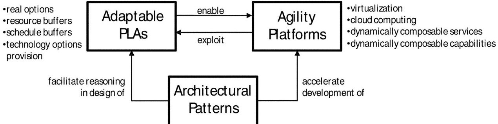
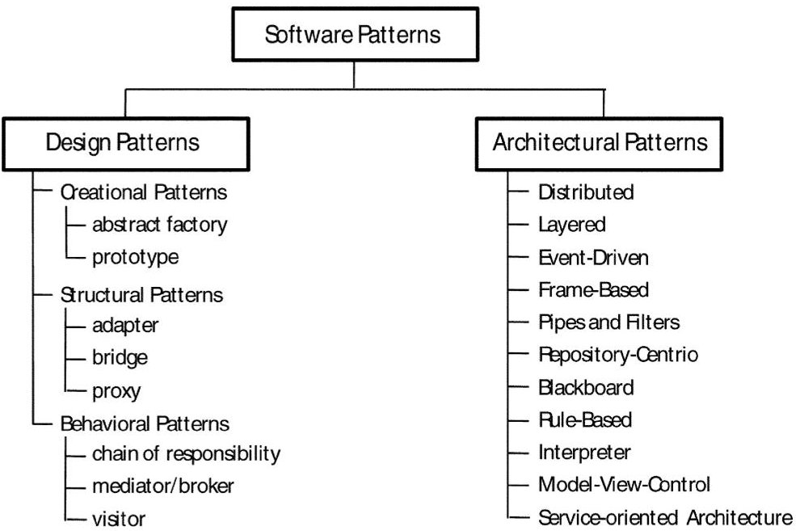

<!-- PDF_PAGE: 1 -->

# Adaptable Platform-Based Engineering: Key Enablers and Outlook for the Future

Azad M. Madni

Daniel J. Epstein Department of Industrial and Systems Engineering, Viterbi School of Engineering, University of Southern California, Los Angeles, CA 90089-0193

Received 28 February 2011; Revised 25 April 2011; Accepted 25 April 2011, after one or more revisions Published online 8 September 2011 in Wiley Online Library (wileyonlinelibrary.com). DOI 10.1002/sys.20197

## ABSTRACT

Platform-Based Engineering (PBE) is a cost-effective, risk-mitigated system development approach that employs a common structure from which high-quality derivative products can be developed rapidly. PBE is especially effective in decreasing development cost, risks, and lead times while increasing product quality. Appropriately scoped, platforms simplify and accelerate the development of families of systems for a particular problem domain. They encompass domain-specific components and services that reflect the commonalities of systems in the domain (which can be configured as reusable physical or informational components), and variabilities across the domain (which need to be individually developed to achieve a domain product line), along with interface conventions that ensure that they can plug-and-play with the domain infrastructure and common components. However, PBE has a potential downside. Locking into a platform strategy for the long term can severely limit an organization's ability to evolve a product. It is this recognition that spurred the development of the adaptable PBE paradigm. Adaptable PBE offers the customary benefits of PBE without compromising the long-term evolvability of the system. This paper presents the game changing technologies under the adaptable PBE rubric, and discusses the key concepts and advances needed to make adaptable PBE an enabler of evolvable systems. $ \textcircled{c} $ 2011 Wiley Periodicals, Inc. Syst Eng 15: 95-107, 2012

Key words: platform; Platform-Based Engineering; agility platform; product line architecture; architectural patterns; resilient systems

## 1. INTRODUCTION

## 1.1. The Changing Global Landscape

The superiority of U.S. organizations and forces in the 21st century depends to a large extent on the ability to design and build a new class of adaptable systems with great speed and

agility. This capability is especially crucial for military systems that are required to rapidly adapt to new contexts such as new missions, new threats, and changes in operational environment. With the nature of conflict being defined by irregular and hybrid warfare, and an adaptive adversary fully capable of exploiting asymmetry in combat, the DoD needs to once again reestablish battlespace advantage through technological superiority. To this end, the DoD needs to exploit innovative commercial product development practices to develop capabilities that achieve desired effects in a matter of months, not years [Lemnios, 2011].

The systems engineering challenge implied by this new global environment is formidable. To begin with, future sys-

<!-- PDF_PAGE: 2 -->

tems need to be interoperable with the other elements in mission capability packages and system of systems [Madni and Moini, 2007]. They need to operate with great speed and agility in dynamic adversarial environments to combat asymmetric, adaptable threats. In light of these requirements, systems engineering methods, processes, and tools need to be transformed to enable rapid, cost-effective development of adaptable systems, i.e., systems that can respond to both anticipated and unanticipated changes in the operational environment [Madni, 2008a, 2008b; Madni and Jackson, 2008].

The development of such systems needs to go well beyond eking out modest efficiencies through process improvement. Rather, what is needed are systems engineering "game-changers" that capitalize on both technological and methodological advances. These are the goals of DDR&E's new initiative called Systems 2020. Systems 2020 has identified four potentially game-changing research thrusts: model-based engineering (MBE), to eliminate extraneous iterations and rework through systematic exploitation of models; Platform-Based Engineering (PBE), to achieve rapid time-to-fielding through risk-mitigated, effective reuse of the platform and core assets; capability on demand (COD), to achieve rapid, cost-effective scale up and scale down primarily in hardware assets and manufacturing capability; and trusted systems design (TSD), to assure cost-effective introduction of security and privacy mechanisms into systems.

## 1.2. Platform-Based Engineering Paradigm

Platform-Based Engineering (PBE) is a cost-effective, riskmitigated system development approach that employs a common structure from which high-quality derivative products can be rapidly developed. Appropriately scoped, platforms can simplify and accelerate the development of families of systems for a particular problem domain. PBE is distinguished by two unique characteristics. First, the platforms are

reusable, configurable, and extensible system implementation infrastructures. These include physical platforms (e.g., aircraft, spacecraft) designed to support a variety of payloads for a range of missions, as well as information platforms (which provide a layered set of services for network management, operating system, data management, and mission support). Second, the platforms encompass domain-specific components and services that reflect the commonalities of systems in the domain (which can be configured as reusable physical or informational components), and variabilities across the domain (that need to be individually developed to achieve a domain product line), along with interface conventions that ensure that they can plug-and-play with the domain infrastructure and common components.

A platform comprises the common components, interfaces, and processes within a product family [Meyer and Lenherd, 1997; Dai and Scott, 2005; de Weck, 2005; Eppinger and Gulati, 1996]. The PBE paradigm is ubiquitous in both the defense and commercial sectors [Fujita et al., 1999; Geppert and Roessler, 2001; Gonzalez-Zugasti, Otto, and Baker, 2001; Hölttä-Otto and Otto, 2005; Jose and Tollenaere, 2005; Sanderson and Uzumeri, 1995]. Its benefits are well understood and well documented. Given a high expected production volume of a product family, developers share the learning curve for the design and manufacture of platform components among all variants. With this strategy, the cost of redesigning platform components for every variant is avoided, thereby leveraging capital expenses of production variants and the initial platform. Furthermore, strategic supplier agreements and alliances, which are characteristic of PBE, result in fast and reliable supply chains. Platform design enables product families with very similar functional characteristics to fully satisfy customers' needs, thereby expanding and reinventing markets that create a competitive advantage for the developer organizations [Kalligeros, 2006; Kalligeros and de Weck, 2004; Li and Azram, 2002; Martin and Ishii, 2002; Muffato,

## Table I. Pros and Cons of Platform-Based Design

<table border="1"><tr><td>Pros</td><td>-Common manufacturing processes, technology, knowledge transfer across organization and supply chain
-Reduction in manufacturing assets and tooling
-Cross-functional team simplifies product and process integration, and reduces risks
-Manufacturing organizations can delay“point of differentiation”which enables just-in-time production and faster reaction times to fluctuating demand
-Delayed differentiation in design is key to Toyota&#x27;s excellence in development time and quality[Ward et al.,1995]
-Lower design and production costs,higher productivity in new product development,shorter lead times,and increased manufacturing flexibility</td></tr><tr><td>Cons</td><td>-Locking into a platform strategy for the long-term can reduce an organization&#x27;s ability to evolve
-Initial cost of developing a platform is often much higher than the cost of creating a single product[Ulrich and Eppinger,1999]
-Greater technical risk because an error in platform design will permeate all variants
-Sharing a large number of components may reduce perceived differentiation between products in a family
-An organization&#x27;s risk exposure in the long-term can potentially increase
- production volume of variants may not produce sufficient savings to recoup development costs
- platform development cost has to be recouped from savings(variants produced,their production volume)
- uncertainty regarding future demand for variants increases platform development risks
-locked into platform&#x27;s technology,architecture,and supply chain(i.e.,sources of production cost reductions)</td></tr></table>

<!-- PDF_PAGE: 3 -->

1999; Robertson and Ulrich, 1998; Simpson and D'Souza, 2003; Simpson, Siddique, and Jiao, 2006; Sivaloganathan and Sahin, 1999]. Commercial organizations have realized speedup factors of 4 to 10 in development of new systems (developing fast) and adaptation time for fielded systems (flexibility), with concurrent improvements in assurance, reliability, and interoperability.

Like most development paradigms, PBE has its pros and cons (Table I). Even so, there are times when the pros outweigh the cons. When it comes to defense platforms, this is invariably the case. In today's competitive environment, however, customers want both standardization (i.e., stability) and flexibility [Simpson, 2004; Simpson and D'Souza, 2002]. While standardization is admittedly a great source of value, flexibility is almost a necessity in uncertain, competitive environments [Suh, de Weck, and Chang, 2007]. Standardization, in principle, can increase strategic flexibility by enabling developers to design and build reliable systems faster, use existing expertise to inexpensively enter new ventures/markets, and even exit projects retaining high salvage value (i.e., system or components can be used on other projects). However, excessive standardization can limit innovation and creativity by locking the platform/system into specific suppliers and technologies. And, of course, inflexible platforms cannot accommodate changing future requirements. Fortunately, flexible designs can be implemented through component and process standardization when multiple instances or variants of a system are involved. Thus, standardization in certain dimensions and flexibility in certain other dimensions can both be achieved in an adaptable platform-based solution. The key challenge to advancing the state-of-the-art in PBE is to develop platforms that can accommodate or evolve to satisfy the needs of changing mission goals, different mission profiles, and variable and uncertain operational environments. This problem and high payoff solution directions are the focus of this paper.

## 2. PBE PRACTICES AND TRENDS

The state-of-the-practice of PBE is best exemplified by the automobile platform [Madni, 2010a]. The bottom layer of the automobile "platform" is relatively fixed. The top layer can vary to create different models of an automobile. The key advantage of this approach is that it is usually less expensive to design a new car model based on an existing platform than it is to design the model from scratch. The relative ease of making changes is the result of the modularity and flexibility afforded by platform-based design. It is important to note that automobile platforms are examples of physical, energy-centered systems. Such platforms have only two layers, unlike information platforms that tend to have three or more layers [Moses, 2010].

nally envisioned based on prototype tests, and/or because common standards and policies were not enforced [Madni, 2010a]. A study conducted by MIT [Boas, 2008] showed that the decrease in commonality varied in the following three areas: mission systems and avionics, structural airframe, and aircraft utility systems. The area where local optimization/specialization led to the largest decrease in commonality was the airframe.

In the same vein, there is some evidence that the Joint Strike Fighter (JSF) program started out with a platform focus [Boas, 2008] with a high degree of commonality between the carrier (U.S. Navy), vertical-take-off (USMC), and longrange (USAF) versions of the same aircraft. Gradually the amount of commonality between the variants eroded because the variants turned out to be significantly different than origi-

Lockheed Martin implemented a successful platform strategy for its family of military transport aircraft. The series of Block Upgrades (major aircraft and avionics revisions), software and avionics (major subsystems) were expected to become common for Lockheed's three platforms, the C-130, C-5, and C-27. The common subsystems were to form the basis for a new airframe platform eventually replacing the C-130 [Madni, 2010a]. The new airframe platform was expected to be similar to today's aircraft in that it would be reconfigurable to fill a wide variety of different roles. Today's C-130 fills roles as diverse as Search and Rescue to Gunship applications, all leveraging a common airframe. A variety of software and weapons suites can be added to the airframe with cost impact ranging from low-end to high-end.

Today, PBE is being used in industries other than traditional product engineering [Madni, 2010a]. PBE approaches and platform-based product family designs are now being adopted in "nontraditional" sectors such as telecommunications, food and drug industries, and service systems (e.g., entertainment, tourism, banking). Initially, this expansion occurred when companies began marketing derivatives of existing products and services to fill existing and readily exploited niches, but future product development is expected to be conducted using product platform strategies. For example, Cingular Wireless has implemented a platform approach on both their pre-paid and "Take Charge" cellular plans.

Designing a product platform and corresponding family of products is a nontrivial proposition. It embodies all the challenges of product design with the added complexity of having to harmonize the design of multiple products in an effort to increase commonality across the set of products without compromising their distinctiveness and competitive advantage. Due to these difficulties, product family designs and PBE have been primarily conducted in ad hoc fashion. Research is needed to make PBE more rigorous from both methodological and technology exploitation perspectives. Some of the specific technical challenges that need to be overcome, especially for DoD platforms, are discussed next.

DoD platforms need a methodology-based approach capable of exploiting promising emerging technologies that have reached a level of maturity acceptable for inclusion in the platform. In this regard, model-based approaches hold great promise. These approaches can be used for product family designs with specific attributes (e.g., design for maintainability). They also facilitate architectural tradeoffs and sensitivity analyses along with error tracking. Model-based techniques enable statistical analysis and propagation of uncertainties. They also enable rigorous cost-benefit/analysis based on explicit representation of product models.

To appreciate these potential benefits of model-based approaches, requires putting PBE into perspective for DoD/military applications. The typical life time of a platform,

<!-- PDF_PAGE: 4 -->

especially a military platform, spans multiple product generations [Madni, 2010a]. Thus, one of the key challenges is to either develop the ability to "predict the future"—an unlikely proposition—or design platforms in a manner that accounts for both expected and unexpected changes down the line [Madni, 2010a]. The key questions that need to be answered in this regard include: Where to introduce flexibility in the platform? When to design a flexible platform and when to opt for a new platform? How to value the cost of flexibility? How to prepare for the introduction of new applications/modules, new product lines, and radically new technologies? What criteria to apply to determine when to initiate platform redesign before it loses competitive standing? How to define what goes into a platform for both traditional products and non-traditional applications? How diverse are the set of variants that can be derived from a common platform? How to exploit product line architectures without compromising platform agility? How to conduct multiple tradeoffs and manage complexity in platform design? Answering these questions is crucial to understanding how to institutionalize PBE and a more adaptable and flexible version of PBE within DoD.

Fortunately, these issues are being addressed by several leaders in academe and industry [Madni, 2010a]. Today, there are several platform conferences that provide a forum for interchange of ideas between industry and academia. Notable among these is the "First Platform Management for Continued Growth Companies" organized by the Institute for International Research (ISR) and the Product Development and Management Association (PDMA). Active industry researchers today include in IBM, Dupont, Intel, Lockheed Martin, Cingular Wireless, Harley Davidson, Argon Engineering, Playtex, Aventis Pasteur, Case-New Holland Global, and Innovation Focus.

## 3. ADAPTABLE PLATFORM-BASED ENGINEERING

## 3.1. Adaptable PBE Vision

Despite its manifest advantages, PBE can potentially "lock in" certain core assets, thereby limiting the useful life of the product family. Adaptable PBE is intended to overcome these limitations of PBE, i.e., the lack of evolvability of the platform to respond to changes in the future. The evolutionary paths for an adaptable PBE are based on: expected changes to concepts of operation (CONOPS); emergence of new technology; and repurposing of platform for new missions. Addressing platform evolvability in the abstract is not helpful in that the platform can potentially evolve in any number of ways. To overcome this dilemma, we need to be able to identify directions for potential evolution. To this end, we use the CONOPS and, more specifically, a family of diverse CONOPS to identify the invariant and the potentially evolving elements of the platform. For example, one of the pillars of adaptable PBE [Madni, 2010a] is adaptable product line architectures (PLAs). By relating the CONOPS and its variants to design characteristics of the adaptive PLAs, we can identify invariant components and components that we expect to evolve.

Adaptable PBE can be expected to preserve much of the benefits of PBE while incorporating sufficient flexibility for platform evolution to satisfy new CONOPS and exploit new technologies. Adaptable PBE, in essence, is an enabler of resilient systems in that an adaptable open platform is a means of achieving resilience. So, what are the principles underlying Adaptable PBE that give it the needed evolvability? These principles are discussed next.

First, CONOPS and their likely variations (i.e., CONOPS variants) are used to define the initial set of core assets of the platform as well as links to various platform parameters (e.g., product line architecture design features). Second, relevant, promising, immature technologies need to be identified and related to platform components and characteristics (e.g., PLA characteristics). Concurrently, provision needs to be made to revise the core assets of the platform (if needed) to increase platform flexibility, a prerequisite to evolvability. The provisions can be in the form of real options that are embedded in both the platform architecture (to be able to realize the needed evolution) and on the program [to ensure that the needed resources would become available were the option(s) to be exercised]. Third, CONOPS-platform combinations (patterns) need to be identified for different types of adaptability. In general, the invariant elements (i.e., core assets) in an Adaptable PBE can be expected to be less than for traditional PBE. The key innovations in Adaptable PBE are:

- Parameterized, configurable product line architectures with open interfaces to accommodate both anticipated and unanticipated changes

- Rapidly reconfigurable CONOPS architectures with integrated product-process representations that relate process segments explicitly to product line features

- Customizable tradeoffs analyses approaches and tools to rapidly locate robust product line-CONOPS combinations that meet mission needs.

Madni [2010a] defines the pillars of adaptable PBE as adaptable product line architectures, agility platforms, and architectural patterns. This combination of capabilities is both complementary and synergistic. Adaptable Product Line Architectures (APLAs) enable: (a) reduction of product development cycle time and cost by starting with and capitalizing on a "partial solution" provided by the platform; and (b) extend the useful life of the platform by building in mechanisms for product line adaptation and evolution. Agility Platforms (APs) potentially enable fast and cost-effective adaptation to change (e.g., exploit an emerging technology, adapt to changes in regulation, policy, or threat characteristics). Architectural Patterns support both APLAs and APs by accelerating their development through reuse of patterns and in so doing reduce downstream implementation risks. Figure 1 presents a conceptual representation of the synergy between these three game-changing concepts. These concepts and the required advances in each are discussed next.

## 3.2. From Product Line Architectures to Adaptable Product Line Architectures

Before discussing adaptable PLAs, it is worth reviewing PLAs and current practices within DoD. In essence, a product

<!-- PDF_PAGE: 5 -->

Figure 1. Vision for next generation adaptable PBEs.

line is a set of systems that share a common, managed set of features that satisfy the needs of a particular market segment or mission and that are developed from a common set of core assets in a prescribed way [McGreger et al., 2010; Mohan, Balasubramaniam, and Sugumaran, 2010; Babar, Chen, and Shull, 2010; Bosch, 2010; Jones and Northrop, 2010; Lee and Kotonya, 2010]. Product line methodologies consist of a robust set of practices that invariably result in increased performance, lower risk, and lower costs. In the commercial world, PLAs are used as frameworks for developing customer-specific applications in a particular domain. For example, all TV sets and mobile phones share some core set of capabilities, yet each model may have unique features. The PLA approach focuses on developing application families, rather than individual applications. From an economic perspective, the PLA investment pays off after a few systems (as few as four to six systems), but the savings accrued in the long run more than justify the initial investment. Not surprisingly, companies such as Nokia, Motorola, and HP have embraced this approach.

For the aforementioned reasons, product lines have the ability to satisfy key DoD objectives of fast, flexible, and adaptable systems. Moreover, product lines can result in highly dependable, interoperable, and reliable systems because components that are frequently reused are more likely to be robust. Second, specifications of how to correctly use product line components are a fundamental element of a PLA. A product line approach becomes a preferred approach when the intent is to build a family of systems [Lee and Kotonya, 2010]. The key metrics by which this approach can be compared to others is in terms of cost, time to delivery, elimination of duplicate work, and quality.

Product line thinking becomes appropriate for the military when one comes to the realization that very few military systems are truly unique. It is important to realize that military platforms can be physical, informational, or a combination of the two. The latter poses a unique set of challenges. These include: extending the PLA definitions and concepts from the world of software to the world of systems; creating a formal approach to PLA evaluation, including when to extend, evolve, or replace a PLA; developing a methodology based on product characteristics to include or exclude a product from a PLA. Beyond that, general methods, processes, and tools are needed for domain engineering and reengineering of legacy systems to become product-line-compatible. Perhaps the main game that needs to change in the DoD is the one

identified in megaprogramming of having empowered product line managers, who have the resources to invest in product line capabilities and the clout to get individual programmers to use them.

The current state-of-the-practice is widespread use of product line practices throughout the software industry [McGreger et al., 2010; Mohan, Balasubramaniam, and Sugumaran, 2010; Babar, Chen, and Shull, 2010; Bosch, 2010; Jones and Northrop, 2010; Lee and Kotonya, 2010]. A number of small, medium-sized, and large organizations have embraced the product line approach in lieu of the traditional, isolated, product-by-product approach to software development. In the commercial sector, the markets covered include medical equipment, aircraft avionics, automotive products, and financial analysis systems. Organizations in these sectors report substantial gains in productivity, quality, and customer satisfaction. None of the so-called technical challenges to product line adoption are show-stoppers. The biggest challenge is a management and organization challenge—the focus on short-term goals that compromises the pursuit of product line strategy.

The most spectacular platform in history is the Internet. The Internet is an example of platform linearization whereby computer systems are repurposed and morphed into a product line. Given the financial constraints imposed in today's fiscal climate, linearization needs to be a central theme of any PLA strategy, fixed or adaptable.

The state-of-the-art in PLAs is best exemplified by the adoption of PLA practices within the DoD. DoD organizations that have adopted the product line approach include: the U.S. Navy's PEO Integrated Warfare System; the National Reconnaissance Office; the Naval Undersea Warfare Center (NUWC), the U.S. Army's Technical Applications Program Office (TAPO); the U.S. Army's Live Training Transformation effort; the U.S. Navy's PEO for Submarine Warfare Federated Tactical System family of systems. One particular DoD project, OneSAF Product Line Architecture (PLA), bears some elaboration. The OneSAF Product Line Architecture provides tangible evidence in the real world to back up the projected impact of PLAs. OneSAF is the U.S. Army's next generation entity level simulation. As part of the acquisition and development of OneSAF, the U.S. Government used a task order acquisition plan. Under this plan, the government developed an initial Product Line Architecture Framework (PLAF) that was used to inform and guide the respective bidders for OneSAF Architecture and Integration

<!-- PDF_PAGE: 6 -->

(A&I) contract that was let in 2001. The successful A&I contractor is now responsible for the evolution and further development of the architecture.

The benefits of PLAs for PBE are:

—Reduced time to deployment: Cummins, Inc. reports that systems that used to take a year to complete now can be turned out in about a week [Clements and Northrop, 2003].

—Reduced cost: For example, products in the National Reconnaissance Office's Central Channel Toolkit product line cost approximately 10% of what they otherwise would have.

Increased productivity: For example, Cummins estimates that they are turning out 14 times the number of products than before, while using two-thirds the software resources.

Superior quality: Each system is the beneficiary of defect elimination in its predecessors; higher developer and customer confidence; the more complex the system, the greater the benefit of having pre-solved performance, security, and availability problems.

—Simplified training: Users conversant with working with one member of a product line can competently work with others.

—Reduced logistics tail: Fungibility of components reduces the number of spares required at the SoS level.

Increased competition: Product lines present an inherently horizontal market, whereby industries can flourish across application pillars. Reduced barriers to entry allow more vendors to compete.

—Superior leverage of human capital: Platform savings are, to a large extent, due to design reuse. This allows human capital to focus further up the value chain. This is a significant benefit as the US seeks to retain competitiveness both militarily and economically [Madni, 2010b].

However, today the DoD needs fast, flexible, and adaptable capabilities (and tools that enable the development of these capabilities) to succeed in unprecedented asymmetric conflicts during the conduct of irregular and hybrid warfare. In this regard, adaptive product line architectures go beyond product line architectures in that they specifically address the critical DoD need for long-lived systems that need to adapt and evolve in the operational environment [Madni, 2008a, 2008b]. Adaptable PLAs are a potential game-changer for advancing the state-of-the-art in PBE. The key distinguishing feature of adaptive product line architectures is the ability they afford to rapidly insert and "test-drive" new capabilities and evolve systems as part of a product line. Included in this thrust are: (a) architectural patterns, to facilitate automated reasoning about platforms to realize adaptive system behavior and seamless legacy integration; (b) principled first platform development approach, to overcome "the first generation dilemma"; (c) tradeoffs between design for change and costs, between reuse and flexibility, and between near-term performance and system evolvability; and (d) specification of common components that can accelerate development and support evolution.

The business case for adaptable PLAs becomes quite apparent when one recognizes that the benefit of PLAs comes at the expense of agility and product differentiation. Adaptable PLAs are intended to overcome this known drawback of PLA. The basic idea of adaptable PLAs is to anticipate likely changes in product requirements and either build in "change absorbers" (e.g., schedule and resource buffers used in critical chain planning) or build in adaptation mechanisms as part of the delivered system. Adaptation mechanisms can take a variety of forms depending on what the platform is adapting to and where they are being employed in the system life cycle. They span design time, build time, and run time. Design time adaptation means, for example, human-enabled adaptation of software as opposed to writing the software from scratch. Examples of such software are control system software and human-machine interface software. Run time adaptation means adaptation to conditions encountered in the operational environment (e.g., terrain, weather, enemy, battlespace characteristics).

For example, for a UAV system, the adaptation mechanisms are needed to adapt to different payloads, sensors, communication gear, and levels of autonomy as a function of mission requirements (e.g., endurance, range, altitude, atmospheric conditions). Thus, for example, platform adaptation to payload depends on what the payload is (e.g., reconnaissance suite, munitions, imagery gathering package). Adaptation mechanisms also come into play in netcentric services where new users of services and new information sources can be added on demand without having to bring the system down (i.e., discontinue system operations). Adaptation mechanisms also come into play as part of fault tolerance and error checking schemes.

As importantly, adaptable PLAs can enable technology substitution by implementing real options [De Neufville, 2003] at specific decision points in the product line life cycle. The latter serves to extend the useful life of the product line. Adaptable PLAs are responsive to DDR&E imperatives: (a) Accelerate delivery of technical capabilities to win the current fight; (b) prepare for an uncertain future; and (c) reduce the cost, acquisition time, and risk of major defense acquisition programs. They respond to the first imperative through reuse of the platform's core assets. They respond to the second imperative through extensibility and evolvability capabilities that enable preparation for an uncertain future. They respond to the third imperative through reusable core assets, standard interfaces, and extensible/evolvable capabilities to handle eventualities and exploit technology breakthroughs.

Adaptable PLAs offer a "bold, new way" as part of overall adaptable Platform-Based Engineering strategy to acquire and field systems. What is needed today is the ability to apply, evolve, and refactor Product Line Architectures to systems comprising hardware, software, and networked informational and physical system (e.g., ISR, weapons) and opportunistically exploit technology breakthroughs to extend the useful life of the product line and maintain product differentiation. The investment opportunity lies in extending Product Line from purely informational to hybrid systems (i.e., systems spanning informational and physical spaces) and making the product line architecture adaptable. The latter is key to extending the useful life of the product or system. Despite the

<!-- PDF_PAGE: 7 -->

promise of adaptable PLAs, one is wise to heed Machiavelli's refrain:

There is nothing more difficult to take in hand, more perilous to conduct, or more uncertain in its success, than to take the lead in the introduction of a new order of things.

## 3.3. Agility Platform

Recent technological advances (e.g., virtualization, cloud computing, architectural patterns, product line architectures) have provided an unprecedented opportunity to create an Agility Platform [Madni, 2008a, 2008b]. The key distinguishing feature of agility platforms is the ability to conduct tradeoffs between product line architecture and platform agility. Included in this thrust are: (a) composable functionality and flexible interfaces, to create netcentric mission capability packages; (b) architectural patterns to facilitate dynamic composition of capabilities and services; and (c) explicit adaptation mechanisms, to enable and support platform adaptability in the operational environment [Madni, 2008b; Salasin and Madni, 2007].

An Agility Platform is one that combines virtualization with cloud computing and is enabled by architectural patterns [Madni, 2010a]. Virtualization is the ability to run multiple operating systems on a single physical system and share the underlying hardware resources. Virtualization allows complete transparency of computing resources and locations. These characteristics make it a key building block for an Agility Platform. Cloud computing is the provisioning of services in a timely (near-instant) manner on demand, to allow rapid increase or reduction of resources, the key to platform scalability. These characteristics make cloud computing a key building block of an Agility Platform. In the commercial world, virtualization and cloud computing are mature technologies. Architectural patterns have shown great promise in software development and enterprise integration. They need to be scaled up to address system issues. Product line architectures have shown great promise in the commercial world and are being seriously examined for defense systems applications. The combination of these technologies in an Agility Platform can be a true game-changer for Platform-Based Engineering. The Agility Platform, so defined, subsumes hardware, software, and networked systems, which is the DoD's new expanded definition of the term "platform."

Virtualized platforms typically apply to IT systems, such as cloud computing. They also apply to systems-oriented architectures for heterogeneous databases. In the latter case, the disparate databases are mapped into a virtual database that can be exploited, indexed, and manipulated in a manner that given the appearance of single database with whatever virtual format the user, software, or human user desires. A virtualized platform can involve weapons, logistics, or any capability/service required by warfighters. Specifically, we contend that virtualization can be achieved in an even deeper and broader fashion than is achieved today in that we can view physical systems as being virtualized in the sense of providing services through netcentric systems. For example, in ISR one can extend systems-oriented architectures to include asset management on demand, whereby if the requested data is not

available in data archive, it is immediately requested from the integrated ISR architecture. Likewise, if it is stored but not exploited, the system can launch an exploitation routine. To users, the only difference among these options will be the latency that they experience. In this section, we address the Agility Platform from the virtualization and cloud computing perspectives.

Virtualization is based on the Virtual Server Concept. Virtual servers encapsulate the server software away from the hardware. The encapsulation includes the operating system, the applications, and the storage for the server. A virtual server can be serviced by one or more hosts, and one host may house more than one virtual server. Virtual servers are still referred to by their functionality (i.e., database server, e-mail server). In a properly architected environment, virtual servers remain unaffected upon the loss of a host. In fact, hosts can be removed and introduced almost at will to accommodate maintenance. Virtual servers scale easily. For example, if the resources supporting a virtual server are heavily taxed, then resources allocated to that virtual server can be adjusted. Server templates can be created in a virtual environment and then be used to create multiple, identical virtual servers. As importantly, virtual servers themselves can be migrated from one host to another seamlessly. The advantages of the virtual server concept are: resource pooling, high redundancy, high availability, rapidly deployability of new servers, ease of deployment, reconfigurability while services are running, and physical resource optimization by being able to do more with less. The drawbacks of the virtual server concept are: they are somewhat more difficult to conceptualize, and they are slightly more expensive in that the organization needs to purchase hardware, OS, applications, and the abstraction layer. Virtualization is now a well-established technology.

Cloud computing is one of the more promising technologies for Platform-Based Engineering. While there is no one single definition of cloud computing, for the purpose of this report, we use the definition from the National Institute of Standards and Technology [NIST, 2010]:

Cloud computing is a model for enabling convenient, on-demand network access to a shared pool of configurable computing resources (e.g., networks, servers, storage, applications, and services) that can be rapidly provisioned and released with minimal management effort or service provider interaction.

There are several reasons why cloud computing is gaining in popularity. Most noteworthy are the significant savings in capital investments that come about by switching to a cloud. Secondly, it is flexible, and scalable, whereby the customer can request additional storage or processing capacity, and they are instantly available. Lastly, cloud-based services are modeled as "pay-as-you-go"; hence, there are no upfront costs. Amazon and Google are the leading two providers of cloud computing services.

On the other hand, there is reluctance on the part of some organizations to embrace cloud computing. One of the reasons for lack of adoption by firms, concerns the privacy of data, which in a cloud is handled by third party firms. Perhaps as a consequence of this, firms and organizations have started

<!-- PDF_PAGE: 8 -->

developing their own private clouds. For example, the U.S. Army has stopped buying new servers, and is consolidating its existing infrastructure into data centers and clouds, virtualizing its servers, and is using applications developed for cloud by the Defense Information Systems Agency. Also, the Federal Government is recommending that all its agencies switch to a cloud-based platform for their information technology needs.

Cloud computing is complementary and synergistic with virtualization in that the organization does not have to own the hardware but can "rent" as needed from a cloud. It is important to realize that business agility is more than scalability; it is elasticity. It is the ability to rapidly scale up and scale back. Rather than relying on a server cluster, Eli Lilly rapidly changed its healthcare business by using Elastic Compute Cloud (EC2). With this technology, the organization can give back resources to the cloud when done. With cloud computing, various providers let the organization create virtual servers, and set up an account, perhaps just with a credit card. The organization can create virtual servers ("virtualization"). This process consists of: choosing the OS and software each virtual server "instance" will have; running the software on a larger server farm located elsewhere; instantiating more virtual servers on demand; and shutting down instances as needed in a matter of minutes. The providers then send the organization a bill for what the organization used. The dynamic property is best characterized as "capability on demand." To summarize, cloud computing reduces costs and is scalable, and concerns for privacy can be addressed by developing private clouds. Virtualization is key to transparency. Together they provide an unprecedented opportunity to create an Agility Platform.

It is important to realize that the concept of Agility Platforms [Madni, 2010a] and the attributes of virtualization evinced in cloud computing and systems-oriented architectures can also be applied to physical systems and services subject to certain constraints. Consider the context of tactical weapons usage in which a warfighter, in a direct action situation, is in need of fire support. In this case, the "cloud" is the entire aggregate of all weapons on all platforms available to the warfighter. The cloud may comprise aircraft carrying weapons on hardpoints or internal bomb bays, snipers, ERGM, or other artillery launchers from Navy vessels, Army units, and long-range missiles. In much the same way that an IT cloud has rules to determine which processors are available, a physical cloud can have rules that govern which "points" in the cloud are candidates for servicing a given request. As with traditional cloud computing, a key aspect of the solution is knowing/determining the extent to which resource allocation is going to be done in aggregate fashion, or in isolation (an example of the latter being memory-less greedy algorithm and variants). Note that physical virtualization requires netcentric connectivity of users and points of service. Loosely speaking, physical virtualization can be viewed as the dual of IT virtualization.

Cloud computing offers speed and flexibility while ensuring high availability. As such, cloud computing is the preferred choice for mobile interactive applications. Second, parallel batch processing times can be reduced by using clouds [Armbrust et al., 2009]. Third, clouds enable customers to use almost unlimited computational power; hence, it can be used for symbolic mathematics, which is very intensive. Cloud computing, when combined with virtualization, helps in achieving speed and flexibility objectives of PBE. The projected impact of the Agility Platform (i.e., virtualization-enabled cloud computing) within the PBE rubric is presented in Table II.

## Table II. Agility Platform Benefits

- TRANSPARENT

- total transparency (resources, locations,...)

- FAST, FLEXIBLE

- rapid, cost-effective scale up and scale down

- LOW COST

- LOW COST

- "pay for use" lowers cost

- ADAPTABLE

- seamless migration from one host to another

- readily extensible, cost-effective

There is ample evidence in the real world to substantiate these claims. Virtualization is offered by many companies including VMWare, Sun, and Microsoft. Cloud computing is being exploited by Forbes.com. In fact, Forbes is hosting its website in Amazon's Elastic Compute Cloud (EC2) and "paying for use" only, while letting Amazon worry about the hardware. Eli Lilly is also a user of EC2.

The current state of the practice is wide-scale adoption of virtualization and growing adoption of cloud computing in the real world (e.g., healthcare, finance). Research in these promising technology areas is not strictly restricted to academia, in that commercial companies such as Google, Microsoft, and Yahoo Research have made significant strides in this arena. Broadly speaking, research in cloud computing addresses four key improvement areas: availability and privacy of data, storage and organization of memory, operating systems and virtualization, and developing improved middleware for clouds. And, finally, cloud computing is gaining acceptance in diverse industrial sectors due to its speed and scalability. For example, The New York Times, Activision, ESPN, and NASDAQ all use cloud computing at different levels. Government organizations such as the U.S. Army and NASA [2010] are also users of cloud computing for certain specific tasks.

Despite the advances in virtualization and cloud computing, an Agility Platform does not exist. Combining virtualization with cloud computing to create an Agility Platform requires advances in how best to optimize and integrate these two promising technologies. In addition, there are several key advances needed in cloud computing. These include: enhancing trust of cloud applications; delivering user-centric personal clouds; and reducing the power consumption of clouds. This is where a real opportunity for investment lies for commercial organizations.

Finally, it is important to note that agility in a platform can only be achieved if the performing organization has the ability to innovate, modify designs, and quickly manufacture, assemble, and certify the platform.

<!-- PDF_PAGE: 9 -->

## 3.4. Architectural Patterns

Architectural patterns are solutions to specific software and hardware development problems within a particular domain that can be applied (with appropriate modifications) in many contexts. Architectural patterns are central to numerous aspects of software development, including security, usability, and adaptability. They provide an important foundation for architectural styles, reference architectures, middleware platforms, and application frameworks. Current state-of-the-art research in architectural patterns involves automatic detection of patterns in models and code, and automatic advice delivery pertaining to the use of a particular pattern.

Architecture patterns are most useful and effective when they align organizations and system components. For example, the benefits of architecture patterns are enhanced through standardized protocols, interfaces, languages, and models. Architecture patterns, if leveraged appropriately, provide the opportunity to uncover new ways to build platforms that are highly flexible, versatile, and adaptable. For example, PBE can potentially benefit from data mining tools that uncover latent patterns in architecture and find opportunities to reuse components and subsystems. The next few paragraphs discuss promising approaches for creating architectural pattern-based solutions.

New, revolutionary computing models based on social, biological, and economic systems (e.g., crystal growth, auction markets) have shown enormous promise as a basis for architectural patterns in the laboratory setting. These computing models have the potential to achieve unprecedented levels of scalability and dependability beyond models such as object-oriented, aspect-oriented, and component-oriented techniques. Systems that leverage revolutionary computing models are built using architectural patterns that mimic or emulate processes and structures found in nature and society. An example is the tile architectural style (architectural pattern), which is based on the tile assembly model of crystal growth.

To be effectively utilized by non-scientists for practical applications, platforms based on revolutionary computing models must be constructed so that engineers can specify, design, and implement systems using high-level, intuitive languages and assemble systems from reusable components and services.

The architectural pattern approach can be expected to produce systems faster, since less design time is needed. Secondarily, it will enhance flexibility, since there will be more capability in each of the subsystems by virtue of module reduction. The evidence that exists today in the real world to back up the projected impact (metrics) is limited to very confined problem sets, such as software. However, this is not a limitation of architectural patterns; rather, it means that patterns have not been scaled up to apply to systems.

Research in academia on architectural patterns centers around: detection of antipatterns, leveraging biologically, chemically, and socially inspired patterns, and using crystal growth and auction markets for creating highly resilient and autonomous systems [Madni and Jackson, 2008]. The theory behind pattern analysis in architectures is much like recommended systems, such as those used in Amazon.

Patterns for systems architecting are in the nascent stages. They are being discussed in the systems architecture community as a promising and important building block to systems architecting. For example, in TOGAF, patterns are viewed as a way of putting building blocks into context by, for example, describing a reusable solution to a problem [The Open Group, 2009]. Building blocks are what one uses, patterns tell one how to use them, when, why, and what tradeoffs need to be made. Pragmatically speaking, patterns can potentially help the system architect in identifying combinations of architectural building blocks that have yielded effective solutions in the past, and that can serve as the basis for effective solutions in the future.

Patterns for systems architecting can borrow and extend many of the concepts and terminology from software architecting (Fig. 2). Software architectural patterns can either

Figure 2. Exemplar Software Patterns (adapted from Booch [2007]).

<!-- PDF_PAGE: 10 -->

directly apply as system architectural patterns or can apply after reinterpretation of the pattern. An example of the former is model-view-control. An example of the latter is service-oriented architecture. SoA can be reinterpreted at the systems level as capabilities-oriented architecture where the "capabilities" can be delivered through hardware (i.e., physical) platforms or software.

Within the software community, a key challenge is discovering and codifying patterns for ultra-large-scale (ULS) systems and SoS. From a systems perspective, the current challenge is the transferability of patterns observed in software to the systems domain. In this regard, the patterns presented in Figure 2 should serve as a convenient starting point.

## 4. EXAMPLE OF AN ADAPTABLE PLATFORM

Today CONOPS development and platform architecting/design tend to be distinct activities with systems architects and engineers manually bridging the gap. Clearly, these two activities need to be brought together. In this regard, PBE construct can be extended to include CONOPS families that interface with a family of platforms to realize adaptable PBE solutions. A CONOPS family means a core CONOP and its variants collectively describing a set of mission profiles and a range of capabilities required to deal with current and emerging contingencies. A platform family means a parameterized product line architecture that can exploit new technologies and be expeditiously adapted to evolving customer needs. The integrated representation of a CONOPS family and a platform family in machine-interpretable, executable form is key to supporting trade studies and coevolving the CONOPS and platform system for plausible futures. These concepts are described next within the context of Unmanned Aerial Vehicles (UAV) and their ground control stations, a specific platform family. Currently, most UAV systems are designed for specific missions in specific environments. UAV flight software is often redesigned for each new vehicle, and sometimes for different missions or payloads on the same vehicle. Adapting an existing UAV design to a new set of mission profiles requiring different performance, endurance, connectivity, and/or information collection requirements often necessitates the design of an entirely new platform. This approach is clearly costly and requires that manufacturers and user organizations maintain open production and support lines for multiple UAV systems regardless of demand. It also results in long time to market and acquisition and deployment delays. Adaptable Platform Based Engineering can circumvent or overcome these problems as discussed next.

A handful of UAV architecture designs can be used to bootstrap the architecture of an adaptable UAV platform family that could be readily adapted to different mission profiles and scenarios. A parameterized product line architecture can be used to capture system commonalities while also expressing variabilities by differentiating physical characteristics, such as power plant, propulsion, airframe, fuel capacity, and endurance/range level, as well as hardware and software characteristics such as navigation, collision avoidance, flight control, remote command and control, communication, and telemetry. To achieve mission adaptability, the platform family would be reconfigurable, allowing for fieldconfigurable and/or -replaceable hardware components without introducing side effects. The software infrastructure would be capable of automatic detection, discovery, and reconfiguration, thereby allowing new hardware components to be integrated and extraneous ones removed dynamically. Dynamic reconfigurability is key to allowing a "live" system to recover from failures—a key resilience characteristic.

The platform architecture can be extended and generalized in specific ways and along specific directions. The intent would be to create a product line architecture (PLA) that is adaptable to selected CONOPS families representing distinct mission profiles, and resilient to contingencies such as loss of communication with ground station as well as changes in payload, communication, and sensing and telemetry requirements.

As seen from the foregoing, Adaptable PBE preserves much of the benefits of PBE while incorporating sufficient flexibility for platform evolution to satisfy new CONOPS and exploit new technologies. Adaptable PBE, in essence, is at the heart of engineering resilient systems in that an adaptable open platform is key to achieving resilience. So, what are the principles underlying Adaptable PBE that give it the needed evolvability? These principles are discussed next.

First, CONOPS and their likely variations (i.e., CONOPS variants) can be used to define the initial set of core assets of the platform as well as links to various platform parameters (e.g., product line architecture design features). Second, relevant, promising, immature technologies need to be identified and related to platform components and characteristics (e.g., PLA characteristics). Specifically, provision needs to be made to revise the core assets of the platform (if needed) to increase platform flexibility, a prerequisite to evolvability. These provisions can be in the form of real options [De Neufville, 2003] that are embedded in both the platform architecture (to be able to realize the needed evolution) and in the program plan [to ensure that the needed resources would become available were the option(s) to be exercised]. Third, patterns comprising CONOPS-platform combinations can be identified for different types of adaptability. In general, the invariant elements (i.e., core assets) in an adaptable PBE can be expected to be fewer than those for traditional PBE.

## 5. ADAPTABLE PBE RESEARCH THRUSTS

As a result of the pace of change in today's global competitive environment, both the defense and commercial sectors are once again looking toward technology game-changers to establish competitive advantage. For the DoD, competitive advantage means rapid and cost-effective development of adaptable systems. Systems 2020, a DoD initiative, identified PBE as one of four potential game-changers to achieve competitive advantage in system development and subsequent operation in dynamic changing environments [Madni, 2010a]. For PBE to become a true game-changer, the platform needs to be adaptable for long-lived operations, a DoD imperative. In response to this adaptability need, this paper has identified three critical research areas (i.e., adaptive product

<!-- PDF_PAGE: 11 -->

## Table III. Critical Research Areas for Adaptable PBEs

<table border="1"><tr><td>·Adaptive Product Line Architectures
- mechanisms for introducing real options to cost-effectively enable downstream introduction of new technology
- methodology for designing resource and schedule buffers to absorb changes in product line
- methodology for determining how far a product line can be adapted before it loses its value proposition and competitive advantage</td></tr><tr><td>·Agility Platforms
- methodology to analyze multiple tradeoffs impacting platform agility
- methodology to conduct tradeoffs between product line robustness (and scope) and platform agility</td></tr><tr><td>·Architectural Patterns
- scale proven software architectural patterns to systems
- specify integration patterns for hardware-software integration and human-system integration
- develop reasoning mechanisms based on system architectural patterns</td></tr></table>

line architectures, agility platforms, and architectural patterns) that collectively characterize Adaptable PBE. The specific research that needs to be conducted in each area is presented in Table III.

## 6. CONCLUSIONS AND FUTURE OUTLOOK

Competitive advantage in the future will depend to a large extent on the ability to design and build a new class of adaptable systems with great speed and agility. Adaptability is needed by the military to rapidly respond to new contexts (i.e., new missions, threats, operating environment) in months, not years. In today's irregular and hybrid warfare environment, battlespace advantage can be sustained primarily through accelerating the ability to field systems with the latest technologies and commercial product development practices. Platform-based engineering is one such technology that is key to achieving rapid fielding in a matter of months, not years.

While Platform-Based Engineering (PBE) addresses short-term risk mitigation (i.e., through standardization and product line architectures), PBE can potentially limit the ability of the system to evolve in the long term. It is the recognition that has spurred interest in "adaptable" Platform-Based Engineering. Adaptable PBE strives to achieve risk mitigation in the short term through component and process standardization and PLAs and in the long term through embedded adaptation mechanisms that ensure evolvability of the platform.

From a systems life cycle perspective, the major benefits of adaptable PBEs are increased system lifetime and substantial savings in development time and cost across a product line or family of platform-based systems. In particular, adaptable product line architectures, agility platforms, and architectural patterns have the potential of overcoming the limitations of the traditional PBE. Adaptable product line architectures can potentially extend the useful life of the product line by being able to exploit opportunities (e.g., new technology) and respond to unanticipated changes in the operational environment by providing capability on demand. Agility Platforms can enable rapid and cost-effective adaptation to changes in the operational and regulatory environment. Architectural patterns can potentially accelerate the response to change of

the product line during development, and the adaptation rate of the deployed platform in the operational environment. Individually, these thrusts can potentially transform how systems are developed, deployed, and evolved. Collectively, they can be the PBE "game-changer" needed for engineering adaptable systems in the 21st century.

Looking toward the future, there is a pressing need for methods, processes, and tools to engineer resilient systems. A resilient system is one that is designed and operated in a way that allows it to: (a) anticipate and circumvent disruptions; (b) absorb or adapt to changes (e.g., new technologies, new regulation); and (c) restore normal operations quickly after surviving disruptions. In other words, a resilient system exhibits anticipation (to circumvent disruptions), robustness (to absorb disruptive changes), and adaptability (to respond effectively to unanticipated change). From the foregoing characterization of resilience, it is clear that adaptability is a prerequisite to resilience, and that resilience is more than just adaptability. Adaptable PBE is a key enabler of resilience and especially well suited to engineering long-lived resilient systems.

## REFERENCES

M. Armbrust, A. Fox, R. Griffith, A.D. Joseph, R.H. Katz, A. Konwinski, G. Lee, D.A. Patterson, A. Rabkin, I. Stoica, and M. Zaharia, Above the clouds: A Berkeley view of cloud computing Technical Report UCB/EECS-2009-28, University of California, Berkeley, February 10, 2009.

M.A. Babar, L. Chen, and F. Shull, Managing variability in software product lines, IEEE Software 27(3) (May/June 2010), 89-91, 94.

R.C. Boas, Commonality in complex product families: Implications of divergence and lifecycle offsets, Ph.D. dissertation, Engineering Systems Division, Massachusetts Institute of Technology, Cambridge, MA, September 2008.

G. Booch, Architectural patterns for a competitive advantage, Center for Systems and Software Engineering, University of Southern California, Los Angeles, 2007.

J. Bosch, Toward compositional software product lines, IEEE Software 27(3) (May/June 2010), 29-34.

P. Clements and L. Northrop, Software product lines: Practices and patterns, Addison Wesley, Reading, MA, 2003.

<!-- PDF_PAGE: 12 -->

Z. Dai and M. Scott, Product platform design with consideration of uncertainty, SAE 5005 2005-01-0350, SAE International, Warrendale, PA, 2005.

R. De Neufville, Real options: Dealing with uncertainty in systems planning and design, Integrated Assess J 4(1) (2003), 26-34.

O. de Weck, "Product platform and product family design," Determining product platform extent, Springer, New York, 2005, Chap. 12, pp. 241-302.

S. Eppinger and R. Gulati, The coupling of product architecture and organizational structure decisions, MIT Sloan School of Management Working Paper No. 3906, Massachusetts Institute of Technology, Cambridge, MA, 1996.

K. Fujita et al., Product variety deployment and its optimization under modular architecture and module communalization, ASME Des Eng Tech Conf, Las Vegas, NV, 1999.

B. Geppert and F. Roessler, Combining product line engineering with options thinking, Proc PLEES01, Prod Line Eng Early Steps, Erfurt, Germany, 2001.

J. Gonzalez-Zugasti, K. Otto, and J. Baker, Assessing value in platformed product family design, Res Eng Des 13 (2001), 30-41.

K. Hölttä-Otto and K. Otto, "Product platform and product family design," Platform concept evaluation, Springer, New York, 2005 Chap. 4, pp. 49-72.

L.G. Jones and L.M. Northrop, Clearing the way for software product line success, IEEE Software 27(3) (May/June 2010) 22-28.

A. Jose and M. Tollenaere, Modular and platform methods for product family design: Literature analysis, J Intell Manuf 16 (2005), 371-390.

K. Kalligeros, Platforms and real options in large-scale engineering systems, Ph.D. Dissertation, Massachusetts Institute of Technology, Cambridge, MA, June 2006.

K. Kalligeros and O. de Weck, Flexible design of commercial systems under market uncertainty: Framework and application, 10th AIAA/ISSMO Multidisciplinary Anal Optim Conf, AIAA- 2004-4646, 2004.

J. Lee and G. Kotonya, Combining service orientation with product line engineering, IEEE Software 27(3) (May/June 2010), 35-41.

Z.J. Lemnios, DDR&E vision for Systems 2020, Department of Defense, Washington, DC, 2011.

H. Li and S. Azram, An approach for product line design selection under uncertainty and competition, J Mech Des 124 (2002), 385-392.

A.M. Madni, Agile systems architecting: Placing agility where it counts, Conf Syst Eng Res (CSER), 2008a.

A.M. Madni, AgileTecting $ ^{\mathrm{TM}} $ : A principled approach to introducing agility in systems engineering and product development enterprises, J Integrated Des Process Sci 12(4) (December 2008b).

A.M. Madni, Platform-based engineering: A pillar of systems 2020, USC Report, University of Southern California, Los Angeles, June 2010a.

A.M. Madni, Integrating humans with software and systems: Technical challenges and a research agenda, INCOSE J Syst Eng 13(3) (2010b).

A.M. Madni and S. Jackson, Towards a conceptual framework for resilience engineering, IEEE Syst J (Spec Iss Resilience Eng) (2008), Paper No. 132.

A.M. Madni and A. Moini, Viewing enterprises as Systems-of-Systems (SoS): Implications for SoS research, J Integrated Des Process Sci 11(2) (June 2007), 3-14.

M. Martin and K. Ishii, Design for variety: Developing standardized and modularized product platform architectures, Res Eng Des 13 (2002), 213-235.

J.D. McGreger, D. Muthig, K. Yoshimura, and P. Jensen, Successful software product line practices, IEEE Software 27(3) (May/June 2010), 16-21.

M. Meyer and A. Lehnerd, The power of product platforms, building value and cost leadership, The Free Press, New York, 1997.

K. Mohan, R. Balasubramaniam, and V. Sugumaran, Integrating software product line engineering and agile development, IEEE Software 27(3) (May/June 2010), 48-55.

Moses, J. "Architecting Engineering Systems," in Philosophy and Engineering, Springer Science, Chapter 23, pp. 275-284, 2010.

Muffato, V. "Introducing a platform strategy in product development," International Journal of Production Economics, 60(1):145-153, 1999.

NASA, http://www.informationweek.com/news/government/cloudsaas/showArticle.jhtm1?articleID=225200398&queryText=cloud%20computing, Houston, TX, accessed June 25, 2010.

National Institute of Standards and Technology (NIST) http://csrc.nist.gov/groups/SNS/cloud-computing/, Gaithersburg, MD, accessed June 24, 2010.

D. Robertson and K. Ulrich, Planning for product platforms, Sloan Management Rev 39(4) (1998), 19-31.

J. Salasin and A.M. Madni, Metrics for Service Oriented Architecture (SOA) systems: What developers should know, J Integrated Des Process Sci 11(2) (June 2007), 55-71.

S. Sanderson and M. Uzumeri, Managing product families: The case of the Sony Walkman, Res Policy 24(5) (1995), 761-782.

T. Simpson, Product Platform design and customization: status and promise, Artif Intell Eng Des Anal Manuf 18 (2004), 3-20.

T. Simpson and B. D'Souza, Assessing variable levels of platform commonality within a product family using a multi-objective genetice algorithm," 9th AIAA/ISSMO Symp Multidisciplinary Anal Optim, 2002.

T. Simpson and B. D'Souza, A genetic algorithm based method for product family design optimization, Eng Optim 35(1), 1-18.

T. Simpson, Z. Siddique, and J. Jiao (Editors), Product platform and product family design: Methods and applications, Springer, New York, 2006.

S. Sivaloganathan and T. Sahin, Design reuse: An overview, J Mech Eng 213 (1999), 641-654.

E.S. Suh, O.L. de Weck, and D. Chang, Flexible product platforms: framework and case study, Res Eng Des 18(2) (2007), 67-89.

The Open Group, Version 9 Enterprise Edition, The Open Group San Francisco, CA, February 2009.

K. Ulrich and S. Eppinger, Product design and development, 2nd edition, McGraw-Hill/Irwin, New York, 1999.

A. Ward, J.K. Liker, J.J. Cristiano, and D.K. Sobek, The second Toyota paradox: How delaying decisions can make better cars faster, Long Range Plan 28(4) (1995), 129-129.

<!-- PDF_PAGE: 13 -->

Azad Madni is a Professor in the Daniel J. Epstein Department of Industrial and Systems Engineering, University of Southern California, Los Angeles, and the Director of the multidisciplinary Systems Architecting and Engineering (SAE) Program in the Viterbi School of Engineering at the University of Southern California. He is also the founder, Chairman, and Chief Scientist of Intelligent Systems Technology, Inc., a high tech company specializing in modeling, simulation, and gaming technologies for education and training. He received his B.S., M.S., and Ph.D. degrees from the University of California at Los Angeles. His research has been sponsored by 34 different government research agencies including DARPA, DHS S&T, MDA, DTRA, ONR, AFOSR, AFRL, RDECOM, NIST, and NASA. He has received numerous awards from both the U.S. Government and the commercial sector. He received the 2011 Pioneer Award from the International Council of Systems Engineering. He is also the recipient of the 1999 National Tibbetts Award for California from the SBA, the 2000 Blue Chip Entrepreneurship Award from MassMutual and the U.S. Chamber of Commerce, and the C.V. Ramamoorthy Distinguished Scholar Award and President's Award from the Society of Design and Process Science. He is also a two-time winner of the Developer of the Year Award from the Technology Council of Southern California. He is a Fellow of IEEE, INCOSE, SDPS, IETE, and Associate Fellow of AIAA. Dr. Madni is Editor-in-Chief of the Journal for Integrated Design and Process Science, and serves on the Advisory Boards of the AutoSoft Journal, IEEE Systems Journal, and Human Factors and Ergonomics in Manufacturing and Service Industries Journal. He is listed in the major Who's Who including Marquis Who's Who in Science and Engineering, Who's Who in Industry and Finance, and Who's Who in America.