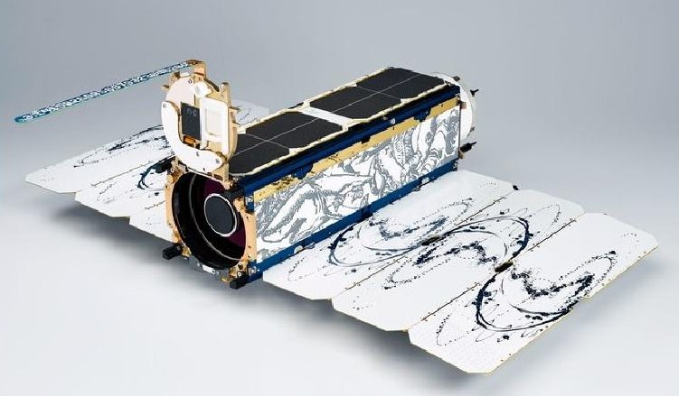
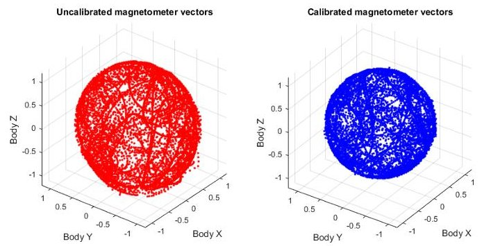
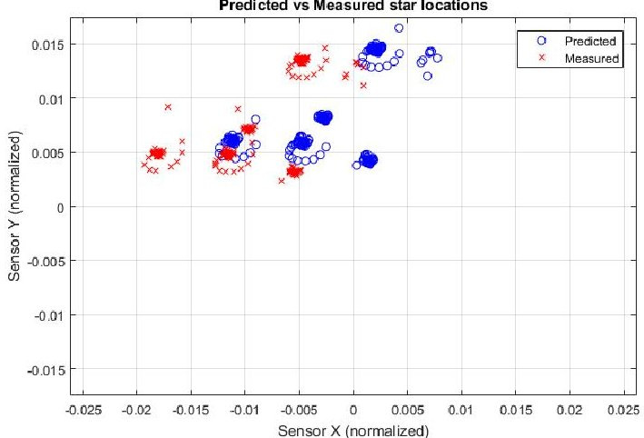
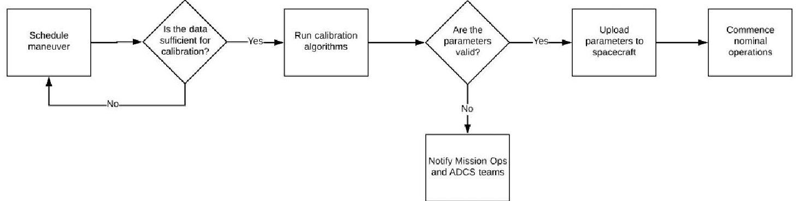
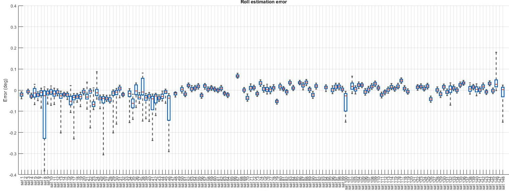
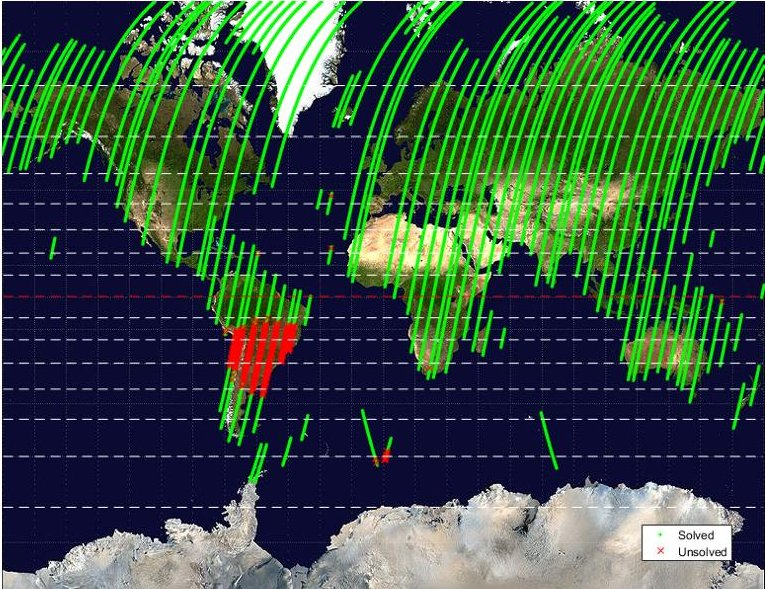

<!-- PDF_PAGE: 1 -->

# ADCS at Scale: Calibrating and Monitoring the Dove Constellation

Lawrence Leung, Vincent Beukelaers, Simone Chesi, Hyosang Yoon, Daniel S. Walker, Joshua Egbert Planet Labs Inc.

346 9th St, CA 94103; 650-529-4648

lawrence@planet.com

## ABSTRACT

The Attitude Determination and Control System (ADCS) is considered one of the most critical subsystems of a spacecraft, and must be carefully calibrated and monitored to ensure mission success. Many emerging small satellite missions feature large constellations, creating a need for new design philosophies and operational approaches to accommodate the management of many ADCS subsystems simultaneously. Planet currently operates approximately 190 Dove Cubesats for Earth Observation, with only a small team of ADCS engineers and satellite operators responsible for the performance of the entire constellation. Since Planet's first launches in 2013, on-orbit data and diverse experiences have contributed to the evolution of techniques and tools to support a fleet of this size. Today, Planet's ADCS engineers and operators rely on automated systems to enable on-orbit calibration, nominal operations, performance monitoring, and anomaly detection. The systems are intended to minimize the need for humans-in-the-loop, but where it is required they are designed to enable agile decision making. This paper shares techniques, insights and lessons learned from calibrating and monitoring ADCS subsystems at scale.

## INTRODUCTION

A noticeable trend in the last decade is the emergence of satellite missions featuring large constellations. Well-known recent examples include SpaceX's proposed 4000-plus satellite constellation and OneWeb's proposed 900-plus satellite constellation, both for space-based Internet. Earth-imaging constellations are typically smaller than those required for Internet but are still larger than (or at least on the same order of magnitude as) existing constellations such as those operated by Iridium or for GPS. Adding to the complexity, satellites are typically deployed in batches, sometimes to many orbits, and sometimes consisting of various hardware revisions. Regardless of the mission, the Attitude Determination and Control System (ADCS) is integral to payload operation and overall mission success, and must be treated accordingly.

In designing and operating large constellations, material and human resources can become constrained. To efficiently and effectively manage the ADCS subsystems on fleets of these sizes, focus must be placed on speed and agility throughout the spacecraft life-cycle. Pre-launch, this means automating and/or removing tasks where possible, and post-launch this means selecting and displaying information that enables quick decision making. As of June 2018, Planet operates

the world's largest satellite constellation and navigated these challenges as the fleet grew. Applying a rapid, capabilities-focused, automation-driven design philosophy, Planet built a system that allows a small team to manage a large number of spacecraft.

This paper opens with an overview of Planet's mission, the Dove spacecraft and ADCS subsystem, and approach to satellite operations. The rest of the paper is divided according to the three areas Planet's ADCS engineers believe are necessary for managing this subsystem at scale. The first is a description of an automated on-orbit calibration approach that replaces pre-launch calibration and is designed around frequent replenishment/launches. The second is a review of how ADCS engineers at Planet make decisions about subsystem performance quickly by monitoring product driven metrics before component level metrics. The third is a discussion of support functions that enable the calibration and monitoring activities.

## THE DOVE CONSTELLATION

## Mission Description

When Planet was founded in 2010, "Mission One" was defined as imaging the entire landmass of the Earth every day. From 2013 onward, Planet launched over

<!-- PDF_PAGE: 2 -->

280 Dove satellites (representing 13 design iterations) toward achieving this goal. While many of these satellites have decayed naturally from their LEO orbits, as of June 2018, Planet currently operates approximately $ 190^{*} $ Doves and successfully achieved Mission One in November 2017. $ ^{1,2} $ Planet is now working toward "Mission Two" - applying machine learning and analytics to imagery to enable users to query what is on the Earth and build customized information feeds - and will continue to launch satellites to replenish the constellation as capabilities improve with future Dove iterations.

## The Dove Spacecraft and ADCS Subsystem

The Dove, shown in Figure 1, is based on the 3U CubeSat platform. It primarily consists of an optical payload with a three-axis stabilized control system. The ADCS subsystem components are listed in Table 1. For attitude estimation the Dove uses magnetometers, coarse sun sensors, gyroscopes, a horizon sensor, and a star tracker. For attitude control the Dove uses a combination of magnetorquers and reaction wheels. Almost all of the ADCS subsystem and associated algorithms are internally developed, allowing for flexibility and transparency during system integration and operations.

As an Earth-observation platform, the Imaging Chain dictates the requirements of the Dove ADCS subsystem. The optical system is nadir-facing whenever the satellite is over land, and the constellation is distributed within an orbit such that it functions as a "line-scanner" for the Earth, where the swath width of one satellite just overlaps with the previous one at the equator. This configuration imposes requirements on the boresight pointing performance of the system to

Figure 1. The Dove spacecraft. Planet currently operates approximately 190 Doves to image the entire landmass of the Earth every day.

Table 1. Dove ADCS Subsystem components

<table border="1"><tr><td>Sensors</td><td>Magnetometers
Coarse sun sensors
Gyroscopes
Horizon sensor
Star tracker</td></tr><tr><td>Actuators</td><td>Magnetorquers
Reaction wheels</td></tr></table>

ensure optimal swath deconfliction. A Monolithic Charge-Coupled Device (CCD) sensor with multispectral filters captures images using Time Delay Integration (TDI). This necessitates yaw-steering to account for the ground velocity due to Earth's rotation and thereby imposes requirements on the yaw determination/control performance of the system as well as stability requirements to minimize motion blur.

## Satellite Operations at Planet

Planet's Mission Operations team is distributed between the US and European offices. This small team is responsible for maintaining the health of the entire Dove constellation, the scope of which includes commissioning, developing tools for anomaly detection/debugging, performing experiments, and upgrading on board software.

A "good" state of health indicates that a spacecraft is capable of carrying out its mission, but it is important to note that this does not necessarily provide information about how well a spacecraft is performing its mission. $ ^{3} $ Consider a simple example where a satellite consistently returns nominal telemetry values but telescope alignment is poorly calibrated, or conversely a satellite which occasionally exceeds telemetry limit thresholds but consistently returns blur-free imagery of an intended target.

Therefore, maintaining an appropriate balance between health and performance metrics is especially important when managing a large constellation. Planet's Mission Operations team works closely with subsystem teams. Aside from launch, Planet is vertically integrated from spacecraft design through delivering analytic products to customers, and this allows for efficient collaboration between teams. In the particular case of the ADCS system, Mission Operations maintains and reports on the health of the sensors and actuators, while the ADCS team is responsible for performance: that is, keeping the satellites wellcalibrated and making sure the overall pointing and stability metrics are met.

<!-- PDF_PAGE: 3 -->

## ADCS CALIBRATION AT SCALE

The calibration of all ADCS systems across the constellation is performed on-orbit. This section discusses the motivations behind the choice to calibrate each Dove in space versus on the ground, describes the maneuvers that are used, and details the method by which their execution and analysis is automated.

Table 2 lists the calibration parameters that are calculated for each Dove. There are other known sources of error in addition to those listed in the table, but it was found from ground testing and on-orbit data that these factors contributed the most to Dove performance.

## Motivation for On-Orbit Approach

The magnetometer calibration was performed on the ground for Planet's initial satellites with an engineer rotating the spacecraft in a constant magnetic field. While this was manageable for the individual satellites Dove 1 through 4, it proved less practical for Flock 1 (28 spacecraft), particularly because of the difficulties in providing a magnetically clean/consistent environment and challenges in handling integrated spacecraft. Additionally, it was known that the solar panel currents influence the magnetometer and it was difficult to capture those parameters in a ground-based environment.

The magnetometer is just a single example, but after the experiences with Flock 1 the ADCS team adopted the approach that parameter estimation across the desired components would be done on-orbit based on predefined maneuvers. This was chosen not only because it would save time when manufacturing/testing large numbers of spacecraft, but also because the team believed that calibrating in the true operating environment would yield better performance than calibrating in the lab if the maneuvers were carefully designed and repeatable over a spacecraft's lifetime.

To enable on-orbit calibration, proper instrumentation of the spacecraft is required. That is, it is important to identify early in the spacecraft design process which parameters are to be calibrated in space and ensure that appropriate sensors are included that have the resolution required for calibration.

Table 2. Dove calibration parameters

<table border="1"><tr><td>Component</td><td>Calibration</td></tr><tr><td>Magnetometers</td><td>Gain, offset, misalignment, solar panel fields</td></tr><tr><td>Sun sensors</td><td>Gain, misalignment</td></tr><tr><td>Gyroscopes</td><td>Temperature (Gain, offset)</td></tr><tr><td>Horizon sensor</td><td>Misalignment</td></tr><tr><td>Star tracker</td><td>Misalignment, optical distortion</td></tr></table>

## Maneuver and Algorithm Description

## Calibration Maneuver One

Two automated maneuvers are used to calibrate the Doves. They are performed in sequential order during commissioning, and repeated as necessary throughout each spacecraft's lifetime.

## Insights and Lessons Learned

A first calibration maneuver is used for estimating the magnetometer and sun sensor parameters. The spacecraft is induced into a random tumble state with the magnetorquers that persists across multiple sunlight/eclipse periods. This allows the Earth's magnetic field and sun vector to be swept through the spacecraft body frame. A well distributed set of calibration data covers most of the body-centered attitude sphere, as shown in Figure 2 (uncalibrated versus calibrated magnetometer data is shown). During the tumble, on board devices known to cause disturbances to the magnetometer are also switched on and off. By comparing the measured magnetic field and sun vector against the IGRF magnetic field, albedo, and sun models, it is possible to use least squares to provide an attitude-independent estimate of the calibration parameters. $ ^{4} $

For a single Dove, the maneuver has been found to provide consistent results across multiple calibration attempts. One of the important characteristics of this maneuver is the tumbling state. In a first iteration of the on-orbit calibration only nadir-facing pointing modes were used since this was the primary attitude during nominal operations. However, parameters determined from the nadir-facing attitude lead to poor

Figure 2. An example of a well distributed calibration data set. Uncalibrated vectors are shown on the left, calibrated vectors are shown on the right.

<!-- PDF_PAGE: 4 -->

determination accuracy in other attitudes, such as those used differential drag. $ ^{5} $ The suspected cause was overfitting of a data set that was not representative of all modes (that is, training data was capturing idiosyncrasies of the nadir-facing attitude such as sun reflections off the spacecraft body into the sun sensors).

When applying this maneuver across a constellation, one of the challenges for repeatability was that inducing a random tumble did not guarantee that sampled data points were well distributed in the spacecraft body frame. One possible approach to this would be to substitute the tumble with controlled pointing using reaction wheels to sweep the vectors as desired, however the body rates achievable with this method are limited by the maximum speed of the wheels and could lengthen the duration of the maneuver. Planet's approach to this was to check the distribution of the random tumble data and re-perform the maneuver if necessary, an approach that was possible because of an automated management system (discussed in more detail in a later section).

## Calibration Maneuver Two

A second calibration maneuver is used for estimation of the star tracker, horizon sensor, and gyroscope parameters. This maneuver takes place over a single eclipse period.

## Maneuver and Algorithm Description

The roll/pitch/yaw misalignments between the star tracker and the main telescope need to be calibrated to ensure boresight pointing accuracy. To do this, the main telescope payload is treated as a secondary star tracker while simultaneously operating the actual star tracker. The spacecraft is commanded to image a target star constellation with the main telescope (using an ECI-fixed attitude). The attitude reported by the uncalibrated star tracker is used to predict and compare the location of the target stars in the main telescope images, and using a time-series of images the misalignments are estimated that minimize the difference between predicted and estimated locations. This is shown graphically in Figure 3, which represents the main telescope CCD frame capturing a constellation of five stars. The blue circles are the estimated positions of the stars based on the attitude from the uncalibrated star tracker (an entire time-series is plotted, and the settling motion of the spacecraft is visible), and the red crosses are the measured positions. The algorithm chooses roll/pitch/yaw misalignments that aligns the circles and crosses.

Figure 3. Calibration of the misalignment between the main telescope and star tracker by comparing the predicted and measured postions of stars in the main telescope CCD images.

In order to calibrate the relative optical distortion present in the star tracker lens, a time-series of solved star tracker images is used. For each solved image, the attitude quaternion is used to calculate the difference between the captured stars' centroids (from the image) and the expected stars' centroids (from the star catalog). This effectively creates a "checkerboard" from which the centroid offset functions can be determined. There is some debate as to whether this calibration should performed on the ground or on-orbit. One advantage is that the calibration captures any impacts of vibrations from launch. One disadvantage of the described method is that using point sources such as stars it is not possible to achieve a true checkerboard covering the entire FOV that would be possible on the ground. This became a trade between precision and the need for additional ground test equipment/resources, and the Planet ADCS team determined that an on-orbit solution was sufficient for the system to satisfy performance requirements.

The roll/pitch/yaw misalignments between the horizon sensor and the main telescope must also be calibrated. As a practical matter, this is calculated after star tracker misalignment and so an equivalent calculation for the horizon sensor is to calculate its misalignment relative to the star tracker. The Dove horizon sensor reports the nadir vector and the calibration is comparable to that of the star tracker misalignment. The horizon sensor and star tracker are operated simultaneously while the spacecraft cycles between predetermined attitudes that re-orient the nadir vector in the horizon sensor FOV. The nadir vector reported by the star tracker (derived from the attitude quaternion) is compared with that reported by the horizon sensor, and misalignment parameters are estimated through least squares to minimize the difference between the vectors.

<!-- PDF_PAGE: 5 -->

The Dove uses MEMs gyroscopes, which are known to have temperature dependent biases. During the starpointing and horizon-pointing collections described above, the satellite is logging gyroscope rates but the satellite is cooling because the entire maneuver takes place over a single eclipse period. Logging the gyroscope temperatures and taking advantage of the fact that the star tracker is operating continuously during the maneuver, the derivative of the attitude solutions is used to provide a "true" rotation rate as reported by the star tracker. By comparing the rate measured by the gyroscopes to the true rotation rate it is possible to calculate the temperature biases of each axis of the gyroscopes. Applying this across the constellation, it was found that despite using the same component on every satellite each chip had different temperature gains and offsets.

## Insights and Lessons Learned

The star imaging approach was developed in response to some shortcomings of an earlier iteration of the calibration that relied on the Moon. This involved capturing multiple images of the moon centered in different parts of the CCD, then similar to the star imaging approach the attitude reported by the uncalibrated star tracker was used to predict and compare the location of the moon in the main telescope images with a Lunar ephemeris. This methodology was successfully applied to Flock 2e/2e' (32 spacecraft) and Flock 2p (12 spacecraft) but during the commissioning of the latter there was a New Moon and the calibration of these satellites had to be delayed. With a constellation of 12 spacecraft the overall delay was short in duration, but the launch following Flock 2p was Flock 3p (88 spacecraft) where the plan was to commission these satellites in serial batches over a period of 3 months. $ ^{6} $ Any delays to batches could significantly increase the overall commissioning duration and complicate planned work flows. By shifting to using star constellations instead of the Moon, the dependence on launch and commissioning schedule was removed.

Another shortcoming of the Moon calibration algorithm was that without a feature-extraction process for Lunar features only a single target vector was available (the center of the Moon), and this meant that the yaw misalignment was poorly constrained. Using star constellations removed this ambiguity because of the presence of multiple target vectors in a single image. All satellites that were calibrated using the Moon imaging method were subsequently recalibrated using the star imaging method and an improvement in estimation accuracy was observed.

There are several practical considerations when implementing a star imaging based calibration. The first thing to note is the requirement for multiple constellations analyzed and ready for use. Planet operates spacecraft in multiple orbits and launches throughout the year (with launch dates often moving), and so the visibility of any single star constellation is never guaranteed. The ADCS team maintains a list of suitable constellations and before each launch selects which is the most appropriate. Secondly, camera payloads typically have a small field of view (FOV) when compared to a traditional star tracker, therefore the chosen constellation should be wide enough to fill the FOV plus some margin because the ADCS system is uncalibrated when performing this maneuver. In the case of the Doves, the ADCS team adds error margin based on statistics from earlier Flocks comparing uncalibrated versus calibrated pointing performance, and uses this larger FOV as the requirement for star constellation selection. Additionally, the constellation must have a high enough density of stars such that multiple can be seen in the main telescope FOV at the same time. If a wide, dense constellation cannot be found, a suitable alternative is to target multiple points around the dense constellation to maximize the chance of imaging stars.

## Automation of Work Flows

The two maneuvers and associated data processing described in the previous section are implemented using an automated system known as Sequencer. $ ^{7} $ Sequencer is an evolution of partially automated procedures used to commission and calibrate the earlier Planet constellations, and has been a critical tool for the ADCS team to manage calibrations across the fleet. Its primary purpose is to reduce operator workload on the ADCS team for calibration, and in the context of commissioning its purpose is to reduce the time taken to produce output products for customers.

For the commissioning of Flocks 2e/2e' and 2p, the maneuvers were manually scheduled, the data was automatically downloaded but processed manually, and then parameters were uploaded to the spacecraft. The calibration of these constellations was handled by a single ADCS engineer and found to be manageable when there were no anomalies. However, as has been the case with every constellation launched by Planet, there are satellites with unique issues and/or maneuvers that need to be re-performed and the overall process could quickly become unwieldy. Sequencer was developed for the subsequent launch, and Flock 3p was the first to implement full automation of the cal-

<!-- PDF_PAGE: 6 -->

ibration process, $ ^{6} $ followed by Flock 2k (48 satellites). Using Sequencer, Planet was able to calibrate Flock 3p satellites at a rate of approximately one satellite per day with 75% of calibration activities proceeding without operator intervention, and Flock 2k at a rate of approximately two satellites every three days with 90% of calibration activities proceeding without operator intervention.

## Sequencer and State Machines

At a high level, Sequencer manages the scheduling of the maneuvers, running of the calibration algorithms, and uploading of parameters. It also automates some of the simple decision making that was historically managed by a person. At its core, it is a timer-based jobs system that treats the calibration workflow of each individual satellite as a state machine. Figure 4 is a block diagram with a simplified representation of the Sequencer process. The process is the same for both the first and second calibration maneuvers.

When a satellite enters the state machine as "ready for calibration", Sequencer will use the Planet Mission Control API to find a suitable time for the maneuver. It does this by applying a set of rules required for each maneuver, for example for the second maneuver it will look for a single eclipse period where there are no other activities scheduled (such as downlinking or imaging). Sequencer then schedules the maneuver and enters a waiting state where it will periodically check if telemetry has been downloaded for the requested time period.

Once the data has been downloaded, Sequencer proceeds to check the integrity of the data. This involves verifying the data against some simple rules set by the ADCS engineers to determine if the data is sufficient for the calibration algorithms. This includes

the aforementioned checking that data points are well distributed throughout the body frame, checking the overall number of data points is as expected, and checking the current draw on components that were supposed to turn on during the maneuver. If the data is deemed insufficient the Sequencer will automatically try to reschedule the maneuver. Additionally, if after waiting some period of time there is no data downloaded, Sequencer assumes the maneuver did not take place and reschedules the activity.

If the data is sufficient, Sequencer will run the calibration algorithms and then compare the output calibration parameters against another set of rules. This set of rules is determined by looking at distributions of the calibration parameters across other Doves. These rules are reviewed each time there are any significant design changes to the Dove that might impact the ADCS subsystem. If one or more calibration parameters deviates too far from the expected population, the Sequencer will exit out of the automated process and the ADCS team is notified. If the parameters are within family the parameters are uploaded to the satellites and they proceed to nominal operations (or sometimes to the commissioning of other subsystems). In this manner, the Mission Operations and ADCS teams are not notified unless there is a problem during calibration. During the commissioning of the large constellations Flock 3p and Flock 2k, this was found to reduce cognitive load on the engineers and allow them to focus on satellites that had anomalies.

One of the most useful features of Sequencer was the ability to "reinsert" a satellite to the automated process following a failure of the parameter checks. Historically most of these cases have been related to hardware peculiarities that lead to data which skewed

Figure 4. Calibration of the Doves occurs on orbit through two pre-defined maneuvers. Maneuver execution and data analysis is automated via a system known as Sequencer. Events and decisions are designed to remove the need for humans-in-the-loop, and Operators are only notified in the case of anomalies.

<!-- PDF_PAGE: 7 -->

the calibration results, and the course of action taken was simply to have an ADCS engineer verify the results before resuming Sequencer at the next event in the state machine. The ability to reinsert prevents unnecessary repeats of the calibration maneuvers, and this is important to prevent delays in commissioning because - even though the maneuvers are relatively short - when commissioning a large constellation scheduling/downlinking resources are scarce. During the calibration of Flock 3p and 2k, reattempts at maneuvers were found to add 2 to 3 days to the calibration duration for a single satellite, so Sequencer was redesigned to not reattempt unless deemed necessary.

## ADCS MONITORING AT SCALE

Aside from calibration, it is the responsibility of the ADCS team to monitor the estimation/control performance of the satellites to ensure that Imaging Chain specifications are met.

The ADCS team maintains both product driven metrics and component level metrics. Product driven metrics capture the performance of the ADCS system as a whole while imaging, while component level metrics include measures such as star tracker yield, and magnetometer/sun sensor errors. A key enabler for maintaining a large constellation has been to adopt the philosophy of using metrics derived from Planet's output products to infer the performance of the ADCS system rather than relying purely on component level metrics. The latter are typically only used when debugging is required.

The rationale is that an ADCS system should be robust to non-permanent component level anomalies, and therefore, by focusing attention on those satellites which are not meeting the product specifications, the team can more efficiently allocate resources and prioritize issues. An alternative way of stating the approach is: making sure that a satellite meets the overall imaging specifications takes priority over making sure a component on a satellite is in-family with the rest of the constellation.

## Product Driven Metrics

Table 3 lists the product driven metrics and how they are calculated. The target attitude comes from spacecraft telemetry, and is generated by the on board ADCS code based on the schedule and orbit parameters. The estimated attitude also comes from spacecraft telemetry, and is the output of the on board Extended Kalman filter. The "true" attitude is determined from the satellite imagery. When a scene is

downloaded, it is geo-referenced to actual coordinates via automatically detected ground control points and orthorectified using terrain digital elevation models (DEMs). Knowing the latitudes and longitudes of the corners of the rectified image, it is possible to combine this with orbit determination models (from both GPS and ranging data) to determine the true attitude of the spacecraft when the image was captured. With these three pieces of information the estimation, control and total error of the ADCS system are calculated and reported as roll/pitch/yaw errors in degrees. The stability is also calculated from the rectified images as the derivative of a time-series of vectors representing the center of the frame.

These metrics have advantages and disadvantages. The main advantage is that they provide a direct measure of how well the satellite is performing with respect to its primary mission since the priority of the ADCS team is to know if the system is meeting the imaging specifications. The metrics are compared against thresholds, which are derived from first principles based on the allowable number of pixels of blur. By breaking the error up into estimation and control components, debugging becomes easier because the focus can be directed toward sensors, actuators, or algorithms accordingly. Another advantage of being derived from the output product is that it enables simple performance comparison across satellites. This is particularly useful because constellations are deployed across multiple launches, and hardware configurations can vary or evolve such that it can be hard to compare satellites if only looking at component level metrics.

However, because the metrics are generated from imaging modes, they do not capture the performance during other modes such as downlinking or differential drag. These operational modes have their own metrics, but typically are not closely monitored because the requirements are much less stringent than while imaging. Another disadvantage of these metrics is that because they are based on rectification,

Table 3. ADCS Product Driven Metrics

<table border="1"><tr><td>Metric</td><td>Calculation</td></tr><tr><td>Estimation Error</td><td>Difference between true attitude and estimated attitude</td></tr><tr><td>Control Error</td><td>Difference between estimated attitude and target attitude</td></tr><tr><td>Total Error</td><td>Difference between true attitude and target attitude</td></tr><tr><td>Stability</td><td>Boresight“rate”</td></tr></table>

<!-- PDF_PAGE: 8 -->

if an image is not rectified, then no metrics are calculated. This means that some failure cases would not be captured by the metric. For example, an extreme circumstance where the satellite is performing so poorly that it is pointing above the horizon. It is important to recognize these edge cases and capture them in separate alarm systems in the product pipeline. The boresight "rate" calculation of stability has the disadvantage that is an low-passed measure of stability depending on the frame rate of the camera. This metric is only intended to capture large deviations in body rates as opposed to jitter introduced by the reaction wheels.

## Visualizing Product Driven Metrics

Monitoring of these metrics is done via a dashboard. When developing early versions of the dashboard, the team iterated on many dashboard designs to find the best "at-a-glance" measure of fleet-wide performance. For example, it wasn't clear whether it was best to report the median, mean, or some nth percentile of each metric for each satellite. The ADCS team eventually found boxplots to be the most useful, both for quickly discerning a satellite's individual performance, as well as a comparison to the rest of the fleet. On the dashboard a boxplot for every satellite is shown, with its metrics aggregated for some time period (typically 7 days, though the dashboard can be dynamically adjusted).

An illustrative example is shown in Figure 5. A single plot is shown here, but the ADCS dashboard has plots for each of the errors listed in Table 3. Each

boxplot corresponds to an individual satellite and are grouped by Flock. The featured dashboard covers the entire constellation and it is immediately obvious that one Flock is performing differently to the others. This snapshot was actually taken shortly after a new constellation had been through the automated commissioning process. This constellation had launched into a different orbit than prior Flocks and it turned out that some of the pre-launch attitude parameters were not valid for this orbit. This was quickly noticed by viewing the dashboard and, after adjusting operational parameters for the different orbit the metrics moved in line with the rest of the fleet.

In addition to detecting systemic issues, the dashboard also makes it easy to identify individual satellites that are not within family. Viewing the product driven metrics in this manner makes it simple to determine which satellites warrant deeper investigation of component level metrics.

## Component Level Metrics

Component level metrics are used when an individual satellite's performance needs to be debugged. These metrics are constantly under development as the team encounters new and recurring anomalies. Most of the development has focused on metrics for the sensors, although recently efforts have started to shift to developing actuator metrics as the constellation has been aging. As a general approach, the ADCS team tries to log data and calculate metrics before they are needed - the background collection of this information enables quicker root-cause analysis.

Figure 5. An example of Planet's fleet monitoring dashboards with product driven metrics. Product driven metrics combined with boxplots make it quick to discern a satellite's individual mission performance while also allowing comparison to the rest of the fleet. Here, it is clearly visible that the performance of the recently deployed Flock has less consistent performance.

<!-- PDF_PAGE: 9 -->

## Sensor Metrics

Regarding sensors, the star tracker is the primary sensor for the Dove ADCS system and oftentimes degraded performance can be traced back to this sensor. Aside from overall star camera solution yield, two of the most useful metrics for monitoring star tracker performance are 1) the number of lit pixels, and 2) the number of centroids. The number of lit pixels can be used to differentiate between stray light or obstruction issues, and the number of centroids can be used to infer whether the solutions were impacted by spacecraft motion. This information is logged for every star image, parsed into a telemetry database, and then available for visualization at any time after downlink. There is also evidence to suggest that the star tracker performance varies with temperature, and a proposed metric is the number of pixels per star as a proxy for change in focus, though this has yet to be automated.

The Dove also uses the sun sensors and magnetometer for attitude estimation. Using the true attitude from the rectified images, it is possible to use Sun and magnetic field models to estimate the Sun and magnetic field vectors in the body frame and compare these to the measured Sun and magnetic field vectors. Again, these metrics are computed in the background for every image captured and have been a useful resource for measuring the change in performance of these components over time, particularly differentiating between seasonal variations and true degradation. These metrics also serve as a means of determining when the sensors may need recalibration.

## Actuator Metrics

Regarding actuators, an experiment is performed each month where the gyroscopes are logged at high rate while actuating the wheels at various speeds. Abnormally high or noisy gyroscope rates can be an indicator of potential mechanical wheel issues, and preemptive actions can be taken to prolong reaction wheel lifetime. At the present time, this experiment is manually scheduled by an operator and the data analyzed by either the Mission Operations or ADCS team. This is a perfect example of a recurring activity that could be automated by Sequencer and metrics automatically calculated.

## Visualizing Component Level Metrics

The ADCS team does not use a dashboard for component level metrics due to the volume of data, and also because they are mainly used when debugging rather than continuous monitoring. Typically, the metrics

are visualized as a time-series, which is useful for analyzing individual imaging collection periods and also long term trending. The ADCS team has found that another powerful visualization is to view the metrics as a function of the orbit parameters. Specifically in the case of the Earth observation mission, an insightful visualization is to plot the metrics as a function of latitude and longitude. Early in the star tracker development phase, this visualization allowed the team to realize that solution yield was being impacted by Earth's radiation belts, and to implement fixes accordingly. This is illustrated in Figure 6 where the South Atlantic Anomaly is clearly highlighted as a region where the star camera has trouble solving images. For the sun sensors, this allowed the team to gain insight into the performance of this sensor under different seasonal albedo conditions.

## SUPPORTING OPERATIONS AT SCALE

All the calibration and monitoring activities described in the previous sections are intended to make it quick to get a satellite to nominal operations, identify problem satellites, and take corrective action. Efficient anomaly resolution is already important when operating a single satellite, but is critical for constellations to avoid overwhelming resources. Focus is placed on agility through automation: human-in-the-loop analysis should only be used where absolutely necessary. The Planet ADCS team has iterated on its approach a number of times and believes there are a few pieces of supporting infrastructure that are required to make this possible.

Figure 6. Visualization of star tracker yield as a function of lat/lon for an individual satellite. In this example it is easy to see that the region of low yield is geographically constrained to the South Atlantic Anomaly, rather than a systemic issue with the star tracker.

<!-- PDF_PAGE: 10 -->

## Bias Toward Automation

The nature of operating a constellation often means that a procedure is rarely run just once. Regardless if the issue is hardware or software related, it is unlikely that only a single satellite is impacted. With that understanding, development of any tools within the spacecraft teams usually leans towards automation from the beginning. This mentality applies from early-design validation scripts to on-orbit anomaly resolution. Automation has already been highlighted as a central theme of the ADCS calibration and monitoring approaches. For anomaly resolution, the first time an anomaly is encountered satellite operators are heavily involved, but the general procedure is to perform detailed post-mortems and from those derive procedures that can be automated to minimize spacecraft downtime. An example of this on the Doves is the handling of failed reaction wheels. Traditionally this was a manual process that could take days between detection and resolution that involved Mission Operations and ADCS teams. However, because the resolution process is almost identical every time, it was converted into an automated detection/resolution process that reduced downtime to less than 30 minutes. Another advantage of Sequencer is that calibrations can be easily be performed again at any time for any number of satellites; such as repeating the first calibration maneuver as the sun sensors degrade, as well as repeating the second calibration maneuver as improvements are made to the main telescope image timing. More broadly, an automated general-purpose system that is capable of a) carrying out an activity in space, b) running scripted analysis on the output data, and c) doing this for n number of satellites, is very valuable and extensible to many spacecraft activities outside of calibration.

## Data Retrieval Services

The previous section detailed metrics used for performance monitoring, but an important upstream capability to enable this is the provision of data retrieval services. Once Dove telemetry is downlinked or a metric is computed, it is uploaded to one of Planet's multiple cloud services. The ADCS team relies heavily on a series of APIs that allow for the retrieval of data. Even though there are multiple services for fetching different types of data - such as telemetry, orbit determination, satellite activity timelines, and image metadata - Planet generally maintains a standardized set of parameters for retrieving data across all services, namely a satellite hardware ID, a requested start time, and a requested end time. There are also additional search parameters such as Activity

IDs, which are assigned to each imaging, downlink, or experiment activity. When operating at scale, analysis is often performed for many satellites at a time, and so the services should be designed to support heavy request loads. Additionally, there is value in APIs providing machine readable formats to simplify importing into analysis tools. There are cases where Dove subsystems output logs that are designed to be human readable. Making these machine readable requires maintenance of an additional log-parsing layer between the downlink and ingestion of the data, a sufficient solution but one that is brittle to changes in logging outputs. This is better addressed at the spacecraft level by modifying the data generation, and is a process that is underway within the wider Planet spacecraft design team.

## Record Keeping and Configuration Management

Like any organization that needs to keep track of many assets, detailed record keeping is invaluable. For tracking the Dove constellation, one of the challenges was configuration management as the hardware iterations evolved and as events took place on orbit over time. The system used for this does not need to be overly complicated; at Planet the ADCS team maintains a single document that lists the current on-orbit status of each satellite's ADCS subsystem. This includes links to manufacturing records, commissioning activities, any software modifications or operational workarounds that have been applied, and any hardware issues. This document only serves as an index of the current status, and details are maintained in other places. For example, on-orbit hardware and software issues are addressed via a ticketing system and all debugging efforts are thoroughly documented in the tickets while only links are provided in the master ADCS document.

Manufacturing records have also proven to be a great resource for debugging on orbit. Each of the Doves goes through a suite of both automated and manual tests during the manufacturing process and comprehensive records are kept at every stage. Small details captured during testing, such as recording software versions, time-stamping of test runs, and capturing close up photos, have been used on multiple occasions to explain behavior on-orbit. It is recommended to capture as much detail as possible during the manufacturing process; the cost of storage is low and much of the work can be automated via software. This data collection is particularly important with early design iterations where detailed documentation is often an afterthought.

<!-- PDF_PAGE: 11 -->

## CONCLUSION

The ADCS subsystem is integral to the success of a spacecraft carrying out its mission. Calibrating and monitoring this subsystem across a large constellation is challenging, particularly due to the complexities introduced by distributed launches and multiple hardware revisions. Furthermore, as constellations grow in size, both human and material resources can become constrained and need to be allocated appropriately.

Through its experience building and operating the Mission One constellation, Planet has iterated on an system to allow a small Mission Operations and ADCS design team to ensure that imaging specifications are met. Pre-launch calibrations are moved to post-launch operations, using automated maneuvers and processing. Spacecraft performance is monitored through simple visualizations, firstly of product driven metrics, followed by component level metrics. Both these activities are supported by a general bias toward automation and the availability of data retrieval services. All the services are intended to minimize the need for humans-in-the-loop, but where it is required the systems are designed to enable agile decision making. Planet will continue with this mentality as it continues to iterate on the Dove and replenish the constellation.

## $ \textcircled{c} $ 2018 Planet Labs Inc. All rights reserved

## References

$ ^{1} $ Marshall, W. (2017, Nov 9). Mission 1 Complete! [blog post]. Retrieved from: https://www.planet.com/pulse/mission-1/

$ ^{2} $Beukelaers, V., Howard, B., Mason, J., Safyan, M., Doan, D., Perera, J. (2018). Completing Mission 1: Imaging Everywhere, Every Day, Proceedings of the 4S Symposium Small Satellites Systems and Services, 28 May - 1 June 2018, Sorrento, Italy.

$ ^{3} $Leung, L. (2012). Performance Analysis and Behaviour Estimation of Satellites Using Telemetry Data (unpublished undergraduate thesis). University of New South Wales, Sydney, Australia

$ ^{4} $Springmann, J. and Cutler, J. (2012) Attitude-Independent Magnetometer Calibration with Time-Varying Bias, Journal of Guidance, Control, and Dynamics, Vol. 35, No. 4, pp. 1080- 1088.

$ ^{5} $ Foster, C., Mason, J., Vittaldev, V., Leung, L., Beukelaers, V., Stepan, L., Zimmerman, R. (2018). Constellation Phasing with Differential Drag on Planet Labs Satellites, Journal of Spacecraft and Rockets, Vol. 55, No. 2, pp. 473-483.

$ ^{6} $ Zimmerman, R., Doan, D., Leung, L., Mason, J., Parsons, N., Shahid, K., (2017). Commissioning the World's Largest Satellite Constellation, Proceedings of the AIAA/USU Conference on Small Satellites, Year In Review, SSC17-X-03. https://digitalcommons.usu.edu/smallsat/2017/all2017/138/.

$ ^{7} $Parsons, N. (2017, Dec). Operator Sanity via Automation. Presentation at the 10th Workshop on Spacecraft Flight Software, Laurel, MD.

