<!-- PDF_PAGE: 1 -->

# ADCS Interface Control Document

Document Version 3.0

Status Release

Date 18 June 2014

Author(s) Lourens Visagie

Version history

<table border="1"><tr><td>Version</td><td>Status</td><td>Date</td><td>Comments</td></tr><tr><td>0.1</td><td>Draft</td><td>13 March 2013</td><td>Initial version</td></tr><tr><td>1.0</td><td>-Draft</td><td>8 April 2013</td><td>After PDR</td></tr><tr><td>1.1</td><td>1strelease-PDR</td><td>1 July 2013</td><td>Implemented PDR feedback</td></tr><tr><td>2.0</td><td>Draft</td><td>20 Oct 2013</td><td>Updated for CDR</td></tr><tr><td>2.1</td><td>Draft</td><td>11 November 2013</td><td>Implemented CDR changes</td></tr><tr><td>2.2</td><td>2ndrelease-CDR</td><td>18 November 2013</td><td>Updated GPS power switch implementation</td></tr><tr><td>3.0</td><td>3rdrelease</td><td>18 June 2014</td><td>Updated drawing dimensions (stack height)</td></tr></table>

Approval for Release

<table border="1"><tr><td>Name</td><td></td><td>Date</td><td>Signature</td></tr><tr><td>Vaios Lappas</td><td>Manager-SSC</td><td></td><td></td></tr><tr><td>Herman Steyn</td><td>Manager-ESL</td><td></td><td></td></tr><tr><td>Lourens Visagie</td><td>ADCS Engineer</td><td></td><td></td></tr></table>

<!-- PDF_PAGE: 2 -->

## Table of Contents

Reference documents ... 1

List of acronyms ... 1

1 Introduction ... 2

2 Functional description ... 2

2.1 Body axes definition and sensor/actuator mounting ... 3

2.2 Control modes ... 4

2.3 ADCS control loop ... 6

2.4 GPS receiver interface ... 6

3 Electrical interface ... 6

3.1 Power ... 7

3.1.1 Power use ... 7

3.2 Communication ... 8

3.2.1 I2C pull-up resistors ... 8

3.3 Logging ... 8

4 Mechanical interface ... 8

4.1 PC104 Component stack ... 8

4.2 External magnetometer ... 9

4.3 Coarse Sun Sensors ... 11

4.4 Mass ... 12

4.5 Inertia moments and Centre-of-mass ... 12

5 Command interface ... 12

6 Specifications ... 12

6.1 Sensor specifications ... 13

6.2 Actuator specifications ... 14

7 Handling ... 14

<!-- PDF_PAGE: 3 -->

## Reference documents

<table border="1"><tr><td>[R01]</td><td>QB50 System Requirements and Recommendations- Issue 5-11 October 2013</td></tr><tr><td>[R02]</td><td>INMS Requirements Compliancy Table-20130614</td></tr><tr><td>[R03]</td><td>FIPEX Requirements Compliancy Table-20130619</td></tr><tr><td>[R04]</td><td>MNLP Requirements Compliancy Table-20130614</td></tr><tr><td>[R05]</td><td>QB50 ADCS Reference Manual-v1.0-28 March 2014</td></tr><tr><td></td><td></td></tr><tr><td></td><td></td></tr><tr><td></td><td></td></tr></table>

## List of acronyms

<table border="1"><tr><td>ACP</td><td>Attitude Control Processor</td></tr><tr><td>ADCS</td><td>Attitude Determination and Control Sub-system</td></tr><tr><td>bpp</td><td>Bits Per Pixel</td></tr><tr><td>CSS</td><td>Coarse Sun Sensor</td></tr><tr><td>EKF</td><td>Extended Kalman Filter</td></tr><tr><td>FOV</td><td>Field of view</td></tr><tr><td>ICD</td><td>Interface Control Document</td></tr><tr><td>H-wheel</td><td>Momentum wheel</td></tr><tr><td>OBC</td><td>On-board Computer</td></tr><tr><td>OBDH</td><td>On-board Data Handling</td></tr><tr><td>TBC</td><td>To Be Confirmed</td></tr><tr><td>TBD</td><td>To Be Determined</td></tr><tr><td>TC</td><td>Telecommand</td></tr><tr><td>TLE</td><td>Two-line Element set</td></tr><tr><td>TLM</td><td>Telemetry</td></tr></table>

<!-- PDF_PAGE: 4 -->

## 1 Introduction

The QB50 ADCS will provide attitude sensing and control capabilities to 2U CubeSats in order to meet the QB50 system requirements [R01] and science unit requirements [R02], [R03], [R04]. The QB50 mission will carry a number of 2U CubeSats, each fitted with a Science Unit - a payload that gathers atmospheric data in the lower thermosphere. CubeSats in the QB50 constellation require attitude control in order to

1. Minimize the influence of drag - The orbital life of a satellite will be prolonged if the effect of drag is minimized. This will allow for more atmospheric data to be gathered

2. Ensure science payloads point towards the ram direction

The most stringent attitude requirements on the QB50 mission relate to the INMS Science Unit [R02]. The CubeSats carrying this sensor shall have an attitude control with pointing accuracy of $ \pm 1 0^{\circ} $ and pointing knowledge of $ \pm 2^{\circ} $ from its initial launch altitude down to at least 200km. In addition, CubeSats shall be able to recover from tip-off rates of up to 10 degrees/second within 2 days [R01].

The attitude determination and control sub-system described in this ICD is tailored to meet the QB50 system requirements.

## 2 Functional description

The QB50 ADCS will make use of a combination of magnetometer, sun and nadir sensor measurements and a MEMS rate sensor to estimate the current attitude. It will use magnetorquers and a single reaction wheel, operating as a momentum wheel, to stabilize and control the attitude of the satellite.

The integrated ADCS functionality is provided by three PC104 sized boards:

<table border="1"><tr><td>CubeControl</td><td>The CubeControl board interfaces to most of the sensors and the actuators. The momentum wheel, two of the torquer rods, optional GPS receiver and the sun and nadir sensor cameras are mounted on this board to provide a compact volume. This board will also interface to the external magnetometer and coarse sun sensors(CSS).</td></tr><tr><td>CubeSense</td><td>CubeSense is a combined sun and nadir sensor.The processing unit is a PC104 sized board and it interfaces to two CMOS cameras- one functioning as a sun sensor and the other functioning as a nadir/horizon sensor.The cameras use wide field-of-view optics(180°)and the sun sensor has a neutral density filter to allow only sunlight onto the detector.</td></tr><tr><td>CubeComputer</td><td>CubeComputer is a generic CubeSat OBC.In this application it will serve as the attitude control processor.</td></tr></table>

<!-- PDF_PAGE: 5 -->

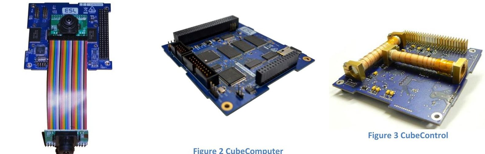

Figure 1 CubeSense sun and nadir sensor

Figure 2 CubeComputer

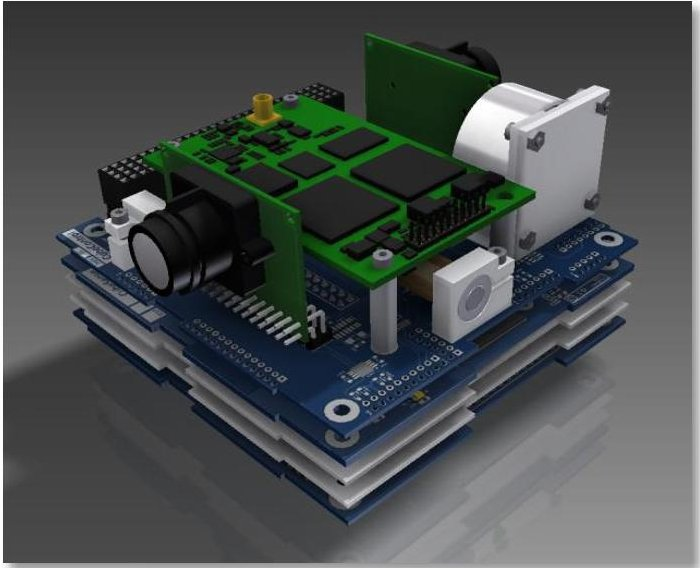

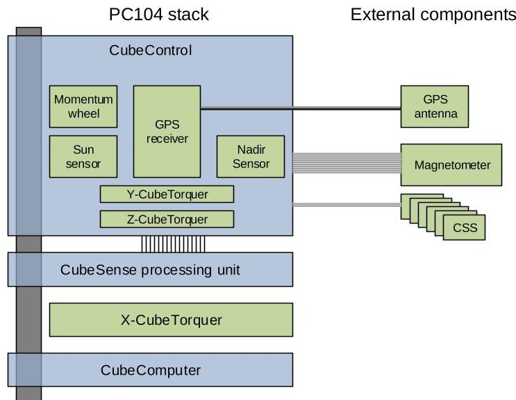

Figure 5 QB50 ADCS block diagram

Figure 4 QB50 ADCS component stack

Although the components can be used individually depending on the specific functionality requirement, this ICD will describe the integrated system and its interfaces.

## 2.1 Body axes definition and sensor/actuator mounting

The coordinate system definition used by the ADCS is shown below. When the ADCS is controlling the attitude to zero roll, pitch and yaw, the ADCS coordinate system will coincide with the orbit coordinate system.

<!-- PDF_PAGE: 6 -->

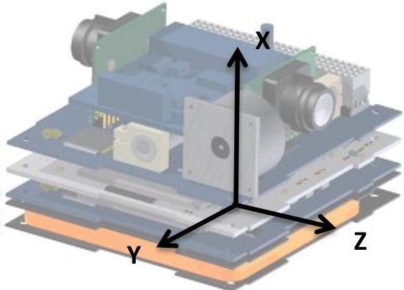

Figure 6 ADCS coordinate system

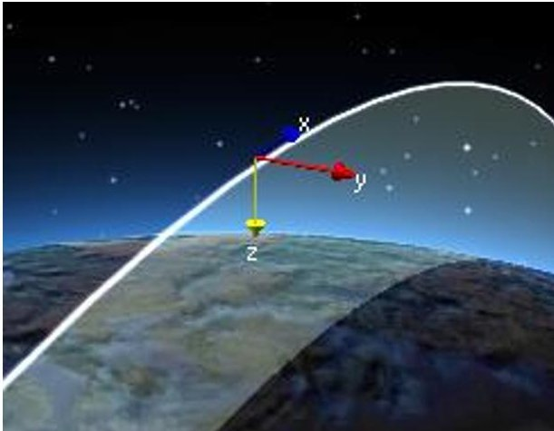

Figure 7 Orbit coordinate system

The sun and nadir sensor mountings are such that in the nominal orientation the nadir sensor will point towards nadir, the sun sensor will point towards zenith and the momentum wheel spin axis will align with the orbit normal.

## 2.2 Control modes

The QB50 ADCS will have two distinct control modes. The first detumbling mode will serve to recover from any initial tumble condition and place the satellite in a stable and known tumbling motion - a so-called Y- Thomson spin $ ^{1} $ . In this mode the satellite will end-up spinning only about the ADCS Y-axis and the spin axis will align itself with the orbit normal. The second control mode, Y-momentum mode, can only be activated once the satellite is in this stable tumbling state. In Y-momentum mode the satellite will stop spinning and stabilize to the nominal orientation (zero roll, pitch and yaw angles). In Y-momentum mode the pitch angle may be controlled to a specific reference value using a telecommand.

Table 1 QB50 ADCS control modes

<table border="1"><tr><td>Control mode</td><td>Detumbling control mode(steady-state)</td><td>Y-momentum mode</td></tr><tr><td></td><td>图1</td><td>图2</td></tr><tr><td>Attitude angles</td><td>Roll=yaw=0
Pitch:</td><td>Roll=yaw=0
Pitch=θref</td></tr><tr><td>Angular rates</td><td>ω=[0 ωy,ref 0]</td><td>ω=[0 0 0]</td></tr></table>

The Y-momentum mode is the nominal mode for QB50 satellites since this mode satisfies the pointing requirements. The detumbling mode is an intermediate step towards this nominal mode.

<!-- PDF_PAGE: 7 -->

In order to perform the required control, the ADCS needs to know the current attitude (angles and/or rates). This knowledge is supplied by estimation methods which make use of sensor measurements. Different estimation methods exist with varying sensor dependencies.

The detumbling control mode only requires an estimate of the satellite Y-body angular rate. This can be measured directly using the MEMS rate sensor, or it can be estimated using a rate estimator that uses successive magnetometer measurements.

The Y-momentum mode requires full attitude knowledge (angles and rates) and in order to estimate this, current position and velocity of the satellite has to be known as well as the current time. This information will be estimated using an SGP4 orbit propagator and requires that up-to-date TLEs and the current time is provided (via telecommand).

The ADCS will always start up in the idle condition that is with no estimation or control active. The orbit and attitude estimation and control modes can be changed via telecommand. The state diagram below shows the various states and transitions that should occur to transition from idle to stabilized state.

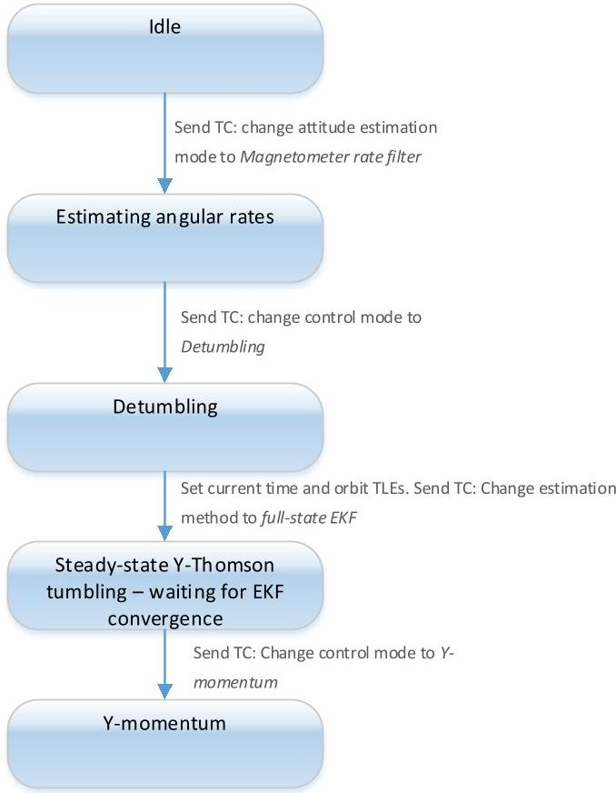

Figure 8 QB50 ADCS state diagram

<table border="1"><tr><td>No.</td><td>State</td><td>Attitude estimation mode</td><td>Control mode</td></tr><tr><td>0</td><td>Idle</td><td>None</td><td>None</td></tr><tr><td>1</td><td>Estimating angular rates</td><td>Magnetometer rate filter</td><td>None</td></tr><tr><td>2</td><td>Detumbling</td><td>Magnetometer rate filter</td><td>Detumbling</td></tr><tr><td>4</td><td>Y-Thomson Tumbling-waiting for EKF to converge</td><td>Full-state EKF</td><td>Detumbling</td></tr><tr><td>5</td><td>Y-momentum</td><td>Full-state EKF</td><td>Y-momentum</td></tr></table>

<!-- PDF_PAGE: 8 -->

The mode numbers in the following tables apply when sending telecommands to change the current modes.

Table 2 Attitude estimation modes

<table border="1"><tr><td>Mode number</td><td>Mode</td><td>Notes</td></tr><tr><td>0</td><td>No attitude estimation</td><td></td></tr><tr><td>1</td><td>MEMS rate only</td><td></td></tr><tr><td>2</td><td>Magnetometer rate filter</td><td></td></tr><tr><td>4</td><td>Full-state EKF</td><td rowspan="2">Requires orbit position &amp; velocity estimates from SGP4 propagator</td></tr><tr><td>5</td><td>TRIAD (magnetometer + Fine sun) and magnetometer rate filter</td></tr></table>

Table 3 Control modes

<table border="1"><tr><td>Mode number</td><td>Mode</td><td>Notes</td></tr><tr><td>0</td><td>No control</td><td></td></tr><tr><td>2</td><td>Detumbling</td><td></td></tr><tr><td>3</td><td>Y-momentum initial</td><td rowspan="2">Requires either the full-state EKF or TRIAD estimation mode to be active.(attitude estimation mode&gt;=4)</td></tr><tr><td>4</td><td>Y-momentum steady-state</td></tr></table>

The difference between control modes 3 & 4 is that in control mode 3, the momentum wheel speed will be ramped up while the satellite still performs a slow Y-tumble. This will continue until the estimated pitch angle is within 20 degrees of the commanded pitch angle. At this point the control will automatically transition to mode 4- the steady state mode in which the pitch angle will be controlled to zero. Commands that engage Y-momentum control mode should always specify a control selection of 3 to allow the automatic transition to occur on the ADCS.

## 2.3 ADCS control loop

The ADCS control loop executes on the CubeComputer at a rate of 1Hz. Sensors are thus also sampled at this frequency.

## 2.4 GPS receiver interface

The CubeControl board has the capability to interface to the Novatel OEM615 GPS receiver module with Special Space Firmware. When enabled, it is possible to read the GPS provided position, velocity and time measurements via TLM request to the ADCS. The GPS receiver measurements are not used or required by the ADCS.

## 3 Electrical interface

The QB50 ADCS will make use of the standard PC104 stacking header for electrical interfacing. The following pins will be used by the ADCS:

<!-- PDF_PAGE: 9 -->

<table border="1"><tr><td rowspan="2">H2</td><td>2</td><td>4</td><td>6</td><td>8</td><td>10</td><td>12</td><td>14</td><td>16</td><td>18</td><td>20</td><td>22</td><td>24</td><td>26</td><td>28</td><td>30</td><td>32</td><td>34</td><td>36</td><td>38</td><td>40</td><td>42</td><td>44</td><td>46</td><td>48</td><td>50</td><td>52</td></tr><tr><td>1</td><td>3</td><td>5</td><td>7</td><td>9</td><td>11</td><td>13</td><td>15</td><td>17</td><td>19</td><td>21</td><td>23</td><td>25</td><td>27</td><td>29</td><td>31</td><td>33</td><td>35</td><td>37</td><td>39</td><td>41</td><td>43</td><td>45</td><td>47</td><td>49</td><td>51</td></tr><tr><td rowspan="2">H1</td><td>2</td><td>4</td><td>6</td><td>8</td><td>10</td><td>12</td><td>14</td><td>16</td><td>18</td><td>20</td><td>22</td><td>24</td><td>26</td><td>28</td><td>30</td><td>32</td><td>34</td><td>36</td><td>38</td><td>40</td><td>42</td><td>44</td><td>46</td><td>48</td><td>50</td><td>52</td></tr><tr><td>1</td><td>3</td><td>5</td><td>7</td><td>9</td><td>11</td><td>13</td><td>15</td><td>17</td><td>19</td><td>21</td><td>23</td><td>25</td><td>27</td><td>29</td><td>31</td><td>33</td><td>35</td><td>37</td><td>39</td><td>41</td><td>43</td><td>45</td><td>47</td><td>49</td><td>51</td></tr></table>

<table border="1"><tr><td colspan="4">PC104 Interface pins</td></tr><tr><td>H1</td><td>41</td><td>SYSI2C_SDA</td><td>SystemI2C Data</td></tr><tr><td>H1</td><td>43</td><td>SYSI2C_SCL</td><td>SystemI2C Clock</td></tr><tr><td>H1</td><td>47</td><td>ADCS+5V</td><td>+5V ADCS supply</td></tr><tr><td>H1</td><td>48</td><td>ADCS+3.3V</td><td>+3.3V ADCS supply</td></tr><tr><td>H1</td><td>50</td><td>GPS+3.3V</td><td>GPS3.3V supply</td></tr><tr><td>H2</td><td>27/28</td><td>+3V3</td><td>connect to3V3(either switched on withH1-48oralwayson)</td></tr><tr><td>H2</td><td>29</td><td>GND</td><td>Ground connection</td></tr><tr><td>H2</td><td>30</td><td>GND</td><td>Ground connection</td></tr><tr><td>H2</td><td>32</td><td>GND</td><td>Ground connection</td></tr><tr><td>H2</td><td>45</td><td>VBat</td><td>Battery bus</td></tr><tr><td>H2</td><td>46</td><td>VBat</td><td>Battery bus</td></tr></table>

<table border="1"><tr><td colspan="5">PC104 Reserved pins</td></tr><tr><td></td><td>H1</td><td>21</td><td>ADCS12C_SCL</td><td>ADCS12C Clock(used internally)</td></tr><tr><td></td><td>H1</td><td>23</td><td>ADCS12C_SDA</td><td>ADCS12C Data(used internally)</td></tr><tr><td></td><td>H2</td><td>20</td><td>CubeSense Enable</td><td>Enable line to control CubeControl power switch(used internally)</td></tr></table>

Figure 9 ADCS pin allocation on the PC104 header

## 3.1 Power

The ADCS should be supplied with 3.3V on pin H1-48, and 5V on pin H1-47. Both supplies must be switched on simultaneously. The ADCS has internal power switches for the different components (CubeSense and CubeControl). The internal power switches are controlled by the CubeComputer depending on the current mode selection. The switch states can be read via telemetry rest and can also be forced on using a telecommand. The ADCS also requires a 3.3V connection on pin H2-27 and H2-28. This supply is only used to power I2C buffers and may be connected to a non-switched (always on) supply. The power draw from this line is minimal.

Current and voltages are measured at various points in the ADCS and can be requested using TLM requests. The ADCS will also use this to switch off components in case of latch-up. The battery bus (pins H2-45 and H2- 46) supplies power to the momentum wheel, the magnetometer boom deployment and the GPS receiver patch antenna LNA.

The GPS receiver itself is powered from pin H1-50 (3.3V supply. Only applies if the GPS receiver is included). The GPS does not have to be powered if the ADCS is switched on. The GPS can only be switched on when needed. The ADCS will sense the GPS enabled status and react accordingly by setting up logs and storing telemetry.

## 3.1.1 Power use

The power use of the ADCS in various operating conditions is listed in the table below.

<table border="1"><tr><td rowspan="2">Condition</td><td colspan="3">Average current(mA)</td><td rowspan="2">Total power(mW)</td></tr><tr><td>From3.3V supply</td><td>From5V supply</td><td>From battery bus</td></tr><tr><td>Attitude sensing only(rate estimator)</td><td>102</td><td>0</td><td>0</td><td>336</td></tr></table>

<!-- PDF_PAGE: 10 -->

<table border="1"><tr><td>Attitude sensing only(full-state estimator)</td><td>102</td><td>23</td><td>0</td><td>450</td></tr><tr><td>Detumbling control</td><td>102</td><td>36</td><td>0</td><td>516</td></tr><tr><td>Y-momentum control(eclipse)</td><td>102</td><td>10</td><td>9</td><td>456</td></tr><tr><td>Y-momentum control(daylight)</td><td>102</td><td>48</td><td>9</td><td>644</td></tr></table>

The GPS will consume an additional 1W of power from the 3.3V supply when switched on.

## 3.2 Communication

The QB50 ADCS will communicate using the system I2C interface on the standard PC104 header (pin H1-41 and H1-43 on the standard header). The CubeComputer will act as a slave on the system I2C bus, responding to commands and telemetry requests as detailed in the Reference Manual [R05].

## 3.2.1 I2C pull-up resistors

The ADCS will have no pull-up resistors on the system I2C bus.

## 3.3 Logging

The ADCS has to ability to automatically log data and save it to SD memory card. For detail about the logging, please consult the Reference Manual [R05].

## 4 Mechanical interface

## 4.1 PC104 Component stack

The stacked components make use of the standard "self-stacking" CubeSat mechanical interface. The dimensions of the stacked components and mounting locations are shown below.

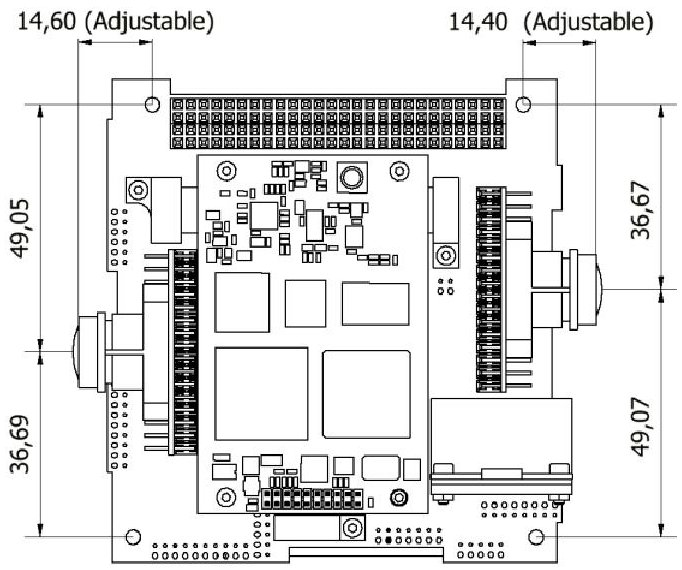

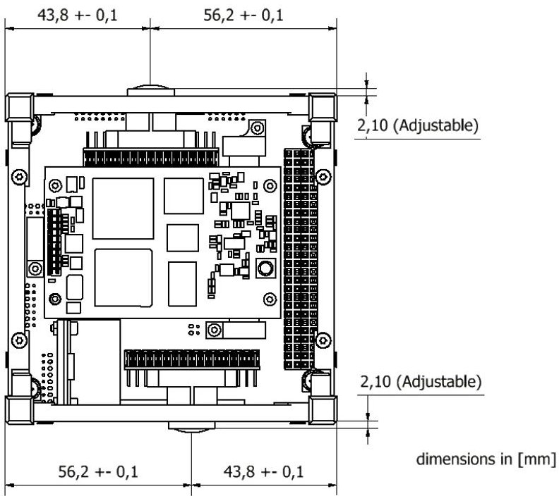

<!-- PDF_PAGE: 11 -->

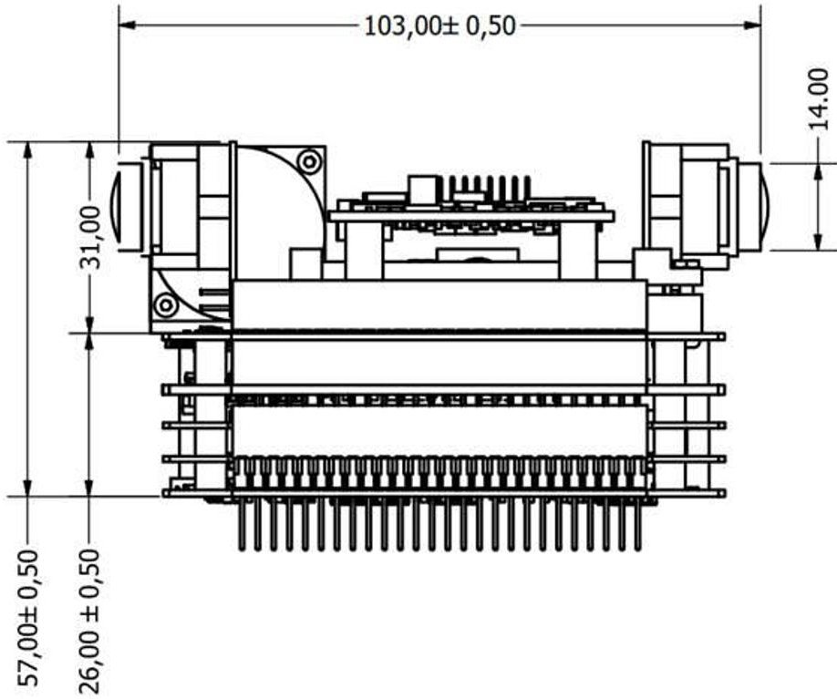

Figure 10 QB50 ADCS PC104 stack dimensions

The ADCS stack will have spacers to support the inter-PCB spacing.

## 4.2 External magnetometer

The external magnetometer is housed on a small external PCB and encased inside an aluminium housing. The magnetometer housing measures 16 x 17 x 6mm.

The magnetometer housing is supplied with a deployable boom. The boom will give a separation of 8cm from the rest of the spacecraft to limit the effect of electromagnetic interference and result in low noise measurements.

The deployable boom consists of a rod with the magnetometer in a metal enclosure at one end. The other end is connected to a mounting bracket with a spring. The bracket will be mounted on the outside of the satellite structure. The boom will be constrained when stowed and deployment takes place upon a telecommand. The deployable boom and mounting interface is illustrated below:

<!-- PDF_PAGE: 12 -->

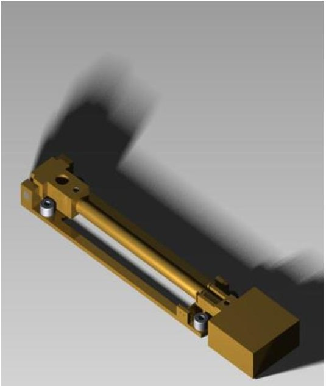

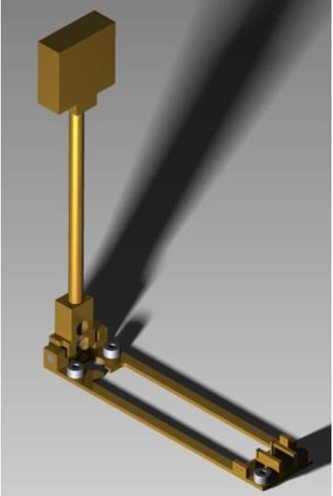

Figure 11 Deployable magnetometer boom stowed (left) and deployed (right)

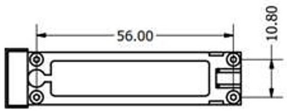

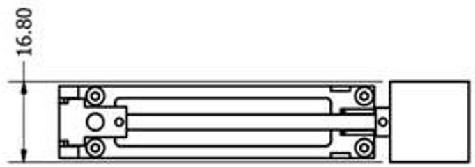

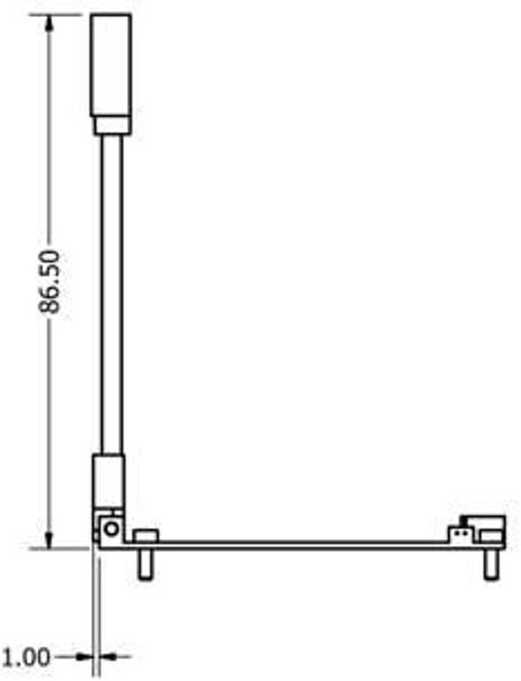

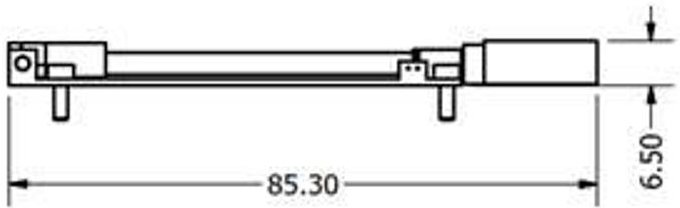

Figure 12 Deployable magnetometer dimensions and mounting locations

<!-- PDF_PAGE: 13 -->

Both the magnetometer and the boom deployment actuation will be connected to the CubeControl PCB in the ADCS stack using a harness. The harness between the magnetometer and the CubeControl is broken by a circular 11-way connector with harness length as indicated below.

The connector is an Omnetics nano-circular connector with part number NCP-11-WD-18.0-C for the plug (CubeControl side) and NCS-11-WD-18.0-C for the socket (magnetometer side).

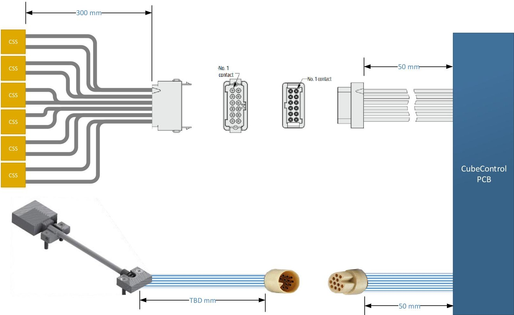

Figure 13 CSS and magnetometer harness lengths

## 4.3 Coarse Sun Sensors

Each Coarse Sun Sensor (CSS) consists of a photodiode mounted on a small PCB. There are 6 of these CSS in total. The dimensions of each CSS are 4mm x 11mm x 2mm. The CSS do not have mounting holes - they should be staked down to the satellite structure using epoxy. The sensors should be placed on the 6 different facets of the spacecraft.

The CSS are not critical for the operation of the ADCS, and it is expected that it will not be possible to place a CSS on the +X (RAM direction) facet due to the presence of the Science Unit. The ADCS will still be able to estimate sun vectors from the CSS if only 5 are used.

The 6 CSSs will be connected to the CubeControl PCB by wire harness. The wire harness is broken by a single 12-way rectangular connector as in Figure 13. The connector is a latched Harwin Gecko 12-way connector with part number G125-204-12-96-L0 for the socket (CubeControl side) and G125-304-12-96-L4 for the plug (CSS side).

The CSS connector pin assignment is specified in the table below:

<!-- PDF_PAGE: 14 -->

Table 4 CSS connector pin assignment

<table border="1"><tr><td>pin</td><td>signal</td><td>pin</td><td>signal</td><td>pin</td><td>signal</td><td>pin</td><td>signal</td></tr><tr><td>1</td><td>CSS1-cathode</td><td>2</td><td>CSS1-anode</td><td>3</td><td>CSS2-cathode</td><td>4</td><td>CSS2-anode</td></tr><tr><td>5</td><td>CSS3-cathode</td><td>6</td><td>CSS3-anode</td><td>7</td><td>CSS4-cathode</td><td>8</td><td>CSS4-anode</td></tr><tr><td>9</td><td>CSS5-cathode</td><td>10</td><td>CSS5-anode</td><td>11</td><td>CSS6-cathode</td><td>12</td><td>CSS6-anode</td></tr></table>

## 4.4 Mass

The mass of the QB50 ADCS stack and optional and external components are summarized in the table.

Table 5 mass of ADCS components

<table border="1"><tr><td>Component</td><td>Mass</td></tr><tr><td>PC104 component stack (excluding GPS receiver)</td><td>335g</td></tr><tr><td>External components</td><td></td></tr><tr><td>External magnetometer assembly (including boom)</td><td>15g</td></tr><tr><td>6x CSS (including harness)</td><td>5g</td></tr></table>

## 4.5 Inertia moments and Centre-of-mass

The moment of inertia about any satellite body axis for the host satellite on which the QB50 ADCS will be used shall not exceed 0.02 $ \mathrm{k g m^{2}}. $

The host satellite shall have a dominant moment of inertia about the ADCS Y-axis for configurations in which the detumbling mode will be used. The Y moment of inertia $ \left( I_{yy} \right) $ shall be at least 5% larger than the X and Z inertia moments $ \left( I_{xx} \right) $ and $ \left( I_{zz} \right) $ .

The host satellite centre-of-mass and deployable panels should be arranged such that a positive (restoring) aerodynamic torque is generated for all possible angles of attack.

## 5 Command interface

The ADCS attitude control processor (CubeComputer) acts as an I2C slave node on the system bus with 7-bit addressing. The default 8-bit read and write addresses of the node are:

Table 6 I2C node address

<table border="1"><tr><td>I2C write address</td><td>0x24</td></tr><tr><td>I2C read address</td><td>0x25</td></tr></table>

For more detail on the communications interface including protocols for telecommands, telemetry and file downloads, please consult the QB50 ADCS Reference Manual [R05].

## 6 Specifications

Table 7 QB50 ADCS specifications

<table border="1"><tr><td>Specification</td><td>Value</td><td>Notes</td></tr><tr><td>Physical</td><td></td><td></td></tr><tr><td>Mass</td><td>400g</td><td>Complete system including GPS receiver and deployable magnetometer boom</td></tr><tr><td>Dimensions</td><td></td><td></td></tr><tr><td>PC104 stack</td><td>90x96x60mm</td><td></td></tr></table>

<!-- PDF_PAGE: 15 -->

<table border="1"><tr><td>CSS</td><td>4x11x2mm</td><td></td></tr><tr><td>External magnetometer housing</td><td>16x17x6mm</td><td></td></tr><tr><td>Performance</td><td></td><td></td></tr><tr><td>Attitude update rate</td><td>1Hz</td><td></td></tr><tr><td>Attitude measurement accuracy(&gt;200km)</td><td></td><td></td></tr><tr><td>Pitch</td><td>&lt;0.5°</td><td>1σ</td></tr><tr><td>Roll and yaw</td><td>&lt;2.0°</td><td>1σ</td></tr><tr><td>Pointing accuracy(Y-momentum mode)</td><td></td><td></td></tr><tr><td>&gt;300km altitude</td><td>&lt;0.5°1</td><td>1σ</td></tr><tr><td>&gt;200km altitude</td><td>&lt;2.5°1</td><td>1σ</td></tr><tr><td>Time to reach steady-stateY-Thomson motion from10°/sinitial tip-off rate(at350km altitude)</td><td>&lt;0.5days1</td><td>Maximum time fromMonte-carlosimulation of1000test cases.</td></tr><tr><td>Outgassing</td><td></td><td></td></tr><tr><td>Total Mass Loss(TML)</td><td>&lt;1.0%</td><td></td></tr><tr><td>Collected Volatile CondensableMaterial(CVCM)</td><td>&lt;0.1%</td><td></td></tr><tr><td>Vibrations</td><td></td><td></td></tr><tr><td>Sine sweep</td><td>as per[R01]</td><td></td></tr><tr><td>Random vibrations</td><td>as per[R01]</td><td></td></tr><tr><td>Thermal</td><td></td><td></td></tr><tr><td>Operating temperature range</td><td>-10℃to+60℃</td><td></td></tr><tr><td>Non-operational temperature range</td><td>-10℃to+60℃</td><td></td></tr></table>

$ ^{1} $ Applies to 2U satellite with no appendages, centre-of-mass location $ [0.01,0.0,0.0]^{\mathrm{T}} $ m and moment of inertia matrix diag (0.0027,0.0107,0.0101) kg.m $ ^{2} $

The specifications for the sensors and actuators used in the QB50 ADCS are listed in the following tables.

## 6.1 Sensor specifications

The sensor specifications below apply when requesting the measurements via the system I2C interface. Individual components may have different update rates when interfacing to them directly.

Table 8 Sensor specifications

<table border="1"><tr><td>Specification</td><td>Value</td><td>Notes</td></tr><tr><td>Sun and nadir sensor</td><td></td><td></td></tr><tr><td>Sun sensor measurement accuracy(1σ)</td><td>&lt;0.5°&lt;2°</td><td>&lt;40° from bore-sight entire FOV</td></tr><tr><td>Nadir sensor measurement accuracy(1σ)</td><td>0.18°</td><td>Entire Earth visible in FOV</td></tr><tr><td>Field of view(both cameras)</td><td>180°</td><td></td></tr><tr><td>Update rate</td><td>1Hz</td><td></td></tr><tr><td>Image size</td><td>640x480pix</td><td></td></tr><tr><td>Image format</td><td>8bpp grayscale</td><td></td></tr><tr><td>Coarse sun sensor</td><td></td><td></td></tr><tr><td>Measurement accuracy</td><td>&lt;10°</td><td>1σ</td></tr><tr><td>Update rate</td><td>1Hz</td><td></td></tr><tr><td>Magnetometer</td><td></td><td></td></tr><tr><td>Measurement accuracy</td><td>&lt;50nT</td><td>1σ(perX/Y/Z channel)</td></tr><tr><td>Update rate</td><td>1Hz</td><td></td></tr></table>

<!-- PDF_PAGE: 16 -->

<table border="1"><tr><td>Rate sensor</td><td></td><td></td></tr><tr><td>Measurement accuracy</td><td>&lt;0.015°/s</td><td>1σ</td></tr><tr><td>Update rate</td><td>1Hz</td><td>Averaged output</td></tr><tr><td>Angular Random Walk</td><td>0.28°/$\sqrt{hr}$</td><td></td></tr><tr><td>Bias instability</td><td>24°/hr</td><td></td></tr></table>

## 6.2 Actuator specifications

Table 9 Actuator specifications

<table border="1"><tr><td>Specification</td><td>Value</td><td>Notes</td></tr><tr><td>Magnetorquers</td><td></td><td></td></tr><tr><td>Maximum magnetic dipole</td><td>0.2Am2</td><td></td></tr><tr><td>On-time command resolution</td><td>0.2ms</td><td>For a1Hz control period</td></tr><tr><td>Momentum wheel</td><td></td><td></td></tr><tr><td>Maximum momentum storage</td><td>1.7mNms</td><td></td></tr><tr><td>Maximum wheel speed</td><td>±8000rpm</td><td></td></tr><tr><td>Maximum torque</td><td>0.15mNm</td><td></td></tr><tr><td>Wheel inertia</td><td>2.0kg.mm2</td><td></td></tr></table>

## 7 Handling

The QB50 ADCS shall be handled and integrated in an ISO class 8 or higher cleanroom. ESD protective clothing and wrist- or ankle straps shall be worn when handling the ADCS.

The sun and nadir optics are fitted with dust caps which should be removed before flight.