<!-- PDF_PAGE: 1 -->

# Addressing Deep Uncertainty in Space System Development through Model-based Adaptive Design

by

Mark A. Chodas

S.B. Massachusetts Institute of Technology (2012) S.M. Massachusetts Institute of Technology (2014) Submitted to the Department of Aeronautics and Astronautics in partial fulfillment of the requirements for the degree of Doctor of Philosophy at the MASSACHUSETTS INSTITUTE OF TECHNOLOGY June 2019 $ \textcircled{c} $ Massachusetts Institute of Technology 2019. All rights reserved

Department of Aeronautics and Astronautics May 23, 2019

Olivier L. de Weck Professor of Aeronautics and Astronautics

Rebecca A. Masterson Principal Research Engineer, Department of Aeronautics and Astronautics

Certified by...

Brian C. Williams Professor of Aeronautics and Astronautics

Michel D. Ingham Jet Propulsion Laboratory

Sertac Karaman

Associate Professor of Aeronautics and Astronautics Chair, Graduate Program Committee

<!-- PDF_PAGE: 2 -->

<!-- PDF_PAGE: 3 -->

# Addressing Deep Uncertainty in Space System Development through Model-based Adaptive Design

by

Mark A. Chodas

Submitted to the Department of Aeronautics and Astronautics on May 23,2019, in partial fulfillment of the requirements for the degree of Doctor of Philosophy

## Abstract

When developing a space system, many properties of the design space are initially unknown and are discovered during the development process. Therefore, the problem exhibits deep uncertainty. Deep uncertainty refers to the condition where the full range of outcomes of a decision is not knowable. A key strategy to mitigate deep uncertainty is to update decisions when new information is learned. NASA's current uncertainty management processes do not emphasize revisiting decisions and therefore are vulnerable to deep uncertainty. Examples from the development of the James Webb Space Telescope are provided to illustrate these vulnerabilities.

In this research, the spacecraft development problem is modeled as a dynamic, chance-constrained, stochastic optimization problem. The Model-based Adaptive Design under Uncertainty (MADU) framework is introduced, in which conflict-directed search is combined with reuse of conflicts to solve the problem efficiently. The framework is built within a Model-based Systems Engineering (MBSE) paradigm in which a SysML model contains the design and conflicts identified during search. Changes between problems can involve the addition or removal a design variable, expansion or contraction of the domain of a design variable, addition or removal of constraints, or changes to the objective function. These changes are processed to determine their effect on the set of known conflicts. Using Python, an optimization problem is composed from information in the SysML model, including conflicts from past problems, and is solved using IBM ILOG CP Optimizer. The framework is tested on a case study drawn from the thermal design of the REgolith X-ray Imaging Spectrometer (REXIS) instrument and a case study based on the Starshade exoplanet direct imaging mission concept which is sizeable at 35 design variables, 40 constraints, and $ 10^{10} $ possible solutions. In these case studies, the MADU framework performs 58% faster on average than an algorithm that doesn't reuse information. Adding a requirement or changing the objective function are particularly efficient types of changes. With this framework, designers can more efficiently explore the design space and perform updates to a design when new information is learned.

<!-- PDF_PAGE: 4 -->

Thesis Supervisor: Olivier L. de Weck

Title: Professor of Aeronautics and Astronautics

Thesis Supervisor: Rebecca A. Masterson

Title: Principal Research Engineer, Department of Aeronautics and Astronautics

Thesis Supervisor: Brian C. Williams

Title: Professor of Aeronautics and Astronautics

Thesis Supervisor: Michel D. Ingham

Title: Jet Propulsion Laboratory

<!-- PDF_PAGE: 5 -->

## Acknowledgments

Thank you to Oli and Becky, my co-advisors, for helping me so many times and teaching me so much over the many years that we've worked together. Thank you to the rest of my committee, Brian and Mitch, as well as my readers, Sebastian and Afreen, for helping me with my research and to polish this thesis.

Thank you to my many fellow grad students on REXIS: Maddy, Carolyn, Sormeh, David G., Conor, Laura, Pronoy, David C., Mike, James, Kevin, Matt, Niraj, Hal, Harrison, and Eric. Thank you for all your hard work to get REXIS designed, built, and tested and for the continuing work of operating REXIS. It has been lots of fun getting to work with you. You have made my grad school experience very memorable.

Thank you to everyone on the REXIS leadership team: Becky, Rick, Josh, Branden, and Jaesub. You have done an admirable job managing REXIS, getting us onto the spacecraft, and now to Bennu. I look forward to seeing the science results in the near future. Thank you to the other institutions that helped us build REXIS: MIT Lincoln Laboratory, MIT Kavli Institute for Astrophysics, and Aurora Flight Sciences.

Thank you to the OSIRIS-REx team at NASA GSFC, Lockheed Martin, and the University of Arizona. Thank you for giving me and everyone else the chance to work on a NASA mission while still in school. I've gained tremendous experience with flight hardware and have learned so much from all of you.

Thank you to my family for their love and support. I couldn't have done it without you.

This research was supported by a NASA Space Technology Research Fellowship (NNX14AL57H) and by the REXIS project (NN12FD70C, PO363458).

<!-- PDF_PAGE: 6 -->

<!-- PDF_PAGE: 7 -->

## Nomenclature

## Abbreviations

<table border="1"><tr><td>ADCS</td><td>Attitude Control and Determination Subsystem</td></tr><tr><td>ASDS</td><td>Automated Spaceport Drone Ship</td></tr><tr><td>BDD</td><td>Block Definition Diagram</td></tr><tr><td>BWG</td><td>Beam Waveguide</td></tr><tr><td>C&amp;DH</td><td>Command and Data Handling</td></tr><tr><td>CBE</td><td>Current Best Estimate</td></tr><tr><td>COPV</td><td>Composite-Overwrapped Pressure Vessel</td></tr><tr><td>CRM</td><td>Continuous Risk Management</td></tr><tr><td>CSP</td><td>Constraint Satisfaction Problem</td></tr><tr><td>DoD</td><td>Department of Defense</td></tr><tr><td>DRM</td><td>Design Reference Mission</td></tr><tr><td>FIFO</td><td>First-In-First-Out</td></tr><tr><td>IBD</td><td>Interface Block Diagram</td></tr><tr><td>IMU</td><td>Inertial Measurement Unit</td></tr><tr><td>MADU</td><td>Model-based Adaptive Design under Uncertainty</td></tr><tr><td>MBSE</td><td>Model-based Systems Engineering</td></tr></table>

<!-- PDF_PAGE: 8 -->

MEV Maximum Expected Value

MGA Medium Gain Antenna

MILP Mixed-Integer Linear Programming

MLI multi-layer insulation

MON Mixed Oxides of Nitrogen

OLC Object Constraint Language

OMG Object Management Group

OPM Object Process Methodology

OSIRIS-REx Origins Spectral Interpretation Resource Identification Security Regolith EXplorer

PAR Parametric Diagram

REXIS REgolith X-ray Imaging Spectrometer

RIDM Risk-Informed Decision Making

SDD Silicon Drift Detector

SDST Small Deep Space Transponder

SUV Sport Utility Vehicle

SXM Solar X-ray Monitor

SysML Systems Modeling Language

TCM Trajectory Correction Maneuver

TMS Truth Maintenance System

TWTA Traveling Wave Tube Amplifier

UML Unified Modeling Language

## Symbols

a(x) set constraint

A cross sectional area

A array area of a solar array

<!-- PDF_PAGE: 9 -->

$ c $ set of constraints

$ c_{batt} $ battery capacity

$ C $ set of known conflicts

$ \hat{C} $ updated set of conflicts after conflict extraction is complete

$ C_{sun} $ solar constant

$ d_{batt} $ energy density of a battery

$ d_{safemode} $ duration of safe mode

$ d_{yearly} $ yearly degradation of a solar array

$ D_{array} $ degradation factor for combining solar cells into a solar array

$ DOD $ depth of discharge of battery

$ e $ efficiency of a solar array

$ e_{amp} $ efficiency of X-band TWTA

$ E $ Young's modulus

$ E(C_{i}) $ explanation of the conflict $ C_{i} $

$ \frac{E_{b}}{N_{0}} $ signal to noise ratio

$ f $ fill level of a propellant tank in the Starshade case study

$ f(x,y) $ objective function

$ f_{axial} $ axial natural frequency

$ f_{lateral} $ lateral natural frequency

$ f_{rad} $ fraction of bus face taken up by radiator

$ g $ acceleration of gravity

$ g(x,y) $ inequality constraint

$ G_{r} $ receive gain

$ G_{t} $ transmit gain

<!-- PDF_PAGE: 10 -->

$ h $ height

$ h ( x, y ) $ equality constraint

$ I $ area moment of inertia

$ I s p $ specific impulse

$ k $ thermal conductivity

$ \hat{k} $ equivalent thermal conductivity of part after accounting for interface resistance

$ l $ side length

$ L $ length

$ L_{l} $ line loss

$ L_{p} $ path loss

$ L_{s} $ space loss

$ L_{s c} $ lifetime of a spacecraft

$ m $ mass

$ m_{a} $ mass per unit area of solar array

$ m_{dry} $ dry mass

$ m_{wet} $ wet mass

$ M $ mixture ratio

$ n_{targets} $ number of stars that the Starshade mission will observe

$ O $ decision outcome

$ p $ minimum probability of satisfaction for an inequality constraint

$ p_{amp} $ input power to X-band TWTA

$ p_{ADCS} $ power draw of the ADCS subsystem

$ p_{C\&DH} $ power draw of the C&DH subsystem

<!-- PDF_PAGE: 11 -->

$ p_{ff} $ power draw of formation flying package

$ p_{main} $ power draw of main engine

$ p_{peak} $ peak power draw of the Starshade bus

$ p_{s} $ pressurant tank selector in the Starshade case study

$ p_{safemode} $ power draw of Starshade bus in safe mode

$ p_{S-band} $ power draw of X-band transmitter

$ p_{thruster} $ power draw of one thruster

$ p_{trans} $ power draw of X-band transmitter

$ P $ pressure

$ P_{array} $ power produced by a solar array in the Starshade case study

$ P_{t} $ transmit power

$ q $ heat load

$ r $ radius

$ R $ decision rationale

$ R_{d} $ data rate

$ R_{He} $ universal gas constant of helium

$ s $ volumetric cost of material

$ S $ cost

$ t $ set of known satisfying states

$ t_{s} $ thruster tank selector in the Starshade case study

$ t_{target} $ average time that the Starshade mission observes a star

$ T $ temperature

$ T_{s} $ system noise temperature

$ \mathcal{U}(a,b) $ uniform random variable defined over the interval $ [a,b] $

<!-- PDF_PAGE: 12 -->

$ v_{i} $ set of design variable alternatives defining the domain of a single design variable

$ v_{ij} $ a single design variable alternative

$ V $ volume

$ w $ wall thickness

$ x $ set of design variables

$ x_{c} $ candidate solution generated by the relaxed problem

$ y $ set of model parameters

$ \alpha $ limit of an inequality constraint

$ \alpha_{b} $ absorptivity of Starshade bus

$ \Delta V $ change in velocity

$ \Delta V_{cont} $ contingency $ \Delta V $ provided for retargeting

$ \Delta V_{disposal} $ $ \Delta V $ required to dispose of the Starshade

$ \Delta V_{rendezvous} $ $ \Delta V $ required to rendezvous with the Starshade telescope at Earth-Sun L2

$ \Delta V_{retargeting} $ $ \Delta V $ required to perform an average retargeting maneuver

$ \Delta V_{stationkeeping} $ $ \Delta V $ per day needed to fly in formation with the Starshade telescope

$ \Delta V_{tcm1} $ $ \Delta V $ required to perform TCM 1

$ \Delta V_{tcm2} $ $ \Delta V $ required to perform TCM 2

$ \Delta V_{tcm3} $ $ \Delta V $ required to perform TCM 3

$ \epsilon_{b} $ emissivity of Starshade bus radiator

$ \theta $ angle of Sun on Starshade bus

$ \theta_{worst} $ worst case solar array illumination angle

$ \rho $ density of material

## Subscripts and Superscripts

$ (\cdot)^{*} $ optimal solution

<!-- PDF_PAGE: 13 -->

$ (\cdot)_{ADCS} $ property of the ADCS subsystem in the Starshade case study

$(\cdot)_{b}$ property of Starshade bus

（ $ \cdot $ ） $ _{B} $ property of an ideal beam

（ $ \cdot $ ）changed new problem formulation after changes have been made

$(\cdot)_{comm}$ property of the Communications subsystem in the Starshade case study

（ $ \cdot $ ） $ C\& D H $ property of the C&DH subsystem in the Starshade case study

$ (\cdot)_{DAM} $ property of the DAM in the REXIS detector thermal design case study

$ (\cdot)_{DASS} $ property of the DASS in the REXIS detector thermal design case study

$ (\cdot)_{DASS-TIL} $ property of the DASS to TIL interface in the REXIS detector thermal design case study

（ $ \cdot $ ） $ E O L $ end of life property

（ $ \cdot $ ）gas property of the gas in a pressurant tank in the Starshade case study

（ $ \cdot $ ）gas1 property of the gas in pressurant tank 1 in the Starshade case study

$ \left( \cdot\right)_{gas2} $ property of the gas in pressurant tank 2 in the Starshade case study

（ $ \cdot $ ） $ ^{int} $ property of the interior of the bus in the Starshade case study

（ $ \cdot $ ） $ _{main} $ property of the main engine in the Starshade case study

$(\cdot)_{mli}$ property of MLI in the Starshade case study

（.） $ _{new} $ design variable, constraint, design variable alternative, etc. that is being added to the problem

（ $ \cdot $ ） $ _{orig} $ original problem formulation before changes are made

( $ \cdot $ )poss a set of conflicts of satisfying states that apply to an individual sampled problem

（ $ \cdot $ ） $ _{power} $ property of the Power subsystem in the Starshade case study

<!-- PDF_PAGE: 14 -->

$(\cdot)_{pressurant}$ property of a pressurant tank in the Starshade case study

（ $ \cdot $ ） $ _{pres1} $ property of pressurant tank 1 in the Starshade case study

（ $ \cdot $ ） $ _{pres2} $ property of pressurant tank 2 in the Starshade case study

$(\cdot)_{prop1}$ property of the propellant in propellant tank 1 in the Starshade case study

$(\cdot)_{prop2}$ property of the propellant in propellant tank 2 in the Starshade case study

（ $ \cdot $ ） $ _Prop $ property of the Propulsion subsystem in the Starshade case study

$ (\cdot)_{Prop,wet} $ property of the Propulsion subsystem including propellant in the Starshade case study

（.） $ _{rad} $ property of a radiator

（ $ \cdot $ ） $ _{rel} $ relaxed inequality constraint

$(\cdot)_{rem}$ design variable, constraint, design variable alternative, etc. that is being removed from the problem

（.） $ _{space} $ property of space

（ $ \cdot $ ） $ _{starshade} $ property of the starshade in the Starshade case study

$(\cdot)_{struct}$ property of the Structures subsystem in the Starshade case study

$$
(\cdot) _ {t a n k}
$$

（ $ \cdot $ ） $ _{tank1} $ property of propellant tank 1 in the Starshade case study

（ $ \cdot $ ） $ _{tank2} $ property of propellant tank 2 in the Starshade case study

（ $ \cdot $ ）thermal property of the Thermal subsystem in the Starshade case study

（ $ \cdot $ ）thruster property of the thrusters in the Starshade case study

$ (\cdot)_{TIL} $ property of the TIL in the REXIS detector thermal design case study

$ (\cdot)_{TIL-DAM} $ property of the TIL to DAM interface in the REXIS detector thermal design case study

<!-- PDF_PAGE: 15 -->

$ (\cdot)_{TS} $ property of the Thermal Strap in the REXIS detector thermal design case study

<!-- PDF_PAGE: 16 -->

<!-- PDF_PAGE: 17 -->

## Contents

# 1 Introduction 29

1.1 Motivation 32

    1.1.1 Limitations in Uncertainty Management in Space System Design 32

    1.1.2 Weaknesses in NASA’s Uncertainty Management Processes 36

    1.1.3 Building on Model-based Systems Engineering 41

    1.1.4 Revisiting Decisions Efficiently 43

1.2 Problem Statement and Research Questions 43

    1.2.1 Contributions 44

    1.2.2 Scope 45

1.3 Thesis Roadmap 45

# 2 Background and Literature Review 47

2.1 Background 47

    2.1.1 Model-based Systems Engineering 47

    2.1.2 Deep Uncertainty 49

    2.1.3 Constraint Satisfaction Problems 50

2.2 Literature Review 51

    2.2.1 Decision Making under Deep Uncertainty 51

    2.2.2 System Design with Model-based Systems Engineering 54

    2.2.3 Incremental Search Algorithms 56

    2.2.4 Research Gap 60

<!-- PDF_PAGE: 18 -->

## 3 Methodology

3.1 The Model-based Adaptive Design under Uncertainty (MADU) Framework 63

3.1.1 Problem Formulation 64

3.1.2 Allowable Problem Changes 67

3.1.3 Approach 69

3.1.4 Efficiency Claim 89

3.1.5 Limitations 90

3.2 Implementation of the MADU Framework 90

3.2.1 Step One: Construct SysML model 91

3.2.2 Step Two: Optimize design while recording rationales 98

3.2.3 Step Three: Update SysML Model with Optimal Design and Rationales 100

3.2.4 Step Four: Update SysML Model with New Information 102

3.2.5 Repeat Step Two: Re-optimize design while recording rationales 104

3.2.6 Repeat Step Three: Update SysML Model with New Optimal Design and New Rationales 104

3.2.7 Limitations of Implementation 105

3.3 Summary 105

4 REXIS Detector Thermal Design Case Study 107

4.1 REXIS Overview 107

4.2 Problem Definition 109

4.2.1 Problem Structure 110

4.2.2 Design Variable Definition 111

4.2.3 Set Constraints 113

4.2.4 Equality Constraints 113

4.2.5 Inequality Constraints 116

4.2.6 Objective Function 117

4.3 Example Walkthrough 117

<!-- PDF_PAGE: 19 -->

4.3.1 Step One: Construct SysML model 117

4.3.2 Step Two: Optimize design while recording rationales 119

4.3.3 Step Three: Update SysML model with Optimal Design and Rationales 123

4.3.4 Step Four: Update SysML model with New Information 125

4.3.5 Repeat Step Two: Re-optimize design while recording rationales 125

4.3.6 Repeat Step Three: Update SysML Model with New Optimal Design and New Rationales 128

4.4 Measuring the Value of Re-using Information 128

4.4.1 Adding a Design Variable Alternative 131

4.4.2 Removing a Design Variable Alternative 131

4.4.3 Adding a Constraint 132

4.4.4 Removing a Constraint 134

4.4.5 Tightening a Constraint 135

4.4.6 Relaxing a Constraint 135

4.4.7 Changing the Objective Function 136

4.4.8 Adding or Removing a Design Variable 136

4.5 Summary 137

5 Starshade Case Study 139

5.1 Starshade Overview 139

5.2 Problem Definition 140

5.2.1 Starshade Architecture 141

5.2.2 Problem Formulation 142

5.3 Hypothetical Development Scenario 143

5.3.1 Baseline Problem 146

5.3.2 Relax Bus Interior Volume Constraint 148

5.3.3 Tighten Maximum Bus Temperature Requirement 150

5.4 Sensitivity to Requirement Changes 152

5.5 Scalability of MADU Framework 156

<!-- PDF_PAGE: 20 -->

5.6 Summary 157

**6 Conclusion** **161**

6.1 Avoiding Issues in JWST Development 162

6.2 Key Findings from Case Studies 163

6.3 Contributions 164

6.3.1 Research Question 1 164

6.3.2 Research Question 2 165

6.3.3 Research Question 3 165

6.4 Future Work 166

**A Starshade Bus Model** **169**

A.1 Starshade Mission Properties 169

A.2 Bus Subsystem Models 171

<!-- PDF_PAGE: 21 -->

## List of Figures

1-1 The systems engineering Vee model, a common model of how systems engineering tasks evolve over the lifecycle [90] 30

1-2 Cost and schedule overruns for selected NASA missions 33

1-3 Flow diagram of the eight steps of the decision analysis process [82]. 37

1-4 The three steps of the Risk Informed Decision Making (RIDM) process [20]. 39

1-5 The five steps of the Continuous Risk Management (CRM) process [20]. 40

1-6 Planned versus actual full time equivalents at Northrop Grumman, the prime contractor for JWST [36]. 42

1-7 Roadmap for this thesis. 46

2-1 The nine SysML diagram types [91]. 49

3-1 The set of design variable alternatives for each design variable in the toy problem 66

3-2 The four steps of the MADU framework 70

3-3 The architecture of the MADU optimization algorithm. 72

3-4 The relaxed problem modeled as tree search 73

3-5 The conflict extraction portion of the algorithm viewed as search through the power set of a candidate solution 78

3-6 An example BDD from the SysML specification showing the structure of the power subsystem of a hybrid SUV [91]. 92

3-7 An example IBD from the same Hybrid SUV model [91]. This IBD shows the interfaces within the Power Subsystem defined in Figure 3-6. 93

<!-- PDF_PAGE: 22 -->

3-8 An example Enumeration showing the Enumeration Literals that represent the options that a design variable may take . . . . .

<!-- PDF_PAGE: 23 -->

4-10 A parametric diagram showing how the DAM temperature is calculated from the temperature of the DASS and Radiator and the equivalent conductivities of the TIL and Thermal Strap 121

4-11 A radar plot showing the optimal value for five design variables after the initial solve of the REXIS detector thermal design problem. 122

4-12 A BDD defining the components in the sample problem 123

4-13 A BDD showing how a conflict found during search is modeled in SysML.124

4-14 A BDD showing how a satisfying state found during search is modeled in SysML. 124

4-15 A BDD showing the new set of alternatives for the TIL Length design variable 125

4-16 A radar plot showing the optimal value for five design variables in the initial problem and the new optimal design after the introduction of a new design variable alternative for TIL Length. 127

4-17 A BDD defining the components in the sample problem after updating the system model with the optimal design 128

4-18 Performance of MADU framework after each type change compared to an algorithm that doesn’t reuse information. 130

5-1 A graphic of the working principle of the Starshade mission 140

5-2 A graphic of the bus architecture used in this case study with key design features and bus design variables labeled. 142

5-3 A flow chart showing the form of the Starshade hypothetical development scenario problem. 146

5-4 Performance of MADU optimization algorithm after each type change compared to an algorithm that starts from scratch after a change to the problem. 147

5-5 A radar chart showing the optimal values for bus height, bus side length, and radiator fraction for the baseline problem. 149

<!-- PDF_PAGE: 24 -->

5-6 A radar chart showing the optimal values for bus height, bus side length, and radiator fraction after relaxing the bus volume constraint. 150

5-7 A radar chart showing the optimal values for bus height, bus side length, and radiator fraction after tightening the bus maximum temperature constraint. 151

5-8 Scatter plot showing the maximum $ \Delta V $ available for each retargeting maneuver as a function of maximum wet mass. 155

5-9 Performance of MADU framework compared against an algorithm that starts from scratch when exploring how bus height affects the optimal solution. 156

5-10 Performance of MADU framework for a range of problem sizes 158

<!-- PDF_PAGE: 25 -->

## List of Tables

3.1 Summary of the different types of changes that may be made to an optimization problem within the MADU framework. 68

3.2 Summary of the effects of different changes on the list of conflicts and satisfying states. 86

3.3 Each type of change and how it is implemented in the SysML model. 103

4.1 The set of model parameters $y$ for the REXIS Detector thermal design problem 112

4.2 The set of material alternatives for the Thermal Strap and TIL. 112

4.3 The set of design variables for the REXIS thermal design problem, with the set of alternatives for each design variable listed. 114

4.4 The set of optimal design variables alternatives for the REXIS thermal design problem. 121

4.5 Two of twenty-nine conflicts identified while searching for the optimal solution. 123

4.6 The full conflict set after accommodating the newly TIL Length design variable alternative. 126

4.7 The set of optimal design variable alternatives for the changed REXIS thermal design problem, after the addition of a new design variable alternative for TIL Length 127

4.8 Each test case for testing the performance of the MADU framework after adding a design variable alternative 132

<!-- PDF_PAGE: 26 -->

4. 9 Each test case for testing the performance of the MADU framework after removing a design variable alternative . . . . .

<!-- PDF_PAGE: 27 -->

A.7 Design variables that control the design of the communications subsystem. 186

A.8 Set constraints among the communications subsystem design variables. 186

A.9 Design variables that control the design of the power subsystem. 187

A.10 Set constraints among the power subsystem design variables. 188

A.11 Design variable that controls the design of the thermal subsystem. 191

<!-- PDF_PAGE: 28 -->

<!-- PDF_PAGE: 29 -->

## Chapter 1

## Introduction

NASA has established processes designed to meet the challenge of developing systems that accomplish difficult tasks in the unforgiving environment of space. These processes have evolved over the years and have produced many successful space missions. Still, some missions struggle with cost and schedule overruns and technical failures [24]. The discipline assigned to balance performance demands against cost, schedule, and risk constraints is called systems engineering. Within NASA, systems engineering is defined as "a methodical, multi-disciplinary approach for the design, realization, technical management, operations, and retirement of a system" [82]. Good systems engineering requires the integration of a disparate set of needs, desires, and constraints that commonly conflict with one another.

The role of a systems engineer evolves over the lifecycle. The systems engineering Vee Model shown in Figure 1-1 is one common model of how systems engineering tasks evolve [90]. In the earliest phases of a project, a systems engineer focuses on interfacing with the customer to understand the desired system and to establish a set of requirements. In the next phases of development, the systems engineering architects the system, develops system concepts, and iteratively refines the design through analysis and trade studies. In the bottom of the Vee model, the systems engineer finalizes the detailed design and builds the system. Prototypes may be built to identify the best design choices or to understand difficult manufacturing steps. Beginning on the right hand side of the Vee, the systems engineer integrates the system while

<!-- PDF_PAGE: 30 -->

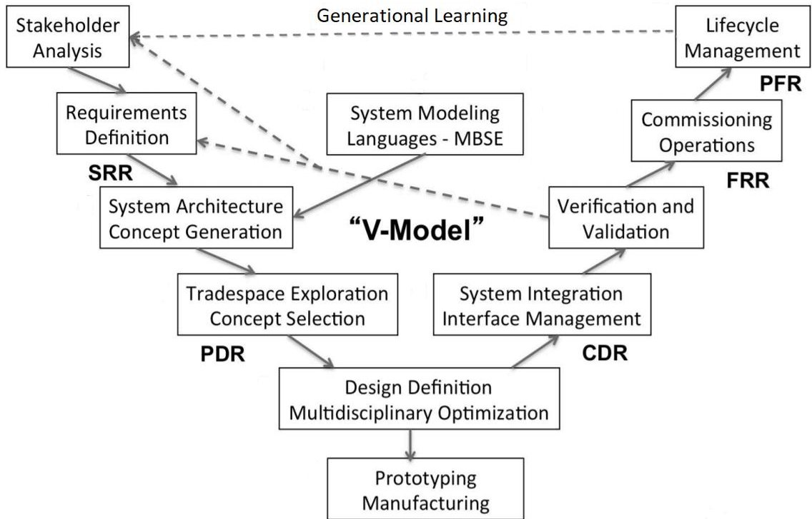

Figure 1-1: The systems engineering Vee model, a common model of how systems engineering tasks evolve over the lifecycle [90]

performing verification and validation to ensure that the system meets requirements and satisfies the customer. Finally, the system is deployed, operated, and retired. Throughout the lifecycle, the systems engineering team must track and mitigate risks, manage the cost, schedule, and configuration of the system, and balance the concerns of subsystem engineers.

The space system development process is a series of decisions, made over time, with an increasing level of detail and maturity in the design [82] [46]. The process is highly iterative with decisions made at higher levels being used to frame the set of options at lower levels. Decisions made later in the lifecycle benefit from the additional knowledge about the design space that is gained as the system is designed. Traditional design frameworks don't take advantage of the fact that more information is available later in the design process to revisit decisions made early in the design process.

Uncertainty is prevalent in space system development [112]. System performance is difficult to measure before launch and so tests and models are used to raise the likelihood of the system performing as intended after launch. These tests and models are imperfect reproductions of the actual operational environment and therefore

<!-- PDF_PAGE: 31 -->

performance estimates are uncertain. Space systems involve many tightly integrated components and therefore uncertainty arises from the difficulty in accurately quantifying all of the system interactions. Finally, system properties may not be accurately known and therefore cannot be modeled precisely. Many techniques exist to develop space systems under these types of uncertainty [12] [109] [20]. However, these approaches make the assumption that all uncertainty can be modeled a priori and this assumption does not always hold as the probability of some events that can occur during the development process cannot be accurately estimated. This type of uncertainty is called deep uncertainty [65].

The definition of deep uncertainty taken from Lempert et al. and used in this thesis is as follows [65] [117]:

"the condition in which analysts do not know, or the parties to a decision cannot agree on, (1) the appropriate models to describe the interactions among a system's variables, (2) the probability distributions to represent uncertainty about key variables and parameters in the models and/or (3) how to value the desirability of alternative outcomes."

Many events that may occur during the development process fall into the category of deep uncertainty. For example, a component may break during handling, a new technology may not work as intended, or unexpected interactions between system elements may emerge. These events are difficult or impossible to predict beforehand with confidence.

This research introduces the Model-based Adaptive Design under Uncertainty (MADU) framework for use in developing space systems. The framework looks for opportunities to improve past decisions when new information is learned while also handling deep uncertainty by updating the system design after unforeseen events occur. The framework is enabled by Model-based Systems Engineering (MBSE) where system information is captured in a descriptive system model instead of separate documents, spreadsheets, and slide decks [29]. MBSE is a key enabler of MADU because it supports descriptive modeling of the system, the design space, and decisions

<!-- PDF_PAGE: 32 -->

made about the system design. Frequent redesigns can be wasteful and so incremental search techniques based on conflict learning are used to perform the design update efficiently. With this framework, uncertainty can be more completely accounted for during the design process, saving rework, improving system performance, and lowering cost.

## 1.1 Motivation

Space systems commonly experience cost overruns and programmatic delays. One root cause of these issues is that current uncertainty management techniques do not adequately handle unforeseen events and don't emphasize revisiting decisions in light of new information. In contrast, strategies for dealing with deep uncertainty rely upon adaptation to address unforeseen events. NASA's uncertainty management processes generally seek to avoid or minimize change. With the introduction of model-based systems engineering, uncertainty management processes can be improved to incorporate efficient adaptation of the design in light of new information that is learned during the development process. Efficient design updates minimize the effort needed to perform design adaptation and enable more analyses to be conducted, improving insight into the system.

## 1.1.1 Limitations in Uncertainty Management in Space System Design

Historical data shows that, despite mature uncertainty management processes, space systems commonly experience issues related to uncertainty management during development. Deep uncertainty is a root cause of these issues. This section reviews programmatic performance data across many NASA and DOD projects and dives into the issues experienced during the development of the James Webb Space Telescope to show how current uncertainty management processes do not effectively handle deep uncertainty.

<!-- PDF_PAGE: 33 -->

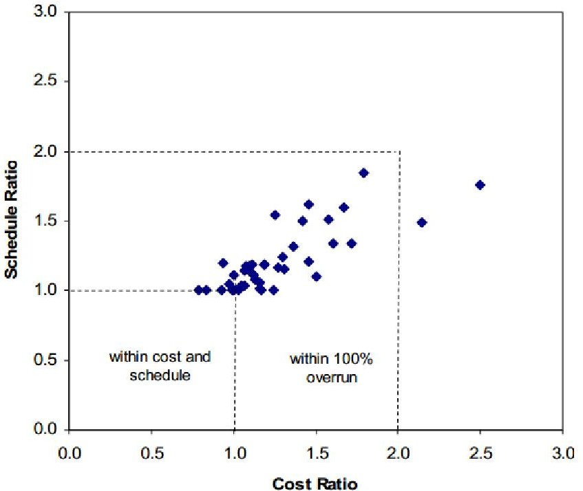

Figure 1-2: The ratio of actual cost to estimated cost is plotted on the horizontal axis and the ratio of actual schedule to estimated schedule is plotted on the vertical axis for a set of selected NASA missions under development between 1992 and 2007. The average cost overrun is 27% and the average schedule overrun is 22% with cost and schedule overruns being correlated. [24]

## Chronic Programmatic Overruns

NASA and Department of Defense DoD space missions commonly experience cost and schedule overruns. A summary of the cost and schedule performance of forty NASA missions [24] is shown in Figure 1-2. The ratio of actual cost to estimated cost is plotted on the horizontal axis and the ratio of actual schedule to estimated schedule is plotted on the vertical axis for a set of selected NASA missions under development between 1992 and 2007. The vast majority of mission experience both cost and schedule overruns with the average cost overrun being 27% and the average schedule overrun being 22%.

DoD space systems have not performed any better. A GAO report from 2005 recorded many programmatic issues with major space acquisitions [31]. The Advanced Extremely High Frequency (AEHF) program experienced cost increases of over 50% and schedule delays of over three years. The National Polar-orbiting Operational Environmental Satellite System (NPOESS) experienced a cost increase of over 10%. Worst of all, the Space Based Infrared System High (SBIRS-High) experienced a unit

<!-- PDF_PAGE: 34 -->

cost increase of over 150% and schedule delays of at least six years.

The reasons for such extensive programmatic breaches include repeated changes to requirements, reliance on immature technology, and reliance on immature software [87]. These root causes are all manifestations of deep uncertainty. If requirements constantly change, constant rework is needed to update the system design to ensure that it satisfies the latest set of requirements. This difficulty is a form of deep uncertainty because the development team may be able to agree on an approximate set of requirements but does not have enough knowledge to bound the correct set of requirements. Relying on immature technology or software increases the dependence on effective uncertainty management processes because unforeseen issues may arise when those items are matured. This reliance is also a form of deep uncertainty because the models available to the design team do not fully scope the technology or software development effort necessary to build the system.

## James Webb Space Telescope Development Issues

The James Webb Space Telescope (JWST) is a next generation space telescope that will greatly expand humanity's knowledge of the universe [39]. However, it has experienced unprecedented extensive delays during development. The cost of JWST has increased 93% to $9.6 billion and the launch date of the telescope has slipped 81 months to March 2021 [38] since it was baselined in 2009 [81]. This section will review some of the difficulties experienced by the project and trace them to inadequate handling of deep uncertainty.

The delays experienced by JWST can be largely divided into three categories: mismanagement of the project, workmanship issues, and integration and test schedule issues. During the detailed design phase, the project was underscoped, resulting in insufficient funds to accomplish the tasks necessary to ensure a timely completion of the telescope [11]. The budget that the project was working under was not based on a detailed estimate of the effort necessary to complete the project. Additionally, the budget reserves that could be used to pay for the completion of unforeseen tasks or tasks that took longer than anticipated were too low because they were established

<!-- PDF_PAGE: 35 -->

against a subset of the actual work that needed to take place. Essentially, the project was budget constrained and therefore would push work to following fiscal years when it ran out of money. While this stance allowed the project to stay on budget in a given year, it greatly increased the overall cost of the project. Delaying work tends to increase the cost of that work because other tasks that rely upon the completion of that work are delayed as well. These management issues are manifestations of deep uncertainty because the project was struggling with issues that it could not predict.

While assembling and testing the telescope, repeated flight hardware was repeatedly mishandled. In 2014, cryocooler delivery was delayed three weeks because of unauthorized work on the compressor and an additional three weeks because of a manufacturing error [32]. In October 2015, some hardware was damaged while being vacuum sealed for transport [35]. This issue delayed the project three weeks. In January 2016, a deficient test cable caused a vibration test anomaly resulting in a two week delay [35]. In April 2017, too much voltage was applied to pressure transducers on board the spacecraft, damaging them [36]. Combined with other issues, this incident delayed the schedule by five weeks. In May 2017, some propulsion system valves leaked beyond permissible levels and needed refurbishment [37]. The root cause of the leaking was that the valves were cleaned with an incorrect solvent. The rework caused by this incident delayed the schedule by two months.

Workmanship issues are a good example of deep uncertainty because they are nearly impossible to predict ahead of time. Humans can make mistakes in unpredictable ways. While workmanship issues can occur on any project, they are typically addressed by building sufficient margin into the schedule. However, JWST consistently struggled to predict the amount of schedule margin needed to accommodate the issues that were occurring [35]. The rate at which JWST was consuming schedule margin would result in the depletion of schedule margin before the desired launch date. Such a delay eventually occurred when all options to add schedule margin were exhausted. As can be seen from these problems, the project did not adequately deal with deep uncertainty related to workmanship issues.

The integration and test phase of JWST has experienced many issues beyond

<!-- PDF_PAGE: 36 -->

workmanship mishaps that have delayed the launch of the telescope. These issues are all related to underestimation of the time that is required to accomplish integration and test tasks. In 2016, the integration of the instrument section of the telescope was delayed one month because of greater than expected complexity with accomplishing the necessary work [35]. For example, more than 900 thermal blankets needed to be installed and access issues prevented blanket installation from being done in parallel. An additional two weeks of reserve were consumed when the installation and welding of propellant lines were more complicated than expected. In September 2017, three and a half months of reserve were consumed because the prime contractor underestimated the amount of time it would take to complete the integration and test of the spacecraft [36]. Again, tasks could not be performed in parallel because the work was elevated and an insufficient number of lifts were available. Also in September 2017, when lessons from the initial sunshade folding operation were incorporated into the schedule, an additional three months of schedule margin were consumed.

Like workmanship issues, integration and test issues are good examples of deep uncertainty because they are unpredictable. Their unpredictability arises from the lack of sufficiently accurate models to understand how the time allocated to accomplish a certain task compares with the true time that it will take to accomplish that task. Historical data is less reliable for one-of-a-kind systems and therefore models of how integration and test will proceed may be less accurate. Again, schedule margin is allocated to cover these unforeseen delays but JWST did not allocate sufficient schedule margin to cover the magnitude of delays that were experienced.

## 1.1.2 Weaknesses in NASA's Uncertainty Management Processes

The NASA space system design process utilizes two processes for making design decisions under uncertainty: the Decision Analysis process and the Technical Risk Management process [82]. Decision Analysis is a framework for making design decisions while considering all reasonable decision alternatives and accounting for uncertainties

<!-- PDF_PAGE: 37 -->

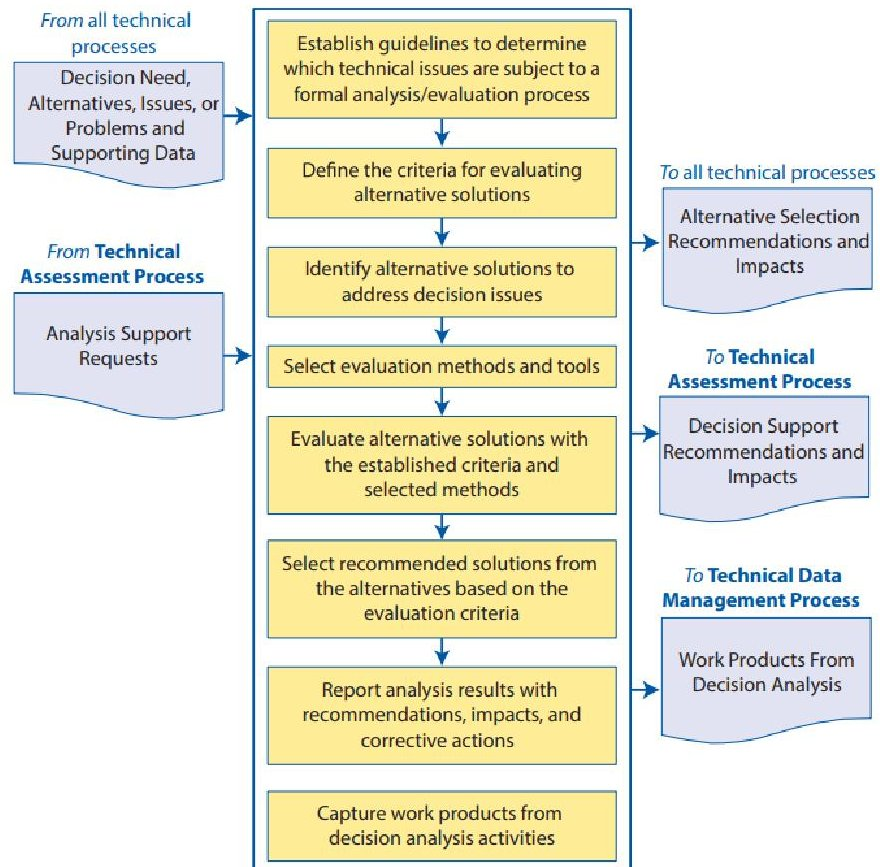

Figure 1-3: Flow diagram of the eight steps of the decision analysis process [82].

that may affect the ranking of alternatives. As shown in Figure 1-3, Decision Analysis consists of eight steps. First, guidelines are established to identify design decisions that require analysis and to determine the appropriate level of formality for each decision. Second, the criteria for comparing design alternatives are defined. Third, the set of alternatives to be considered is identified. Fourth, the evaluation methods are identified. Fifth, the alternatives are analyzed per the methods determined in the previous step. Sixth, the results of the analysis of alternatives are analyzed to select which alternative will be recommended. Seventh, the results of the analysis are documented and reported to stakeholders. Eighth, the products of the decision process are captured. If uncertainty affects the decision, it is incorporated into the analysis and the selection of the recommended alternative. No criteria are established that define when to revisit the decision.

The NASA Risk Management process is the combination of two subprocesses: Risk Informed Decision Making (RIDM) and Continuous Risk Management (CRM) [20]. RIDM and CRM are complementary processes. The RIDM process is invoked whenever key decisions on the system architecture, system design, or requirements are

<!-- PDF_PAGE: 38 -->

made. The CRM process manages the process of achieving performance commitments [20].

The Risk Informed Decision Making (RIDM) process defines how to incorporate risk analysis into architecture and design decisions, requirement changes, and trade studies, and other important decisions [20]. RIDM is composed of three steps as shown in Figure 1-4. The first step is the Identification of Alternatives. In this step, stakeholder goals are identified and assigned a performance measure. The performance measure should quantify the extent to which each alternative fulfills a stakeholder goal. After the performance objectives have been identified, a set of feasible alternatives that accomplish the objectives are compiled. The second step is the Risk Analysis of Alternatives. In this step, models are used to predict the performance of the alternatives identified in the first step while accounting for the uncertainty in how well each alternative accomplishes stakeholder goals. The output of this step is a probability distribution over the range of possible values of a set of performance parameters for each alternative. The third step is Risk-Informed Alternative Selection. In this step, the stakeholders and decision makers review the performance of each alternative with respect to the performance measures and either decide on an alternative, decide to eliminate some alternatives, or suggest new alternatives. Commitments made through an RIDM process are passed to the CRM process so that progress towards meeting the commitments can be managed. The NASA Risk Management Handbook notes that RIDM may be an iterative process but does not provide guidance within the RIDM process for how to revisit a decision made using RIDM.

The Continuous Risk Management (CRM) process tracks risks to ensure that all commitments are met [20]. Commitments in this context refer to requirement definitions, architecture or design decisions, or use of key technologies. CRM is composed of five steps as shown in Figure 1-5. The first step is to identify commitments that have a chance of not being met. The next step is to analyze the risk identified in the previous step to calculate a likelihood that the risk manifests and the consequence of the risk, or impact of the manifested risk on the system. The likelihood and conse-

<!-- PDF_PAGE: 39 -->

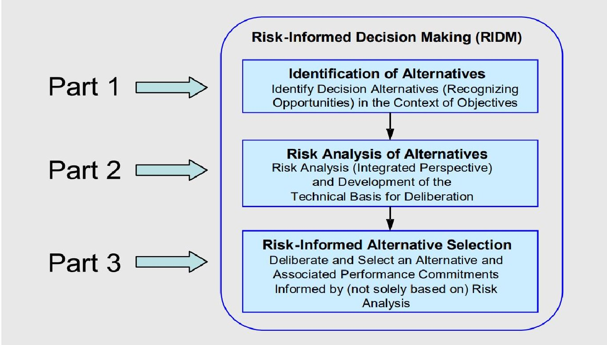

Figure 1-4: The three steps of the Risk Informed Decision Making (RIDM) process [20].

quence are typically presented in a 5x5 risk chart [83]. The third step is to plan what actions must be taken in reaction to the identified risk. The possible actions are: to accept the risk for the time being, to mitigate the risk to an acceptable level, to watch the risk to see how it evolves, to research the drivers of the risk to better understand their uncertainties, to elevate the risk to the next level higher in the project organizational hierarchy if the risk cannot be managed at the current level, or to close the risk if all risk drivers can be shown to be insignificant. The fourth step is to track the risk to evaluate how it changes as the design evolves or as mitigation plans are executed. The fifth step is to control the risk if it is not tracking in a favorable direction. The steps form a loop as the CRM process is continuously applied to track risks as more knowledge is gained on their possible effects on the mission. If a commitment is at severe risk of not being met, despite implementation of a risk mitigation strategy, the CRM process passes the risk back to the RIDM process for re-consideration of the choices that led to that risk. This feedback is the only way for a decision to be revisited within the NASA risk management framework.

Revisiting a decision only when the commitment entailed by that decision cannot

<!-- PDF_PAGE: 40 -->

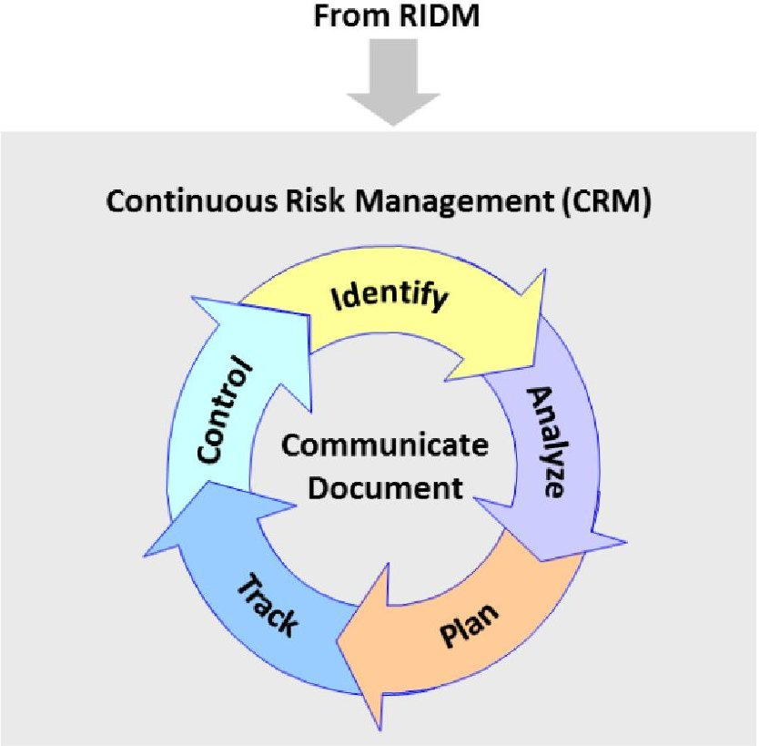

Figure 1-5: The five steps of the Continuous Risk Management (CRM) process [20].

be met has several disadvantages. Firstly, because revisiting a decision is only done after failure of the risk mitigation strategy, opportunities to improve the design that were unknown at the time of the original decision will not be identified or implemented. Secondly, suboptimal risk mitigation strategies will continue to be employed as long as they are succeeding at mitigating the risk. Improved mitigation strategies will not necessarily be employed. Thirdly, the CRM process as a whole must succeed in order for decisions to be revisited. If the CRM process has a flaw and does not properly detect uncontrolled risks, then the decisions that lead to that uncontrolled risk will never be revisited.

## Issues with Revisiting Decisions from JWST

Examples from JWST reinforce the issues with revisiting decisions present in NASA's risk management processes. The JWST project was very reluctant to adapt in light of new information. For example, the GAO repeatedly recommended that a detailed update be made to cost and schedule predictions, without any action from NASA or the project [36]. The project was confident that its basic uncertainty manage-

<!-- PDF_PAGE: 41 -->

ment process would detect and mitigate risks. In reality, many issues flew under the radar until they ballooned into significant issues that severely impacted cost and/or schedule. During the integration and test phase of the project, the GAO found that 70% of reserve funding was being spent on issues that had not been predicted by the project [32]. The budget established in 2008 that was followed for the first several years of the project did not incorporate information such as known risks to cost or schedule or prior performance of contractors [11]. Furthermore, the project did not do a detailed bottoms-up cost estimate in preparation for several major reviews prior to 2008. A cryocooler replan performed in 2013 did not account for risks to the schedule [33]. Unsurprisingly, the cryocooler subsequently took much longer to develop than predicted and cost much more than predicted [34].

Personnel at the prime contractor consistently exceeded estimates by significant amounts. In December 2015, the required workforce had exceeded the planned workforce for 20 consecutive months [34]. Despite firm evidence that the required personnel levels were well beyond the planned levels, workforce levels continued to exceed planned levels through February 2018 by which time it had exceeded planned levels for 44 consecutive months [36]. Figure 1-6 is from a GAO report and shows the predicted versus actual full time equivalents at Northrop Grumman, the prime contractor, for fiscal years 2016 and 2017 [36]. The exceedances were not minor, in some months they were close to or above 50%. Even during the replanning done for the start of fiscal year 2017 in October 2016, the planned workforce is still significantly below the actual workforce. The inability of the prime contractor to manage its workforce numbers was the primary contributor to the cost overrun proposal submitted by the prime contractor in July 2016 [35]. From these examples, it is clear that the project suffered from an inability to rigorously update its plans based on information gained during development.

## 1.1.3 Building on Model-based Systems Engineering

Model-based Systems Engineering (MBSE) is the formalized application of modeling to support systems requirements, design, analysis, verification, validation, and oper-

<!-- PDF_PAGE: 42 -->

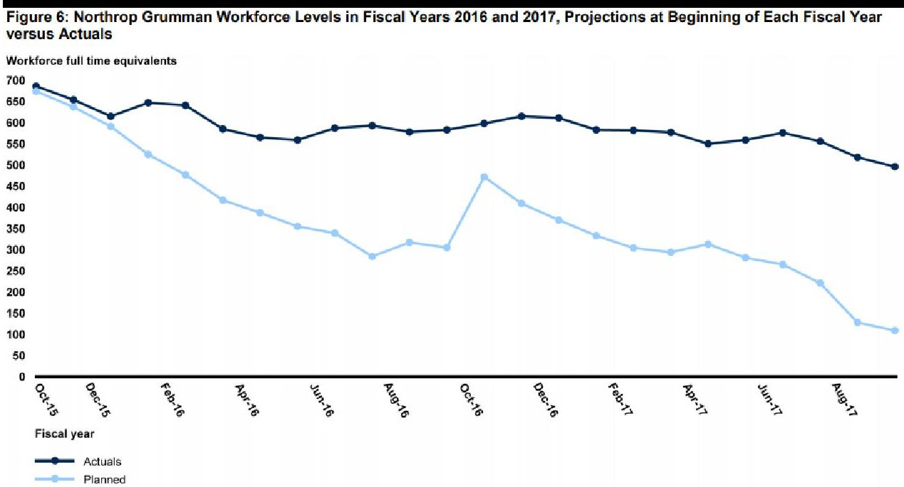

Figure 1-6: Planned versus actual full time equivalents at Northrop Grumman, the prime contractor for JWST [36]. The light blue line shows the planned workforce each month whereas the dark blue line shows the actual workforce each month. The actual workforce needed far outstripped the planned workforce each month. Reproduced from GAO-18-273.

ations [29] [26]. MBSE can provide excellent support for implementing strategy to effectively handle deep uncertainty for three reasons. Firstly, with a systems model written in a formal language, the process of identifying how the design is impacted by new information should be much more straightforward than in a document-based paradigm. Given sufficient modeling detail of assumptions made for each decision, a query should be able to retrieve decisions that were impacted by a change to an assumption. In document-based systems engineering, such an analysis would a large amount of effort by engineers to cross reference information spread across many different documents. Secondly, the system model can be connected to analysis models to enable streamlined re-execution of decisions and trade studies when necessary. Thirdly, the system model serves as an interface between the design team and algorithms that assist with decision making. The design team can use the system model both as an information repository, as well as a human-readable interface for system information.

<!-- PDF_PAGE: 43 -->

## 1.1.4 Revisiting Decisions Efficiently

Constantly revisiting decisions when new information is learned can result in wasted work if the new information has no impact on previous decisions. Therefore, the decision revisiting process should be made as efficient as possible. Beyond reducing wasted work, efficient revisiting of decisions allows more analyses to be performed and therefore enables deeper insight into the system. On JWST, an integrated model was used to support decisions [75]. However, performing a decision cycle with the integrated model took three to six months. Therefore, only a few cycles were possible between major design reviews. As information is constantly learned during the development process, the impact of new information may takes months to quantify with such a slow analysis process. The use of MBSE can shorten the length of the analysis process through connection of the system model to analysis models, but other opportunities for improving analysis time, such as more efficient optimization techniques, should also be used. This thesis combines both MBSE and efficient optimization techniques to produce a framework that can efficiently update the optimal design when new information is learned.

## 1.2 Problem Statement and Research Questions

The problem statement for this thesis is:

How can MBSE be leveraged to combine strategies for decision making under deep uncertainty and constraint learning techniques to create a design framework that can efficiently handle deep uncertainty in the iterative development of space systems?

To refine the scope of the thesis, this problem statement is broken down into more specific research questions about the design framework presented in this thesis:

1. How can the framework perform space system design under deep uncertainty?

2. How can a system model be used to perform space system design while considering uncertainty?

<!-- PDF_PAGE: 44 -->

3. Does the framework perform updates efficiently?

## 1.2.1 Contributions

The primary contribution of this thesis is a model-based framework for development of space systems under deep uncertainty. An implementation of the framework is presented and exercised on two case studies. The results from the case studies show that the framework is able to efficiently identify an optimal design, even when unforeseen changes are made to the problem. The contributions with respect to each research question are:

1. A framework is developed that addresses deep uncertainty in space system design through design adaptation. Deep uncertainty is handled through an update process where design decisions are revisited when new information is learned. This strategy allows the consequences of unforeseen events on the design to be quantified. This information can be used by the design team to inform design decisions. The current state of the practice of space system development doesn't always examine the implications of new information when it is learned. Therefore, the framework presented in this thesis is less vulnerable to unforeseen events than current practices.

2. A system model is incorporated into the design framework. The system model contains information on known system uncertainties, information about design decisions, and integrates with optimizers used to quantify the impact of new information. Current space system design practices rarely utilize a system model. Because the framework presented in this thesis utilizes a system model, traceability between design decisions and information learned about the system during development is improved over current practices.

3. Constraint learning techniques are used to perform efficient design updates. Conflicts and satisfying states from previous optimizations are stored in the system model and reused in new optimizations. Reuse of these artifacts

<!-- PDF_PAGE: 45 -->

reduces the design space searched in new optimizations. Efficiency is demonstrated using two case studies. Current state-of-the-art algorithms for solving constraint optimization problems don't reuse information between optimizations. Across both case studies, the framework presented in this thesis is able to consistently find the new optimal design faster than an algorithm with an identical search strategy that doesn't reuse information. The average savings in runtime and number of optimizer calls across the two case studies is 58%.

## 1.2.2 Scope

While uncertainty management is performed across the entire project lifecycle, this research will only examine uncertainty management processes during the development of a space system. The development phase of the project is defined as beginning in Pre-Phase A and stretching until launch. During this period, the amount of information known about the system evolves enormously, so re-evaluation of decisions is critical. This thesis will only focus on addressing deep uncertainty in space system development but deep uncertainty is present in the development of other types of complex systems. The framework developed in this thesis could be used to assist in the development of those systems as well. Out of the many types of space systems, this framework will be more useful to those that use new technology, explore new environments, or support new markets. Systems with strong heritage will see less benefit from the framework because unforeseen events are less likely to occur during development. The framework does not address ways in which information can be learned. It focuses solely on how to handle new information after it has been learned to update the system design.

## 1.3 Thesis Roadmap

This thesis is organized into six chapters as shown in Figure 1-7. Chapter one contains the introduction, motivation, and research questions. Chapter two contains the background and literature review. Chapter three presents the design framework de-

<!-- PDF_PAGE: 46 -->

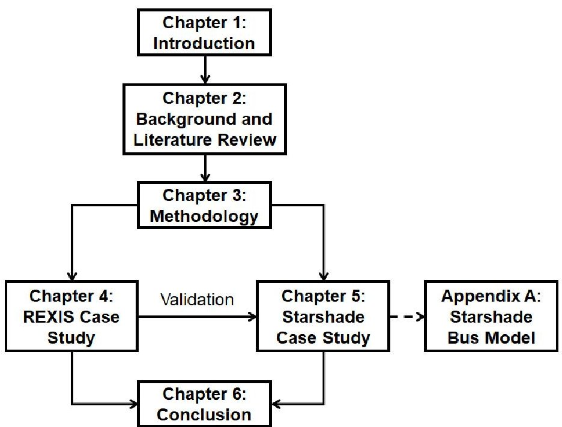

Figure 1-7: Roadmap for this thesis.

veloped in this research. Chapter four applies the design framework to an example problem based on the REXIS thermal subsystem in order to explore its computational properties. Chapter five applies the framework to the Starshade mission concept in order to illustrate its advantages over the traditional uncertainty management process. Appendix A provides supporting information for Chapter five. Chapter six is the conclusion containing a summary of the thesis, a list of thesis contributions, and several directions for future work.

<!-- PDF_PAGE: 47 -->

# Chapter 2

# Background and Literature Review

This chapter reviews several topics to provide background information on foundational concepts relevant to the design framework developed in this thesis. Additionally, a review of the relevant literature is performed to understand how previous research has approached the challenge of space system design under deep uncertainty.

## 2.1 Background

In this section, background information on Model-based Systems Engineering (MBSE), deep uncertainty, and constraint satisfaction problems is presented. The work presented in this thesis is enabled by MBSE and utilizes principles from constraint satisfaction and so understanding these is important to provide context. Deep uncertainty is a primary motivating factor for this work and so this section defines deep uncertainty and presents different types of deep uncertainty.

## 2.1.1 Model-based Systems Engineering

Model-based systems engineering (MBSE) is the formalized application of modeling to support systems requirements, design, analysis, verification, validation, and operations [29] [26]. As opposed to traditional document-based methods, MBSE methods store system information in a descriptive system model. The systems model is usually

<!-- PDF_PAGE: 48 -->

represented using a systems description language such as the Systems Modeling Language (SysML) or the Object Process Methodology (OPM) [91] [21]. A central idea behind a system model is to serve as a "single source of truth" for system information [120]. In this paradigm, system information is only stored in one place, avoiding duplication and making updates straightforward. Additionally, the formalism of a systems description language improves communication among systems engineers by reducing ambiguity and enables automated system analysis. With these advantages, MBSE is expected to result to improve the ability of systems engineers to manage complex systems.

Currently, the most prominent MBSE modeling language is the Object Management Group's (OMG) Systems Modeling Language (SysML). SysML is a graphical, descriptive modeling language developed for complex systems [91]. The system models used in this thesis are written in SysML. It is a sibling of the Unified Modeling Language (UML) used to describe software. SysML is able to describe the form of a system, the interfaces within a system, requirements on a system, the behavior of the system, and more. It has a diagrammatic syntax meaning that concepts can be expressed using visual elements. General information about SysML can be found in the SysML specification or any of several books on SysML modeling [91] [30] [120].

SysML defines nine diagram types that display modeling elements. The nine diagram types are shown in Figure 2-1 grouped into structural and behavioral categories, with the Requirements Diagram fitting in neither category. The diagram types used in this research are the Block Definition Diagram, Internal Block Diagram, and Parametric Diagram (shown in bold in the figure). Each type of diagram displays a subset of the system model using a subset of the SysML modeling elements. A Block Definition Diagram (BDD) captures system form and relationships between system elements such as part-whole relationships and general-specific relationships. An Internal Block Diagram (IBD) captures the interfaces within a system. A Parametric Diagram (PAR) expresses mathematical or logical relationships between system properties.

<!-- PDF_PAGE: 49 -->

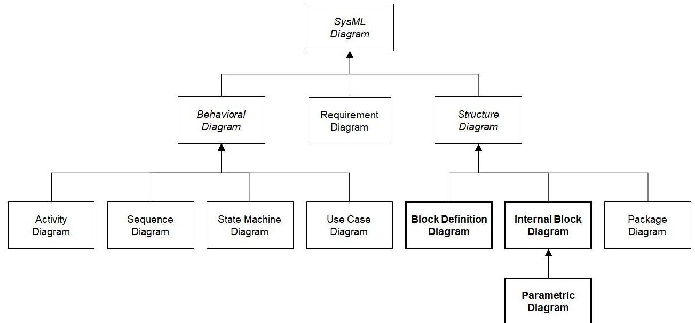

Figure 2-1: The nine SysML diagram types grouped into structural and behavioral categories, with the Requirements Diagram fitting in neither category [91]. The diagram types used in this research are the Block Definition Diagram, Internal Block Diagram, and Parametric Diagram.

## 2.1.2 Deep Uncertainty

Deep uncertainty refers to the situation where the probability of some future events cannot be accurately estimated. The framework developed in this thesis is focused on addressing deep uncertainty in the space system development process and utilizes the following definition of deep uncertainty taken from Lempert et al. [65] [117]:

"the condition in which analysts do not know, or the parties to a decision cannot agree on, (1) the appropriate models to describe the interactions among a system's variables, (2) the probability distributions to represent uncertainty about key variables and parameters in the models and/or (3) how to value the desirability of alternative outcomes."

Deep uncertainty is related to the economic concept of Knightian uncertainty which refers to the inability to quantify all factors that affect a decision [58]. Deep uncertainty is commonly discussed as on a spectrum between total certainty and total ambiguity [14] [117]. Total certainty is the situation where everything is precisely known. Total ignorance is the situation where nothing is known. Neither extreme is realistic but they serve as two ends of a scale. Courtney defines four levels of uncertainty between these two extremes. Level one uncertainty is the situation where slight

<!-- PDF_PAGE: 50 -->

uncertainty exists but has a negligible impact on the system. Level two uncertainty is the situation where uncertainty exists and can be described statistically. Level three uncertainty is the situation where a range of possible outcomes exist but only a representative set of outcomes can be identified and quantified, with other outcomes not ruled out. Level four uncertainty is the situation where a large variety of outcomes exist, with no understanding of where a more likely outcome lies within the range of possibilities. The full range of possibilities may be unknowable. Level three and level four uncertainties are collectively referred to as deep uncertainty [15].

## 2.1.3 Constraint Satisfaction Problems

A constraint satisfaction problem (CSP) is a mathematical problem in which each variable within a set of variables must be assigned a value such that all constraints present in the problem are satisfied [101]. This thesis will build on algorithms that solve CSPs in order to create an optimization algorithm that can be used within the MADU framework. Constraint problems are typically solved using an algorithm that incrementally constructs a series of candidate solutions. Using propagation methods, after a variable has been assigned a value, constraints can be used to prune the set of allowed assignments to unassigned variables. If all possible values are pruned from the domain of an unassigned variable, then the search algorithm backtracks by unassigning variables and proceeds down a different branch of the search tree. The algorithm terminates when a satisfying solution is found.

A particularly useful concept for efficient search algorithms is that of conflict learning. A conflict is a partial set of variable assignments that cannot be extended into a full assignment that satisfies all constraints [107]. Conflicts can be used during search to identify and avoid unsatisfiable regions of the search space. A powerful algorithm called conflict-directed $ A^{*} $ solves CSPs by combining conflict-directed search with the $ A^{*} $ informed search algorithm [123]. Conflict-directed $ A^{*} $ works by finding the most promising partial assignment that resolves all conflicts. Each potential solution is then checked for satisfiability. If the potential solution is unsatisfiable, then conflicts are extracted and a new solution is constructed that resolves both the old and new

<!-- PDF_PAGE: 51 -->

conflicts. This process is repeated until a solution is found that is satisfiable. The conflict-directed A $ ^{*} $ algorithm is able to find the global optimum to a non-convex, combinatorial problem.

Constraint problems that incorporate models of uncertainty are called stochastic constraint satisfaction problems (stochastic CSPs) [119]. These problems involve random variables and maximize expected utility. Constraints within stochastic CSPs can take different forms. A particular type of constraint that is used in this research is called a chance constraint. Chance constraints specify that a constraint over a set of random variables must be satisfied with some minimum probability [56]. Such constraints are used to ensure that the solution to a constraint satisfaction is likely to be satisfiable while accounting for probabilistic uncertainty in the problem.

## 2.2 Literature Review

This literature review will examine previous work in three areas: decision making under deep uncertainty, computational design with MBSE, and incremental search techniques. The approaches for making decisions under uncertainty are reviewed with a goal of understanding what strategies are necessary to handle unforeseen events. The computational design with MBSE literature is reviewed in order to evaluate how existing approaches deal with uncertainty. Finally, established incremental search techniques are reviewed to determine if any existing techniques enable efficient updating of a system design when new information is learned. The framework developed in this thesis implements strategies from existing decision under deep uncertainty approaches using established incremental search algorithms within a MBSE paradigm.

## 2.2.1 Decision Making under Deep Uncertainty

The concept of deep uncertainty has been developed in the fields of economics, policy, and climate change. In the context of those fields, principles and strategies for making decisions under deep uncertainty have been developed.

Strategies to make decisions under deep uncertainty utilize one or more of four

<!-- PDF_PAGE: 52 -->

principles: resistance, resilience, robustness, or adaptation [118] [117]. Strategies can be categorized by whether they proactively predict future conditions and attempt to make good decisions in light of those future conditions or if they reactively change decisions when new information emerges. The resistance principle is proactive and entails making decisions that are viable in the worst possible future condition. The resilience principle involves making decisions that can be easily recovered from if they turn out to be incorrect based on information that emerges in the future. The robustness principle is proactive and aims to make decisions that perform well in many conceivable situations. The adaptation principle is reactive and quickly changes decisions when new information emerges.

A single strategy can implement combinations of these strategies. However, different strategies are better suited to different levels of deep uncertainty. Resistance-focused strategies are only suitable for Level one and Level two uncertainty where the worst future case can be identified. Resilience-focused strategies may be suboptimal in the near term and also require that all conceivable future scenarios be identified in order to guarantee that any adverse future can be recovered from. Therefore, it is only suitable for Level one, two, and three uncertainty. Robustness-focused strategies also require that all future scenarios be identified in order to show that the chosen solution is acceptable in all futures. Therefore it too is only suitable for Level one, two, and three uncertainty. Adaptation-focused strategies are the only type of strategy that can effectively deal with Level four uncertainty because they are able to change decisions after an unforeseen event manifests.

Current NASA processes for uncertainty management adhere mostly to the resilience strategy. They don't emphasize revisiting decisions when new information is learned. The framework developed in this thesis focuses on adaptation in order to improve the handling of deep uncertainty over current NASA uncertainty management processes.

Lempert et al. present a multifaceted approach to making decisions under deep uncertainty called robust decision making [65]. Their approach is made up of four elements: consider a large number of possible, plausible future scenarios, seek ro-

<!-- PDF_PAGE: 53 -->

bust, rather than optimal, strategies, use adaptive strategies that evolve over time in response to new information, and support interaction between the computer tools running the analyses and the human decision makers. They then illustrate such a strategy on the problem of sustainable development. A later paper described the implementation of this strategy to manage water in the American west [66].

Ben-Haim introduced information-gap analysis which supports robust decisions under uncertainty by quantifying how wrong models or data must be before impacting the outcome of a decision [5]. This approach has been used to evaluate decisions to protect the Sumatran rhino [99].

Marchau et al. introduced a process for making adaptive policies [68]. Their approach has four steps. In the first step, objectives, constraints, and policy alternatives are identified. In the second step, a basic policy is defined. This basic policy may have weaknesses or vulnerabilities to uncertainty. Those vulnerabilities are identified in the third step, along with actions to remedy those vulnerabilities and signposts for identifying if the policy needs to change. The fourth step is the implementation and monitoring of the policy. If necessary, the policy can be scrapped and a new policy developed by restarting from the first step with the benefit of the knowledge gained while implementing the original policy. This framework is illustrated by developing hypothetical policies for transit planning.

A range of methodologies and principles to address deep uncertainty have been developed. In particular, adaptation is a powerful way of mitigating the most unpredictable types of deep uncertainty. These methodologies can both establish plans that are robust against known uncertainty and adapt to continue performing well when unforeseen events occur. However, to the best of the author's knowledge, this research is the first application of the concept of deep uncertainty to the development of space systems. This research will focus on incorporating the robustness and adaptability aspects of strategies for making decisions under deep uncertainty into the space system development process.

<!-- PDF_PAGE: 54 -->

## 2.2.2 System Design with Model-based Systems Engineering

Many different methodologies for designing systems within the MBSE paradigm have been developed. This section will present several different design methodologies and discuss their capabilities and limitations.

Some MBSE design methodologies utilize model transformation techniques to explore the design space and select an optimal design and are in essence a form of design synthesis through compilation. Model transformation techniques are suited for topological optimization where the topology of the system is allowed to vary, along with system parameters [48] [114]. Model transformation algorithms apply a series of rules or patterns to generate a suite of alternatives that meet constraints. Herzig et al. developed an algorithm to perform automated architecture synthesis of satellite constellations using model transformations [50]. The optimization is performed using the MOMoT framework which enables model transformation technologies like Henshin to be combined with optimization technologies like genetic algorithms [27]. Spyropoulos and Baras integrated SysML and Consol-Optcad to develop a trade-off analysis framework based on a systems model [106]. To enable transfer of information between those tools, they created meta-models of both in Ecore and defined transformation rules using eMoflon. Their case study centered on the design of an electrical microgrid. The structure of the microgrid was modeled in SysML using Blocks and constraints between model parameters were represented using parametric diagrams. The model was then transformed to Consol-Optcad and solved using gradient-based methods.

Other methodologies represent architecture alternatives within a system model and pass the system model to an optimizer to select among those alternatives. Several authors at Lockheed Martin have built a composable architecture system in SysML to model a satellite product line to help a design team find attractive designs [97] [76]. Spacecraft architecture variants are modeled in SysML, pruned based on compatibility by comparing variants against a rules database, and then a visualization tool enables a design team to compare and choose among the valid architectures. Variability is expressed by modeling architectural decisions and using those decisions to map

<!-- PDF_PAGE: 55 -->

abstract system elements to concrete system elements. The pruning rules are based on realistic models of spacecraft subsystems implemented in Excel spreadsheets outside of the system model. Because of the complexity of those subsystem models, the variants must be computed offline, instead of in an interactive manner.

Arifin et al. utilized a genetic algorithm to perform component selection within a defined architecture [3]. They defined an architecture within SysML using Blocks and used instances of those Blocks to define options for each component. The genetic algorithm then selected a set of components that met the constraints and maximized a fitness function. The optimization was conducted directly in the SysML tool using a plugin.

Leserf et al. demonstrated modeling of a variety of architectures and an optimization context in SysML and then extracted that information from the system model and solved a constraint satisfaction multicriteria optimization problem in order to find the optimal architecture [67]. Variability is captured in SysML using custom extensions of the Comment stereotype and could represent choice among alternatives of a component, replication of components within the system, or the range of possible values of a Value Property. The optimization is constructed through generation of an intermediate text file that serves as an input to the chosen optimizer.

LaSorda et al. present an optimization of a system-of-systems satellite constellation architecture with information drawn from a SysML model [63]. They define a Variability Block Definition Diagram that describes variants of a system through a series of trades. The set of outcomes of the trades defines a configuration. Constraints are captured in parametric diagrams. The information from the model was extracted using Phoenix Model Center and optimized using a genetic algorithm.

Herzig et al. used a MILP framework to design robotic assembly cells from information contained in a SysML model [49]. Variability was expressed through a library of resources to draw from. Constraints were expressed using both SysML constraints and the Object Constraint Language (OCL). System information was extracted from the model and transformed to a format that could be solved using a commercial MILP solver. The results of the optimization were then transformed back to SysML.

<!-- PDF_PAGE: 56 -->

One important limitation of the above approaches is that they don't consider uncertainty. Given the significance of uncertainty in space system development, this limitation hampers the applicability of these approaches. An approach introduced by Singh and Willcox that does consider uncertainty uses information gained during the design process into the next generation of products using Bayesian inference [105]. Importantly, this approach considers uncertainty in design parameters and how that uncertainty is reduced through tests and operations. These observations can be used to update uncertainty distributions before designing the next generation of a product. While this methodology doesn't explicitly use MBSE, it is presented in the context of the Digital Thread, a related concept where information about a system over its lifecycle is linked together to support decision making [61].

A general limitation of the established methodologies to perform computational design with MBSE are that they are static and do not provide avenues to revisit decisions when new information emerges. As described in section 2.2.1, revisiting decisions using an adaptive strategy enables level four uncertainty to be handled. The framework introduced in this research uses an adaptive strategy for computational design with MBSE.

## 2.2.3 Incremental Search Algorithms

To support adaptive design under deep uncertainty, efficient search techniques are needed to minimize the work needed when new information is learned. Incremental search algorithms are designed to be efficient when relatively small changes are made to a problem and therefore should perform well within an adaptive design framework. This section explores different types of incremental search algorithms and identifies the incremental strategy that is used in this research.

Many incremental search algorithms for constraint satisfaction problems can trace their roots to work on truth maintenance systems (TMS) and the idea of incremental propagation of information [22]. A truth maintenance system maintains a set of beliefs as information is learned. The original implementation of a TMS used justifications, or the reasons to believe that certain statement is true. Justifications may rely upon

<!-- PDF_PAGE: 57 -->

other beliefs within the TMS and so changes to justifications must be propagated through the graph of beliefs. Many types of TMS's have been developed that address issues with the original implementation such as difficulty in switching between sets of beliefs or to avoid reprocessing justifications that do not change when new information is learned [17] [16] [88].

Incremental search algorithms can be divided into two categories: those that change the cost of states explored during search when the problem changes and those that change the set of valid states when the problem changes. Algorithms in the first category are generally used in the path planning and temporal reasoning communities who both frame their decision problems in terms of weighted graphs. For path planning problems, a robot trying to navigate in an unknown environment must find the shortest path from a start node to a goal node as the obstacles in the environment change. For temporal problems, deadlines can be revised to be earlier or later. One of the first incremental search algorithms for the shortest path problem is the Dynamic SWSF-FP algorithm developed by Ramalingam and Reps [98]. When a change occurs to the problem, this algorithm can efficiently find a new path by repairing the cost of states whose cost was changed by the change to the problem. By repairing nodes in a specific order, the algorithm will eventually repair all nodes affected by the change, including the goal node if it was affected, at which point the algorithm terminates because the minimum cost path to the goal can be computed through an algorithm that traverses from the goal node to the start node by always choosing the lowest cost neighbor node.

This algorithm was improved by Koenig et al. by combining it with the $ A^{*} $ heuristic search algorithm to produce the Lifelong Planning $ A^{*} $ algorithm [60]. This algorithm utilizes a heuristic to only recompute the cost of nodes that close to the optimal path from the start node to the goal node, thereby saving computational effort wasted on repairing nodes that are not relevant to the optimization. A further extension to the Lifelong Planning $ A^{*} $ algorithm is the popular $ D^{*} $ Lite algorithm by Koenig and Likhachev [59]. $ D^{*} $ Lite extends Lifelong Planning $ A^{*} $ to handles cases where the problem changes in a way such that the goal node is redefined.

<!-- PDF_PAGE: 58 -->

Sun et al. developed a slightly different approach in the Generalized Adaptive A $ ^{*} $ algorithm [110]. This algorithm is still based on the $ A^{*} $ search algorithm but improves its heuristic estimate of the distance to the goal between searches. After the true cost to the goal is found after an initial search, the heuristic value for a given node can be updated with the knowledge of where the goal is. If the problem is updated, the heuristic value can be changed according to the type of change in such a way that it is still guaranteed to be admissible but maintains some information from the previous search, making it better informed than a heuristic that didn't utilize information from the previous search. A better informed heuristic results in a more efficient search.

The second type of incremental search algorithms utilize information about how the set of satisfying and unsatisfying states are changed when the problem changes. If some unsatisfying states can be identified before search begins, the search tree can be pruned, resulting in a smaller search space and therefore a more efficient search. These algorithms are used to solve dynamic constraint satisfaction problems. A dynamic constraint satisfaction problem is a sequence of constraint problems where some elements in each CSP have been changed from the previous one [19]. Such a framework closely mirrors the space system design process because the space system design process is iterative and the set of design constraints is evolving and maturing throughout the lifecycle. Therefore, this problem structure is used to develop the framework introduced in this thesis.

Algorithms to solve dynamic constraint satisfaction problems are divided into two general categories: proactive approaches that use information provided by the modeler about the types of problem changes that may occur and reactive approaches that try to use knowledge from the solution of the previous search to help in finding the solution to the next search [115]. Proactive solution methods levy constraints on possible changes between CSPs which reduces the generality of the problem but allows search algorithms to find solutions that are robust against the types of changes that are allowed or to easily adapt when the allowed type of changes are introduced. A robust solution can be found by adding possible future changes to the current problem as soft constraints and maximizing the amount to which the solution of the current

<!-- PDF_PAGE: 59 -->

problem meets these soft constraints [13]. Hebrard et al. introduce the idea of super solutions [47]. A super solution is a solution to a constraint satisfaction problem such that, if a limited number of variables have their values changed, consistency can be restored by changing the values of a bounded number of other variables.

Methods that rely on offline compilation to identify conflicts are also types of proactive solutions because they rely on bounded set of possible problem forms. Chung et al. developed a method to perform model-based diagnosis using conflicts that are computed offline. A similar method for planning was developed by Kim et al. that utilizes a temporal plan network (TPN), a generalization of a simple temporal network that contains all feasible plans [57]. The TPN is used offline to find a feasible plan and used online to repair plans if necessary. Because proactive algorithms make assumptions about the types of future changes, they are not able to handle unpredictable changes as is necessary to properly handle deep uncertainty in space system design.

A variety of types of reactive solution algorithms exist that make different assumptions about what information is available after the problem changes. One approach is to locally perturb the solution to the previous problem guided by a min-conflicts heuristic until a solution to the new problem is found [77] [116]. These algorithms naturally find a solution that minimizes changes between the old solution and new solution. Other reactive algorithms prepare for changes to the problem by recording useful information during search. Van Hentenryck and Le Provost developed the oracles algorithm that records the path through the search tree to the solution and reuses portions of that search tree if they are not made invalid by the changes to the problem [113]. A different approach, used by Jussien, is to record explanations for why search decisions such as the pruning of a variable domain are made [54]. The explanation is the set of constraints that imply the search decision. If the problem changes, the set of explanations can be checked to identify which search decisions will still apply in the new problem. A common and useful search decision is the identification of a conflict. By recording the set of constraints that imply a conflict, conflicts can potentially be carried over to a new problem if the constraints that explain that conflict are not

<!-- PDF_PAGE: 60 -->

affected by the change to the problem. This approach has been used in several DCSP algorithms [6] [18] [111]. These algorithms focus on how to maintain arc consistency across changes to the problem by restoring values to the domains of variables if a constraint is removed from the problem. The more efficient versions of these algorithms restore as few variable values as possible for each constraint that is removed. Schiex and Verfaillie used a similar approach that focused on using explanations to reuse conflicts across problems [103].

Based on the form of the space system development problem, the framework developed in this research utilizes an explanation-based reactive algorithm that reuses conflicts when the problem changes. Reactive algorithms are preferred over proactive algorithms so that no assumptions need to be made about how the problem may change. Therefore, level four uncertainty can be handled by the algorithm. Conflicts are chosen to be reused because important aspects of the space system development problem have a natural mapping to conflicts. Requirements and physics-based formulas can be modeled as constraints and then used to identify conflicts. Requirements changes are an important driver of cost and schedule increases as discussed in section 1.1.1 and so efficient handling of requirements changes may have significant benefits.

## 2.2.4 Research Gap

The preceding sections examines the literature in the areas of decision making under deep uncertainty, computational design with MBSE, and incremental search algorithms. In the deep uncertainty literature, several strategies for making robust decisions are identified. Adaptation in particular is a necessary attribute for handling Level four uncertainty. However, none of the strategies outlined are tailored for the space system design process. In the computational design with MBSE literature, many techniques for automated design exist but none account for uncertainty and none utilize an adaptive strategy to update the design in light of new information. Therefore, extensions to existing methods in this area are needed to design space systems under deep uncertainty.

In the incremental search algorithm literature, the dynamic constraint satisfaction

<!-- PDF_PAGE: 61 -->

problem framework is a good model of the space system design process. An algorithm for solving dynamic constraint satisfaction problems is identified that gains efficiency by reusing conflicts and other information between individual constraint satisfaction problems. The conflicts and other information are checked against the updated problem formulation by reasoning against the explanations for those artifacts. A research gap exists for a design framework that stitches these three fields together to develop a framework capable of leveraging information in a system model to optimize a design under deep uncertainty by efficiently updating the design when new information is learned. Such a framework can address issues related to deep uncertainty exhibited by current uncertainty management processes.

<!-- PDF_PAGE: 62 -->

<!-- PDF_PAGE: 63 -->

## Chapter 3

## Methodology

This chapter presents the Model-based Adaptive Design under Uncertainty (MADU) design framework. This framework models the spacecraft design problem as a dynamic, chance-constrained, stochastic optimization problem, solves that problem using incremental, informed, conflict-directed search that performs efficient updates to the optimal solution when changes to the problem occur. Furthermore, the framework uses a descriptive system model to store the system architecture and to express how the system may vary. The chapter is split into two sections. The first section presents the MADU framework and conceptual approach while the second section explains the implementation of the framework used to demonstrate its value in the following chapters.

## 3.1 The Model-based Adaptive Design under Uncertainty (MADU) Framework

This section introduces the Model-based Adaptive Design under Uncertainty (MADU) design framework. It presents the formulation of the space system design problem as a dynamic, chance-constrained, stochastic optimization problem. Then, the general method for solving that problem is presented. The MADU framework differs from current NASA uncertainty management processes because it requires that design

<!-- PDF_PAGE: 64 -->

decisions are revisited when new information is learned. In order to minimize the work needed to re-analyze decisions when new information is learned, MADU only revisits decisions whose outcome is affected by the new information. The MADU framework can be applied to guide a design team during the development process or it can be implemented computationally as an automated optimization algorithm. This thesis focuses on a computational implementation of the framework in order to evaluate the benefits of the framework.

## 3.1.1 Problem Formulation

The space system design problem is defined as a series of finite domain, chance- constrained, stochastic optimization problems. Changes to problem structure can occur between solutions of these problems. The types of changes that are allowed are discussed in section 3.1.2. The goal for each individual optimization problem is to find the best solution that satisfies all constraints and minimizes the objective function. Nothing is known about the form of future problems, modeling level four deep uncertainty where future events cannot be predicted.

The formulation for an individual optimization is shown in equation 3.1. The problem is to optimize the assignments to a set of design variables while meeting constraints and considering uncertainty in the value of the design variables.

A toy problem is used to illustrate the problem formulation and the details of the MADU optimization algorithm. The toy problem is defined in equation 3.2. The toy problem minimizes the sum of three design variables $ x_{0}, x_{1} $ , and $ x_{2} $ and one constant subject to the constraints that the sum of $ x_{0} $ and $ x_{1} $ is less than 4.97 and that the sum of $ x_{1} $ and $ x_{2} $ is less than 8. Each design variable is a random variable. The domain of each design variable is a set of random variables meaning that the value of each design variable cannot be controlled precisely. Therefore, each summation constraint must be met with a probability of at least 0.95. Furthermore, the assignments to $ x_{0} $ and $ x_{1} $ must fall within a list of acceptable assignments defined using sets.

<!-- PDF_PAGE: 65 -->

$$
\begin{array}{l} \min _ {x} f (x, y) \\ x = \left\{x _ {1}, \dots , x _ {m} \right\} \\ v _ {i} = \left\{v _ {i 1}, \dots , v _ {i n} \right\} \\ x _ {i} \in v _ {i} \\ c = \left\{c _ {1}, \dots , c _ {k} \right\} \\ h (x, y) = 0 \\ \mathbb {P} \left(g (x, y) < \alpha\right) > p \\ p \in [ 0, 1 ] \\ a (x) = \left\{v _ {i j}, \dots , v _ {m z} \right\} \\ g (x, y), h (x, y), a (x) \in c \\ y = \left\{y _ {1}, \dots , y _ {w} \right\} \\ \end{array}
$$

The set x represents the set of design variables that define the form of the system. Each design variable must be assigned a random variable from its domain that satisfies all constraints in the set of constraints c while minimizing the objective function f. The toy problem has three design variables: $ x_{0}, $ $ x_{1} $ , and $ x_{2} $ .

The set $ v_{i} $ represents the domain for a design variable $ x_{i} $ . The set $ v_{i} $ is made up of the design variable alternatives $ v_{ij} $ . Each design variable alternative $ v_{ij} $ is a random variable to model the inability of the design team to precisely set system properties. There are no restrictions on the distributions of random variables that make up the set $ v_{i} $ . The set $ v_{i} $ must be finite. The set of design variable alternatives for each design variable in the toy problem is shown in Figure 3-1. Each design variable alternative in the toy problem is a uniform random variable centered on an integer between 1 and 5 inclusive and with a width of 1% of the central value. Therefore, the lowest possible assignment to a design variable is the alternative centered on 1 and with a range from 0.99 to 1.01 and the highest possible assignment to a design variable is the alternative centered on 5 with a range from 4.95 to 5.05.

<!-- PDF_PAGE: 66 -->

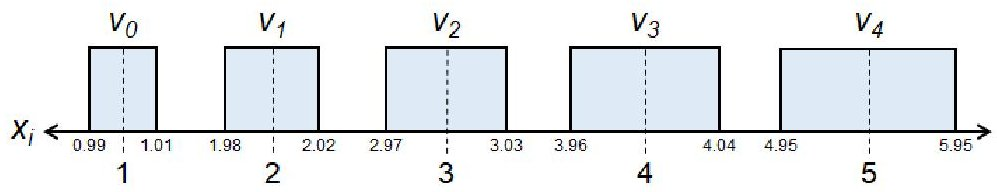

Figure 3-1: The set of design variable alternatives for each design variable in the toy problem. Each design variable alternative is a uniform random variable centered on an integer between 1 and 5 inclusive and with a width of 1% of the central value

$$
\begin{array}{l} \min _ {x} \left(x _ {0} + x _ {1} + x _ {2} + y _ {0}\right) \\ x = \left\{x _ {0}, x _ {1}, x _ {2} \right\} \\ v _ {0}, v _ {1}, v _ {2} = \left\{\mathcal {U} (0. 9 9, 1. 0 1), \mathcal {U} (1. 9 8, 2. 0 2), \mathcal {U} (2. 9 7, 3. 0 3) \right. \\ \mathcal {U} (3. 9 6, 4. 0 4), \mathcal {U} (4. 9 5, 5. 0 5) \} \\ x _ {0} \in v _ {0}, x _ {1} \in v _ {1}, x _ {2} \in v _ {2} \\ \mathbb {P} \left(x _ {0} + x _ {1} > 4. 9 7\right) > 0. 9 5 \\ \mathbb {P} \left(x _ {1} + x _ {2} > 8\right) > 0. 9 5 \\ a \left(x _ {0}, x _ {1}\right) = \left\{\left\{\mathcal {U} (0. 9 9, 1. 0 1), \mathcal {U} (4. 9 5, 5. 0 5) \right\}, \right. \\ \left\{\mathcal {U} (1. 9 8, 2. 0 2), \mathcal {U} (4. 9 5, 5. 0 5) \right\}, \\ \left\{\mathcal {U} (2. 9 7, 3. 0 3), \mathcal {U} (2. 9 7, 3. 0 3) \right\}, \\ \left\{\mathcal {U} (3. 9 6, 4. 0 4), \mathcal {U} (0. 9 9, 1. 0 1) \right\}, \\ \left\{\mathcal {U} (4. 9 5, 5. 0 5), \mathcal {U} (0. 9 9, 1. 0 1) \right\} \\ y = y _ {0} = \{3 \} \\ \end{array}
$$

The set of constraints c is divided into equality constraints h(x,y), inequality constraints g(x,y), and set constraints a(x). Each equality constraint is defined by a function h(x,y) that must be equal to zero. The toy problem has no equality constraints. Each inequality constraint is made up of a function g(x,y) and an upper limit $ \alpha $ , such that g(x,y) must be less than $ \alpha $ . The value p represents the minimum acceptable probability of meeting any inequality constraint. Therefore, the inequality constraints in this formulation are chance constraints. The toy problem has two

<!-- PDF_PAGE: 67 -->

inequality constraints. The sum of $ x_{0} $ and $ x_{1} $ must be greater than 4.97 while the sum of $ x_{1} $ and $ x_{2} $ must be greater than 8. Each inequality constraint must be met with a minimum probability of 0.95.

Set constraints are used to represent valid combinations of design variable alternatives with set notation, as opposed to the algebraic notation used in equality and inequality constraints and are defined over a subset of the design variables x. The toy problem has one set constraint defined over $ x_{0} $ and $ x_{1} $ . Each set constraint $ a(x) $ is a set of sets. Each inner set contains several design variable alternatives, one for each design variable that is in the scope of the set constraint. The inner sets define acceptable assignments to the design variables in the scope of the set constraint. If a design variable is assigned an alternative that is contained in an inner set of a set constraint, then the other design variables within the scope of that set constraint must be assigned the alternatives within that same inner set. For example, in the toy problem, if $ x_{0} $ is assigned the alternative whose central value is 1, then $ x_{1} $ must be assigned the alternative with a central value equal to 5. However, if $ x_{0} $ is assigned the alternative whose central value is 3, then $ x_{1} $ must be assigned the alternative with a central value equal to 3. If a design variable is assigned a value that is not contained in any inner set of any set constraint, then that assignment doesn't place any additional constraints on the set of satisfying assignments to the other design variables.

The set y is the set of parameters for the problem. Parameters denote constants defined by the problem specification that cannot be chosen by the optimizer but affect the value of the objective function and the satisfaction of constraints. The toy problem only has one parameter, the constant 3 that is added to the objective function.

## 3.1.2 Allowable Problem Changes

The set of possible changes within the MADU framework is defined by building on an existing definition of possible changes within a dynamic CSP [28]. The types of changes are summarized in Table 3.1 with examples drawn from space system design

<!-- PDF_PAGE: 68 -->

Table 3.1: Summary of the different types of changes that may be made to an optimization problem within the MADU framework.

<table border="1"><tr><td>Type of Change</td><td>Problem Formulation Change</td><td>Example</td></tr><tr><td>Addition of Design Variable</td><td>$x_{changed}\leftarrow x_{orig}\cup y_{i}\land y_{changed}\leftarrow y_{orig}\backslash y_{i}$</td><td>Addition of gravitational slingshot maneuver to trajectory</td></tr><tr><td>Removal of Design Variable</td><td>$x_{changed}\leftarrow x_{orig}\backslash x_{i}\land y_{changed}\leftarrow y_{orig}\cup x_{i}$</td><td>Removal of redundant component</td></tr><tr><td>Addition of Design Variable Alternative</td><td>$v_{changed}\leftarrow v_{orig}\cup v_{new}$</td><td>New surface coating developed</td></tr><tr><td>Removal of Design Variable Alternative</td><td>$v_{changed}\leftarrow v_{orig}\backslash v_{rem}$</td><td>Material found to violate contamination requirements</td></tr><tr><td>Addition of Constraint</td><td>$g_{changed}\leftarrow g_{orig}\cup g_{new}\vee h_{changed}\leftarrow h_{orig}\cup h_{new}\vee a_{changed}\leftarrow a_{orig}\cup a_{new}$</td><td>Compatibility with additional ground stations desired</td></tr><tr><td>Removal of Constraint</td><td>$g_{changed}\leftarrow g_{orig}\backslash g_{rem}\vee h_{changed}\leftarrow h_{orig}\backslash h_{rem}\vee a_{changed}\leftarrow a_{orig}\backslash a_{rem}$</td><td>Payload does not require high data rate interface</td></tr><tr><td>Tightening of Constraint</td><td>$\alpha_{changed}<\alpha_{orig}\vee p_{changed}>p_{orig}$</td><td>Customer requires tighter pointing requirements</td></tr><tr><td>Relaxation of Constraint</td><td>$\alpha_{changed}>\alpha_{orig}\vee p_{changed}<p_{orig}$</td><td>Launch vehicle capability increased</td></tr><tr><td>Change Objective Function</td><td>$f\leftarrow f_{new}$</td><td>Customer changes priority from cost to schedule</td></tr></table>

given for each type of change. There is no limit on the number of changes that can be made between optimizations within the MADU framework.

Firstly, a design variable can be added or removed from the set of design variables x. Following the established definition of changes to a dynamic CSP, in the MADU framework, the only way to add a design variable to the problem is to transform a parameter $ y_{i} $ , whose value is already specified in the problem formulation, into a design variable. The domain of this new design variable must only have a single member, a number that is equal to the value of the old parameter $ \left(v_{new}=y_{i}\right) $ . In such a transformation, the solution to the problem isn't changed. Once a new design variable has been introduced, other types of changes can be used to further change the problem by modifying the domain of the new design variable. A design variable can be removed from the problem only if it only has a domain with a single value

<!-- PDF_PAGE: 69 -->

and that value has no uncertainty. In that case, the design variable can be removed from the set of design variables x and added to the set of model parameters y. The new parameter must have the same value as the single alternative of the old design variable. This transformation means that the solution to the problem isn't changed. Other types of changes are used to restrict the domain of the design variable to prepare it for removal.

Secondly, the domain of a design variable can be extended or contracted by adding or removing an alternative from the set $ v_{i} $ . Sequential contractions and extensions can be used to change a design variable alternative.

Thirdly, a constraint can be added to or removed from the set of constraints c. Most changes to a constraint should be modeled as a removal of the old version of that constraint and an addition of the new version of that constraint. However, certain changes in inequality constraints are handled by a different process. An inequality constraint can be tightened by decreasing its limit $ \alpha $ or by increasing the minimum probability of satisfaction p. Similarly, an inequality constraint can be relaxed by increasing its limit $ \alpha $ or by decreasing the minimum probability of satisfaction p. These changes can be handled in one step because their effect on the set of possible solutions is straightforward. In contrast, a general change to a constraint may have subtle effects on the set of possible solutions and so must be handled through the removal of the old version of the constraint and addition of the new version of the constraint.

Fourthly, the objective function can be changed to a different functional form. Within the MADU framework, there are no constraints on the form of the objective function.

## 3.1.3 Approach

The MADU framework has four steps as shown in Figure 3-2: In step one, system information is captured in a system model. In step two, information is extracted from the system model and used to perform a design optimization. The optimization records the rationales for certain design decisions. The decisions may be trade

<!-- PDF_PAGE: 70 -->

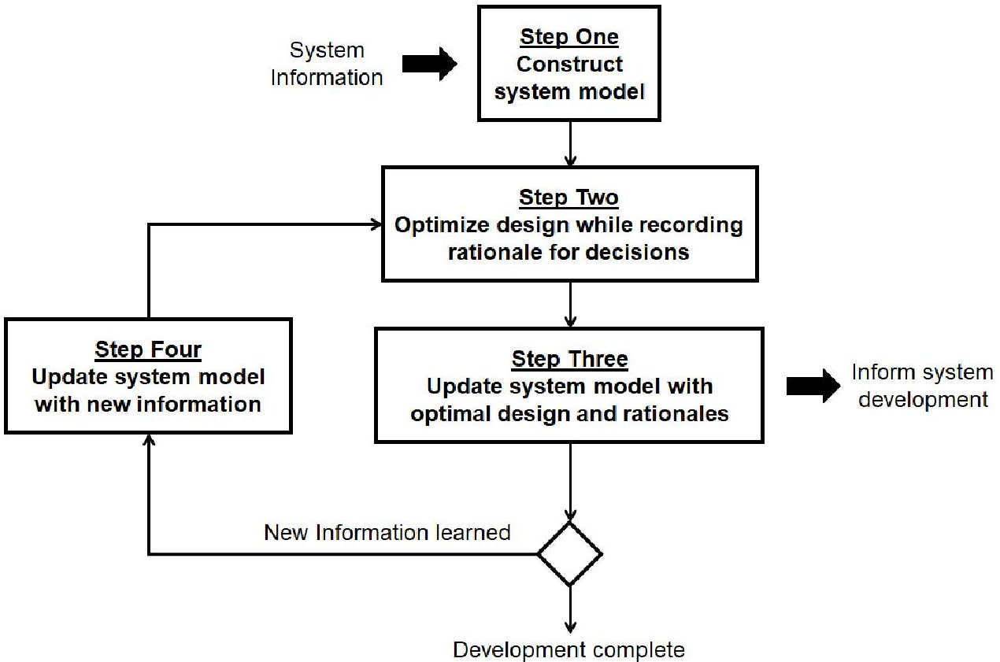

Figure 3-2: The four steps of the MADU framework

studies conducted by the design team or may be inferences made by the optimization algorithm such as the identification of a conflict. The rationale for each decision is recorded so that decisions can be revisited if necessary. A decision rationale is the reason that the decision was made. A logical entailment relationship should exist between the rationale and the decision outcome such that the rationale R entails the decision outcome O $ (R\models O) $ . In step three, the system model is updated with the optimal design and the decision rationales. Adhering to the single-source-of-truth maxim for MBSE, the decisions and rationales are stored in the system model alongside the design. The single-source-of-truth maxim dictates that all system information be stored in the system model so that retrieval of information is simplified and duplication of information is prevented. The results of the optimization are used by the design team to inform the development of the system. Next, if system development is complete and the design can no longer be changed, the framework ends, but if development is not complete, the framework waits for the design team to learn new information. In step four, the system model is updated to reflect the new information. The types of changes that can be made to the system model is step four are shown in Table

<!-- PDF_PAGE: 71 -->

3. 1. Any number of changes can be made to the model before completing step four. Next, a design update is performed by returning to step two. Information from the previous problem is reused in order to improve the efficiency of finding the optimal solution to the changed problem. Once the new optimal design is found, step three is repeated and the optimal design, along with the decisions that lead to it, are once again captured in the system model. The subsequent sections go into detail for each step. The toy problem defined in equation 3.2 is used to illustrate various details of the algorithm.

## Step One: Construct system model

The first step of the MADU framework is to capture system information in a system model. The system model must contain the following pieces of information:

- A description of the design of the system

- Elements within the design that can be varied and a set of alternatives for each variable

- Constraints defining the numerical or logical relationships within the system

- A measure of effectiveness to be optimized

Once each of these pieces of information is captured in the system model, step two is triggered. For the toy problem, the information that goes into the system model is the information contained in equation 3.2.

## Step Two: Optimize design while recording rationales

In step two, information from the system model is extracted and used to find the optimal design. The optimization is performed while recording the rationale for any choices made during the optimization. The MADU framework uses conflict-directed search to find the optimal design. The design decisions made in the optimization are assignments to the design variables. Conflicts and satisfying states are identified and

<!-- PDF_PAGE: 72 -->

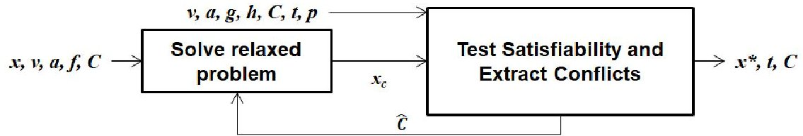

Figure 3-3: The architecture of the MADU optimization algorithm.

utilized during search. A conflict is defined as a set of design variable alternatives that cannot be extended into any full assignments that satisfy a set of constraints [107]. For each conflict, the rationale for the conflict is defined as the minimal set of constraints that entail the conflict. That set of constraints is recorded as the conflict explanation. A satisfying state is a set of design variables that can be extended to at least one full solution that satisfies all constraints. In other words, a satisfying state is a state that has been proven to not be a conflict nor a superset of a conflict. The MADU framework doesn't record rationales for satisfying states because the maximal set of constraints that imply that a state is satisfying contains all constraints present in the problem.

The algorithm to find the optimal solution follows the architecture of the conflictdirected $ \mathrm{A}^{*} $ algorithm in which candidate solutions are generated with a relaxed problem and a satisfiability checker determines if those candidate solutions meet constraints. This architecture is shown in Figure 3-3. Conflicts are stored in the list C while satisfying states are stored in the list t.

## Relaxed Problem

At the beginning of the problem, the set of design variables x, the design variable domains $ v_{i} $ for each $ x_{i} $ , the set constraints a, the objective function f, and the set of known conflicts C are used to solve a relaxed problem. A relaxed problem is defined as a problem that has fewer restrictions on design variable assignments than the full problem [101]. The relaxed problem is used in order to compute an admissible heuristic, equivalently a bounding function, for the cost of the solution to the full problem. An admissible heuristic is an estimate of the cost of the solution to the problem that is guaranteed to be an underestimate [101]. Such heuristics are useful

<!-- PDF_PAGE: 73 -->

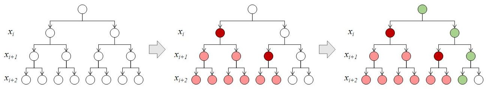

Figure 3-4: The relaxed problem portion of the algorithm can be viewed as tree search. The algorithm must assign a value to each design variable while avoiding conflicts. Each layer of the tree corresponds to one design variable, each node in the tree represents an assignment to a design variable, and a path from the root of the tree to a leaf represents a complete assignment to all design variables. Conflicts are shown as dark red nodes in this picture and the portion of the search tree pruned by the conflicts is shown by the light red nodes. The chosen set of assignments is shown in green.

because they can be used to provide a guarantee that an optimal solution can be found [45]. The relaxed problem ignores the equality constraints $ h ( x,y) $ and inequality constraints $ g ( x,y) $ but resolves all known conflicts. With fewer restrictions on the output of the relaxed problem, the solution that it generates will have a cost that is less than or equal to the optimal solution to the full problem.

The goal of the relaxed problem is to find a full assignment of all design variables that satisfies the set constraints a(x) and is not a superset of any known conflict. The solution approach to the relaxed problem can be thought of as a tree search as shown in Figure 3-4. Each layer of the tree corresponds to one design variable, each node in the tree represents an assignment to a design variable, and a path from the root of the tree to a leaf node represents a complete assignment to all design variables. Conflicts are depicted as dark red nodes in the tree. Each conflict prunes all child nodes from the search space (shown in light red) as any superset of a conflict is guaranteed to be unsatisfiable. Therefore, the algorithm must avoid any portion of the tree with conflicts and might instead choose the green set of assignments as a candidate solution.

Because the value of each design variable alternative cannot be precisely chosen, each design variable alternative is a random variable. Therefore, uncertainty must be considered in the relaxed problem. The MADU framework uses a Monte Carlo sampling strategy where samples from the uncertainty distributions for each design

<!-- PDF_PAGE: 74 -->

variable alternative are repeatedly drawn and an optimization is performed with each set of samples. For example, in the toy problem, a set of samples for the alternatives for the variable $ x_{0} $ might be 0.994,2.003,3.002,3.980,4.998. To determine the number of samples that are required, the algorithm applies a Bernoulli trial framework. There are three conditions that must be met for a Bernoulli trial framework to apply [7]:

- Each trial results in either success or failure

- The probability of success remains constant across the trials

- The trials are independent

This application meets the first condition because a successful trial is defined as finding a new solution with a cost lower than the current lowest cost. The second condition is met because the values for each design variable alternative are sampled using a consistent methodology and that current lowest cost remains fixed across the trials. Because of this condition, each time a lower cost is found, the trial must be restarted. The third condition is met because the samples for each variable are independent within each trial and each trial is independent from the preceding and following trials.

Samples continue to be drawn until the probability of finding a solution with a lower cost than the current lowest cost is below a user-provided threshold. This condition implies that the lowest cost solution has likely been found. To calculate the probability of finding a solution with lower cost that the current lower cost solution, the binomial proportion confidence interval is calculated [9]. Because the proportion must be calculated for situations where a number of trials have been performed without any successes, the "rule of three" is used [44]. The "rule of three" is an approximation of the upper 95% confidence bound when estimating a binomial proportion after a number of samples in which no successes have been observed. It states that, after n trials without any successes, it can be concluded with 95% confidence that the probability of success lies below $ 3 / n $

<!-- PDF_PAGE: 75 -->

The pseudocode for solving the relaxed problem is shown in algorithm 1. The procedure starts by using the user-defined value $ p_{cutoff} $ to calculate the required number of Monte Carlo samples without a success to be confident that the true lowest cost solution has been found. $ p_{cutoff} $ should be set to a small value to ensure that the solution produced by the relaxed algorithm is likely to be close to the true minimum cost solution. A value of 0.01 is typical.

Next, the sample counter is initialized to zero and two variables are initialized to hold the lowest known cost and the set of assignments to the design variables with the lowest known cost. The lowest known cost is initially infinity and the set of design variable that results in the lowest known cost is initially empty. Then, the algorithm enters a loop on line 7 where samples are drawn from the uncertainty distributions and optimizations are performed. The samples are drawn from the set of design variable alternatives $ v_{i} $ and stored in the set $ u_{i} $ . Therefore, $ u_{ij} $ is a value sampled from the random distribution $ v_{ij} $ . For example, in the toy problem, the set $ u_{0} $ for the variable $ x_{0} $ may be equal to $ \{1.003,1.999,2.987,3.978,4.951\} $ , the set $ u_{1} $ for the variable $ x_{1} $ may be equal to $ \{0.999,2.002,3.024,3.996,5.014\} $ , and the set $ u_{2} $ for the variable $ x_{2} $ may be equal to $ \{0.993,2.011,3.007,4.028,4.989\} $ .

This set of sampled values is passed to an optimizer to perform a discrete constrained optimization. The solver returns the cost and set of design variable assignments comprising the optimal solution $ x_{temp} $ . A typical optimal solution for a set of sampled values might result in the following design variables assignments $ x_{0}=3.978, x_{1}=0.999, x_{2}=0.993 $ for an optimal cost of 8.97. Finally, a test is performed to check if the new solution has a lower cost than the current known lowest cost $ c_{lowest} $ . If it is lower, then the variables for lowest known cost and best set of design variable assignments are overwritten and the sample counter is reset to zero to restart the Bernoulli trial process. If the new solution has a higher cost than the lowest known cost, then the sample counter is incremented in order to keep track of the number of consecutive failures to find a better solution than the currently known best solution. When this counter becomes equal to the maximum counter value as calculated on line 3 using the "rule of three", the while loop is exited. After exiting

<!-- PDF_PAGE: 76 -->

the while loop, the best known set of design variable assignments is returned. The set of variables assignments with the lowest known cost is defined using random variables in the set $ v_{i} $ , not the sampled values of those random variables in the set $ u_{i} $ . Therefore, the candidate solution generated by the relaxed problem is the set of variable assignments that have the potential for the lowest cost.

Algorithm 1 relaxedProblem

1: procedure RELAXEDPROBLEM(x,v,a,f,C)

2: $p_{cutoff} \leftarrow 0.01$

3: counter $_{max} = 3/p_{cutoff}$

4: counter $\leftarrow 0$

5: $c_{lowest} \leftarrow \infty$

6: $x_{best} \leftarrow null$

7: while counter $<$ counter $_{max}$ do

8: $u \leftarrow \emptyset$

9: for $v_{i} \in v$ do

10: $u_{i} \leftarrow \emptyset$

11: for $v_{ij} \in v_{i}$ do

12: $u_{ij} \leftarrow random(v_{ij})$

13: $u_{i} \cup u_{ij}$

14: end for

15: $u \cup u_{i}$

16: end for

17: cost, $x_{temp} \leftarrow optimizer(x,u,a,f,C)$

18: if cost $< c_{lowest}$ then

19: $c_{lowest} \leftarrow cost$

20: $x_{best} \leftarrow x_{temp}$

21: counter $\leftarrow 0$

22: else

23: counter ++

24: end if

25: end while

26: return $x_{best}$

27: end procedure

Conflict Extraction Next, the algorithm checks the satisfiability of the candidate solution generated by the relaxed problem. An example candidate solution to the toy problem that might be generated by the relaxed problem is $ x_{0}=\mathcal{U}(3.96,4.04), x_{1}= \mathcal{U}(0.99,1.01), x_{2}=\mathcal{U}(0.99,1.01). $ If it is satisfiable, then the solution candidate is

<!-- PDF_PAGE: 77 -->

returned as the optimal solution to the full problem. If it is unsatisfiable, then conflicts are extracted, added to the set of known conflicts and the relaxed problem is restarted. This candidate solution to the toy problem given above isn't satisfiable because $ x_{1} $ plus $ x_{2} $ is not greater than eight.

Conflicts are extracted in a black box manner by testing each member of the power set of the candidate solution as shown in Figure 3-5. The figure shows an example for a problem with three design variables. The root node in this diagram represents the candidate solution generated by the relaxed problem which contains an assignment to all design variables. The other nodes in the diagram are all subsets of the set of assignments to the design variables in the candidate solution. All subsets must be tested in order to find all conflicts for a given candidate solution. However, if a subset is shown to be satisfiable, then large portions of the search space can be pruned because all subsets of a satisfying state are also satisfiable. For example, the root of the graph is shown in red in the figure to indicate that it is unsatisfiable. However, if one of its children is found to be satisfiable, as shown by the dark blue color, then all subsets of that node do not need to be tested because they are guaranteed to be satisfiable. The members of the power set that can be pruned based on the satisfying state are colored light blue. The conflict extractor continues to test other subsets of the candidate solution until all subsets have been determined to be unsatisfiable, determined to be satisfiable, or are a subset of a satisfiable state. If satisfying states are known from the previous problem, portions of the conflict extraction search space can be pruned without any satisfiability testing, increasing search efficiency.

Algorithm 2 shows the high level process of testing satisfiability and extracting conflicts. The candidate solution $ x_{c} $ and other data products are passed to a secondary function called extractConflicts. That function returns a list of possible conflicts $ C_{poss} $ and a list of possible satisfying states $ t_{poss} $ . The conflicts and satisfying states are computed through Monte Carlo sampling and so may not be applicable to the full problem. For example, if $ x_{0} $ was randomly assigned 3.965 and $ x_{1} $ was randomly assigned 0.995, then $ x_{0}+x_{1}=4.96 $ which violates the constraint that $ x_{0}+x_{1}>4.97 $ and so $ x_{0}=\mathcal{U}(3.96,4.04),x_{1}=\mathcal{U}(0.99,1.01) $ would be recorded as a possible conflict.

<!-- PDF_PAGE: 78 -->

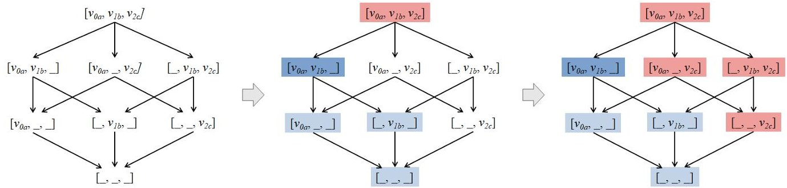

Figure 3-5: The conflict extraction portion of the algorithm viewed as search through the power set of a candidate solution. Satisfiable states (shown in dark blue) can prune large portions of the search space (shown in light blue) because all subsets of a satisfiable state are guaranteed to be satisfiable and therefore are not conflicts.

However, it is very unlikely that $ x_{0} $ and $ x_{1} $ get assigned values low enough to violate that constraint so, after repeated samples, the probability of that possible conflict would be very low and so it would not be recorded as a conflict for the full problem.

To determine whether each possible conflict and satisfying state applies to the full problem, the lower bound of the confidence interval of the detection probability for each conflict and satisfying state $ p_{min} $ is compared against the minimum acceptable probability of meeting an inequality constraint p. A conflict whose detection probability lower bound is greater than 1-p will have an unacceptably high probability of not meeting an inequality constraint in the full problem and therefore is a conflict in the full problem. For example, the assignment $ x_{2}=\mathcal{U}(0.99,1.01) $ is a conflict with a probability of one because no value within the domain of $ x_{1} $ can be combined with the assignment $ x_{2}=\mathcal{U}(0.99,1.01) $ to meet the constraint $ x_{1}+x_{2}>8 $ . Therefore, $ x_{2}=\mathcal{U}(0.99,1.01) $ is recorded as a conflict to the full problem with the explanation $ x_{1}+x_{2}>8. $

A satisfying state whose lower bound on its detection probability is greater than p will meet all inequality constraints with high confidence and is therefore a satisfying state for the full problem. For example, the candidate solution $ x_{0}=\mathcal{U}(0.99,1.01), x_{1}= \mathcal{U}(4.95,5.05), x_{2}=\mathcal{U}(1.98,2.02) $ isn't satisfying but contains the satisfying state $ x_{0}= \mathcal{U}(0.99,1.01), x_{1}=\mathcal{U}(4.95,5.05) $ which is a satisfying state because it can be extended to the satisfying solution $ x_{0}=\mathcal{U}(0.99,1.01), x_{1}=\mathcal{U}(4.95,5.05), x_{2}=\mathcal{U}(3.96,4.04). $ The procedure returns the candidate solution and the updated lists of conflicts and

<!-- PDF_PAGE: 79 -->

Algorithm 2 satisfiabilityTester

1: procedure SATISFIABILITYTESTER(xc,v,g,h,a,C,t,p)

2: $ C_{poss}, t_{poss} \leftarrow extractConflicts(x_c,v,g,h,a,C,t)$

3: for $ C_i \in C_{poss} $ do

4: if $ C_i.p_{min} > (1-p) $ then

5: $ C \cup C_i $

6: end if

7: end for

8: for $ t_i \in t_{poss} $ do

9: if $ t_i.p_{min} > p $ then

10: $ t \cup t_i $

11: end if

12: end for

13: return $ x_c, t, C $

14: end procedure

The extractConflicts procedure shown in algorithm 3 finds all possible conflicts and possible satisfying states in a candidate solution. It does this by taking Monte Carlo samples from the distribution of each design variable alternative and performing repeated satisfiability tests. To determine when sufficient samples have been taken, a Bernoulli trial framework with convergence criteria on the calculated probabilities is used. As discussed above, there are three criteria that need to be satisfied for a Bernoulli trial framework to apply. The first criteria of a Boolean success definition is satisfied by defining success as the detection of a conflict or satisfying state in the candidate solution. The second criteria on the probability of success being constant is satisfied because each Monte Carlo sample is taken using the same methodology. The third criteria of independent trials is satisfied because all samples are taken independently. The confidence bounds on the binomial proportion are calculated using the Agresti-Coull interval [2]. Once the calculated probabilities have converged, defined as an acceptably small difference between the previous value of the probability and the updated value once the newest sample has been included in probability calculation, then the function returns the list of possible conflicts and satisfying states to the SatisfiabilityTester algorithm.

The algorithm begins by declaring a number of variables. sample_again is a

<!-- PDF_PAGE: 80 -->

Boolean variable that determines if more samples need to be taken. It is initialized to True. $ t_{poss} $ and $ C_{poss} $ are the list of possibly satisfying states and possible conflicts respectively and are initialized to empty sets. counter is a counter for the total number of Monte Carlo samples. $ conv_{criteria} $ is a user-configurable parameter that is used to determine when the calculated binomial proportion has converged. It is applied as an absolute difference threshold that two subsequent probability calculations fall beneath and therefore should be set to a small value. A value of 0.01 is typical. After declaring these variables, the algorithm enters an outer loop that implements the Monte Carlo sampling process. In lines 8-16, samples are taken from the uncertainty distributions for each design variable alternative in the same manner as random samples were taken in the relaxedProblem procedure.

Starting on line 18, an inner loop is entered in which all satisfying states and conflicts are identified for the problem with the sampled values. q is a first-in-last-out (FILO) queue. The queue is initialized with the input candidate solution $ x_{c} $ visited is a list of states that have been added to the queue. It is used to avoid revisiting the same state multiple times during the conflict extraction process. At the beginning of the loop, the candidate solution at the head of the queue is removed from the queue and passed to a satisfiability solver. The solver is assumed to be able to check the satisfiability of the candidate solution as well as generate a conflict manifested by the candidate solution if it is not satisfiable. If the candidate solution is satisfiable, then updateDetections increments the solution's detection counter, or, if this is the first time that this candidate solution has been found satisfiable, updateDetections adds it to the list of possibly satisfying states and initializes its detection counter with a count of one. The detection counter for a conflict or satisfying state counts the number of samples in which that conflict or satisfying state has been identified. The updateDetections function is shown in algorithm 4. Similarly, if the candidate solution is unsatisfiable, the conflict is updated in the same way using updateDetections function. However, the conflict is then used to generate child solutions from the unsatisfiable candidate solution.

The childStates algorithm shown in algorithm 5 creates child solution candidates

<!-- PDF_PAGE: 81 -->

that resolve the newly detected conflict by unassigning variables from the unsatisfying candidate solution. For example, the candidate solution $ x_{0}=\mathcal{U}(3.96,4.04), x_{1}=\mathcal{U}(0.99,1.01), x_{2}=\mathcal{U}(0.99,1.01) $ contains the conflict $ x_{2}=\mathcal{U}(0.99,1.01). $ A child state $ x_{0}=\mathcal{U}(3.96,4.04), x_{1}=\mathcal{U}(0.99,1.01) $ is created by unassigning the variable involved in the conflict $ x_{2}. $ If these child solution candidates are not already in the queue, are not supersets of any satisfying states for the full problem, are not superset of possible satisfying states, and are not in the visited list, then the child candidates are added to the queue. Each child that is added to the queue is also added to the visited list. This loop continues until the queue is empty and all possible conflicts have been found.

Next, starting on line 28, the algorithm checks whether it has to continue generating Monte Carlo samples. It does this by updating the probability of each possible candidate and possible satisfying state using the updateProbability function shown in algorithm 6. In order to rigorously account for sampling-induced variation, a confidence interval is maintained for the probability of occurrence of each conflict and satisfying state. This function updates the confidence interval bounds using either the "rule of three" or the Agresti-Coull interval [44] [2]. The "rule of three" is used if the conflict or satisfying state has been detected in all samples taken so far. Otherwise, the Agresti-Coull interval is used. Then, the change in the lower bound of the confidence interval is checked against the convergence criteria. The lower bound of the confidence interval is checked for stability because that number is what is used in lines 4 and 9 of the satisfiabilityTester to check if a possible conflict or satisfying state applies to the whole problem. If the change in any lower probability bound is greater than the convergence criteria, the sample_again flag is set to True so that another Monte Carlo sample is taken. At the end of the of the loop, the sample counter is incremented. Once all probabilities have converged, the function returns the list of possible conflicts and list of possible satisfying states.

Once the solution to the optimization problem has been found, step two is complete and the framework moves onto step three. The output from step two is the optimal solution $ x^{*} $ , the list of satisfying states t, and the list of conflicts C. Each

<!-- PDF_PAGE: 82 -->

Algorithm 3 extractConflicts

1: **procedure** EXTRACTCONFLICTS($x_c, v, g, h, a, C, t$)

2: sample_again $\leftarrow$ True

3: $t_{poss}, C_{poss} \leftarrow \emptyset$

4: counter $\leftarrow 0$

5: conv_criteria $\leftarrow 0.01$

6: **while** sample_again **do**

7: $u \leftarrow \emptyset$

8: **for** $v_i \in v$ **do**

9: $u_i \leftarrow \emptyset$

10: **for** $v_{ij} \in v_i$ **do**

11: $u_{ij} \leftarrow \text{random}(v_{ij})$

12: $u_i \cup u_{ij}$

13: **end for**

14: $u \cup u_i$

15: **end for**

16: $q \leftarrow \emptyset, q \cup x_c$

17: visited $\leftarrow \emptyset$

18: **while** $q \neq \emptyset$ **do**

19: $x_q \leftarrow \text{pop}(q)$

20: sat, conflict $\leftarrow \text{satSolver}(x_q, u, a, g, h, C)$

21: **if** sat **then**

22: $x_q, t_{poss} \leftarrow \text{updateDetections}(x_q, t_{poss})$

23: **else**

24: conflict, $C_{poss} \leftarrow \text{updateDetections(conflict, C_{poss})}$

25: $q, \text{visited} \leftarrow \text{childStates}(x_q, \text{conflict}, q, t, t_{poss}, \text{visited})$

26: **end if**

27: **end while**

28: sample_again $\leftarrow$ False

29: **for** $C_i \in C_{poss}$ **do**

30: $C_i \leftarrow C_i.\text{updateProbability}(C_i, \text{counter} + 1)$

31: **if** $C_i.p_{old} - C_i.p_{min} > \text{conv\_criteria}$ **then**

32: sample_again $\leftarrow$ True

33: **end if**

34: **end for**

35: **for** $t_i \in t_{poss}$ **do**

36: $t_i \leftarrow t_i.\text{updateProbability}(t_i, \text{counter} + 1)$

37: **if** $t_i.p_{old} - t_i.p_{min} > \text{conv\_criteria}$ **then**

38: sample_again $\leftarrow$ True

39: **end if**

40: **end for**

41: counter = ++

42: **end while**

43: return $C_{poss}, t_{poss}$

44: **end procedure**

<!-- PDF_PAGE: 83 -->

Algorithm 4 updateDetections

1: procedure UPDATEDETECTIONS(s,l)

2: if s∈l then

3: s.detections=s.detections+1

4: else

5: s.detections=1

6: l∪s

7: end if

8: return s,l

9: end procedure

Algorithm 5 childStates

1: procedure CHILDSTATES(xq, conflict, q, t, tposs, visited)

2: children $ \leftarrow \emptyset $

3: for i $ \in $ range(len(xq)) do

4: if conflict[i] $ \neq $ null then

5: $ c_{new} \leftarrow x_{q} $

6: $ c_{new}[i] \leftarrow null $

7: if $ c_{new} \notin q \land c_{new} \notin t \land c_{new} \notin t_{poss} \land c_{new} \notin visited $ then

8: children $ \cup $ cnew

9: visited $ \cup $ cnew

10: end if

11: end if

12: end for

13: return children, visited

14: end procedure

<!-- PDF_PAGE: 84 -->

Algorithm 6 updateProbability

1: procedure UPDATEPROBABILITY(s, runs)

2: $ z \leftarrow 1.96 $ $ \triangleright $ Standard quantile of normal distribution

3: $ s.p_{old} \leftarrow s.p $

4: if $ s.detections = runs $ then $ \triangleright $ Update minimum probability using "rule of three"

5: $ s.p \leftarrow 1 $

6: $ s.p_{min} \leftarrow 1-3/runs $

7: $ s.p_{max} \leftarrow 1 $

8: else $ \triangleright $ Update probability using Agresti-Coull interval

9: $ n \leftarrow runs + z^{2}/2 $

10: $ s.p \leftarrow (1/n)(s.detections + z^{2}/2) $

11: $ error \leftarrow z\sqrt{((s.p/n)(1-s.p))}

12: $ $ s.p_{min} \leftarrow s.p - error $

13: $ s.p_{max} \leftarrow s.p + error $

14: end if

15: return s

16: end procedure

conflict has an associated set of constraints that serves as the explanation for that conflict.

## Step Three: Update System Model with Optimal Design and Rationales

In step three, the system model is updated with the results of the optimization. The optimal design is stored in the system model as well as the list of satisfying states and conflicts. Following this update process, if system development is complete, the framework terminates. If development is ongoing, then the framework waits until new information is learned and then proceeds to step four.

## Step Four: Update System Model with New Information

When new information that may impact the system design is learned, the system model is updated to incorporate that new information. The new information must fall into the categories of acceptable changes defined in Table 3.1. The system model is kept updated as new information emerges and may be updated any number of times before the next optimization. The more changes to the problem that occur between

<!-- PDF_PAGE: 85 -->

optimization, the less likely it is that a given conflict or satisfying state survives the pruning that will occur when step two is repeated. Therefore, optimizations should be performed on as frequent a basis as possible to maximize information reuse.

## Repeat Step Two: Re-optimize design while recording rationales

In this repeat of step two, decisions are revisited in light of new information learned in step four. Given the approach in the original step two, the decisions that need to be revisited are the identification of conflicts and satisfying states. The types of changes made to the model in step four to capture new information determine whether a conflict or satisfying state continues to apply to the problem. The rules for pruning conflict and satisfying states are shown in Table 3.2. Conflicts and satisfying states are pruned whenever it cannot be proven, without explicitly testing the satisfiability of the state, that the conflicts or satisfying state holds in the new problem. In many cases, conflicts or satisfying states remain conflicts or satisfying states when changes are made but must be checked explicitly in the new problem formulation. Satisfiability checking of old conflicts and satisfying states is performed within the optimization algorithm as described in step two above. A different algorithm could explicitly check satisfiability of a conflict or satisfying state before pruning it, but this might result in increased runtime if states that are checked outside of the problem turn out to be suboptimal and therefore irrelevant to the new problem.

Adding a design variable to the problem has no effect on the problem because the design variable simply replaces a parameter that was already in the problem. Therefore, neither the conflict list nor the satisfying list need to change. Similarly, removing a design variable from the problem doesn't change the list of conflicts or satisfying states because the variable is transformed into a parameter and so the solution to the problem doesn't change.

Adding a design variable alternative has no effect on the list of satisfying states but may resolve some conflicts. Any constraint whose domain includes that design variable whose domain was expanded may now be satisfied with sets of previously unidentified variable assignments. Therefore, any conflict $ C_{i} $ whose explanation $ E(C_{i}) $

<!-- PDF_PAGE: 86 -->

Table 3.2: Summary of the effects of different changes on the list of conflicts and satisfying states.

<table border="1"><tr><td>Type of Change</td><td>Effect on Conflict List</td><td>Effect on Satisfying List</td></tr><tr><td>Addition of Design Variable</td><td>None</td><td>None</td></tr><tr><td>Removal of Design Variable</td><td>None</td><td>None</td></tr><tr><td>Addition of Design Variable Alternative</td><td>if $v_{new}\in c_{i}$ and $c_{i}\in E(C_{i})$ then $C\setminus C_{i}$ unless $\exists v_{ik}s.t.v_{new}\land v_{ik}\in v_{i}$</td><td>None</td></tr><tr><td>Removal of Design Variable Alternative</td><td>None</td><td>$\emptyset$ unless $\exists v_{ik}\in t_{i}s.t.v_{rem}\land v_{ik}\in v_{i}$</td></tr><tr><td>Addition of Constraint</td><td>None</td><td>$\emptyset$</td></tr><tr><td>Removal of Constraint</td><td>if $c_{rem}\in E(C_{i})$ then $C\setminus C_{i}$</td><td>None</td></tr><tr><td>Tightening of Constraint</td><td>None</td><td>$\emptyset$</td></tr><tr><td>Relaxation of Constraint</td><td>if $c_{rel}\in E(C_{i})$ then $C\setminus C_{i}$</td><td>None</td></tr><tr><td>New Objective Function</td><td>None</td><td>None</td></tr></table>

<!-- PDF_PAGE: 87 -->

contains a constraint $ c_{i} $ whose domain includes the design variable $ x_{i} $ whose domain was expanded with a new design variable alternative $ v_{new} $ needs to be removed from the list of known conflicts unless the conflict contains a different design variable alternative $ v_{ik} $ within the domain of the design variable $ x_{i} $ . Those conflicts will remain conflicts as they are not affected by any new variable combinations that may now be possible. For example, take the toy problem conflict $ x_{2}=\mathcal{U}(2.97,3.03) $ whose explanation is $ x_{1}+x_{2}>8 $ . If the design variable alternative $ x_{1}=\mathcal{U}(5.94,6.06) $ is added to the problem, the conflict needs to be removed because $ x_{1} $ is used in the constraint $ x_{1}+x_{2}>8 $ and the new variable combination of $ x_{1}=\mathcal{U}(5.94,6.06),x_{2}= $ $ \mathcal{U}(2.97,3.03) $ meets the constraint. However, if the design variable alternative $ x_{2}= $ $ \mathcal{U}(5.94,6.06) $ is added to the problem, then the conflict remains a conflict because the design variable whose domain was expanded is part of the conflict. The addition of this new design variable alternative doesn't create any new combinations of assignments that involve the design variable alternative involved in the conflict because both are part of the domain of the same design variable. Because a variable can only be assigned one value, the design variable assignment in the conflict cannot take part in any new sets of assignments, continues to violate the constraint even after the addition of the new design variable alternative, and therefore is kept as a conflict in the new problem.

Removing a design variable alternative has no effect on the set of conflicts but may result in some satisfying states becoming conflicts. Because satisfying states are modeled solely as a set of design variable alternatives, all satisfying states except those satisfying states $ t_{i} $ that contain the design variable $ x_{i} $ whose domain was reduced must be removed from the list of satisfying states. For example, the satisfying state $ x_{2}=\mathcal{U}(3.96,4.04) $ has to be removed from the list of satisfying states if the design variable alternative $ x_{1}=\mathcal{U}(4.96,5.05) $ is removed from the problem. However, it would not have to be removed if the design variable alternative $ x_{2}=\mathcal{U}(0.99,1.01) $ was removed from the problem because the satisfying state relies on a different assignment to the design variable $ x_{2}. $

Adding a constraint has no effect on the set of conflicts since the set of solutions

<!-- PDF_PAGE: 88 -->

to the problem will not expand when a constraint is added. All conflicts remain conflicts. However, adding a constraint means that all satisfying states must be removed. Removing a constraint has no effect on the set of satisfying states since the set of solutions to the problem will not decrease but it does have potential effects on the set of conflicts. A conflict $ C_{i} $ that contains the removed constraint $ c_{rem} $ in its explanation $ E(C_{i}) $ must be removed from the list of known conflicts.

Tightening a constraint is will not increase the set of possible solutions to the problem and so it has the same effect on the set of satisfying states and the set of conflicts as adding a constraint to the problem. Similarly, relaxing a constraint will not decrease the set of possible solutions to the problem so it has the same effect on the set of satisfying states and the set of conflicts as removing a constraint from the problem. A change in objective function only changes which satisfying states are preferred and so therefore has no effect on the set of conflicts or the set of satisfying states.

Once the set of conflicts and satisfying states has been appropriately pruned, the optimization can be performed again. This time, the set of conflicts and satisfying states that are passed to the optimization algorithm may not be empty. If some conflicts or satisfying states are preserved from the previous problem, the optimization algorithm can leverage this knowledge to find the new optimal solution faster than an algorithm with an identical search strategy that doesn't have these pieces of information.

The principle of reusing conflicts from previous problems is an established technique for solving dynamic CSPs [6] [18] [111] [103]. In this algorithm, conflicts known before search begins improve the output of the relaxed problem. The initial solution generated by the relaxed problem will resolve all known conflicts and will therefore resolve more conflicts than an optimization that has to first identify conflicts. Therefore, fewer changes need to be made to the initial candidate solution to find the optimal solution, resulting in lower search time.

The reuse of satisfying states to improve conflict extraction is novel. The MADU framework uses a black box search strategy for extracting conflicts in which variables

<!-- PDF_PAGE: 89 -->

are gradually unassigned from an unsatisfying candidate solution. This process can be made more efficient by avoiding parts of the conflict extraction search space known to not have any conflicts. All satisfying states and subsets of satisfying states are guaranteed to not be conflicts. Therefore, satisfying states passed from the previous problem can be used to prune the conflict extraction search space. When extracting conflicts, child candidate solutions are only added to the queue if they aren't already known to be satisfying. Therefore, reused satisfying states will prevent some child candidate solutions from being added to the queue and fewer child candidate solutions will need to be explicitly tested before the conflict extraction process is complete.

## Repeat Step Three: Update System Model with New Optimal Design and New Rationales

This step is carried out in an identical manner to the original step three. The optimal design, conflicts, and satisfying states are stored in the system model. The results of the optimization are used to inform the system being designed. After completing this step, the framework follows the same logic at the decision node to decide if it should terminate. The loop between steps two, three, and four is continued until system development is over.

## 3.1.4 Efficiency Claim

The search efficiency gains for the MADU framework arise from the reuse of information between problems. The search strategy does not change but since the algorithm isn't exploring as large a search space, the optimal solution will be found faster than an algorithm that doesn't reuse information. If a set of changes prevents any conflicts or satisfying states from being reused, then the search performance will be identical to an algorithm that doesn't reuse information. Therefore, the MADU framework will always be at least as fast as an algorithm that doesn't reuse information. The case studies in chapters 4 and 5 will examine the magnitude and frequency of the savings enabled by reuse of information.

<!-- PDF_PAGE: 90 -->

## 3.1.5 Limitations

The problems explored in this research are focused on a subset of the set of all possible optimization problems. The MADU framework is designed for finite domain, single-objective fixed architecture problems. While most engineering systems are best described with a mix of finite and continuous variable domains, the assumption made in the MADU framework of only finite variable domains is less limiting than it may appear. In aerospace systems, some system properties are unambiguously finite, such as the number of reaction wheels in a spacecraft. Other properties may be constrained to a finite set because of physical or financial limitations. A good example of properties that fall into this set are material properties or surface coatings. While a large, potentially continuous, space of options may exist, in reality, only a finite set of options are considered in order to maintain heritage with previous systems or to stay within the valid range of heritage analysis models. Finally, variables that are truly continuous can be discretized for analysis. Handling continuous variables is challenging because a conflict only prunes an infinitesimally small part of the domain of a continuous variable. More advanced techniques like interval arithmetic need to be used to make conflict-directed search efficient for continuous variables [100]. The choice to only support a single objective is made for simplicity. The MADU framework could be extended to consider multiple objectives in the future. The choice of a fixed architecture is also made for simplicity. While MADU can transform model parameters into design variables and vice versa, no type of change defined in Table 3.1 enables the addition of model parameters. Therefore, all system properties that could eventually become design variables should be included in the initial model formulation. Future extensions to the MADU framework may remove this limitation.

## 3.2 Implementation of the MADU Framework

This section presents the implementation of the MADU framework used in this thesis to evaluate its utility in space system development. Each step is presented with details of how the algorithm in the previous section was implemented. The main tools used

<!-- PDF_PAGE: 91 -->

to implement the MADU framework are Python, SysML, and IBM CP Optimizer [62].

## 3.2.1 Step One: Construct SysML model

System information is captured using a SysML model. As a reminder, the SysML model must contain the following pieces of information:

- A description of the design of the system

- Elements within the design that can be varied and a set of options for each variable element

- Constraints defining the numerical relationships within the system and a designated measure of effectiveness to be optimized

The following subsections will present how these pieces of information are captured in a SysML model.

## Modeling System Form

The form of the system under design is captured in SysML using Blocks and is displayed on a Block Definition Diagram (BDD). Blocks are the fundamental structural element in SysML [91]. Blocks are used to model a collection of features that describe an element of the system. A Block can represent a physical component, a subassembly, or a logical subsystem. Blocks serve as the base class for many other more specific modeling entities. Blocks can be given properties to add detail to the Block. A Value Property is a useful type of property that is used to capture numerical properties of a Block. A Part Property denotes that one Block is a part of another Block. A system hierarchy showing compositional relationships within the system can be created using Part Properties. Blocks, properties, and composition relationships are typically shown on a BDD.

An example BDD from the SysML specification showing the structure of the power subsystem of a hybrid sport utility vehicle (SUV) is shown in Figure 3-6 [91]. Blocks

<!-- PDF_PAGE: 92 -->

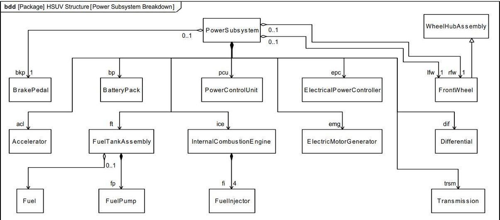

Figure 3-6: An example BDD from the SysML specification showing the structure of the power subsystem of a hybrid SUV [91].

are shown as rectangles with inner text. Composition relationships are shown as lines with an arrow on one end pointing towards the Block representing a part and a black diamond on the other end. Therefore, the BDD shows that the power subsystem is composed of a number of components including an Accelerator, a BatteryPack, a PowerControlUnit etc. It also shows that the FrontWheel is a specific instantiation of a general WheelHubAssembly with a Generalization relationship. A Generalization relationship is shown as a line with a white arrow pointing towards the more general element.

## Modeling System Topology

The topology of the system under design is captured in SysML using Connectors and Ports and is displayed on an Interface Block Diagram (IBD). Connectors model which parts of the system are connected to other parts and so only represent the existence of an interface. Detail can be added to the interface by using Ports. Ports are properties of a Block that describe how a Block can interact with the rest of the system. Part Properties, Connectors, and Ports are typically shown on an IBD.

An example IBD from the same hybrid SUV model from the SysML specification is shown in Figure 3-7 [91]. This IBD shows the interfaces within the Power Subsystem whose structure was defined in the BDD shown in Figure 3-6. The large rectangles represent parts of the Power Subsystem and the smaller squares on the edges of the

<!-- PDF_PAGE: 93 -->

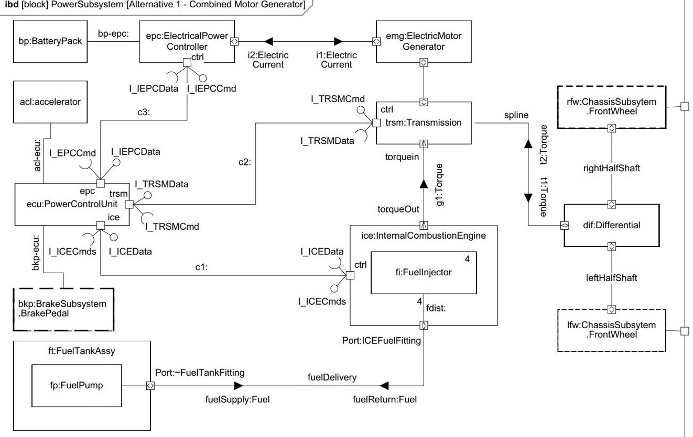

Figure 3-7: An example IBD from the same Hybrid SUV model [91]. This IBD shows the interfaces within the Power Subsystem defined in Figure 3-6.

rectangles are Ports. Connectors are lines that show how Ports are connected to other Ports. Different types of Ports are shown using different types of squares on the edge of the larger rectangles. The squares with the lollipop-shaped extensions show required (depicted with socket) and provided (depicted with ball) interfaces. The small arrows within some of the small rectangles indicate that those Ports have properties that defines what is allowed to flow over that interface. The direction of the arrows indicate the direction in which flow is allowed and can be bidirectional (shown with two arrows within the box). Some Connectors have black arrows on them. These symbols show what does flow over those interfaces (as contrasted with the properties of Ports that define what can flow over an interface). The IBD shows, among other things, that the Transmission is connected to the Differential, the InternalCombustionEngine, the ElectricMotorGenerator, and the PowerControlUnit. Torque is transmitted between the Transmission and the Differential, and from the InternalCombustionEngine and the Transmission. The Transmission provides commands to the PowerControlUnit and receives data from the PowerControlUnit.

<!-- PDF_PAGE: 94 -->

## Modeling Variability

SysML contains several concepts that can be used to model variability. In the MADU framework, variability is modeled by allowing Value Properties to take different values as defined by an Enumeration. An Enumeration is a SysML modeling concept, inherited from UML, that constrains possible values of a property to a user-defined list [92]. Enumeration literals are defined to represent the options that the element typed by the Enumeration can take. Typing is a mechanism within SysML/UML to enable the modeler to constrain the range of values of a typed element. For example, Part Properties are typed by the Blocks that they represent within a larger system and Ports can be typed by Blocks to define the features of that Port.

To enable it to type Value Properties, the Enumeration is given a《ValueType》 Stereotype. Stereotyping is a SysML/UML mechanism used to extend metaclasses. A metaclass is a concept within SysML/UML to describe model elements that are used to define legal modeling techniques. Therefore, Stereotypes are useful because they can be used to define custom modeling semantics. A common application of this idea is the modeling of a domain-specific language that can be used to more conveniently or precisely model a system. Each modeling element is labeled with its Stereotype within guillemets (《》). For example, a Block is nominally stereotyped with the Stereotype《block》。

The MADU framework models design variables as Value Properties with unknown default values. The unknown properties must be identified within the model and be given a set of possible values $ v_{i} $ . To accomplish this, an Enumeration is created for each design variable and a set of Enumeration literals is defined for each Enumeration to define the set of possible distributions for the Value Property typed by that Enumeration. Additionally, three Value Properties are defined for each Enumeration that specify its ID, its uncertainty, and its integer conversion factor. The ID is a zero-based integer counter that represents the position of that design variable within the set of design variables in the optimization problem. The current implementation of the MADU framework assumes that uncertainty in the value of a design variable

<!-- PDF_PAGE: 95 -->

alternative can be expressed using a uniform random variable. Therefore, the uncertainty property defines a multiplicative factor that represents the half width of a uniform probability distribution centered on the value specified in each enumeration literal. In other words, the distribution can be described as $ \mathcal{U}((1-u)v,(1+u)v) $ where u the value of the uncertainty property and v is the central value defined by an Enumeration literal. Because each Enumeration has a single uncertainty property, the same uncertainty is applied to each design variable alternative.

The integer conversion factor is a multiplicative factor used in forming the optimization problem to ensure that all possible design variable options can be converted to integers as the solver that is used requires integer variables. Multiplying the nominal value expressed by each Enumeration literal by the integer conversion factor must result in an integer. Additional steps are taken within the Python code that interfaces with the solver to ensure that even after accounting for uncertainty, all variable alternatives can be expressed as integers after sampling.

The ID, uncertainty, and integer conversion factor Value Properties are given default values. Each design variable is described by one Enumeration and each Enumeration ID must be unique and the IDs must be consecutive. An example Enumeration is shown in Figure 3-8. The figure shows an Enumeration with an ID of 6, three possible values (1, 2.5, or 10), an integer conversion factor of 10, and an uncertainty of 1%. As can be seen, the possible values can be any real number but the integer conversion factor must chosen so that every possible value, after being multiplied by the integer conversion factor is equal to an integer. Because the ID is 6, five other variables must exist that have ID's of 0 through 5.

## Modeling Constraints and the Objective Function

Mathematical relationships within a system are modeled in SysML using Constraint Blocks and Binding Connectors and are displayed on a Parametric Diagram (PAR). A Constraint Block is a special type of Block used to capture mathematical or logical relationships among system properties. Constraint Blocks are tied to properties or other Constraint Blocks using Binding Connectors. Binding Connectors denote an

<!-- PDF_PAGE: 96 -->

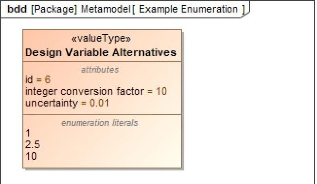

Figure 3-8: An example Enumeration showing the Enumeration Literals that represent the options that a design variable may take and the three Value Properties that specify the ID of the design variable, the uncertainty in the design variable options, and the multiplicative factor that will ensure that all possible variable values can be correctly converted to integers.

equality relationship. Constraint relationships are shown on a Parametric Diagram.

A Parametric Diagram from the hybrid SUV example is shown in Figure 3-9 [91]. The diagram shows the mathematical relationship between fuel demand, fuel pressure, and fuel flow rate. The three rectangles are Value Properties while the rounded rectangle in the center of the diagram is a constraint property that shows how the FuelFlow Constraint Block is used in this calculation. The lines between the rectangles are Binding Connectors that symbolize that the properties at either end of the connector have equal values. SysML doesn't require that any properties are designated as an input or output. Given the value of any two Value Properties, the value of the third Value Property can be calculated. For example, given FuelPressure and FuelDemand, the FuelFlowRate can be calculated.

A Constraint Block is created for each constraint and a Parametric Diagram is used to connect each constraint to Value Properties or other constraints. Equality constraints g(x,y), inequality constraints h(x,y), and set constraints a(x) are all modeled using Constraint Blocks. Equality and inequality constraints are modeled using algebraic notation. The current implementation of the MADU framework assumes that each constraint is written in syntax that can be directly converted to Python code and executed within the optimization solver. Additionally, the current implementation of the MADU framework requires that the set of constraints not contain

<!-- PDF_PAGE: 97 -->

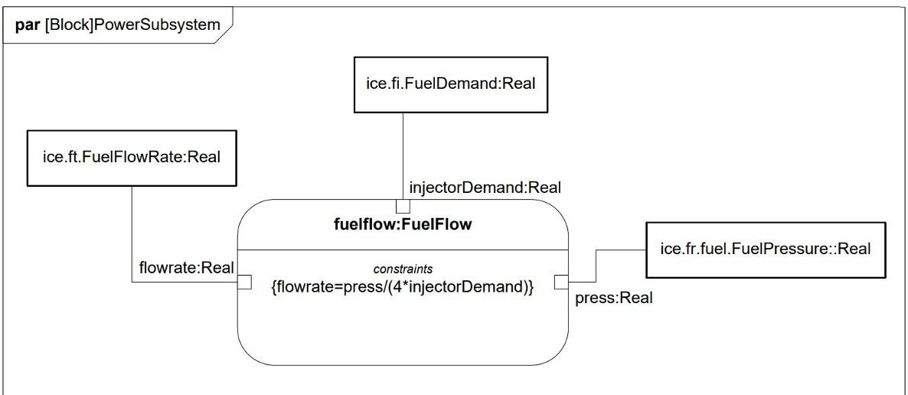

Figure 3-9: A Parametric Diagram from the Hybrid SUV example [91]. The diagram shows the mathematical relationship between fuel demand, fuel pressure, and fuel flow rate.

any simultaneous equations for compatibility with the external solver. In other words, the constraint graph must be able to be solved in a directed fashion with no loops. To support the required directionality, each Constraint Block must have all but one of its variables defined by a Value Properties with a given default value or a Value Property that is typed by an Enumeration.

Set constraints are modeled using a slightly different method. In the MADU framework, multiple Value Properties can be used to describe a single design option. Each Value Property is typed by an Enumeration that allows the Value Property to take any value as defined by that Enumeration. However, an individual value within one Enumeration may not be compatible with an individual value of a different Enumeration. For example, in the hybrid SUV model, options for the gas engine could be described by a set of Value Properties including horsepower, fuel consumption, and mass. Each Value Property must be able to take the value of any of the engine options. However, the value represented by the three Value Properties must be consistent with a single engine option. Therefore, a set constraint is needed to specify the allowable combinations of Value Properties. This constraint is modeled within a Constraint Block by listing the sets of acceptable Value Property values for a set of variables. The set of variables is defined by connecting the Value Properties that represent those variables to the Constraint Block.

<!-- PDF_PAGE: 98 -->

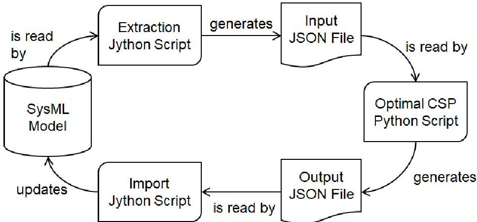

Figure 3-10: Flow chart showing steps two and three of the MADU framework.

One Value Property in the model is assigned the measure of effectiveness Stereotype (《moe》）to signify that the optimizer should minimize that value. The measure of effectiveness Stereotype is a non-normative extension of SysML but it is intended to be used to identify critical parameters within a Parametric Diagram. The constraint used to calculate the value of the Value Property stereotyped with the《moe》 Stereotype is the objective function.

## 3.2.2 Step Two: Optimize design while recording rationales

In step two, information from the system model is extracted and used to find the optimal design. As shown in Figure 3-10, in this implementation of the MADU framework, the information is extracted from the system model using a Jython script and placed in a JSON file. Next, a Python script reads the JSON file, solves an finite domain, chance-constrained, stochastic optimization problem to find the optimal design, and writes the information describing the optimal design as well as conflicts and satisfying states found during optimization to a second JSON file. Last, as part of step three, a second Jython script updates the system model with the information about the optimal design and conflicts.

## Setting up the Optimization Problem

The optimization problem is initialized using information extracted from the system model. The problem formulation used in the MADU framework is shown in equation

<!-- PDF_PAGE: 99 -->

3. 1. There are four elements that must be initialized: the set of design variables x, the set of design variable alternatives for each design variable $ v_{i} $ , the set of constraints c, and the objective function f. Firstly, the set of design variables x is initialized by checking the system model to find Value Properties that have been typed by an Enumeration. Secondly, the set of possible alternatives for each design variable $ v_{i} $ is constructed by iterating through all of the Enumeration Literals owned by each Enumeration that represents a design variable. Thirdly, the set of constraints c is constructed by iterating through the constraints defined by Constraint Blocks in the system model. The set of constraints is made up of three categories: inequality constraints $ g(x,y) $ , equality constraints $ h(x,y) $ , and set constraints $ a(x) $ . The function $ g(x,y) $ and limit $ \alpha $ for each inequality constraint function are defined in the equation within the Constraint Block. Each equality constraint $ h(x,y) $ is read from the equation with a Constraint Block. Each set constraint is constructed by reading the set of variable alternatives from a Constraint Block. Lastly, the objective function $ f(x,y) $ is identified through its unique measure of effectiveness stereotype.

## Solving the Optimization Problem

The optimization problem is solved following the pseudocode in algorithms 1-6. The algorithm is implemented in Python. The solver used to perform the optimizations in relaxedProblem as well as the satisfiability check in extractConflicts is the IBM ILOG CP Optimizer tool [62]. The DOcplex package is used to interface between the Python code and CP Optimizer. Within CP Optimizer, set constraints are imposed using the allowed assignments constraint while conflicts are imposed using the forbidden assignment constraints. In the conflict extractor, the allowed assignments constraint is used to fix the value of design variables when necessary. Equality and inequality constraints are added directly to the optimizer model from the Python code. The refine_conflict is used on an unsatisfiable candidate solution when a conflict is needed. The refine_conflict function only returns one conflict out of the many that may be present in the candidate solution. Hence, algorithm 3 contains a loop starting on line 18 in order to identify all conflicts.

<!-- PDF_PAGE: 100 -->

## 3.2.3 Step Three: Update SysML Model with Optimal Design and Rationales

After the optimization is completed, the optimal solution as well as the conflicts and satisfying states identified during the optimization are imported into the system model using an intermediate JSON file as shown in Figure 3-10. The optimal solution is straightforward to import. Each of the Value Properties that represent a design variable are given a default value equal to the nominal value of the optimal design variable alternative identified during the optimization. The conflicts and satisfying states are created from scratch following the patterns described in Figures 3-11 and 3-12. Relationships are created between satisfying states or conflicts to other modeling elements as per the patterns. All previous conflicts and satisfying states stored in the model are deleted as the set of conflicts and satisfying states that emerge from the optimization will be complete with respect to the new problem definition.

## Modeling Conflicts and Satisfying States

Conflicts and satisfying states are modeled in SysML with similar patterns. As shown in Figure 3-11, a conflict is represented by a Block made up of two parts. One part represents the set of conflicting design variable assignments and is modeled with a Block. The Variable Assignments Block is tied to all Enumeration Literals that represent a conflicting design variable assignment using a custom relationship. The Dependency metaclass is extended to define a new type of relationship called variableAssignments as shown in Figure 3-12. The variableAssignments Stereotype defines a directed relationship between a Block and a set of Enumeration Literals. The other part of the conflict models the set of Constraint Blocks that make up the conflict justification and is also represented by a Block. Each Constraint Block in the conflict justification is tied to the Justification Block using an association relationship.

Satisfying states are modeled with a similar but simpler formalism. As shown in Figure 3-13, a satisfying state is represented by a Block with one or more variableAssignment relationships between that block and the Enumeration literals that

<!-- PDF_PAGE: 101 -->

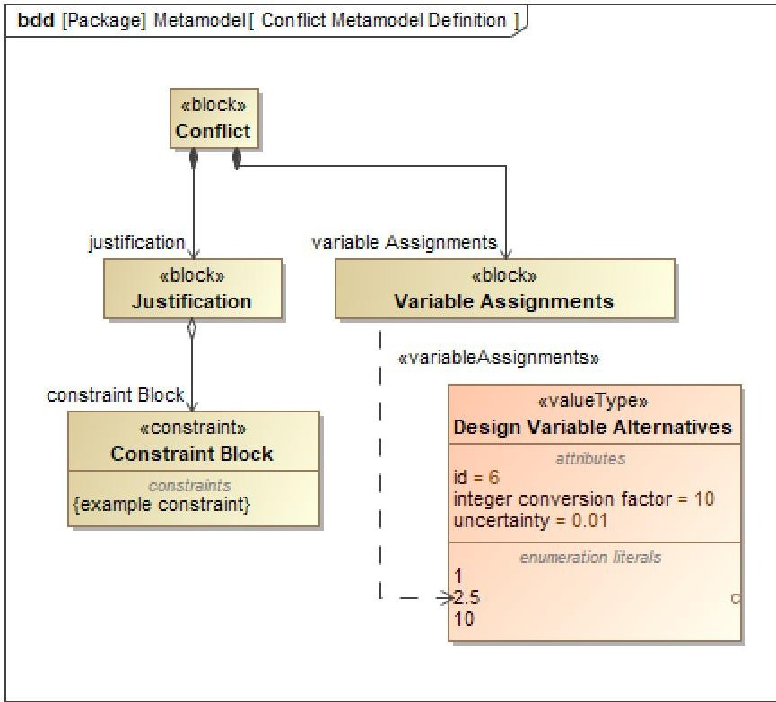

Figure 3-11: The SysML representation of a conflict within the MADU framework.

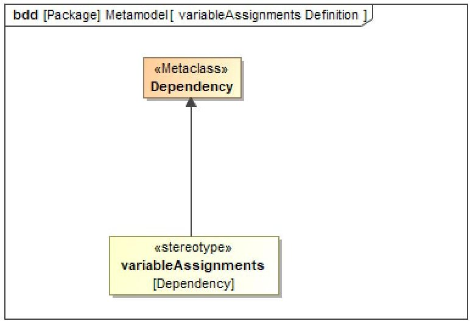

Figure 3-12: The definition of the custom SysML element《variableAssignments》。 The variableAssignments Stereotype extends the Dependency Stereotype to define a directed relationship between a Block and a set of Enumeration Literals.

<!-- PDF_PAGE: 102 -->

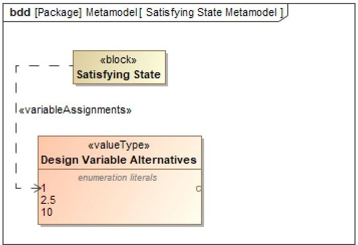

Figure 3-13: The SysML representation of a satisfying state within the MADU framework.

represent the design variable alternatives that are part of that satisfying state.

## 3.2.4 Step Four: Update SysML Model with New Information

In step four, new information about the system is learned and the system model is updated to reflect that new piece of information. As new information is learned during the design process through analyses, trade studies, or other activities, the system model should be updated so that it remains the authoritative source for system information. Table 3.3 shows each type of change, how the problem is affected, and how the change is made in the SysML model.

A design variable can be added to the problem by constructing a new Enumeration and typing a previously-untyped Value Property with that Enumeration. The MADU framework requires that the new Enumeration have only one Enumeration literal and that the Enumeration Literal have a value equal to the value of the old parameter with zero uncertainty. A design variable can be removed from the problem by removing an Enumeration from typing a Value Property. The MADU framework requires that the removed Enumeration have only one Enumeration literal and that the untyped Value Property be given a default value equal to the value of that Enumeration literal.

Adding an alternative to the domain of a design variable is modeled by adding an Enumeration literal to the Enumeration that types the Value Property that represents that design variable. Removing an alternative from the domain of a design variable is

<!-- PDF_PAGE: 103 -->

Table 3.3: Each type of change and how it is implemented in the SysML model

<table border="1"><tr><td>Type of Change</td><td>SysML Model Change</td></tr><tr><td>Addition of Design Variable</td><td>Create new Enumeration and type Value Property</td></tr><tr><td>Removal of Design Variable</td><td>Remove Enumeration from typing Value Property</td></tr><tr><td>Addition of Design Variable Alternative</td><td>Add Enumeration Literal to Enumeration</td></tr><tr><td>Removal of Design Variable Alternative</td><td>Remove Enumeration Literal from Enumeration</td></tr><tr><td>Addition of Constraint</td><td>Add Constraint Block</td></tr><tr><td>Removal of Constraint</td><td>Remove Constraint Block</td></tr><tr><td>Tightening of Constraint</td><td>Decrease default value of Value Property defining inequality constraint limit or increase default value of Value Property defining minimum probability of constraint satisfaction</td></tr><tr><td>Relaxation of Constraint</td><td>Increase default value of Value Property defining inequality constraint limit or decrease default value of Value Property defining minimum probability of constraint satisfaction</td></tr><tr><td>Change Objective Function</td><td>Remove《moe》stereotype from Value Property and add it to a different Value Property</td></tr></table>

<!-- PDF_PAGE: 104 -->

modeled by removing an Enumeration Literal from the Enumeration that types the Value Property that represents that design variable.

Adding a constraint is modeled by adding a Constraint Block with the appropriate equation to the system model and connecting it to existing Value Properties or other Constraint Blocks. Removing a constraint is modeled by deleting a Constraint Block and its connections from the system model. Tightening a constraint is modeled by tightening the default value of a Value Property that represents an inequality constraint limit. Relaxing a constraint is modeled by relaxing the default value of a Value Property that represents an inequality constraint limit. Changing the objective function is modeled by removing the measure of effectiveness Stereotype from its current Value Property and adding it to a different Value Property.

## 3.2.5 Repeat Step Two: Re-optimize design while recording rationales

Returning to step two, conflicts and satisfying states stored in the system model are extracted into a JSON file, pruned if they don't apply to the new problem formulation, fed into the optimizer, and the problem is re-solved. The rules for determining if a conflict or satisfying state applies in the new problem formulation are defined in Table 3.2. The surviving list of conflicts and list of satisfying states are passed to the optimizer. The problem is solved using the same algorithm as in section 3.2.2 and new conflicts and satisfying states are identified.

## 3.2.6 Repeat Step Three: Update SysML Model with New Optimal Design and New Rationales

Repeating step three, the new optimal design and new rationales found in the reoptimization of the problem are stored in the SysML model. The methodology is same as in section 3.2.3. All of the old conflicts and satisfying states are deleted from the model and new representations conforming to Figures 3-11 and 3-13 are created for each of the conflicts and satisfying states.

<!-- PDF_PAGE: 105 -->

## 3.2.7 Limitations of Implementation

The implementation of the MADU framework as described in the preceding sections contains additional limitations over the limitations of the framework itself that are described in section 3.1.5. The current implementation cannot handle simultaneous equations. The CP Optimizer model is built by importing equations from the SysML model in a sequential manner and all variables on the right hand side of each equation must be defined when an equation is imported. Equations are imported in a specific order to meet this constraint. However, simultaneous equations cannot be handled because some variables on the right hand side of the equation are defined by equations that have not yet been imported. A second limitation is that each design variable alternative can only be modeled using a uniform random variable. Other types of random variables could be used but would require different techniques to model those distributions in SysML.

## 3.3 Summary

This chapter introduced the MADU framework and demonstrated the implementation used for this thesis. The framework solves the space system development problem efficiently by re-using conflicts and satisfying states when the problem changes. The framework was implemented using SysML, Python, and IBM ILOG CP Optimizer. The following chapters will exercise the framework on realistic space system development problems.

<!-- PDF_PAGE: 106 -->

<!-- PDF_PAGE: 107 -->

# REXIS Detector Thermal Design Case Study

This chapter presents an example problem in order to walk through the MADU framework and explore its benefits. The example problem is based on the thermal design of the REXIS X-ray spectrometer. The problem illustrates the capabilities of the MADU framework on a simple problem that can be intuitively understood.

## 4.1 REXIS Overview

The REgolith X-ray Imaging Spectrometer (REXIS) is an instrument on board NASA's Origins Spectral Interpretation Resource Identification Security Regolith EXplorer (OSIRIS-REx) spacecraft. The OSIRIS-REx mission will explore the near-Earth asteroid Bennu and return a sample of asteroid regolith to Earth [64]. The mission is led by the University of Arizona with management by NASA through the Goddard Space Flight Center.

REXIS contributes to the mission by observing the asteroid in the soft X-ray band in order to measure elemental abundances and ratios. REXIS was built by students at MIT, Harvard, and other universities. Leadership is provided by the MIT Space Systems Laboratory within the MIT Department of Aeronautics and Astronautics and the MIT Department of Earth, Atmospheric, and Planetary Sciences. Additional

<!-- PDF_PAGE: 108 -->

collaborators include MIT Lincoln Laboratory, MIT Kavli Institute for Astrophysics, and Harvard College Observatory. NASA management was provided by the Goddard Space Flight Center. The overall goal of the REXIS instrument is to provide students with hands-on experience on a NASA mission working with NASA and industry professionals. Beyond this goal, REXIS also provides valuable science to the OSIRIS-REx mission.

REXIS measures X-ray photons fluoresced from Bennu in order to determine elemental abundances and ratios [69]. This information can inform the classification of Bennu within the known meteorite groups. REXIS is a soft X-ray spectrometer sensitive in the 0.5-7.5 keV band that can measure the global Mg/Si, Fe/Si, and S/Si ratios and map the distribution of Fe on the surface to a spatial resolution of 50 m. X-ray photons from the asteroid are detected by four CCID-41 detectors provided by MIT Lincoln Laboratory [102]. In order to simultaneously measure the solar X-ray spectrum responsible for producing fluoresced X-ray photons from the asteroid, REXIS also contains a Sun-pointed Amptek XR-100 silicon drift detector (SDD) [53].

Figure 4-1 shows a CAD model of the REXIS instrument. REXIS is composed of two subassemblies: the main spectrometer containing the CCDs and electronics and the Solar X-ray Monitor (SXM). The main spectrometer is divided into three sections. The base contains the three electronics boards that run the instrument, communicate with the spacecraft, and regulate voltages. A thermal isolation layer separates the warm electronics box from the colder upper section of the spectrometer. The Detector Assembly Mount (DAM) contains the four detectors as well as several radioactive $ ^{55} $ Fe calibration sources. To accurately measure the energy of each incident X-ray photon, the detector array is passively cooled below $ -60^{\circ} \mathrm{C} $ . The cooling is accomplished by isolating the detectors from the warmer electronics box through low conductivity standoffs and connecting the detectors to a radiator using a high-conductivity thermal strap [108]. At the top of the spectrometer is the radiation cover that protects the detectors from excessive radiation damage during the cruise to Bennu. The cover was closed at launch and was opened in September 2018 using a TiNi Aerospace FD04 Frangibolt shape memory alloy actuator [10]. The SXM contains the SDD that

<!-- PDF_PAGE: 109 -->

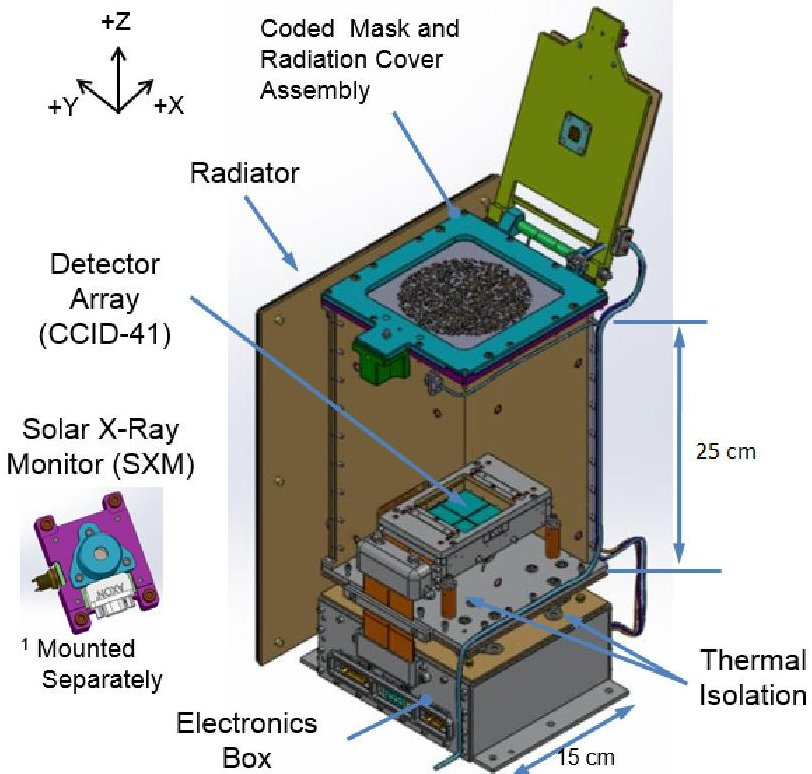

Figure 4-1: CAD of the REXIS Instrument

observes the Sun and is mounted separately from the spectrometer so that it can observe the Sun while the spectrometer observes the asteroid. It is connected to the spectrometer through a harness.

## 4.2 Problem Definition

The example problem used in this chapter to illustrate the MADU framework is motivated by the thermal design necessary to cool the REXIS detectors to below $ - 6 0^{\circ} \mathrm{C} $ As described above, this cooling is achieved entirely passively through isolation from the warmer parts of the instrument and connection to a large radiator through a thermal strap. The radiator rejects heat from the detectors to deep space. The design of the instrument was largely driven by this thermal design. The problem in this chapter will select the size and material of the isolation layer and thermal strap to meet this temperature requirement while satisfying a maximum mass constraint.

A schematic of the portion of the REXIS instrument analyzed in this problem is shown in Figure 4-2. The detectors are housed in the Detector Assembly Mount (DAM) which needs to be cooled to less than $ - 6 0^{\circ} \mathrm{C} $ (213 K) in order to meet noise

<!-- PDF_PAGE: 110 -->

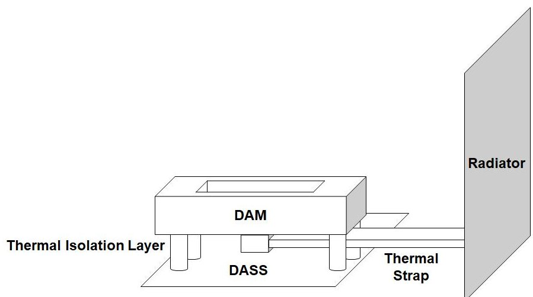

Figure 4-2: Schematic showing the physical geometry of the example problem (not to scale).

requirements. It is connected to the Detector Assembly Support Structure (DASS) through the Thermal Isolation Layer (TIL) and to the Radiator through the Thermal Strap.

## 4.2.1 Problem Structure

The topology of the thermal system used in this problem is shown in Figure 4-3. Three nodes are present in the problem: the DASS, the DAM, and the Radiator. The DASS is modeled with a temperature $ T_{DASS} $ of $ -20^{\circ} \mathrm{C} $ (253 K). The DAM is has an unknown temperature $ T_{DAM} $ but has a maximum temperature limit of $ -60^{\circ} \mathrm{C} $ (213 K). A heat load of 1.5 W is present on the DAM. This heat load $ q_{DAM} $ comes from dissipation by detectors themselves, as well as by thermal radiation from surrounding, warmer components. Radiative heat transfer is not modeled for any components. The Radiator is assumed to have a temperature $ T_{rad} $ of $ -65^{\circ} \mathrm{C} $ (208 K). Two edges connect the three nodes. The first edge is the TIL which connects the DASS to the DAM. The TIL is made up of four standoffs. Each standoff has an unknown radius $ r_{TIL} $ . This problem models the TIL as a single edge, lumping the four standoffs into one when calculating the cross sectional area of the TIL $ A_{TIL} $ . The TIL also has an unknown conductivity $ k_{TIL} $ and an unknown length $ L_{TIL} $ . These unknown values represent design variables.

Accounting for bolted joint conductivity is an important consideration for accu-

<!-- PDF_PAGE: 111 -->

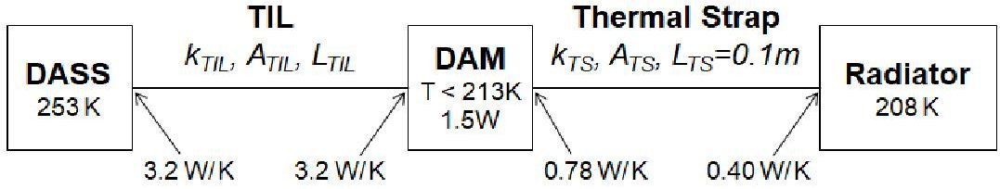

Figure 4-3: A simplified diagram showing the assumptions made in the example problem.

rately predicting the temperature of the DAM [43]. The bolted joint connecting the DASS to the TIL and the bolted joint connecting the DAM to the TIL both have a conductivity of 3.2 W/K.

The other edge is the Thermal Strap which connects the DAM to the Radiator. The Thermal Strap has an unknown conductivity $ k_{TS} $ and an unknown cross sectional area $ A_{TS} $ . These unknown values represent design variables. The length of the Thermal Strap $ L_{TS} $ is equal to 0.1 m. The bolted joint connecting the DAM to the Thermal Strap has a conductivity of 0.78W/K while the bolted joint connecting the Thermal Strap to the Radiator has a conductivity of 0.40W/K.

The model parameters and design variables described in this section are shown in Table 4.1 and Table 4.3 respectively. As a whole, the REXIS detector thermal design problem has 9 design variables, 2 inequality constraints, 9 equality constraints, and 2 set constraints. Accounting for the set constraints, there are 7200 possible solutions to the problem.

## 4.2.2 Design Variable Definition

The design variables for this example problem specify the material and geometric properties of the system. The section above describes the geometric design variables. The material alternatives are shown in Table 4.2. The materials are typical aerospace materials that span a wide range of thermal conductivities, densities, and volumetric costs, providing a diverse set of options for the system design. The volumetric cost for each material is the cost of buying a volume of that material in raw form. This cost is combined with the volume of the system to calculate the overall cost.

The full set of design variables along with their set of alternatives is shown in

<!-- PDF_PAGE: 112 -->

Table 4.1: The set of model parameters y for the REXIS Detector thermal design problem

<table border="1"><tr><td>Parameter Name</td><td>Parameter Symbol</td><td>Parameter Value</td></tr><tr><td>DASS Temperature</td><td>$T_{DASS}$</td><td>$-20^{\circ}C$</td></tr><tr><td>DAM Heat Load</td><td>$q_{DAM}$</td><td>$1.5W$</td></tr><tr><td>Radiator Temperature</td><td>$T_{rad}$</td><td>$-65^{\circ}C$</td></tr><tr><td>DASS to TIL Bolted Joint Conductivity</td><td>$k_{DASS-TIL}$</td><td>$3.2W/K$</td></tr><tr><td>TIL to DAM Bolted Joint Conductivity</td><td>$k_{TIL-DAM}$</td><td>$3.2W/K$</td></tr><tr><td>Thermal Strap Length</td><td>$L_{TS}$</td><td>$0.1m$</td></tr><tr><td>DAM to Thermal Strap Bolted Joint Conductivity</td><td>$k_{DAM-TS}$</td><td>$0.78W/K$</td></tr><tr><td>Thermal Strap to Radiator Bolted Joint Conductivity</td><td>$k_{TS-Rad}$</td><td>$0.40W/K$</td></tr></table>

Table 4.2: The set of material alternatives for the Thermal Strap and TIL.

<table border="1"><tr><td>Material</td><td>ConductivityW/(mK)</td><td>Densitykg/m3</td><td>VolumetricCost$/cm3</td></tr><tr><td>Aluminum6061-T6[70][93]</td><td>167</td><td>2700</td><td>0.177</td></tr><tr><td>316StainlessSteel[72][95]</td><td>15.9</td><td>7920</td><td>0.400</td></tr><tr><td>OFHC Copper[71][94]</td><td>391</td><td>8940</td><td>0.727</td></tr><tr><td>Titanium6AL-4V[74][96]</td><td>6.70</td><td>4430</td><td>1.81</td></tr><tr><td>Torlon5030[73][23]</td><td>0.360</td><td>1610</td><td>3.66</td></tr></table>

<!-- PDF_PAGE: 113 -->

Table 4.3. The set of design variables includes the conductivity of the Thermal Strap $ k_{TS} $ , the cross sectional area of the Thermal Strap $ A_{TS} $ , the conductivity of the TIL $ k_{TIL} $ , the length of the TIL $ L_{TIL} $ , the radius of each of the four TIL standoffs $ r_{TIL} $ , the density of the TIL $ \rho_{TIL} $ , the volumetric cost of the TIL $ s_{TIL} $ , the density of the Thermal Strap $ \rho_{TS} $ , and the volumetric cost of the Thermal Strap $ s_{TS} $ . The set of alternatives for the geometric properties are values close to the values for the REXIS design while the set of alternatives for the material properties are taken from the set of materials shown in Table 4.2. Thermal Strap cross sectional area can take any value between $ 1\times 10^{-4}\mathrm{m}^{2} $ and $ 5\times 10^{-4}\mathrm{m}^{2} $ in steps of $ 5\times 10^{-5}\mathrm{m}^{2} $ . TIL length can take any value between 0.005 m and 0.015 m in steps of 0.001 m. TIL radius can take any value between 0.004 m and 0.007 m in steps of 0.001 m.

Each geometric design variable alternative is modeled as a uniform random variable with an uncertainty of 1% around its central value. Each material property design variable alternative is modeled as a uniform random variable with an uncertainty of 5% around its central value. In total, the problem has nine design variables.

## 4.2.3 Set Constraints

Because a single material is represented using multiple design variables, set constraints are needed to ensure consistency. For example, the algorithm should not be able to choose the conductivity of copper (391W/（mK)) and the cost of aluminum $ \mathrm{(}\mathrm{S}0.177/\mathrm{c m}^{3} $ ). Therefore, two set constraints, each with multiple sets of satisfying design variable assignments, are included in the problem. The first set constraint enforces consistency for the Thermal Strap while the second set constraint enforces consistency for the TIL. The satisfying sets of design variable alternatives for each set constraint correspond to the rows in Table 4.2

## 4.2.4 Equality Constraints

The primary consideration for designing this thermal system is the temperature of the detectors. That temperature can be calculated using the one-dimensional conductive

<!-- PDF_PAGE: 114 -->

Table 4.3: The set of design variables for the REXIS thermal design problem, with the set of alternatives for each design variable listed.

<table border="1"><tr><td>Name</td><td>Symbol</td><td>Units</td><td>Uncertainty</td><td>Alternatives</td></tr><tr><td>Thermal Strap Conductivity</td><td>$k_{TS}$</td><td>W/(mK)</td><td>0.05</td><td>167,15.9,391,6.70,0.360</td></tr><tr><td>Thermal Strap Cross Sectional Area</td><td>$A_{TS}$</td><td>m2</td><td>0.01</td><td>$1\times10^{-4},1.5\times10^{-4},2\times10^{-4},2.5\times10^{-4},3\times10^{-4},3.5\times10^{-4},4\times10^{-4},4.5\times10^{-4},5\times10^{-4}$</td></tr><tr><td>TIL Conductivity</td><td>$k_{TIL}$</td><td>W/(mK)</td><td>0.05</td><td>167,15.9,391,6.70,0.360</td></tr><tr><td>TIL Length</td><td>$L_{TIL}$</td><td>m</td><td>0.01</td><td>0.005,0.006,0.007,0.008,0.009,0.010,0.011,0.012</td></tr><tr><td>TIL Radius</td><td>$r_{TIL}$</td><td>m</td><td>0.01</td><td>0.004,0.005,0.006,0.007</td></tr><tr><td>TIL Density</td><td>$\rho_{TIL}$</td><td>kg/m3</td><td>0.05</td><td>2700,7920,8940,4430,1610</td></tr><tr><td>TIL Volumetric Cost</td><td>$s_{TIL}$</td><td>$/cm3</td><td>0.05</td><td>0.177,0.400,0.727,1.81,3.66</td></tr><tr><td>Thermal Strap Density</td><td>$\rho_{TS}$</td><td>kg/m3</td><td>0.05</td><td>2700,7920,8940,4430,1610</td></tr><tr><td>Thermal Strap Volumetric Cost</td><td>$s_{TS}$</td><td>$/cm3</td><td>0.05</td><td>0.177,0.400,0.727,1.81,3.66</td></tr></table>

<!-- PDF_PAGE: 115 -->

heat transfer equation shown in equation 4.1. Conductive heat transfer q is determined by the temperature on the two ends of the interface $ T_{a}, T_{b} $ , the length of the interface L, the cross-sectional area of the interface A, and the thermal conductivity of the material across which heat is transferred k. The DAM temperature can be calculated by applying this equation to calculate the heat transfer across the TIL and across the Thermal Strap.

$$
q = \frac {k A}{L} \left(T _ {a} - T _ {b}\right)
$$

The DAM temperature can be calculated using equations 4.2, 4.3, and 4.4 by applying the conductivity equation to calculate the heat transfer across the TIL and across the Thermal Strap. The first equation uses the length of the Thermal Strap $ L_{TS} $ , the conductivity of the Thermal Strap $ k_{TS} $ , the cross sectional area of the Thermal Strap $ A_{TS} $ , and the Thermal Strap bolted joint conductances $ k_{DAM-TS} $ and $ k_{TS-Rad} $ to calculate the equivalent conductivity of the Thermal Strap $ \hat{k}_{TS} $ . The second equation uses the length of the TIL $ L_{TIL} $ , the conductivity of the TIL $ k_{TIL} $ , the cross sectional area of the TIL $ A_{TIL} $ , and the TIL bolted joint conductances $ k_{DASS-TIL} $ and $ k_{TIL-DAM} $ to calculate the equivalent conductivity of the TIL $ \hat{k}_{TIL} $ . The third equation uses the equivalent conductivities of the TIL and Thermal Strap $ \hat{k}_{TIL} $ and $ \hat{k}_{TS} $ , the temperature of the DASS $ T_{DASS} $ , the temperature of the Radiator $ T_{rad} $ , and the heat load on the DAM $ q_{DAM} $ to calculate the temperature of the DAM $ T_{DAM} $ .

$$
\hat {k} _ {T S} = \frac {1}{1 / k _ {D A M - T S} + 1 / k _ {T S - R a d} + \frac {L _ {T S}}{k _ {T S} A _ {T S}}}
$$

$$
\hat {k} _ {T I L} = \frac {1}{1 / k _ {D A S S - T I L} + 1 / k _ {T I L - D A M} + \frac {L _ {T I L}}{k _ {T I L} A _ {T I L}}}
$$

$$
T _ {D A M} = \frac {\hat {k} _ {T S} T _ {r a d} + \hat {k} _ {T I L} T _ {D A S S}}{\hat {k} _ {T S} + \hat {k} _ {T I L}} + q _ {D A M}
$$

Additional equality constraints are used to calculate mass and cost of the design.

<!-- PDF_PAGE: 116 -->

Mass is calculated individually for the TIL and Thermal Strap as shown in equations 4.5 and 4.6 and then summed to calculate the total mass of the design as shown in equation 4.7. Similarly, cost is calculated individually for the TIL and Thermal Strap as shown in equations 4.8 and 4.9 and then summed to calculate the total cost of the design as shown in equation 4.10.

$$
m _ {T S} = A _ {T S} L _ {T S} \rho_ {T S}
$$

$$
m _ {T I L} = A _ {T I L} L _ {T I L} \rho_ {T I L}
$$

$$
m _ {t o t} = m _ {T I L} + m _ {T S}
$$

$$
S _ {T S} = A _ {T S} L _ {T S} s _ {T S}
$$

$$
S _ {T I L} = A _ {T I L} L _ {T I L} s _ {T I L}
$$

$$
S _ {t o t} = S _ {T I L} + S _ {T S}
$$

## 4.2.5 Inequality Constraints

Two inequality constraints define acceptable solutions. The first inequality constraint expresses the requirement on DAM temperature $ T_{DAM} $ . That temperature must reach a steady state value below $ - 6 0^{\circ} \mathrm{C} $ (213 K). The first inequality constraint is shown in equation 4.11. The second inequality constraint defines a maximum mass to replicate a mass allocation made by the design team. The total mass of the TIL and Thermal Strap cannot exceed 0.35 kg. The second inequality constraint is shown in equation 4.12. The minimum probability of satisfying any inequality constraint p is set at 0.95.

<!-- PDF_PAGE: 117 -->

$$
T _ {D A M} < - 6 0
$$

$$
m _ {t o t} < 0. 3 5
$$

## 4.2.6 Objective Function

The objective for this example problem is to minimize the total cost of the system. The objective function is defined in equation 4.13.

$$
f (x, y) \leftarrow S _ {t o t}
$$

## 4.3 Example Walkthrough

This section presents a walkthrough of the how the MADU framework is used to solve the REXIS detector thermal design problem. A SysML model is constructed, the chance constrained optimization problem is solved, the optimization products are returned to the system model, a change is made to the problem, and the optimization is rerun to find the new optimal design.

## 4.3.1 Step One: Construct SysML model

A system model is built that contains the design variables, design variable alternatives, constraints, and objective function defined in the previous section. Figure 4-4 is a block definition diagram showing the Enumerations for the example problem. Each Enumeration owns a set of literals that define the set of alternatives for that variable, and its ID, its uncertainty, and its integer conversion factor.

Figure 4-5 is a block definition diagram that defines the structure of the system and shows the Value Properties representing the model parameters and design variables. The top level Thermal Analysis Context block contains the Value Property that defines the minimum acceptable probability of meeting any inequality constraint

<!-- PDF_PAGE: 118 -->

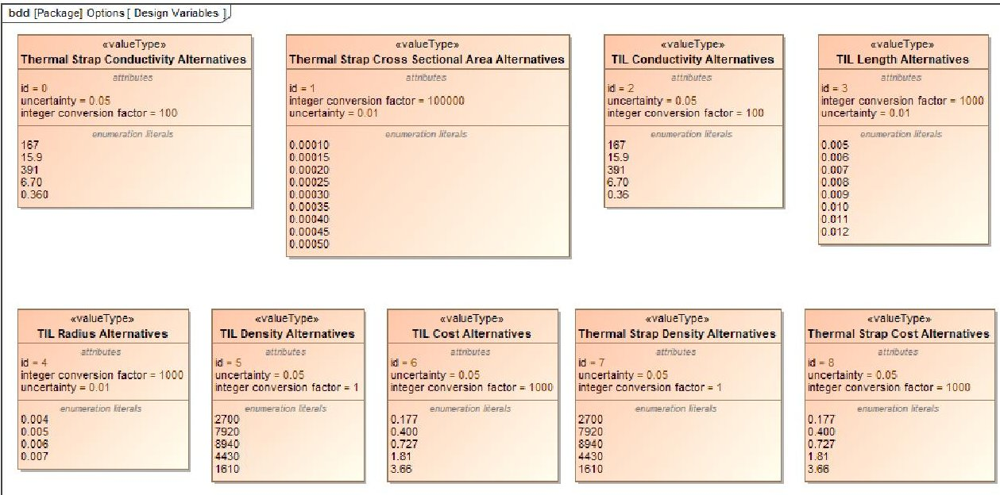

Figure 4-4: A block definition diagram showing the set of Enumerations that define all design variable alternatives for the REXIS thermal design problem.

p. The REXIS Block contains three value properties defining the total mass, total cost, and maximum mass. The REXIS block is composed of five components, also represented with Blocks. Each component contains several Value Properties defining its attributes. The Value Properties that are typed by Enumerations represent design variables. Note that the bolted joint conductivities are shown as thermal resistances in this figure.

After creating all components, Constraint Blocks are added to the model to express the equality, inequality, and set constraints. These Constraint Blocks relate Value Properties shown in Figure 4-5. Constraint Blocks are shown in parametric diagrams. A selection of parametric diagrams are shown to show how constraints are constructed. Figure 4-6 shows how the total mass and cost of the TIL is calculated from its geometric and material properties using equations 4.6 and 4.9. Figure 4-7 shows how the mass and cost of the TIL and Thermal Strap are summed to calculate the total mass and cost for the system per equations 4.7 and 4.10. Figure 4-8 shows how the set constraint for material properties as shown in Table 4.2 is implemented. Each row of the constraint block corresponds to an acceptable combination of design variable alternatives. Figure 4-9 shows how the equivalent conductivity of the TIL is calculated per equation 4.3. Figure 4-10 shows how the DAM temperature is calcu-

<!-- PDF_PAGE: 119 -->

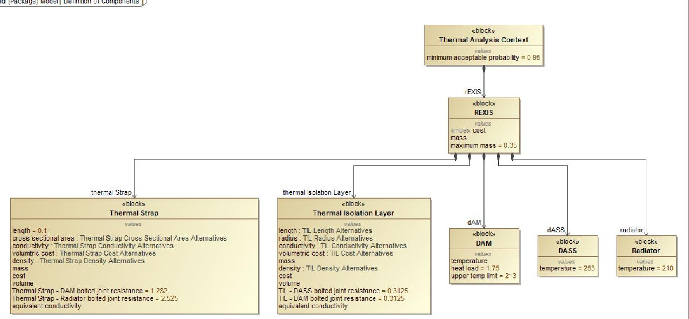

Figure 4-5: A block definition diagram defining all of the components in the example problem. The figure also shows a number of Value Properties that define model parameters and design variables.

lated per equation 4.4. The figure also shows the inequality constraint from equation 4.11 defining the maximum allowable DAM temperature.

## 4.3.2 Step Two: Optimize design while recording rationales

With the system model constructed, the algorithm described in section 3.2 is run to find the optimal design. In this example problem, the optimal solution is found after checking 8 candidate solutions and identifying 29 conflicts. A total of 5735 calls to CP Optimizer are required and the total run time is 278.6s. The optimal design is shown in Figure 4-11 and Table 4.4 and consists of a copper thermal strap with a cross sectional area of $ 3\times1 0^{-4} \mathrm{m}^{2} $ and a Torlon TIL with a radius of 0.004 m and a length of 0.012 m. Unsurprisingly, the optimizer chose a low conductivity material for the TIL and a high conductivity material for the Thermal Strap. Additionally, the TIL is made as tall and thin as possible to reduce conductivity and cost, while the Thermal Strap is made as thin as possible to reduce cost while remaining thick enough to meet the temperature constraint.

The algorithm also records conflicts found during search. Table 4.5 shows two of the twenty-nine conflicts that were identified. The table shows design variable alter-

<!-- PDF_PAGE: 120 -->

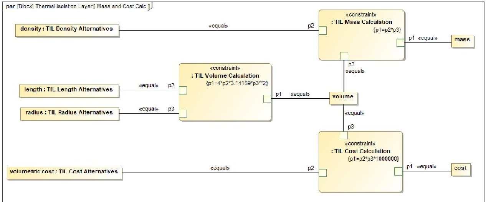

Figure 4-6: A parametric diagram defining how the total mass and cost for the TIL are calculated.

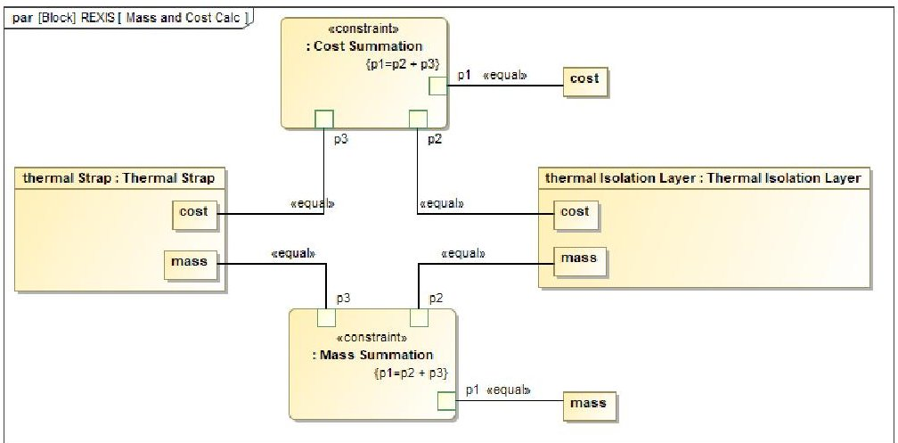

Figure 4-7: A parametric diagram defining how the total mass and cost of the thermal system are calculated by summing the mass and cost for the TIL and the Thermal Strap.

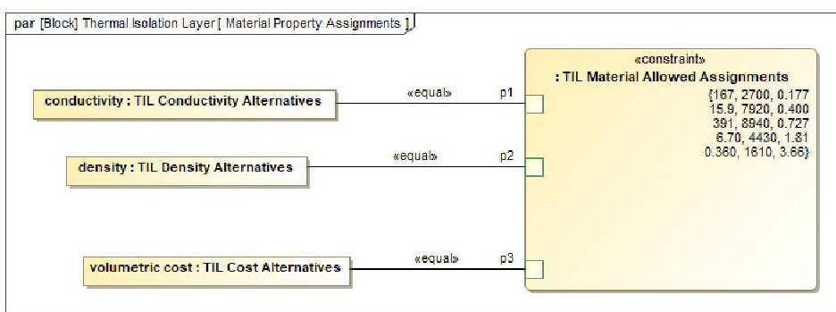

Figure 4-8: A parametric diagram showing how the allowable assignment sets for the variables related to material properties are defined.

<!-- PDF_PAGE: 121 -->

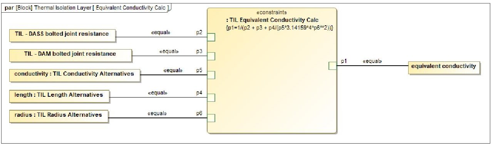

Figure 4-9: A parametric diagram showing how the equivalent conductivity of the TIL is calculated by combining the conductivity of the four standoffs with the bolted joint resistances.

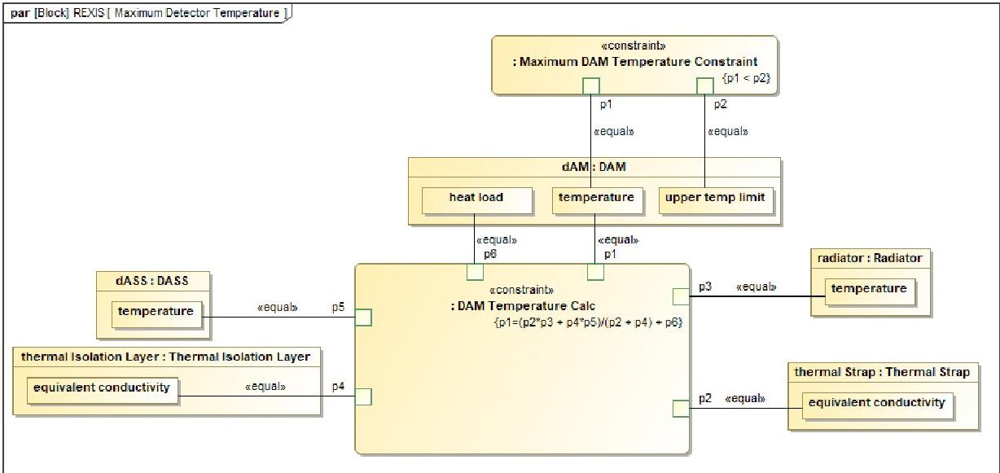

Figure 4-10: A parametric diagram showing how the DAM temperature is calculated from the temperature of the DASS and Radiator and the equivalent conductivities of the TIL and Thermal Strap. The diagram also shows the inequality constraint defining the maximum allowable DAM temperature.

Table 4.4: The set of optimal design variables alternatives for the REXIS thermal design problem.

<table border="1"><tr><td>Name</td><td>Symbol</td><td>Units</td><td>Optimal Value</td></tr><tr><td>Thermal Strap Conductivity</td><td>$k_{TS}$</td><td>W/(mK)</td><td>391</td></tr><tr><td>Thermal Strap Cross Sectional Area</td><td>$A_{TS}$</td><td>m2</td><td>$3\times10^{-4}$</td></tr><tr><td>TIL Conductivity</td><td>$k_{TIL}$</td><td>W/(mK)</td><td>0.360</td></tr><tr><td>TIL Length</td><td>$L_{TIL}$</td><td>m</td><td>0.012</td></tr><tr><td>TIL Radius</td><td>$r_{TIL}$</td><td>m</td><td>0.004</td></tr><tr><td>TIL Density</td><td>$\rho_{TIL}$</td><td>kg/m3</td><td>1610</td></tr><tr><td>TIL Volumetric Cost</td><td>$s_{TIL}$</td><td>$/cm3</td><td>3.66</td></tr><tr><td>Thermal Strap Density</td><td>$\rho_{TS}$</td><td>kg/m3</td><td>8940</td></tr><tr><td>Thermal Strap Volumetric Cost</td><td>$s_{TS}$</td><td>$/cm3</td><td>0.727</td></tr></table>

<!-- PDF_PAGE: 122 -->

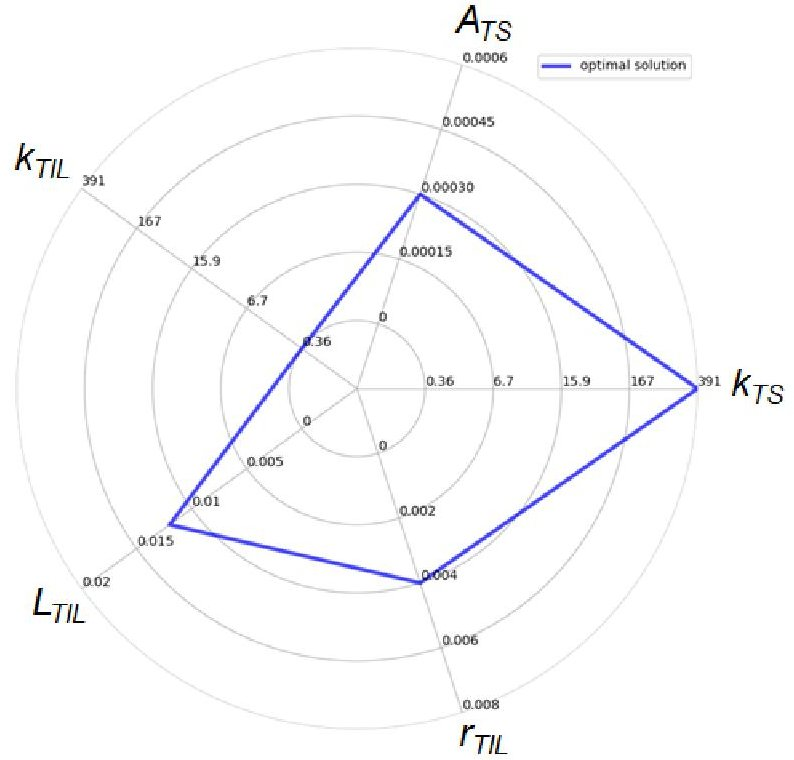

Figure 4-11: A radar plot showing the optimal value for five design variables after the initial solve of the REXIS detector thermal design problem.

natives involved in the conflict and the explanation for the conflict. The first conflict is the selection of the 391W/（mK）design variable alternative for the TIL conductivity $ k_{TIL} $ . The explanation for this conflict is the maximum DAM temperature constraint. Intuitively, if a high conductivity is selected for the TIL, the Radiator cannot reject enough heat from the DAM to meet the maximum DAM temperature constraint. Therefore, setting the $ k_{TIL} $ to such a high conductivity makes the problem unsatisfiable. The second conflict is the selection of the $ 2700\mathrm{kg}/\mathrm{m}^{3} $ density for the Thermal Strap. This selection implies that the Thermal Strap is made of aluminum. The explanation for the conflict is both the maximum DAM temperature constraint and the Thermal Strap set constraint. Intuitively, the conductivity of aluminum is not high enough to reject enough heat from the DAM to meet its temperature constraint. The conductivity of copper is sufficient to meet the DAM temperature constraint, as shown in Table 4.4 but the optimizer can't simultaneously select the density of aluminum and the conductivity of copper because of the set constraint.

<!-- PDF_PAGE: 123 -->

Table 4.5: Two of twenty-nine conflicts identified while searching for the optimal solution.

<table border="1"><tr><td>Conflict</td><td>Explanation</td></tr><tr><td>kTIL=391</td><td>Maximum DAM Temperature Constraint</td></tr><tr><td>ρTS=2700</td><td>Maximum DAM Temperature Constraint,Thermal Strap Material Constraint</td></tr></table>

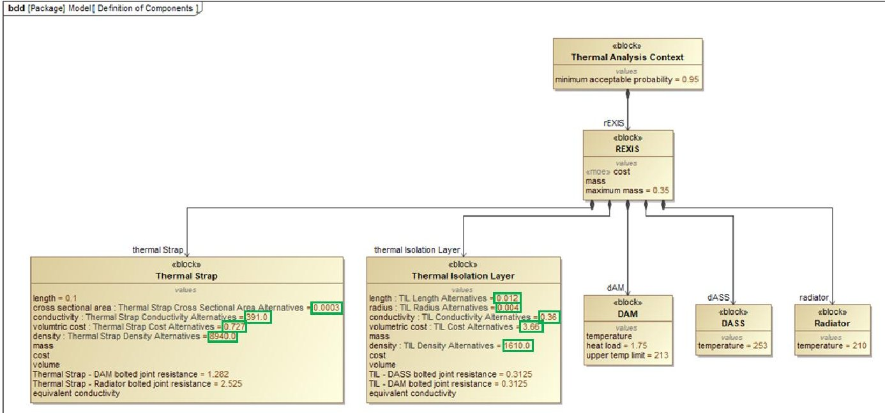

Figure 4-12: A BDD defining the components in the sample problem. This diagram is identical to that in Figure 4-5 except that the Value Properties representing design variables have been given default values corresponding to the optimal design. The added values are highlighted by the green boxes.

## 4.3.3 Step Three: Update SysML model with Optimal Design and Rationales

In step three, the system model is updated to capture the optimal design, set of conflicts, and set of satisfying states. The optimal assignments to design variables are represented by assigning default values to each of the Value Properties that represents a design variable as shown in Figure 4-12. Each conflict is modeled per its defined pattern. The first conflict in Table 4.5 is shown in Figure 4-13. Each satisfying state is modeled in its defined pattern. Figure 4-14 shows the one satisfying state that was found during search, the optimal solution.

<!-- PDF_PAGE: 124 -->

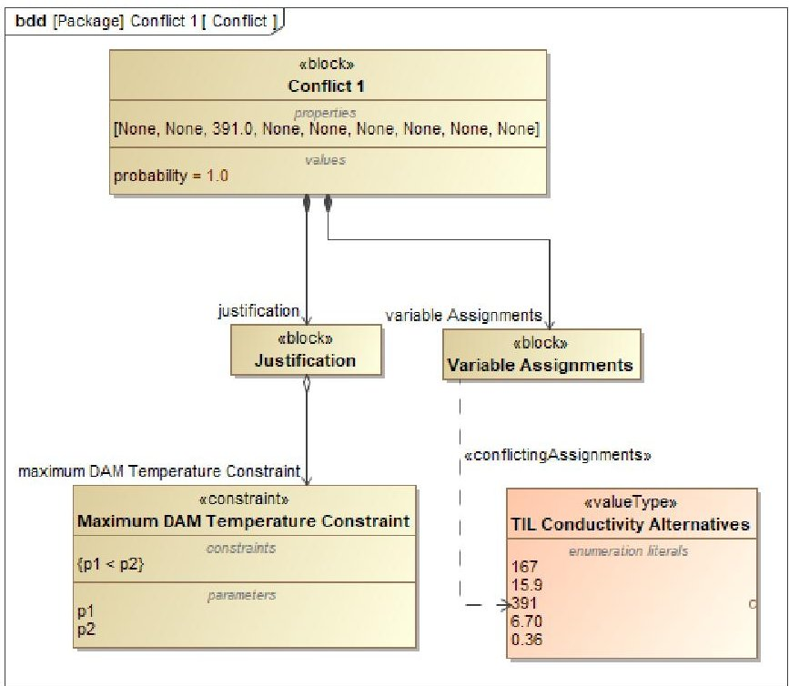

Figure 4-13: A BDD showing how a conflict found during search is modeled in SysML.

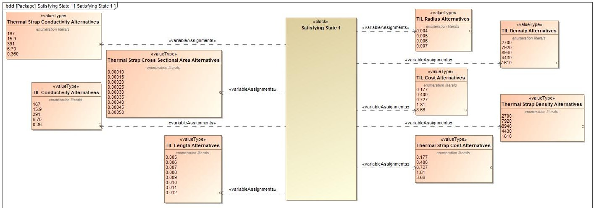

Figure 4-14: A BDD showing how a satisfying state found during search is modeled in SysML.

<!-- PDF_PAGE: 125 -->

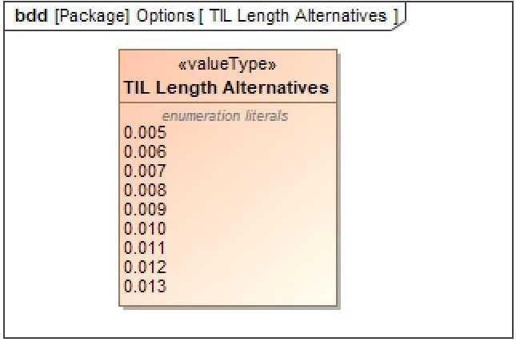

Figure 4-15: A BDD showing the new set of alternatives for the TIL Length design variable. An Enumeration Literal with a value of 0.013 m has been added as compared with the TIL Length Enumeration in the original problem shown in Figure 4-4.

## 4.3.4 Step Four: Update SysML model with New Information

In step four, the system model is altered to reflect new information that has been learned. For this walkthrough, a new design variable alternative is introduced for TIL Length, a uniform random variable with a central value equal to 0.013 m and an uncertainty of 1%. This new design variable alternative is larger than any other alternative for TIL Length and so reflects a situation where the TIL can now be taller than its previous maximum height. Perhaps another component has been removed from the system, making more room for the TIL and DAM. To implement this change in the SysML model, a new Enumeration Literal is added to the Enumeration that represents the $ L_{TIL} $ design variable. Figure 4-15 shows the new set of alternatives for the Thermal Strap cross sectional area design variable.

## 4.3.5 Repeat Step Two: Re-optimize design while recording rationales

Returning to step two, the information from the system model is extracted, changes to the problem are identified through comparison of the JSON file created in this step and the JSON file created in step two when the original optimization was performed, the remaining conflicts and satisfying states are fed into the optimization algorithm, and the problem is re-solved. With the addition of a design variable alternative, all

<!-- PDF_PAGE: 126 -->

Table 4.6: The full conflict set after accommodating the newly TIL Length design variable alternative.

<table border="1"><tr><td>Conflict</td><td>Explanation</td></tr><tr><td>$L_{TIL}=0.005$</td><td>Maximum DAM Temperature Constraint</td></tr><tr><td>$L_{TIL}=0.006$</td><td>Maximum DAM Temperature Constraint</td></tr><tr><td>$L_{TIL}=0.007$</td><td>Maximum DAM Temperature Constraint</td></tr><tr><td>$L_{TIL}=0.008$</td><td>Maximum DAM Temperature Constraint</td></tr><tr><td>$L_{TIL}=0.009$</td><td>Maximum DAM Temperature Constraint</td></tr><tr><td>$L_{TIL}=0.010$</td><td>Maximum DAM Temperature Constraint</td></tr><tr><td>$L_{TIL}=0.011$</td><td>Maximum DAM Temperature Constraint，Thermal Strap Material Set Constraint，Maximum Mass Constraint</td></tr></table>

previously satisfying solutions remain satisfying. A conflict is pruned if a constraint in its explanation has the altered design variable in its domain, except in the case where the set of design variable alternatives that comprise the conflict contains a design variable alternative from the altered design variable. After applying these rules, the one satisfying state and the conflicts shown in Table 4.6 remain. These conflicts remain conflicts because they all involve assignments to the $ L_{TIL} $ design variable. As a result of these conflicts, almost all of the alternatives for TIL Length can be ruled out before optimization begins.

A new solution is found after checking 9 candidate solutions, identifying 34 conflicts in addition to the 7 that were known from the previous problem, and making 5516 calls to CP Optimizer. The solution is found in 291.6 s. The same problem was run without utilizing any conflicts or satisfying states from the previous problem and it checked 10 solution candidates, made 6853 calls to CP Optimizer, and took 418.0 s to find the optimal solution, demonstrating the value of information reuse. The new optimal design is shown in Figure 4-16 and Table 4.7 and consists of an aluminum thermal strap with a cross sectional area of $ 4. 5 \times1 0^{-4} \mathrm{m}^{2} $ and a Torlon TIL with a radius of 0.004 m and a length of 0.013 m. The new alternative for TIL Length is chosen because it enabled the Thermal Strap to be changed to aluminum, saving cost.

<!-- PDF_PAGE: 127 -->

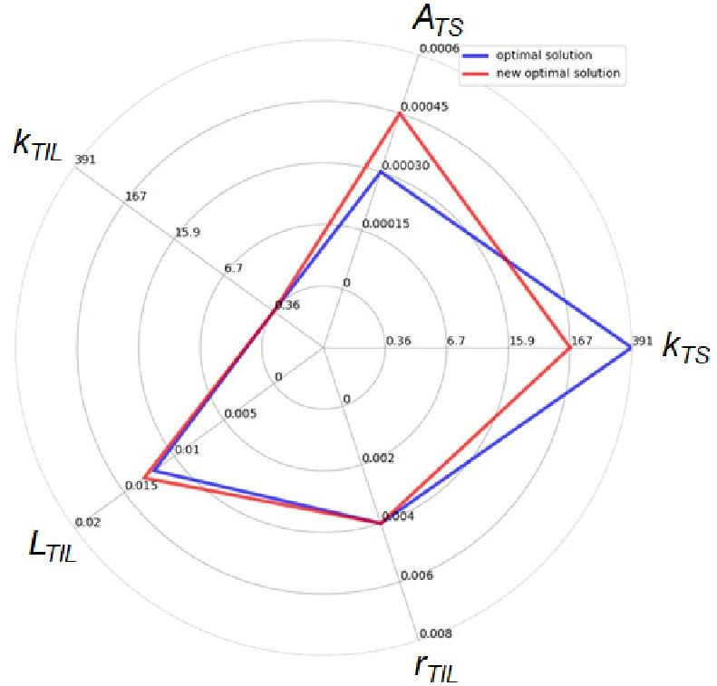

Figure 4-16: A radar plot showing the optimal value for five design variables in the initial problem and the new optimal design after the introduction of a new design variable alternative for TIL Length.

Table 4.7: The set of optimal design variable alternatives for the changed REXIS thermal design problem, after the addition of a new design variable alternative for TIL Length. The old optimal values are shown for comparison.

<table border="1"><tr><td>Name</td><td>Symbol</td><td>Units</td><td>Old Optimal Alternative</td><td>New Optimal Alternative</td></tr><tr><td>Thermal Strap Conductivity</td><td>$k_{TS}$</td><td>W/(mK)</td><td>391</td><td>167</td></tr><tr><td>Thermal Strap Cross Sectional Area</td><td>$A_{TS}$</td><td>m2</td><td>$3\times10^{-4}$</td><td>$4.5\times10^{-4}$</td></tr><tr><td>TIL Conductivity</td><td>$k_{TIL}$</td><td>W/(mK)</td><td>0.360</td><td>0.360</td></tr><tr><td>TIL Length</td><td>$L_{TIL}$</td><td>m</td><td>0.012</td><td>0.013</td></tr><tr><td>TIL Radius</td><td>$r_{TIL}$</td><td>m</td><td>0.004</td><td>0.004</td></tr><tr><td>TIL Density</td><td>$\rho_{TIL}$</td><td>kg/m3</td><td>1610</td><td>1610</td></tr><tr><td>TIL Volumetric Cost</td><td>$s_{TIL}$</td><td>$/cm3</td><td>3.66</td><td>3.66</td></tr><tr><td>Thermal Strap Density</td><td>$\rho_{TS}$</td><td>kg/m3</td><td>8940</td><td>2700</td></tr><tr><td>Thermal Strap Volumetric Cost</td><td>$s_{TS}$</td><td>$/cm3</td><td>0.727</td><td>0.177</td></tr></table>

<!-- PDF_PAGE: 128 -->

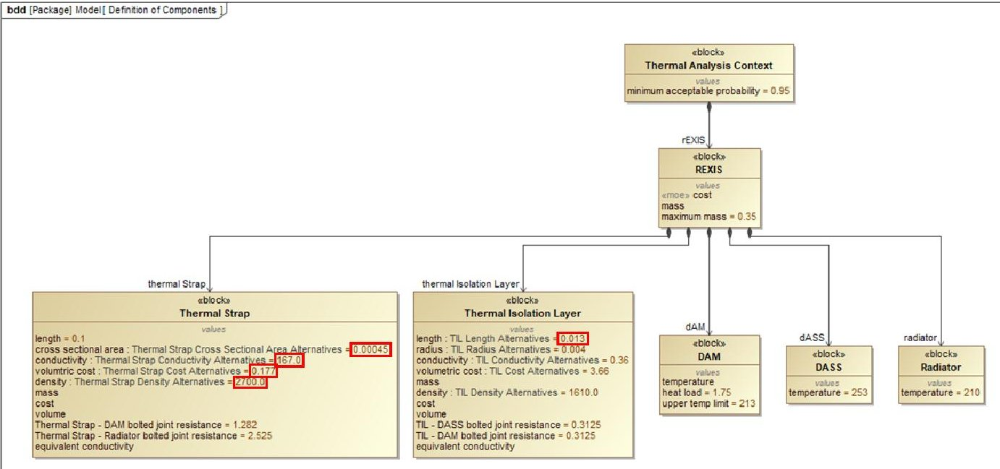

Figure 4-17: A BDD defining the components in the sample problem. This diagram is identical to that in Figure 4-12 except that the Value Properties representing design variables have been updated with the values of the new optimal design. The changed values are highlighted by the red boxes.

## 4.3.6 Repeat Step Three: Update SysML Model with New Optimal Design and New Rationales

After the optimization is completed, the SysML model is updated once again with the optimal design, conflicts, and satisfying states. The procedure is the same as in section 4.3.3. The default values for each Value Property are overwritten with the new optimal values as shown in Figure 4-17. All old conflicts and satisfying states are deleted from the model and the new ones are created per the patterns shown in Figure 4-13 and 4-14.

## 4.4 Measuring the Value of Re-using Information

This section exercises the REXIS detector thermal design problem using each type of change to examine the computational savings that can be obtained by reusing conflicts and satisfying states. The statistics for these examples may not be generalizable to all problems but they illustrate that savings are possible through information reuse. The optimization algorithm within the MADU framework will be tested against an

<!-- PDF_PAGE: 129 -->

identical optimization algorithm that doesn't reuse any information from the previous problem. This "restart" algorithm identifies and uses conflicts and satisfying states during search but doesn't carry over any conflicts or satisfying states to the next problem. It is very similar to the state-of-the-art conflict-directed A $ ^{*} $ algorithm except that it incorporates an external constraint solver and uses the same sampling technique as the MADU framework to accommodate the uncertainty in the problem [123]. Therefore, the savings that result is solely a function of the information that is reused between problems.

The results of the experiments for all types of change are summarized in Figure 4- 18. A set of cases was run for each type of change and the results averaged. Each case study made only one change of the prescribed type to the problem to avoid conflating the effects of multiple changes. To test the MADU framework, the assumed initial condition is that the thermal design problem had already been solved and all conflicts and satisfying states had been recorded. Then, the change is applied and the results recorded. The next case assumes the same initial condition; that the thermal design problem had just been solved. Therefore, the changes do not occur in sequence, but represent parallel ways in which the base problem can be changed.

The red bar chart shows the number of candidate solutions tested while looking for the solution. The green bar chart shows the total number of calls to the CP Optimizer engine made in both the relaxed problem and while extracting conflicts. The blue bar chart shows the run time in seconds until the optimal solution is found. The table shows the same results numerically. In all three charts, the results using the MADU framework are compared against an algorithm that restarts; that is it uses the same search methods as the MADU optimizer but does not carry information over from the previous search. Performance depends on the type of change but on average, for the REXIS detector thermal design problem, the MADU framework finds the new optimal solution 57% faster than an algorithm that doesn't reuse information. The subsequent sections review the data for each type of change in detail to explain the samples used for testing and to contextualize the results.

<!-- PDF_PAGE: 130 -->

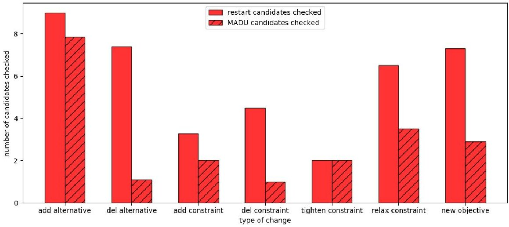

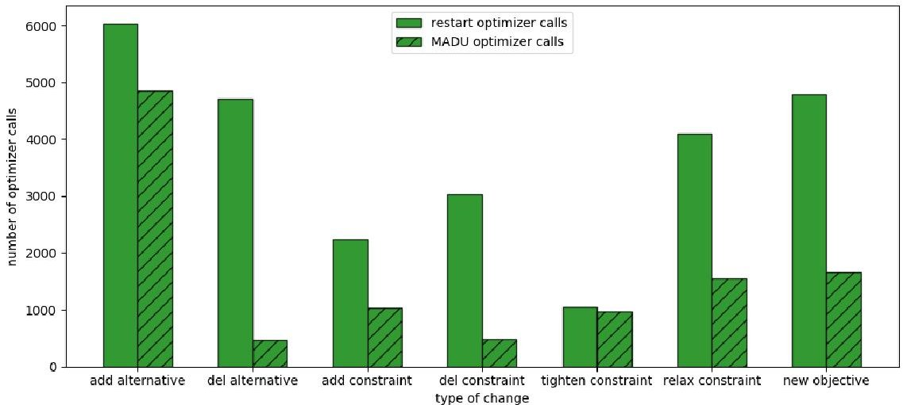

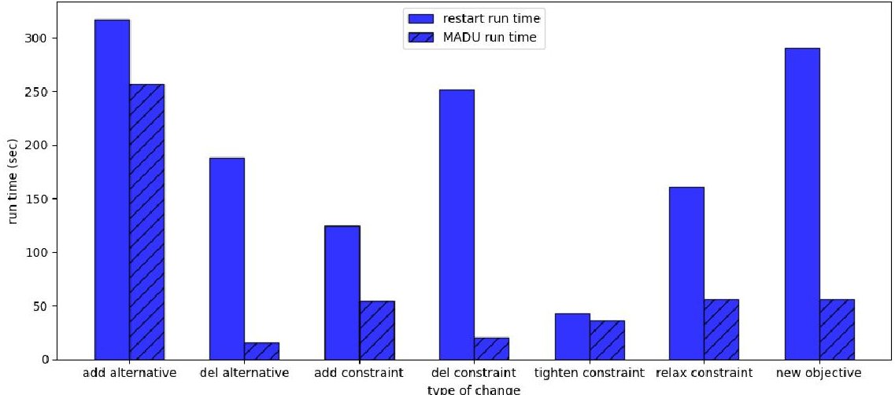

<table border="1"><tr><td rowspan="2">Type of Change</td><td colspan="2">Candidates Checked</td><td colspan="2">CP Calls</td><td colspan="2">Run Time (sec)</td></tr><tr><td>Restart</td><td>MADU</td><td>Restart</td><td>MADU</td><td>Restart</td><td>MADU</td></tr><tr><td>Addition of Alternative</td><td>9.0</td><td>7.8</td><td>6036.7</td><td>4859.2</td><td>317.3</td><td>256.8</td></tr><tr><td>Removal of Alternative</td><td>7.4</td><td>1.1</td><td>4707.6</td><td>464.5</td><td>188.1</td><td>15.6</td></tr><tr><td>Addition of Constraint</td><td>3.3</td><td>2.0</td><td>2247.8</td><td>1025.3</td><td>125.0</td><td>54.7</td></tr><tr><td>Deletion of Constraint</td><td>4.5</td><td>1.0</td><td>3029.0</td><td>479.5</td><td>252.1</td><td>20.6</td></tr><tr><td>Tightened Constraint</td><td>2.0</td><td>2.0</td><td>1043.5</td><td>970.5</td><td>43.1</td><td>36.4</td></tr><tr><td>Relaxed Constraint</td><td>6.5</td><td>3.5</td><td>4105.0</td><td>1558.5</td><td>161.1</td><td>56.3</td></tr><tr><td>New Objective</td><td>7.3</td><td>2.9</td><td>4783.7</td><td>1660.4</td><td>290.9</td><td>56.1</td></tr></table>

Figure 4-18: Performance of MADU framework after each type change compared to an algorithm that doesn't reuse information.

<!-- PDF_PAGE: 131 -->

## 4.4.1 Adding a Design Variable Alternative

The performance of the MADU framework after adding a design variable alternative to one design variable is tested using six case studies as shown in Table 4.8. The Thermal Strap Cross Sectional Area, TIL Length, and TIL Radius design variables each had their domain increased in two ways. These three variables were chosen because they don't participate in any set constraints. Adding a variable alternative to a variable that is involved in a set constraint does not change the problem unless the set constraint is also changed. To avoid making multiple changes to the problem at once, variables involved in set constraints were not tested for this type of change. In one set of three case studies, an alternative was added that was lower than the lowest alternative in the nominal domain of the variable. In the other set of three trials, an alternative was added that had a higher central value than the highest alternative in the nominal domain of the variable. Because the Thermal Strap Cross Sectional Area, TIL Length, and TIL Radius are geometric design variables, the uncertainty applied to each new design alternative is 1% of the central value.

The six test cases were run once with the reuse of conflicts and satisfying states per the MADU framework and once without re-using conflicts or satisfying states. Per row two of Figure 4-18, the MADU algorithm checks 13% fewer candidate solutions, calls the CP Optimizer engine 20% fewer times, and finds the optimal solution in 19% less time for this type of change. These improvements are not large because the addition of a design variable alternative may force a large number of conflicts to be pruned from the list of known conflicts if that design variable is used in many constraints.

## 4.4.2 Removing a Design Variable Alternative

The performance of the MADU framework after removing a design variable alternative from a design variable is tested using ten case studies. A variable was selected at random and then a random variable alternative in the domain of that variable was removed. Table 4.9 shows each of the changes that were made.

<!-- PDF_PAGE: 132 -->

Table 4.8: Each test case for testing the performance of the MADU framework after adding a design variable alternative. The added design variable alternative is bolded.

<table border="1"><tr><td>Design Variable</td><td>Design Variable Domain</td></tr><tr><td>Thermal Strap Cross Sectional Area</td><td>0.00005,0.0001,0.00015,0.0002,0.00025,0.0003,0.00035,0.0004,0.00045,0.0005</td></tr><tr><td>Thermal Strap Cross Sectional Area</td><td>0.0001,0.00015,0.0002,0.00025,0.0003,0.00035,0.0004,0.00045,0.0005,0.00055</td></tr><tr><td>TIL Length</td><td>0.004,0.005,0.006,0.007,0.008,0.009,0.010,0.011,0.012</td></tr><tr><td>TIL Length</td><td>0.005,0.006,0.007,0.008,0.009,0.010,0.011,0.012,0.013</td></tr><tr><td>TIL Radius</td><td>0.003,0.004,0.005,0.006,0.007</td></tr><tr><td>TIL Radius</td><td>0.004,0.005,0.006,0.007,0.008</td></tr></table>

The ten test cases were run once with the reuse of conflicts and satisfying states per the MADU framework and once without re-using conflicts or satisfying states. Per row three of Figure 4-18, the MADU framework checks 85% fewer candidate solutions, calls the CP Optimizer engine 90% fewer times, and finds the optimal solution in 92% less time. The MADU framework performs so much better because all conflicts can be carried forward to the new problem. If the removed design variable alternative is not involved in the previous solution, then the solution to the problem will not change and so the first candidate solution generated will be the solution. Even when a design variable alternative involved in the previous solution is removed, the MADU algorithm prunes a significant portion of the search space a priori through conflict reuse.

## 4.4.3 Adding a Constraint

The performance of the MADU framework after adding a constraint is tested using eleven test cases. Each test case added an inequality constraint to a previously unconstrained variable to simulate a new requirement being added to the system. For example, a requirement could be added on the volume of the Thermal Strap if access to the screws connecting it to the DAM becomes an issue. Each test case constrains one of the eleven unconstrained variables in the original problem. Only

<!-- PDF_PAGE: 133 -->

Table 4.9: Each test case for testing the performance of the MADU framework after removing a design variable alternative. The removed alternative is crossed out.

<table border="1"><tr><td>Design Variable</td><td>Design Variable Domain</td></tr><tr><td>TIL Conductivity</td><td>167,15.9,391,6.70,0.360</td></tr><tr><td>Thermal Strap Cross Sectional Area</td><td>0.0001,0.00015,0.0002,0.00025,0.0003,0.00035,0.0004,0.00045,0.0005</td></tr><tr><td>TIL Density</td><td>2700,7920,8940,4430,1610</td></tr><tr><td>Thermal Strap Cost</td><td>0.177,0.400,0.727,1.81,3.66</td></tr><tr><td>Thermal Strap Density</td><td>2700,7920,8940,4430,1610</td></tr><tr><td>Thermal Strap Cross Sectional Area</td><td>0.0001,0.00015,0.0002,0.00025,0.0003,0.00035,0.0004,0.00045,0.0005</td></tr><tr><td>TIL Density</td><td>2700,7920,8940,4430,1610</td></tr><tr><td>Thermal Strap Cross Sectional Area</td><td>0.0001,0.00015,0.0002,0.00025,0.0003,0.00035,0.0004,0.00045,0.0005</td></tr><tr><td>Thermal Strap Conductivity</td><td>167,15.9,391,6.70,0.360</td></tr><tr><td>TIL Conductivity</td><td>167,15.9,391,6.70,0.360</td></tr></table>

inequality constraints are added. Adding new set constraints is not realistic because no new design variable alternatives are being added and so the set of materials is not expanding. Adding new equality constraints does not mirror the addition of a requirement because system properties are never constrained to be exactly equal to something. Instead, requirements are used to establish bounds on the value of a system property. All new constraints are chosen so that the previous optimal solution is no longer feasible. Table 4.10 shows all test cases.

The eleven test cases were run once with the reuse of conflicts and satisfying states per the MADU framework and once without re-using conflicts or satisfying states. Per row four of Figure 4-18, the MADU algorithm checks 39% fewer candidate solutions, calls the CP Optimizer engine 54% fewer times, and finds the optimal solution in 56% less time. The MADU algorithm performs so well because all conflicts can be carried forward to the new problem. In many cases, the added constraint doesn't change the solution and so the first candidate solution generated will be the solution. Even when the previous solution is no longer valid, carrying forward conflicts allows the MADU algorithm to prune a significant portion of the search space.

<!-- PDF_PAGE: 134 -->

Table 4.10: The eleven test cases for testing the performance of the MADU framework after adding a constraint.

<table border="1"><tr><td>Design Variable</td><td>New Constraint</td></tr><tr><td>TIL Volume</td><td>$<2.412\times10^{-6}$</td></tr><tr><td>TIL Equivalent Conductivity</td><td>$>0.006009$</td></tr><tr><td>TIL Cost</td><td>$<8.8306$</td></tr><tr><td>Thermal Strap Equivalent Conductivity</td><td>$<0.2146$</td></tr><tr><td>Thermal Strap Volume</td><td>$<3\times10^{-5}$</td></tr><tr><td>TIL Mass</td><td>$<0.00388$</td></tr><tr><td>Thermal Strap Mass</td><td>$<0.2682$</td></tr><tr><td>Thermal Strap Cost</td><td>$<21.81$</td></tr><tr><td>DAM Temperature</td><td>$<212$</td></tr><tr><td>Total Mass</td><td>$<0.272$</td></tr><tr><td>Total Cost</td><td>$<30.64$</td></tr></table>

Table 4.11: The two tests cases for testing the performance of the MADU framework after removing a constraint.

<table border="1"><tr><td>Removed Constraint Name</td><td>Removed Constraint Equation</td></tr><tr><td>Maximum DAM Temperature Constraint</td><td>TDAM＜-60</td></tr><tr><td>Maximum Mass Constraint</td><td>m tot＜0.35</td></tr></table>

## 4.4.4 Removing a Constraint

The performance of the MADU framework after removing a constraint is tested using two test cases. Only two cases are possible since the original problem only contains two inequality constraints. Removing equality constraints would leave values undefined while removing set constraints is not a realistic change since material properties need to be consistent. One test case removed the DAM temperature inequality constraint while the other removed the total mass inequality constraint. Table 4.11 shows each of the test cases that were made.

The two test cases were run once with the reuse of conflicts and satisfying states per the MADU framework and once without re-using conflicts or satisfying states. Per row five of Figure 4-18, the MADU algorithm checks 78% fewer candidate solutions, calls the CP Optimizer engine 84% fewer times, and finds the optimal solution in 92% less time. The MADU algorithm performs well because all satisfying states from the original problem are carried forward into the new problem.

<!-- PDF_PAGE: 135 -->

Table 4.12: The two test cases for testing the performance of the MADU framework after tightening a constraint.

<table border="1"><tr><td>Constraint Name</td><td>Old Constraint Equation</td><td>New Constraint Equation</td></tr><tr><td>Mass Constraint</td><td>$m_{tot}<0.35$</td><td>$m_{tot}<0.25$</td></tr><tr><td>DAM Temperature Constraint</td><td>$T_{DAM}<-60$</td><td>$T_{DAM}<-60.5$</td></tr></table>

## 4.4.5 Tightening a Constraint

The performance of the MADU framework after tightening a constraint is tested using two test cases. Again, only two test cases are possible because the original problem only has two inequality constraints. One test case tightens the maximum DAM temperature constraint by $ 0. 5^{\circ} \mathrm{C} $ while the other tightens the maximum mass constraint by $ 0. 1 \mathrm{~ k g}. $ The new values of the constraints are chosen such that the optimal solution from the original problem is no longer satisfiable. Table 4.12 shows the new inequality constraints.

The two test cases were run once with the reuse of conflicts and satisfying states per the MADU framework and once without re-using conflicts or satisfying states. Per row six of Figure 4-18, the MADU algorithm checks the same number of candidate solutions, calls the CP Optimizer engine 7% fewer times, and finds the optimal solution in 16% less time. While the savings provided by MADU when tightening a requirement should be substantial because all conflicts can be reused, the savings shown in these test cases are slight. The savings are so slight because the change to each constraint makes the problem unsatisfiable. The algorithm quickly determines that the problem is unsatisfiable and terminates. Therefore, the algorithm doesn't run long enough to accumulate substantial savings.

## 4.4.6 Relaxing a Constraint

The performance of the MADU framework after relaxing a constraint is tested using two test cases. Again, only two test cases are possible because the original problem only has two inequality constraints. One test case relaxes the maximum DAM temperature constraint by $ 5^{\circ} \mathrm{C} $ while the other relaxes the maximum mass constraint by

<!-- PDF_PAGE: 136 -->

Table 4.13: The two test cases for testing the performance of the MADU framework after relaxing a constraint.

<table border="1"><tr><td>Constraint Name</td><td>Old Constraint Equation</td><td>New Constraint Equation</td></tr><tr><td>Mass Constraint</td><td>$m_{tot}<0.35$</td><td>$m_{tot}<0.4375$</td></tr><tr><td>DAM Temperature Constraint</td><td>$T_{DAM}<-60$</td><td>$T_{DAM}<-55$</td></tr></table>

25%. Table 4.13 shows the new values of the constraints.

The two test cases were run once with the reuse of conflicts and satisfying states per the MADU framework and once starting the problem from scratch after the change. Per row seven of Figure 4-18, the MADU algorithm checks 46% fewer candidate solutions, calls the CP Optimizer engine 62% fewer times, and finds the optimal solution in 65% less time. The MADU algorithm performs well because all satisfying states from the original problem can be carried forward into the new problem.

## 4.4.7 Changing the Objective Function

The performance of the MADU framework after changing the objective function is tested using ten test cases. Each test case changed the objective function to a different variable out of the ten variables to which the objective function could be changed. Table 4.14 shows the objective function for each of the ten test cases.

The ten test cases were run once with the reuse of conflicts and satisfying states per the MADU framework and once starting the problem from scratch after the change. Per row eight of Figure 4-18, the MADU algorithm checks 60% fewer candidate solutions, calls the CP Optimizer engine 65% fewer times, and finds the optimal solution in 81% less time. The MADU algorithm performs so well because all conflicts and satisfying states can be carried forward into the new problem.

## 4.4.8 Adding or Removing a Design Variable

Because adding or removing a design variable is defined in such a way that the problem doesn't change, those changes are not included in Figure 4-18. In practice, the addition of a design variable is followed by other types of changes whereas the

<!-- PDF_PAGE: 137 -->

Table 4.14: The ten test cases for testing the performance of the MADU framework after changing the objective function to a different equation.

<table border="1"><tr><td>min $m_{tot}$</td></tr><tr><td>min $v_{TIL}$</td></tr><tr><td>min $S_{TIL}$</td></tr><tr><td>min $k_{TIL}$</td></tr><tr><td>min $v_{TS}$</td></tr><tr><td>min $k_{TS}$</td></tr><tr><td>min $m_{TS}$</td></tr><tr><td>min $m_{TIL}$</td></tr><tr><td>min $T_{DAM}$</td></tr><tr><td>min $S_{TS}$</td></tr></table>

removal of a design variable is preceded by other types of changes. Both types of changes are part of a multistep process whereas this section is limited to single step changes. The overall performance of adding or removing a design variable is not separable from the set of changes that must be made to the problem to add or remove a design variable.

## 4.5 Summary

This chapter has described the REXIS detector thermal problem, used it to walk through how the MADU framework functions, and used it to provide empirical evidence of the efficiency of the framework. The REXIS detector thermal problem is a simplified model of the thermal constraints on the real REXIS detector. Exercising the MADU framework on a realistic problem demonstrates its practical value. The empirical evidence gathered about each type of change shows that reusing conflicts and satisfying states when the problem changes is an effective strategy. On average, for the REXIS detector thermal design problem, the savings in the number of optimizer calls and run time that is provided by the MADU framework is 57% over an algorithm that does not reuse information.

<!-- PDF_PAGE: 138 -->

<!-- PDF_PAGE: 139 -->

## Chapter 5

## Starshade Case Study

This chapter will examine a more complex case study centered on the Starshade mission proposal. The goal of this problem is to evaluate the capabilities and benefits of the MADU framework for a realistic architecture study.

## 5.1 Starshade Overview

The Starshade mission aims to directly image exoplanets by using a space telescope with an external, formation flying occulter [104]. Figure 5-1 shows how the external occulter blocks starlight while permitting imaging and spectral measurements of planets around the star. This new technology for exoplanet science will enable discovery of Earth-like planets in the habitable zone of a star and the measurement of spectra of planets that may harbor life. Spectral information in particular has the potential to provide strong evidence of alien life on exoplanets. No mission like Starshade has ever been flown before. Starshade requires precision deployment of large structures and extremely precise formation flying over long distances. To observe a star, the Starshade is positioned between the telescope and the star that the telescope is observing. Subsequent stars are observed by moving the starshade and telescope to line up with the new star. In this manner, dozens of stars can be observed over a multi-year mission.

<!-- PDF_PAGE: 140 -->

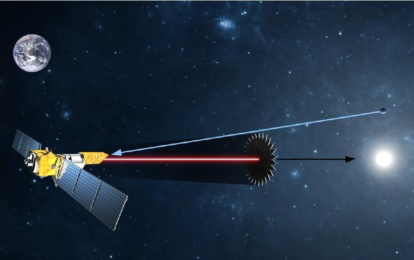

Figure 5-1: A graphic of the working principle of the Starshade mission. An external, formation flying occulter blocks light from a star, enabling imaging and spectroscopic measurements of a planet around that star [84].

## 5.2 Problem Definition

This case study will perform an optimization of the spacecraft bus that supports the starshade. The bus must be a fully capable spacecraft that can survive and operate in deep space while positioning the starshade accurately and repositioning it to observe different stars. This mission pushes the state of the art in a number of ways. Firstly, the Starshade and telescope must fly in formation over a baseline of tens of thousands of kilometers with 1m accuracy. This challenge requires highly precise sensing and a communications link between the telescope and Starshade. A special package consisting of light emitting diodes, a laser, and an S-band communications system must be mounted on the Starshade to accommodate these needs. Secondly, the science produced by the Starshade is strongly dependent on the $ \Delta V $ capability for retargeting maneuvers. Because only one star can be observed at a time, the Starshade must fly between a large number of stars to have a high probability of observing an Earthlike planet in the habitable zone or another type of exoplanet of interest. Therefore, the design of the bus is largely driven by the propulsion subsystem. Thirdly, the Starshade is a large structure tens of meters in diameter that must be deployed with sub-millimeter accuracy. There are two challenges with this design: the deployment system must be very accurate and the structure is very difficult to test in a relevant environment. Therefore, the design of the Starshade is particularly sensitive to issues

<!-- PDF_PAGE: 141 -->

discovered late in the design and testing process. These challenges add additional uncertainty over the normal issues experienced when developing a spacecraft that must operate successfully in deep space for years. Therefore, a rigorous uncertainty management methodology will be important to ensure mission success. This case study will explore how using the MADU framework improves upon conventional uncertainty management processes.

## 5.2.1 Starshade Architecture

The baseline Starshade architecture assumed in this problem closely corresponds to the Rendezvous design from the 2015 JPL Exo-S Final Report [84]. Figure 5-2 shows a schematic of the bus design used for this case study. In this architecture, a 28 petal starshade 34 m in diameter rendezvouses with the WFIRST telescope already in orbit around the Earth-Sun L2 point. The bus structure is a square prism parameterized by a side length and a height. The bus contains two propellant tanks, each with a corresponding pressurant tank. The tanks feed an array of thrusters (not shown) and the main engine. The thrusters perform attitude control and stationkeeping while the main engine performs the retargeting maneuvers to move the starshade to a different star. The bus is powered by a gimballed solar array. The bus contains two communication systems, as in the JPL report. The X-band system communicates to Earth with a medium gain antenna and three low gain antennas. The S-band system communicates with WFIRST to perform formation flight. The bus also contains the formation flying package. Unlike the JPL report, the bus is assumed to be three-axis stabilized, instead of spin stabilized. This case study includes an electric propulsion option which requires a large radiator on the anti-Sun side of the spacecraft, driving a three axis stabilized design. Electronics for the Command and Data Handling (C&DH) subsystem are contained within the bus. The Starshade is able to observe targets as close to $ 4 0^{\circ} $ from the Sun based on WIFRST constraints. Because the telescope facing side of the starshade can never see the Sun because of its very dark coating, the maximum angle between the target and the Sun is $ 8 3^{\circ} $

<!-- PDF_PAGE: 142 -->

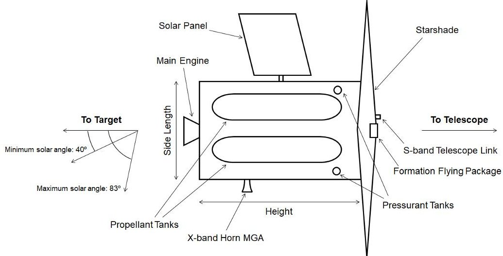

Figure 5-2: A graphic of the bus architecture used in this case study with key design features and bus design variables labeled.

## 5.2.2 Problem Formulation

In order to comprehensively model the properties of the Starshade bus, the Attitude Determination and Control Subsystem (ADCS), propulsion subsystem, Command and Data Handling (C&DH) subsystem, structures subsystem, communications subsystem, power subsystem, and thermal subsystem are modeled using equations drawn from Space Mission Analysis and Design, Third Edition as well as Space Mission Engineering: the new SMAD [122] [121]. These models are simple, physics based equations but they capture the main dependencies and design drivers for each subsystem. Information from the JPL Exo-S final report is used to provide inputs and design parameters where possible. The detailed model for the Starshade bus is discussed in Appendix A. An overview of the number of design variables and constraints per subsystem to convey the size and complexity of the Starshade problem is shown in Table 5.1. In total, the problem has 35 design variables, 11 inequality constraints, 25 equality constraints, and 4 set constraints.

All design variables and their set of alternatives are shown in Table A.2. The set of alternatives for each design variable is determined using several different philosophies. Geometric design variables are given a set of alternatives that span typical values for that system property. For example, the bus height design variable can take any value in the range from 1 m to 2.5 m in steps of 0.25 m. Other design variables

<!-- PDF_PAGE: 143 -->

represent a choice of technology. For example, the solar array efficiency design variable can take values typical of silicon panels, single-junction gallium arsenide panels, or multi-junction gallium arsenide panels. Finally, some design variables only have one alternative. Design variables are used for these properties instead of model parameters in order to model uncertainty (model parameters have no uncertainty). Taking set constraints into account, there are $ 1.87\times10^{1 0} $ possible bus designs. The objective function for the problem is to minimize dry mass $ m_{dry} $ . Dry mass is proportional to cost and inversely proportional with $ \Delta V $ capability, a key performance parameter for the Starshade mission.

Because of the size of the problem, algorithm parameters were adjusted to decrease run time. In the relaxed problem, the maximum acceptable probability of a better solution exiting $ p_{cutoff} $ is set to 0.1, up from its nominal value of 0.01. In the conflict extraction algorithm, the stability criteria on the probability of detection of conflicts and satisfying states conv_criteria is set to 0.05, up from its nominal value of 0.01. These parameter changes slightly increase the chance that the solution output by the optimizer violates constraints or is suboptimal. However, that chance remains small and the purpose of this case study is to compare the performance of the MADU optimizer that reuses information against an identical optimization algorithm that doesn't reuse information. The alternate optimizer also uses the adjusted algorithm parameters so the comparison is not affected by the adjusted parameters.

## 5.3 Hypothetical Development Scenario

The first exploration of the MADU framework applied to the Starshade problem is a simulation of information emerging during the development process and shows how the MADU framework can support the design team in making decisions by efficiently finding the new optimal solution. The problem consists of three subproblems as shown in Figure 5-3. The first subproblem corresponds to the problem described in section 5.2. The solution to this subproblem serves as the baseline design for the Starshade bus. The subsequent subproblems are alterations of the initial subproblem

<!-- PDF_PAGE: 144 -->

Table 5.1: Statistics on the number of design variables and constraints per subsystem for the Starshade problem.

<table border="1"><tr><td>Subsystem</td><td># of Design Variables</td><td># of Inequality Constraints</td><td># of Equality Constraints</td><td># of Set Constraints</td></tr><tr><td>Starshade</td><td>5</td><td>0</td><td>2</td><td>0</td></tr><tr><td>ADCS</td><td>0</td><td>0</td><td>2</td><td>0</td></tr><tr><td>Propulsion</td><td>16</td><td>4</td><td>7</td><td>1</td></tr><tr><td>C&amp;DH</td><td>0</td><td>0</td><td>0</td><td>0</td></tr><tr><td>Structures</td><td>5</td><td>3</td><td>4</td><td>1</td></tr><tr><td>Communications</td><td>2</td><td>0</td><td>2</td><td>1</td></tr><tr><td>Power</td><td>5</td><td>2</td><td>5</td><td>1</td></tr><tr><td>Thermal</td><td>2</td><td>2</td><td>3</td><td>0</td></tr><tr><td>Total</td><td>35</td><td>11</td><td>25</td><td>4</td></tr></table>

that simulate information coming to light during the development process.

In the first scenario, a prototype of the bus has been built and the development team realizes that the bus interior volume requirement is overly conservative. Not as much room is needed for wiring harnesses as previously assumed. Therefore, the second subproblem is generated from the first subproblem by reducing the conservatism in the bus interior volume constraint. The subproblem is then solved, minimizing the dry mass of the system $ m_{dry} $ . The solution output by the optimizer reduces the bus height and side length over the previous bus design, resulting in a reduction in dry mass. A design team following a traditional systems engineering process would be unlikely to make this change to the bus dimensions as the change would reduce the margin available for future propellant tank volume increases to handle unforeseen events. The MADU framework enables a quantification of the benefit of reducing bus volume in terms of dry mass while considering the known uncertainty in propellant tank volume. It also provides a defined process for addressing future unforeseen issues that may necessitate an increase in propellant tank volume, providing confidence to the design team that the bus dimensions can be reduced.

In the second scenario, radiation testing reveals that an electrical component needs to be exchanged for a more radiation hardened version. However, the radiation hardened version of the part has a tighter operating temperature range. Therefore, the

<!-- PDF_PAGE: 145 -->

Table 5.2: Design variables and design variables alternatives for the Starshade problem.

<table border="1"><tr><td>Design Variable</td><td>Units</td><td>Uncertainty</td><td>Design Variable Alternatives</td></tr><tr><td>S-band Power Draw</td><td>W</td><td>0.01</td><td>29.5</td></tr><tr><td>S-band Mass</td><td>kg</td><td>0.01</td><td>5.3</td></tr><tr><td>Main Engine Power Draw</td><td>W</td><td>0.05</td><td>7290,41,30</td></tr><tr><td>Main Engine Mass</td><td>kg</td><td>0.05</td><td>120.8,0.77,0.72</td></tr><tr><td>Main Engine Isp</td><td>s</td><td>0.02</td><td>4190,310,230</td></tr><tr><td>Solar Array Area</td><td>m2</td><td>0.01</td><td>1,2,5,10,20,50,80,100</td></tr><tr><td>Solar Cell Efficiency</td><td>None</td><td>0.05</td><td>0.14,0.185,0.226</td></tr><tr><td>Solar Array Mass per Unit Area</td><td>kg/m2</td><td>0.05</td><td>2.3,2.7,2.8</td></tr><tr><td>Battery Depth of Discharge</td><td>None</td><td>0.01</td><td>0.6</td></tr><tr><td>Battery Capacity</td><td>Wh</td><td>0.01</td><td>10,50,100,200,500,800,1000,2000,3000</td></tr><tr><td>Bus Height</td><td>m</td><td>0.01</td><td>1,1.25,1.5,1.75,2,2.25,2.5</td></tr><tr><td>Bus Side Length</td><td>m</td><td>0.01</td><td>0.75,1,1.25,1.5,1.75,2,2.25,2.5,2.75,3,3.25,3.5,3.75,4</td></tr><tr><td>Bus Wall Thickness</td><td>meter</td><td>0.01</td><td>0.002,0.004,0.006,0.008,0.01</td></tr><tr><td>Bus Material Density</td><td>kg/m3</td><td>0.01</td><td>2710,4430,8027</td></tr><tr><td>Bus Material Young&#x27;s Modulus</td><td>Pa</td><td>0.01</td><td>68×109,110×109,200×109</td></tr><tr><td>Absorptivity</td><td>None</td><td>0.01</td><td>0.08</td></tr><tr><td>Radiator Fraction</td><td>None</td><td>0.01</td><td>0.05,0.1,0.2,0.3,0.4,0.5,0.6,0.7,0.8,0.9,0.99</td></tr><tr><td>Propellant Tank 1 Capacity</td><td>L</td><td>0.01</td><td>10,25,50,75,100,300,500,750,1000,1500,2000</td></tr><tr><td>Pressurant Tank 1 Capacity</td><td>m3</td><td>0.01</td><td>0,0.025,0.05,0.075,0.01</td></tr><tr><td>Propellant Tank 2 Capacity</td><td>L</td><td>0.01</td><td>0,10,25,50,75,100,300,500,750,1000,1500,2000</td></tr><tr><td>Pressurant Tank 2 Capacity</td><td>m3</td><td>0.01</td><td>0,0.025,0.05,0.075,0.01</td></tr><tr><td>Starshade Mass</td><td>kg</td><td>0.3</td><td>570</td></tr><tr><td>Retargeting Delta V</td><td>m/s</td><td>0.05</td><td>23</td></tr><tr><td>Stationkeeping Delta V</td><td>m/s</td><td>0.05</td><td>1.5</td></tr><tr><td>Formation Flying Package Mass</td><td>kg</td><td>0.5</td><td>10</td></tr><tr><td>Formation Flying Package Power Draw</td><td>W</td><td>0.5</td><td>10</td></tr><tr><td>Propellant Density Tank 1</td><td>kg/m3</td><td>0.01</td><td>1004,1433,1709</td></tr><tr><td>Propellant Density Tank 2</td><td>kg/m3</td><td>0.01</td><td>1004,1433,1709</td></tr><tr><td>Thruster Tank Selector</td><td>None</td><td>0</td><td>0,1</td></tr><tr><td>Mixture Ratio</td><td>None</td><td>0</td><td>0,0.46,1</td></tr><tr><td>Main Engine Heat Dissipation</td><td>W</td><td>0.05</td><td>792,41,30</td></tr><tr><td>Pressurant Tank 1</td><td>None</td><td>0</td><td>0,1</td></tr><tr><td>Pressurant Tank 2</td><td>None</td><td>0</td><td>0,1</td></tr><tr><td>Propellant Tank 1 Fill Percentage</td><td>None</td><td>0.01</td><td>1</td></tr><tr><td>Propellant Tank 2 Fill Percentage</td><td>None</td><td>0.01</td><td>1</td></tr></table>

<!-- PDF_PAGE: 146 -->

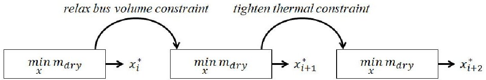

Figure 5-3: A flow chart showing the form of the Starshade hypothetical development scenario problem.

maximum bus temperature needs to be lowered. The third subproblem is generated by tightening the maximum bus temperature inequality constraint of the first subproblem. The third subproblem is then solved, minimizing dry mass. The solution generated by the optimizer increases the radiator area to reject more heat and lower bus temperature. A design team following a traditional systems engineering process would be likely to make the same design change. However, the MADU framework provides confidence that this change will have the lowest impact on dry mass as compared with other types of changes. Additionally, the MADU framework finds the smallest increase in radiator size that will ensure that requirements are met in the face of the uncertainty in the design variables.

The computational results for the hypothetical development scenario are shown in Figure 5-4. As with the REXIS thermal design problem, the MADU framework is compared against an identical algorithm with the exception that the "restart" algorithm doesn't reuse any information from the previous problem. However, it does discover and use conflicts during search in the same manner as the conflict-directed A $ ^{*} $ algorithm [123]. Over the entire problem, the average savings in number of optimizer calls and run time provided by the MADU framework is 47%.

## 5.3.1 Baseline Problem

The solution to the baseline problem formulation given in section 5.2 is found after checking 13 candidate solutions, calling the CP Optimizer engine 4928 times, and in a run time of 3678.1 s. The optimal solution uses the bipropellant propulsion system, has a solar array with GaAs multijunction cells that is $ 2 \mathrm{m}^{2} $ in size, a battery capacity of 800 Wh, a height of 2 m, a side length of 1.5 m, a wall thickness of 0.0002 m with

<!-- PDF_PAGE: 147 -->

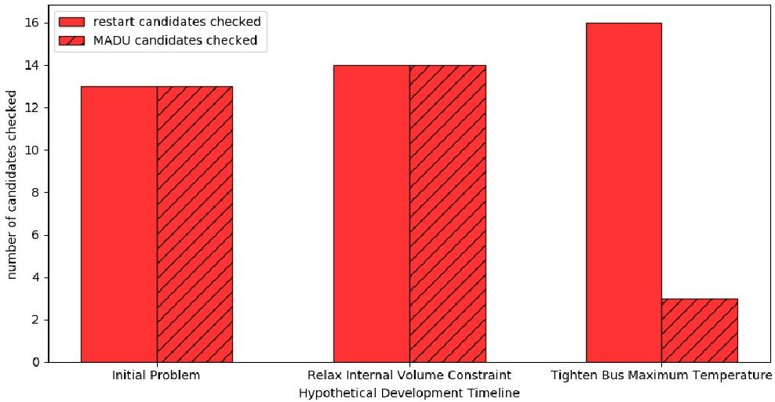

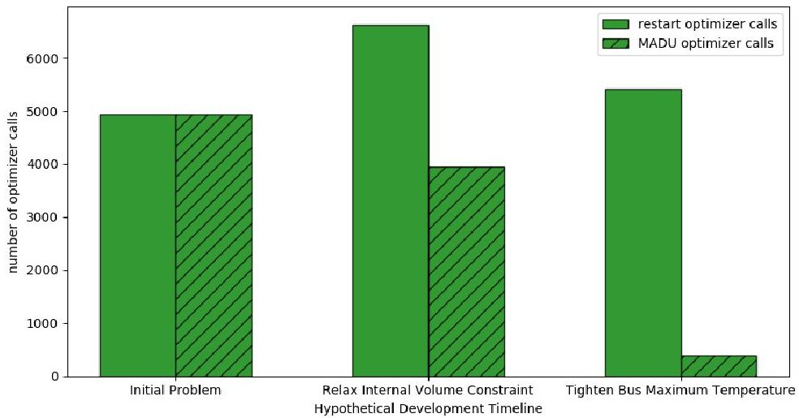

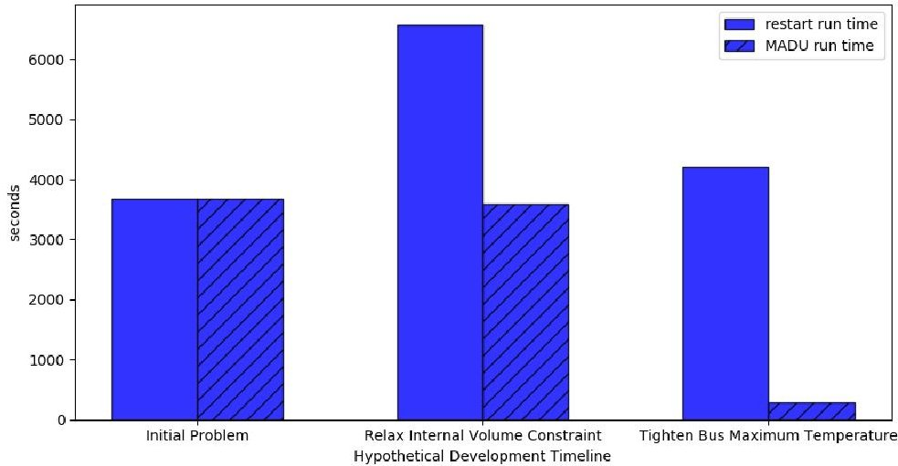

<table border="1"><tr><td rowspan="2">Type of Change</td><td colspan="2">Candidates Checked</td><td colspan="2">Optimizer Calls</td><td colspan="2">Run Time(sec)</td></tr><tr><td>Restart</td><td>MADU</td><td>Restart</td><td>MADU</td><td>Restart</td><td>MADU</td></tr><tr><td>Initial Problem</td><td>13</td><td>13</td><td>4928</td><td>4928</td><td>3678.1</td><td>3678.1</td></tr><tr><td>Relax Minimum Bus Volume</td><td>14</td><td>14</td><td>6628</td><td>3956</td><td>6574.7</td><td>3585.2</td></tr><tr><td>Tighten Bus Maximum Temperature</td><td>16</td><td>3</td><td>5420</td><td>386</td><td>4205.8</td><td>294.3</td></tr></table>

Figure 5-4: Performance of MADU optimization algorithm after each type change compared to an algorithm that starts from scratch after a change to the problem.

<!-- PDF_PAGE: 148 -->

walls made out of aluminum, and a radiator taking up 50% of the anti-Sun side of the Bus. Propellant tank 1 holds MON and is 500 L in size with a pressurant tank that has a volume of $ 0.025 \mathrm{~m}^{3} $ . Propellant tank 2 holds hydrazine and has a capacity of 1500 L with a pressurant tank that has a volume of $ 0.05 \mathrm{~m}^{3} $ . The dry mass of the system is about 264 kg.

The baseline solution intuitively makes sense for a minimization of dry mass. A bipropellant propulsion has a relatively high specific impulse without the dry mass disadvantages of an electric propulsion system which needs heavy propellant management and power conditioning equipment. The bus size, solar array area, battery capacity, and radiator are sized to be sufficient to execute the mission while accounting for uncertainty. The walls thickness is assigned the thinnest possible alternative and uses the lightest material indicating that the stiffness constraints aren't driving the design. Propellant tank 1 is smaller than propellant tank 2 because it holds a denser propellant. Pressurant tank 1 is smaller than pressurant tank 2 because propellant tank 1 is smaller than propellant tank 2 and therefore pressurant tank 1 doesn't need to hold as much helium as pressurant tank 2. The optimal value for selected design variables for the baseline solution are shown on a radar plot in Figure 5-5.

## 5.3.2 Relax Bus Interior Volume Constraint

In the first scenario, a prototype of the bus has been built and the development team realizes that the bus interior volume requirement is overly conservative. Not as much room is needed for wiring harnesses as previously assumed. Therefore, the conservatism applied to the calculation of bus volume can be reduced. This change corresponds to a relaxation of the inequality constraint given in equation A.22 in Appendix A. Instead of requiring that the bus volume be at least twice as large as the total volume of both propellant tanks, the bus volume only needs to be 1.75 times as large as the total volume of both propellant tanks. The subproblem is re-solved, minimizing dry mass.

The new solution is different in a number of ways from the previous solution. The value of selected design variables are shown in a radar plot in Figure 5-6 alongside the

<!-- PDF_PAGE: 149 -->

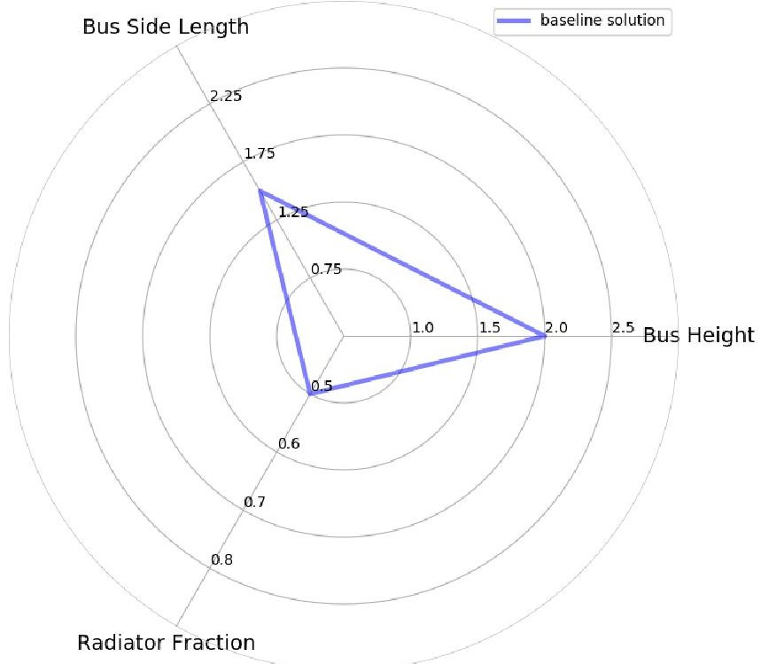

Figure 5-5: A radar chart showing the optimal values for bus height, bus side length, and radiator fraction for the baseline problem.

results from the baseline problem. The bus height decreased from 2 m to 1.25 m, the bus side length increased from 1.5 m to 1.75 m, and the radiator fraction increased from 50% to 60%. These changes result in a reduction in bus interior volume from $ 4. 5 \mathrm{m}^{3} $ to $ 3. 8 3 \mathrm{m}^{3} $ and a decrease in nominal dry mass from 264 kg to 260 kg. A design team following a traditional systems engineering process would be unlikely to make this change to the bus dimensions as the change would reduce the margin available for future propellant tank volume increases to handle unforeseen events. The MADU framework enables a quantification of the benefit of reducing bus volume in terms of dry mass while considering the known uncertainty in propellant tank volume. It also provides a defined process for addressing future unforeseen issues that may necessitate an increase in propellant tank volume, providing confidence to the design team that the bus dimensions can be reduced.

The new optimal solution is found after checking 14 candidate solutions, calling the CP Optimizer engine 3956 times, and a run time of 3585.2s. Importantly, the conflicts and satisfying states carried over from the previous problem enabled the new optimal design to be found faster than an approach that did not reuse conflicts or

<!-- PDF_PAGE: 150 -->

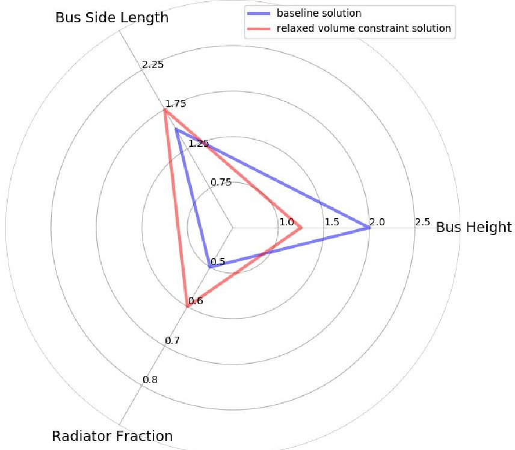

Figure 5-6: A radar chart showing the optimal values for bus height, bus side length, and radiator fraction after relaxing the bus volume constraint.

satisfying states. Such an approach would find the same optimal design but evaluates 14 candidate solutions, calls the CP Optimizer engine 6628 times, and takes 6574.7 s to run. The MADU framework evaluates the same number of candidate solutions, calls the CP Optimizer engine 40% fewer times, and runs in 45% less time.

## 5.3.3 Tighten Maximum Bus Temperature Requirement

In the second scenario, radiation testing reveals that an electrical component needs to be exchanged for a more radiation hardened version. However, the radiation hardened version of the part has a tighter operating temperature range. Therefore, the maximum bus temperature needs to be lowered. This change corresponds to a tightening of the maximum bus temperature inequality constraint. The old maximum temperature was $ 4 0^{\circ} \mathrm{C} $ while the new maximum temperature is now $ 2 0^{\circ} \mathrm{C} $ . Again, the optimizer is asked to minimize dry mass.

The new solution is almost the same as the old solution but increases the fraction of the anti-Sun side of the bus that serves as a radiator from 60% to 80%. The value of

<!-- PDF_PAGE: 151 -->

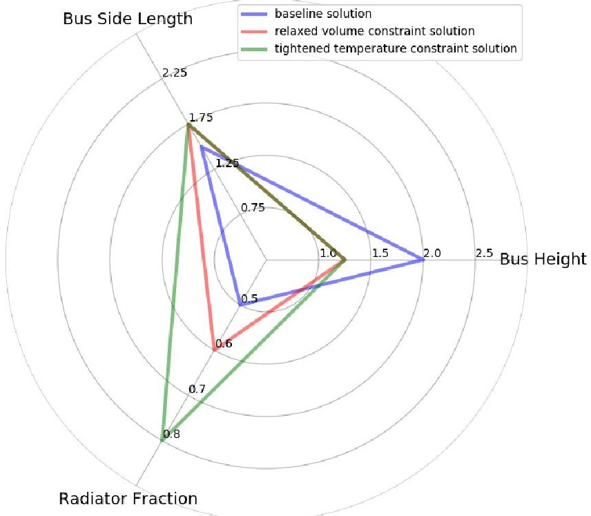

Figure 5-7: A radar chart showing the optimal values for bus height, bus side length, and radiator fraction after tightening the bus maximum temperature constraint.

selected design variables are shown in a radar plot in Figure 5-7 alongside the results from the baseline problem and the solution after relaxing the bus volume constraint. A design team following a traditional systems engineering process would be likely to make the same design change. However, the MADU framework provides confidence that this change will have the lowest impact on dry mass as compared with other types of changes. Additionally, the MADU framework finds the smallest increase in radiator size that will ensure that requirements are met in the face of the uncertainty in the design variables.

The new optimal solution is found after checking 3 candidate solutions, calling the CP Optimizer engine 386 times, and a run time of 294.3s. The solution is found much faster than the previous problem because all conflicts can be reused. Again, carrying over conflicts and satisfying states from the previous problem resulted in a performance improvement over an algorithm that started from scratch. Such an algorithm evaluates 16 candidate solutions, calls CP Optimizer 5420 times, and takes 4205.8s to run. The MADU framework evaluated 81% fewer candidate solutions, called CP Optimizer 93% fewer times, and runs in 93% less time.

<!-- PDF_PAGE: 152 -->

## 5.4 Sensitivity to Requirement Changes

In addition to updating the design as information is learned, the MADU framework can be used to efficiently evaluate how the optimal design changes when requirements change. The framework can be used to find the new optimal design after a requirements change or to perform a sensitivity analysis to examine how the optimal solution depends on the value of a requirement.

This section imagines that after settling on the baseline bus design described in section 5.3.1, a late change to the launch vehicle occurs. The problem is to identify which new launch vehicle should be used for the mission and how that new launch vehicle may impact the mission's science return. A series of problems are solved in order to understand how the $ \Delta V $ capability of the bus depends on the mass capability of the launch vehicle. A wet mass constraint is introduced and gradually tightened in steps with the optimal design calculated at each step. Several new alternatives for the $ \Delta V $ available for each retargeting maneuver are added to the problem and the objective function is changed to maximize the $ \Delta V $ available for each retargeting maneuver. This objective function corresponds to a maximization of the number of stars that the Starshade system can observe.

Because the change was made late in development, some design choices have already been made and so some design variables are frozen at their values as calculated for the baseline bus design. The bus structure and propulsion subsystem are two of the first pieces of a spacecraft to be built. Therefore, the propulsion system is fixed to be bipropellant, the bus height is fixed at 2 m, and the bus side length is fixed at 1.5 m.

This sensitivity analysis gives the systems engineering team information on the maximum wet mass at which the system will no longer be able to meet its nominal $ \Delta V $ requirements, the maximum $ \Delta V $ of the bus with smaller launch vehicles, and the minimum launch vehicle size at which the system cannot retarget at all. The MADU framework allows this problem to be solved efficiently, permitting a more thorough exploration of the design space than would otherwise be possible.

<!-- PDF_PAGE: 153 -->

Table 5.3: The sequence of subproblems that are solved to understand how Starshade bus $ \Delta V $ capability depends on launch vehicle capability.

<table border="1"><tr><td>Wet Mass Constraint</td><td>Retargeting Delta V Design Variable Alternatives(m/s)</td><td>Objective Function</td></tr><tr><td>None</td><td>23</td><td>minmdry</td></tr><tr><td>mwet＜4000</td><td>5,10,15,20,23,25,30,35,40</td><td>maxΔVretargeting</td></tr><tr><td>mwet＜3750</td><td>5,10,15,20,23,25,30,35,40</td><td>maxΔVretargeting</td></tr><tr><td>mwet＜3500</td><td>5,10,15,20,23,25,30,35,40</td><td>maxΔVretargeting</td></tr><tr><td>mwet＜3250</td><td>5,10,15,20,23,25,30,35,40</td><td>maxΔVretargeting</td></tr><tr><td>mwet＜3000</td><td>5,10,15,20,23,25,30,35,40</td><td>maxΔVretargeting</td></tr><tr><td>mwet＜2750</td><td>5,10,15,20,23,25,30,35,40</td><td>maxΔVretargeting</td></tr><tr><td>mwet＜2500</td><td>5,10,15,20,23,25,30,35,40</td><td>maxΔVretargeting</td></tr><tr><td>mwet＜2250</td><td>5,10,15,20,23,25,30,35,40</td><td>maxΔVretargeting</td></tr><tr><td>mwet＜2000</td><td>5,10,15,20,23,25,30,35,40</td><td>maxΔVretargeting</td></tr></table>

The sequence of subproblems that are solved to conduct the sensitivity analysis is shown in Table 5.3. The sensitivity analysis is conducted after the baseline problem described in section 5.2 has been solved. The first subproblem of the sensitivity analysis introduces a number of retargeting $ \Delta V $ alternatives, introduces a maximum wet mass constraint with a loose limit, and changes the objective function to maximize the retargeting $ \Delta V $ . In the subsequent subproblems, the wet mass constraint is gradually tightened in steps of 250kg. In each subproblem, bus retargeting $ \Delta V $ capability is maximized. The constraint starts at an initially loose value and then is tightened in order to maximize the number of conflicts that are preserved after each change, maximizing the resulting efficiency of the sensitivity analysis.

The results of this sensitivity analysis are shown in Table 5.4 and Figure 5-8. In the figure and table, the maximum $ \Delta V $ available for each retargeting maneuver is shown as a function of launch vehicle capability. In all subproblems, the bus height is restricted to 2.0m, the bus side length is restricted to 1.5m, and the bipropellant propulsion system is used.

For high launch vehicle capabilities, the bus can accomplish the nominal mission, which requires a $ \Delta V $ of 23 m/s for each retargeting maneuver. Because no larger value for the maximum retargeting $ \Delta V $ is chosen, it can be concluded that 23 m/s is the maximum capability of the bipropellant propulsion system with the chosen bus

<!-- PDF_PAGE: 154 -->

dimensions. As maximum wet mass decreases, the system can no longer deliver as much $ \Delta V $ for each retargeting maneuver. With a wet mass constraint of 3000 kg or less, the system can no longer accomplish the nominal mission. This cutoff value is extremely useful to know for the customer. It means that launch vehicles like the Atlas V 501 and Atlas V 401 9 cannot support the nominal mission [86]. The capabilities of those launch vehicles to the required orbit for the Starshade mission are 2070 kg and 3000 kg respectively. Alternatively, rockets like the Atlas V 411 and Falcon 9 with the Automated Spaceport Drone Ship (ASDS) recovery option for the first stage can support the nominal mission. The capability of those rockets to the Starshade orbit is 3895 kg and 3250 kg respectively.

As the table and figure show, the Starshade bus retains the capability to execute 15 m/s retargeting maneuvers down to a launch vehicle capability of 2500 kg and the ability to execute 10 m/s retargeting maneuvers down to a launch vehicle capability of 2250 kg. No satisfying solution exists with a maximum wet mass of 2000 kg.

The changes made to the bus for these less capable designs is to shrink the propellant tanks. In the design that is capable of 15 m/s retargeting maneuvers, propellant tank 1 has a volume of 300 L and propellant tanks 2 has a volume of 1000 L. In the design that is only capable of 10 m/s retargeting maneuvers, propellant tank 1 has a volume of 300 L and propellant tank 2 has a volume of 750 L. A design team following a traditional systems engineering approach would be resistant to switching to a launch vehicle with reduced capability and would instead focus on ensuring that a launch vehicle with sufficient capability to support the nominal mission is available. The traditional process is vulnerable to circumstances in which no such launch vehicle is available because a reduced mission has not been explored. The MADU framework allows a quantitative understanding of how bus $ \Delta V $ capability trades with launch vehicle capability and the design changes that are necessary to fit within a smaller launch vehicle.

Figure 5-9 shows the computational data for running the sensitivity analysis. The MADU framework performs better than an algorithm that restarts from scratch, because such an algorithm forgets all conflicts and satisfying states when the wet mass

<!-- PDF_PAGE: 155 -->

Table 5.4: Maximum $ \Delta V $ available for each retargeting maneuver as a function of maximum wet mass

<table border="1"><tr><td>Maximum Wet Mass(kg)</td><td>Maximum ΔV per Retargeting Maneuver(m/s)</td></tr><tr><td>4000kg</td><td>23</td></tr><tr><td>3750kg</td><td>23</td></tr><tr><td>3500kg</td><td>23</td></tr><tr><td>3250kg</td><td>23</td></tr><tr><td>3000kg</td><td>15</td></tr><tr><td>2750kg</td><td>15</td></tr><tr><td>2500kg</td><td>15</td></tr><tr><td>2250kg</td><td>10</td></tr><tr><td>2000kg</td><td>None(infeasible)</td></tr></table>

Figure 5-8: Scatter plot showing the maximum $ \Delta V $ available for each retargeting maneuver as a function of maximum wet mass.

<!-- PDF_PAGE: 156 -->

Figure 5-9: Performance of MADU framework compared against an algorithm that starts from scratch when exploring how bus height affects the optimal solution.

constraint is tightened. Across the entire series of problems, the MADU framework checks 72% fewer solution candidates, calls CP Optimizer 82% fewer times, and runs in 82% less time. The savings arises because each new wet mass constraint is implemented as a tightening of the previous wet mass constraint. Therefore, all conflicts from the previous problem remain conflicts and a significant amount of search space is pruned. With this savings, systems engineers can test more options and better understand the design space with the MADU framework.

## 5.5 Scalability of MADU Framework

To evaluate the scalability of the MADU Framework, a series of hypothetical design scenarios are run each with a different number of possible solutions. Each problem simulates the sequence of three problems laid out in section 5.3 but the number of alternatives for each design variable is altered. The set of constraints and the objective function are kept constant because this study is focused on understanding the computational properties of the MADU framework as a function of problem size. Changes to the set of constraints or the objective function might distort the results. The set of problems is developed by removing design variable alternatives from the full Starshade problem. The optimal set of alternatives for each stage of the development scenario are included in each problem so that the optimal solution is the same across

<!-- PDF_PAGE: 157 -->

each problem. To compose a problem, the design variable alternative with the highest and lowest value are removed from the domain of each variable that is not involved in a set constraint except where the alternative to be removed is part of an optimal solution. In that case, the next highest or lowest alternative is removed instead. For each problem size, the problem is solved with the MADU framework and with a similar algorithm that uses conflict-directed search but doesn't reuse information.

The computational results of the hypothetical scenarios are shown in Figure 5-10. Four hypothetical design scenarios are solved. The scenario with the largest number of solutions corresponds to the original development scenario described in section 5.3. The four problems span about four orders of magnitude in terms of number of solutions. In the figures, the performance of the MADU framework is shown by the dashed lines whereas the performance of the algorithm that doesn't reuse information is shown by the solid lines. As the problem sizes increase, both the MADU framework and the "restart" algorithm take longer to find a solution. On average, the MADU framework generated 34% fewer solution candidates, calls the optimizer 46% fewer times, and finds the optimal solution in 47% less time. These savings are consistent across the different problem sizes. While the statistics are limited, the data for these problems indicate that the MADU framework should provide computational savings for larger problems.

## 5.6 Summary

This chapter utilizes a case study based on the Starshade mission concept to demonstrate how the MADU framework can incorporate information learned during development and find an optimal design efficiently, how the MADU framework supports efficient sensitivity analysis against requirements changes, and how the MADU framework performs as problem size changes. The hypothetical design scenario problem illustrates how the MADU framework can provide more information about how relaxing or tightening a requirement might impact the design than the traditional systems engineering process. The average savings in the number of optimizer calls and run

<!-- PDF_PAGE: 158 -->

<table border="1"><tr><td rowspan="2">Number of Solutions</td><td colspan="2">Candidates Checked</td><td colspan="2">Optimizer Calls</td><td colspan="2">Run Time(sec)</td></tr><tr><td>Restart</td><td>MADU</td><td>Restart</td><td>MADU</td><td>Restart</td><td>MADU</td></tr><tr><td>$1.87\times10^{6}$</td><td>18</td><td>12</td><td>4644</td><td>2459</td><td>1079.5</td><td>532.3</td></tr><tr><td>$8.82\times10^{7}$</td><td>26</td><td>17</td><td>10091</td><td>4988</td><td>4681.4</td><td>2171.5</td></tr><tr><td>$2.09\times10^{9}$</td><td>30</td><td>19</td><td>10588</td><td>6088</td><td>5903.9</td><td>3698.7</td></tr><tr><td>$1.80\times10^{10}$</td><td>43</td><td>30</td><td>16976</td><td>9270</td><td>14458.6</td><td>7557.6</td></tr></table>

Figure 5-10: Performance of MADU framework for a range of problem sizes

<!-- PDF_PAGE: 159 -->

time over an algorithm that does not reuse information after each change to the problem is 47% . The sensitivity analysis of how retargeting $ \Delta V $ capability depends on launch vehicle capability shows that the MADU framework can provide information about dependencies between design variables and requirements beyond what the traditional systems engineering process provides. In this problem, the average savings in the number of optimizer calls and run time provided by the MADU framework over an algorithm that does not reuse information is 82% . The scalability testing performed using several versions of the hypothetical development scenario with different numbers of possible solutions reveals that the MADU framework provides savings for all tested problem sizes. On average, across all tested problem sizes, the savings in the number of optimizer calls and run time that is provided by the MADU framework is 47% over an algorithm that does not reuse information. This savings is consistent across the tested problem sizes.

<!-- PDF_PAGE: 160 -->

<!-- PDF_PAGE: 161 -->

## Chapter 6

## Conclusion

This thesis has explored the importance of considering deep uncertainty in the design of space systems and presented a framework to handle deep uncertainty through adaptation when new information is learned. Current uncertainty management processes have weaknesses related to deep uncertainty because they don't emphasize revisiting decisions when new information emerges. Revisiting decisions in light of new information is a fundamental strategy for decision making under deep uncertainty. To implement adaptation in a computational framework, incremental search algorithms used to solve dynamic constraint satisfaction problems are adapted to solve the dynamic, chance-constrained, stochastic optimization problem that is the space system development process. The Model-based Systems Engineering (MBSE) paradigm provides new capabilities related to traceability of system information to design decisions and integration of analysis tools with the design team. The Model-based Adaptive Design under Uncertainty (MADU) framework integrates adaptive strategies to handle deep uncertainty, incremental search techniques that reuse information, and MBSE to enable efficient space system design under deep uncertainty.

The MADU framework is tested in two case studies. The first case study is a thermal design problem based on the design of the REXIS detectors. The case study is used to walkthrough the MADU framework step by step and to give examples of the potential computational savings for each type of change. The second case study is a design problem based on the Starshade mission concept. This case study

<!-- PDF_PAGE: 162 -->

is used to illustrate the advantages of the framework over the traditional systems engineering process, to demonstrate the efficiency of conducting a sensitivity analysis against requirements changes, and to show evidence that the computational savings provided by the framework are insensitive to problem size. In these case studies, the MADU framework performs 58% faster on average than an algorithm that doesn't reuse information.

## 6.1 Avoiding Issues in JWST Development

Returning to the case of JWST development, there are several instances of delays resulting from design decisions that were not revisited in light of new information. With the MADU framework, these issues may have been avoidable.

The first example of how MADU may have helped JWST is the elevated workforce levels described in section 1.1.2. With MADU, the higher-than-predicted personnel issues may have been identified much earlier. After several consecutive months of elevated workforce levels, the assumptions that went into the prediction of personnel levels could be revisited to understand if the root causes of the elevated personnel levels could be identified and incorporated into the predictions.

A second example of how MADU may helped JWST stems from an incident in June 2016. During a sunshade deployment test, a cable was pinched by a pulley [35]. The pulley walls had been thinned during a mass reduction effort but the effect of that design change on deployment dynamics was not re-examined, leading to a pinched cable. The pulleys had to be redesigned, consuming two weeks of schedule reserves. If the MADU framework was used, the pulley deflection analysis would have been flagged as an analysis that had to be redone after changing the pulley geometry. Redoing the deflection analysis may have revealed that a cable could pinch during deployment and may have prevented the test failure and associated rework.

A third example of how MADU may have helped JWST comes from an issue experienced during an acoustics test of the spacecraft. Loose hardware was found in the spacecraft because locking nuts were not torqued to the required level [55]. The

<!-- PDF_PAGE: 163 -->

nuts were tightened just enough to be flush with the end of the screw to minimize the potential for the sunshade to snag. The decision to use locking nuts, instead of other locking methods, on those screws was not re-examined after the decision to only tighten the nuts enough to be flush with their screw. The MADU framework would have mandated that any analyses that assumed a torque value be reconsidered when the torque value was changed and the issue of the nuts not locking may have been caught before the test. Catching the issue before the test would have prevented the test failure, the associated rework to redo the test, and would have not exposed the hardware to the risk presented by loose hardware in a mechanically energetic environment.

## 6.2 Key Findings from Case Studies

Analysis of the case studies performed in this thesis reveals several key findings. Firstly, the MADU framework revealed some possible design changes that may not have been used by a design team following a traditional systems engineering process. MADU not only can identify optimal designs while accounting for the uncertainty in the problem but provides a process for changing that design if unforeseen events occur. The existence of this adaptation process gives the design team added confidence over the traditional systems engineering process where a design team must account for possible future events by including extra margin in the system and only releasing that margin when strictly necessary.

Secondly, in both case studies, the changes that tend to preserve conflicts resulted in more significant computational savings than the changes that tend to preserve satisfying states. This additional savings is because reused conflicts improve the initial solution candidate generated by the relaxed problem which reduces the number of solution candidates that need to be generated before finding the optimal solution. Therefore, fewer relaxed problems need to be solved and fewer conflicts need to be extracted. In contrast, reusing satisfying states only improves the conflict extraction process and doesn't affect the number of solution candidates that need to be generated

<!-- PDF_PAGE: 164 -->

before the optimal solution is found. Therefore, reuse of conflicts provides more savings.

Thirdly, the changes that can be made to the problem can be used to incorporate information learned during development but can also be used to explore hypothetical changes to the system. In the hypothetical cases, carefully structuring the series of problems in such a way that many conflicts and satisfying states are preserved between problems can result in significant computational savings. This feature of the MADU framework makes some types of sensitivity analyses quite computationally cheap to perform and enables deeper exploration of the design space than traditional methods.

Fourthly, the test of scalability showed that the percentage savings that MADU provides are independent of the number of solutions. As problem size increases, the pruning power of conflicts and satisfying states increases proportionally and so the overall percentage savings stays the same. This finding provides confidence that the MADU framework will continue to provide beneficial savings as problem size increases beyond the largest problem size tested in this thesis.

## 6.3 Contributions

The primary contribution of this thesis is a model-based framework for development of space systems under deep uncertainty. This work is the first to examine strategies for decision making under deep uncertainty in the space system design process. An implementation of the framework is presented and exercised on two case studies. The results from the case studies show that the framework is able to efficiently identify an optimal design, even when unforeseen changes are made to the problem. The contributions with respect to the three research questions from section 1.2 are:

## 6.3.1 Research Question 1

How can the framework perform space system design under deep uncertainty?

<!-- PDF_PAGE: 165 -->

A framework is developed that addresses deep uncertainty in space system design through design adaptation. Deep uncertainty is handled through an update process where design decisions are revisited when new information is learned. This strategy allows the consequences of unforeseen events on the design to be quantified. This information can be used by the design team to inform design decisions. The current state of the practice of space system development doesn't always examine the implications of new information when it is learned. Therefore, the framework presented in this thesis is less vulnerable to unforeseen events than current practices.

## 6.3.2 Research Question 2

How can a system model be used to perform space system design while considering uncertainty?

A system model is incorporated into the design framework. The system model contains information on known system uncertainties, information about design decisions, and integrates with optimizers used to quantify the impact of new information. Current space system design practices rarely utilize a system model. Because the framework presented in this thesis utilizes a system model, traceability between design decisions and information learned about the system during development is improved over current practices.

## 6.3.3 Research Question 3

## Does the framework perform updates efficiently?

Constraint learning techniques are used to perform efficient design updates. Conflicts and satisfying states from previous optimizations are stored in the system model and reused in new optimizations. Reuse of these artifacts reduces the design space searched in new optimizations. Efficiency is demonstrated using two case studies. Current state-of-the-art algorithms for solving constraint optimization problems don't reuse information between optimizations. Across both case studies, the framework presented in this thesis is able to consistently find the new optimal

<!-- PDF_PAGE: 166 -->

design faster than an algorithm with an identical search strategy that doesn't reuse information. The average savings in runtime and number of optimizer calls across the two case studies is 58%.

## 6.4 Future Work

The framework developed in this thesis can be extended in a number of ways. The recommendations for future work fall into three categories: (1) addressing limitations with the current framework, (2) expanding the capabilities of the framework, and (3) improving the performance of the framework.

## 1. Addressing the limitations of the MADU framework

- The framework can be extended to cover mixed finite domain and continuous variables. This extension will require correct identification and application of conflicts to continuous variables. This extension will be valuable because it will enable more natural modeling of the space system design problem and will prevent the chosen discretization scheme from affecting the results of the optimization.

- The framework could benefit from a constraint engine that is capable of solving simultaneous equations, as opposed to requiring the constraint system to form a directed acyclic graph as the CP Optimizer engine does. Several engineering domains utilize techniques like finite element analysis that result in simultaneous equations. A constraint engine capable of handling those problems will greatly increase the level of system detail that can be modeled.

## 2. Expanding the capabilities of the MADU framework

- The framework can be extended to optimize with multiple objective functions. This capability will enable better exploration of interesting design

<!-- PDF_PAGE: 167 -->

solutions that can balance multiple concerns. For example, in the Starshade problem, interesting solutions may be found that minimize dry mass while maximizing $ \Delta V $ capability.

- The impact of new information on the system could be minimized by implementing new types of objective functions. Changes to the objective function are efficient to explore as such a change has no impact on the set of conflicts or satisfying states. For example, if the design team would like to find the minimum change design after tightening a requirement, they could implement an objective function that steered changes toward areas of the system that have little impact on the rest of the system. Areas of a system that when changed have little impact on the rest of the system are called change absorbers [42]. An objective function that prioritizes making changes to change absorbers will result in a new system design that minimizes change from the previous design.

- The scope of the MADU framework implemented in this thesis could be expanded to cover behaviors of a system. Behavioral information can be captured in SysML using Activity diagrams, State Machine diagrams, and other type of diagrams. The framework should be able to handle information stored in these diagrams. The information contained in these diagrams could be used to build a model of the decision making process used by the operations team on the ground or the by the vehicle itself. This behavioral information has a strong parallel to the fields of automated planning and scheduling in which a system must determine the correct sequence of actions to execute. Existing techniques from those fields could be combined with MADU to develop a comprehensive framework that ties together how design and operations interact to deliver value to stakeholders. With such a framework, the impact of a change in requirement could be quantified in terms of how the system form may have to change or how the system could be operated in a different way to meet the new requirement.

<!-- PDF_PAGE: 168 -->

- Proactive approaches to address deep uncertainty could be added to the framework in order to generate optimal designs that are robust to future events that are foreseeable. This capability may result in more robust system designs that aren't affected much by new information.

- A check of the quality and scope of the system model used in the framework will make the results produced by the MADU framework more reliable. The quality of the output of the MADU framework is dependent on the correctness of the system model and so some effort should be expended to ensure that the system model is correct before proceeding with optimization.

## 3. Improving the performance of the MADU framework

- The framework could be improved by establishing a database of conflicts and satisfying states that can be queried every time that the problem changes. The current implementation only tries to reuse conflicts and satisfying states from the previous problem instance, ignoring the full history of problems. This improvement could result in more conflicts and satisfying states being reused in a given optimization, resulting in improved performance.

- The sampling technique described in this thesis could be improved through use of more advanced techniques that reduce the required number of samples. Importance sampling could be used to reduce the number of optimizer calls necessary to find the solution to a relaxed problem or to compute the probability of occurrence of a conflict or satisfying state in the conflict extraction process [41]. Alternatively, information reuse from past model evaluations can also be used to reduce the variance of a Monte Carlo estimator [89].

<!-- PDF_PAGE: 169 -->

## Appendix A

## Starshade Bus Model

This appendix describes the subsystem models and starshade properties assumed for the Starshade problem.

## A.1 Starshade Mission Properties

The Starshade bus model requires a number of properties to be defined for the Starshade and for the mission plan. The design variables that are used to describe the design of the Starshade are captured in Table A.2. The JPL report described the Starshade mechanism as having a current best estimate (CBE) mass of 570kg with a maximum expected value (MEV)mass of 741kg. In the model, the Starshade mass is a design variable with one alternative. The alternative is a uniform random variable centered on the CBE mass of 570kg with a width of 30% of the central value. The JPL report doesn't mention many details of the formation flying package so it is modeled using a two design variables, one for mass and one for power draw. The mass design variable has one alternative with a central value of 10kg and a width of 50% of the central value. The power draw design variable has one alternative with a central value of 10W and a width of 50% of the central value.

A crucial assumption is the $ \Delta V $ allocated for the various maneuvers during cruise, formation flying, and retargeting. The $ \Delta V $ values from the JPL Starshade study are shown in Table A.1. The spacecraft must perform three trajectory correction

<!-- PDF_PAGE: 170 -->

Table A.1: Reference $ \Delta V $ values for the Starshade mission reproduced from Table 8.2-1 in the 2015 JPL Exo-S Final Report [84].

<table border="1"><tr><td>Occulter ΔV</td><td>CBE ΔV per(m/s)</td><td>Contingency(%)</td><td>MEV ΔV per(m/s)</td><td>MEV ΔV tot(m/s)</td></tr><tr><td>TCM1</td><td>20</td><td>25%</td><td>25</td><td>25</td></tr><tr><td>TCM2</td><td>2</td><td>25%</td><td>3</td><td>3</td></tr><tr><td>TCM3</td><td>2</td><td>25%</td><td>3</td><td>3</td></tr><tr><td>Rendezvous</td><td>5</td><td>43%</td><td>7</td><td>7</td></tr><tr><td>Retargeting</td><td>23</td><td>25%</td><td>29</td><td>2013</td></tr><tr><td>Stationkeeping Maneuvers(per day)</td><td>1.5</td><td>10%</td><td>2</td><td>361</td></tr><tr><td>Disposal</td><td>10</td><td>43%</td><td>14</td><td>14</td></tr><tr><td>Total</td><td></td><td></td><td></td><td>2426</td></tr></table>

maneuvers (TCMs) on the way to Earth-Sun L2, a rendezvous maneuver to arrive at the first star target, stationkeeping maneuvers to stay on station while observing a target, a series of retargeting maneuvers to move between targets, and a disposal maneuver. The $ \Delta V $ values for the three TCMs, the rendezvous maneuver, and the disposal maneuver are model parameters and are set to the MEV values given in Table A.1. The $ \Delta V $ required for each retargeting maneuver and the daily stationkeeping maneuvers are design variables. Both design variables only have one alternative in their domain, a uniform random variable centered on the CBE value given in Table A.1 and with a width of 5% of the central value. The JPL report presents three design reference missions (DRMs) for the starshade. This problem assumes that the third DRM, that maximizes Earth twins in habitable zones, is chosen. This DRM has 55 star targets. Each star is observed for an average of 4.375 d. A contingency of 700 m/s of $ \Delta V $ for retargeting is provided, in addition to the $ \Delta V $ necessary to accomplish all 55 retargeting maneuvers.

The total $ \Delta V $ that must be provided by the main engines $ \Delta V_{main} $ is calculated using equation A.1 where $ n_{targets} $ is the number of stars that the mission observes, $ \Delta V_{retargeting} $ is the average $ \Delta V $ per retargeting maneuver, and $ \Delta V_{cont} $ is the contingency $ \Delta V $ . The total $ \Delta V $ that must be provided by the Starshade bus thrusters $ \Delta V_{thruster} $ is calculated using equation A.2 where $ n_{targets} $ is the number of stars that the mission observes, $ t_{target} $ is the average number of days that the mission observes

<!-- PDF_PAGE: 171 -->

<table border="1"><tr><td>Design Variable</td><td>Units</td><td>Uncertainty</td><td>Design Variable Alternatives</td></tr><tr><td>Starshade Mass</td><td>kg</td><td>0.3</td><td>570</td></tr><tr><td>Retargeting Delta V</td><td>m/s</td><td>0.05</td><td>23</td></tr><tr><td>Stationkeeping Delta V</td><td>m/s</td><td>0.05</td><td>1.5</td></tr><tr><td>Formation Flying Package Mass</td><td>kg</td><td>0.5</td><td>10</td></tr><tr><td>Formation Flying Package Power Draw</td><td>W</td><td>0.5</td><td>10</td></tr></table>

Table A.2: Design variables that control the design of the structures subsystem.

a star, $ \Delta V_{stationkeeping} $ is the $ \Delta V $ per day for stationkeeping while observing a star, $ \Delta V_{tcm1} $ is the $ \Delta V $ required for TCM 1, $ \Delta V_{tcm2} $ is the $ \Delta V $ required for TCM 2, $ \Delta V_{tcm3} $ is the $ \Delta V $ required for TCM 3, $ \Delta V_{rendezvous} $ is the $ \Delta V $ required to rendezvous with the telescope when arriving at Earth-Sun L2, and $ \Delta V_{disposal} $ is the required $ \Delta V $ to dispose of the Starshade after the mission is complete.

$$
\Delta V _ {m a i n} = n _ {t a r g e t s} \Delta V _ {r e t a r g e t i n g} + \Delta V _ {c o n t}
$$

$$
\begin{array}{l} \Delta V _ {t h r u s t e r} = n _ {t a r g e t s} t _ {t a r g e t} \Delta V _ {s t a t i o n k e e p i n g} + \Delta V _ {t c m 1} + \Delta V _ {t c m 2} + \Delta V _ {t c m 3} \\ + \Delta V _ {r e n d e z v o u s} + \Delta V _ {d i s p o s a l} \\ \end{array}
$$

## A.2 Bus Subsystem Models

In order to comprehensively model the properties of the Starshade bus, the Attitude Determination and Control Subsystem (ADCS), propulsion subsystem, Command and Data Handling (C&DH) subsystem, structures subsystem, communications subsystem, power subsystem, and thermal subsystem are modeled using equations drawn from Space Mission Analysis and Design, Third Edition as well as Space Mission Engineering: the new SMAD [122] [121]. These models are simple, physics based equa-

<!-- PDF_PAGE: 172 -->

tions but they capture the main dependencies and design drivers for each subsystem. Information from the JPL Exo-S final report is used to provide inputs and design parameters where possible.

## Attitude Determination and Control Subsystem

The ADCS design specified in the JPL Exo-S final report is a simple, thruster based design. The sunshade has relatively loose pointing requirements $ (< 1^{\circ}) $ and requires a capable thruster system for formation flying and so no reaction wheels are needed. Attitude control is provided entirely by thrusters. The thruster design is discussed in the propulsion subsystem section. Therefore, the only ACS hardware that is needed are a primary and redundant inertial measurement unit (IMU), primary and redundant star trackers, and sun sensors. Four sun sensors are baselined for the Starshade bus to provide coarse attitude control and to trigger fault responses if the Sun moves out of its designated zone. The Honeywell MIMU is assumed for the two IMUs [51]. Each MIMU has a mass of 4.44kg and draws 22W of power on average. The Ball CT-2020 is baselined for the two star trackers [4]. Each CT-2020 has a mass of 3kg and draws 8W of power. The Adcole Digital Sun Sensor is baselined as the sun sensor [1]. The Digital Sun Sensor comes as an electronics package with a number of sensor heads. The total mass of one electronics unit with four heads is 2.2kg and the unit draws about 1W of power. The total mass of the baseline ADCS subsystem is 17.1kg and the average power draw, assuming that only one IMU and one star tracker operate at any one time, is 31W. The design of the ADCS subsystem is not affected by any design variables and the only constraints within the ADCS subsystem are the mass and power summations described above.

## Propulsion Subsystem

The design of the propulsion subsystem has a large impact on overall mission capabilities and is dependent on a number of design variables. Fundamentally, the design can take one of three options: a monopropellant design, a bipropellant design, or an electric propulsion design. The design variables and constraints are chosen to enable

<!-- PDF_PAGE: 173 -->

encoding of these three very different designs.

The three different propulsion system choices reflect different main engine types. The main engine is responsible for providing the retargeting $ \Delta V $ , the largest fraction of the overall required $ \Delta V $ for the mission and the main driver of the number of targets that the Starshade can observe. The monopropellant design baselines a Moog MONARC-22-6 engine [79]. This engine uses hydrazine propellant, has a thrust of 22N, a specific impulse of 230s, a mass of 0.72kg, and a power draw of 30W. The $ \Delta V $ that has to be provided by this engine is well beyond the total impulse that the engine is currently qualified to provide. This analysis will make the assumption that the engine can be qualified for the required total impulse. If not, multiple engines can be used with a small penalty to dry mass.

The bipropellant design baselines a Moog DST-11H engine [78]. This engine uses Hydrazine and Mixed Oxides of Nitrogen (MON) propellant, has a thrust of 22N, a specific impulse of 310s, a mass of 0.77kg, and draws 41W of power. The total impulse required to be produced by this engine will also challenge its current qualified propellant throughput. Again, this analysis will assume that the engine can be qualified for the required total impulse.

The electric propulsion design baselines the NEXT-C thruster [52]. This engine uses xenon propellant, has a thrust of 236 mN and a specific impulse of 4190 s. This thruster requires substantial supporting electronics to supply the high voltages, feed the propellant, and gimbal the thruster. Each thruster head has a mass of 13.5 kg including the thruster harness. Two thrusters are assumed to be mounted on the Starshade bus to provide redundancy. The propellant management system, not including the xenon tank, has a mass of 5 kg and draws 20.3 W of power on average. There are two propellant management systems, one primary and one redundant. The power processing unit (PPU) has a mass of 34.5 kg and draws up to 7220 W of power when a thruster is firing. Most of this power is used to accelerate the propellant and so the PPU only dissipates 10% or 722 W of heat. Two PPUs are assumed, one primary and one redundant. The digital interface control unit for the engine, which can be incorporated into the PPU has a mass of 2.8 kg including a redundant string

<!-- PDF_PAGE: 174 -->

and draws 30W of power on average. Each engine has a gimbal to provide control authority and to align the thrust vector in the appropriate direction. Each gimbal has a mass of 6kg and draws 19.5W when all three motors are actuating. In total, the electric propulsion alternative has a mass of 120.8kg and draws 7290W assuming that one thruster is firing. The thermal load on the bus is 792W while one thruster is firing.

The thruster design is the same across all three propulsion types. The bus has twelve thrusters for attitude control and stationkeeping. The number of thrusters is based on the Juno spacecraft [80]. The baseline thruster is the Moog MONARC- 5 thruster [79]. This thruster uses hydrazine propellant, has 4.5N of thrust, has a specific impulse of 226s, has a mass of 0.5kg, and draws 18W of power. The monopropellant and bipropellant propulsion alternatives both utilize hydrazine propellant and so a dual-mode approach is used where one tank holds the hydrazine for the main engine and the thrusters. The electric propulsion alternative requires a separate tank for the hydrazine for the thrusters. The thrusters are assumed to provide the $ \Delta V $ for the TCM 1, 2, and 3, rendezvous, stationkeeping, and disposal maneuvers.

Propellant tank mass is calculated using equation A.3 taken from SME SMAD where V is the volume of the tank in L and $ m_{tank} $ is the mass of the tank in kg [121]. This equation is a best fit polynomial to tanks that have propellant management devices.

$$
\begin{array}{l} m _ {t a n k} = 2. 7 0 8 6 \times 1 0 ^ {- 8} \mathrm {V} _ {p r e s s u r a n t} ^ {3} - 6. 1 7 0 3 \times 1 0 ^ {- 5} \mathrm {V} _ {p r e s s u r a n t} ^ {2} \\ + 6. 6 2 9 \times 1 0 ^ {- 2} \mathrm {V} _ {p r e s s u r a n t} + 1. 3 1 9 2 \\ \end{array}
$$

If a tank holds any propellant except xenon, pressurant gas is needed to feed the propellant to the thrusters. The pressurant gas is assumed to be helium stored in composite-overwrapped pressure vessels (COPVs) in the bus. The mass of these tanks is calculated according to equation A.4 where $ m_{pressurant} $ is the mass of the pressurant tank in kg, $ P_{pressurant} $ is the pressure of the tank in Pa, and $ V_{pressurant} $ is

<!-- PDF_PAGE: 175 -->

the volume of the tank in $ \mathrm{m}^{3} $ [121]. Each tank requiring pressurization is assumed to have its own pressurant tank. The mass of gas held by a pressurant tank is calculated using equation A.5 where $ V_{pressurant} $ is the volume of the pressurant tank in $ \mathrm{m}^{3} $ and $ \rho_{pressurant} $ is the density of the pressurant gas [121]. This problem assumes that the helium pressurant gas is held at $ 27.6\times10^{6} $ Pa and at 323 K based on recommendations from SME SMAD.

$$
\begin{array}{l} m _ {p r e s s u r a n t} = 0. 7 2 6 6 \left(P _ {p r e s s u r a n t} V _ {p r e s s u r a n t}\right) ^ {2} \\ + 2. 5 1 1 9 P _ {p r e s s u r a n t} V _ {p r e s s u r a n t} + 2. 9 8 2 6 \\ \end{array}
$$

$$
m _ {g a s} = V _ {p r e s s u r a n t} \rho_ {p r e s s u r a n t}
$$

The overall dry mass of the propulsion subsystem is calculated according to equation A.6 where $ m_{tank1} $ is the mass of propulsion tank 1, $ m_{tank2} $ is the mass of propulsion tank 2, $ m_{pres1} $ is the mass of pressurant tank 1, $ m_{pres2} $ is the mass of pressurant tank 2, $ m_{gas1} $ is the mass of the pressurant gas in pressurant tank 1, $ m_{gas2} $ is the mass of the pressurant gas in pressurant tank 2, $ m_{main} $ is the mass of the main engine including supporting equipment, $ n_{thruster} $ is the number of thrusters, which is assumed to be twelve, and $ m_{thruster} $ is the mass of one thruster. The wet mass of the propulsion system is calculated according to equation A.7 where $ m_{dry} $ is the dry mass of the propulsion system calculated using equation A.6, $ V_{tank1} $ is the volume of propulsion tank 1, $ \rho_{prop1} $ is the density of the propellant in propulsion tank 1, $ f_{tank1} $ is the fill level of propulsion tank 1, $ V_{tank2} $ is the volume of propulsion tank 2, $ \rho_{prop2} $ , is the density of the propellant in propulsion tank 2, and $ f_{tank2} $ is the fill level of propellant tank 2.

<!-- PDF_PAGE: 176 -->

$$
\begin{array}{l} m _ {P r o p} = m _ {t a n k 1} + m _ {t a n k 2} + m _ {p r e s 1} + m _ {p r e s 2} \\ + m _ {g a s 1} + m _ {g a s 2} + m _ {m a i n} + n _ {t h r u s t e r} * m _ {t h r u s t e r} \\ \end{array}
$$

$$
m _ {P r o p, w e t} = m _ {d r y} + V _ {t a n k 1} \rho_ {p r o p 1} f _ {t a n k 1} + V _ {t a n k 2} \rho_ {p r o p 2} f _ {t a n k 2}
$$

A number of properties of the propulsion subsystem are encoded as design variables to enable exploration of how the choice of each variable affects the optimal solution. Additionally, some parameters from the JPL report are encoded as design variables in order to capture their uncertainty and to explore changes to those values. The propulsion design variables along with a set of alternatives for each design variable are shown in Table A.3. Main engine power draw reflects the power required by the main engine and supporting equipment as described above. Main engine mass encodes the mass of the main engine as well as supporting equipment if necessary. Main engine specific impulse encodes the specific impulse of the main engine. Propellant tank 1 capacity specifies the size of the first propellant tank. Pressurant tank 1 capacity specifies the size of the pressurant tank for the first propellant tank. Because pressurant may not be needed, the pressurant tank can have a capacity of zero. Propellant tank 2 capacity specifies the size of the second propellant tank. Because the monopropellant design alternative only has one tank, the second propellant tank can have a size of zero. Pressurant tank 2 specifies the size of the pressurant tank for the second propellant tank that again, can have a size of zero if a second propellant tank isn't needed. Because each propulsion subsystem alternative uses different propellants, the choice of propellant that goes in each of the two tanks will change depending on the chosen alternative. Propellant density tank 1 specifies the density of the propellant loaded into Tank 1 and propellant density tank 2 specifies the density of the propellant loaded into Tank 2. The density of hydrazine is assumed to be $ 1 0 0 4 \mathrm{k g / m^{3}} $ [8]. The density of MON is assumed to be $ 1 4 3 3 \mathrm{k g / m^{3}} $ [124]. Xenon

<!-- PDF_PAGE: 177 -->

is assumed to be stored at 18.6MPa [52]. At this pressure, the density of xenon is $ 1 7 0 9 \mathrm{k g / m^{3}} $ . For some propulsion system designs, thruster fuel is drawn from Tank 1 whereas in others, it is drawn from Tank 2. The thruster fuel tank selector indicates the tank that the thruster fuel is drawn from with 0 representing Tank 1 and 1 representing Tank 2. The main engine in each propulsion system alternative has a different mixture ratio. The mixture ratio indicates the mass fraction of fuel that is drawn from Tank 1, with the balance being drawn from Tank 2. The main engine heat dissipation design variable indicates how much heat the main engine or its supporting equipment generates that must be handled by the thermal subsystem. The pressurant tank 1 and pressurant tank 2 design variables indicate whether tank 1 or tank 2 respectively needs a pressurization tank. A 0 indicates that the propellant tank does not need a pressurization tank whereas a 1 indicates that the propellant tank does need a pressurization tank.

Because each propulsion subsystem alternative is encoded using a number of design variables, several set constraints are created to encode the allowable sets of assignments between design variables. Table A.4 shows the set constraints for the propulsion subsystem. The electric propulsion alternative has a main engine power draw of 7290W, a main engine mass of 120.8kg, a main engine specific impulse of 4190s, a propellant density in Tank 1 of 1709 $ \mathrm{kg} / \mathrm{m}^{3} $ representing xenon, a propellant density in Tank 2 of 1004 $ \mathrm{kg} / \mathrm{m}^{3} $ representing hydrazine, a thruster tank selector value of 1 for Tank 2, a mixture ratio of 1 meaning that all main engine propellant is drawn from tank 1, a main engine heat dissipation of 792W, a pressurant tank 1 value of 0 since no pressurant is needed for xenon, and a pressurant tank 2 value of 1 since pressurant is needed for the hydrazine tank. The bipropellant alternative has a main engine power draw of 41W, a main engine mass of 0.77kg, a main engine specific impulse of 310s, a propellant density in tank 1 of 1433 $ \mathrm{kg} / \mathrm{m}^{3} $ representing MON, a propellant density in Tank 2 of 1004 $ \mathrm{kg} / \mathrm{m}^{3} $ representing hydrazine, a thruster tank selector value of 1 for Tank 2, a mixture ratio of 0.46 meaning that 46% of fuel by mass is drawn from tank 1, a main engine heat dissipation of 41W, a pressurant tank 1 value of 1 since pressurant is needed for MON, and a pressurant tank 2 value of 1

<!-- PDF_PAGE: 178 -->

Table A.3: Design variables that control the design of the propulsion subsystem.

<table border="1"><tr><td>Design Variable</td><td>Units</td><td>Uncertainty</td><td>Design Variable Alternatives</td></tr><tr><td>Main Engine Power Draw</td><td>W</td><td>0.05</td><td>7290,41,30</td></tr><tr><td>Main Engine Mass</td><td>kg</td><td>0.05</td><td>120.8,0.77,0.72</td></tr><tr><td>Main Engine Isp</td><td>s</td><td>0.02</td><td>4190,310,230</td></tr><tr><td>Propellant Tank 1 Capacity</td><td>L</td><td>0.01</td><td>10,25,50,75,100,300,500,750,1000,1500,2000</td></tr><tr><td>Pressurant Tank 1 Capacity</td><td>m3</td><td>0.01</td><td>0,0.025,0.05,0.075,0.01</td></tr><tr><td>Propellant Tank 2 Capacity</td><td>L</td><td>0.01</td><td>0,10,25,50,75,100,300,500,750,1000,1500,2000</td></tr><tr><td>Pressurant Tank 2 Capacity</td><td>m3</td><td>0.01</td><td>0,0.025,0.05,0.075,0.01</td></tr><tr><td>Propellant Density Tank 1</td><td>kg/m3</td><td>0.01</td><td>1004,1433,1709</td></tr><tr><td>Propellant Density Tank 2</td><td>kg/m3</td><td>0.01</td><td>1004,1433,1709</td></tr><tr><td>Thruster Tank Selector</td><td>None</td><td>0</td><td>0,1</td></tr><tr><td>Mixture Ratio</td><td>None</td><td>0</td><td>0,0.46,1</td></tr><tr><td>Main Engine Heat Dissipation</td><td>W</td><td>0.05</td><td>792,41,30</td></tr><tr><td>Pressurant Tank 1</td><td>None</td><td>0</td><td>0,1</td></tr><tr><td>Pressurant Tank 2</td><td>None</td><td>0</td><td>0,1</td></tr><tr><td>Propellant Tank 1 Fill Percentage</td><td>None</td><td>0.01</td><td>1</td></tr><tr><td>Propellant Tank 2 Fill Percentage</td><td>None</td><td>0.01</td><td>1</td></tr></table>

<!-- PDF_PAGE: 179 -->

<table border="1"><tr><td>Design Variable</td><td>Units</td><td>Electric Alternative</td><td>Bipropellant Alternative</td><td>Monopropellant Alternative</td></tr><tr><td>Main Engine Power Draw</td><td>W</td><td>7290</td><td>41</td><td>30</td></tr><tr><td>Main Engine Mass</td><td>kg</td><td>120.8</td><td>0.77</td><td>0.72</td></tr><tr><td>Main Engine Isp</td><td>s</td><td>4190</td><td>310</td><td>230</td></tr><tr><td>Propellant Density Tank 1</td><td>kg/m3</td><td>1709</td><td>1433</td><td>1004</td></tr><tr><td>Propellant Density Tank 2</td><td>kg/m3</td><td>1004</td><td>1004</td><td>1004</td></tr><tr><td>Thruster Tank Selector</td><td>-</td><td>1</td><td>1</td><td>0</td></tr><tr><td>Mixture Ratio</td><td>-</td><td>1</td><td>0.46</td><td>1</td></tr><tr><td>Main Engine Heat Dissipation</td><td>W</td><td>792</td><td>41</td><td>30</td></tr><tr><td>Pressurant Tank 1 Selector</td><td>-</td><td>0</td><td>1</td><td>1</td></tr><tr><td>Pressurant Tank 1 Selector</td><td>-</td><td>1</td><td>1</td><td>0</td></tr></table>

Table A.4: Set constraints among the propulsion subsystem design variables.

since pressurant is needed for hydrazine. The monopropellant alternative has a main engine power draw of 30W, a main engine mass of 0.72kg, a main engine specific impulse of 230s, a propellant density in tank 1 of $ 1 0 0 4 \mathrm{k g} / \mathrm{m}^{3} $ representing hydrazine, a propellant density in Tank 2 of $ 1 0 0 4 \mathrm{k g} / \mathrm{m}^{3} $ representing hydrazine although tank 2 is not used by any thruster and can therefore have a volume of zero meaning that propellant density doesn't matter, a thruster tank selector value of 0 for Tank 1, a mixture ratio of 1 meaning that all fuel is drawn from tank 1, a main engine heat dissipation of 30W, a pressurant tank 1 value of 1 since pressurant is needed for hydrazine, and a pressurant tank 2 value of 0 since no pressurant is needed for tank 2.

The propulsion subsystem design is subject to four inequality constraints, two that ensure that the propellant tanks are big enough to meet the $ \Delta V $ requirements for the mission and another two that ensures that the pressurant tanks are big enough to properly pressurize the propellant tanks. In equations A.8 and A.9, the propellant

<!-- PDF_PAGE: 180 -->

mass for the main engine and thrusters respectively is calculated using the rocket equation. In these equations, $ m_{wet} $ is the wet mass of bus, assuming that the tanks are full, $ \Delta V_{main} $ is the $ \Delta V $ required to be provided by the main engine, $ \Delta V_{thruster} $ is the $ \Delta V $ required to be provided by the thrusters, g is the acceleration due to gravity, $ Isp_{main} $ is the specific impulse of the main engine, and $ Isp_{thruster} $ is the specific impulse of the thrusters. Once the fuel mass for both the thrusters and main engine has been calculated, the fuel must be divided into the first and second propellant tank using the thruster tank selector and mixture ratio. Equations A.10 and A.11, show the inequality constraint that ensures the volume of each tank is big enough to hold the volume of propellant in that tank. In these equations, $ m_{main} $ is the required propellant mass for the main engine, $ m_{thruster} $ is the required propellant mass for the thrusters, $ M_{main} $ is the mixture ratio of the main engine, $ t_{s} $ is the thruster tank selector, $ \rho_{prop1} $ is the density of propellant in tank 1, and $ \rho_{prop2} $ is the density of propellant in tank 2.

$$
m _ {m a i n} = \frac {m _ {w e t}}{e ^ {\frac {\Delta V _ {m a i n}}{g I s p _ {m a i n}}}}
$$

$$
m _ {t h r u s t e r} = \frac {m _ {w e t}}{e ^ {\frac {\Delta V _ {t h r u s t e r}}{g I s p _ {t h r u s t e r}}}}
$$

$$
V _ {t a n k 1} > \frac {m _ {m a i n} M _ {m a i n} + m _ {t h r u s t e r} \left(1 - t _ {s}\right)}{\rho_ {p r o p 1} f _ {p r o p 1}}
$$

$$
V _ {t a n k 2} > \frac {m _ {m a i n} \left(1 - M _ {m a i n}\right) + t _ {s} m _ {t h r u s t e r}}{\rho_ {p r o p 2} f _ {p r o p 2}}
$$

The required pressurant tank volume is calculated using the procedure laid out in SME SMAD and shown in equations A.12 and A.13 [121]. The method uses the ideal gas law to ensure that the volume of gas at the end of life of the tank can fill both the pressurant and propellant tank to the required pressure. In these equations, $ V_{pres1} $ is the volume of pressurant tank 1, $ V_{pres2} $ is the volume of pressurant tank 2, $ \rho_{He} $ is the density of helium at the assumed beginning-of-life temperature and pressure, $ P_{EOL} $ is the required end-of-life pressure, $ V_{tank1} $ is the volume of propellant tank 1, $ V_{tank2} $ is the volume of propellant tank 2, $ p_{s} $ is the pressurant tank selector, $ R_{He} $ is

<!-- PDF_PAGE: 181 -->

the specific gas constant for helium, and $ T_{EOL} $ is the assumed temperature at end of life. Following guidelines from SME SMAD, $ \rho_{He} $ is assumed to be $ 3 6. 7 8 \mathrm{~ k g / m^{3}} $ $ P_{EOL} $ is assumed to be $ 5. 5 \times1 0^{5} \mathrm{~ P a} $ , and $ T_{EOL} $ is assumed to be 293 K [121]. $ R_{He} $ is 2077.1 J/（kg K）[25].

$$
V _ {p r e s 1} \rho_ {H e} > \frac {P _ {E O L} V _ {t a n k 1} p _ {s}}{R _ {H e} T _ {E O L} - \frac {P _ {E O L}}{\rho_ {H e}}}
$$

$$
V _ {p r e s 2} \rho_ {H e} > \frac {P _ {E O L} V _ {t a n k 2} p _ {s}}{R _ {H e} T _ {E O L} - \frac {P _ {E O L}}{\rho_ {H e}}}
$$

## Command and Data Handling Subsystem

The command and data handling (C&DH) requirements for the Starshade bus are not significant. The bus doesn't have any instruments and so generates a small amount of data. Some processing capability will be needed for formation flying and retargeting burns. The mass and power draw of the C&DH subsystem are assumed to fall within the "Typical" category given in section 11.3 of SMAD. The mass is assumed to be 5.5 kg and the power draw is assumed to be 15.5 W. The design of the C&DH subsystem is not affected by any design variables and there are no constraints within the C&DH subsystem.

## Structures Subsystem

The structure of the Starshade bus is modeled as a hollow square prism. To model its structural properties, the bus is modeled as a beam with uniformly distributed mass. The lateral and axial natural frequencies of such a structure can be calculated according to equations A.14 and A.16 respectively [122]. In equation A.14, the natural frequency depends on the Young's modulus of the structure's material E, the area moment of inertia of the structure I, the mass of the beam $ m_{B} $ , and the length of the beam $ L_{B} $ . As the structure is modeled as a hollow square prism, the area moment of inertia is calculated according to equation A.15 where l is the bus side length and w is the bus wall thickness. In equation A.16, the natural frequency depends on the cross sectional area of the beam $ A_{B} $ , the Young's modulus of the structure's material

<!-- PDF_PAGE: 182 -->

E, the mass of the beam $ m_{B} $ , and the length of the beam $ L_{B} $

$$
f _ {l a t e r a l} = 0. 5 6 \sqrt {\frac {E I}{m _ {B} L _ {B} ^ {3}}}
$$

$$
I = \frac {l ^ {4}}{1 2} - \frac {(l - 2 w) ^ {4}}{1 2}
$$

$$
f _ {a x i a l} = 0. 2 5 \sqrt {\frac {A _ {B} E}{m _ {B} L _ {B}}}
$$

Another design property of interest is the volume inside the structure in which the propellant tanks and other equipment are mounted. That volume is calculated according to equation A.17 which depends on the bus height h, bus side length l, and bus wall thickness t.

$$
V _ {i n t} = (h - 2 t) * (l - 2 t) ^ {2}
$$

The total dry mass and total wet mass of the bus are calculated using the equation A.18 and A.19 respectively.

$$
m _ {d r y} = m _ {s t a r s h a d e} + m _ {A D C S} + m _ {P r o p} + m _ {C \& D H} + m _ {s t r u c t} + m _ {c o m m} + m _ {p o w e r} + m _ {t h e r m a l} \tag {A.18}
$$

$$
m _ {w e t} = m _ {s t a r s h a d e} + m _ {A D C S} + m _ {P r o p, w e t} + m _ {C \& D H} + m _ {s t r u c t} + m _ {c o m m} + m _ {p o w e r} + m _ {t h e r m a l}
$$

The design of the structures subsystem is controlled by a number of design variables as shown in Table A.5. The structure of the Starshade bus is parameterized by its height, its side length, and its wall thickness. The bus can be made of three different materials: aluminum, titanium, or stainless steel. The material density and Young's modulus design variables specify the properties of the bus material.

<!-- PDF_PAGE: 183 -->

<table border="1"><tr><td>Design Variable</td><td>Units</td><td>Uncertainty</td><td>Design Variable Alternatives</td></tr><tr><td>Bus Height</td><td>m</td><td>0.01</td><td>1,1.25,1.5,1.75,2,2.25,2.5</td></tr><tr><td>Bus Side Length</td><td>m</td><td>0.01</td><td>0.75,1,1.25,1.5,1.75,2,2.25,2.5,2.75,3,3.25,3.5,3.75,4</td></tr><tr><td>Bus Wall Thickness</td><td>meter</td><td>0.01</td><td>0.002,0.004,0.006,0.008,0.01</td></tr><tr><td>Bus Material Density</td><td>kg/m3</td><td>0.01</td><td>2710,4430,8027</td></tr><tr><td>Bus Material Young&#x27;s Modulus</td><td>Pa</td><td>0.01</td><td>68×109,110×109,200×109</td></tr></table>

Table A.5: Design variables that control the design of the structures subsystem.

<table border="1"><tr><td>Set Constraint Name</td><td>Density</td><td>Young&#x27;s Modulus</td></tr><tr><td>Aluminum 6061-T6</td><td>2700</td><td>$68\times10^{9}$</td></tr><tr><td>316 Stainless Steel</td><td>7920</td><td>$200\times10^{9}$</td></tr><tr><td>Titanium 6AL-4V</td><td>4430</td><td>$110\times10^{9}$</td></tr></table>

Table A.6: Set constraints among the structures subsystem design variables that specify material properties.

Because bus material properties are encoded with multiple design variables, set constraints are needed to ensure consistency between the density of the material and the Young's Modulus. Table A.6 shows the set constraints for the structures subsystem.

Three requirements are levied on the structures subsystem as inequality constraints. Equation A.20 and A.21 constrain the minimum lateral and axial natural frequencies respectively while equation A.22 one ensures that the volume of the bus is sufficient for all required equipment. The minimum axial and lateral natural frequencies come from launch vehicle requirements and apply to the bus in its stowed configuration. From SMAD, the minimum axial natural frequency is 20 Hz while the minimum lateral frequency is 13 Hz. The biggest items inside the bus are the two propellant tanks. To account for other equipment and packing inefficiencies, the volume of the tanks is constrained to take up no more than half of the interior volume

<!-- PDF_PAGE: 184 -->

of the bus. The volume constraint is shown in equation A.22. In this equation, $ V_{int} $ is the interior volume of the bus, $ V_{tank1} $ is the volume of propellant tank 1, and $ V_{tank2} $ is the volume of propellant tank 2.

$$
f _ {l a t e r a l} > 1 3
$$

$$
f _ {a x i a l} > 2 0
$$

$$
V _ {i n t} > 2 \left(V _ {t a n k 1} + V _ {t a n k 2}\right)
$$

## Communications Subsystem

The communications subsystem handles communications to and from ground stations on Earth as well as to and from WFIRST. Because only engineering data is transmitted to the ground, the data rate doesn't need to be high and the link can be closed using an X-band medium gain horn antenna. The link equation shown in equation A.23 is used to ensure that the uplink and downlink links close with at least 3 dB margin. The margin of the link is a function of $ P_{t} $ , the transmit power, $ G_{t} $ , the transmit antenna gain, $ L_{l} $ , the line loss, $ L_{s} $ , the space loss, $ L_{p} $ , the path loss, $ G_{r} $ , the receive antenna gain, $ T_{s} $ , the system noise temperature, $ R_{d} $ , the data rate, and $ \frac{E_{b}}{N_{0} r e q} $ the required signal to noise ratio for the chosen coding scheme. The transmit power on the Starshade bus is set to 20 W. The bus antenna is a horn antenna 0.2 m in diameter. The transmit frequency for downlink is X-band at 8 GHz. Therefore, the spacecraft bus antenna has a gain of 21.7 dB calculated using equations from SMAD [122]. Line losses are assumed to be $ -1 $ dB. The transmit distance is from Earth-Sun L2 which is approximately $ 1.5\times 10^{9} $ m from Earth. Therefore, the space loss is $ -254 $ dB. The path loss in the atmosphere is low for X-band, $ -0.5 $ dB is assumed based on Figure 13-10 in SMAD [122]. The receive antenna is assumed to be a 34 m NASA DSN Beam Waveguide (BWG) antenna with a uplink and downlink gain of 67 dB [85]. Uplink transmit power is assumed to be 1000 W. The downlink system

<!-- PDF_PAGE: 185 -->

noise temperature is assumed to be 135 K and the uplink system noise temperature is assumed to be 614 K based on Table 13-10 from SMAD [122]. The data rates are taken from SMAD and are assumed to be 2 kbps uplink and 8 kbps downlink. BPSK encoding is assumed which requires a $ \frac{E_{b}}{N_{0}} $ of at least 9.6 to achieve a bit error rate of at least $ 1\times 10^{-5} $ [122]. With these assumptions, the downlink margin is 4.57 dB and the uplink margin is 21.0 dB. Therefore, the assumed properties of the ground communications system are reasonable.

$$
\begin{array}{l} M a r g i n = 1 0 \log \left(P _ {t}\right) + G _ {t} + L _ {l} + L _ {s} + L _ {p} + G _ {r} \\ + 2 2 8. 6 - 1 0 \log \left(T _ {s}\right) - 1 0 \log \left(R _ {d}\right) - \frac {E _ {b}}{N _ {0} _ {r e q}} \\ \end{array}
$$

The 0.2m diameter horn antenna is assumed to have a mass of 2kg [121]. A further three omnidirectional antennas are mounted on the bus to provide complete communications coverage. Each of these antenna is assumed to have a mass of 0.25kg. The remainder of the ground communications system consists of two traveling wave tube amplifiers (TWTAs), two Small Deep Space Transponders (SDST), and a variety of filters and switches. The two transmitters and amplifiers are for redundancy. Each TWTA has a mass of 4kg [122] and has an efficiency of 50% so 40W of input power is needed to produce the required 20W of transmit power. The SDST has a mass of 3.2kg and draws 15.8W of power with an X-band receiver and X-band exciter [40]. The filters and switches are assumed to have a total mass of 1.5kg [122]. Therefore, the ground communications system has a total mass of 18.65kg.

The link to the telescope for formation control has a very low data rate of 100 bps. The JPL report examines two solutions for the inter-satellite link: a GRACEbased S-band transmitter and an S-band variant of the Electra transmitter [84]. The GRACE transmitter is described as having a mass of 5.3kg and drawing 29.5W of power and is assumed for this problem.

The design of the communications subsystem is controlled by two design variables that determine the S-band inter-satellite link mass and power. These design variables

<!-- PDF_PAGE: 186 -->

<table border="1"><tr><td>Design Variable</td><td>Units</td><td>Uncertainty</td><td>Design Variable Alternatives</td></tr><tr><td>S-band Power Draw</td><td>W</td><td>0.01</td><td>29.5</td></tr><tr><td>S-band Mass</td><td>kg</td><td>0.01</td><td>5.3</td></tr></table>

Table A.7: Design variables that control the design of the communications subsystem.

<table border="1"><tr><td>Set Constraint Name</td><td>Power Draw</td><td>Mass</td></tr><tr><td>GRACE S-band transmitter</td><td>29.5</td><td>40</td></tr></table>

Table A.8: Set constraints among the communications subsystem design variables.

are shown in Table A.7.

Because the inter-satellite link alternatives are encoded with two design variables, set constraints are needed to ensure consistency between the selected mass and power of the inter-satellite link. The set constraints are shown in Table A.8.

## Power Subsystem

The power subsystem is responsible for generating sufficient power to operate the bus and for storing power in the event that the bus's solar arrays lose exposure to the Sun. The design of the solar array is defined by its size, cell type, and mass per unit area. The power generated by a solar array is calculated by equation A.24 where $ C_{sun} $ is the solar constant, $ A_{array} $ is the area of the solar array, $ e_{array} $ is the efficiency of the solar cell, $ D_{array} $ is the degradation factor that applies when cells are built into an array, $ \theta_{worst} $ is the worst case angle of light on the array, $ d_{yearly} $ is the yearly degradation of the performance of the array, and $ L_{sc} $ is the lifetime of the spacecraft. The solar constant is assumed to be of $ 1367\mathrm{W / m^{2}} $ $ D_{array} $ is assumed to be 0.72, $ \theta_{worst} $ is assumed to be 0 as the array is articulated and can ensure that it always gets full illumination, and $ d_{yearly} $ is assumed to be 3.25% per year [122]. $ L_{sc} $ is assumed to be three years based on the JPL report [84].

$$
P _ {a r r a y} = C _ {s u n} A _ {a r r a y} e _ {a r r a y} D _ {a r r a y} \cos \left(\theta_ {w o r s t}\right) \left(1 - d _ {y e a r l y}\right) _ {s c} ^ {L}
$$

<!-- PDF_PAGE: 187 -->

<table border="1"><tr><td>Design Variable</td><td>Units</td><td>Uncertainty</td><td>Design Variable Alternatives</td></tr><tr><td>Solar Array Area</td><td>m2</td><td>0.01</td><td>1,2,5,10,20,50,80,100</td></tr><tr><td>Solar Cell Efficiency</td><td>None</td><td>0.05</td><td>0.14,0.185,0.226</td></tr><tr><td>Solar Array Mass per Unit Area</td><td>kg/m2</td><td>0.05</td><td>2.3,2.7,2.8</td></tr><tr><td>Battery Depth of Discharge</td><td>None</td><td>0.01</td><td>0.6</td></tr><tr><td>Battery Capacity</td><td>Wh</td><td>0.01</td><td>10,50,100,200,500,800,1000,2000,3000</td></tr></table>

Table A.9: Design variables that control the design of the power subsystem.

The spacecraft bus also contains a battery to support operations when the array is not providing power. The capacity of the battery is calculated by multiplying the size of the battery by the maximum depth of discharge permitted. Because the Starshade spacecraft will be illuminated for the vast majority of its lifetime, the battery size is assumed to be driven by a contingency case which permits a deeper depth of discharge because it is not expected to occur often. A depth of discharge of 80% is assumed.

The mass of the power subsystem is calculated using equation A.25 where $ A_{array} $ is the area of the solar array, $ m_{a} $ is the mass per unit area of the array, $ c_{batt} $ is the capacity of the battery, and $ d_{batt} $ is energy density of the battery. Assuming a Li-ion battery, $ d_{batt} $ is assumed to be 150 Wh/kg [122].

$$
m _ {p o w e r} = A _ {a r r a y} m _ {a} + \frac {c _ {b a t t}}{d _ {b a t t}}
$$

The design of the power subsystem is controlled by four design variables that determine the size of the solar array, the efficiency of the cells used in the solar array, the mass per unit area of the solar array, and the size of the battery. These design variables are shown in Table A.9. The solar cell efficiencies are based on silicon, GaAs single junction, and GaAs multijunction respectively [121]. These cell types also dictate the array mass per unit area alternatives.

Because the solar cell efficiency and solar array mass per unit area are both dependent on the type of solar cell, set constraints are needed to ensure consistency

<!-- PDF_PAGE: 188 -->

<table border="1"><tr><td>Set Constraint Name</td><td>Solar Cell Efficiency</td><td>Solar Array Mass per Unit Area</td></tr><tr><td>Silicon</td><td>0.14</td><td>2.3</td></tr><tr><td>GaAs SJ</td><td>0.185</td><td>2.7</td></tr><tr><td>GaAs MJ</td><td>0.226</td><td>2.8</td></tr></table>

Table A.10: Set constraints among the power subsystem design variables.

between these design variables. The set constraints are shown in Table A.10.

Two requirements are levied on the power subsystem as inequality constraints. One constraint dictates that the solar arrays be large enough to provide more power than the peak power state of the bus. The other constraint dictates that the battery be big enough to support the spacecraft in a safing condition. The peak power required by the bus is calculated by summing the peak power needs of each subsystem. This approach is overly conservative but provides some room for growth in subsystem power requirements without impact on the power subsystem. The peak power of the bus is calculated according to equation A.26. In this equation, $ p_{ADCS} $ is the power consumption of the ADCS subsystem, $ p_{C\&DH} $ is the power consumption of the C&DH subsystem, $ p_{amp} $ is the input power to the X-band TWTA, $ e_{amp} $ is the efficiency of the TWTA, $ p_{trans} $ is the power consumption of the SDST, $ p_{S-band} $ is the power consumption of the S-band communications system, $ p_{main} $ is the power consumed by the main engine, $ n_{thruster} $ is the number of thrusters, $ p_{thruster} $ is the power used by each thruster, and $ p_{ff} $ is the power consumed by the formation flying system. The actual inequality constraint on power generation is shown in equation A.27.

$$
\begin{array}{l} p _ {p e a k} = p _ {A D C S} + p _ {C \& D H} + p _ {a m p} e _ {a m p} + p _ {t r a n s} + p _ {S - b a n d} \\ + p _ {m a i n} + n _ {t h r u s t e r} * p _ {t h r u s t e r} + p _ {f f} \\ \end{array}
$$

$$
P _ {a r r a y} > p _ {p e a k}
$$

<!-- PDF_PAGE: 189 -->

Safe mode is imagined as a scenario where the bus loses track of the Sun and must rely on its battery to sustain on-board systems until the Sun can be reacquired by the arrays. The power draw in safe mode is much less than regular operations because no main engine burns or formation flying will be occurring. The ADCS subsystem will be operating trying to determine the attitude of the spacecraft, the C&DH subsystem will be controlling the bus, the communications subsystem will be attempting to transmit to the ground, but not to the telescope, and the propulsion subsystem will be using thrusters to regain attitude control or to slew to find the Sun. Therefore, the safe mode power draw is calculated according to equation A.28. In this equation, $ p_{ADCS} $ is the power consumption of the ADCS subsystem, $ p_{C\& DH} $ is the power consumption of the C&DH subsystem, $ p_{amp} $ is the input power to the X-band TWTA, $ e_{amp} $ is the efficiency of the TWTA, $ p_{trans} $ is the power consumption of the SDST, $ n_{thrusters} $ is the number of thrusters, and $ p_{thruster} $ is the power used by each thruster. The total safe mode duration is assumed to be one hour. Therefore, the required battery is calculated according to equation A.29. In this equation, $ p_{safemode} $ is the power draw in safe mode, $ d_{safemode} $ is the duration of the safe mode condition before the Sun is reacquired, and DOD is the maximum depth of discharge of the battery.

$$
p _ {s a f e m o d e} = p _ {A D C S} + p _ {C \& D H} + p _ {a m p} e _ {a m p} + p _ {t r a n s} + n _ {t h r u s t e r} * p _ {t h r u s t e r}
$$

$$
C _ {b a t t} > \frac {p _ {s a f e m o d e} d _ {s a f e m o d e}}{D O D}
$$

## Thermal Subsystem

The thermal subsystem is responsible for maintaining components within the bus at a reasonable temperature. The bus is assumed to be covered in multi-layer insulation (MLI) on all sides except the anti-Sun side which contains the main radiator. The Sun side is assumed to have a low absorptivity outer coating on the MLI. The bus is modeled as a single node and the steady state temperature of the bus is solved for

<!-- PDF_PAGE: 190 -->

by balancing the incident heat, heat generated by the bus, and radiated heat using equation A.30. In this equation, $ h_{b} $ is the bus height, $ l_{b} $ is the bus side length, $ \alpha_{b} $ is the absorptivity of the bus on its illuminated side. $ C_{sun} $ is the solar constant, $ \theta $ is the angle at which the Sun shines on the bus, $ q_{b} $ is the heat dissipated inside the bus, $ \sigma $ is the Stefan-Boltzmann constant, $ \epsilon_{b} $ is the emissivity of the bus radiator, $ f_{rad} $ is the fraction of a bus face taken up by the radiator, and $ T_{space} $ is the temperature of deep space. $ \alpha_{b} $ is assumed to be a low absorptivity material like vapor-deposited aluminum on the surface of an MLI blanket and is assumed to be equal to 0.08 [43]. $ C_{sun} $ is assumed to be $ 1 3 6 7 \mathrm{W / m^{2}} $ [122]. $ \theta $ is assumed to be $ 7^{\circ} $ based on the maximum solar avoidance angle. $ \sigma $ is equal to $ 5. 6 7 \times1 0^{-8} \mathrm{W / (m^{2} K^{4})} $ $ T_{space} $ is assumed to be 3 K. $ q_{b} $ is calculated by summing the maximum heat dissipation modes of all of the subsystems as shown in equation A.31. This approach is quite conservative, but is a simple way of sizing the bus radiator that allows for future increases in power dissipation.

In equation A.31, $ p_{ADCS} $ is the power dissipation of the ADCS subsystem, $ p_{C\&DH} $ is the power dissipation of the C&DH subsystem, $ p_{amp} $ is the input power to the X-band TWTA, $ e_{amp} $ is the efficiency of the TWTA, $ p_{trans} $ is the power dissipation of the SDST, $ p_{S-band} $ is the power dissipation of the S-band communications system, $ d_{engine} $ is the heat dissipation by the main engine, $ n_{thruster} $ is the number of thrusters, $ p_{thruster} $ is the power used by each thruster, and $ p_{ff} $ is the power dissipated by the formation flying system.

$$
T _ {b u s} = \left(\frac {h _ {b} l _ {b} \alpha C _ {s u n} \cos (\theta) + q _ {b}}{\sigma \epsilon h _ {b} l _ {b} f _ {r a d}} + T _ {s p a c e} ^ {4}\right) ^ {\frac {1}{4}}
$$

$$
\begin{array}{l} q _ {b} = p _ {A D C S} + p _ {C \& D H} + p _ {a m p} e _ {a m p} + p _ {t r a n s} + p _ {S - b a n d} \\ + d _ {e n g i n e} + n _ {t h r u s t e r} * p _ {t h r u s t e r} + p _ {f f} \\ \end{array}
$$

The mass of the thermal subsystem is calculated by summing the mass of the MLI and radiator using equation A.32 where $ m_{mli} $ is the mass per unit area of MLI, $ l_{b} $ is

<!-- PDF_PAGE: 191 -->

<table border="1"><tr><td>Design Variable</td><td>Units</td><td>Uncertainty</td><td>Design Variable Alternatives</td></tr><tr><td>Absorptivity</td><td>-</td><td>0.01</td><td>0.08</td></tr><tr><td>Radiator Fraction</td><td>-</td><td>0.01</td><td>0.05,0.1,0.2,0.3,0.4,0.5,0.6,0.7,0.8,0.9,0.99</td></tr></table>

Table A.11: Design variable that controls the design of the thermal subsystem.

the bus side length, $ h_{b} $ is the bus height, $ f_{rad} $ is the fraction of the anti-Sun side of the bus taken up by the radiator, and $ m_{rad} $ is the mass per unit area of the radiator. $ m_{mli} $ is assumed to be $ 0. 7 3 \mathrm{~ k g / m^{2}} $ and $ m_{rad} $ is assumed to be $ 3. 3 \mathrm{~ k g / m^{2}} $ [122].

$$
m _ {t h e r m a l} = m _ {m l i} \left(3 l _ {b} h _ {b} + l _ {b} ^ {2} + \left(1 - f _ {r a d}\right) * l _ {b} h _ {b}\right) + m _ {r a d} f _ {r a d} l _ {b} h _ {b}
$$

The design of the thermal subsystem is controlled by two design variables, the absorptivity of the bus and the fraction of a bus side panel that is taken up by the radiator. These design variables are shown in Table A.11.

Two requirements are levied on the thermal subsystem to define the minimum and maximum bus temperatures. The allowable temperature range is taken from SMAD and is typical for spacecraft electronics. The minimum bus temperature is $ - 1 0^{\circ} \mathrm{C} $ while the maximum bus temperature is $ 4 0^{\circ} \mathrm{C} $ . The two temperature limits are shown in equation A.33 and A.34.

$$
T _ {b u s} > 2 6 3
$$

$$
T _ {b u s} < 3 1 3
$$

<!-- PDF_PAGE: 192 -->

<!-- PDF_PAGE: 193 -->

## Bibliography

[1] Adcole Maryland Aerospace. Digital Sun Sensor. https://www.adcolemai.com/wp-content/uploads/2018/10/Digital-Sun-Sensor-Legacy-One Sheet.pdf. Accessed 03-14-2019.

[2] Agresti, Alan and Coull, Brent. Approximate is Better than "Exact" for Interval Estimation of Binomial Proportions. The American Statistician, 52(2):119-126, 1998.

[3] Arifin, Habibi Husain and Chimplee, Nasis and Kit Robert Ong, Ho and Daengdej, Jirapun and Sortrakul, Thotsapon. Automated Component-Selection of Design Synthesis for Physical Architecture with Model-Based Systems Engineering using Evolutionary Trade-off. In INCOSE International Symposium, volume 28, pages 1296-1310, 2018.

[4] Ball Aerospace. Ball CT-2020. https://www.ball.com/aerospace/Aerospace/media/Aerospace/Downloads/D3408_CT2020_0118.pdf?ext=.pdf, 2018. Accessed 03-14-2019.

[5] Ben-Haim, Yakov. Info-Gap Decision Theory: Decisions under Severe Uncertainty. Elsevier, 2006.

[6] Bessiere, Christian. Arc-Consistency in Dynamic Constraint Satisfaction Problems. In Proceedings of the Ninth National conference on Artificial intelligence, volume 1, pages 221-226, 1991.

[7] Blitzstein, Joseph and Hwang, Jessica. Introduction to Probability. Chapman and Hall/CRC, 2014.

[8] Braeunig, Robert. Rocket Propellants. http://www.braeunig.us/space/ propel.htm, 2008. Accessed 03-15-2019.

[9] Brown, Lawrence and Cai, T. Tony and DasGupta, Anirban. Interval Estimation for a Binomial Proportion. Statistical Science, 19(2):101-117, 2001.

[10] Carte, David and Inamdar, Niraj and Jones, Michael and Masterson, Rebecca. Design and Test of a Deployable Radiation Cover for the REgolith X-ray imaging Spectrometer. In 42nd Aerospace Mechanisms Symposium, 2014.

<!-- PDF_PAGE: 194 -->

[11] Casani, John and others. James Webb Space Telescope (JWST) Independent Comprehensive Review Panel (ICRP) Final Report. Technical report, JWST Independent Comprehensive Review Panel, 2010.

[12] Chen, Wei and Allen, Janet K and Tsui, Kwok-Leung and Mistree, Farrokh. A Procedure for Robust Design: Minimizing Variations Caused by Noise Factors and Control Factors. Journal of Mechanical Design, 118(4):478-485, 1996.

[13] Climent, Laura and Salido, Miguel and Barber, Federico. Robustness in Dynamic Constraint Satisfaction Problems. International Journal of Innovative Computing Information and Control, 8(4):2513-2532, 2012.

[14] Hugh Courtney. 20/20 Foresight: Crafting strategy in an uncertain world. Harvard Business Press, 2001.

[15] Cox, Louis . Confronting Deep Uncertainties in Risk Analysis. Risk Analysis, 32(10):1607-1629, 2012.

[16] Johan de Kleer. A hybrid truth maintenance system. Technical report, PARC, 1992.

[17] de Kleer, Johan. An Assumption-based TMS. Artificial intelligence, 28(2):127- 162, 1986.

[18] Debruyne, Romuald. Arc-consistency in dynamic CSPs is no more prohibitive. In Proceedings 8th IEEE Int. Conf. on Tools with AI, pages 299 306. IEEE, 1996.

[19] Dechter, Rina and Dechter, Avi. Belief Maintenance in Dynamic Constraint Networks. In Proceedings of the Seventh AAAI National Conference on Artificial Intelligence, pages 37-42, 1988.

[20] Dezfuli, Homayoon and Benjamin, Allan and Everett, Christopher and Maggio, Gaspare and Stamatelatos, Michael and Youngblood, Robert and Guarro, Sergio and Rutledge, Peter and Sherrard, James and Smith, Curtis and Williams, Rodney et al. NASA Risk Management Handbook. Version 1.0. 2011.

[21] Dori, Dov. Object-process Analysis: Maintaining the Balance Between System Structure and Behaviour. Journal of Logic and Computation, 5(2):227-249, 1995.

[22] Doyle, Jon. Truth Maintenance Systems for Problem Solving. Master's thesis, Massachusetts Institute of Technology, 1978.

[23] Drake Plastics. Torlon Rod. https://drakeplastics.com/torlon-rod/, 2019. Accessed 02-28-2019.

[24] Emmons, Debra and Lobbia, Marcus and Radcliffe, Torrey and Bitten, Robert. Affordability Assessments to Support Strategic Planning and Decisions at NASA. In 2010 IEEE Aerospace Conference, 2010.

<!-- PDF_PAGE: 195 -->

[25] Engineering ToolBox. Universal and Individual Gas Constants. https://www.engineeringtoolbox.com/individual-universal-gas constant-d_588.html, 2004. Accessed 03-19-2019.

[26] Fisher, Jerry. From the Editor: Model-Based Systems Engineering: A New Paradigm. INSIGHT, 1(3):3 4, 1998.

[27] Fleck, Martin and Troya, Javier and Wimmer, Manuel. Marrying Search-based Optimization and Model Transformation Technology. Proc. of NasBASE, pages 1-16, 2015.

[28] Frank, Jeremy. Revisiting Dynamic Constraint Satisfaction for Model-Based Planning. The Knowledge Engineering Review, 31(5):429-439, 2016.

[29] Friedenthal, Sanford and Griego, Regina and Sampson, Mark. INCOSE Model Based Systems Engineering (MBSE) Initiative. In INCOSE 2007 Symposium, 2007.

[30] Friedenthal, Sanford and Moore, Alan and Steiner, Rick. A Practical Guide to SysML: The Systems Modeling Language. Morgan Kaufmann, 2014.

[31] GAO. Space Acquisitions: Stronger Development Practices and Investment Planning Needed to Address Continuing Problems. Technical report, GAO-05- 891T, 2005.

[32] GAO. James Webb Space Telescope: Project Facing Increased Schedule Risk with Significant Work Remaining. Technical report, GAO-15-100, 2014.

[33] GAO. James Webb Space Telescope: Project Meeting Commitments but Current Technical, Cost, and Schedule Challenges Could Affect Continued Progress. Technical report, GAO-14-72, 2014.

[34] GAO. James Webb Space Telescope: Project on Track but May Benefit from Improved Contractor Data to Better Understand Costs. Technical report, GAO- 16-112, 2015.

[35] GAO. James Webb Space Telescope: Project Meeting Cost and Schedule Commitments but Continues to Use Reserves to Address Challenges. Technical report, GAO-17-71, 2016.

[36] GAO. James Webb Space Telescope: Integration and Test Challenges Have Delayed Launch and Threaten to Push Costs Over Cap. Technical report, GAO-18-273, 2018.

[37] GAO. James Webb Space Telescope: Opportunity Nears to Provide Additional Assurance That Project Can Meet New Cost and Schedule Commitments. Technical report, GAO-19-189, 2018.

<!-- PDF_PAGE: 196 -->

[38] GAO. NASA: Assessments of Major Projects. Technical report, GAO-18-280SP 2018.

[39] Gardner, Jonathan and others. The James Webb Space Telescope. Space Science Reviews, 123(4):485-606, 2006.

[40] General Dynamics. Small Deep Space Transponder (SDST). https://gdmissionsystems.com/-/media/ General-Dynamics/Space-and-Intelligence-Systems/PDF small-deep-space-transponder-datasheet.ashx?la=en&hash= D970BAE44CBECF8E12280B6C06C2DEEC2D787E0F, 2015. Accessed 03-15-2019.

[41] Geweke, John. Bayesian Inference in Econometric Models Using Monte Carlo Integration. Econometrica, pages 1317-1339, 1989.

[42] Giffin, Monica and de Weck, Olivier and Bounova, Gergana and Keller, Rene and Eckert, Claudia and Clarkson, P. John. Change Propagation Analysis in Complex Technical Systems. Journal of Mechanical Design, 131(8):081001, 2009.

[43] Gilmore, David. Spacecraft Thermal Control Handbook Volume I: Fundamental Technologies, 2002.

[44] Hanley, James and Lippman-Hand, Abby. If Nothing Goes Wrong, Is Everything All Right? Interpreting Zero Numerators. JAMA, 249(13):1743-1745, 1983.

[45] Hart, Peter and Nilsson, Nils and Raphael, Bertram. A Formal Basis for the Heuristic Determination of Minimum Cost Paths. IEEE Transactions on Systems Science and Cybernetics, 4(2):100-107, 1968.

[46] Hazelrigg, George. A Framework for Decision-Based Engineering Design. Journal of Mechanical Design, 120(4):653 658, 1998.

[47] Hebrard, Emmanuel and Hnich, Brahim and Walsh, Toby. Super Solutions in Constraint Programming. In Int. Conf. on Integration of AI and OR Techniques in Constraint Programming, pages 157-172. Springer, 2004.

[48] Hegedüs, Abel and Horváth, Akos and Varró, Dániel. A model-driven framework for guided design space exploration. Automated Software Engineering, 22:399-436, 2015.

[49] Herzig, Sebastian and Berx, Kristof and Gadeyne, Klaas and Witters, Maarten and Paredis, Christiaan. Computational Design Synthesis for Conceptual Design of Robotic Assembly Cells. In 2016 IEEE International Symposium on Systems Engineering, pages 1-8, 2016.

<!-- PDF_PAGE: 197 -->

[50] Herzig, Sebastian and Mandutianu, Sanda and Kim, Hongman and Hernandez, Sonia and Imken, Travis. Model-Transformation-Based Computational Design Synthesis for Mission Architecture Optimization. In 2017 IEEE Aerospace Conference, pages 1-15, 2017.

[51] Honeywell. MIMU Miniature Inertial Measurement Unit. https://aerocontent.honeywell.com/aero/common/documents/ myaerospacecatalog-documents/MIMU.pdf, 2003. Accessed 03-14-2019.

[52] Hoskins, Andrew and Aadland, Randall and Meckel, Nicole and Talerico, Leonard and Monheiser, Jeffrey. NEXT Ion Propulsion System Production Readiness. In 43rd AIAA/ASME/SAE/ASEE Joint Propulsion Conference & Exhibit, page 5856, 2007.

[53] Jones, Michael. The engineering design of the REXIS Solar X-ray Monitor and risk management considerations for resource constrained payload development. Master's thesis, Massachusetts Institute of Technology, 2015.

[54] Jussien, Narendra. The versatility of using explanations within constraint programming. Technical report, Universite de Nantes, 2003.

[55] JWST Independent Review Board. James Webb Space Telescope Independent Review Board Report. https://www.nasa.gov/sites/default/files/atoms/files/webb_irb_report_and_response.pdf, 2018. Accessed 03-29-2019.

[56] Kall, Peter and Wallace, Stein. Stochastic Programming. John Wiley & Sons, 1994.

[57] Kim, Phil and Williams, Brian and Abramson, Mark. Executing Reactive, Model-based Programs through Graph-based Temporal Planning. In Proc. Int. Joint Conf. Artif. Intell. (IJCAI-01), pages 487-493, 2001.

[58] Knight, Frank. Risk, Uncertainty and Profit. Houghton Mifflin Company, 1921.

[59] Koenig, Sven and Likhachev, Maxim. Fast Replanning for Navigation in Unknown Terrain. IEEE Transactions on Robotics, 21(3):354 363, 2005.

[60] Koenig, Sven and Likhachev, Maxim and Furcy, David. Lifelong planning A*. Artificial Intelligence, 155(1-2):93-146, 2004.

[61] Kraft, Edward. HPCMP CREATE $ ^{TM} $ -AV and the Air Force Digital Thread. In 53rd AIAA Aerospace Sciences Meeting, 2015.

[62] Laborie, Philippe and Rogerie, Jérôme and Shaw, Paul and Vilim, Petr. IBM ILOG CP optimizer for scheduling. Constraints, 23(2):210-250, 2018.

[63] LaSorda, Michael and Borky, John and Sega, Ronald. Model-based architecture and programmatic optimization for satellite system-of-systems architectures. Systems Engineering, 21(4):372-387, 2018.

<!-- PDF_PAGE: 198 -->

[64] Lauretta, Dante and others. OSIRIS-REx: sample return from asteroid (101955) Bennu. Space Science Reviews, 212(1-2):925-984, 2017.

[65] Lempert, Robert. Shaping the Next One Hundred Years: New Methods for Quantitative, Long-Term Policy Analysis. RAND, 2003.

[66] Lempert, Robert and Groves, David. Identifying and evaluating robust adaptive policy responses to climate change for water management agencies in the American west. Technological Forecasting and Social Change, 77(6):960-974, 2010.

[67] Leserf, Patrick and de Saqui-Sannes, Pierre and Hugues, Jérôme and Chaaban, Khaled. Architecture Optimization with SysML Modeling: A Case Study Using Variability. In Int. Conf. on Model-Driven Engineering and Software Development, pages 311 327. Springer, 2015.

[68] Marchau, Vincent and Walker, Warren and Van Wee, Bert. Dynamic adaptive transport policies for handling deep uncertainty. Technological Forecasting and Social Change, 77(6):940-950, 2010.

[69] Masterson, Rebecca and Chodas, Mark and Bayley, Laura and Allen, Branden and Hong, JaeSub and Biswas, Pronoy and McMenamin, Conor and Stout, Kevin and Bokhour, Ed and Bralower, Harrison and others. Regolith X-Ray Imaging Spectrometer (REXIS) Aboard the OSIRIS-REx Asteroid Sample Return Mission. Space Science Reviews, 214(1):48, 2018.

[70] MatWeb. Aluminum 6061-T6; 6061-T651. http://www.matweb.com/search/ DataSheet.aspx?MatGUID=b8d536e0b9b54bd7b69e4124d8f1d20a, 2019. Accessed 04-08-2019.

[71] MatWeb. Eagle Brass 101 OFE Copper (Certified), 1/2 Hard. http://www.matweb.com/search/DataSheet.aspx?MatGUID= 8e2aa1a2eff74ba08293f70a378fce6f, 2019. Accessed 04-08-2019.

[72] MatWeb. Eagle Brass 316 Austenitic Stainless Steel, 1/2 Hardened. http://www.matweb.com/search/DataSheet.aspx?MatGUID= 0dd32ed08cbd48f488708d9f6e89665f, 2019. Accessed 04-08-2019.

[73] MatWeb. Solvay Specialty Polymers TorlonAo 5030 Polyamide-imide (PAI), 30% Glass Fiber. http://www.matweb.com/search/DataSheet.aspx?MatGUID= e7f9f5bcb90c49f799d46944ea581383, 2019. Accessed 04-08-2019.

[74] MatWeb. Titanium Ti-6AI-4V (Grade 5), Annealed. http://www.matweb.com/search/DataSheet.aspx?MatGUID=a0655d261898456b958e5f825ae85390, 2019. Accessed 04-08-2019.

[75] Menzel, Michael and others. Systems engineering on the James Webb Space telescope. In Modeling, Systems Engineering, and Project Management for Astronomy IV, volume 7738, page 77380X, 2010.

<!-- PDF_PAGE: 199 -->

[76] Miano, Candace. Using Optimization to Exploit a Composable Satellite Product Line Architecture. In AIAA SPACE 2015 Conference and Exposition, page 4618, 2015.

[77] Minton, Steven and Johnston, Mark and Philips, Andrew and Laird, Phil. Minimizing Conflicts: A Heuristic Repair Method for Constraint-Satisfaction and Scheduling Problems. Artificial Intelligence, 58(1-3):161 205, 1992.

[78] Moog. Bipropellant Thrusters. https://www.moog.com/content dam/moog/literature/Space_Defense/spaceliterature/propulsion bipropellant_thrusters_rev_0418.pdf, 2018. Accessed 03-14-2019.

[79] Moog. Monopropellant Thrusters. https://www.moog.com/content/dam/moog/literature/Space_Defense/Spacecraft/ Monopropellant_Thrusters_Rev_0613.pdf, 2018. Accessed 03-14-2019.

[80] NASA. Mission Juno: Amount of Fuel. https://www.missionjuno.swri.edu/ launch?show=hs_launch_story_amount-of-fuel. Accessed 03-14-2019.

[81] NASA. NASA Completes Webb Telescope Review, Commits to Launch in Early 2021. https://www.nasa.gov/press-release/nasa-completes-webb telescope-review-commits-to-launch-in-early-2021, 2018. Accessed 04- 03-2019.

[82] NASA, editor. NASA Systems Engineering Handbook Rev. 2. NASA, 2018.

[83] NASA Goddard Space Flight Center. GSFC-STD-0002 Risk Management Reporting. 2009.

[84] NASA Jet Propulsion Laboratory. Exo-S: Starshade Probe-Class Exoplanet Direct Imaging Mission Concept Final Report. https://exoplanets.nasa.gov/ internal_resources/788/, 2015. Accessed: 2019-03-06.

[85] NASA Jet Propulsion Laboratory. 34-m BWG Stations Telecommunications Interfaces. https://deepspace.jpl.nasa.gov/dsndocs/810-005/104/104J.pdf 2018. Accessed 03-16-2019.

[86] NASA Launch Services Program. Launch Vehicle Performance Website. https://elvperf.ksc.nasa.gov/Pages/Default.aspx, 2018. Accessed 03-16-2019.

[87] National Research Council. Pre-Milestone A and Early-Phase Systems Engineering: A Retrospective Review and Benefits for Future Air Force Acquisition. The National Academies Press, 2008.

[88] Nayak, P. Pandurang and Williams, Brian. Fast Context Switching in Real- Time Propositional Reasoning. In Proc. 14th Nat. Conf. on AI and 9th Conf. on Innovative Applications of AI, pages 50-56, 1997.

<!-- PDF_PAGE: 200 -->

[89] Ng, Leo and Willcox, Karen. Monte Carlo Information-Reuse Approach to Aircraft Conceptual Design Optimization Under Uncertainty. Journal of Aircraft, 53(2):427-438, 2016.

[90] Olivier de Weck. 16.842 Fundamentals of Systems Engineering. https://ocw.mit.edu, Fall 2015. Accessed 02-02-2019.

[91] OMG. OMG System Modeling Language v1.5, 2015. https://www.omg.org/spec/SysML/1.5/PDF. Accessed 01-30-2019.

[92] OMG. OMG Unified Modeling Language v2.5.1, 2017. https://www.omg.org/spec/UML/2.5.1/PDF. Accessed 02-20-2019.

[93] OnlineMetals.com. Aluminum Round Bar 6061-T651-Cold Finish, 72" length. https://www.onlinemetals.com/en/buy/aluminum/aluminum-round-bar 6061-t651-cold-finish/pid/18037, 2019. Accessed 04-08-2019.

[94] OnlineMetals.com. Copper Round Bar 101-H04, 72" length. https: //www.onlinemetals.com/en/buy/copper/copper-round-bar-101-h04/ pid/13898, 2019. Accessed 04-08-2019.

[95] OnlineMetals.com. Stainless Round Bar 316 Annealed Cold Finish, 72" length. https://www.onlinemetals.com/en/buy/stainless/stainlessround-bar-316-annealed-cold-finish/pid/4481, 2019. Accessed 04-08- 2019.

[96] OnlineMetals.com. Titanium Round Bar 6al-4v, 72" length. https://www.onlinemetals.com/en/buy/titanium/titanium-round-bar-6al-4v/pid/4736, 2019. Accessed 04-08-2019.

[97] Oster, Christopher and Kaiser, Michael and Kruse, Jonathan and Wade, Jon and Cloutier, Rob. Applying Composable Architectures to the Design and Development of a Product Line of Complex Systems. Systems Engineering, 19(6):522-534, 2016.

[98] Ramalingam, Ganesan and Reps, Thomas. An Incremental Algorithm for a Generalization of the Shortest-Path Problem. Journal of Algorithms, 21(2):267- 305, 1996.

[99] Helen M Regan, Yakov Ben-Haim, Bill Langford, William G Wilson, Per Lundberg, Sandy J Andelman, and Mark A Burgman. Robust decision-making under severe uncertainty for conservation management. Ecological applications, 15(4):1471-1477, 2005.

[100] Rossi, Francesca and Van Beek, Peter and Walsh, Toby. Handbook of Constraint Programming. Elsevier, 2006.

[101] Russell, Stuart and Norvig, Peter. Artificial Intelligence: A Modern Approach. Prentice Hall, 3rd edition, 2010.

<!-- PDF_PAGE: 201 -->

[102] Ryu, Kevin and Burke, Barry and Clark, Harry and Lambert, Renee and O'Brien, Peter and Suntharalingam, Vyshnavi and Ward, Christopher and Warner, Keith and Bautz, Mark and Binzel, Richard and Kissel, Steve and Masterson, Rebecca. Development of CCDs for REXIS on OSIRIS-REx. In Space Telescopes and Instrumentation 2014: Ultraviolet to Gamma Ray, volume 9144, page 91444O. International Society for Optics and Photonics, 2014.

[103] Schiex, Thomas and Verfaillie, Gérard. Nogood Recording for Static and Dynamic Constraint Satisfaction Problems. In Proc. of 1993 IEEE Conference on Tools with AI, pages 48 55, 1993.

[104] Seager, Sara and others. The Exo-S Probe Class Starshade Mission. In Techniques and Instrumentation for Detection of Exoplanets VII, volume 9605, page 96050W, 2015.

[105] Singh, Victor and Willcox, Karen. Engineering Design with Digital Thread. AIAA Journal, 56(11):4515-4528, 2018.

[106] Spyropoulos, Dimitrios and Baras, John. Extending Design Capabilities of SysML with Trade-off Analysis: Electrical Microgrid Case Study. Procedia Computer Science, 16:108-117, 2013.

[107] Stallman, Richard and Sussman, Gerald. Forward Reasoning and Dependency-Directed Backtracking in a System for Computer-Aided Circuit Analysis. Artificial Intelligence, 9(2):135-196, 1977.

[108] Stout, Kevin and Masterson, Rebecca. Thermal Design and Performance of the REgolith X-ray Imaging Spectrometer (REXIS) Instrument. In Modeling, Systems Engineering, and Project Management for Astronomy VI, volume 9150, page 91501J, 2014.

[109] Suh, Eun Suk and de Weck, Olivier and Chang, David. Flexible Product Platforms: Framework and Case Study. Research in Engineering Design, 18(2):6789, 2007.

[110] Sun, Xiaoxun and Koenig, Sven and Yeoh, William. Generalized Adaptive A $ ^{*} $ . In Proc. of 7th Int. Conf. on Autonomous Agents and Multiagent Systems, pages 469-476, 2008.

[111] Surynek, Pavel and Barták, Roman. A New Algorithm for Maintaining Arc Consistency After Constraint Retraction. In International Conference on Principles and Practice of Constraint Programming, pages 767-771, 2004.

[112] Thunnissen, Daniel. Propagating and Mitigating Uncertainty in the Design of Complex Multidisciplinary Systems. PhD thesis, California Institute of Technology, 2005.

[113] Van Hentenryck, Pascal and Le Provost, Thierry. Incremental search in Constraint Logic Programming. New Generation Computing, 9:257-275, 1991.

<!-- PDF_PAGE: 202 -->

[114] Varró, Dániel and Bergmann, Gábor and Hegedüs, Ábel and Horváth, Ákos and Ráth, István and Ujhelyi, Zoltán. Road to a reactive and incremental model transformation platform: three generations of the VIATRA framework. Software & Systems Modeling, 15(3):609-629, 2016.

[115] Verfaillie, Gérard and Jussien, Narendra. Constraint Solving in Uncertain and Dynamic Environments: A Survey. Constraints, 10(3):253 281, 2005.

[116] Verfaillie, Gérard and Schiex, Thomas. Solution Reuse in Dynamic Constraint Satisfaction Problems. In Proc. of 12th National Conf. on Artificial Intelligence, pages 307-312, 1994.

[117] Walker, Warren and Lempert, Robert and Kwakkel, Jan. Deep Uncertainty. In Encyclopedia of Oper. Res. and Management Science 3rd Ed, pages 395-402. Springer, 2013.

[118] Walker, Warren and Marchau, Vincent and Swanson, Darren. Addressing deep uncertainty using adaptive policies: Introduction to section 2. Technological Forecasting and Social Change, 77(6):917 923, 2010.

[119] Walsh, Toby. Stochastic Constraint Programming. In Proc. of the 15th European Conference on Artificial Intelligence (ECAI-02), 2002.

[120] Weilkiens, Tim and Lamm, Jesko and Roth, Stephan and Walker, Markus. Model-based System Architecture. John Wiley & Sons, 2016.

[121] Wertz, James and Everett, David and Puschell, Jeffery. Space Mission Engineering: The New SMAD. Microcosm Press, 2011.

[122] Wertz, James and Larson, Wiley. Space Mission Analysis and Design (SMAD) 3rd Edition. Microcosm/Springer, 1999.

[123] Williams, Brian and Ragno, Robert. Conflict-directed A $ ^{*} $ and its role in modelbased embedded systems. Discrete Applied Mathematics, 155(12):1562-1595, 2007.

[124] Wright, Alfred. USAF Propellant Handbooks Nitric Acid/Nitrogen Tetroxide Oxidizers. Volume II. Technical report, Martin Marietta Aerospace, 1977.