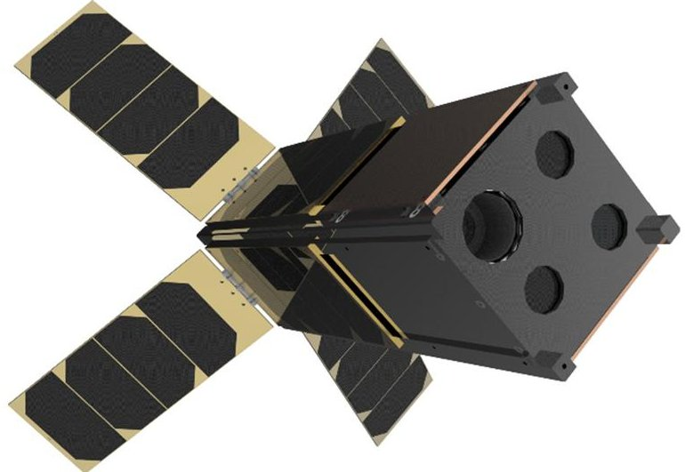
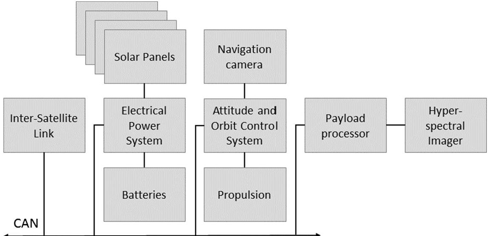
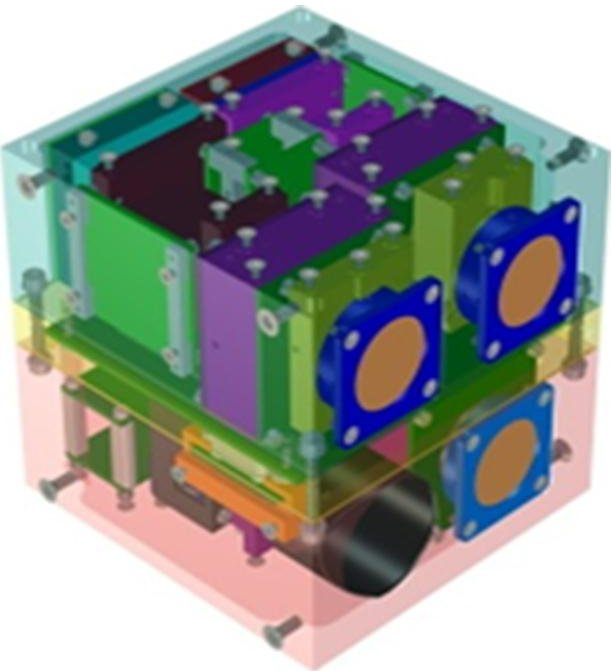
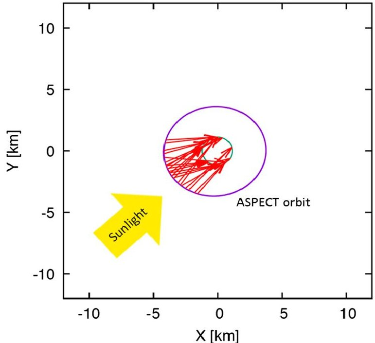

<!-- PDF_PAGE: 1 -->

# Feasibility of asteroid exploration using CubeSats ASPECT case study

Kohout, Tomas; Näsilä, Antti; Tikka, Tuomas; Granvik, Mikael Matias Sebastian; Kestilä, Antti ...

2018-10-15

Elsevier Ltd.

http://hdl.handle.net/10138/246364

Kohout, T, Näsilä, A, Tikka, T, Granvik, M M S, Kestilä, A, Penttilä, A I, Kuhno, J, Muinonen, K O, Viherkanto, K & Kallio, E 2018, 'Feasibility of asteroid exploration using CubeSats—ASPECT case study', Advances in Space Research, vol. 62, no. 8, pp. 2239- 2244. https://doi.org/10.1016/j.asr.2017.07.036

<!-- PDF_PAGE: 2 -->

# Feasibility of asteroid exploration using CubeSats—ASPECT case study

Tomas Kohout $ ^{a,b,*} $ , Antti Näsilä $ ^{c} $ , Tuomas Tikka $ ^{d} $ , Mikael Granvik $ ^{a} $ , Antti Kestilä $ ^{e} $ Antti Penttilä $ ^{a} $ , Janne Kuhno $ ^{d} $ , Karri Muinonen $ ^{a,f} $ , Kai Viherkanto $ ^{c} $ , Esa Kallio $ ^{e} $

$ ^{a} $ Department of Physics, P. O. Box 64, 00014 University of Helsinki, Finland $ ^{b} $ Institute of Geology, The Czech Academy of Sciences, Rozvojova 269, 16500 Prague, Czech Republic $ ^{c} $ VTT Technical Research Centre of Finland Ltd., Tietotie 3, 02044 Espoo, Finland $ ^{d} $ Reaktor Space Lab Ltd., Mannerheimintie 2, 00100 Helsinki, Finland $ ^{e} $ Aalto University, School of Electrical Engineering, Department of Electronics and Nanoengineering, 02150 Espoo, Finland $ ^{f} $ Finnish Geospatial Research Institute FGI, Geodeetinrinne 2, 02430 Masala, Finland

Received 3 April 2017; received in revised form 7 July 2017; accepted 24 July 2017

## Abstract

Operation of a small CubeSat in the deep-space microgravity environment brings additional challenging factors including the increased radiation environment, the significant contribution of non-gravitational forces to the satellite orbit, or the limited communication opportunities. These factors need to be taken into account in the form of modifications to the classic CubeSat architecture. Increased radiation resistance, the semi-autonomous satellite operation, navigation, and the active orbit correction are required. Such a modified CubeSat platform can potentially deliver a high performance to mass and cost ratios. The Asteroid Spectral Imaging Mission (ASPECT) is a three unit (3U) CubeSat mission built on these principles. It is part of the AIDA (Asteroid Impact & Deflection Assessment) project to the binary asteroid Didymos. ASPECT is equipped with a visible to near-infrared hyperspectral imager and will deliver both technological knowledge as well as scientific data about the origin and evolution of Solar System small bodies. $ \textcircled{c} $ 2017 COSPAR. Published by Elsevier Ltd. All rights reserved.

Keywords: CubeSat; Didymos; Binary asteroid; Space weathering; Impact; Planetary defense; Kinetic impactor; Spectroscopy

## 1. Introduction

The CubeSat concept was developed in 1999 at the California Polytechnic State University, San Luis Obispo and Stanford University's Space Systems Development Lab as an affordable, cheap, simple, and open satellite platform for university student space experiments in low Earth orbit (LEO). Since then the Cubesat design and philosophy has been adopted by hundreds of academic, commercial, and government organizations worldwide (http://www.cubesat.org/about/).

Currently, the use of the CubeSat platform is expanding beyond LEO with several deep space missions proposed. Examples include missions to be launched in 2018 by the Space Launch System, Exploration Mission 1 as BioSentinel [https://www.nasa.gov/centers/ames/engineering/projects/biosentinel.html, retrieved on June 26, 2017], CuPS (CubeSat for Solar Particles; Christian et al., 2015), LunaH-Map (Lunar Polar Hydrogen Mapper; Hardgrove et al., 2015), Lunar Flashlight (Cohen et al., 2015), Lunar IceCube (Clark et al., 2016), NEA Scout (Frick et al., 2015), OMOTENASHI [http://space.skyrocket.de/doc_sdat/omotenashi.htm, retrieved on June 26, 2017], or SkyFire [http://space.skyrocket.de/doc_sdat/skyfire.htm, retrieved on June 26, 2017]. The InSight mission to Mars will also include twin MarCO CubeSats (Mars CubeSat

<!-- PDF_PAGE: 3 -->

# ARTICLE IN PRESS

T. Kohout et al. / Advances in Space Research xxx (2017) xxx-xxx

One; https://www.jpl.nasa.gov/cubesat/missions/marco php, retrieved on June 26, 2017) which will cruise to Mars by their own and relay InSight descent data to the Earth.

In this study we discuss the possibility of a CubeSat deployment in the orbit of a small (<1 km) asteroid and outline a case study design ASPECT (Asteroid Spectral Imaging Mission) CubeSat payload for the AIM (Asteroid Impact Mission) / AIDA (Asteroid Impact & Deflection Assessment) joint ESA-NASA project.

## 2. Mission analysis

The deep space environment brings several additional challenges compared to CubeSat operations at LEO. The following major factors were identified for successful CubeSat deep-space operations:

F1: Low-gravity environment,

F2: Reduced set of objects for navigation reference,

F3: Presence of significant orbital perturbation forces as solar wind/radiation pressure, planetary perturbations, and intrinsic heat radiation force relative to the gravity of the orbiting object,

F4: Increased radiation background (operation outside Earth's magnetosphere),

F5: Limited direct communication opportunities.

In order to cope successfully with the abovementioned characteristic of the deep-space environment, the following modifications to the classic CubeSat configuration are needed:

M1: Active propulsion system,

M2: Multi-reference advanced navigation,

M3: Reliable, semi-autonomous mission operation, navigation

igation, and trajectory correction,

M4: Enhanced radiation shielding/tolerance,

M5: Foldable dish antenna or communication utilizing relay spacecraft.

## 3. AIDA project

The AIDA project is a technology demonstration mission to conduct the first-ever test of a kinetic impactor to influence the orbit of a small asteroid (Cheng et al., 2015, 2016). The AIDA target is the S-type binary asteroid (65803) Didymos (formerly 1996 GT). AIDA will also be the first mission to a binary asteroid.

AIDA consists of AIM by ESA and DART (Double Asteroid Redirection Test) by NASA. DART is targeted to impact the Didymos secondary component (Didymos II) while AIM characterizes the Didymos system prior and after the DART encounter and monitors the impact effects (Michel et al., 2016, Michel et al., in this issue). This will demonstrate the use of a kinetic impactor to deflect potentially hazardous asteroids.

Two proposed dates exist for DART and AIM launch (2020 and 2022) and Didymos encounter (2022 and 2024 respectively). As of the time of writing this manuscript DART entered phase B within NASA. AIM in its full configuration did not secure sufficient funding and support is being gathered within Europe for a simplified AIM spacecraft designated AIM-D2 (AIM Deflection Demonstration; Michel et al., in this issue).

## 4. ASPECT CubeSat

One of the AIM technology demonstration activities is the deployment of CubeSats in the vicinity of Didymos. In the original AIM design, the integration of two CubeSat Opportunity Payloads (COPINS) was planned (Michel et al., 2016). ASPECT is one of the proposed COPINS designs.

ASPECT is a 3U (3 unit) CubeSat with a visible to nearinfrared (VIS-NIR) hyperspectral imager payload (Fig. 1) operating in the spectral range of 500-2500 nm. One CubeSat payload is included in the revised and simplified AIMD2 design (Michel et al., in this issue). Based on the results of the one-year COPINS study conducted in 2016, ASPECT was selected as the single COPINS payload for AIM-D2.

## 5. Technical and scientific objectives

ASPECT is a CubeSat technology demonstration mission. The technical goals of ASPECT consist of demonstrating how a CubeSat is able to navigate and operate autonomously in tandem with the traditional spacecraft (AIM) far away from the LEO environment and the typical communication options. The impact by DART will change the local orbital environment dramatically. While the high velocity ejecta will escape Didymos gravity immediately after impact, low velocity debris from Didymos II will remain in the vicinity of the Didymos binary system and will make the ASPECT operation more hazardous. ASPECT will demonstrate whether a CubeSat can handle

Fig. 1. ASPECT preliminary design illustration.

<!-- PDF_PAGE: 4 -->

# ARTICLE IN PRESS

T. Kohout et al. / Advances in Space Research xxx (2017) xxx-xxx

operation in such a rough environment, withstand occasional collisions of low velocity fragments, and recover to its attitude and orbit. The technical objective of the spectral imager payload is to deliver data of the same spectral, radiometric and spatial quality as in ground calibrations. The ASPECT technical objectives and expected results are summarized in Table 1.

In addition to the technology demonstration, ASPECT will be able to deliver valuable scientific data. The presence of the VIS-NIR spectral imager will allow a study of the composition of Didymos surfaces using reflected solar light. Knowledge of asteroid composition, the physical appearance of asteroids, and the correct interpretation of their reflectance spectra, are issues of key importance in planetary science. It is essential not only in assessing the hazard due to asteroid impacts with the Earth or in the mitigation efforts of potentially hazardous asteroids, but also in understanding Solar System formation and evolution, in the studies of planetary surface processes, and in the preparation and data interpretation of robotic or human space missions.

AIM will be equipped with an AIM Framing Camera (AFC, flight spare from the NASA DAWN mission; Sierks et al., 2011, Michel et al., in this issue). The camera has a clear filter and seven band-pass filters in the range of 400-1050 nm. Thus, cross-calibration between the ASPECT spectral imager and AFC will be possible at the overlapping wavelengths. However, compared to the AFC, the ASPECT VIS-NIR spectrometer is working with

Table 1

ASPECT technical objectives.

<table border="1"><tr><td></td><td>ASPECT technical objectives</td></tr><tr><td>AT1</td><td>Demonstration of CubeSat autonomous operations in deep space environment</td></tr><tr><td>AT2</td><td>Navigation in the vicinity of a binary asteroid</td></tr><tr><td>AT3</td><td>Demonstration of satellite survival during impact</td></tr><tr><td>AT4</td><td>Demonstration of joint spacecraft-CubeSat operations</td></tr><tr><td>AT5</td><td>Demonstration of spectral imaging of asteroid materials</td></tr></table>

a wider spectral range and has higher spectral resolution. Thus, observations provided by ASPECT will complement/extend those by AIM.

The ASPECT scientific observational strategy focuses primarily on the spectral mapping of Didymos II (the target of the DART impact) and, secondarily, on performing a similar task on Didymos I. A 4 km, slightly inclined orbit will provide almost global coverage of Didymos II. The ASPECT scientific objectives and expected results are summarized in Table 2.

The CubeSat platform provides required subsystems for operating the spectral imager payload and communication with AIM. The operation infrastructure is centered on the S-band radio link, which provides the satellite attitude control location data from the AIM mothercraft, as well as access directly to all the other subsystems of the satellite, negating the need for a traditional failure-prone hub, e.g. an Onboard Computer, to access the subsystems. The ASPECT platform avionics, including the S-band radio equipment, batteries, attitude and orbit control, and the electrical power system, are integrated in a 1U module to minimize external connections and to simplify the system. Also included in the platform section are solar panel connections and all required harnessing.

## 6. Platform

The system architecture, space-qualified subsystem modules, structural components and the platform software are currently used in the Reaktor Space Lab's Hello World (https://www.reaktor.com/blog/introducing-the-reaktor hello-world-satellite/, retrieved on July 7, 2017) in-orbit demonstration satellite hosting a SWIR (shortwave infrared) hyperspectral imager from VTT Technical Research Centre of Finland. The porting of the Hello World design to ASPECT has been feasibility-checked and planned. The CubeSat platform will be a radiation-hardened and single-event-effect (SEE) resistant variant of the Hello World, to guarantee reliable operation for at least a 3-month mission duration. The platform side responsibilities include

Table 2

ASPECT scientific objectives and expected results.

<table border="1"><tr><td></td><td>ASPECT scientific objectives and results</td></tr><tr><td>AS1</td><td>Map the surface composition of the Didymos system</td></tr><tr><td>Result</td><td>Composition and homogeneity of the Didymos asteroid, changes as a result of DART impact</td></tr><tr><td>Result</td><td>Information on the origin and evolution of the Didymos binary system</td></tr><tr><td>AS2</td><td>Photometric observations and modeling of the Didymos system under varying phase angle and distance</td></tr><tr><td>Result</td><td>Surface particle size distribution and composition for Didymos II and Didymos I (simultaneous modeling of photometry and spectroscopy)</td></tr><tr><td>AS3</td><td>Evaluate space weathering effects on Didymos II by comparing mature and freshly exposed material</td></tr><tr><td>Result</td><td>Information on the surface processes on airless bodies due to their exposure to the interplanetary environment</td></tr><tr><td>AS4</td><td>Identify local shock effects on Didymos II based on spectral properties of crater interior</td></tr><tr><td>Result</td><td>Information on the processes related to impacts on small Solar System bodies</td></tr><tr><td>AS5</td><td>Observations of the plume produced by the DART impact</td></tr><tr><td>Result</td><td>Evolution and composition of the DART impact plume</td></tr><tr><td>AS6</td><td>Map global fallback ejecta on Didymos II and Didymos I</td></tr><tr><td>Result</td><td>Detailed global mapping of fallback ejecta on both Didymos I and Didymos II</td></tr></table>

<table border="1"><tr><td>Please cite this article in press as: Kohout, T., et al. Feasibility of asteroid exploration using CubeSats—ASPECT case study. Adv. Space Res. (2017), http://dx.doi.org/10.1016/j.asr.2017.07.036</td></tr></table>

<!-- PDF_PAGE: 5 -->

T. Kohout et al. / Advances in Space Research xxx (2017) xxx-xxx

Fig. 2. ASPECT high-level system block diagram.

accommodation of the payload and a required cold gas or equivalent thruster system (1U of space has been allocated for each). The satellite system block diagram is depicted in Fig. 2. All subsystems are monitored and switchable during operations from the electrical power system.

## 7. Payload

The payload is a miniaturized spectral imager extending from the visible up to the shortwave infrared wavelengths. In contrast to more traditional spatial-scanning imaging spectrometers, the Asteroid Spectral Imager utilizes tunable Fabry-Perot Interferometers (FPI) to select the imaged wavelengths. When multiple snapshots are combined, a spectral datacube is formed, where the wavelength bands are separated in the time domain (Saari et al., 2009). The instrument is based on the space-qualified designs of the Aalto-1 Spectral Imager and Picasso VISION (Saari et al., 2015; Nasila et al., 2016).

The instrument envelope is 97 mm $ \times $ 97 mm $ \times $ 100 mm (roughly 1U), which is split into three measurement channels, one in the visible (VIS), and two in the infrared (NIR and SWIR). The VIS and NIR channels are imaging spectrometers, while the SWIR channel only measures a single point. The target wavelength range is 500-900 nm for the VIS channel, 900-1600 nm for the NIR channel and 1600-2500 nm for the SWIR channel. The spectral separation is done by an tunable FPI. All three channels have dedicated FPIs optimized for the desired wavelength range. The imaged wavelengths are freely selectable within these ranges, and the targeted spectral resolution is about 10- 50 nm. All three channels can be operated simultaneously and are independent of each other. Even if a single image sensor or FPI is lost, the mission can still carry on with limited capabilities. A 3D rendering of the instrument is shown in Fig. 3 and the main instrument parameters are listed in Table 3.

Fig. 3. 3D rendering of the asteroid spectral imager.

## 8. Operational plan

The AIM spacecraft will release ASPECT in the proximity of the Didymos binary asteroid before proceeding with its main mission. The optimal satellite orbit is based on satisfying the payload requirements as well as on the stability of the chosen orbit. Stability around the Didymos system is primarily defined by the solar radiation pressure and the complex, time-varying gravitational field of the mutually orbiting, irregularly shaped small bodies (Scheeres, 2012).

Initially, ASPECT will be placed on a stable commissioning higher altitude orbit for a two-week commissioning period. During this time, the satellite will check its health and then transfer to the nominal mission orbit. The two candidate commissioning orbits are slightly higher than the nominal mission orbit — semimajor axis a=5.91 km, eccentricity e=0.34, and inclination i=19 degrees, or

<!-- PDF_PAGE: 6 -->

Table 3

The main asteroid spectral imager parameters.

<table border="1"><tr><td>Parameter</td><td>VIS channel</td><td>NIR channel</td><td>SWIR channel</td><td>Notes</td></tr><tr><td>Field of View[deg]</td><td>6°×6°</td><td>5.3°×5.3°</td><td>5° circular</td><td></td></tr><tr><td>Spectral range[nm]</td><td>500-900</td><td>900-1600</td><td>1600-2500</td><td></td></tr><tr><td>Image size[pixels]</td><td>614×614</td><td>256×256</td><td>1 pixel</td><td></td></tr><tr><td>No. spectral bands</td><td>~14</td><td>~24</td><td>~30</td><td>Tunable in flight</td></tr><tr><td>Spectral resolution[nm]</td><td>&lt;20nm</td><td>&lt;50nm</td><td>&lt;25nm</td><td></td></tr></table>

a=6.38 km, e=0.34, and i=5 degrees for pro- and retrograde Didymos II scenarios, respectively.

The nominal mission orbit selection is driven by the performance parameters of the payload defined by observational requirements. The best nominal orbit solution is a=3.33 km and e=0.4 or a=3.53 km and e=0.32 for pro- and retrograde Didymos II scenarios, respectively. In both cases, the orbits will require active orbit maintenance throughout the mission as they have about ten days of stability without orbit correction before impacting Didymos I. The orbital velocity in the nominal mission orbit is about 0.1 m/s on average.

At the nominal semimajor axis the ground pixel size stays below 2 m/px with a feasible field of view (FoV) design during the whole orbit covering the whole of Didymos II. In turn, orbits closer to Didymos I are restricted by their FoV as Didymos I obstructs large segments of Didymos II orbit. For example, the 500-700 m semimajor axis circular orbits are stable for up to 28 days (Damme, personal communication), but have roughly a 9-6 times larger portion of the secondary's orbit blocked by the primary than for example at the chosen nominal orbits. The lighting angle for Didymos II and the Sun also precluded orbits with significantly high inclinations with respect to the orbit plane of the binary, such as terminator orbits. A Lagrange point position during the mission is not advantageous, as only one side of Didymos II can be observed in the case of its synchronous rotation. Example of suitable observation positions is shown in Fig. 4.

The concern of DART post-impact debris accumulation on the Didymos II orbital plane as well as provision for complete coverage of Didymos II (including its "poles") led us to choose a 20 degree inclination with respect to Didymos II orbital plane.

Almost global imaging coverage of Didymos II will be achieved from 8 evenly spaced observations with respect to the Didymos II rotational phase. The required time to achieve these from the nominal orbit is approximately 2 weeks. These observations will be repeated after the DART impact. This together with the ASPECT commissioning phase defines the overall minimum ASPECT operational period to 6 weeks (2 week commissioning, 2 week observations prior impact, 2 week observations after impact). Together with a 2 week contingency period the resulting target mission duration is 8 weeks.

Fig. 4. An example of suitable observation geometries for 100% mission completion. The outer circle is the ASPECT orbit, and the inner circle is the Didymos II orbit around Didymos I (situated in the centre).

## 9. Discussion

As identified in the mission analysis, the operation of a small CubeSat in deep-space microgravity environment brings additional challenges which need to be taken into account in the form of modifications to classic CubeSat architecture. Spacecraft operations among small bodies have been carried out before and thus the required technologies exist. However, previous small body missions involved relatively large spacecraft accommodating robust subsystems.

ASPECT is, in contrast, limited to the 3U （ $ 3 0 \times1 0 \times1 0 \mathrm{c m} $ ）envelope and the cold gas propulsion defined by the AIM COPINS specification. Thus, it is necessary to miniaturize and select the ASPECT platform components carefully. For this reason, traditional spacequalified components cannot be used due to their size and mass and ASPECT will have to largely rely on CubeSat and modified off-the-shelf components. This approach will result in a reduced operational lifetime and requires additional total dose and single event upset radiation testing of subsystems. This approach is, however, acceptable considering the planned 6-8-week ASPECT mission duration and will enable by far the best performance compared to mass and cost.

<!-- PDF_PAGE: 7 -->

# ARTICLE IN PRESS

T. Kohout et al. / Advances in Space Research xxx (2017) xxx-xxx

If ASPECT is successfully proven in space, it will enable small satellite deep space exploration. The ASPECT design can serve as an achievable platform baseline for scientific and commercial activities to explore and characterize small bodies.

## 10. Conclusions

The ASPECT design study demonstrated that it is possible, within the 3U CubeSat envelope, to design an autonomous small satellite to be deployed in the vicinity of a small binary asteroid. ASPECT will deliver both the technological knowledge as well as the scientific data about the origin and evolution of small Solar System bodies and will contribute to the AIDA project goals delivering observations of the DART impact and its consequences on the target asteroid.

## Acknowledgements

The project is done under ESA Sys-Nova R&D Studies Competition for Innovation contract and is partly supported by VTT internal project, Academy of Finland project nos. 285432 and 299543, and ERC project no. 320773. Institute of Geology, the Czech Academy of Sciences is supported by Ministry of Education, Youth and Sports project no. RVO67985831. We would like to thank two anonymous reviewers for their constructive comments to our manuscript.

## References

Cheng, A.F., Atchison, J., Kantsiper, B., et al., 2015. Asteroid impact and deflection assessment mission. Acta Astronaut. 115, 262-269. http:// dx.doi.org/10.1016/j.actaastro.2015.05.021.

Cheng, A.F., Michel, P., Jutzi, M., et al., 2016. Asteroid impact and deflection assessment mission: kinetic impactor. Planet. Space Sci. 121, 27-35. http://dx.doi.org/10.1016/j.pss.2015.12.004.

Christian, E.R., Desai, M.I., Allegrini, F., et al., 2015. The Cubesat mission to study Solar Particles (CuSP), an interplanetary cubesat. In: Proceedings of the American Geophysical Union Fall Meeting, December 14-18, 2015, San Francisco, California, USA https:// agu.confex.com/agu/fm15/meetingapp.cgi/Paper/63298.

Clark, P.E., Malphrus, B., Brown, K. et al., 2016, Lunar Ice Cube Mission: Determining Lunar Water Dynamics with a First Generation Deep Space CubeSat. Proceedings of the 47th Lunar and Planetary Science Conference, March 21-25, 2016, The Woodlands, Texas, USA, abstract no. 1043 <https://www.hou.usra.edu/meetings/lpsc2016/pdf/ 1043.pdf>.

Cohen, B.A., Hayne, P. O., Paige, D.A., Greenhagen, B.T., 2015, Lunar Flashlight: Mapping Lunar Surface Volatiles Using a CubeSat. In: Proceedings of the 46th Lunar and Planetary Science Conference, March 16-20, 2015, The Woodlands, Texas, USA, abstract no. 2020 <https://www.hou.usra.edu/meetings/lpsc2015/pdf/2020.pdf>.

Frick, A., Castillo-Rogez, J.C., Johnson, L. et al. 2015, NEO Scout: A CubeSat Architecture to Characterize Near-Earth Asteroids. In: Proceedings of the Conference on Spacecraft Reconnaissance of Asteroid and Comet Interiors, January 8-10, 2015, Tempe, Arizona, USA, abstract no. 6041 <https://www.hou.usra.edu/meetings/astrorecon2015/pdf/6041.pdf>.

Hardgrove, C., Bell, J., Thangavelautham, J. et al., 2015, The Lunar Polar Hydrogen Mapper (LunaH-Map) Mission: Mapping Hydrogen Distributions in Permanently Shadowed Regions of the Moon's South Pole. In: Proceedings of the Lunar Exploration Analysis Group, October 20-22, 2015, Columbia, Maryland, USA, abstract no. 2035 <https:// www.hou.usra.edu/meetings/leag2015/pdf/2035.pdf>.

Michel, P., Cheng, A.F., Kueppers, M., et al., 2016. Science case for the Asteroid Impact Mission (AIM): a component of the Asteroid Impact and Deflection Assessment (AIDA) mission. Adv. Space Sci. 57, 2529- 2547. http://dx.doi.org/10.1016/j.asr.2016.03.031.

Näsilä, A., Holmlund, C., Mannila, R., Näkki, I., Ojanen, H.J., Akujärvi, A., Saari, H., Fussen, D., Pieroux, D., Demoulin, P., 2016. PICASSO VISION instrument design, engineering model test results, and flight model development status. Remote Sensing of Clouds and the Atmosphere XXI, Proceedings of SPIE, vol. 10001, p. 1000109. http://dx.doi.org/10.1117/12.2241956.

Saari, H., Aallos, V., Akujärvi, A., Antila, T., Holmlund, C., Kantojärvi, U., Mäkynen, J., Ollila, J., 2009. Novel miniaturized hyperspectral sensor for UAV and space applications. Sensors, Systems and Next- Generation Satellites XIII, Proceedings of SPIE, vol. 7474, p. 74741M. http://dx.doi.org/10.1117/12.830284.

Saari, H., Näsilä, A., Holmlund, C., Mannila, R., Nakki, I., Ojanen, H.J., Fussen, D., Pieroux, D., Demoulin, P., Dekemper, E., Vanhellemont, F., 2015. Visible spectral imager for occultation and nightglow (VISION) for the PICASSO mission. Sensors, Systems, and Next- Generation Satellites XIX, Proceedings of SPIE, vol. 9639, p. 96391M. http://dx.doi.org/10.1117/12.2193557.

Sierks, H., Keller, H.U., Jaumann, R., et al., 2011. The dawn framing camera. Space Sci. Rev. 163, 263-327. http://dx.doi.org/10.1007/s11214-011-9745-4.

Scheeres, D.J., 2012. Orbital mechanics about small bodies. Acta Astronaut. 72, 1-14. http://dx.doi.org/10.1016/j.actaastro.2011.10.021.