<!-- PDF_PAGE: 1 -->

# Alma Mater Studiorum Università di Bologna Archivio istituzionale della ricerca

DustCube, a nanosatellite mission to binary asteroid 65803 Didymos as part of the ESA AIM mission

This is the final peer-reviewed author's accepted manuscript (postprint) of the following publication:

Published Version:

Perez, F., Modenini, D., Vázquez, A., Aguado, F., Tubío, R., Dolgos, G., et al. (2018). DustCube, a nanosatellite mission to binary asteroid 65803 Didymos as part of the ESA AIM mission. ADVANCES IN SPACE RESEARCH, 62(12), 3335-3356 [10.1016/j.asr.2018.06.019].

Availability:

This version is available at: https://hdl.handle.net/11585/655923 since: 2019-01-22

Published:

DOI: http://doi.org/10.1016/j.asr.2018.06.019

Terms of use:

Some rights reserved. The terms and conditions for the reuse of this version of the manuscript are specified in the publishing policy. For all terms of use and more information see the publisher's website.

This item was downloaded from IRIS Università di Bologna (https://cris.unibo.it/). When citing, please refer to the published version.

<!-- PDF_PAGE: 2 -->

This is the final peer-reviewed accepted manuscript of:

Franco Perez, Dario Modenini, Antonio Vazquez, Fernando Aguado, Ricardo Tubio, Gergely Dolgos, Paolo Tortora, Alberto Gonzalez, Riccardo Lasagni Manghi, Marco Zannoni, Adeeb Nazeeruddin, Mauro Melozzi, Ian Carnelli, DustCube, a nanosatellite mission to binary asteroid 65803 Didymos as part of the ESA AIM mission, Advances in Space Research, Volume 62, Issue 12, 2018, Pages 3335-3356, ISSN 0273-1177

The final published version is available online at: https://doi.org/10.1016/j.asr.2018.06.019

## Rights / License:

The terms and conditions for the reuse of this version of the manuscript are specified in the publishing policy. For all terms of use and more information see the publisher's website.

<!-- PDF_PAGE: 3 -->

# DustCube, a nanosatellite mission to binary asteroid 65803 Didymos as part of the ESA AIM mission.

Franco Perez $ ^{*1} $ , Dario Modenini $ ^{+1} $ , Antonio Vazquez $ ^{*} $ , Fernando Aguado $ ^{*,\text{¥}} $ , Ricardo Tubio $ ^{*} $ , Gergely Dolgos $ ^{''} $ , Paolo Tortora $ ^{+} $ , Alberto Gonzalez $ ^{*} $ , Riccardo Lasagni Manghi $ ^{+} $ , Marco Zannoni $ ^{+} $ , Adeeb Nazeeruddin $ ^{''} $ , Mauro Melozzi $ ^{''} $ , Ian Carnelli $ ^{+} $

* Department of Telecommunication Engineering, University of Vigo, Rua Maxwell S/N, Vigo, Spain.

$ ^{\dagger} $ Department of Industrial Engineering, University of Bologna, Via Fontanelle 40, I-47121 Forli, Italy.

Micos Engineering GmbH, Überland Str. 129, 8600 Dübendorf, Switzerland.

¥ Centro de Innovación Aeroespacial de Galicia (CINAE), Porto do Molle 6, Nigrán, Vigo, Spain.

$ ^{ \dagger} $ ESA/HQ, F-75738 Paris, France.

## Abstract

Nanosatellites are a promising option for the exploration of the solar system and near-Earth objects, providing an agile, reduced cost and mass solution for interplanetary missions. This paper summarises the efforts done during the Phase A study aimed at assessing the feasibility of a nanosatellite-based mission concept for a 3U CubeSat to the vicinity of the binary asteroid 65803 Didymos. The nanosatellite is meant to be part of the Asteroid Impact Mission (AIM) which is the European element of the NASA-ESA jointly developed Asteroid Impact & Deflection Assessment (AIDA) mission. The inclusion of a scientific optical payload based on a Nephelometer, the selected orbital and navigation strategy, together with the differences found between the Beyond-Earth space environments (radiation, micrometeoroids, ejected material, illumination conditions, communications access) and a typical LEO polar environment, unveils new technical challenges to be faced along interplanetary missions. These challenges have been identified and analysed to be included within the DustCube concept of operations, are described in this manuscript.

Keywords: Nanosatellite, Binary asteroid, Didymos, interplanetary, ESA.

## 1. Introduction

In recent years, the interest towards nanosatellites development is increasingly shifting from an academic tool, as they were originally conceived, towards their use to accomplish real science missions, with capabilities that may complement those of bigger platforms, but obtained at a fraction of the development time and cost. Indeed, nanosatellites may be profitably exploited not only for Low Earth Orbit missions but even for more challenging, interplanetary scenarios.

The Asteroid Impact Mission (AIM) is the European element of the Asteroid Impact & Deflection Assessment Mission (AIDA) jointly developed by NASA and ESA., It plans to target the binary asteroid system Didymos to demonstrate the kinetic impactor concept (Cheng et al., 2015).

AIM will investigate the binary asteroid system and will observe the outcome of the NASA DART (Double Asteroid Redirection Test) impactor hitting the secondary body, by measuring the momentum transfer, as well as a crater and ejecta properties (Cheng et al., 2016), (Michel et al., 2016).

<!-- PDF_PAGE: 4 -->

The original AIM spacecraft concept, now being reshaped to become lighter and more affordable. (Michel et al., 2017) was designed to carry on board three smaller spacecraft: The Mascot-2 asteroid lander, developed by DLR, and two CubeSat Opportunity Payloads (COPINS).

DustCube, a mission concept developed jointly by the University of Vigo (ES), the University of Bologna (IT), and Micos Engineering GmbH (CH), is one of the five proposals that were selected by ESA for further study. Based on a 3U CubeSat platform, DustCube is intended to enhance the capability of the AIM spacecraft to elucidate the properties of the natural dust environment of the Didymos binary system, by measuring concentrations, sizes and speeds of natural dust in the vicinity of Didymoon. It will also allow to quantify and characterise the plume ejected during DART's impact by using a light scattering Nephelometer for remote (RNH) and in-situ (INH) measurements and will serve as an in orbit demonstration of a novel technique of laser altimetry, using the RNH for time of flight (TOF) measurement.

This paper summarises the efforts done by the proposing team during the Phase A study, aimed at assessing the feasibility of such an ambitious CubeSat-based mission concept. The manuscript is organised as follows: Section 2 gives an overview of the DustCube mission concept, including its scientific objectives and a description of the scientific payloads, namely two nephelometers. Section 3 presents the outcome of the preliminary orbital analysis and design, aimed at guaranteeing the survivability of the CubeSat within the Didymos system while optimising the scientific observations. Section 4 deals with Spacecraft design. Section 5 presents the results of the environmental analysis, on which a great focus was placed as it significantly differs from the common operational scenario of CubeSats in LEO. Section 6 describes the power budget of the mission, while Section 7 presents the results of the preliminary thermal analysis. Finally, Section 8 draws the conclusions and highlights possible applications of this work.

## 2. Mission Analysis

## 2.1. Concept of Operations

The DustCube mission represents a major advance in both Cubesat technology and mission planning. It is a completely new concept that has been designed based on the available information about the Didymos system environment and its dynamical model (for details, see Zannoni et al., 2017 and references therein). The proposed concept of operations was designed to minimise the risks to the AIM Mothership, assuming a higher risk with the Nanosatellite, which will create a communication network with the mothership, to relay all its data to Earth. The mission concept is formed by 5 operational phases, covering: Birthing (During AIM Cruise), Injection, Pre-impact, Impact and Post-impact phases.

The injection phase is based on inserting the spacecraft in a stable orbit (range of about (4 $ \pm 1 $ ) km of radius from the system barycentre) whith a trajectory that ensures that the residence time inside a safe region (neither collision with the system nor escape from the sphere of influence) ranges from at least 7 to 14 days. During the injection time active S/C orbit correction is not required. This is the ideal orbit for early operations and commissioning, since in case unexpected problems occur, the spacecraft can remain in safe hold mode waiting to be recovered from the ground. All communications are executed through the AIM spacecraft ISL communication link, which serves as a gateway for communication with Earth.

After the injection phase, the spacecraft is transferred to an orbit around the Lagrangian point L4 or L5 of the Didymos binary system (around 1,2 km distance from the system barycentre) (Figure 1). Once the parking orbit is achieved, the nominal payload operations will start, comprising the Pre-Impact operational phase, in which the natural dust environment of the system is analysed.

The Impact Phase is contingent on the availability of the DART spacecraft. If DART impact is foreseen, then DustCube will be pre-programmed to operate its payload and gather detailed information during the exact moment of the impact (telescope images of plume and crater, ejecta plume characterization for light scattering properties and environmental assessment). The acquisition is foreseen from the L4/L5 parking orbits up to 4 days after the impact (depending on the dust dispersion pattern).

The continuation of the Impact Phase has been designed to allow the satellite to rendezvous with Didymoon starting from the L4/L5 parking orbits. The target (close-up) orbit is a low altitude ( $ \approx $ 250-

<!-- PDF_PAGE: 5 -->

130m) Distant Retrograde Orbit (DRO). This option would entail obtaining high-resolution measurements while increasing the risk of the mission. After 24 days on the selected DRO orbit around Didymoon, the S/C will be transferred back to the L4/L5 parking orbit to carry out post impact operations until the disposal phase.

Table 1 DustCube mission phases duration and description

<table border="1"><tr><td>AIM mission phases</td><td>DustCube CONOPS</td><td>Target orbit</td><td>Duration</td><td>Schedule activities</td></tr><tr><td rowspan="2">CRUISE(547 days)</td><td>Birthing</td><td rowspan="2">Deep space trajectory inside AIM S/C</td><td>547 days</td><td>Periodic switch ON for health checks</td></tr><tr><td>Ephemerides update</td><td>1 day</td><td>Update of orbital data and reference model, on board the S/C</td></tr><tr><td rowspan="7">Deployment Phase(21 days)</td><td rowspan="7">Injection Phase</td><td rowspan="7">Release at 4km distance from barycenter</td><td rowspan="7">6-13 days</td><td>S/C switch ON</td></tr><tr><td>S/C Autonomous Health Checks</td></tr><tr><td>S/C Detumbling+Attitude determination</td></tr><tr><td>Communication link stablishment</td></tr><tr><td>S/C Commissioning(platform)-OPS</td></tr><tr><td>Navigation system calibration-OPS</td></tr><tr><td>~1 day</td><td>Orbit manouvering to L4/L5 Parking orbit-OPS</td></tr><tr><td rowspan="5">Detailed Characterization Phase Period #2(21 days)</td><td rowspan="5">Pre-Impact Phase</td><td rowspan="5">L4/L5 Trailing Orbits“Parking Orbit”</td><td>~1 day</td><td>Payload Commissioning at target orbit</td></tr><tr><td>~21 days</td><td>Station keeping at target orbit(@L4/L5)</td></tr><tr><td></td><td>Inter Satellite Link communications</td></tr><tr><td></td><td>Nominal Payload Operations</td></tr><tr><td></td><td>Data download to Earth(w/COMMs windows)</td></tr><tr><td rowspan="3">Impact Phase(21 days)</td><td rowspan="3">Impact Phase</td><td>L4/L5 Trailing Orbits</td><td>~5 day</td><td>Impact Imaging</td></tr><tr><td>Transfer Orbit</td><td>(TBD)hrs</td><td>Orbital Manoeuvre-Rendezvous to Didymain(If ALT2 or ALT3 is selected)</td></tr><tr><td></td><td></td><td></td></tr></table>

<!-- PDF_PAGE: 6 -->

<table border="1"><tr><td>AIM mission phases</td><td>DustCube CONOPS</td><td>Target orbit</td><td>Duration</td><td>Schedule activities</td></tr><tr><td></td><td></td><td>DRO Around Didymoon(280m or 180m Altitude)</td><td>24 days</td><td>Payload Operations from DRO OrbitPayload Operations from L4/L5(if ALT-1)Data download to Earth(w/COMMs windows)</td></tr><tr><td rowspan="2">Detailed Characterization Phase Period #3(21 days)</td><td rowspan="2">Post-Impact Phase</td><td>Transfer Orbit</td><td>(TBD)hrs</td><td>Orbital Manouver - back to parking orbit(@L4/L5)(If ALT2 or ALT3 is selected)</td></tr><tr><td>L4/L5 Trailing</td><td>~20 days</td><td>Nominal Payload operations</td></tr><tr><td>Post-Impact Close Phase(42 days)</td><td>Disposal EOL extended OPS</td><td>(TBD)</td><td>(TBD)days</td><td>Extended Science operations</td></tr><tr><td>Total</td><td></td><td></td><td>~90 days</td><td></td></tr></table>

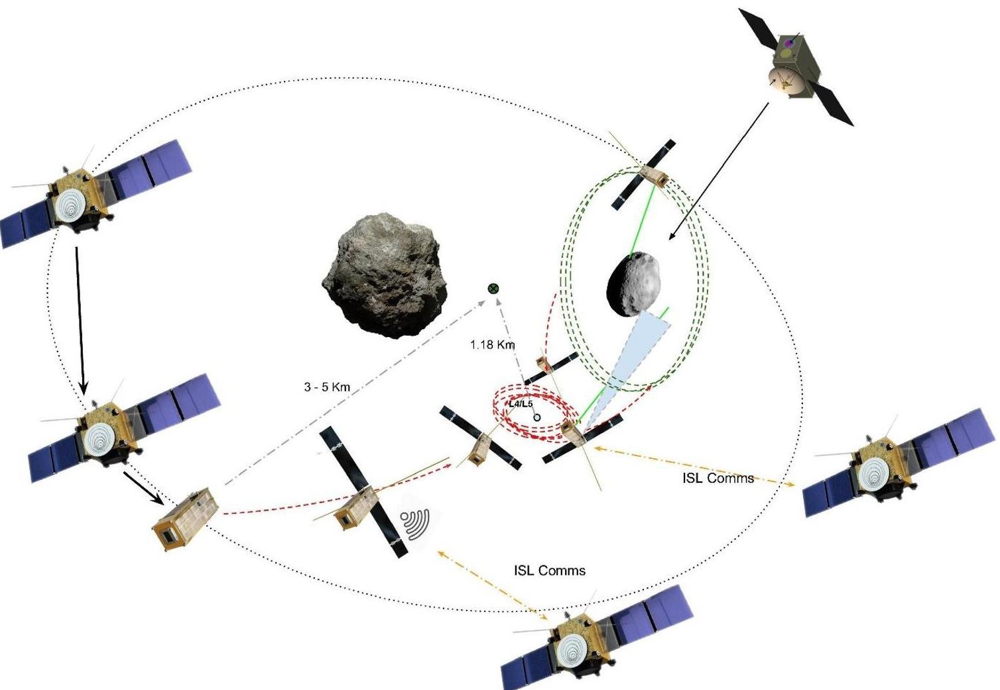

Figure 1. DustCube concept of operations (CONOPS) within Didymos binary system, once the spacecraft is released on its target orbit. Ground communications are relayed to the nanosatellite trough he AIM mothership.

## 2.2. Science and Payload

<!-- PDF_PAGE: 7 -->

The DustCube mission has been designed in order to enhance the capability of the AIM spacecraft for elucidating the properties of the natural dust environment and the aftermath of the DART impact on the Didymos binary system. The DustCube science objectives are described in Table 2:

Table 2. Science objectives of the Remote Nephelometer (RNH), the In-situ Nephelometer(INH) and Laser Altimetry instrument (TOF)

<table border="1"><tr><td>ID</td><td>Objective</td><td>Parameter</td><td>DC target accuracy</td></tr><tr><td>DC1</td><td>Measure the concentration of ejected particles through the deposition on the In-situ nephelometer (INH)</td><td>$-dN/dV:$ number of particles in the sampled volume.
$-Particle speed stats$</td><td>10% at 0.1 m$^{-3}$ (TBC),
Time res 1 day
ULOD[1] 1 mm/100 ns
LLOD[2]=f(dN/dV)</td></tr><tr><td>DC2</td><td>Characterization of the Natural dust environment already present on the Lagrangian Points L4 or L5</td><td>$-Size$
$-Shape$
$-Refractive Index$</td><td>TBD as function of foreseen concentration</td></tr><tr><td>DC3</td><td>Measurement of the Bidirectional Reflection Distribution Function of Didymos surfaces</td><td>$-BRDF$ at Remote Nephelometer (RNH) 800 &amp; 900 nm</td><td>10% in absence of on board calibration</td></tr><tr><td>DC4</td><td>High-resolution Imaging of the System, Didymoon surface craters, impact and ejected Plume.</td><td>$-RNH$ high-resolution images</td><td>1.2cm resolution
$3.5\times 3.5m^{2}$ cover</td></tr><tr><td>DC5</td><td>Laser altimetry technology validation (TOF) for both surface topology and navigation</td><td>$-Distance$ to Didymos asteroids</td><td>20cm precision,
30cm footprint</td></tr><tr><td>DC6</td><td>Plume cloud particles characterization and
Evolution, in support of ejecta budgets such as mass and momentum</td><td>$-Particles$ size distribution, sphericity, Real Refractive Index (800 nm, 900 nm)</td><td>Size: 15 bins
$\Delta RRI=0.02$
0.1 to 30+ $\mu m$ diameter</td></tr></table>

The close-range operations will happen before, during and after impact; using two payload instruments the In-situ Nephelometer and the remote Nephelometer (Figure 2).

The In-situ Nephelometer payload (0.5 Cubesat units) is an adaptation of a NASA Airborne payload (Dolgos G, 2014) to measure freely floating particles, reengineered to allow extreme miniaturisation.

The INH nephelometer operates in the following manner: The INH bay allows particles to freely float inside the sample bay exposing its surface to the particles environment through the INH Inlet. The laser beam passes twice in front of the internal camera lenses, the first one to measure the forward scattering light (when the light hits the trapped particle), and during the second pass, the backscattered light reaches the camera in the complementary scattering angles. The CCD sensor captures images of linear laser beams, extracting the scattering information from the image intensity per pixel since each pixel corresponds to a different scattering angle (Figure 3).

<!-- PDF_PAGE: 8 -->

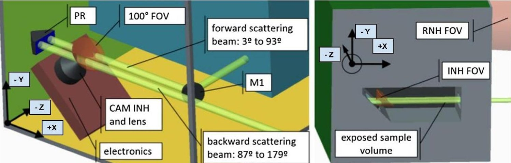

Figure 2. In-situ Nephelometer internal architecture. Laser beam is generated and directed into the Mirror 1 (M1) which reflects the light over the camera FOV and into the Prism (PR) which will allow the laser beam to cross a second time over the camera FOV.

(a) Rayleigh scattering of $ \mathrm{C O_{2}} $ (30 minutes)

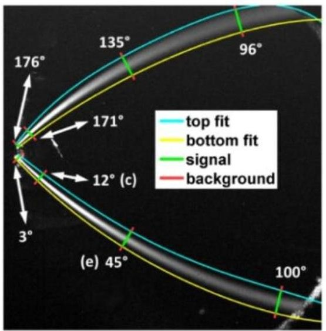

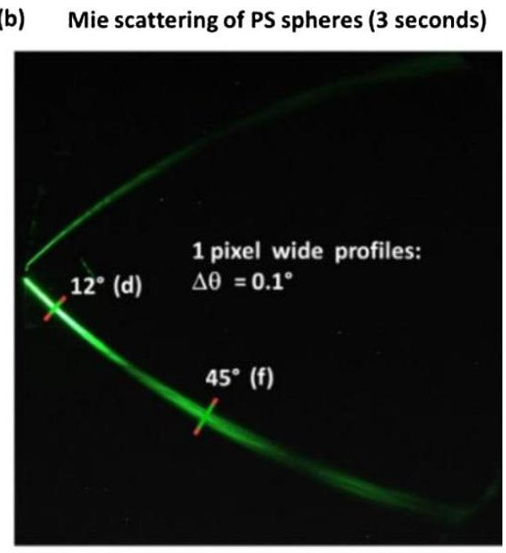

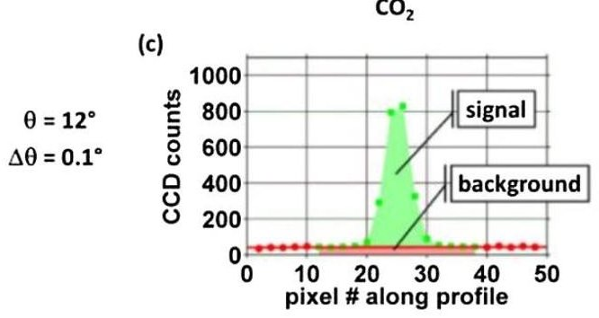

(d)

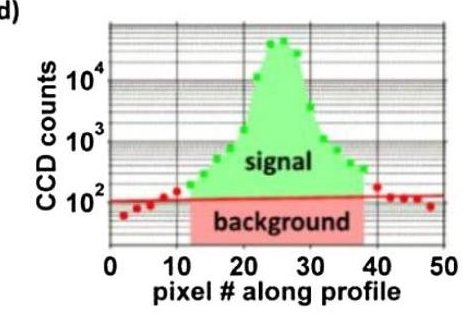

(e)

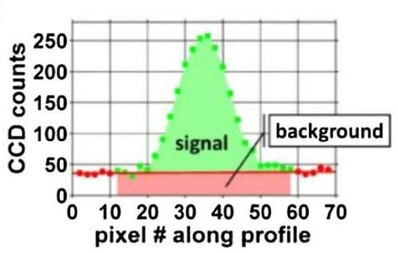

(f)

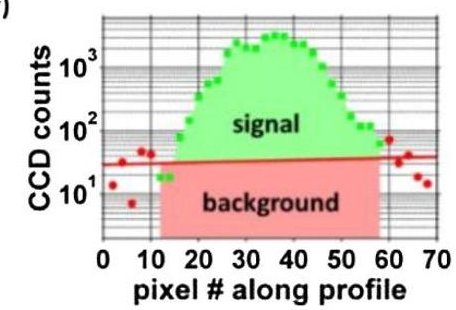

Figure 3. Example PI-Neph data of Rayleigh scattering gases and Mie scattering test particles (Dolgos. G, et.al, 2014)

The directional distribution of light scattered by the particles is to be measured, characterising the particle type, along with the total scattering per unit volume of space, characterising the particle

<!-- PDF_PAGE: 9 -->

amount. Measured particles scattering parameters are: SCA, the linear scattering coefficient, usually measured in inverse mega meters $ (1 / \mathrm{M m}=10^{-6}1 / \mathrm{m}) $; P11, the Phase function, which corresponds to the (1,1) element of the phase matrix; P12, degree of linear polarisation, the (1,2) element of the phase matrix. The resulting scattering measurement (L1 data) can be validated with scatterers that have a known scattering distribution, such as polystyrene spheres, which scatter very accurately according to Mie theory. Once the L1 data is validated, it can be inverted to yield particle microphysical properties (L2 data), such as size distribution and refractive index, in addition to sphericity indication (Dubovik, O, 2014).

The Remote Nephelometer (Figure 4) payload includes a telescope (0.5 Cubesat Units) enabling the measurements of the INH to be extrapolated, through the utilisation of the laser beam of INH emitted to remotely sense the concentration of suspended particles, up to a range of 1500 meters.

The payload named RNH-TOF exploits the telescope of the RNH for the time of flight distance measurement. Therefore, RNH-TOF is a mode of operation of the RNH telescope, requiring minimal hardware extension in addition to the RNH core. Distance measurement to various points on asteroid requires repointing the spacecraft without repositioning the spacecraft. Therefore, this is only possible to within the tolerance of impulse balance of the thrusters, to induce only rotation without extensive translation. The rotation axes are required to be the two axes perpendicular to the RNH-TOF telescope line of sight.

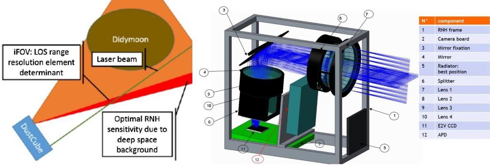

Figure 4. Remote Nephelometer design

Demanding alignment stability requirement of the optical payloads RNH with respect to INH represents a significant challenge on the miniaturisation of the optical benches. The presented design requires a dedicated substructure, since the coefficient of thermal expansion (CTE) plays a critical role, as a result of the thermal analysis in section 7.3. The required angular resolution for the maximum RNH range is not reached through the utilisation of an aluminium mount, within the -40 C to +40 C thermal range. A trade-off between Titanium and carbon-fibre reinforced silicon carbide (CeSic) materials were contemplated and had been demonstrated through analysis that the CeSiC mount would have 50% lower thermal variability than a Titanium mount due to optimal CTE.

## 3. Orbital Analysis

DustCube needs to operate in a rather complex dynamic environment, due to the presence of two bodies with irregular shapes, whose physical parameters are still quite uncertain, and a non-negligible Solar Radiation Pressure (SRP). Having as a primary objective the in-situ measurement of the dust particles near the smaller asteroid, DustCube should navigate at close range from the binary system: less than 3 km from Didymoon to allow for the use of the Remote Nephelometer (RNH). Furthermore, given the expected time frame from the deployment to DART impact of about two months, the proposed mission concepts should seek for parking orbits which are sufficiently stable, as to reduce as much as possible the station keeping effort.

<!-- PDF_PAGE: 10 -->

As an additional constraint, it should be kept in mind that DustCube in orbit operations cannot rely on ground-based navigation, rather, the platform must be equipped with an autonomous navigation system, whose target accuracy will be constrained by the sensitivity to perturbations of the identified orbits. In this chapter, we will summarise the most important aspects and results of the orbital analysis for the DustCube mission, while for a thorough description the reader is referred to (Lasagni et al. 2017).

## 3.1. General Approach

The search for candidate orbits considered the three main phases of DustCube Concept of Operations (CONOPS), namely injection, pre-impact phase and post-impact phase. The approach towards the identification and orbital analysis consisted of a series of successive steps.

First, possible trajectories that exploit the binary nature of the system were obtained in the simplified Circular Restricted 3-Body Problem (CR3BP) by using a differential correction method. Several orbital families were explored, which include Planar Lyapunov orbits, Distant Prograde Orbits (DPOs), Distant Retrograde Orbits (DROs), and Halo orbits.

Among these, few suitable orbital solutions satisfying stability and geometrical constraints were identified, which formed the basis for the preliminary concept of operations (see Section 3). This preliminary concept included three alternative scenarios, with an increasing level of risk and a corresponding benefit in the scientific return from the mission, with the various options sharing the same injection and pre-impact phases, but differing only in the post-impact phase.

To assess the robustness and stability of a given solution, candidate orbits obtained in the CR3BP model were then integrated in a so called High Fidelity Ephemerides (HFE) model (Lasagni et al. 2017), which numerically integrates DustCube trajectories by considering 1) the point mass gravity of the Sun, the Solar System bodies, the Moon, and Pluto, 2) Gravity field of Didymain, modelled with a uniform density polyhedral shape, 3) Gravity field of Didymoon, modelled as a triaxial ellipsoid of uniform density, and 4) Solar Radiation Pressure.

## 3.2. Injection

A suitable injection strategy for DustCube shall: 1) cope with a deployment velocity (and associated uncertainties) which is of the same order of magnitude asthe orbital velocity within Didymos system, and 2) require no active operations from DustCube during an assumed commissioning time of 1 week. We analysed orbits within the sphere of influence of the system, having nominal semi-major axes in the range between 2 km and 10 km from Didymos barycentre. Orbits at lower altitudes were not considered since they are more susceptible to departure due to injection errors, with a higher risk of impact with the primary or the secondary.

We found that a convenient strategy fulfilling the various constraints is deploying DustCube from AIM while travelling on an orbit inclined with respect to the target orbital plane and exploiting the deployment velocity as an impulsive manoeuvre for changing orbit inclination towards Didymoon's orbit plane. Such an approach is preferable with respect to an injection straight from the target orbital plane since the stability of the considered orbits is highly degraded by in-plane velocity errors, but less affected by out of plane errors. The analysis further highlighted that the most stable region for injection lies in the range of about (4 $ \pm1 $ ) km of radius from the system barycentre. The robustness of the proposed approach with respect to the expected injection velocity errors has been verified through Monte Carlo simulations, which suggest that a lifetime equal to or higher than 1 week (Figure 5) is feasible.

<!-- PDF_PAGE: 11 -->

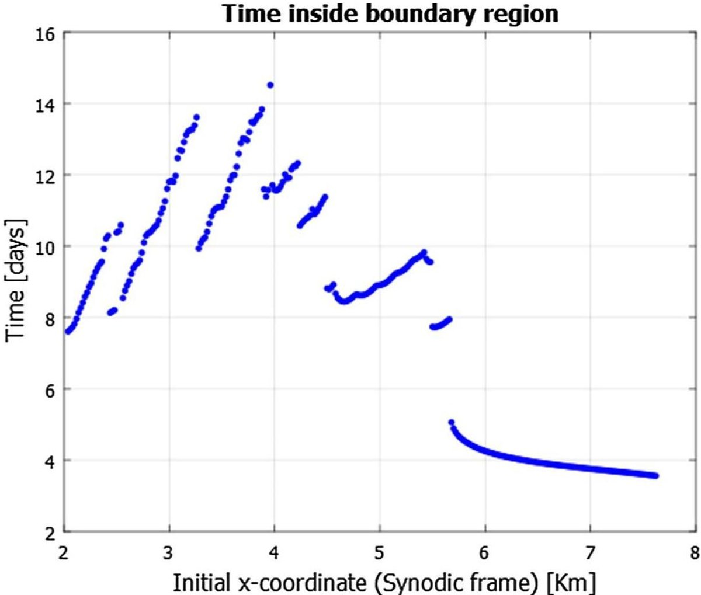

Figure 5. Survival time for a DPO orbit with deployed solar panels configuration

## 3.3. Pre-Impact and Post-Impact Phase

After commissioning in the injection orbit is performed, DustCube will transfer to a parking orbit, at the $ \mathrm{L}_{4} $ equilibrium point. Trailing orbits were found to remain bounded for a time span of two months, even in the absence of station keeping efforts (Figure 6). The parking phase will be followed by different possible scenarios, characterized by increasing levels of risk and operational complexity: continue orbiting at $ \mathrm{L}_{4} $ (low risk), rendezvous with Didymoon on high altitude DRO at roughly 300m from the surface (medium risk), or rendezvous with Didymoon on a low altitude DRO at roughly 100m (high risk). All the three alternatives exhibit a sufficient level of stability when integrated into the HFE model and are consistent with the manoeuvring capabilities of the platform in terms of station keeping effort. Sensitivity to errors in the initial conditions was evaluated with a series of Monte Carlo simulations: these allowed to put some constraints on the performance of the Orbit Determination and Control System. In particular, it was found that position and velocity accuracies of respectively 10m and 5 mm/s are required for safe operations.

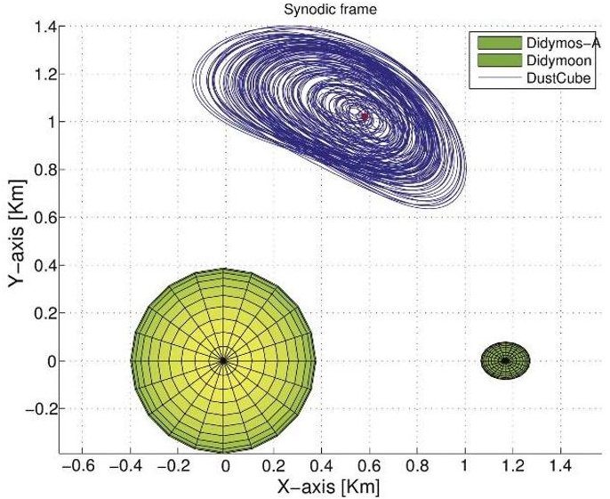

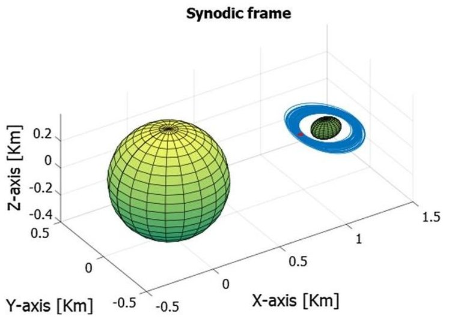

<!-- PDF_PAGE: 12 -->

Figure 6. L4 parking orbit in the HFE model as seen in the synodic reference frame. The integration time span is two months, starting on the $ 8^{\mathrm{th}} $ of August 2022

Figure 7. DRO orbit in the HFE model as seen in the synodic reference frame. The integration time span is two weeks, starting on the $ 8^{\mathrm{th}} $ of August 2022

## 3.4. Navigation

Taking into considerations the constraints regarding mass, volume and available computing power posed by a 3U CubeSat, the selected navigation concept is based on a line of sight to the centre of brightness technique. This technique is then complemented by limb fitting, especially when unfavourable geometric configurations occur. The inherent limitations of the line of sight to the centre of brightness (COB) navigation, i.e. the inability to estimate the range from the body, is overcome by shooting images of both bodies at the same time, thus exploiting the binary nature of the system. A dual camera configuration is proposed for the simultaneous estimation of the LOS vectors to the asteroids, imaging in the Thermal Infrared (TIR) band to limit the influence of the illumination conditions. Figure 8 shows the proposed configuration for the optical navigation hardware: the two TIR cameras have an angular separation of $ 6 0^{\circ} $ , which corresponds to the average angular distance of the two asteroids at the $ \mathrm{L}_{4} $ parking orbit, where the s/c will spend most of its operational life.

Results of a geometrical OpNav simulation (Lasagni Manghi et al., 2017) suggest that the target positioning accuracy can be achieved both at parking orbit and for the proximity operations, provided that the centre finding algorithms can maintain the COB to Centre Of Mass (COM) error within a value of 2% of the asteroids' Field Of View (FOV) extension, and that asteroid ephemerides are predicted and available with 5m 1 $ \sigma $ -accuracy (a value which is compatible with what achievable through AIM orbit determination (Zannoni et al., 2017)).

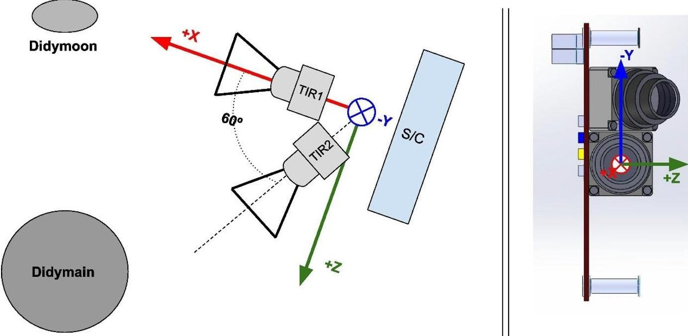

Figure 8. - Proposed navigation cameras' setup.

## 4. Spacecraft Design

Following the CubeSat Design Specification, DustCube is a 3 Units (3U) nanosatellite architecture based on commercial off-the-shelf (COTS) components, composed of eleven subsystems (Figure 9), whose configuration is constrained by the available volume, mass, derived optical payload accommodation, navigation strategy and thermal survivability.

The main driver for the subsystems configuration logic is the payload position, as the telescope and the laser beam (provided by the INH) shall be installed as physically separated as possible, to obtain a larger geometric measurement range for the remote sensing activities. Furthermore, the INH sample bay (INHSB) shall be located along the Z axis to maximize the particle deposition rates, avoiding direct exposition of internal optical elements to the plume (during nominal pointing mode, XZ plane is coincident with the orbital one, with +Z axis directed towards orbital velocity vector, and +X towards Didymos system).

<!-- PDF_PAGE: 13 -->

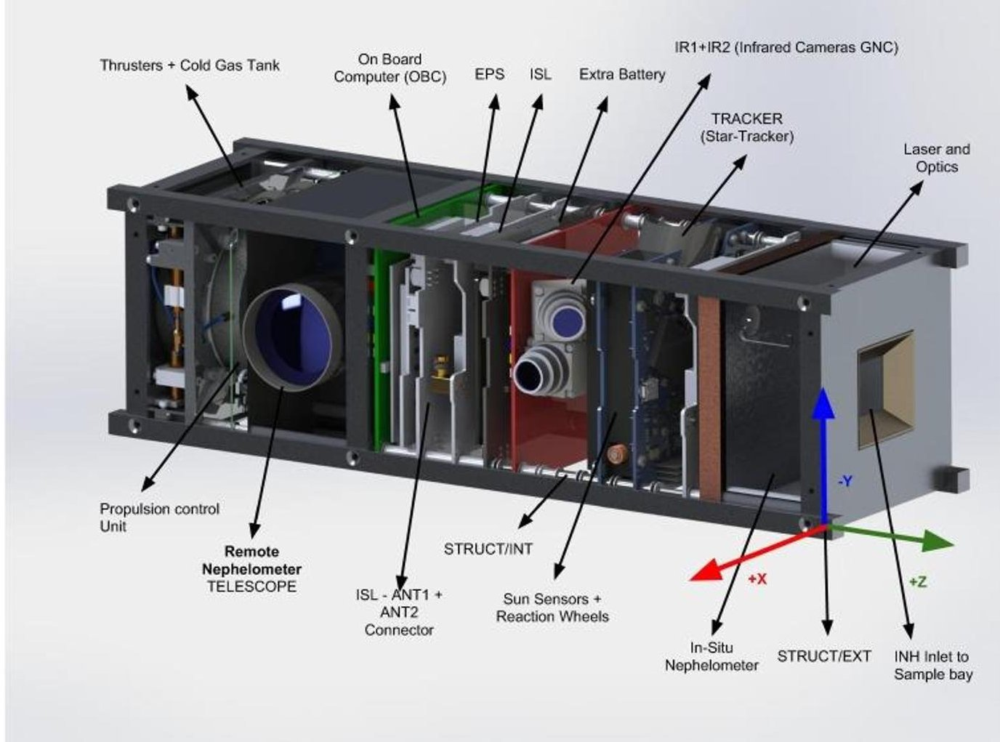

Figure 9a,b. 3U Cubesat platform configuration using COTS components

## 4.1. Propulsion

To meet all the orbital and attitude control needs, the propulsion subsystem is requested to provide 6 degrees of freedom (DoF) control. Due to the low gravity environment of Didymos, Delta-V needs are not particularly demanding and can be fulfilled using flight proven cold gas micro-propulsion technology. The subsystem is located on the -Z face. Propulsion system requirements are summarised in Table 3.

Table 3. Propulsion subsystem requirements

<table border="1"><tr><td>Type</td><td>Cold gas</td></tr><tr><td>Nominal Thrust</td><td>1mN</td></tr><tr><td>Total delta-V</td><td>2m/s</td></tr><tr><td>Specific Impulse</td><td>50s</td></tr><tr><td>Thruster configuration</td><td>6DoF control authority</td></tr></table>

## 4.2. Solar panels configuration

The DustCube SC will use photovoltaic solar arrays for generating power. The solar array configuration constrains the overall structural design, impacts the orientation of the spacecraft, and in this case, drove the decision of including security elements as shutters, within the payload optical sensor.In order to avoid sun pointing during unstabilized scenarios,the solar arrays will not be deployed until the de-

<!-- PDF_PAGE: 14 -->

tumbling and stabilization phase is completed. The thermal analysis has been crucial in the selection of a solar panels and solar cells configuration strategy, within one face of the deployables, in order to include thermal radiators in the other

## 4.3. Antennas configuration

The DustCube SC will integrate an Inter-Satellite Link (ISL) communication module provided by ESA, which will enable the communication with the AIM mothership and the creation of a deep space network with the MASCOT and other Cubesats. For this particular mission the placement of the communication antennas is not a main driver on the overall SC configuration; nevertheless, their location within the SC body will drive other configurational designs as solar cells placement and pointing strategies, due to the fact that the S-Band antennas have to be placed on opposite faces of the SC in order to obtain an almost omnidirectional antenna radiation diagram, to minimize slew manouvers for communication scenarios.

## 4.4. Optical Components distribution

The configuration of optical components (TIR Cameras for navigation, start-tracker and fine sun sensors, remote nephelometer telescope and laser beam source) within the nanosatellite long edges, were key drivers on the final spacecraft layout. The abovementioned navigation strategy, orbital mission profile and SC-Sun and SC-Target vectors, extracted from the orbital analysis, constrained the TIR cameras and the payload optical components configuration. To constantly point towards the binary system, without requiring slew manoeuvres for the concurrent execution of science acquisition and navigation, both subsystems were installed within the same plane (Figure 10).

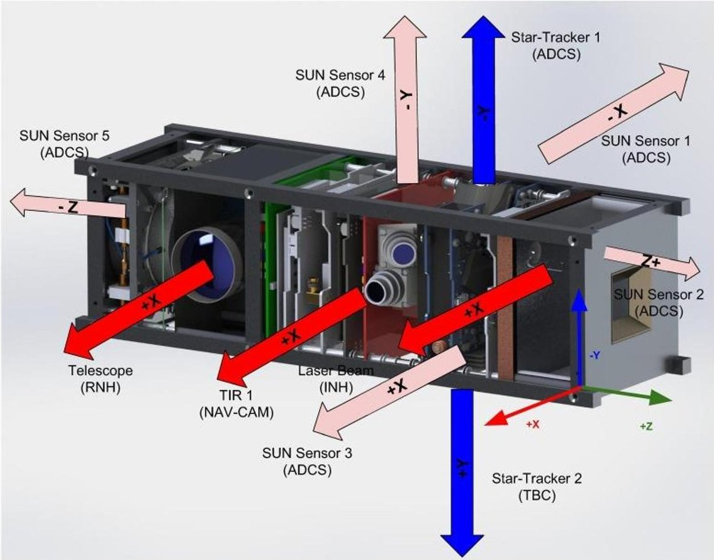

Figure 10. 3U Cubesat platform optical elements configuration

## 4.5. ADCS Configuration

Given the demanding pointing requirements for the mission, a highly capable 3 axes stabilisation concept is proposed for DustCube. Attitude determination will be performed with the use of two startrackers in cold redundancy, a triaxial gyroscope and 6 sun sensors located over all the external faces. Additional information on the relative attitude of the S/C in the synodic (rotating) reference frame may come from the two thermal IR navigation cameras. Attitude control will be achieved with the use of three reaction wheels for torque compensation and slewing manoeuvres and a series of cold gas thrusters

<!-- PDF_PAGE: 15 -->

for detumbling and desaturating manoeuvres. Since the S/C motion lies on the orbital plane of the binary system, a wheel momentum bias is foreseen during scientific operations, to guarantee gyroscopic stiffness about the pitch axis (out of orbital plane).

Relative accuracy requirements for fine pointing mode imposed by scientific and navigation instrumentation are Absolute Knowledge Error (AKE) $ < 0.1^{\circ} $ (1 $ \sigma $ for all axes), Absolute Performance Error $ < 1^{\circ} $ (1 $ \sigma $ for all axes), Relative Performance Error (RPE) $ < 0.01^{\circ} $ (pk-pk) on a 10s time scale.

## 5. Space Environment

## 5.1. Radiation

A radiation analysis was carried out to assess the effects of the expected radiation environment on the spacecraft, focusing on the 3 main issues: degradation of the electronic devices due to the Total Ionizing Dose (TID); degradation of the electrical power generation by the solar cells and single event effects (SEE) that will occur in the electronic devices.

In order to provide protection for the cumulative effects of the TID, a target range from 2 to 10 krad is sought for the total mission time of the DustCube spacecraft: this would allow a broad range of COTS components to be utilised for its design.

Simulations using SHIELDOSE model from ESA's SPENVIS (Space Environment Information System) were performed, including Monte Carlo simulations for the second bremsstrahlung radiation. Results showed that, to keep the mass requirements for the shielding below 10% of the total spacecraft mass while ensuring the target range of 5 to 20 krad the following equivalent plate thicknesses could be adopted:

- 0,6 mm AI equivalent plates achieve 5,80 krad using 5,67% of the satellite mass;

- 0,8 mm AI equivalent plates achieve 4,29 krad using 7,56% of the satellite mass;

- 1,0 mm AI equivalent plates achieve 3,38 krad using 10,0% of the satellite mass;

The radiation environment around Didymos is a galactic cosmic rays (GCR), and solar particle events (SPE) dominated one, being the protons the main contributors to the radiation effects. This differs from LEO environment, where trapped particles (including electrons and ions) are the main contributors. Thus, the radiation shielding proposed for this mission is based on Kevlar, Nomex/Nextel and HDPE (Di Fino, L et. Al, 2014) (R. Destefanis et al. 2013).

## 5.2. Solar Cells degradation

Solar cells degradation analysis for the Azur Space 3G28 cell assembly was computed, following (ECSS Secretariat, 2008b). Degradation due to the interplanetary environment was estimated using SPENVIS software, defining the near-Earth interplanetary trajectory, computing the GCR fluxes, followed by the calculation of the long-term solar particle fluences. The equivalent 1 MeV flux was also computed, using JPL's EQFLUX (Equivalent Flux Program) and AZUR3G28 models. An alternative method was utilised to estimate the degradation of the solar cells by displacement damage using the MC-SCREAM model with the same parameters as for EQFLUX.

The overall degradation of the solar cells efficiency was calculated to be below 3.89% , for both methods.

## 5.3. SEU Rate and LET Spectra comparison

The comparison criteria for Single Event Upset (SEU) rates is based on simulations for three electronic devices, which are already included in the SPENVIS library showing results for a broader range of electronic technologies. For the SEU Rate and Linear Energy Transfer (LET) spectra comparison, the utilized SPENVIS configuration includes a shielding thickness of 0.37 mm of aluminium, Si (SRIM2008) as the device material, and algorithm constant LET (CREME).

The results obtained for both the Didymos and the LEO reference missions are summarised in Table 4.

Table 4. SEU Rates simulations using SPENVIS, for the worst week and complete mission scenario

<!-- PDF_PAGE: 16 -->

<table border="1"><tr><td colspan="2">SEU Rate</td><td colspan="2">Device</td><td>Didymos Environment</td><td>LEO Reference</td><td>Didymos/LEO</td></tr><tr><td rowspan="3">Worst (errors/bit)</td><td rowspan="3">Week</td><td>Samsung DRAM</td><td>16M</td><td>1.03E+05</td><td>1.96E+04</td><td>5.26</td></tr><tr><td colspan="2">93L422 BIPOLAR</td><td>7.45E+08</td><td>1.42E+08</td><td>5.25</td></tr><tr><td colspan="2">2164 MOS</td><td>1.06E+07</td><td>2.01E+06</td><td>5.26</td></tr><tr><td rowspan="3">Mission (errors/bit)</td><td rowspan="3">Week</td><td>Samsung DRAM</td><td>16M</td><td>2.77E+03</td><td>5.08E+02</td><td>5.44</td></tr><tr><td colspan="2">93L422 BIPOLAR</td><td>1.80E+07</td><td>3.47E+06</td><td>5.19</td></tr><tr><td colspan="2">2164 MOS</td><td>2.82E+05</td><td>5.19E+04</td><td>5.44</td></tr></table>

Overall, the SEU rate is expected to be about 5 times bigger than in LEO.

## 5.4. Micrometeoroids

The combined risk for this mission in terms of external impacts can be modelled as a combination of two separate factors: a regular interplanetary micro-meteoroids environment, and a time-decaying particles impact scenario after the collision between Didymoon and the impactor from NASA occurs. The micro-meteoroids in the interplanetary environment are required to be modelled as an omnidirectional flux (ECSS Secretariat, 2008b) with particle velocities as per the HRMP (Harvard Radio Meteor Project, Taylor, 1995) model so that it is equally probable to get hit at any of the faces of the spacecraft. However, the time-decaying flux of particles that will appear at Didymoon, needs to be further modelled and understood in order to size the thickness of the shielding depending on how much risk the mission can assume.

In the AIM mission, CubeSats were conceived as components of the system that could assume a much higher amount of risk. From this point of view, DustCube was designed to cross the debris released from Didymoon just right after the collision. Following this approach, an initial trade-off among different types of materials like Kevlar, carbon-fibre reinforced plastic and tantalum was considered in order to provide a full protection of the bus to reduce the amount of risk that could be assumed. This trade-off analysis needs to be further completed with a more elaborated model of the debris cloud, which has been left for future research.

## 6. Power Generation

The main objectives of the power budget were to estimate the power generated during the mission with respect to the evolution of the distance to the Sun and to select the number, size and layout of the solar arrays as well as the required battery capacity to guarantee continuous S/C operations.

## 6.1. Inputs

The alternatives proposed in the CONOPS impose different orbital constraints to the illumination conditions. To achieve a safe design, a worst case scenario was considered, in which the eclipses due to Didymain and Didymoon are synchronised, therefore causing the longer eclipse period. The lighting conditions are presented in Table 5:

Table 5. Lighting conditions in the asteroid vicinity, following the proposed orbital strategy

<table border="1"><tr><td>Orbital period[h]</td><td>Lighting time[h]</td><td>Eclipse time[h]</td><td>Lighting time(%)</td><td>Eclipse time(%)</td></tr><tr><td>11927</td><td>10376</td><td>1551</td><td>86.99%</td><td>13.01%</td></tr></table>

## 6.2. Losses and degradation estimation

<!-- PDF_PAGE: 17 -->

A simplified model of the power subsystem has been implemented to account for the different efficiencies of the power unit and the losses due to the mission constraints. The loss sources considered for the solar cells are: Temperature losses (efficiency degradation per $ ^{\circ} \mathrm{C} $ equal to 0.06965%) degradation per radiation factors (4% due to the space environment), miscellaneous factors (2%).

The losses of the power unit are: Battery Charge Regulators losses (15%) , regulators losses (10%) useful battery capacity (80%) (Restriction in terms of battery sizing) and Path losses (5%).

## 6.3. Sizing

Along the mission the distance between DustCube and the Sun varies between 1.15AU and 1AU resulting in a significant variation of the maximum available power on the bus (see Figure 11). To size the solar panels and the capacity needed for the batteries, the performance of several configurations has been assessed. The constraints in size and geometry imposed by the CubeSat standard restrict the possible options for deploying solar panels: here we considered as feasible the deployment of 1,2,3 or 4 additional panels.

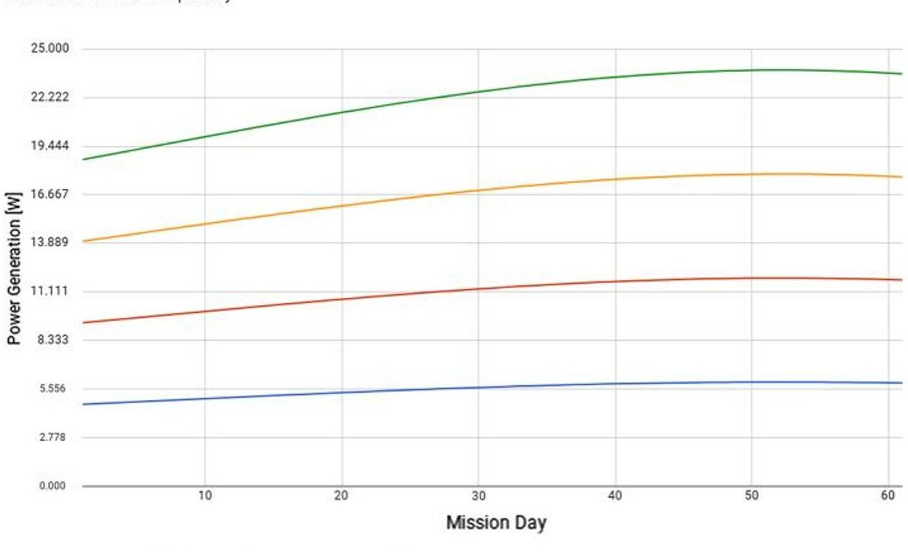

Figure 11. Power generation profile per mission day

Figure 12 shows the expected power curves along the mission. Each curve represents the total amount of power available during the eclipse for a given mission day, depending on how much power was consumed in average during the illumination period (indicated as a label by the side of the curve). The upper limit for the power available during an eclipse is given by the capacity of the battery. For this analysis, the power generation/consumption balance is computed for a cycle of 1 orbit, with an operational battery charge margin of 5% per cycle. Furthermore, an effective battery capacity was used for sizing, taken as the 80% of the nominal rating. Considered effective battery capacities were 40 WHr and 60 WHr.

The following conclusions are derived from analysing Figure 12:

- Due to thermal control issues, an excess in power generation requires more radiative area to dissipate the extra energy.

- A single solar panel allows for 4 W of consumption in sunlight, with almost no battery left during the first days. Given a preliminary power allocation for the various subsystems which ranges from 3.5W (Sun) to 5.3W (Eclipse), a single deployed panel is clearly not a viable option.

- A configuration given by 2 deployable solar panels and a 40 WHr effective capacity battery (50 WHr with margin) seems the best regarding mass spent vs power generation achieved. This

<!-- PDF_PAGE: 18 -->

configuration will allow for a worst case operation of the satellite consuming 7W during illumination and 6W during an eclipse, continuously.

- The larger power achieved with 3 or 4 panels comes at a significant increase of mass since, to limit the extra heat generation, the battery capacity should increase up to 60 WHr.

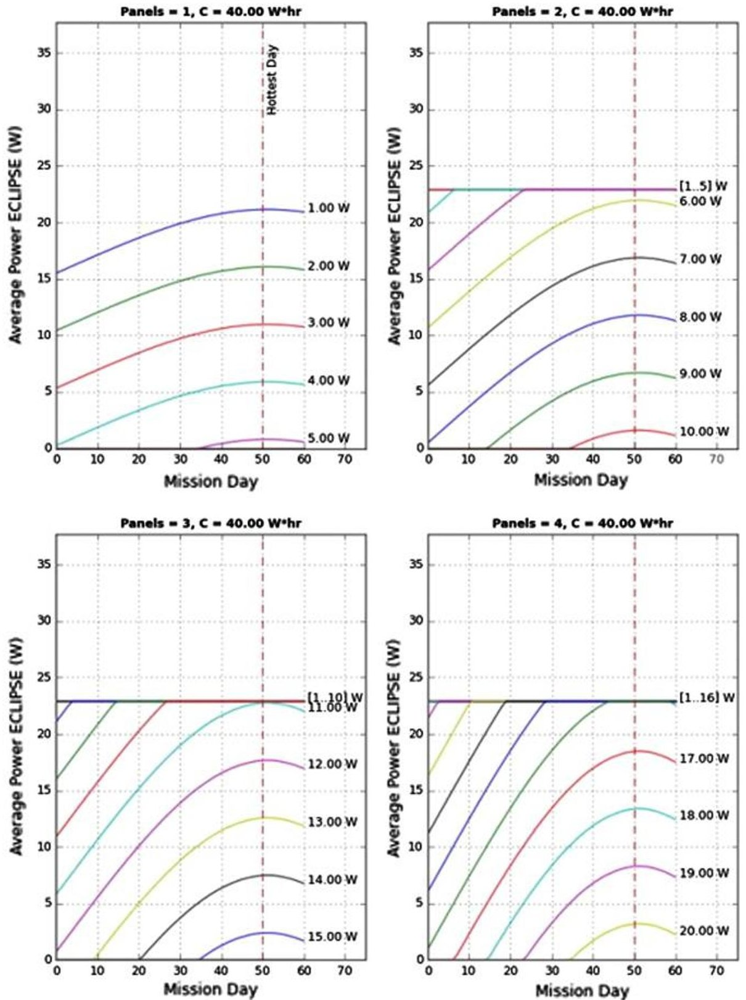

Figure 12. Power curves along mission duration for different solar panel configurations

## 7. Thermal Analysis

## 7.1. Illumination Conditions

The illumination conditions at Didymos differ from the ones found in LEO since the continuous illumination, and eclipse conditions at Didymos are respectively 10 times and 3 times longer. Thus, the major concern that arises is the capability of the system to radiate away all the heat absorbed during those long periods of illumination and to preserve the temperature within operating margins throughout the long eclipse periods as well.

<!-- PDF_PAGE: 19 -->

Taking into account such conditions, the hot/cold cases have been identified as follows. The hot case occurs at day 50 after injection, when Sun irradiance is close to Air Mass Zero (AM0), at the end of the lighting period. The cold case occurs at day 1, at the end of the eclipse.

## 7.2. Thermal Balance Configurations Comparison

Following the results of the power budget, several options with at least 2 solar panels pointed to the Sun have been studied during thermal balance analysis: the considered geometric configurations are summarised in Table 6.

Table 6. Solar panels (SP) configuration options including deployables (DEPL).

<table border="1"><tr><td>Config. name</td><td>Body mounted SP</td><td>Deployed SP</td><td>Radiator faces</td><td>Sun incidence</td></tr><tr><td>+X w/2 DEPL</td><td>(None)</td><td>2 towards +X</td><td>ALL</td><td>0°</td></tr><tr><td>+X w/1 DEPL</td><td>+X</td><td>1 towards +X</td><td>-X,±Y,±Z</td><td>0°</td></tr><tr><td>+X and +Y</td><td>+X,+Y</td><td>(none)</td><td>-X,-Y,±Z</td><td>45°</td></tr><tr><td>+Z w/2 DEPL</td><td>(None)</td><td>2 towards +Z</td><td>ALL</td><td>0°</td></tr></table>

The surface emissivity is considered to be a free parameter ranging from 0.5 to 0.95 and represents the average emissivity for the radiating area. This average emissivity allows us to model complex surfaces, where only a fraction of the area can be covered with the radiator, with the rest being occupied by other surfaces from S/C components that need external access and typically feature low emissivity (such as the lenses of the star trackers or the payload). More than 100% means that additional radiator area needs to be deployed apart from the one available to the spacecraft body.

<!-- PDF_PAGE: 20 -->

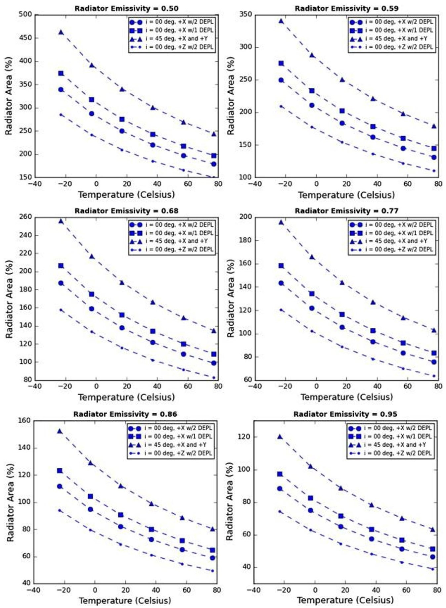

Figure 13. Percentage of the external area to be employed as a radiator as a function of the surface temperature, for different solar panels configurations.

The effects of the DustCube to Sun distance variation was also analysed since the thermal balance presented herein assumes a worst case scenario where the Solar irradiance is at its maximum (minimum DustCube to Sun distance).

In order to provide a preliminary understanding of this issue, the thermal balance was then calculated considering the change in the Sun irradiance along the mission. Figure 14 shows the variation of the size of the radiator required to dissipate the absorbed heat for the various solar panels configurations. A maximum and minimum percentage are reported in Table 7. Results of the analysis show that the variation in the required radiator size along the mission ranges from 13% to 31% (DIFF), with the lowest

<!-- PDF_PAGE: 21 -->

variations occurring with the +Z heat shield panels configuration. A lower variation is to be preferred as it would translate to a more stable S/C thermal environment along the mission.

The impact of this variation in the performance of the thermal control system should be analysed in the following phases of the project, to account for the additional conditions imposed by the colder environment expected during the initial stages of the mission.

Table 7. Summary of the radiators size variations to achieve a specific temperature (T), using a radiator with a specific emissivity (e), for different solar panels configuration options.

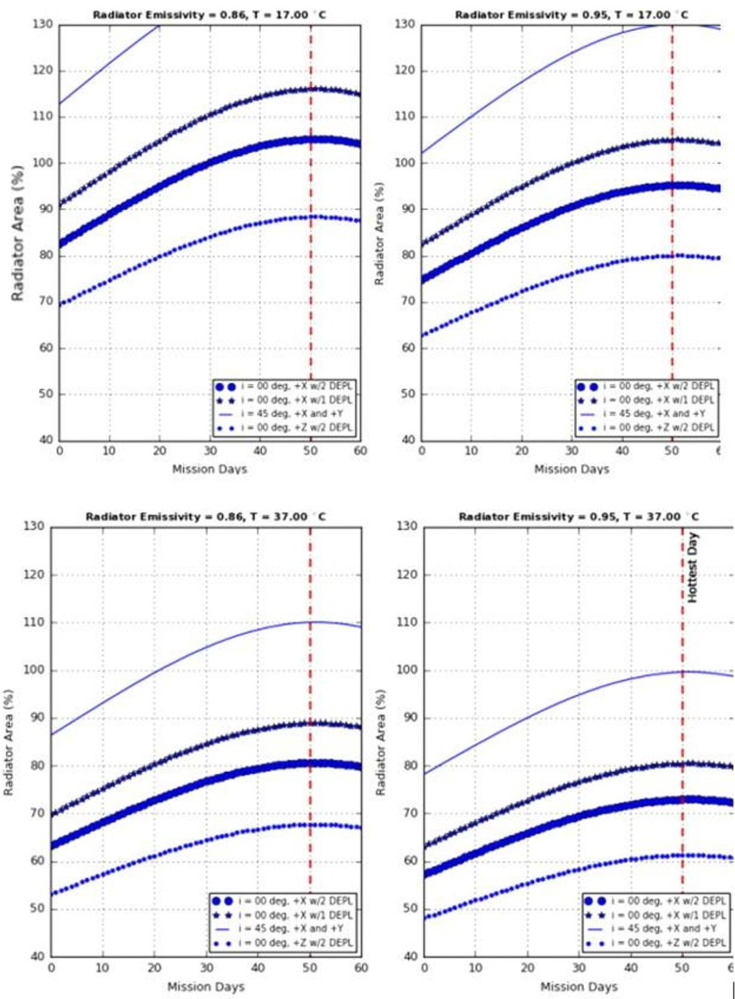

Figure 14. Radiators emissivity analysis

## 7.3. Preliminary Component Level Thermal Analysis

A preliminary component level thermal analysis was performed modelling the spacecraft as a wing-box assembly (see Figure 15), with the following components:

- 1 Aluminium box with no body mounted solar panels.

- 2 radiators （100 cm $ ^{2} $ ）on $ \pm $ Y faces. Surface material: Al silvered Teflon.

- 2 deployed solar panels towards Z face. Each solar panel is composed of 7 Azur Space cells over CFRP plus an Aluminium based back face radiator with the silver Teflon surface finished.

<!-- PDF_PAGE: 22 -->

The following assumptions were made to model internal conduction:

- Internal contacts modelled as: Aluminium to aluminium: 2200 W/m $ ^{2} $ (single M3 bolt, low-pressure contact conductance).

- CFRP panel to aluminium panel contact conductance: 500 W/m $ ^{2} $ (thermal paste).

Assumed pointing mode was with the -Z face continuously pointing to the Sun, and all other faces exposed to deep space (4K).

The results of the analysis indicate that after 11 hours of exposure, the +Z w/2 DEPL configuration exhibits a maximum temperature on the solar panels of around 114 $ ^{\circ} \mathrm{C} $ . The maximum predicted temperature in the aluminium box is slightly above $ 31^{\circ} \mathrm{C} $ .

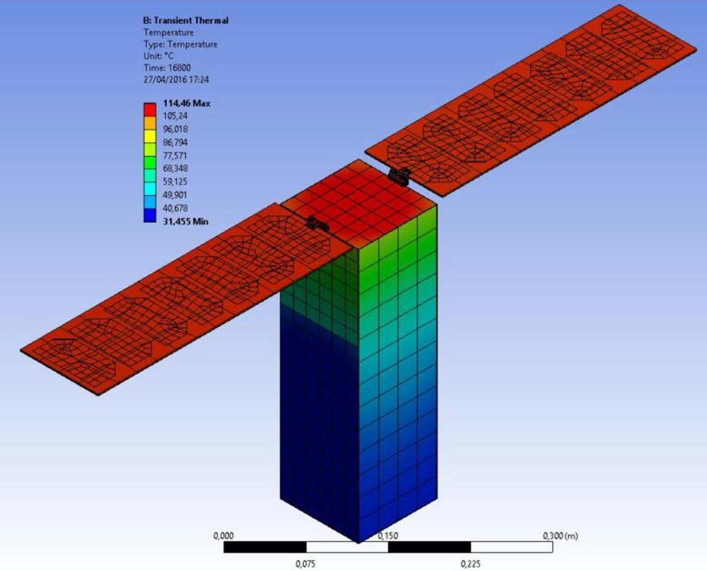

Figure 15. Thermal simulation for DustCube in the heat shield configuration.

## 8. Conclusions

This manuscript has provided an overview of the complete mission design of the DustCube mission to the binary asteroid Didymos. Alignment requirements of optical payloads on board interplanetary nanosatellites, such as DustCube's Nephelometer, are demanding and represent a significant challenge. Dedicated substructure design and associated coupled thermomechanical analyses, are required as well since the coefficient of thermal expansion plays a critical role in space optics structures.

Since the communication opportunities are limited in time and capacity, the amount of data shall be preprocessed on board in order to optimise the communication link. The level of autonomy of a deep space nanosatellite shall be high, in order to survive and recover from unexpected safe modes. Thus, a detailed FDIR implementation shall be executed.

<!-- PDF_PAGE: 23 -->

Furthermore, the proposed mission concepts seek for parking orbits which are sufficiently stable, as to reduce as much as possible the station keeping effort. As an additional constraint, DustCube in-orbit operations cannot rely on ground-based navigation, rather, the platform must be equipped with an autonomous navigation system, whose target accuracy will be constrained by the sensitivity to perturbations of the identified orbits.

Several challenges have been identified as major concerns for the development of the proposed system, and preliminary technical solutions proposed, as summarised in Table 8.

Table 8.Summary of DustCube design challenges.

<table border="1"><tr><td colspan="2">Design challenge</td><td>LEO(650KmSSO)</td><td>Didymos environment</td><td>Proposed technical development</td></tr><tr><td rowspan="4">Thermal(ContinuousSunlight)</td><td rowspan="4">Design</td><td rowspan="4">60 Minutes</td><td rowspan="4">L4/L5:660 Minutes(10 Times longer)</td><td>-Heat shield configuration</td></tr><tr><td>-CFRP-based solar panels</td></tr><tr><td>-Silver coated FEP</td></tr><tr><td>-Radiators design,and solar panels configuration</td></tr><tr><td rowspan="2">Thermal Design(Eclipse)</td><td rowspan="2">30 Minutes</td><td rowspan="2">L4/L5:90 Minutes(3 Times longer)</td><td rowspan="2">-Heaters Implementation</td></tr><tr><td>-MLI Utilization</td></tr><tr><td rowspan="3">Thermal Balance</td><td rowspan="3">1/3 of the Timein eclipse</td><td rowspan="3">13% in eclipse(3 times smaller)</td><td rowspan="3">-Heat shield configuration</td></tr><tr><td>-CFRP-based solar panels</td></tr><tr><td>-Silver coated FEP</td></tr><tr><td rowspan="2">MMOD and ejectedMaterial</td><td rowspan="2">N/A</td><td rowspan="2">High-Speed material(up to250m/s)for somehoursOrbiting dust(4cm/s)duringproximityoperations</td><td>-Kevlar based shielding</td></tr><tr><td>-CFRP Based solar panels</td></tr><tr><td rowspan="2">Radiation(Particles)</td><td rowspan="2">TrappedParticles</td><td rowspan="2">SPE/GCR dominated</td><td>-Non-metallic based shielding(Nomex/Nextel/HDPE,etc)</td></tr><tr><td>-Avionics configurationwithin shielding</td></tr><tr><td>Radiation</td><td>Section5.3</td><td>Section5.3</td><td>-Non-metallic based shielding(Nomex/Nextel/HDPE,etc)</td></tr><tr><td>(SEU Rate)</td><td></td><td>(5times higher rate)</td><td>-Avionics configurationwithin shielding</td></tr><tr><td>(TotalMissionerrors/bit)</td><td></td><td></td><td></td></tr></table>

<!-- PDF_PAGE: 24 -->

All these challenges significantly impact the mission design and the spacecraft configuration. An increase of the minimum mass required for the spacecraft to guarantee its survival to the harsher space environment is found, since new thermal control and avionics shielding strategies are required, compared to those used on low Earth orbit.

Thermal analysis and design shall be planned to start from Phase 0 to assess the thermomechanical performance since it directly impacts on spacecraft operations, survivability and payloads requirements.

Moreover, nanosatellite dimensions impose strong constraints on surface utilisation for radiators and thermal control mechanisms. Thus, an efficient power design coupled with an optimized optical components configuration and orbital mission profile represents perhaps the biggest challenge on the spacecraft and mission design. These issues are caused by some peculiar aspects of the interplanetary environment (radiation, micrometeoroids, ejected material and illumination conditions) when compared to a typical LEO environment. Since the latter is the one for which the CubeSat technology was developed, the utilisation of COTS and the traditional CubeSat development process must be adapted in order to cope with the new issues that are faced on interplanetary missions.

## 9. Acknowledgement

The research described in this paper was carried out at the University of Vigo, University of Bologna and Micos Engineering GmbH, in the framework of ESA contract No. 4000115088/15/F/MOS "Asteroid Impact Mission (AIM) Cubesat Opportunity Payloads (COPINS)". The authors want to express their gratitude to all involved ESA personnel and in particular Roger Walker and Andrés Galvez for their great technical support during different phases.

## 10. Reference

Cheng, A.F., Atchison, J., Kantsiper, B., Rivkin, A.S., Stickle, A., Reed, C., Galvez, A., Carnelli, I., Michel, P., Ulamec, S. (2015). Asteroid Impact and Deflection Assessment mission. Acta Astronaut. 115, 262-269. doi:10.1016/j.actaastro.2015.05.021

Cheng, A.F., Michel, P., Jutzi, M., Rivkin, A.S., Stickle, A., Barnouin, O., Ernst, C., Atchison, J., Pravec, P., Richardson, D.C. (2016). Asteroid Impact & Deflection Assessment mission: Kinetic impactor. Planet. Space Sci. 121, 27-35. doi:10.1016/j.pss.2015.12.004

Destefanis, R., Amerio, E., Briccarello, M. et al. (2009). Space Environment Characterization of Kevlar Good for Bullets, Debris and Radiation Too. Proceedings of the $ 1 1^{\mathrm{th}} $ ISMSE International Symposium on Materials in a Space Environment, Aix-en-Provence, France.

Di Fino, L., Larosa, M., Zaconte, V. et al (2014). Measurements on radiation shielding efficacy of Polyethylene and Kevlar in the ISS (Columbus). Journal of Radiation Research, 55, i64-i65. doi:10.1093/jrr/rrt198

Dolgos, G. and Martins J. V. (2014). Polarized Imaging Nephelometer for in situ airborne measurements of aerosol light scattering, Optics Express, Vol. 22, Issue 18, pp. 21972-21990

Dolgos, G. (2014) Polarized Imaging Nephelometer Development and Applications on Aircraft, PhD. Dissertation, University of Maryland, Baltimore County.

Dubovik, O., Lapyonok, P. Litvinov, M. Herman, D. Fuertes, F. Ducos, B. Torres, Y. Derimian, X. Huang, A. Lopatin, A. Chaikovsky, M. Aspetsberger and C. Federspiel (2014). GRASP: a versatile algorithm for characterizing the atmosphere. SPIE Newsroom. doi:10.1117/2.1201408.005558

ECSS Secretariat (2008a). Space Engineering Control Performance ECSS-E-ST-60-10C, ESA Publications Division.

ECSS Secretariat (2008b). Space Engineering Space Environment ECSS-E-ST-10-04C, ESA Publications Division.

<!-- PDF_PAGE: 25 -->

Lasagni Manghi, R., Modenini, D., Zannoni M., Tortora P. (2017). Preliminary Orbital Analysis for a Cubesat Mission to the Didymos Binary Asteroid System, Advances in Space Research (in press). doi:10.1016/j.asr.2017.12.014

Michel, P., Cheng, A., Kuppers, M., et al. (2016). Science case for the Asteroid Impact Mission (AIM): A component of the Asteroid Impact & Deflection Assessment (AIDA) mission. Adv. Sp. Res. 57, 25292547. doi:10.1016/j.asr.2016.03.031

Michel, P., et al. (2017). AIM-D $ ^{2} $ : Asteroid Impact Mission - Deflection Demonstration to the binary asteroid Didymos, submitted to Advances in Space Research

Taylor, A.D. (1995). The Hardvard Radio Meteor Project Meteor Velocity Distribution Reappraised. Icarus 116, 154-158. https://doi.org/10.1006/icar.1995.1117

Zannoni M., Tommei G., Modenini, D., Tortora P., Mackenzie R., Scoubeau M., Herfort U., Carnelli I. (2017). Radio Science Investigations with the Asteroid Impact Mission, Advances in Space Research (in press). https://doi.org/10.1016/j.asr.2017.12.003