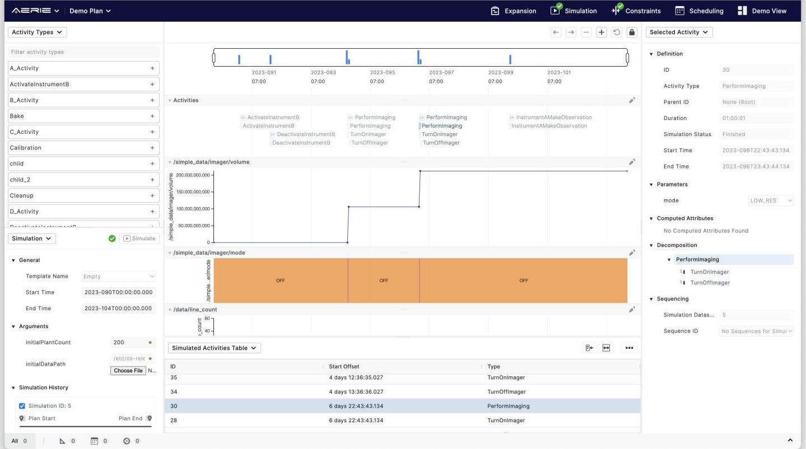
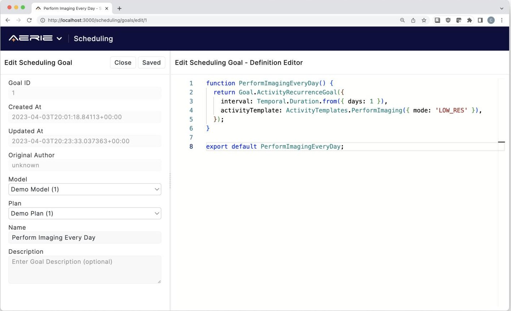

<!-- PDF_PAGE: 1 -->

<div align="center">

# Aerie: A Modern Multi-Mission Planning, Scheduling, and Sequencing System

</div>

Matthew Dailis, Eric Ferguson, Chris Camargo, Adrien Maillard

Jet Propulsion Laboratory, California Institute of Technology 4800 Oak Grove Dr., Pasadena CA 91109 matthew.l.dailis,eric.w.ferguson,christopher.a.camargo,adrien.maillard @ jpl.nasa.gov

## Abstract

Aerie is a new open source multi-mission planning, scheduling, and sequencing system for space applications. We briefly describe the impetus behind the creation of Aerie, comment on its position within the landscape of other planning systems, and highlight some key capabilities that make it well suited for distributed, cross-team collaboration. We also a present a short case study describing the use of Aerie in the uplink planning process for Europa Clipper and illustrate some of the benefits of making Aerie an open source project.

## Introduction

Aerie is a new open source multi-mission planning and scheduling software funded by the Advanced Multi-Mission Operations System (AMMOS) program managed out of NASA's Jet Propulsion Laboratory (JPL). It builds upon its predecessor, APGen (Maldague et al. 2014), adding enhanced capabilities for collaboration, and lowering the barrier to entry for users and developers alike.

There are two primary user types that Aerie targets. Users of the first type, called "mission modelers", are responsible for describing the activities and resources that are relevant to their mission. Once they produce the mission model, they can upload it to Aerie, where users of the second user type called "planners", can create plans using the activities described in the mission model.

Aerie was developed with the following goals in mind:

- Simplify the mission modeling experience by adopting a common programming language instead of a domain specific language (DSL)

- Allow missions to make use of existing libraries for modeling, and write custom code in their mission model as they see fit

- Allow missions to provide a web deployment of a planning tool such that operators with limited programming skills can create valid activity plans and run simulations

- Support real time collaboration and parallel hypothesis testing such that many more iterations of an activity plan can be tested within the same time frame.

Copyright 2023 California Institute of Technology. Government sponsorship acknowledged.

- Allow automation and manual modifications to coexist throughout the planning process

- Provide a low code constraint checking mechanism to validate simulation outputs which can be automated largely

- Provide a low code scheduling mechanism that can scaffold parts of or generate complete activity plans according to goal snippets

- Support an easy to use and verified translation from activities to flight system recognized sequences of commands

In this paper, we will discuss the origins of Aerie (Aerie Heritage and Influence) and compare and contrast it with some existing tools (Aerie Within the Planning and Scheduling Landscape). Next, we will highlight some key capabilities that make Aerie unique (Capability Highlights). We will describe a case study of Aerie's use on the Europa Clipper mission (Case Study: Aerie on Europa Clipper), and finally we discuss the reasoning behind and consequences of making Aerie open source (Aerie as an Open Source Project).

## Aerie Heritage and Influence

Aerie was conceived in an effort to modernize the planning and sequencing products offered by the Mission Planning, Sequencing, and Analysis (MPSA) element of the Advanced Multi-Mission Operations System (AMMOS) program, which is chartered to provide mission operations ground software to the greater NASA community in order to increase operations efficiency and reduce operations cost and risk. While many of MPSA's product offerings, including APGen, had been deployed successfully on a number of missions (Maldague et al. 2014), they were becoming more difficult and expensive to maintain and were lagging behind current software state-of-the-art. In 2018, MPSA began work on Aerie in an effort to build a modular, web-based system that would be easier for customers to use and easier to sustain and grow upon in the future.

The Aerie requirements and architecture were highly influenced by a number of other planning systems. Given APGen's success, the Aerie team wanted to ensure that they had near capability parity with APGen (e.g. discrete event simulation, general modeling framework, automated scheduling, constraint checking) and incorporated lessons learned based

<!-- PDF_PAGE: 2 -->

on feedback from APGen modelers and users. For example, APGen did not expose the ability to automate activity plan generation beyond its modeling framework, and thus required modelers to have to translate scheduling goals defined by the mission operations team into imperative code within the modeling framework. The Blackbird planning system (Lawler et al. 2020) also had a strong influence on Aerie, especially in the decision to implement a mission model framework in an embedded Domain Specific Language (eDSL) within the Java programming language.

Aerie's web-based design, plan collaboration capabilities, and robust API took significant inspiration from COCPIT, which was developed for Mars 2020 surface operations (Deliz et al. 2022). COCPIT was built on top of another planning system developed out of Ames research center called Playbook, which has been used for a variety of applications including planning astronaut schedules on the international space station (Marquez et al. 2019). In addition, the declarative scheduling DSL developed for Aerie was informed by similar scheduling goals that had appeared in ASPEN (Fukunaga et al. 1997) system deployments over the years, particularly for science campaign planning on missions like Rosetta (Chien et al. 2015).

## Aerie Within the Mission Planning and Scheduling Landscape

The use of planning and scheduling systems appear throughout the design and operation of most, if not all, space missions. Given the number of missions and the diversity of their applications, we similarly see a diverse set of planning systems, each of which is specially targeted for specific uses (Chien et al. 2012). Most planning systems are used to perform one of the following functions on a space mission:

1. Mission planning and analysis, which takes place throughout a mission's life cycle to put together a viable mission plan that meets mission objectives while adhering to project and spacecraft constraints

2. Operations planning, which often involves the integration of numerous disparate inputs from payload, spacecraft, and ground system engineers to build an integrated plan that meets plan goals and constraints

3. Real-time operations, where the primary objective is to monitor the execution of the plan as it is carried out and potentially modify the upcoming plan on very short timescales

Aerie was designed with the first two use cases in mind although it could probably support real-time operations with some small modifications similar to what was done with the predecessor of Playbook, SPIFe (Marquez et al. 2010).

Aerie is best classified as a generalized mixed-initiative planning system. The design was intended to support iterative interactions between human planners, a goal-based, priority driven scheduler, and external applications. This design contrasts with other scheduling systems that are tailored to optimize a schedule for a specific application such as surface coverage for pushbroom (Maillard, Chien, and Wells 2021) or steerable framing instruments (Shao et al. 2018) although

such systems can be integrated into Aerie as external applications. The Aerie provided scheduler solves individual scheduling goals in a priority order defined by planners as opposed to performing multi-objective optimization where goals would be solved simultaneously. Many space-based observatories such as Hubble and the James Webb Space Telescope have used systems that leverage such optimization techniques to minimize wasted time and propellant usage to extend mission lifetime (Johnston and Giuliano 2009).

There are a number of similar planning systems to Aerie intended for multi-mission use beyond those that had a direct influence on its development. For example, the "Activity Planner" tool developed out of the Applied Physics Laboratory (APL) was developed as part of their own Mission Independent Ground Software (MIGS) effort (Ruffolo, McCauley, and Berman 2017). Like Aerie, this system is database driven in that it can centralize and view plan data from a variety of external sources. While Activity Planner chose to provide native import/export of domain specific file formats, Aerie has intentionally kept domain-specific constructs out of its core so it can easily be adapted for other applications (conversion to/from file formats exist as utilities written against the API). Furthermore, Activity Planner provides a limited, but easy to use scheduling and constraint checking capability while Aerie provides more expressiveness at the potential expense of simplicity.

The PINTA/PLATO tool suite along with their web-based timeline client TimOnWeb developed at the German Space Operation Center (GSOC) also has comparable features to Aerie and is intended to run as a semi-automated mission planning system (Nibler et al. 2017). This system operates using a modeling language known as the "Planning Model" as opposed to Aerie's approach of using an eDSL within Java for modeling. PINTA/PLATO have significant heritage including use on the GRACE-FO and TerraSAR-X/TanDEM-X missions.

Aerie's definition of resource profiles is similar to the definition of timelines in the APSI software platform, and the Timeline Representation Framework (Fratini and Cesta 2012), but Aerie's timelines are fully grounded in time, while APSI can preserve more temporal flexibility and makes more relationships explicit.

## Capability Highlights

In this section we will highlight particular capabilities of Aerie. We will start by describing what we mean by "mission model", and how a mission can define the details of their own model (Mission Model Framework). We then identify the key features that enable productive collaboration between individuals and teams using Aerie (Collaborative Planning). Next, we will unpack Aerie's approach to automated scheduling (Scheduling) and validating constraints of interest (Constraint Checking). We will also describe Aerie's ability to be deployed in the cloud, or on premises (ServiceBased architecture), and describe the rich integrations made possible by Aerie's API (GraphQL API).

<!-- PDF_PAGE: 3 -->

## Mission Model Framework

Aerie provides a framework for modeling activities and resources in an embedded DSL (eDSL) within Java. The choice to use Java, as opposed to a custom DSL, was motivated by the desire to lower the learning curve required for a mission modeler, as well as enable the use of the Java ecosystem of editors, libraries, and tools in mission model development. Java was previously used for this purpose by Blackbird (Lawler et al. 2020).

The provided framework helps the mission modeler produce a JAR file that adheres to Aerie's interface. If a mission should want to use a different framework, they can do that as long as they can generate a JAR that adheres to Aerie's interface.

Mission models are composed of two primary components: Resources, and Activity Types. Resources describe time-varying quantities of interest, while Activity Types describe the vocabulary of directives that a planner can use in a plan. The term "simulation" in Aerie refers to the process of evaluating the effect models of all activities in a plan for the purpose of producing resource profiles and observing activity decomposition.

Resources In Aerie a resource is any measurable quantity whose behavior is to be tracked over the course of a simulation. Resources are general-purpose, and can model quantities such as finite resources, geometric attributes, ground and flight events, and more. Aerie provides some common models out of the box, including a discrete quantity that can be set (Register), a continuous quantity that can be added to (Counter), and a continuous quantity that grows over time (Accumulator). A mission model can define custom resource models by either combining the provided models, or defining new models that define how the resource can be computed from a stream of events.

Resource profiles in Aerie are defined as a series of discrete temporal segments that completely cover the horizon yet do not overlap just as in (Knight, Rabideau, and Chien 2001). Each segment is associated with a json-like value that conforms in shape to a schema defined for that resource. Unlike (Knight, Rabideau, and Chien 2001), there are no semantic constraints associated with a profile; those are defined separately (see Constraint Checking). No distinction between depletable, non-depletable, or renewable resources is made by Aerie, similarly to Pinta/Plato (Chien et al. 2012).

Resources for a given mission are encoded in a "mission" object that is provided to all activities. Activities use this object to affect resources. This object can also be parameterized - these parameters form the "simulation configuration", and can be used to provide initial conditions to the simulation.

Activity Types A mission modeler defines Activity Types as Java records, as in Listing 1. Parameters to the activity are encoded as fields on the record. The @EffectModel annotation marks a method that is to be called during simulation when the activity begins. In this method, the mission modeler can describe the behavior of the activity by calling methods on the model, or by calling built-in utilities such as

Listing 1: Sample Activity Definition

```cpp

record PerformImaging(

    ImagerMode imagerMode,

    int numImages

) {

    @EffectModel

    void run(Mission mission) {

        mission.imager.beginWarmup();

        waitUntil(mission.imager.ready());

        for (int i = 0; i < numImages; i++) {

            mission.imager.beginImaging();

            if (imagerMode == HIGH_RES) {

                delay(30, SECONDS);

            } else {

                delay(10, SECONDS);

            }

            mission.imager.endImaging();

        }

        mission.imager.powerOff();

    }

}

```

delay, or waitUntil, which pause the method until the given time has elapsed, or until the given condition is true.

A mission modeler can also define validations, which can check that the values provided for the activity's parameters are within bounds, or in any other way consistent with the activity modeler's intent.

Events Aerie's discrete event simulation uses a notion of integer time - starting from zero at the beginning of the simulation, and counting up in microseconds. It also provides a notion of dense time - when an activity performs multiple actions in the same time step, those actions are ordered with respect to each other. When multiple activities perform actions concurrently, Aerie does not arbitrarily pick an ordering, but rather surfaces the situation to the mission model. The mission modeler can define how a custom resource model handles concurrent effects. Aerie's concurrency semantics are transactional - meaning the two concurrently executing activities do not observe each others' effects until the end of the current "tick" of the simulation.

## Collaborative Planning

Aerie is designed to enable collaboration between multiple teams on a mission, as well as between individuals on those teams. It does that by providing two mechanisms for collaboration - multi-tenancy and branching.

Aerie enables synchronous collaboration by allowing multiple users to access the same plan at the same time via their browser. Changes are pushed to all users' browsers over web sockets, so that everyone can always see the most up to date version of the plan.

Aerie also enables asynchronous collaboration in the form of branching. A user can create a copy of a plan, called a "branch", and freely make edits to it. These changes do not affect the original plan in any way, which allows the user to experiment without fear. When that user is satisfied with the changes they have made, they can issue a "merge request"

<!-- PDF_PAGE: 4 -->

to the original plan, where the changes can be reviewed and incorporated into the plan. If two changes were made to the same activity, Aerie will surface this situation to the reviewer as a "conflict", and ask the reviewer to choose one of these two versions to keep.

## Scheduler

Aerie features an automated scheduling system based on a prototype described in (Maillard, Jorritsma, and Schaffer 2021). As other components of Aerie, it designed to be as independent as possible from other modules. It runs its own database and provides a distinct GraphQL API that can be queried by other modules.

The user specifies inputs to the scheduler by writing scheduling goals in a Typescript-embedded domain specific language. Goals are expressions focusing on scheduling a particular consistent set of activity instances. There are several types of goals defined in the scheduling language, each providing a different high-level satisfaction criteria:

1. A coexistence goal is a type of goal in which activity instances are scheduled with respect to an existing set of time periods, be those instances of another activity type or a conjunction of state values. This goal translates the intent expression "schedule activity A for each activity B present in the plan, 5 minutes after its end" or "schedule activity A for each period during which resource R is above X".

2. A recurrence goal expresses the need to schedule activities at a regular cadence, i.e. a set of activities separated by a specific range of durations.

3. A cardinality goal expresses the need to schedule a number of activities whose total duration lies in a range of durations.

4. A composite goal is a conjunction or disjunction of other goals. The conjunctive composite requires satisfaction of all subgoals while the disjunctive only requires one of its subgoals be satisfied. While the composite goal has its own priority to order it within the wider scheduling process, the subgoals are ordered according to their relative priority within the composite.

Each goal is associated with

- a scheduling priority which reflects its scheduling order relative to other goals,

- a temporal scope during which the goal is applicable, which may be different from the overall scheduling horizon

- an activity expression, describing the type of activity whose instances may satisfy the goal, along with any specific parameter values for these instances

Our approach with authoring goals is more declarative than imperative. The language allows planners to express high-level requirements about activity insertions, but it does not express precisely how to insert activities such as in (Maldague et al. 2014) which provide an imperative language to the user, resulting in goals being a collections of algorithms. Even if a purely declarative scheduling language is not possible in our setting for operational aspects,

we try to tend in this direction to increase modularity and readability of goals. Note that it is still possible for a user to build their own procedural scheduler and communicate with the simulation, scheduling, and UI components via the GraphQL API.

The scheduling algorithm is a constructive algorithm in which goals are scheduled in priority-first order. To schedule a given goal, valid constraint intervals are computed and the current schedule is examined to look for activities already present and satisfying the goal. If any activities are lacking, the goal will generate conflicts. Conflicts can be resolved with different possible resolutions, based on heuristically chosen start times for activities when several are available. As their names suggest, goals can be left unsatisfied at the end of a scheduling run. The scheduler will backtrack whenever it turns out, after simulating an activity, that scheduling that activity at a particular time is impossible. The scheduler will also backtrack if a goal has been only partially satisfied while the user has specified that this goal has to be totally satisfied or left unsatisfied.

The allocation of responsibilities between the scheduler and the goal allows for more flexibility in terms of scheduling algorithms. Such a simple approach has its drawbacks in terms of resulting schedule quality but it has advantages in our setting. Priorities are an easy way to express preferences but in practice, it is usually difficult to discriminate between scientific activities. Scheduling priorities are rather an easily understandable handle for tweaking the results when mission/science planners are not satisfied with the resulting schedule. Also, the context-dependent, non-inversible nature of activity behaviors (e.g. attitude planning), and the large size of problem instances, makes us lean towards scheduling approaches that favor early instantiation/grounding and fast computation via greedy approaches rather than least commitment approaches.

As seen in a previous section, the user has great expressive power to build the behaviors in the mission model. As an independent component, the scheduler has only very limited access to the mission model and thus cannot infer much about preconditions, effects or durations of tasks. This presents an interesting challenge for the scheduling engine. Most existing scheduling software relies on extended domain knowledge to place activities. In our case, the only way to ensure that an activity can be inserted in a plan is to insert it and simulate it.

The scheduling algorithm is not performing optimizations. For example, it does not try to increase satisfaction by processing several goals at a time and make sure to pick opportunities based on maximum global satisfaction. Nevertheless, the scheduler ensures that activities inserted in the plan never put the plan in a forbidden state. For that, it simulates every activity before inserting in the plan (unless otherwise explicitly indicated by the user). It also reduces the windows of opportunities for placing activities by checking global scheduling conditions. Such a condition is said to be global when it is not attached to a specific goal or its activity instances, but rather to the whole scheduling problem, meaning it must be enforced every time a change is made to the schedule in service of any goal. A global constraint may

<!-- PDF_PAGE: 5 -->

be set on resources to prevent oversubscription (e.g. energy or memory) or on activity types such as to prevent parallel execution of certain activity types (a mutual exclusion constraint). We now outline three directions for developing the scheduler.

More expressive power Practical instances of scheduling goals, for the Europa Clipper mission for example, sometimes exceed the expressive power of the scheduling eDSL. For instance, goals involving nested behaviors are not currently possible to express: combining a cardinality goal and a coexistence goal to schedule a given number of activities for each occurrence of an event. That is why the current set of scheduling constructs is still in development.

Domain control knowledge and performance As we have seen, the scheduler has limited access to the mission model and constantly needs to simulate activities, which is costly computationally. Expanding the domain knowledge available to the scheduler would be valuable. Currently, the duration of an activity is either unknown or externally controllable via a parameter. But in practice, some activities may have a constant duration or a duration that is only a function of its parameters. The scheduler can use this kind of information to avoid simulating activities which may bring a significant performance boost. Ultimately, providing behavioral helpers (i.e. declaring what kind of effect a task has on a resource) could enable planning capabilities instead of just scheduling. A user could simply specify what state is desired and the engine could schedule activities to achieve this state.

Where are my activities? Explainability of sequential decision-making In the space domain, decision-making needs to be traced which makes any black-box solvers unsuited for use. Interpreting the results of a scheduler processing hundreds of states on long scheduling horizons is a challenge for mission planners. Our goal is to provide explainability features to mission planners and operators. One good recent example is in the context of task scheduling for Perseverance, the Mars 2020 rover. Crosscheck (Agrawal, Yelamanchili, and Chien 2020) has been developed to provide explanations as to why some activities failed to be scheduled by analyzing constraint intervals and resource consumption. We expect that this development will be user-focused, as to provide explanations to most frequently asked questions about the produced schedules. For example, these will include explanations about why a goal has failed to be satisfied but also about the choices leading to the current start time of scheduled activities or the usage history of a resource. In the context of activity scheduling for the Rosetta orbiter (Chien et al. 2021), the scheduler user interface shows the opportunity windows corresponding to each of the constraints linked to the failed satisfaction of science campaigns, allowing the user to gain an understanding as to why the campaign failed to be scheduled.

## Constraint Checking

Aerie provides a mechanism for checking that certain properties hold true. For example, let's suppose that a mission model has two instruments, denoted A and B, that produce

<div align="center">

Listing 2: Combined data rate constraint

</div>

<table border="1"><tr><td>1</td><td>Real.Resource('/rate/a')</td></tr><tr><td>2</td><td>.plus(Real.Resource('/rate/b'))</td></tr><tr><td>3</td><td>.lessThan(10)</td></tr></table>

data. Due to limited bandwidth, the planner may want to limit the combined data rate of these two instruments. Let's say that the two data rates are defined as resources in the mission model: "/rate/a" and "/rate/b" respectively (resources in Aerie are often named with filepath-like prefixes, to allow easy grouping of related resources).

Once a planner has set up their plan, they can run a simulation to observe the effects of the activities in their plan on resources. They can visually inspect the resources in the Aerie UI, export them via the GraphQL API to analyze them elsewhere, or define constraints using Aerie's constraint checking mechanism, and use Aerie to check for violations of those constraints.

Constraints in Aerie are described using an expression language embedded in Typescript. In Listing 2, you can see the definition of a constraint that requires that the sum of resource '/rate/a' and '/rate/b' be less than 10. After simulating, the planner can request a constraints check, which will cause any temporal regions of the plan that do not satisfy this condition to be highlighted in red on the visualized timeline.

Aerie's constraints expression language allows manipulating profiles as values, making it possible to express complex relationships between resources. A user would start with a resource profile (e.g. Real.Resource('/rate/a')) and then manipulate it using the provided operations for adding and multiplying profiles with each other, or with scalars. A scalar is interpreted to be a constant profile spanning the planning horizon. Comparison operators, such as lessThan, produce boolean-valued profiles, known as "Windows", which can be combined with other Windows using boolean operators such as And and Or.

In order to write constraints that refer to activities in the plan, Aerie provides a ForEach construct in the constraint language. ForEach allows the user to specify an activity type, and an associated constraint. This constraint will be checked separately for each activity of that type in the plan, and the violations will be accumulated. ForEach constraints can be nested inside each other, so it is possible to write a constraint that examines every pair of activities in the plan, and evaluate whether their timing is acceptable. Inside of a ForEach constraint, activity parameters are treated as profiles and can participate in operations with resources and scalars alike.

Aerie allows users to upload datasets produced externally to Aerie, and check constraints against those datasets and simulation results together in the same constraint.

Since it's possible for the temporal bounds of externally produced datasets to not perfectly match the bounds of simulation results, Aerie constraints can handle "unknown" values. This can be useful for checking constraints such as "At least one of these two instruments must be in DISABLED

<!-- PDF_PAGE: 6 -->

mode at this time". If the value for one resource is DISABLED, and the other is "unknown", the constraint checker will still confidently report that the rule is satisfied.

## Service-Based Architecture

Aerie is designed to be deployable on a user's own computer, on a server on premises, and in a cloud environment. Its components are deployed as services that communicate with each other over the same GraphQL API that is exposed to users (more on that in the next section). Services consist of one or more containers (in a standard OCI format), and a logically isolated database (a typical deployment will put all service databases in the same PostgreSQL database cluster). This makes Aerie easily deployable in a cloud environment. Some Aerie containers, such as the simulation or scheduler workers, are designed to be horizontally scalable. For example, a mission expecting to have many users running simulations concurrently can deploy multiple copies of the simulation worker container. Simulation requests will be claimed by the first available worker. If a mission needs to run more memory-intensive simulations, or store more data, the simulation workers and database will need to be scaled vertically by provisioning more memory or disk space.

## GraphQL API

Aerie leverages a third-party tool called Hasura (Hasura Inc 2023) to provide an extensive GraphQL API to enable the integration of Aerie into a mission's ground data system. The primary advantage of GraphQL is that it allows the client to specify exactly what data it needs, which allows more useful data to be fetched with fewer requests, and less network bandwidth than with other solutions. Hasura is able to inspect Aerie's databases, and generate an API based on select tables or functions. Hasura can also be configured to route specific queries to designated Aerie services via http for operations that require more business logic. Hasura also provides the ability to filter and sort any query, enabling a rich client experience, without adding much complexity or maintenance burden to the Aerie system. Listing 3 provides an example of a query that uses a Hasura filter to find all PerformImaging activities whose imagerMode is HIGH_RES. All Aerie components communicate with each other using this same API, so external tools can integrate with Aerie just as directly as its own components do.

## User Interface

The user interface for Aerie is designed to support the needs of any mission planning team. It provides a user-friendly web-based interface for creating and modifying mission plans, as well as a means for sharing these plans with other team members. The interface is flexible and adaptable to different mission scenarios, allowing for the creation of highly customized views that meet the specific needs of each mission. For example, one can configure the mission planning view to visualize activities and resources only applicable to subsystems of interest (e.g. power, thermal, GNC, etc.).

The UI uses the Aerie GraphQL API to operate on Aerie data just like any other third-party client, and is not

Listing 3: GraphQL query for high res imaging activities

```json

simulated_activity(

where: {

activity_type_name: {

  _eq: "PerformImaging"

},

attributes: {

  _contains: {

    arguments: {

      imagerMode: "HIGH_RES"

    }

  }

}

}

}

)

{

start_time,

end_time,

attributes

}

```

privileged in any way. It takes advantage of modern web technologies like Svelte for high-performance, lightweight browser rendering, and web sockets so user interactions are synchronized. For example changing the start time of an activity in a plan on one browser automatically updates the start time in another browser without needing to refresh the page. This makes real-time planning in the UI fast and convenient.

Additionally, the Aerie UI includes powerful tools for automatically scheduling and sequencing mission activities. It provides scheduling capabilities and allow for creating and editing scheduling goals, as well as running scheduling goals in the context of a mission plan.

## Case Study: Aerie on Europa Clipper

The Europa Clipper mission will be one of the first missions to use Aerie for planning and sequencing in operations and is actively using Aerie today to conduct verification and validation (V&V) activities. Slated to launch in October 2024, Clipper is a flagship-class mission whose primary objective is to globally characterize Jupiter's icy moon Europa at a regional scale to assess its habitability. The Clipper spacecraft hosts a suite of ten instruments including a two-channel ice penetrating radar, spectrometers, cameras, and in-situ fields and particles instruments plus a radiation monitoring system and the ability to conduct gravity measurements using its telecommunications subsystem. The sheer number of instruments whose observations must be planned, the numerous constraints imposed on planning due to limited spacecraft resources (energy, data storage, etc.) and Jupiter's harsh radiation environment, and the lengthy light time delay between Earth and Jupiter make operations planning complex and challenging.

Fortunately, Clipper has been leveraging modeling and simulation via Aerie's predecessor, APGen, throughout the project life-cycle to inform the development of the mission plan, and in some cases, even the spacecraft design (Ferguson et al. 2019). As Clipper moves into operations, they will continue to use modeling and simulation as a central compo-

<!-- PDF_PAGE: 7 -->





<div align="center">

Figure 1: Aerie UI Mission Plan

</div>

nent in their uplink planning architecture, but have chosen to use Aerie in lieu of APGen for a variety of reasons including:

- Aerie has improved support for collaborative and distributed planning, which is critically important due to the number of instrument and subsystem teams that must coordinate activities

- Aerie's UI and eDSLs allow planners with minimal programming experience or full knowledge of the integrated set of planning constraints to get involved in planning. Essentially, Aerie moves the authoring of plan constraints closer to the domain experts.

- Aerie supports easier deployment and integration into the Clipper ground system, which includes many project-specific applications

- APGen will no longer be maintained as part of AMMOS and therefore the project would have to incur that cost.

One of the key concepts behind Clipper's uplink planning process is the Reference Activity Plan (RAP) (Pinover et al. 2020). The RAP is the authoritative source of activity plans for the entire mission. An initial version of the RAP will be generated months prior to entering each mission phase using software-assisted scheduling, most of which will be provided by Aerie. Some scheduling particularly focused on surface coverage optimization will be conducted by a separate planning system and then imported into Aerie via the API for viewing alongside the rest of the plan. Ideally, the resultant schedule will be fairly complete such that only minor refinements are necessary later in the uplink planning process.

As each segment of the RAP steps closer to execution, planners will have the opportunity to refine the RAP using their choice of software-assisted scheduling or manual editing (many of the instrument teams expressed a strong desire to fine tune their activity parameters based on the latest available data from the spacecraft). Individual instrument and subsystem teams will have the opportunity to branch off the "master" RAP into a "sandbox" environment where they can make local changes. Teams will then request for their changes to be integrated into the "master" RAP. Finally, an integration team will evaluate the feasibility of the collective set of change requests and negotiate with teams as needed to ensure a valid plan. The branching and merging capability within Aerie is a key enabler for the successful custodianship of Clipper's RAP.

Clipper has developed models both within and external to Aerie's mission model framework. For example, Clipper's geometry model, which computes geometric quantities like spacecraft distance, range, eclipses, etc., is written directly in Java while its telecom model to determine downlink bit rates is computed via a completely separate tool. Data from external models is pushed into the Aerie system via the API giving planners a unified view of plan data. Planners also have the ability to check constraints against a combination of internally and externally computed data.

One of the primary challenges Clipper has experienced using Aerie is that the expressiveness of the constraint and

<!-- PDF_PAGE: 8 -->





<div align="center">

Figure 2: Aerie UI Scheduling Goal Editor

</div>

scheduling eDSLs have not always been sufficient to describe the very complicated rules that govern how Clipper must operate. While the available expressions in each language continue to grow, it has become apparent that an interface to describe custom scheduling logic and constraint evaluation are necessary. The Aerie team is exploring ways to add these capabilities in the future.

## Aerie as an Open Source Project

In an effort to encourage transparency of implementation and cross-organizational collaboration, Aerie chose to become an open source project. All of Aerie's source code and documentation are freely and publicly available on GitHub.com under a number of repositories within the NASA-AMMOS organization. Since Aerie's code base is public, it can be critiqued by other experts in the community, which motivates core developers to write better code and maintain high quality standards. Given users have instant access to the latest releases and deployments, there is extra incentive for the project to write clear and complete documentation so those users can get up and running with minimal support (and ultimately at a lower cost).

Similarly, because anyone can contribute to Aerie, the project must clearly define contribution guidelines and instructions for new developers to get on-boarded smoothly. Therefore, Aerie has developed a governance model for promoting, guiding, reviewing and accepting contributions from the community. The project follows a fairly liberal contribution model where people and/or organizations who do the most work will have the most influence on project direction. Technical decision making is primarily conducted through a "consensus-seeking" approach. In the rare cases where consensus cannot be reached, decision making authority is delegated to a Technical Steering Committee (TSC) composed of prominent developers. A Project Management Committee (PMC) made up of sponsor organization representatives (i.e. those providing funding to the project) and key stakeholders who are or will rely on Aerie to meet a critical need is responsible for maintaining the overall project road map and determining project requirements. As the Aerie community grows and the project evolves, the governance model will undoubtedly evolve along with it.

In addition to developing and maintaining Aerie's core repositories, the project plans to promote a "marketplace" of extensions, known as the "Aerie Extended Universe", that missions can browse and then select extensions to use for their system. These extensions would primarily be targeted at the Aerie API or the mission model. For example, an Aerie command line interface (CLI) utility written in Python and originally developed by Europa Clipper is available for the whole community to use to issue standard queries against the Aerie API. The Aerie project also envisions a set of configurable multi-mission models that users can use to seed their mission model development. While some extensions would be maintained and certified by the Aerie core team, others may be maintained by other community members, and thus the Aerie team could not guarantee their condi-

<!-- PDF_PAGE: 9 -->

tion. Nonetheless, such models and utilities have the ability to significantly reduce mission ground system development and operation costs.

## Conclusion

We have presented Aerie, our new mission planning, scheduling, and sequencing software. Aerie's key contributions are its web-based, collaborative planning environment, its declarative, goal-based scheduling language, its constraint checking mechanisms, and its facilities for mission modeling in Java. We discussed the applications of Aerie on the Clipper mission, and some of the challenges being faced there. Lastly, we described the considerations that went into becoming an open source project.

The research was carried out at the Jet Propulsion Laboratory, California Institute of Technology, under a contract with the National Aeronautics and Space Administration (80NM0018D0004). The authors would like to thank Patrick Kenneally, Jonathan Castello, Basak Ramaswamy, and the Aerie Team past and present.

## Acknowledgments

## References

Agrawal, J.; Yelamanchili, A.; and Chien, S. 2020. Using Explainable Scheduling for the Mars 2020 Rover Mission. In ICAPS 2020 Workshop of Explainable AI Planning (XAIP).

Chien, S.; Johnston, M.; Policella, N.; Frank, J.; Lenzen, C.; Giuliano, M.; and Kavelaars, A. 2012. A generalized timeline representation, services, and interface for automating space mission operations. In International Conference On Space Operations (SpaceOps 2012). Stockholm, Sweden.

Chien, S.; Rabideau, G.; Tran, D.; Troesch, M.; Doubleday, J.; Nespoli, F.; Ayucar, M. P.; Sitja, M. C.; Vallat, C.; Geiger, B.; Altobelli, N.; Fernandez, M.; Vallejo, F.; Andres, R.; and Kueppers, M. 2015. In 24th International Joint Conference on Artificial Intelligence. Buenos Aires, Argentina.

Chien, S. A.; Rabideau, G.; Tran, D. Q.; Troesch, M.; Nespoli, F.; Ayucar, M. P.; Sitja, M. C.; Vallat, C.; Geiger, B.; Vallejo, F.; Andres, R.; Altobelli, N.; and Kueppers, M. 2021. Activity-Based Scheduling of Science Campaigns for the Rosetta Orbiter. Journal of Aerospace Information Systems, 18(10): 711-727.

Deliz, I.; Connell, A.; Joswig, C.; Kanefsky, B.; and Marquez, J. 2022. COCPIT: Collaborative Activity Planning Software for Mars Perseverance Rover. In 2022 IEEE Aerospace Conference. Big Sky, MT.

Ferguson, E.; Wissler, S.; Bradley, B.; Maldague, P.; Ludwinski, J.; and Lawler, C. 2019. The Power of High-Fidelity Mission-Level Modeling and Simulation to Influence Spacecraft Design and Operability for Europa Clipper, 195-231. Springer Nature.

Fratini, S.; and Cesta, A. 2012. The APSI Framework: A Platform for Timeline Synthesis.

Fukunaga, A.; Rabideau, G.; Chien, S.; and Yan, D. 1997. Towards an Application Framework for Automated Planning and Scheduling. In International Symposium on Artificial Intelligence, Robotics and Automation for Space (ISAIRAS 1997). Tokyo, Japan.

Hasura Inc. 2023. Instant GraphQL on all your data. https://hasura.io/. Accessed: 2023-03-28.

Johnston, J.; and Giuliano, M. 2009. MUSE: The Multi-User Scheduling Environment for Multi-Objective Scheduling of Space Science Missions. In IJCAI Workshop on Space Applications of AI. Pasadena, CA.

Knight, R.; Rabideau, G.; and Chien, S. 2001. Extending the representational power of model-based systems using generalized timelines". In Proc 6th International Symposium on Artificial Intelligence, Robotics and Automation in Space (iSAIRAS). Montreal, Canada.

Lawler, C. R.; Ridenhour, F. L.; Khan, S. A.; Rossomando, N. M.; and Rothstein-Dowden, A. 2020. Blackbird: ObjectOriented Planning, Simulation, and Sequencing Framework Used by Multiple Missions. In 2020 IEEE Aerospace Conference, 1-20.

Maillard, A.; Chien, S. A.; and Wells, C. 2021. Planning the Coverage of Planets under Geometrical Constraints. Journal of Aerospace Information Systems, 18:5:289-306.

Maillard, A.; Jorritsma, M.; and Schaffer, S. 2021. Sailing Towards an Expressive Scheduling Language for Europa Clipper. In Knowledge Engineering for Planning and Scheduling (KEPS), International Conference on Automated Planning and Scheduling (ICAPS KEPS).

Maldague, P.; Wissler, S. S.; Lenda, M.; and Finnerty, D. 2014. APGEN Scheduling: 15 Years of Experience in Planning Automation. In Proc SpaceOps 2014.

Marquez, J.; Hillenius, S.; Healy, M.; and Silva-Martinez, J. 2019. Lessons Learned from International Space Station Crew Autonomous Scheduling Test. In 11th International Workshop on Planning and Scheduling for Space (IWPSS). Berkeley, CA.

Marquez, J.; Ludowise, M.; McCurdy, M.; and Li, J. 2010. Evolving from Planning and Scheduling to Real-Time Operations Support: Design Challenges. In 40th International Conference on Environmental Systems. Barcelona, Spain.

Nibler, R.; Mrowka, F.; Wörle, M. T.; Hartung, J.; and Lenzen, C. 2017. PINTA and TimOnWeb - (more than) generic user interfaces for various planning problems. In 10th International Workshop on Planning and Scheduling for Space (IWPSS). Pittsburgh, PA.

Pinover, K.; Ferguson, E.; Bindschadler, D.; and Schimmels, K. 2020. The Reference Activity Plan: Collaborative, Agile Planning for NASA's Europa Clipper Mission. In 2020 IEEE Aerospace Conference. Big Sky, MT.

Ruffolo, M.; McCauley, P.; and Berman, A. 2017. Activity Planner: Mission Independent Planning Software. In 10th International Workshop on Planning and Scheduling for Space (IWPSS). Pittsburgh, PA.

Shao, E.; Byon, A.; Davies, C.; Davis, E.; Knight, R.; Lewellen, G.; Trowbridge, M.; and Chien, S. 2018. Area

<!-- PDF_PAGE: 10 -->

Coverage Planning with 3-axis Steerable, 2D Framing Sensors. In Scheduling and Planning Applications Workshop International Conference on Automated Planning and Scheduling (ICAPS SPARK 2018). Delft, Netherlands.