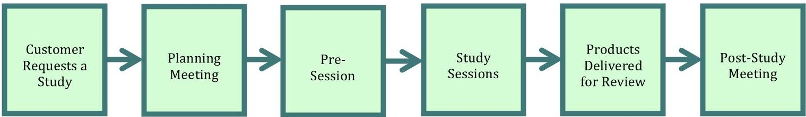
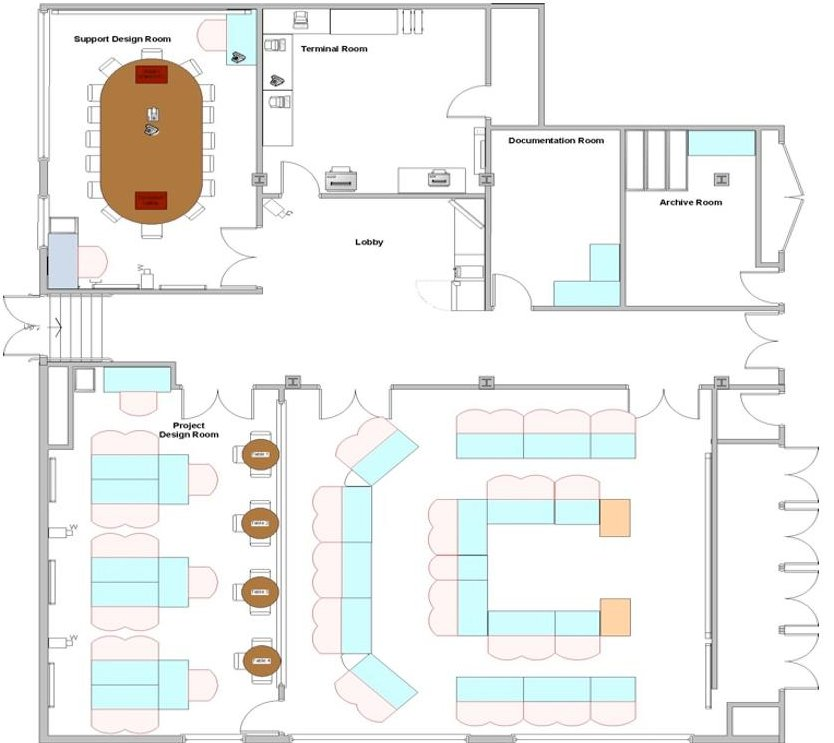
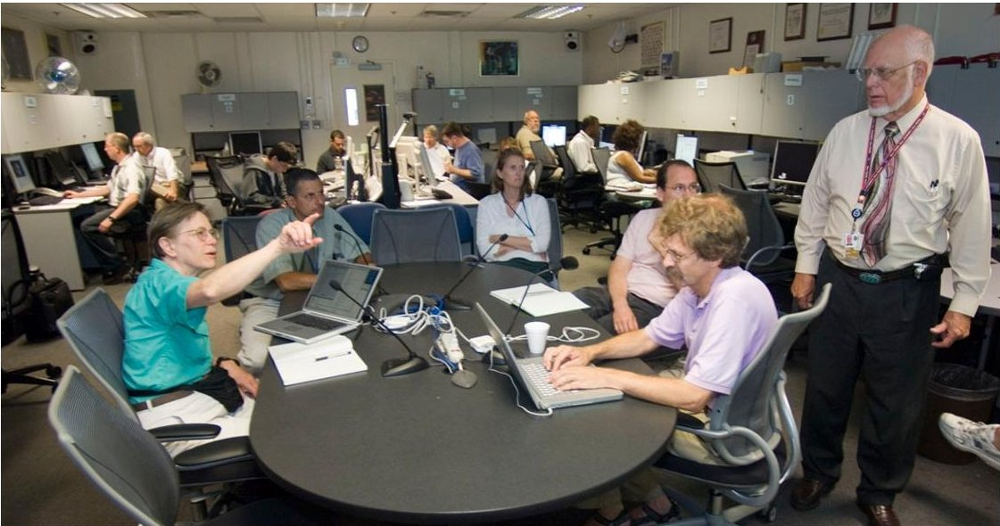
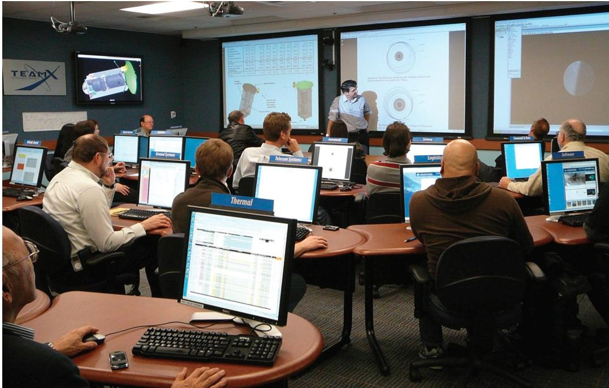
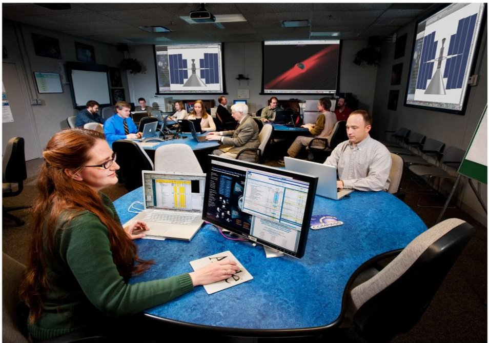

<!-- PDF_PAGE: 1 -->

# Aerospace Concurrent Engineering Design Teams: Current State, Next Steps and a Vision for the Future

Jairus Hihn Jet Propulsion Laboratory/California Institute of Technology Debarati Chattopadhyay Jet Propulsion Laboratory/California Institute of Technology

Gabriel Karpati NASA Goddard Space Flight Center

Melissa McGuire NASA Glenn Research Center

Chester Borden Jet Propulsion Laboratory/California Institute of Technology

John Panek NASA Goddard Space Flight Center

Keith Warfield Jet Propulsion Laboratory/California Institute of Technology

## Abstract

Over the past sixteen years, government aerospace agencies and aerospace industry have developed and evolved operational concurrent design teams to create novel spaceflight mission concepts and designs. These capabilities and teams, however, have evolved largely independently. In today's environment of increasingly complex missions with limited budgets it is becoming readily apparent that both implementing organizations and today's concurrent engineering teams will need to interact more often than they have in the past. This will require significant changes in the current state of practice. This paper documents the findings from a concurrent engineering workshop held in August 2010 to identify the key near term improvement areas for concurrent engineering capabilities and challenges to the long-term advancement of concurrent engineering practice. The paper concludes with a discussion of a proposed vision for the evolution of these teams over the next decade $ ^{1} $

## Nomenclature

AIAA = American Institute of Aeronautics and Astronautics

CE=Concurrent Engineering

CEWG = Concurrent Engineering Working Group

CML = Concept Maturity Level

ESA/ESTEC = European Space Agency/European Space Research and Technology Centre

NASA = National Aeronautics and Space Administration

PI = Principal Investigator

<!-- PDF_PAGE: 2 -->

## I. Introduction

In August 2010, a workshop was held in conjunction with the AIAA Space 2010 Conference with representatives from a variety of concurrent engineering teams currently operating within the aerospace industry. The goal of the workshop was to identify the pressing issues facing today's aerospace concurrent engineering teams and to explore the possibility of creating a concurrent engineering forum. The discussions at the workshop demonstrated that many of the teams face similar challenges, and revealed some solutions implemented by selected teams that could benefit others. There was a general consensus among the participants that continuing these concurrent engineering discussions would be beneficial to the aerospace community. The key findings of the workshop are captured in this paper, along with a vision for the future advancement of collaborative engineering practice.

Based on the discussion at Space 2010, a vision for the future of aerospace concurrent engineering began to take shape. The key elements of this vision include the need to

a) Increase the number of concurrent engineering options available to the customer in terms of process and types of products,

b) improve the capability of geographically distributed concurrent engineering teams to efficiently collaborate, and

c) expand the applicability of concurrent engineering to other phases of the project lifecycle.

In order to achieve this long-term vision and improve the current state of concurrent engineering teams, it is necessary to first identify and begin to solve the key problems commonly faced by the teams. To initiate this effort, a dialog among the teams to facilitate sharing of solutions to problems and collaborative advancement needs to be started. A better appreciation of the capabilities of each team and the nature of their processes and products will enable improved future collaboration between the teams, both within NASA and with industrial and international partners.

## A. A Brief History of Concurrent Engineering in the Aerospace Industry

Sixteen years ago, aerospace conceptual design studies would typically take six to eight months of time and hundreds of thousands of dollars or more to perform trade studies and arrive at a well-documented point design. As a response to tightening national budgets and the resulting challenge to the Agency to create new methods to do NASA's work "faster, better, cheaper", concurrent engineering was first applied to space science mission concepts at the Jet Propulsion Laboratory (JPL) in 1995. Clearly, these ideas did not arise in a vacuum and were influenced by collaborative engineering practices from industry, see [1,2] for a summary of various successful concurrent engineering implementations in the 1980's.

While there are many definitions of concurrent engineering available in the literature. A working definition is that Concurrent Engineering (CE) is a systematic approach by diverse specialists collaborating simultaneously in a shared environment, real or virtual, to yield an integrated design. A good formal definition for concurrent engineering is given by Pennell and Winner:

"Concurrent Engineering is a systematic approach to the integrated, concurrent design of products and their related processes, including, manufacturing and support. This approach is intended to cause the developers from the very outset to consider all elements of the product life cycle, from conception to disposal, including cost, schedule, quality and user requirements." [2]

In the aerospace implementation pioneered at JPL, this meant co-locating scientists and engineers representing major spacecraft subsystems and working through the design issues of a flight project concept collaboratively and in real time targeted at proposal support. By bringing all the requisite expertise into the same room (experts with their analysis tools and data) and working design issues as a team, concurrent engineering overcame many of the bottlenecks and communication pitfalls of the traditional design approach that relied on a physically distributed team, ad hoc information transfer, action items and periodic status meetings. As a result, it reduced the time and cost for conceptual designs drastically, such that conceptual designs can be completed in a fraction of the previous time and cost - some authors report a reduction in cost by as much as a factor of five [3]. The subsequent rapid adoption of concurrent engineering throughout the aerospace industry and its continued growth attests to its value as a design methodology.

<!-- PDF_PAGE: 3 -->

Today, concurrent engineering is no longer an experiment or novelty; for many NASA Centers and other aerospace organizations it is a standard concept design approach totally integrated into the organization's formulation support processes. Team X at the Jet Propulsion Laboratory [4, 5], the Integrated Design Center at the Goddard Space Flight Center [6], COMPASS at the Glenn Research Center [7], the Advanced Concepts Office at the Marshall Space Flight Center [8], the Concept Design Center team at the Aerospace Corporation, the Concurrent Design Facility at the European Space Research and Technology Center (ESTEC) are only a few of the concurrent engineering teams currently operating. The community has grown to include industrial and academic organizations. Many university engineering programs now include coursework on concurrent engineering. Students are often invited to participate in the NASA concurrent engineering teams as part of student projects in several concurrent engineering facilities. New teams that look beyond the traditional point design focus of concurrent engineering teams by enabling concept generation or architecture studies are starting to be developed, addressing the need for a broader range of concurrent engineering capabilities. For example, the Rapid Mission Architecture (RMA) team at JPL (developed in 2007 [9]) and the Architecture Design Laboratory at Goddard (developed in 2010) are new teams that look at architecture trades.

Over the past decade, the concurrent engineering teams at different aerospace organizations have evolved largely independently. The different teams conduct studies using different processes, with some teams doing virtually all of the design work in real-time concurrent sessions, and others doing more work outside the sessions. However, with a growing need for collaboration between the NASA centers as well as industry partners and international space agencies - due to reduced budgets and an anticipated increasing number of multi-center and multi-agency missions - it is likely that the concurrent engineering teams will need to interact more often than they have in the past. This will require a significant change in the current state of practice to enable effective electronic and real time interfaces.

One useful way of conceptualizing the different design team needs is by looking at the maturity of the concepts that they assess. Concept Maturity Level (CML) is a recently created measure for assessing the maturity of an evolving concept [10]. The rating scale is presented in Table 1. Similar to the notion of NASA Technology Readiness Levels (TRLs), which reflect key points along the technology maturation pathway and their associated technology development characteristics, the idea for a CML scale is to address the common path of progression through the mission formulation phase from initial idea through Critical Design Review (CDR). Varying levels of concept maturity may entail differing levels of fidelity of engineering analysis, broader vs. more localized trades, or varying techniques for cost and schedule analysis.

## Table 1: Capability Maturity Levels

Concept maturity levels are defined as follows:

- CML 1 - "Cocktail Napkin": Objectives and basic approach.

- CML 2 - Initial Feasibility: High-level physics, mass and cost assessments. Validate that the mission (or instrument) concept is viable.

- CML 3- Trade Space: Expansion of objectives and architecture trade space with elaboration and evaluation of performance, cost and risks.

- CML 4 - Point Design within Trade Space: Subsystem-level design and cost estimates.

- CML 5 - Concept Baseline: Relationships and dependencies, partnering, heritage, technologies, key risks, mitigation plans and system make-buy approaches.

- CML 6 - Initial Design: Requirements and schedules to subsystem level, grassroots cost agreements, schedule, and V&V approach for key areas.

- CML 7 - PMSR/MDR; Preliminary Cost-Schedule-Design Integrated Baseline: Prelim Project Plan.

- CML 8 - PDR; Final Cost-Schedule-Design Integrated Baseline: Baseline Project Plan.

- CML 9 - CDR: Detailed system design.

<!-- PDF_PAGE: 4 -->

## II. CURRENT CHALLENGES IN SPACE MISSION CONCURRENT ENGINEERING

The key components of the concurrent engineering paradigm are people, processes, tools, products and facilities. The following section provides a short description of each component, along with the associated recognized issues that were identified and discussed at the AIAA Space 2010 Conference's Concurrent Engineering (CE) workshop.

## A. People

The success of a concurrent engineering capability is primarily based on the talented and experienced group of engineers and scientists that make up the team, supported by the appropriate tools and facilities needed to effectively do their job. Concurrent engineering teams have several key members the study lead, systems engineers, subsystem engineers, other subject matter experts and the customer. In a concurrent engineering environment, the engineering team directly interacts with the stakeholders to facilitate design and the customer becomes an active participant in the design process. As the people involved are the most important component of concurrent engineering, developing a team of engineers that can work together effectively and produce highquality, cost-effective products is the highest priority for any concurrent engineering center. Problems related to creating such a team are currently some of the most challenging to solve for the concurrent engineering teams.

## Main areas for improvement

## Getting and maintaining the best staff for the team

The challenge for staffing concurrent engineering teams is to identify and select engineers and scientists who are highly skilled in their discipline, comfortable working with many unknowns, and adaptable to a rapidly changing environment. The staff needs to be able to work as part of a team and communicate effectively with stakeholders. Study leads must embody these qualities as well as leadership and broad experience in engineering systems. Engineers with these characteristics are in high demand and therefore are difficult to find and retain, as they are sought after by flight projects in the implementation phase as well. Concurrent engineering team composition typically includes both senior and junior engineers to work the studies, which helps enable effective and sustainable operations.

## Maximizing efficient collaboration

Developing a set of individual experts into a cohesive, high performing team is key to a successful concurrent engineering capability. Effective teams can be difficult to establish and maintain, especially if the team is composed of a rotating cast of experts. To best address this volatility in study team participants, it is essential to train all participants in the specific aspects of the concurrent environment. This typically includes training on tools and the collaborative environment, as well as teambuilding. Teambuilding is an essential element of a successful collaborative venture to understand individual capabilities and to build trust. Building an effective team requires limiting turnover in teams during studies, maintaining stability between studies, and training team members.

## Institutional support for concurrent engineering

Insufficient or variable institutional buy-in of the concurrent engineering teams can result in problems with staffing inconsistency and limited funds for team training and tool development. A fundamental issue is that CE must compete with flight projects for staffing support, and due to the immediacy and commitment to the flight project, CE often comes up short. The matter is aggravated by the irregularity of formulation study workloads. As a result, the quality of staffing for some concurrent engineering teams (or studies) may suffer.

Concurrent engineering teams with a representative in management who is willing to champion the team are likely to get greater buy-in from all levels of management. Increasing awareness among proposal managers, project managers and the SE community about the capabilities of various concurrent engineering teams and when in the lifecycle they can most effectively be used will help increase the understanding and accessibility to these teams and encourage better institutional buy-in for concurrent engineering. This should also include support for maintaining up-to-date tools, facilities and processes.

<!-- PDF_PAGE: 5 -->

## B. Process

The primary goal of the concurrent engineering process is to ensure that the study meets the customer requirements in a technically sound manner within the time and cost allocated. The process must make the most efficient and effective use of the experts and their tools in creating a design.

A major challenge for each team is to develop a process that is consistent and repeatable, yet flexible enough to allow for changes needed during a concurrent engineering study or session. As the members of a concurrent engineering team typically vary across studies, it is important to have consistent processes in place to be able to generate easily traceable results and to reduce the variation in the study output products. It is not required that the process be the same across concurrent teams at different Centers, but it is necessary to define the interfaces between the different teams conducting distributed collaborative design sessions, similar to a interface agreements between subsystems.

A consistent step-by-step process is essential to reach a conclusion and finish a design (including documentation of results) in an allotted amount of time. The individual sub-steps differ in response to the needs of the customer and the requirements and makeup of the individual concurrent teams. The outline shown in Fig.1 captures, at the very top level, a representative process for a design study sequence. This sequence begins with the customer's initial science or mission concept and goes to the final products. The details of each of the steps may vary between concurrent engineering teams, but the main steps remain quite similar. The amount of time taken to complete a particular step or study can vary from days to weeks to months, depending on the level of detail of the study or the complexity of the mission concept.

## 1. Establishing the scope

In order to make the most of the design team, it is essential to start the study with a solid problem definition. The team lead/study facilitator meets with the customer to understand the problem to be solved and develop the requirements for the study. The team lead and the customer agree on the goals of the design study, figures of merit, required products and any engineering or other study constraints. The level of effort, time to completion and cost to the customer varies as a function of the scope and level of detail of the desired analyses and products. These products can range from an annotated presentation, CAD models and spreadsheet summaries to a full text report.

## 2. Pre-Study background work

The amount of background work done prior to the concurrent engineering session varies by team and by the type of mission design being evaluated. Prior to the study, the team members may review similar previous missions and perform some early work on long lead items (e.g., mission analysis). They also may discuss specific aspects of the mission with the customer to gain a better understanding of the mission requirements and constraints prior to the design session.

## 3. Full-team concurrent design sessions

A design session is the physical or virtual meeting during which the members of the concurrent team are performing the analyses necessary to design a collective system. The customer is an active participant in the design team sessions. The activities and output of the design effort depends on the type of study being performed and the concept maturity level of the mission. Different teams develop their designs on different timescales, depending upon the amount of work done in real-time concurrent sessions versus independent work outside the session. The study may vary from early mission feasibility studies to determine if a concept is viable, to detailed convergent point designs including high-level subsystem design, to very detailed system and subsystem level design including cost and schedule estimates. During the design session, the concurrent design team works with the customer team to achieve the desired level of fidelity. Designs (or a set of architectures for trade studies) are iterated until they converge, or are determined to be infeasible. Convergence is usually driven by a combination of certain key parameters and constraints, which typically include mass, power, cost and fitting within the launch vehicle constraints.

<!-- PDF_PAGE: 6 -->

Figure 1: Concurrent Engineering Process

## 4. Post-session documentation and presentations

While there is a large variation in the post-design session activities between teams, all of the teams develop a product that documents the final design using a consistent template and also presents the design to the customer. Products may include PowerPoint slides, text documents, trajectory files and configuration drawings among others.

## Main areas for improvement

## Understand the processes and products of existing concurrent engineering teams

There are several concurrent engineering teams currently in operation, each of which has somewhat different core capabilities and associated processes, and operate on different timescales. It is essential for each team to have a general understanding of what the capabilities and processes are for each of the other teams, as collaboration between teams becomes a common occurrence. Teams will need to generate standardized products and have a consistent process to be able to create the proper interfaces with other teams. Coordinating the different process timescales between teams will be a challenge. Further, if one team does most of its design work in real time, and another primarily works out of session, collaboration between the two will be difficult. Team processes will need to be coordinated, and modified as necessary, to ensure compatibility of effort during collaborative distributed design sessions.

## C. Tools

Concurrent engineering design centers vitally depend on specialized and unique tools as essential enablers for their outstanding efficiency and productivity. While a great variety of tools are deployed at major US aerospace concurrent design centers, the similarities in categories and types of tools are striking. The tools can be classified according to the following taxonomy:

- Concurrent Collaboration Tools: data exchange platforms, in-lab audiovisual tools, remote presence tools, wikis

- Engineering Tools: system level and tally tools, subsystem and discipline design tools (parametric sizing and estimation tools, analysis, and modeling and simulation tools), and engineering databases

- Study Management Tools: customer interface and data transfer tools, support personnel assignment tools, shared use repositories, wikis

- Lab Management Tools: IT and web tools, procedure, administrative, procurement, and financial support tools

- Programmatic Tools: parametric and grassroots costing tools, scheduling tools and risk tools

Some of these tools are purchased off-the-shelf, while some are developed in-house. What is common to all of the tools is they have ample room for improvement and enhancement. Perhaps even more importantly, as new concurrent processes emerge, needs for new tools arise. Experience shows that tool improvement and development can help greatly improve the ability to leverage the benefits of concurrent engineering. Lack of adequate institutional funding for tools can impact timely analysis capability and efficiency improvements.

<!-- PDF_PAGE: 7 -->

## Main areas for improvement

## Tools for distributed collaborative studies

With large multi-element missions (e.g., for human exploration, or Mars sample return), design problems are getting more complex and are involving a large number of participants (e.g., Crew Exploration Vehicle (CEV) Smart Buyer). In many of these cases, to leverage the NASA expertise at the various centers, multiple design centers are involved in a concurrent engineering study. To effectively achieve high-quality distributed participation, advances in tools and processes and implementation of newer technologies are required.

In order to collaborate with distributed teams, efficient data transfer between tools used at different centers is a high priority. Interfaces between the tools will need to be defined in order to exchange parameters between the teams during a real-time session. However, organizational restrictions on sharing data may present a challenge in creating these interfaces between the teams.

While web-based and audio-visual collaboration tools are currently being used, incorporation of newer collaboration and information-sharing tools that are being developed and used outside the aerospace engineering domain may greatly enhance the collaboration between distributed teams [11]. Enabling remote participants to see the design as it evolves in the session will enhance active participation. Further, options to improve the real-time interaction via cloud computing, HD video, etc. need to also be considered. Finally, tools to support nonconcurrent communication, such as forums for discussion and wikis for document storage and sharing could enhance the effectiveness of distributed collaborative design sessions.

## Flexibility of tools to meet customer needs

As concurrent engineering teams have evolved, they have developed very specific tools that are optimized to meet a particular set of needs. Hence, many of these tools are often not flexible enough to be applied to concepts at other levels of maturity.

In order to meet evolving customer needs and expand the applicability of concurrent engineering, models at various levels of fidelity should be developed. Being able to integrate diverse tools for different CMLs - from tradespace exploration tools to simulation-based models and detailed design models - would allow concurrent engineering teams to support conceptual design from the early architecture trade phase to point designs. Use of model integration tools (e.g., ModelCenter) that support plug-and-play of a wide variety models will allow the use of appropriate models for different scenarios, rather than the one-size-fits-all toolsets in use today.

## Fundamental (not evolutionary) changes in tools

Tools for concurrent engineering need to be developed with an eye to the future. Current tool development is primarily focused on incremental changes to concurrent engineering capability. What is also needed is a systems engineering approach to understanding the tools that will be needed to support the vision for the future of concurrent engineering in which distributed collaborative design will play a major role and concurrent engineering will be effective in earlier and later stages of the lifecycle. The tools needed to achieve this vision are likely to be substantially different from the ones in use today.

## Model based engineering

Model-based engineering has the potential to allow for integrated modeling to produce powerful results starting at the earliest stages of concept formulation. As a first step, small libraries of stock architectures can be built that are customizable for each study. These models could potentially be evolved into more detailed system models in later phases of the project lifecycle. Concurrent engineering teams could provide a model development testbed to enable faster and easier model creation and deployment. Another aspect of concurrent engineering that needs to be addressed in a timely fashion is the incorporation of current IT and modeling approaches such as plug-and-play design models, cloud computing, etc.

<!-- PDF_PAGE: 8 -->

## NASA-wide standardized databases

It would be strategically valuable for NASA to have a standardized database of certified vendor information available for all centers to use. This would increase consistency between centers and reduce the cost uncertainty of mission designs. Such a database should be easily usable and searchable by concurrent engineering teams.

## D. Concurrent Engineering Products

The products generated by concurrent engineering teams vary greatly from basic feasibility mission concepts to detailed point designs, depending on customer requirements. Delivered products can be in either presentation slide or text report format. While there is significant similarity in the products generated by each team, there are differences due to the types of missions and the customer needs, as well as the level of detail provided in the products. Baseline study products typically cover the following areas:

- Mission objectives and requirements

- Design assumptions

- Science and operations concept

- Trajectory and orbital parameters

- Subsystem designs

- Resource tallies: mass, power, data rates, $ \Delta\mathrm{V} $ budget

- Model specifications in spreadsheets

- CAD drawings

- Launch vehicle

- Key components

- Trades conducted

- Ground systems and networks

- Estimated cost

- High level schedule

- Identified risks, TRLs, key drivers & challenges

Some teams are also capable of generating more detailed analysis including

- Science requirements with traceability matrix

- Mission animations

- Flight Equipment lists

- Detailed ops concept, ground system design, DSN tracking

- EDL simulation

- Technical risk evaluations

- Technology needs assessments

## Main areas for improvement

## Utility of products to customers

The products of the established concurrent engineering teams are typically pre-proposal level of detail. While some of the products directly support proposal inputs, many do not as they are designed for a lower level of fidelity (lower CML). To better support customer proposal efforts, an increased number of technical products directly focused on the needs of proposal-level studies would be beneficial, with the study products directly feeding both in content and in format the proposal or the pre-proposal review process. This would also enhance the ability to transition the products to the post-proposal phases, and eventually Phase A and later project phases. If future concurrent engineering products are made reusable through the lifecycle, it may lead to significant mission development cost reduction.

<!-- PDF_PAGE: 9 -->

Understand the products available from different teams

Presently, study products vary widely between design centers in form, content, and even medium. Use of standardized products (e.g., standardized master equipment list) would enable the smooth transfer of results to customers and industry, easier collaboration between design centers, and make archiving and searching more efficient. ESA has defined a standardized data product that it is sharing with its partners, and is ahead of NASA in this respect. The ESTEC Concept Design Facility is using a standard study product format adhered to by their customers and industry partners.

## E. Concurrent Engineering Facilities

The purpose of concurrent engineering facility is to support and enhance effective real time collaborative communication. The facility setup for the point design rooms (CML 4) for all of the current major design centers are configured in a very similar manner. For example, the facility configuration for ESA's ESTEC design center is shown in Figure 2. Design rooms have multiple workstations to support each technical chair. The most critical element is that the stations for the subsystem chairs have a clear line of vision with each other, the customer, and the various screens in the room. There are typically two to three large screens in the front of the room for projection of the displays from multiple stations simultaneously and there can be additional screens on the sides of the rooms. There needs to be high quality audio for participants calling in from external sites. Some centers also have video communication equipment.

Figure 2: European Space Agency Concurrent Design Facility Configuration

Figures 3,4 and 5 show typical interactions during a study. It is ideal if the setup includes a minimum of two support rooms, one for sidebars and breakout sessions and the other for servers to provide the software infrastructure for the linked tools being operated from each station and databases. All workstations must be linked so that all shared data parameters are updated in real time. Note that not all of the concurrent teams currently have the budget or facility space to accommodate this setup.

Specialized rooms may also be desired for lower CML studies. The room configuration may be less standardized and emphasize the need for flexibility, smaller size teams, equipment for effective communication, and breakout areas. Similarly, there may be custom facility needs for higher CML concurrent engineering teams. These needs have yet to be established.

<!-- PDF_PAGE: 10 -->

Figure 3: Goddard Space Flight Center Integrated Design Center Study Session

Figure 4: Jet Propulsion Laboratory Team X Study Session

Figure 5: Glenn Research Center COMPASS Team Study Session

<!-- PDF_PAGE: 11 -->

## Potential issues

## Usability of technology

The most useful technologies for concurrent teams are those that easily promote collaboration between participants and are easy to use, without requiring extensive overhead or training. To initially outfit a room, it is important to have secure network communication between participants and between participants and servers, high quality audio communication, analysis tools and data available to participants, and electronic information capture technology (for efficient team communication and operations). Needs for additional technology should be established by the individual team, however, experience of established teams indicates that those technologies requiring a steep learning curve do not get used on a regular basis. Alternatively, there are simple, inexpensive devices such as a whiteboard camera, which costs a few hundred dollars and generates jpeg files to a computer over a wireless connection, enables the team members to use standard markers and, with the click of a button, the image on the board is saved for future reference.

## Support distributed design sessions

The question for established design centers is whether the existing facilities need to be modified to support distributed collaborative design sessions. The distributed sessions that have been conducted to date have had limited bandwidth which will not be sufficient to meet CE needs if distributed sessions become more commonplace. For example, currently the interaction is primarily via telecon, and may have shared displays [3]. Video displays of the other teams can produce low quality images that often hinder communication. It will be necessary to connect NASA centers and partners via collaboration infrastructure, including secure network connectivity through firewalls, and integrating and upgrading existing collaborative tools such as IT, voice, video (HD if possible), and data sharing. To the extent to which these issues need to be addressed will be determined in the next few years. In addition to facility issues, time zone issues will be of significant impact to real time concurrent sessions with internationally distributed teams. For a description of a detailed methodology for determining the readiness of two teams to engage in a distributed collaborative design sessions, see [12].

## III. VISION FOR THE FUTURE OF CE

The vision for expanding the capabilities of concurrent engineering teams includes increasing the ability of teams to address evolving customer needs, enabling collaboration between geographically distributed concurrent engineering teams, and extending the applicability of concurrent engineering throughout the phases of the project lifecycle.

Increase the number of concurrent engineering options available to address evolving customer needs in terms of process, tools and types of products

Until recently, concurrent engineering teams have focused primarily on conceptual point designs with a limited number of trades. The tools, processes and products of these teams are specifically targeted to this level of design, and are not necessarily flexible enough to accommodate a wide range of design phases. Customers often desire products that are tailored to specific Announcements of Opportunity, or that are otherwise outside of the standard product suite. To meet evolving customer needs, the products should be more customizable, new concurrent engineering teams should be created to focus on lower CML efforts (e.g., tradespace exploration) and higher CML efforts (e.g., proposal and post-proposal analysis), and products from teams should be reusable between the different phases of conceptual design.

A problem that most of the teams have faced is the disparity between the maturity of the concept that a customer brings to the team and the standard offerings of a CML 4 point design team. Customers often desire early design trades and information at a lower fidelity than the current CML 4 teams traditionally provide, which could lead to either the customer needs being insufficiently met or the team attempting to rapidly adapt their tools, processes and products beyond their originally intended scope. The creation of new concurrent engineering teams that are tailored to CMLs 1-3 is a better solution to the problem. As an example, Team Eureka (developed at JPL in 2008)

<!-- PDF_PAGE: 12 -->

and the Rapid Mission Architecture (RMA) team (developed at JPL in 2007), and the Architecture Design Lab (ADL) team (developed at GSFC in 2010), are three lower CML teams that have been created to generate ideas, explore the tradespace of possible design solutions, and conduct high-level architecture trades. While this capability is still relatively new, it has shown very promising results (most recently in its use for the Planetary Science Decadal Survey: 2013-2022) in providing the customer with valuable information early in conceptual design that enables better selection of architectures for subsequent point design assessment. Such teams may require tools, processes, products, facilities and people that are very different from that of the CML 4 teams.

Higher CML concurrent engineering teams that focus on later phases of design may also provide significant benefit to projects and mission development cost reduction. Methods for transitioning CE products to Phase A and later project phases should be improved to be more reusable across the lifecycle, which may lead to cost savings and better design decisions over the project lifetime.

## Extending the applicability of concurrent engineering across the project lifecycle

Aerospace concurrent engineering teams have demonstrated the ability to significantly reduce early design costs. This suggests that leveraging concurrent engineering principles and methods in other aspects of the project lifecycle should contribute to an overall reduction in lifecycle cost, especially given the success with which manufacturing industries have applied concurrent engineering methods later in the lifecycle. Given the success in applying concurrent engineering to early conceptual design studies, there is a need to assess whether (and how) to adapt and apply these practices to later phases of the lifecycle.

The application of concurrent engineering principles beyond pre-phase A point designs has the potential to revolutionize the design process. The use of concurrent engineering methods has already demonstrated significant cost reductions in the conceptual design phase and it is anticipated that this benefit should extend to later phases as well. The European Space Agency is already supporting some Phase B-level designs, and can provide some guidance in how to approach this issue. Clearly, the ability to gather a number of experts to concurrently work on a design, with real-time customer input, and quickly compare design options would be useful even as the design becomes more detailed.

However, it is not well understood how to apply concurrent engineering beyond pre-Phase A point designs in the context of NASA type science missions. It will certainly require significantly different tools, processes and products compared to those currently used, especially, if it is to expand into the Implementation Phase (phases C and D). Products will need to be reusable from phase to phase. Model-based engineering will likely provide part of the solution by enabling models of growing fidelity as the design matures. Significant exploratory work will need to be done. In addition, a significant effort is needed to understand how to integrate the different CML capabilities or teams across the project lifecycle into a cohesive whole.

## Collaborative Distributed Design

The future of concurrent engineering teams lies in real time distributed design session collaboration that will effectively leverage the strengths of individuals and concurrent engineering teams across government, industry, academia, and international agencies. As multi-element, multi-organization complex missions become more common, collaboration between concurrent engineering teams from different organizations will be essential. However, it is anticipated that many changes will need to be made to facilitate effective collaboration. The challenges to distributed collaborative design span all of the aspects of concurrent engineering - people, processes, tools, products and facilities.

In order to develop the interfaces between the different teams, the data definitions, data models, as well as the products and processes of the teams must be commonly understood. For example, an agreed-to, consistent margin policy for a collaborative study is essential when different teams are designing elements in a multi-element mission. A more standardized and consolidated set of study supporting information, including vendor component performance and cost, would increase consistency between the teams and make collaboration easier. The

<!-- PDF_PAGE: 13 -->

concurrent engineering facilities at the centers may need to be modified to better support distributed sessions, addressing issues such as secure network connectivity through firewalls, and real-time voice, video, and data sharing. In addition to the tools and facilities, all of the people-related issues that arise in building and maintaining a concurrent engineering team at a single center apply in the distributed concurrent engineering case, only to a larger group, which increases complexity and communication needs [13].

A known problem in team settings is maintaining team situational awareness. Situational awareness can be defined as "keeping track of what is going on around you in a complex, dynamic environment" [14]. This problem is greatly exacerbated in the complex environment of distributed teams. In addition, there are new issues that emerge due to teams from different organizations with different work cultures and team dynamics interacting. As an important aspect of concurrent engineering is the real-time interactions between team members, the geographic distribution of the teams in different time zones will also have an impact on real-time concurrent sessions. Also, the methods used to enable collaboration between teams working on point designs may be very different from those needed for collaboration between two lower CML or higher CML teams.

Collaboration between academic concurrent engineering teams and existing teams at NASA centers is one way to infuse new ideas to address many of the issues identified above as well as to, to engage students - future engineers - in the concurrent engineering environment. At NASA, students participate in design studies as both engineering and customer team members. ESA is engaging the academic community by conducting workshops at universities as well as enabling the use of their concurrent engineering tools by student teams at the university locations. The Aerospace Corporation also has provided the Naval Postgraduate School with a set of concurrent engineering tools in order to enable the university to conduct student design sessions. Thus there are various ways to engage academia in concurrent engineering, and further expansion of this interaction will benefit both the aerospace concurrent engineering and academic communities.

## IV. NEXT STEPS

The critical first step in enabling study collaboration is initiating a dialog between the various teams practicing concurrent engineering. A Concurrent Engineering Working Group (CEWG), including representatives of the NASA as well as international space agencies and other aerospace concurrent engineering teams, is envisioned as a forum for defining and implementing the vision for the future of concurrent engineering. Topics to be addressed include: multi-organization collaborations, extendibility of products and methods into other project phases, portability of designs between concurrent engineering teams, expanding access to unique expertise, and improved communication and cooperation within the concurrent engineering community.

An annual meeting of the CEWG members as well as the broader concurrent engineering community, similar to the "System Engineering and Concurrent Engineering for Space Applications" meeting sponsored by ESA, would enable dissemination of ideas and standards across the community. A web-based presence through the NASA Communities of Practice would facilitate interaction between face-to-face meetings as well as increase the visibility of concurrent engineering in the broader systems engineering community. The community is also discussing support for other avenues of educational outreach. There is a planned meeting at the AIAA Space Conference in 2011 in Long Beach, CA.

In addition, in order for NASA to be able to utilize the concurrent engineering teams to their maximum potential there is a need for more exposure of the teams within the Agency and organization-wide training so that PI's Proposal Leads and project managers know how to effectively use these teams and their capabilities. This knowledge will also be essential when broad, Agency-wide surveys such as the recent Planetary Science Decadal Survey are conducted in the future to facilitate inter-center work.

In order to achieve the vision for concurrent engineering described above, it is extremely important that there be institutional support at NASA Headquarters, the NASA Centers, aerospace industry and international aerospace agencies.

<!-- PDF_PAGE: 14 -->

The initial products from the Concurrent Engineering Working Group are envisioned to be

- Clear definitions for the data model for each team, to enable data exchange

- A common data dictionary for all teams

- A concurrent engineering handbook, including best practices and lessons learned from sixteen years of space mission concurrent engineering teams

- The establishment of an annual forum to engage the wider aerospace community and foster improvement in concurrent engineering and education of future concurrent engineers through active involvement in professional aerospace conferences

## References

1 Winner, R., Pennell, J., Bertrand, H., and Slusarczuk, M., The Role Of Concurrent Engineering In Weapons System Acquisition, INSTITUTE FOR DEFENSE ANALYSES, IDA REPORT R-338, Dec 1988.

2 Pennell, J. and Winner, R., "Concurrent Engineering: Practices and Prospects", Global Telecommunications Conference, (GLOBECOM'89), 1989

3 Oberto, R.E., Nilsen, E., Cohen, R., Wheeler, R., DeFlorio, P., and Borden, C., "The NASA Exploration Design Team; Blueprint for a New Design Paradigm", 2005 IEEE Aerospace Conference, Big Sky, Montana, March 2005.

4 Wall, S., "Use of Concurrent Engineering in Space Mission Design," Proceedings of EuSEC 2000, Munich, Germany, September 2000.

5 "Management Tips from the Real Rocket Scientists," by Jeffrey Kluger with Dan Cray. Time Magazine November 2005.

6 Karpati, G., Martin, J., Steiner, M., Reinhardt, K., "The Integrated Mission Design Center (IMDC) at NASA Goddard Space Flight Center"; IEEE Aerospace Conference 2003 Proceedings, Volume 8, Page(s): 8_3657 - 8_3667, 2003.

7 McGuire, M., Oleson, S., Babula, M., and Sarver-verhey, T., Concurrent Mission and Systems Design at NASA Glenn Research Center: The origins of the COMPASS Team, AIAA Space 2011 Proceedings, September 27-29, 2011, Long Beach, CA.

8 The MSFC Collaborative Engineering Process for Preliminary Design and Concept Definition Studies. J. Mulqueen; R. Hopkins; D. Jones

9 Robert C. Moeller, Chester Borden, Thomas Spilker, William Smythe, Robert Lock , "Space Missions Trade Space Generation and Assessment using the JPL Rapid Mission Architecture (RMA) Team Approach", IEEE Aerospace Conference, Big Sky, Montana, Mar 2011.

10 Warfield, K., "Addressing Concept Maturity in the Early Formulation of Unmanned Spacecraft," Proceedings of the 4th International Workshop on System and Concurrent Engineering for Space Applications, October 13-15, 2010, Lausanne, Switzerland.

11 Karpati, G., Polacek, G., Avnet, M., Panek, J., Campbell, B., "Information Flow In A Concurrent Engineering Lab, And The Tools That Enable It"; AIAA Space 2011 Proceedings, September 27-29, 2011, Long Beach, CA.

12 Wheeler, R., Hihn, J., and Wilkinson, B., Distributed Collaborative Team Effectiveness: Measurement and Process Improvement. International Conference on Concurrent Engineering: Research and Applications. Cranfield University, United Kingdom. International Society for Productivity Enhancement, August 2, 2002.

13 Chattopadhyay, D., Hihn, J., and Warfield, K., Distributive Collaborative Engineering: What is it and where is it going?, AIAA Space 2011 Proceedings, September 27-29, 2011, Long Beach, CA.

14 Moray, N., Ou' sont les neiges d'antan?. In D. A. Vincenzi, M. Mouloua, & P. A. Hancock (Eds.), Human Performance, Situation Awareness and Automation; Current Research and Trends, 2004.