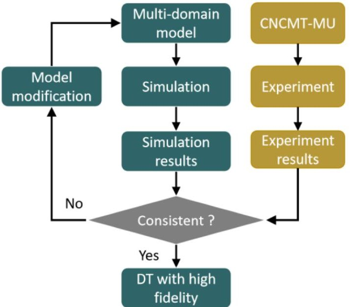
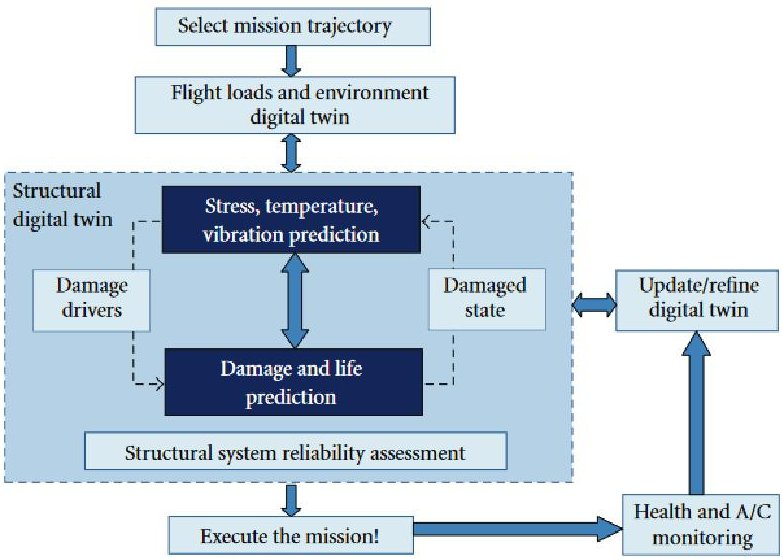
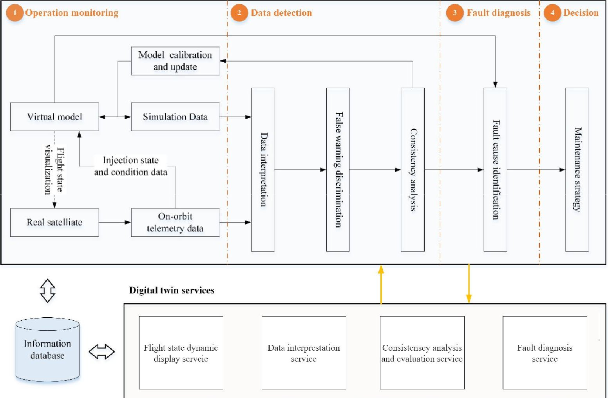
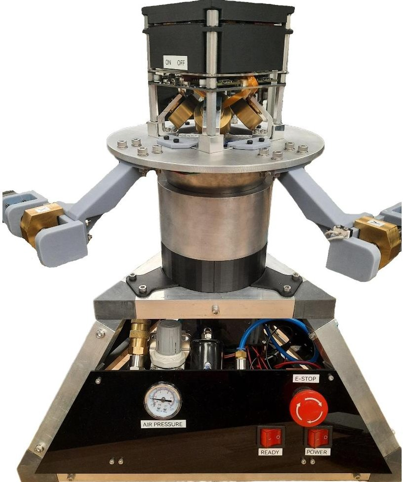

<!-- PDF_PAGE: 1 -->

# Aerospace digital twins: Examining applications of digital twin technology to unmanned aerial vehicles and satellites

Brett Sicard, Alex McCafferty-Leroux, Raveen Appuhamy, Andrew Newton, Patrick Korsieb and Stephen Andrew Gadsden

McMaster University, 1280 Main St W, Hamilton, Ontario, Canada

## ABSTRACT

Unmanned aerial vehicles (UAV) and satellites are becoming increasingly popular in business, government, and military applications. Both have unique use cases and value, but they have several overlapping use cases and features. Most notably they are both used for observation, such as the case of climate monitoring or surveying and mapping. Satellites also have uses in communication and navigation by broadcasting signals and enabling technology such as global positioning systems (GPS). UAVs have also been deployed by the militaries across the world for both reconnaissance and offensive capabilities. Each are electro-mechanical systems with a several important components that need to be reliable and high performance. Maximizing the return in value for these assets might mean improving their performance, reliability, or longevity. One emerging technology that has the promise to do this is the digital twin (DT). DTs utilize a combination of multi-domain modeling and extensive data collection for real-time model updates. This real time updating can be utilized for advanced simulation, improved control, and advanced condition monitoring. DTs are an ideal platform for applying to UAVs and satellites to maximize their capabilities and values. As will be demonstrated in this work, DTs have been demonstrated to provide value in improving control performance, orientation and position tracking, condition monitoring, and fault detection in UAVs and satellites. A case study and preliminary work on a CubeSat attitude adjustment device DT has been presented and examined to display benefits of the concept.

Keywords: CubeSat, Digital twin, Satellite, UAV

## 1. INTRODUCTION

Satellites and unmanned aerial vehicles (UAVs) are becoming increasingly ubiquitous and important in modern society. Satellites are unmanned spacecraft which orbit celestial bodies, and UAVs are unmanned aircraft which typically fly at high altitudes. Both have unique use cases and value, but they have several overlapping use cases and features. Most notably they are both used for observation, $ ^{1} $ such as the case of climate monitoring or surveying and mapping. Satellites also have uses in communication and navigation by broadcasting signals and enabling technology such as global positioning systems (GPS). UAVs have also been deployed by the militaries across the world for both reconnaissance and offensive capabilities.

Due to the nature of being unmanned it is necessary to be able to monitor these systems to ensure proper operation and performance. In the case of a satellite it is very difficult to impossible to provide maintenance or diagnostics. For UAVs, a failure in one of the systems could result in a critical failure, and then a crash. Both satellites and UAVs are expensive assets, so it is imperative to implement technology and methods to monitor these systems and maximize performance and reliability. Each of these systems contain complex subsystems to be monitored and controlled such as the air frame, power systems, avionics, flight control system, electrical control systems and communication systems in the case of the UAV. $ ^{2} $ One possible paradigm to implement this would be digital twins (DT).

DTs are virtual representations and mappings of real-life objects, systems, and processes. They utilize a heterogeneous data stream from multiple data sources including a sensor network to create a real-time mapping of real-life operating conditions. The first concept of the DT actually arose from NASA creating a duplicate

Further author information:

Brett Sicard: E-mail: sicardb@mcmaster.ca

<!-- PDF_PAGE: 2 -->

spaceship for its Apollo mission which was used to mirror the status of the spacecraft on its mission. $ ^{3} $ To model the system there is an array of models that can be used, with most falling into the categories of either data-driven or physics-based. Data-driven models use historical operating data collected from the system to create an input-output mapping. Data-driven models are often artificial intelligence (AI) or machine learning (ML) based, with neural networks (NN) being a common method. Physics-based methods often involve models which take into consideration the inter-workings of the mechanical, electrical, and thermal systems. They require more knowledge of the system but can be better at predicting the behaviour of systems in unknown operating conditions compared to data-driven methods. Both types of modeling can be effecting for DT modeling and are often used in conjunction. DT use a model retention process where the models are constantly updated and validated to ensure that the model is representative of the system. DT modeling using these models can give control and monitoring systems better information to make autonomous decisions.

This work explores the application of DT to both satellites and UAVs and how it can be beneficial for condition monitoring, control optimization, and fault tolerant control. Additionally a case study is examined where DT based model retention is used to correctly identify the frame inertia tensor of a CubeSat device so that proper control can be implemented.

The rest of this work is organized as follows: Section 2 provides a framework for implementing a DT on either a satellite or UAV. Section 3 examines the literature on examples of applying DT to these systems and what advantages or value was seen by doing so. Section 4 displays an application example of a CubeSat attitude adjustment mechanism for satellites and applying a DT based model retention method to identify the inertia tensor. Finally, section 5 concludes the work and provides as future work outlook.

## 2. UAV AND SATELLITE DIGITAL TWINS

The process for DT modeling of a UAV or satellite is described in this section. The first step is data collection from the real system via an array of sensors and data streams. Next, modeling of the system using data-driven or physics-based models occurs. The DT model output is validated against operational data to ensure model accuracy. Once the model is validated it can be used for implementing DT smart services which can enhance performance, reliability, and longevity.

## 2.1 DATA COLLECTION

DT models rely on a heterogeneous stream of high accuracy and high frequency data for modeling purposes. This data is used to model the system's states and parameters. Data can be collected from a variety of sources including the propulsion system, power systems, attitude adjustment systems, navigation systems, and communication systems. Sensors for these purposes include inertial measurement units (IMU), GPS, and accelerometers. Data about electrical systems including voltage, current, temperature $ ^{4} $ can also be used for monitoring the power systems and actuators. Flight log data can be useful for recreating real life experiments in a virtual environment $ ^{5} $ as discussed in 2.3. Additional sensors can also be installed to collect data, this data could include the stress and strain on structural components such as strain gauges $ ^{6} $ and pose sensors. $ ^{6} $ Additionally. data to monitor environmental conditions such as wind or solar radiation can be used which includes air pressure and speed sensors. $ ^{5} $ This data can be used for DT modelling, where it will be used to estimate the parameters and states of the system.

## 2.2 MODELING AND SIMULATION

There are several different approaches to modeling within DTs. Data-driven modeling does not require an understanding of the underlying system mechanics, but rather creates a mapping of inputs to outputs. ML and NN are a very popular approach to this method. Data-driven approaches such as NN are popular for condition monitoring applications. $ ^{7} $ The primary drawback to data-driven modeling is the need for a large, varied, balanced dataset. This may be difficult for certain applications such as fault detection where the normal operating conditions would heavily outweigh faulty condition occurrences. An alternative to a data-driven approach would be physics-based modeling. Physics-based modeling takes advantage of known physical relationships, features, and parameters of the system for effective modeling. There is a variety of modeling methods which fall under this category such as dynamic system modeling using software such as Matlab/Simulink/Simscape, which can model

<!-- PDF_PAGE: 3 -->

the various sub-systems of the UAV or satellite for control, estimation, and condition monitoring purposes. It can be applied to model the power systems $ ^{8,9} $ and attitude adjustment system $ ^{10} $ for example. Another type of physics-based modeling is finite element (FE) and computational fluid dynamics (CFD) modeling. FE and CFD modeling is useful for monitoring stress and fractures, $ ^{11} $ modeling and simulation of vibration, $ ^{12} $ Aerodynamics, $ ^{5} $ and thermal characteristics. $ ^{13} $ Simulation software such as Gazebo $ ^{5,14} $ or Unity $ ^{15,16} $ can be used for virtual prototyping of UAVs. The drawback of a physics-based approach is the need for simplification, assumptions, and approximations of real life behaviour. $ ^{17} $ It also necessitates a good understanding of the underlying system. $ ^{18} $ There are advantages and drawbacks to both physics-based and data-driven approaches, it is possible to use both in conjunction to mitigate the disadvantages of each, while retaining the benefits of each. $ ^{17} $ Utilizing both strategies is a type of hybrid modeling, which can use models in either parallel or in series. Parallel hybrid models use two models to create the same type of outputs given a sets of inputs, this output is then combined to form a more accurate model than one alone. Series hybrid models use the output of one model as the input to another, one example of this is physics-guided input feature augmentation, which uses accurate physics-based modeling, such as FE modeling to generate data to train NNs. This is very useful in the case where certain data may be difficult to come by normally, such as faulty conditions. Hybrid modeling can also be useful to combine a high fidelity low frequency model with a low-fidelity high-frequency model. $ ^{19} $ Hybrid modeling can improve the accuracy, update frequency, and reliability of the DT model.

## 2.3 VALIDATION

It is essential to ensure that the DT models are representative of their corresponding real-life asset, to do so it is necessary to check the outputs of the models compared to the real life system. In the case of UAVs or Satellites this could be in terms of the navigation systems, battery management, or attitude adjustment. In the case of the battery management system for example, it would need to be ensured that given the same inputs such as battery temperature, outputted current and voltage, and state of health, that you could estimate the battery state of charge.

To validate the DT models it is necessary to test the model against experimental data. While testing, it is desirable to create some sort of test experiment which can be used for model matching which can test the system under a variety of operational conditions to ensure robust modeling. In the case of a UAV navigation system a test trajectory which involved a variety of velocities, altitudes, different turn radii, weather conditions, etc. The variety of conditions ensure the model does not over-fit a certain operating conditions and remain robust. Once experimental data is obtained it can be compared to the virtual counterpart to determine the prediction error to determine model consistency as seen in Figure 1. $ ^{20} $ After comparing the experimental results to the model results it is possible to begin an iterative improvement process to optimize the model parameters to minimize prediction error. Computational optimization algorithms such as particle swarm algorithm, genetic algorithm, and ant-colony algorithm can be used for this parameter optimization process. Over the life-cycle this process will need to be repeated to ensure the model matches the current operating state of the asset. It is also valuable to observe the changes in model parameters over time to analyze the change in the systems operating state.

## 2.4 DIGITAL TWIN SMART SERVICES

Once the data collection, modeling, and model validation is complete the DT can be used for various services. There are many different DT services that could be useful in their application to UAVs and satellites. A very popular application is health and condition monitoring. This is popular to monitor the various sub-systems and components within UAVs and satellites to ensure performance and reliability. Another popular application is performance optimization, where the virtual control systems can be tuned on the virtual model to optimize performance before real-life implementation which can streamline prototyping. Virtual simulation can allow for the testing of the system under untested environmental conditions as well. DT models can be used to generate synthetic data which can be used to train NN for fault detection applications. $ ^{17} $

## 3. LITERATURE REVIEW

There are many literature examples of applying DT technology to both satellites and UAVs. DT technology can help along the entire life cycle of the asset from design, $ ^{21} $ testing and validation, $ ^{15} $ manufacturing, $ ^{22} $ and finally

<!-- PDF_PAGE: 4 -->

Figure 1. Consistency retention / model validation process $ ^{20} $

operation. This work primarily focuses on the testing and validation and the operation stage. DT is often used in the design and testing and validation stage for virtual prototyping to reduce the cost and development time of physical prototyping while improving accuracy. $ ^{2} $ During operation the primary benefits of a DT are health monitoring and performance optimization.

## 3.1 HEALTH MONITORING

Both satellites and UAVs operate in uncertain environments where it is difficult to ensure reliability. $ ^{23} $ There are a couple benefits to utilizing DT technology in the case of satellites and UAVs, such as condition monitoring and fault detection. These can be used to identify current operating conditions and used to best operate in these uncertain environments. One key DT service is the real time monitoring of the operating state via a synchronous link. Data collected or transmitted by the system can be used to track changes within the system which can be updated in the virtual system. This status can be updated and displayed to monitor the status of operation. $ ^{24} $

Both satellites and UAVS operate in harsh conditions with low temperatures and high solar and cosmic radiation which can have a detrimental effect on the degradation of components. $ ^{2} $ One of the most common areas of application of DTs is structural health monitoring. An early, and influential work on the topic of the application of DT to aircraft structural life prediction by Teugel et al. seen in Figure 2, which identified the following needed capabilities: $ ^{25} $

- Multi-physics modeling

- Multi-scale damage modeling

- Integration of structural FEM and damage models

- Uncertainty quantification, modeling, and control

- Manipulation of large, shared databases

- High-resolution structural analysis capability

DTs can enable the implementation of integrated vehicle health monitoring, which can be used to achieve diagnosis, prediction, and failure mitigation. $ ^{26} $ Monitoring of the various key components or subsystems such as the wings, $ ^{6} $ rotors, and power systems is essential to the proper operation of the system. There are two important reasons for this, first is fault tolerant control where if a component is experiencing a fault it can be accounted

<!-- PDF_PAGE: 5 -->

Figure 2. DT life prediction concept from $ ^{25} $

for, the second is avoiding catastrophic failures by grounding UAVs if they are deemed a risk. Traditional spacecraft cannot predict or account for failures. $ ^{23} $ In one study $ ^{11} $ the authors created a DT based structural health monitoring method to monitor and estimate the growth of a crack in the frame of a reusable spacecraft. With their method they could accurately estimate the size and predict the growth of a crack with increasing accuracy as their observational data accumulated. Larger UAVs used for commercial or military use at high altitudes typically use wings and jets, rather than rotors for propulsion. The wings are important components to monitor as the manoeuvrability of the UAV depends on them. Lai et al, $ ^{6} $ created a health monitoring method for aircraft wings. They generated data via simulation for load identification and fatigue prediction. Using this models they created a DT visualization which could show the load and fatigue information on a 3-D model of the aircraft. In space satellites need to deal with harsh thermal radiation, and so one study $ ^{19} $ created a hybrid modeling method to estimate deformation due to thermal effects in a satellite. Their model used a hybrid of a high fidelity FE model along with a lower fidelity NN model.

Another very popular application of DTs to health monitoring for UAVs and satellites is monitoring of the power systems and battery. Shangguan et al. $ ^{24} $ created a DT based fault detection scheme for the solar powered battery system of a satellite. Their method, seen in Figure 3, collected several parameters to monitor, visualize and detect faults. Using this method they could accurately and specifically identify faults such as battery short circuits, performance degradation and directional drive failures. One other study $ ^{4} $ examined a DT application to monitor the health of a lithium ion battery for a spacecraft. They used a Kalman filter - least squares support vector machine to estimate the state of charge, and a auto regressive particle filter to estimate the state of health and remaining useful life.

## 3.2 CONTROL AND PERFORMANCE OPTIMIZATION

DTs can allow systems to learn and adapt overtime as the system collects data across the life-cycle. This learning process enables an accurate system model which can enable intelligent autonomous operation. $ ^{27} $ One popular application is virtual prototyping and simulation. Because of the difficulty of recreating the physical conditions in space or high altitude. DT can enable the virtual or hybrid testing and validation of these systems. $ ^{15} $ Virtual prototyping is useful to reduce development time and costs. With virtual prototyping a series of simulation can be performed and iteratively optimized.

A very popular application of virtual prototyping and simulation is path planning and remote operation. A study by Grigoropoulos et al. $ ^{14} $ created a hybrid simulation for testing and validating a UAV for remote operation. By feeding back the results from sensors on the UAV that was matching the simulation they could improve the accuracy of their simulation for further accuracy improvements. Another similar work used virtual DT prototyping and co-simulation to verify their drone control and operating scheme. Their method would identify large deviations from expected behaviour and take appropriate action to avoid catastrophic failure.

<!-- PDF_PAGE: 6 -->

Figure 3. Example of a DT for satellites for fault detection from $ ^{24} $

Simulation environments are also useful for generating data for data-driven control approaches. One study $ ^{16} $ created a reinforcement learning DT for a UAV to improve path planning. Their method was able to generate sufficient data to adequately train a reinforcement learning model to improve arrival time and reduce collisions. Take off and landing is a critical part of UAV flight control. Several studies aimed to use DT technology to optimize this process. McClellan et al. $ ^{28} $ created a MPC based control scheme for the landing of a UAV. They gathered real time state estimates for the UAV as well as estimates of external aerodynamic forces acting on it. Their method was more accurate than assuming static aerodynamic forces. They validated their model with numerical simulations and tested it with a small hobby UAV.

One of the primary applications of DT to spacecraft is in-orbit control $ ^{23} $ where it can be used for real time state and parameter estimation. With real time estimation of these it is easier to achieve high performance. This is especially important for autonomous navigation and orientation and attitude. One study $ ^{29} $ examined using a hybrid DT for temperature field estimation and attitude control. They used a hybrid physics-based and data-driven method, combining a CNN estimate for the temperature field with a Modelica model of the attitude control system. Using this hybrid system they could accurately estimate temperature field and adjust both position and attitude accurately and efficiently. Accurate estimation of the system state and external disturbance is essential for optimal control performance. These real time state estimations can be used for advanced control schemes such as MPC $ ^{28,30} $ or data-driven environmental adaptive control. $ ^{2} $

## 4. APPLICATION EXAMPLE

To examine the framework some preliminary work is explored on a DT condition monitoring scheme for a satellite attitude control system seen in Figure 4. This experimental setup is a CubeSat attitude control system simulator

<!-- PDF_PAGE: 7 -->

Figure 4. CubeSat experimental setup

mounted on an air bearing to simulate zero gravity. $ ^{31-34} $ Four reaction wheels spin to re-orient the system in the desired position. This type of system is used in satellites for attitude control to track targets on earth or in space.

The application is determining the frame inertia tensor matrix. During operation it is possible that the frame could warp or become damaged, or components dislodged, resulting in a different frame inertia. Knowing the frame inertia is important for control of the attitude. This application works by comparing experimental data (simulated in this case) to a set of data which was generated using a set of inertial values. The possible inertia tensor matrices used were five possibilities, three with lower than expected inertia, and two with higher than anticipated inertia. An initial estimate can be obtained through the geometric modeling software. Ideally a larger set of inertia cases could be used, but for simplicity's sake just a few were used to demonstrate the method.

The system begins in an initial orientation and is given a command orientation that it must reach. This operation is conducted in a simulation to gather the expected response under the various inertial conditions as well as experimentally. The experimental data can be compared to the set of simulated inertial values to determine the real inertia. The mean square error is calculated between the test condition and various inertia states orientation quanterion data. Next, a likelihood vector is determined with the following steps. First the mean squared error (MSE) is normalized based on the minimum value:

$$
M S E _ {N o r m a l i z e d} = \frac {M S E}{m i n (M S E)}.
$$

The MSE between each of the four orientation quanterions is summed to form the total MSE. Then a likelihood value is determined based on the inverse proportion of MSE of each inertial case, so if a fault scenario has a MSE

<!-- PDF_PAGE: 8 -->

Table 1. State likelihood estimates

<table border="1"><tr><td colspan="2">Condition1</td><td colspan="2">Condition2</td><td colspan="2">Condition3</td><td colspan="2">Condition4</td><td>Condition5</td></tr><tr><td colspan="2">0.0391</td><td colspan="2">0.1491</td><td colspan="2">0.8031</td><td colspan="2">0.0059</td><td>0.0029</td></tr><tr><td></td><td colspan="8">Table2. Estimated inertia versus actual inertia tensor</td></tr><tr><td></td><td colspan="2">X</td><td colspan="2">Y</td><td colspan="2">Z</td><td></td><td></td></tr><tr><td></td><td>Actual</td><td>Estimate</td><td>Actual</td><td>Estimate</td><td>Actual</td><td>Estimate</td><td></td><td></td></tr><tr><td>X</td><td>0.0196</td><td>0.0185</td><td>-0.0033</td><td>-0.00311</td><td>-0.001</td><td>-0.000944</td><td></td><td></td></tr><tr><td>Y</td><td>-0.0033</td><td>-0.00311</td><td>0.0217</td><td>0.0204</td><td>0.0009</td><td>0.00085</td><td></td><td></td></tr><tr><td>Z</td><td>-0.001</td><td>-0.000944</td><td>0.0009</td><td>0.00085</td><td>0.0287</td><td>0.0271</td><td></td><td></td></tr></table>

of 50% compared to another scenario, it will be $ 2 \times $ as likely. The equation to determine the likelihood vector is

$$
l i k e l i h o o d = \frac {M S E _ {N o r m a l i z e d} ^ {- 1}}{s u m \left(M S E _ {N o r m a l i z e d} ^ {- 1}\right)}.
$$

To reduce the residual probability of unlikely scenarios, the likelihood is squared, and the squared likelihood function is calculated as follows

$$
\mathrm {l i k e l i h o o d} _ {\mathrm {s q u a r e d}} = \frac {\mathrm {l i k e l i h o o d} ^ {2}}{\mathrm {s u m} \left(\mathrm {l i k e l i h o o d} ^ {2}\right)}.
$$

For the experiments the likelihood of various operating condition states representing the system can be seen in Table 1. Then each of the pages (3rd dimension) of the 3x3x5 matrix representing each of the inertia conditions can be multiplied by its corresponding likelihood value, then each corresponding element summed to create an inertia tensor estimate. This process would occur occasionally for model retention. These estimates of inertia are useful for for DT services, such as control tuning based on current operating conditions. The overall results and prediction accuracy of the inertia estimation for the simulated data can be seen in Table 2. As can be seen the prediction accuracy is very high, with an average prediction error of less than 6%.

## 5. CONCLUSION

This work has examined the application of DT technology to satellites and UAVs. Through examining the literature it is clear that DT has been successfully applied to both types of systems to improve health monitoring and performance optimization. Through data collection, modeling and simulation, model validation, and applying DT services it is possible to improve overall system reliability and performance. A case study of identifying the inertia tensor for a CubeSat attitude control device was examined to demonstrate the model retention feature of DTs. Future work on this would include a more complex model identification and retention example of correctly identifying the system model from experimental data.

## REFERENCES

[1] Newton, A., McCafferty-Leroux, A., Gadsden, S. A., and Turpie, K. R., "Towards a second-generation robotic telescope mount for the air-LUSI instrument," in [Sensors and Systems for Space Applications XVI], 12546, 88-104, SPIE (2023).

[2] Wang, Y.-c., Zhang, N., Li, H., and Cao, J., "Research on Digital Twin Framework of Military Largescale UAV Based on Cloud Computing," Journal of Physics: Conference Series 1738, 012052 (Jan. 2021). Publisher: IOP Publishing.

[3] Allen, B. D., "Digital twins and living models at NASA," (2021).

[4] Peng, Y., Zhang, X., Song, Y., and Liu, D., "A Low Cost Flexible Digital Twin Platform for Spacecraft Lithium-ion Battery Pack Degradation Assessment," in [2019 IEEE International Instrumentation and Measurement Technology Conference (I2MTC)], 1-6 (May 2019). ISSN: 2642-2077.

[5] Aláez, D., Olaz, X., Prieto, M., Villadangos, J., and Astrain, J. J., "VTOL UAV digital twin for take-off, hovering and landing in different wind conditions," Simulation Modelling Practice and Theory 123, 102703 (Feb. 2023).

<!-- PDF_PAGE: 9 -->

[6] Lai, X., Yang, L., He, X., Pang, Y., Song, X., and Sun, W., "Digital twin-based structural health monitoring by combining measurement and computational data: An aircraft wing example," Journal of Manufacturing Systems 69, 76-90 (Aug. 2023).

[7] Surucu, O., Gadsden, S. A., and Yawney, J., "Condition Monitoring using Machine Learning: A Review of Theory, Applications, and Recent Advances," Expert Systems with Applications 221, 119738 (July 2023).

[8] Ali, M. B. O. E., Abbaker, A. E. M., and Elfaki, S. E. E., "Modeling, Simulation, and Implementation of the Electrical Power System of Cube Satellite Using Matlab and Simulink," in [2020 International Conference on Computer, Control, Electrical, and Electronics Engineering (ICCCEE)], 1-5 (Feb. 2021).

[9] Sher, A. and Baig, M. S., "Design and Simulation of Small Satellite Power System in Simulink/Matlab for Preliminary Performance Estimation," in [2019 16th International Bhurban Conference on Applied Sciences and Technology (IBCAST)], 359-365 (Jan. 2019). ISSN: 2151-1411.

[10] Aslam, S., Hamza, M., Moazzam, M., Abbas, Z., Ali, F. S., and Hannan, S., "Development of Satellite Attitude Simulink Model to Study the Rotational Degrees of Freedom," in [2020 International Conference on Engineering and Emerging Technologies (ICEET)], 1-5 (Feb. 2020). ISSN: 2409-2983.

[11] Ye, Y., Yang, Q., Yang, F., Huo, Y., and Meng, S., "Digital twin for the structural health management of reusable spacecraft: A case study," Engineering Fracture Mechanics 234, 107076 (July 2020).

[12] Simsiriwong, J. and Sullivan, R. W., "Experimental Vibration Analysis of a Composite UAV Wing," Mechanics of Advanced Materials and Structures 19, 196-206 (Jan. 2012). Publisher: Taylor & Francis _eprint: https://doi.org/10.1080/15376494.2011.572248.

[13] Diaz-Aguado, M. F., Greenbaum, J., Fowler, W. T., and Lightsey, E. G., "Small satellite thermal design, test, and analysis," in [Modeling, Simulation, and Verification of Space-based Systems III], 6221, 74-85, SPIE (May 2006).

[14] Grigoropoulos, N. and Lalis, S., "Simulation and Digital Twin Support for Managed Drone Applications," in [2020 IEEE/ACM 24th International Symposium on Distributed Simulation and Real Time Applications (DS-RT)], 1-8 (Sept. 2020). ISSN: 1550-6525.

[15] Yang, Y., Meng, W., Li, H., Lu, R., and Fu, M., "A Digital Twin Platform for Multi-Rotor UAV," in [2021 40th Chinese Control Conference (CCC)], 7909-7913 (July 2021). ISSN: 1934-1768.

[16] Li, S., Lin, X., Wu, J., Bashir, A. K., and Nawaz, R., "When digital twin meets deep reinforcement learning in multi-UAV path planning," in [Proceedings of the 5th International ACM Mobicom Workshop on Drone Assisted Wireless Communications for 5G and Beyond], DroneCom '22, 61-66, Association for Computing Machinery, New York, NY, USA (Oct. 2022).

[17] Wu, Y., Sicard, B., and Gadsden, S. A., "A Review of Physics-Informed Machine Learning Methods with Applications to Condition Monitoring and Anomaly Detection," (Jan. 2024). arXiv:2401.11860 [cs, eess].

[18] Sicard, B., DIGITAL TWIN MACHINE TOOL FEED DRIVE TEST BENCH FOR RESEARCH ON CONDITION MONITORING AND MODELING, thesis, McMaster University, Hamilton, Ontario, Canada (2024). Accepted: 2024-01-15T19:14:09Z Journal Abbreviation: DIGITAL TWIN MACHINE TOOL FEED DRIVE TEST BENCH.

[19] Kontaxoglou, A., Tsutsumi, S., Khan, S., and Nakasuka, S., "Towards a Digital Twin Enabled Multifidelity Framework for Small Satellites," PHM Society European Conference 6, 10-10 (June 2021). Number: 1.

[20] Yang, X., Ran, Y., Zhang, G., Wang, H., Mu, Z., and Zhi, S., "A digital twin-driven hybrid approach for the prediction of performance degradation in transmission unit of CNC machine tool," Robotics and Computer-Integrated Manufacturing 73, 102230 (Feb. 2022).

[21] Stevens, R., "Digital Twin for Spacecraft Concepts," in [2023 IEEE Aerospace Conference], 1-7 (Mar. 2023). ISSN: 1095-323X.

[22] Yi, Y., Yan, Y., Liu, X., Ni, Z., Feng, J., and Liu, J., "Digital twin-based smart assembly process design and application framework for complex products and its case study," Journal of Manufacturing Systems 58, 94-107 (Jan. 2021).

[23] Yin Z, H. and Wang, L., "Application and Development Prospect of Digital Twin Technology in Aerospace," IFAC-PapersOnLine 53, 732-737 (Jan. 2020).

<!-- PDF_PAGE: 10 -->

[24] Shangguan, D., Chen, L., and Ding, J., "A Digital Twin-Based Approach for the Fault Diagnosis and Health Monitoring of a Complex Satellite System," Symmetry 12, 1307 (Aug. 2020). Number: 8 Publisher: Multidisciplinary Digital Publishing Institute.

[25] Tuegel, E. J., Ingraffea, A. R., Eason, T. G., and Spottswood, S. M., "Reengineering Aircraft Structural Life Prediction Using a Digital Twin," International Journal of Aerospace Engineering 2011, e154798 (Oct. 2011). Publisher: Hindawi.

[26] Xiong, M. and Wang, H., "Digital twin applications in aviation industry: A review," The International Journal of Advanced Manufacturing Technology 121, 5677-5692 (Aug. 2022).

[27] Yang, W., Zheng, Y., and Li, S., "Application Status and Prospect of Digital Twin for On-Orbit Spacecraft," IEEE Access 9, 106489-106500 (2021). Conference Name: IEEE Access.

[28] McClellan, A., Lorenzetti, J., Pavone, M., and Farhat, C., "A physics-based digital twin for model predictive control of autonomous unmanned aerial vehicle landing," Philosophical Transactions of the Royal Society A: Mathematical, Physical and Engineering Sciences 380, 20210204 (June 2022). Publisher: Royal Society.

[29] Xie, Y., Yao, W., Li, X., Wang, N., Zheng, X., and Chen, X., "Hybrid digital twin for satellite temperature field perception and attitude control," Advanced Engineering Informatics 60, 102405 (Apr. 2024).

[30] Hill, E., Newton, A., Gadsden, S. A., and Biglarbegian, M., "Tube-based robust model predictive control for fault tolerance," Mechatronics 95, 103051 (Nov. 2023).

[31] Newton, A., Design, Development, and Experimental Validation of a Nanosatellite Attitude Control Simulator, PhD thesis, University of Guelph (Sept. 2021).

[32] McCafferty-Leroux, A., Newton, A., and Gadsden, S. A., "An improved nanosatellite attitude control simulator for experimental research," in [Sensors and Systems for Space Applications XVI], 12546, 43-52, SPIE (June 2023).

[33] Newton, A., Hill, E., Gadsden, S. A., Biglarbegian, M., and Yang, S., "Investigating reaction wheel configuration and control law pairings for cubesats in the presence of faults," in [Proceedings of the Canadian Society for Mechanical Engineering International Congress], (2020).

[34] Newton, A., Hill, E. D., Gadsden, S. A., and Biglarbegian, M., "Development of a nanosatellite attitude control simulator for ground-based research," in [Sensors and Systems for Space Applications XV], 12121, 44-52, SPIE (June 2022).