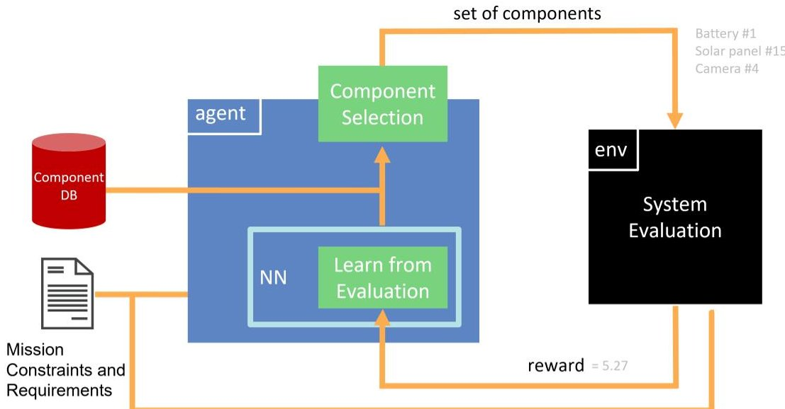
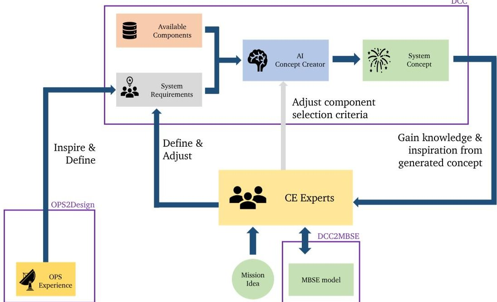

<!-- PDF_PAGE: 1 -->

# AI4CE - Automated Space Mission Design Concepts Generation with Reinforcement Learning

Jan-Peter Ceglarek $ ^{*} $ , Redouane Boumghar $ ^{\dagger} $ , Reinhold Bertrand $ ^{\ddagger} $

Assuming MBSE-centered design as the new reality,building on that, while considering the accomplishments in the field of Artificial Intelligence (AI), supporting early system designs with an AI-based assistant seems the next logical step. The AI for Concurrent Engineering (AI4CE) research project offers the unique possibility to combine the preliminary mission design process, in the form of Concurrent Engineering (CE), Model Based System Engineering (MBSE) and innovative system creation, utilising Reinforcement Learning. It enables the usage of knowledge base and ontologies through an interactive process, where the designing team defines system requirements and benefits from a generated design.

AI4CE complements what a conceptual system design process dedicated to MBSE implies and uses the advantages this symbiosis yields: taking information and constraints from the model, generating a system design based on these information and introducing it directly back into the same model.

Using Deep Reinforcement Learning (DRL), this AI system builds a conceptual design out of available components in a database. The decision of which exact components the AI selects from this database is based on the given system requirements and the AI's trained strategy it's design experience. First tests could demonstrate the feasibility of this approach and future research focuses on expanding its capabilities and the integration into the CE process.

## I. Introduction

The modern market of New Space and its new business opportunities call for innovative and cost-effective design methods. Early design phases of a mission have an important impact on mission cost, development lifecycle and requirements coverage. The multiplication of new actors in the industry brings new off-the-shelf components. The number of integration combination grows, therefore design complexity grows. Being able to manipulate vast set of design knowledge becomes key for maintaining a competitive edge in early design phases.

Model Based System Engineering (MBSE) is enabling the entire mission lifecycle to become fully digital. Every information used to build a mission becomes a digital information. Automated systems can therefore use this digital information to generate design propositions. Most important design decisions are made before reaching phase B (preliminary design), so it becomes crucial to test and find best design solutions in the technical, commercial, or legal domains. These aspects are unified by MBSE and it becomes increasingly fundamental for Concurrent Engineering CE. Artificial Intelligence (AI) methods have proven to be very valuable in driving the development of new fields in the past decade. Especially, the fields of Machine Learning and Deep Learning have substantially grown in number of applications. In this paper we show the advantage of using Deep Reinforcement Learning (DRL) to create technical mission designs from scratch and show its utility during conceptual design.

To ensure the general functionality and a seamless integration into existing CE processes, the AI4CE project is organised into separate modules. The Deep Reinforcement Learning Concept Creator (DCC) is the core of the project, where the AI system creation functionality is implemented and the MBSE2DCC model will offer an interface to import information from and export the system model created by the DCC directly back into the same MBSE model used by the used CE software. The additionally OPS2Design module offers support to introduce gained experience during operation directly into the module in a formalised way.

<!-- PDF_PAGE: 2 -->

Fig.1 Overview of the component selection training process performed by the concept creator. The agent takes a component selection from a database (action) which gets evaluated by the learning environment. Inside the environment multiple classical engineering parameters get calculated to access the performance of the current component selection in form a reward. This reward is used by the agent to learn from its taken action. Since a Neural Network (NN) is used for the action-reward mapping, the technology is called Deep Reinforcement Learning (DRL).

## II. Deep Reinforcement Learning for Preliminary Space Mission Design

Reinforcement Learning (RL) is a Machine Learning (ML) method where the learning entity learns from experiences. In Deep Reinforcement Learning (DRL) an additional Neural Network is utilised during the learning procedure to estimate a function for the action-state mapping. An agent takes actions in a purpose-build environment, which triggers a re-action, from which the agent gains experience, as illustrated by Figure 1. By this learning process the agent learns which action to take given a state and thereby improve its performance over time.

A given situation for the agent is represented as an input vector, with each entry modeling one influence of the current signed system situation - its state. Generating a system, meaning picking a discrete set of components which together form a complete system design, is ultimately achieved by the sequence of actions performed by the agent. In control theory - the classic domain of RL - these can be the steering and acceleration options a car can take for example. In the case of designing a space system, the action is selecting the fitting component for each component category as defined by the system architecture.

In the learning environment, the rules are defined, by which a chosen action gets evaluated, given the context defined by the input vector. Because these rules can be design on behalf of the AI engineer, these rules can be any kind of calculations - like established system engineering and domain specific calculations for example. With this it is possible to evaluate a set of spacecraft components, to assess which set fulfills a given set of requirements best.

The agent makes component selections from the component database based on user-defined system design constraints. The evaluation of a design thus can be done inside the learning environment: This is done by calculating a reward, which is a numerical number characterising the benefit value of a given design variant. The reward acts as a feedback to design agent who can learn from this experience and adjust its component selection accordingly to achieve an even higher reward. As a result, the AI concept creator can gradually improve its design creation capabilities during training.

Figure1 illustrates the generation of such a system reward. The agent calculates an individual reward for every single component, based technical performance calculations in the same way as the domain experts perform their calculations for the CE design activity. Each reward is based on a variety of general and domain-specific parameters such as power, mass, performance parameters, which are read from the database. Subsequently, all individual rewards get combined into one single system reward.

## III. Implementation Scenario

AI for Concurrent Engineering (AI4CE) is a research project to bring the advantages of AI tools to the design process, to support and elevate the design decision process. An AI system capable of generating conceptual space

<!-- PDF_PAGE: 3 -->

Fig. 2 AI4CE concept creation procedure overview. The CE team receives information about the system's purpose and an MBSE model. Building on that, the team adjust the AI system's mission requirements. Together with additional information coming from the operations and a component database, a concept gets created. The CE experts will then review the created system and start a new iteration, until the final design is reached, which gets exported as an updated MBSE model. The three models of the AI4CE project are highlighted as purple boxes.

mission designs would support the preliminary design phase in a number of ways. Implemented directly in the CE workflow, during CE sessions the tool would function as an engineering assistant, to help the designing team, as it is shown in Figure 2.

The team will update the mission requirement parameters according to their progressed design discussion, which again will triggers a new concept generation adjusted to the new requirements. This generated design could function as an inspiration to discover entirely new ideas, a starting point for further design iterations, a test on how a real implementation of the current design parameters would look like or even in a training scenario for new teams.

Using AI-generated system designs would be a native fit into a MBSE environment. Utilising the existence of one source of truth, the concept generator would input its design directly into the design model. This not only keeps the workflow coherent, but would also have the advantage, that the designing team could use existing tools working with the one design model to explore and analyse the generated design further.

To ensure a seamless integration into exiting MBSE-centric CE activities, a dedicated MBSE integration module (DCC2Design) has been envisaged for the AI4CE project. Part of this module will be the functionality to formalise system requirements.

The two other modules of AI4CE are the Deep Reinforcement Learning (DRL) Concept Creator (DCC) and OPS2Design, which functions as an integration module of component experience/knowledge during the actual operation phase. All 3 modules are marked purple in Figure 2.

The AI4CE systems support the mission phases 0 and A, coherent with standard CE studies. In fact, the original implementation were designed at the Concurrent Engineering Lab (CELab) at the ESALab@TU Darmstadt as part of the ESAL@Network.

## IV. Current Implementation of the Software

The current implementation of the AI concept generator was developed over the period of a few month as part of master thesis. The design generation tool currently supports is a simplified CubeSat system consisting of any number of battery, solar panel, camera, reaction wheel or transceiver components. All components influence the assessment of all other components, imitating the propagating effects also covered by the regular CE process.

The necessary mission constraints and requirements can be adjusted by the designing team via separate configuration

<!-- PDF_PAGE: 4 -->

files, where orbit parameter and system configuration can be updated.

The component database consists of all satellite components available at the satsearch webshop. For the first prototype, the database was comprised of all CubeSat components available on the SatSearch webshop.

## V. Results of first experiments

Promising results of the validation of the first prototype implementation showed the general feasibility of the proposed system. Generated concepts for 1U, 3U and 5U CubeSat were compared with brute-force combinatorics within the component database and real-world missions. The comparison showed, that the current implementation of the DCC works best for the 1U satellite designing a concept that were almost identical to the real-world reference. Table 1 shows a comprised representation of the comparison involving the 1U EQUiSat CubeSat mission and a generated CubeSat design with 1 battery, 1 solar panel and 1 transceiver to match the architecture of the real mission.

Table 1 Comparison of the component found by the concept creation tool and the 1U CubeSat mission EQUiSat.

<table border="1"><tr><td>Parameter</td><td>AI tool</td><td>EQUiSat</td><td>ΔAI/EQUiSat</td></tr><tr><td>Name</td><td>AI Concept</td><td>EQUiSat</td><td></td></tr><tr><td>Mass</td><td>0.8kg</td><td>1.3kg(incl structure)</td><td>62%</td></tr><tr><td>Power Consumption</td><td>2.3W</td><td>5W</td><td>46%</td></tr><tr><td>Transmit Power</td><td>3.1W</td><td>1W</td><td>310%</td></tr><tr><td>Transmit Frequency</td><td>430to438MHz</td><td>403-473MHz</td><td>101%(min)</td></tr></table>

Notes on the validation concept:

By comparing a generated system concept with a real-world design, two things need to be taken into account: the generated system is a reduced sub-set of a complete system, since not all possible sub-systems of a satellite are currently implemented, the available components to build the system is limited to the database, while the real-world mission can even build their own components.

## VI. Current State of the Project and Future Work

Work on the first prototype ended with the end of the corresponding master thesis in spring of 2022. Since then, four publications on the following AI4CE project has been written and submitted, with each covering a different aspect of the project: more details on the prototype can be found at SECESA2022, the grand vision of the AI4CE project is explained at IAC2022, MBSE2022 focuses on MBSE related aspects and the foreseen integration of the expertise gained during the operation phase is described at SpaceOps2023.

Future development will improve the functionality of the DCC module. Besides better support for more CubeSat modules and the support for more component vendors, support for the system generation capabilities will be expanded to other systems like a generic satellite and the ground segment. Furthermore, the interfaces will be defined for the integration into the MBSE process and the usage of OPS knowledge.

## VII. Conclusion

Designing space systems is a challenging and complex task, which can profit from the abilities advanced AI system have to offer, which is the concept behind the AI for Concurrent Engineering (AI4CE) research project. With AI4CE, design concepts can be generated for Phase 0/A preliminary Concurrent Engineering (CE) studies using Deep Reinforcement Learning. The MBSE workflow is uniquely qualified for an automated concept generation, since a generated design can be introduced directly into the existing model, where it can be further expected by the designing experts with the existing infrastructures and tools. Deep Reinforcement Learning has proven itself to be a valuable technology to generate complete design concepts with, capable of comprising convincing system designs with its first prototype. AI4CE contains 3 modules: DCC for concept creation, DCC2MBSE for MBSE and OPS2Design for operation phase experience integration.

<!-- PDF_PAGE: 5 -->

The current implementation of the software is capable generating a simplified CubeSat concept including support for the battery, solar panel, camera, reaction wheel and transceiver and has been made open source under the GPL3 version: https://gitlab.com/jan-peter/drl-concept-creator

Future development will focus on expanding its generation capabilities and assessment of the best way to integrate the concept creator into existing MBSE/CE processes.