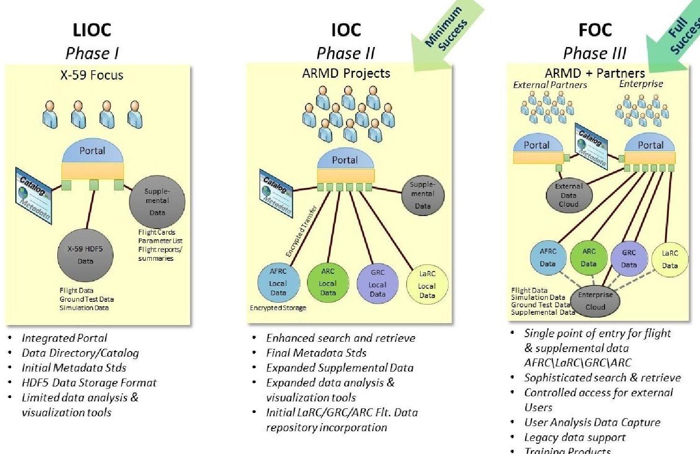
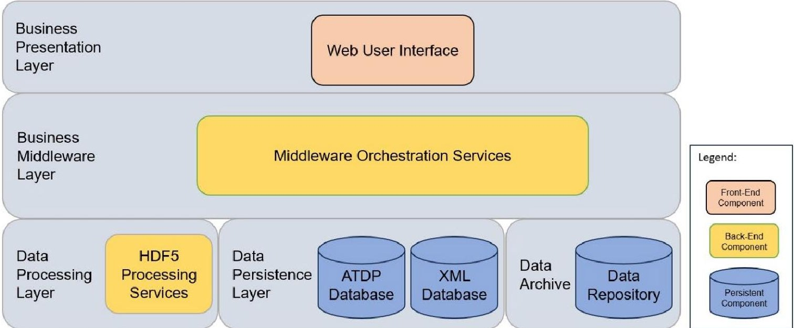
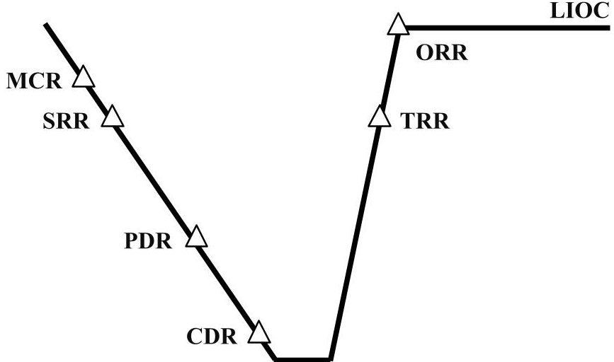
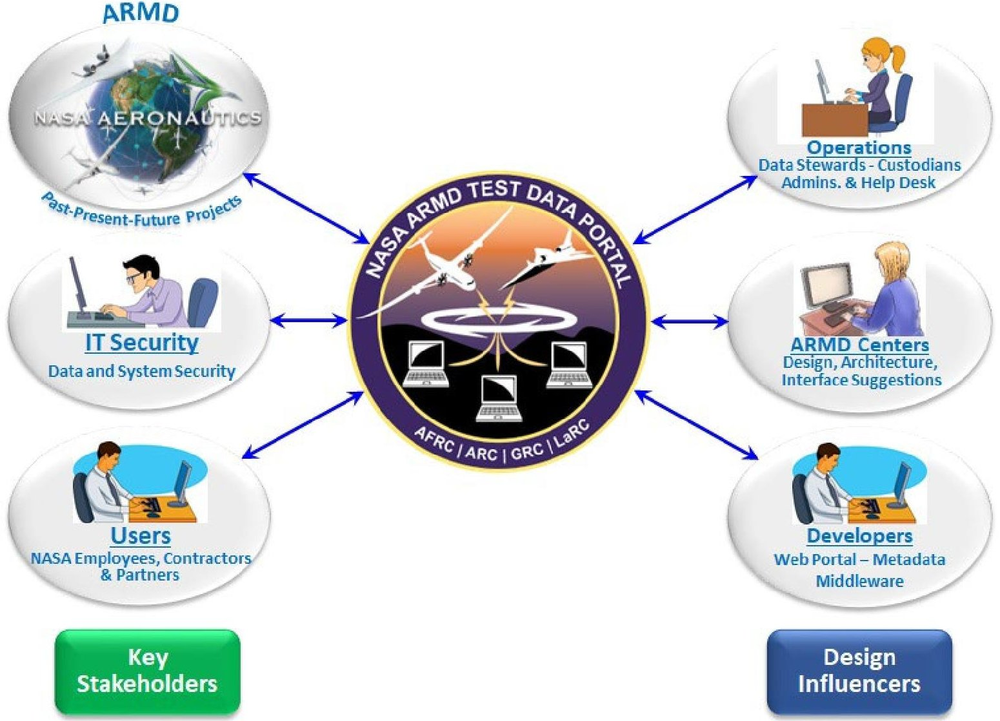
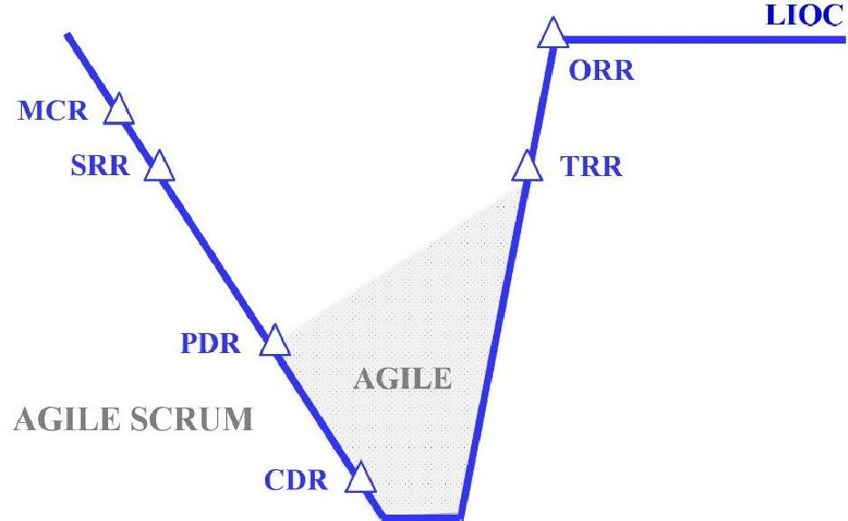

<!-- PDF_PAGE: 1 -->

# Introduction of an Agile Systems Engineering Process to the NASA Armstrong Flight Research Center

Daniel S. Jones $ ^{1} $ and David Tow $ ^{2} $ NASA Armstrong Flight Research Center, Edwards, California, 93523, U.S.A.

Jason L. Holland $ ^{3} $ ASRC Federal System Solutions, LLC, (AFSS), Edwards, California, 93523, U.S.A.

This paper will provide background on the National Aeronautics and Space Administration (NASA) Aeronautics Research Mission Directorate (ARMD) ARMD Test Data Portal (ATDP) effort along with the rationale that motivated the ATDP team to consider implementing an agile systems engineering (SE) process. The primary motivation for using this new SE process was based on the desire to mitigate a major risk to project success. Since the agile SE process had never been used before at the NASA Armstrong Flight Research Center (AFRC), utilizing this new SE process required a trailblazing effort to introduce it to NASA AFRC leadership. As a result, the ATDP team chose to adhere to the agile SE process in addition to the trusted classical waterfall SE process on ATDP. Through successful execution of this hybrid SE process during Phase I, along with demonstrating the value and rigor of the agile SE process, NASA AFRC leadership ultimately permitted the ATDP project to solely use the agile SE process for developments beyond Phase I. While it is the opinion of the authors that the classical SE process is more effective for most projects at NASA AFRC, some projects may deem that the agile SE process is more advantageous. Although this paper is focused on introducing the agile SE process to NASA AFRC, lessons learned will be valuable to other organizations as well. Details of how the ATDP team implemented the agile SE process during Phase I will be summarized, along with how the team met all required classical SE milestones. Lessons learned throughout Phase I of this effort will also be highlighted.

## I. Introduction to ATDP

Since the early 1980s, the National Aeronautics and Space Administration (NASA) Armstrong Flight Research Center (AFRC) (Edwards, California) has stored flight data on the Flight Data Access/Archival System (FDAS). Since the archival and access of flight research and flight-test data is a crucial part of the NASA AFRC mission, the FDAS has been greatly utilized by hundreds of NASA AFRC engineers on numerous projects over the last few decades. Although FDAS usage has been a critical asset for NASA AFRC, it is now an unsustainable and antiquated solution for long-term storage, search, and retrieval of flight-test data. The Aeronautics Research Mission Directorate (ARMD) ARMD Test Data Portal (ATDP) system will provide a web-based solution to this problem, enabling users of the system to archive and access test data while providing access control through the appropriate security methodologies. Along with data, the ATDP system will allow users to archive metadata to better assist them with an understanding of that data. In addition, unlike FDAS, the ATDP system will also foster greater collaboration and communication

<!-- PDF_PAGE: 2 -->

between all the NASA Centers with an ARMD focus by allowing equal access to test data through the ATDP system. This feature will enable the ATDP system to be accessed by research engineers at the NASA Ames Research Center (ARC) (Moffett Field, California); the NASA Glenn Research Center (GRC) (Cleveland, Ohio); and the NASA Langley Research Center (LaRC) (Hampton, Virginia); in addition to NASA AFRC.

The ATDP system was originally named the ARMD Flight Data Portal (AFDP) and was renamed in 2023. The name change was an inclusive effort that also considers ATDP customers who are more focused on archiving and accessing test data that may not be directly related to a specific flight (e.g., wind-tunnel test data). The ATDP is a test data archival system for ARMD projects and was originally intended to be executed in three phases using a classical Systems Engineering (SE) process. Figure 1 shows highlights of all three phases originally planned for the ATDP development process. Phase I of the ATDP project was to complete a limited initial operating capability (LIOC), which was focused on providing storage and retrieval of flight data at NASA AFRC from the X-59 Low Boom Flight Demonstrator (LBFD) flight research project. Phase II of the ATDP project was the initial operating capability (IOC) phase and was to continue the progress from Phase I by incorporating data from other ARMD flight projects at AFRC. In addition to AFRC flight data, Phase II would include test data related to projects at the other ARMD Centers as well, including some data from NASA ARC, GRC, and LaRC. Successful completion of Phase II would meet the minimum success criteria for the ATDP project. Finally, Phase III of the ATDP project was focused on providing full operating capability (FOC), which would include all progress from the two previous phases. In addition to providing access to test data from within NASA, ATDP access would be expanded to include project partners collaborating with NASA on ARMD efforts in Phase III, ultimately meeting the full success criteria for the ATDP project.

Fig. 1 Originally planned ATDP development phases.

The ATDP team originally planned to use this three-phase approach at the start of Phase I; however, the team later realized that it would be advantageous to use more agile philosophies during Phase I and for the future of the project. Near the conclusion of Phase I, the decision to implement a solely agile SE process ultimately rendered the three-phase approach as obsolete, since a continuously improving and evolving ATDP development process was planned for developments beyond Phase I. Developmental progress originally planned for Phase II and Phase III would still be completed, but the schedule for completion would ultimately be driven by customer interests. More details on the evolution of this mindset toward the full implementation of the agile SE process will be discussed later.

<!-- PDF_PAGE: 3 -->

## A. ATDP Phase I Development and Base Functionality

The ATDP system utilizes the Hierarchical Data Format, version 5 (HDF5) data format for time-history data instead of using the compressed 4 file format (CMP4) data, which the FDAS system previously utilized only at AFRC. In addition to the collaborative advantages of using this widely accepted file format, HDF5 files are self-describing data files that allow embedded metadata. With HDF5, metadata for each project can be provided by the data producer and owner of the data; this valuable data will also be available to all research engineers for access. The project will also assign specific distribution limitations for each data parameter. In addition, the files will include a time vector for each parameter to support various synchronous data rates and asynchronous data, assuming data producers generate such files. The HDF5 files can be read directly by common applications such as MATLAB $ ^{\circled{R}} $ , Python-based applications, and other commercially available analysis tools that are utilized to analyze time-history data by NASA researchers and NASA partners.

One of the largest hurdles and complexities that the ATDP project faced was figuring out a common metadata standard that NASA could accept. The ATDP project researched metadata methodologies across the NASA Agency and the Federal Government to create a standard that would be relevant and acceptable to NASA. Being unable to discover a unified metadata standard for NASA, the ATDP team worked with many groups to create the ATDP metadata specification (AMS), which defines the ATDP metadata standard. During the creation of the AMS, the ATDP team engaged with the National Archives and Records Administration (NARA); the Office of the Director of National Intelligence (ODNI); the National Information Exchange Model (NIEM); and the intelligence community. Details on the ATDP AMS will be described in a planned, future ATDP paper. The AMS is compliant with the following:

1) Executive Order 13556 [1]

2) NASA Interim Directive (NID) 2810.135 [2]

3) NASA Procedural Requirements (NPR) 1441.1E [3]

4) NPR 2200.2E[4]

The self-describing nature of the HDF5 files ensure the future searchability and accessibility of the data, even after current day projects have completed active missions that generate original time-history source files by removing the possibility of lost linkages between metadata and time-history data values. The ATDP system categorizes and archives the data based on the identified metadata within the self-describing section of the HDF5 files.

A web-based solution allows for increased ease of data access but also makes the system susceptible to outside interference without the proper security measures in place. To ensure that the system retains its integrity, several base levels of security were utilized. Two of the most important security measures instituted are multi-factor authentication (MFA) and role-based access controls. The various role-based access controls permit the owner of the flight/test project to grant access to each individual user based on access to the data deemed appropriate for that user. Role-based access controls also permit a flight/test project to restrict access to data based on company proprietary data restrictions.

The ATDP system currently uses a limited, faceted search capability with the goal of adding full text search capabilities in the future. The ATDP system has a plethora of metadata; however, the limited, faceted search only utilizes a very small subset of identified ATDP metadata: 1) Project of Record; 2) Experiment Identification (ID); 3) Platform ID; 4) Test Phase; 5) Operation (Op) Type; and 6); Op Number. Utilizing these six metadata elements, one can find/discover specific test data that resides within the ATDP system. With the security access control restrictions that ATDP employs, a user can view titles of nearly all available data that resides within the ATDP system but will be prevented from accessing the data values without proper authorization. This method allows users to search and discover available test data and request access to applicable/restricted test data. At the conclusion of Phase I, the ATDP system had the ability to support test data in the HDF5 file format; however, post-Phase I upgrades, the ATDP system will include the ability to support additional file formats that will allow information access that may be needed to understand the test data.

At NASA AFRC, there are several major data production facilities that generate most of the time-history data for ingestion into ATDP: the AFRC Dryden Aeronautical Test Range (DATR); the AFRC Simulation (SIM) labs; and the AFRC Consolidated Information Technology Center (CITC) data center. In addition to these three facilities mentioned, AFRC will also accept data from the AFRC Flight Loads Laboratory (FLL) in the future. The DATR data production facility supports real-time and post-test mission support for flight test. The real-time support occurs during ground tests and flight tests; the resulting data feeds into a data viewing system, such as a Mission Control Center (MCC); flight-test simulator; and loads apparatus during the tests. The archived data from the missions are HDF5 files, or converted to HDF5 files, which are registered to and ingested by ATDP. The DATR also generates HDF5 files from postflight processing of recordings such as onboard test platform recorders. Similarly, the CITC does postflight processing of position data and other data types to create HDF5 files for the ATDP system.

One of the most important parts of the ATDP system is the time-slice functionality. Time slicing is a key component for data analysis; researchers are often only interested in a desired phenomenon or anomaly related to their

<!-- PDF_PAGE: 4 -->

respective expertise. Time slicing allows a user to select specific parameters and portions of time within an original source-archived HDF5 file, then extract this subset of data to create a subsequent HDF5 file to enable researchers to conduct data analysis on the desired section(s) of a test event. For example, a flight test may result in the creation of three hours of test data, and the test may generate data on the order of thousands of gigabytes (GBs) per flight test. A researcher is often only interested in a small duration of this entire flight (perhaps three minutes of the entire three-hour flight). To reduce the amount of data that the ATDP system needs to push to the user, the time-slicing functionality allows a subset of the original source HDF5 file to be copied from the source, resulting in a new HDF5 file that is called a synthetic HDF5 file. The synthetic file will retain all the metadata of the original source file(s), which allows for traceability back to the source should a user ever wish to recreate the synthetic files from the original source files, plus any synthetic-file-specific metadata that is needed to identify the subset of data (e.g., the section of time used to create the time slice). By reducing a three-hour set of test files down to three minutes, the synthetic file may only be one GB as opposed to thousands of GBs.

The previous data acquisition/archival system, FDAS, had some time-slice methodologies. After the ATDP team gathered requirements on time-slice methodologies from future users of the system, it was determined that the hold last value (HLV) methodology was needed for use by some ATDP users. The HLV is a time-slice methodology where a sync parameter is chosen, and other selected parameters within the same time slice will hold their respective data value based on the chosen sync parameter. Most ATDP customers identified that there was no interest in methodologies related to interpolation of data from the ATDP because the analysis can be performed utilizing other analytical tools, as noted earlier.

The ATDP team has also created electronic training tools as well as user guides that can guide a new user through each step of the ATDP system processes, which will be beneficial for most new users. In-person training, either virtually or physically, is also being offered to show users live demonstrations on system functionalities.

## B. Technology Updates

During Phase I of the ATDP project development lifecycle, two significant changes needed to be addressed. The first change occurred when Oracle (Oracle Corporation, Austin, Texas) decided to make a major update from Java $ ^{\mathrm{TM}} $ 8. Java $ ^{\mathrm{TM}} $ 9 was anticipated to be the next major release with long-term support (LTS); the changes were so significant that the software was not stable until the release of Java $ ^{\mathrm{TM}} $ 11. The ATDP team considered the possibility of migrating to the newer version; however, risks to meeting schedule dates were too high to transition from Java $ ^{\mathrm{TM}} $ 8 to Java $ ^{\mathrm{TM}} $ 11. Eventually, Oracle announced that Java $ ^{\mathrm{TM}} $ 11, released in September 2018, would be their LTS release.

After a second, significant, requirement change to convert Sensitive But Unclassified (SBU) markings to Controlled Unclassified Information (CUI) markings, the ATDP team decided to upgrade to Java $ ^{\mathrm {TM}} $ 11. Compliance to security markings affected major parts of the system. The ATDP team anticipated this compliance change would be required in the future, after the Phase I release, because it was believed that NASA was still years away from implementing Executive Order 13556 and its implementation by Title 32 Code of Federal Regulations (CFR) Part 2002 (32 CFR 2002) [5]. In June of 2020, however, the NASA CUI program announced that all information systems within the NASA Agency needed to comply or receive a waiver before the end of 2021 [6].

This mandate provided an opportunity for the ATDP project to reduce technical debt that was incurred due to early design decisions. The ATDP system was using two different Java $ ^{\mathrm{TM}} $ approaches: part of the system was utilizing Java $ ^{\mathrm{TM}} $ Enterprise Edition with Simple Object Access Protocol (SOAP) data exchanges, while another part of the system was utilizing a modularized approach using Java $ ^{\mathrm{TM}} $ Spring Boot (VMware, Inc., Palo Alto, California) with RESTful data exchanges between applications. Unifying technology approaches to use Spring Boot, for all applications with RESTful data exchanges, provided long-term benefits to the ATDP system. First, the use of a single set of technologies fostered greater team growth and increased the knowledge base of the team. Instead of having two sets of developers, each having knowledge in the technology they were using, all developers would only need knowledge for a single set of technologies. Second, this eliminated the need to manage enterprise servers to deploy applications. Third, the unified technology reaped long-term benefits for operations and maintenance (O&M) since only one set of technologies would require any future upgrades.

## C. Development Operations

To prepare for O&M on the project after the Phase I release, the ATDP team required resources to deploy and maintain information technology (IT) systems for the ATDP system; furthermore, O&M resources would be required to maintain and upgrade ATDP applications. The team anticipated that the project would meet these requirements with one full-time dedicated Development Operations (DevOps) engineer, fulfilling project requirements to maintain and upgrade the system after the ATDP Phase I system went operational.

<!-- PDF_PAGE: 5 -->

The role of a DevOps engineer requires a unique talent with the ability to perform development tasks, such as writing code for web-based applications while having knowledge in maintaining an operational IT environment. Fulfilling this role within the ATDP development also enabled the concepts of Continuous Integration and Continuous Deployment (CI/CD) to be introduced to AFRC. For the ATDP project, it is crucial that development and integration tasks be automated because this automation is an essential part of operating within a CI/CD environment, and test automation ensures that the ATDP system performs as designed on a frequent and regular basis. The ATDP system utilizes the Atlassian Bamboo system to create its CI/CD pipelines, where Bamboo can monitor the code repository for any changes. When code is updated, Bamboo will automatically build and deploy to an integration environment. After integration testing is completed, the code is promoted to a staging branch in the repository, and Bamboo will automatically trigger a deployment to the ATDP staging environment. Upon the code passing testing within the staging branch, the code is then promoted to the production branch. Again, Bamboo will automatically trigger a deployment to the ATDP production environment.

## D. ATDP Architecture

The ATDP project is primarily focused on software development for the ATDP system, with the general purpose of IT systems being sufficient to meet the hardware requirements for the ATDP system to function. The ATDP software is packaged as a set of loosely coupled Java $ ^{\mathrm{TM}} $ applications, where the application itself can run on any system that runs Java $ ^{\mathrm{TM}} $ . Currently, system dependencies on HDF5 native libraries are only built for the Linux operating system (OS), but very little effort would be required to build these on a Windows OS environment. The ATDP system runs on four Linux virtual machines (VMs) as follows: 1) one VM handles the web-based GUI application; 2) one VM provides middleware support to the persistent databases and custom processing for HDF5 files; 3) one VM handles HDF5 file processing; and 4) one VM provides system persistent databases and a Java $ ^{\mathrm{TM}} $ messaging system broker. Figure 2 shows the general architecture of the ATDP system.

Fig. 2 General architecture of the ATDP system.

Typical general-purpose requirements of maintaining the data-center hardware systems apply to the ATDP system and was mostly handled by the IT organization within AFRC; however, since the ATDP is an archiving system, it was important for the ATDP system to have the ability to archive and provide access to large datasets. For data archiving, the ATDP project chose a commercial off-the-shelf file storage solution that provided the ability to expand the size of storage as data storage size requirements increase from the current anticipated needs. The ability to expand data storage capability as the ATDP customer base grows is one specific hardware requirement that the ATDP project will continually review. For Phase I, 400 terabytes met the anticipated test data storage needs for the ATDP system. In addition to the requirement for the ATDP project as the primary archive solution for test data, a secondary off-site backup system is planned to ensure data is not lost due to unexpected problems at the primary archiving location.

<!-- PDF_PAGE: 6 -->

## II. Rationale on Utilizing the Agile Systems Engineering Process for ATDP

This section introduces the classical SE process typically used on most projects at NASA AFRC. While working within this SE process, the ATDP team identified risks to project success, one of which will be discussed. As part of the mitigation strategies for this risk an ATDP outreach effort was initiated, and highlights of this effort will be provided. The outreach effort conducted by the ATDP team was more comprehensive than is typical when using the classical SE approach, but it was believed to be necessary for proper risk mitigation. As a result of these initial efforts by the ATDP team, the team began to realize the necessity of utilizing an agile SE process, so this introduction provides the rationale for that decision.

## A. The Classical Systems Engineering Process

At project inception, the ATDP project informed NASA AFRC leadership that the project will adhere to a classical SE process, often referred to as the waterfall model of development, as noted in Fig. 3. The Director of Research and Engineering at NASA AFRC has established the requirements for the implementation of SE practices at AFRC, and these SE practices are in accordance with the Agency-level SE processes and requirements, as defined in NPR 7123.1 [7]. By utilizing these required practices, the ATDP project team planned to adhere to several key milestones that would be peer-reviewed by AFRC leadership and an independent review team (IRT) that is external to the project. The key milestones included a mission concept review (MCR); a system requirements review (SRR); a preliminary design review (PDR); a critical design review (CDR); a test readiness review (TRR); and an operational readiness review (ORR) before the ATDP system would reach its LIOC and "go live" (during the conclusion of Phase I) as an operational system available to the initial set of ATDP system users.

Fig. 3 Typical classical systems engineering process at NASA AFRC.

At the ATDP MCR, each of the three phases of ATDP, as noted in Fig. 1, were envisioned to be completed using the identical classical SE process, as described in Fig. 3. Phase II of ATDP was planned to conclude after providing the IOC, and ATDP Phase III was planned to conclude after providing the FOC. In Phase I, the ATDP team adhered to all classical SE milestones, as agreed to with NASA AFRC leadership, and these milestones were completed, as noted in Table 1.

Table 1 Classical systems engineering milestones.

<table border="1"><tr><td>Classical SE review</td><td>Completion date</td></tr><tr><td>MCR</td><td>October 2016</td></tr><tr><td>SRR</td><td>June 2017</td></tr><tr><td>PDR</td><td>July 2018</td></tr><tr><td>CDR</td><td>June 2019</td></tr><tr><td>TRR</td><td>March 2022</td></tr><tr><td>ORR</td><td>May 2022</td></tr></table>

<!-- PDF_PAGE: 7 -->

By adhering to this classical SE process, the ATDP team was able to conduct their "go live" event of the ATDP Phase I system in June 2022, enabling its use by initial users. Although the classical SE process was fully adhered to by the ATDP team, the successful completion of Phase I would not have been possible without the ATDP team also conducting an outreach effort and adhering to an agile SE process to ensure user acceptance, which was eventually deemed necessary for project risk mitigation.

## B. Identification of Risks for ATDP

In accordance with AFRC classical SE practices, as defined above, the ATDP team met all entrance criteria for the ATDP MCR. Specifically focusing on the MCR entrance criteria associated with risks, the following details were required to be presented at the MCR:

1) Initial risk-informed cost and schedule estimates for implementation

2) A preliminary assessment performed by the team of top technical, cost, schedule, and safety risks with developed associated risk management and mitigation strategies and options

3) Risk and mitigation strategies have been identified and are acceptable based on technical risk assessments.

At the ATDP MCR, a total of fourteen risks were identified by the ATDP team and disclosed to a large audience of attendees at AFRC, some of which included AFRC leadership and ATDP IRT representatives. One of the dominant identified risks was for user acceptance (i.e., meeting user expectations).

This risk identified the following concern: given that the ATDP system is new to users and that it will be necessary to interface with numerous and varied methodologies in locating, retrieving, and providing access to various types of flight-test data, the anticipation of the user expectations will be significant.

The following context was associated with this risk: The ATDP design/implementation team will work closely with the users from the ARMD Centers to ensure a clear and defined set of requirements are represented and agreed upon, ensuring that all members will have an accurate, representative set of requirements that will meet their expectations.

In preparation for the ATDP MCR, the ATDP team categorized this risk as having a "high" likelihood of occurrence with a "moderate" consequence if this risk occurred. Since this risk was a legitimate concern from the ATDP team, a series of mitigations were identified to reduce the likelihood of it occurring, four of which included the following:

1) Conduct prototype activities to reduce technical risks and evaluate design options

2) Develop in phases and fix as we go - iterative

3) Ensure ARMD users (from NASA AFRC, ARC, GRC, and LaRC) are involved in the design efforts to develop the buy-in of those who will be using the new system

4) Provide ARMD users with outreach and training to help manage expectations.

When the ATDP MCR was conducted, in October 2016, the ATDP team was already planning to use some agile SE philosophies that would facilitate our completion of the four mitigations noted above; however, the acceptance of implementing a complete agile SE process was not yet committed to at that time. Aligned with both the classical SE process and the agile SE process is the importance of engaging project stakeholders. An ATDP outreach effort was initiated simply as an effort to seek stakeholder involvement; however, a greater emphasis was quickly made on this effort to also mitigate the risk of user acceptance. Ultimately, the value of this outreach effort was far greater than anticipated.

## C. ATDP Outreach Effort

Engagement with stakeholders is critical to the success of any NASA project and is articulated repeatedly throughout classical SE documentation [7]. The agile SE process, however, goes beyond this idea by considering each stakeholder as a customer or as the ultimate recipient of the product being developed. The agile SE process is comprised of twelve principles, as documented in the Agile Manifesto [8], two of which are as follows: 1) "our highest priority is to satisfy the customer through early and continuous delivery of valuable software;" and 2) "the most efficient and effective method of conveying information to and within a development team is face-to-face conversation." Although the agile SE process was not entirely embraced by the ATDP team at the time of the ATDP MCR, these two principles of the agile SE philosophy were quickly adopted and executed during the ATDP outreach effort. At the ATDP MCR, an ATDP outreach effort was defined by the ATDP team as a mitigation strategy for the risk of user acceptance; therefore, most of the outreach presentations and face-to-face discussions were conducted between the ATDP MCR and the ATDP PDR.

At the beginning of the ATDP outreach effort, three primary stakeholder groups were identified for ATDP as follows: 1) the ARMD programs and research personnel that generate and use test data, test results, and project documentation; 2) designers, developers, and operations personnel who are responsible for the implementation,

<!-- PDF_PAGE: 8 -->

operations, and maintenance of the system throughout the program and into the sustaining engineering phase of the resulting system; and 3) IT personnel that must ensure access to the data and information within the system is appropriately controlled and protected based on the distribution limitation associated with each project. Figure 4 shows the ATDP stakeholders and design influencers initially considered during the formulation of the ATDP project.

Fig. 4 ATDP stakeholders and design influencers.

To initiate a thorough engagement with all stakeholders, the ATDP team conducted an outreach effort focused on delivering several informational presentations to multiple organizations with this engagement primarily focused on the stakeholders of Phase I. There were five primary goals of this outreach effort: 1) provide all stakeholders with basic information on the system being developed; 2) engage and identify key stakeholders early in the development cycle; 3) receive initial feedback on operational features desired; 4) manage expectations of the stakeholders; and 5) solicit potential end-users that could be a resource for future project guidance throughout the development of ATDP. The ATDP outreach effort presentations were delivered to dozens of stakeholder organizations, at NASA AFRC, ARC, GRC and LaRC, with each presentation delivered to several individuals. These presentations and meetings were a valuable exchange of ideas with various research engineers, engineering leaders, IT representatives, and project teams that have, or may have, a vested interest in the development of the ATDP system.

Consistent with two of the agile SE principles, as noted above, most of the ATDP outreach presentations were delivered in person, while a small number of outreach presentations were delivered via telecon. The ATDP outreach effort was originally conceived as an outreach to key stakeholders of the ATDP system and should be conducted while using a classical SE process. As the team prepared for the ATDP MCR, a more thorough outreach effort was planned that included some aspects of agile SE principles to properly address project risk mitigations. By the conclusion of the ATDP outreach effort, and prior to the ATDP PDR, it became clear to the ATDP team that the entire agile SE process, in addition to our required use of the classical SE process, should be embraced, ensuring adequate mitigation of a risk to project success. During the ATDP PDR, therefore, the ATDP team defined and presented details on how ATDP would implement the agile SE process throughout the remainder of Phase I and beyond.

<!-- PDF_PAGE: 9 -->

## III. Agile Systems Engineering Implementation for ATDP

While implementing the agile SE process on the ATDP project, four different team mindsets evolved over different project milestones. These four mindsets reveal how the ATDP team learned the usefulness of implementing an agile SE process and are listed as follows: 1) the MCR mindset, where the ATDP project needs to implement some aspects of the agile SE philosophy; 2) the PDR mindset, where the ATDP project needs to implement all of the agile SE process; 3) the post-PDR mindset, where the ATDP team learned the agile SE process during its implementation; and 4) the TRR mindset, where no project at NASA AFRC should ever implement a hybrid SE process that fully adheres to the classical SE process, yet fully adheres to the agile SE process. Highlights of implementation and activities within each of these four areas will be discussed.

## A. ATDP Mission Concept Review Mindset

The mindset of the ATDP team, prior to the ATDP MCR, included a focus on mitigation of the project risk for user acceptance of this new system. For this reason, as previously noted, the ATDP team decided to conduct outreach presentations and face-to-face meetings with all stakeholder organizations and, ultimately, presenting the ATDP project details to hundreds of individuals between the MCR and the PDR. This outreach effort proved to be more beneficial than anticipated, and the ATDP team captured several significant lessons learned that could be applied to our project for the future. One of the lessons that was learned, holistically, throughout the outreach effort was that the engagement with our stakeholders should remain at a high level throughout the development of the ATDP system. The intent to maintain this high-level engagement with our stakeholders also created the desire to treat our stakeholders as a customer (i.e., our team was delivering the ATDP product to our customers for their use). Prior to the MCR, it was also known that many software-development projects worldwide have been successful due to their use of the agile SE process, and that the ATDP project was one of the few projects at NASA AFRC that would benefit by utilizing at least a portion of this process.

## B. ATDP Preliminary Design Review Mindset

The revelation that the entire agile SE process should be implemented during Phase I of ATDP was a decision that was made just prior to the ATDP PDR. The decision to implement the entire agile SE process was motivated by two reasons first, the ATDP product requires a high level of customer satisfaction, and second, many software development projects are successful by using an agile SE process. The importance of these two reasons became more evident between the MCR and the PDR.

Most projects at NASA AFRC are developed while adhering to the classical SE process; however, it is the opinion of the authors that the classical SE process is more advantageous for most AFRC projects because these projects are generally focused on hardware development, integration, and flight research. For this reason, the ATDP team at NASA AFRC had only minimal knowledge on agile principles that have been widely used on software development projects worldwide. There are twelve principles of the agile SE process which were quickly adopted by the ATDP team, as detailed in Ref. [8].

Implementing the agile SE process for the ATDP project would require training along with a significant change in the mindset of members on the ATDP team. The ATDP team, however, faced an even greater challenge - to convince NASA AFRC leadership that this new SE process was value-added and sometimes necessary for the success of a project, like ATDP. At the time of the ATDP PDR, no other project at NASA AFRC had ever implemented the agile SE process; therefore, implementing the agile SE process for ATDP would require a trailblazing effort. Completely switching from a classical SE process to a solely agile SE process, during the development of ATDP Phase I, was not considered an option. For this reason, at the time of the ATDP PDR, the team decided to implement a hybrid SE process, including all key milestones of the classical SE process along with implementing all principles of the agile SE process. Successful demonstration through all classical SE milestones would ensure that the ATDP project was meeting all existing SE processes at NASA AFRC, while successful implementation of all agile SE principles would mitigate a risk to project success. Figure 5 shows the hybrid SE process presented at the ATDP PDR. This process showed the audience that the agile SE process would be fully implemented immediately after the PDR, with all the agile principles being implemented between the ATDP PDR and the ATDP TRR. These top-level plans for implementing the agile SE process, presented during the ATDP PDR, mark the beginning of when any project at NASA AFRC has fully implemented the agile SE process.

<!-- PDF_PAGE: 10 -->

Fig. 5 The ATDP hybrid (classical/agile) systems engineering process for Phase I.

Realizing the need to fully implement this new process, and showing evidence of the intent to execute, two individuals on the ATDP team completed a three-day course on agile SE process leadership just four weeks after the ATDP PDR; these two individuals became the ATDP Agile Product Owner and the ATDP Agile SE Scrum Master. Throughout ATDP Phase I, these two individuals had dual roles: the ATDP Agile Product Owner was also the ATDP Project Chief Engineer, and the ATDP Agile SE Scrum Master was also the ATDP Outreach Lead.

Armed with basic knowledge of implementing the agile SE process, just seven weeks after the ATDP PDR, the ATDP project initiated the effort of converting over four hundred requirements that were defined during the ATDP SRR into the Atlassian Jira $ ^{\circledR} $ software [9]. After adding all these requirements into Jira $ ^{\circledR} $ , each member of the ATDP software development team utilized this software daily, which proved valuable for every member to track their individual progress on the completion of their assigned tasks. This software also provided the ATDP Agile SE Scrum Master with a high level of insight into the incremental progress of each of the tasks undertaken, which became valuable evidence for revealing quantifiable progress within the team.

The ATDP team chose to utilize the scrum framework within the agile development process, which was implemented for Phase I, because it was well established and widely used as a valuable framework within the agile development community, and details on the scrum framework were well documented. Of great value to the ATDP leadership team was the guidance provided within Ref. [10], which defines and explains details on the scrum process, scrum team, scrum events, and scrum artifacts. Several additional details pertinent to utilizing a scrum framework were also valuable to the ATDP team, particularly, several details found within Ref. [11]. With basic agile SE training completed, and all requirements converted into Jira $ ^{\circled{r}} $ , the ATDP team had the foundation for implementing the agile SE process immediately after the ATDP PDR.

## C. ATDP Post-Preliminary Design Review Mindset

Immediately after the ATDP PDR, the ATDP team transitioned from minimal knowledge on the agile SE process to knowing just enough to implement their knowledge gained during training. The ATDP team now began reinforcing and implementing this basic knowledge of the agile SE process while refining their interpretation of the agile SE process in a way that was also in the best interest of the project. To facilitate the sprint review process, with each sprint being a two- to four-week effort, the ATDP team decided to create a unique IRT carefully chosen from within the anticipated heaviest user groups and stakeholders of the ATDP system. This ATDP IRT for the agile development process was defined as the agile development team (ADT), which initially consisted of twenty-five members from within NASA AFRC and two members from each of the other NASA Centers with an ARMD focus.

Definition of the ATDP ADT was facilitated by feedback received during the ATDP outreach effort. Although not necessary for ATDP Phase I, the ATDP team decided to include ADT participation from NASA ARC, GRC, and LaRC to facilitate the eventual transition into future developmental efforts. In addition, the ATDP team took the bold approach of selecting some representatives for the ATDP ADT that were unusually critical and outspoken; the team believed that this selection of representatives would expedite the system development toward a system desired by the customer. The final ATDP ADT members from NASA ARC, GRC, and LaRC were selected based on volunteers that had a vested interest in ATDP, whereas the ATDP ADT members from NASA AFRC were selected based on an individual-vested interest along with concurrence from each of the stakeholder branch chiefs.

<!-- PDF_PAGE: 11 -->

Although the ATDP project had successfully completed their MCR, SRR, and PDR, the ATDP PDR marked the beginning of numerous accomplishments by the ATDP team, most of which were completed using the agile SE process. A complete list of all agile SE milestones during Phase I is noted in Table 2.

Table 2 Agile systems engineering milestones.

<table border="1"><tr><td>Timeframe</td><td>Completed milestones</td></tr><tr><td>MCR thru PDR</td><td>Most of the outreach effort</td></tr><tr><td>PDR thru CDR</td><td>5 sprint demonstrations to the ADT</td></tr><tr><td>CDR thru TRR</td><td>32 project-internal sprint demonstrations,and 14 sprint demonstrations to the ADT</td></tr><tr><td>After TRR</td><td>7 project-internal sprint demonstrations</td></tr></table>

Consistent with the agile SE process, the ATDP team completed a total of fifty-eight sprint demonstrations and sprint retrospective meetings in Phase I. One of the most advantageous aspects of the agile SE process is the focus on customer satisfaction, which includes the benefit of gaining valuable feedback during sprint demonstrations. For this reason, the ATDP project placed a high priority on sprint demonstrations to the ATDP ADT with a focus on keeping our customers informed and engaged, which allowed the ATDP project to receive valuable feedback for developmental guidance. While several of the sprint demonstrations were presented to the ATDP ADT, after the ATDP CDR, a lesson learned from the ATDP project was that there was also great value in solely presenting progress to one another within the project, during project-internal sprint demonstrations. These lessons learned were deemed advantageous for three primary reasons: 1) they allowed the project team to go into several technical details that would not be of interest to the ATDP ADT; 2) they allowed the project to maintain a focus on project priorities while allowing for feedback and guidance from fellow team members; and 3) they allowed the project to show respect for time to each ATDP ADT member by only presenting details that were of direct importance to them with a focus on gaining valuable feedback from our customers.

The post-PDR mindset within the ATDP project was a period of great learning on the agile SE process. Knowledge gained through attending training and reading several publications was not enough. Most of the agile SE process was learned by applying this newfound knowledge to an active project, motivated by the desire to succeed while using a tool that permitted this success. One of the final lessons learned within ATDP Phase I was that the mindset of the ATDP team needed to evolve still further.

## D. ATDP Test Readiness Review Mindset

Throughout ATDP Phase I, the project completed all major milestones required by the classical SE process and the agile SE process. Considering the agile SE process alone, this additional process included fifty-eight sprint demonstrations, fifty-eight sprint retrospective meetings, over one thousand daily scrum meetings, and hundreds of other impromptu meetings organized for developmental progress. By the time the ATDP team had approached their TRR, the team realized that the effort required to fully implement a hybrid SE process was significantly underestimated and that there was a redundancy of both documentation and milestone reviews to fully adhere to two SE processes. While it is certainly possible to adhere to a hybrid SE process throughout the lifecycle of a project by incorporating some principles of the agile manifesto within a classical SE process, fully adhering to both SE processes is incredibly cumbersome and unnecessary. For some projects, use of the classical SE process would be more advantageous, whereas for other projects the agile SE process would be best. Furthermore, some projects may benefit by some aspects of each SE process. While the ATDP PDR showed that the ATDP project valued the agile SE process, it was not until the TRR that the project team fully appreciated the effort and rigor required to implement this process successfully. The final lesson learned was that no project at NASA AFRC should ever implement a hybrid SE process that fully adheres to both the classical SE process and the agile SE process.

With this recent lesson learned and equipped with a working knowledge on how to successfully implement the agile SE process, the ATDP project sought approval to implement the agile SE process for the future - beyond Phase I - as the sole SE process to be implemented. This decision was primarily motivated by the same two reasons that initially led the ATDP team to consider the agile SE process: 1) the ATDP product requires a high level of customer satisfaction; and 2) many software development projects are best implemented using an agile SE process. In addition, this decision was now motivated by the desire to reduce redundancy and increase efficiency within the project.

<!-- PDF_PAGE: 12 -->

During the ATDP PDR, the mindset was focused on implementing a hybrid SE process for all three phases of ATDP, but a lesson was clearly learned that this approach was not a sustainable, feasible, or efficient path toward success. As noted previously, the Director of Research and Engineering at NASA AFRC has established the requirements for the implementation of SE practices at AFRC. In February of 2022, just two days prior to the ATDP TRR, the ATDP project requested, and was granted, approval to implement the agile SE process as the sole SE process to be implemented for the future of ATDP by the NASA AFRC leadership team. Through this approval, the agile SE process is now recognized as a rigorous and valuable SE process, and if deemed appropriate, can be implemented on future projects at NASA AFRC.

## IV. Conclusion

Since the early 1980s, NASA AFRC has utilized the Flight Data Access/Archival System (FDAS) as the primary tool for the archival and access of flight research and flight-test data, a crucial part of the NASA AFRC mission. Although this tool was utilized by hundreds of NASA AFRC engineers on numerous projects over the last few decades, it is now an unsustainable and antiquated solution for the long-term storage, search, and retrieval of flight-test data. As a result, the ARMD Test Data Portal (ATDP) system was developed to provide future users with easier access to test data and will be a greater collaborative tool for test data primarily shared between the four ARMD-focused NASA Centers.

The initial plan for the development of ATDP was to solely utilize the classical systems engineering (SE) process. The classical SE process is thorough, with great merit and rigor. In the opinion of the authors, the classical SE process works most effectively for most projects at NASA AFRC. Just before the ATDP preliminary design review (PDR), however, the ATDP team realized that this project required something more to complete the project successfully - the implementation of the agile SE process was required. At the time of the ATDP PDR, a hybrid SE process was chosen that included a full adherence to both the classical SE process and the agile SE process. Since ATDP was the first project at NASA AFRC to ever implement an agile SE process, the requirement of using this hybrid SE process was fully accepted. Admittedly, there was no other path to success for ATDP Phase I.

The lessons learned throughout Phase I of ATDP required the team to change its way of thinking to complete Phase I successfully; therefore, the mindset of the team evolved throughout the project lifecycle. During the ATDP PDR, the team introduced the agile SE process to NASA AFRC and then proceeded to successfully demonstrate the merit and rigor of this process throughout the remainder of Phase I. Near the conclusion of Phase I, after training and experience with implementing the agile SE process, the ATDP team fully appreciated the incredible value of this process and was convinced that it should solely be implemented for the future of the project. Recognizing the diligence and success of the ATDP team throughout the demonstration of Phase I, NASA AFRC leadership permitted ATDP to solely implement the agile SE process for the future on the ATDP project. In hindsight, introducing the agile SE process to NASA AFRC required a trailblazing effort, which ultimately proved beneficial for the ATDP project as well as for NASA AFRC. Now, if deemed appropriate, the agile SE process can solely be implemented for future projects at NASA AFRC.

## References

[1] The White House, "Executive Order 13556 - Controlled Unclassified Information," Date: 04 November 2010. URL: https://obamawhitehouse.archives.gov/the-press-office/2010/11/04/executive-order-13556-controlled-unclassified information [retrieved 30 August 2023].

[2] NASA Office of the Chief Information Officer, "Controlled Unclassified Information," NASA Interim Directive, NID 2810.135, Exp. Date: 02 February 2022. URL: https://nodis3.gsfc.nasa.gov/OPD_docs/NID_2810_135_.pdf [retrieved 30 August 2023].

[3] NASA Office of the Chief Information Officer, "NASA Records Management Program Requirements," NASA Procedural Requirements, NPR 1441.1E, Exp. Date: 29 January 2024. URL: https://nodis3.gsfc.nasa.gov/displayDir.cfm?Internal_ID=N_PR_1441_001E_&page_name=main [retrieved 30 August 2023].

[4] NASA Office of the Chief Information Officer, "Requirements for Documentation, Approval and Dissemination of Scientific and Technical Information," NASA Procedural Requirements, NPR 2200.2E, Exp. Date: 17 December 2026. URL: https://nodis3.gsfc.nasa.gov/displayDir.cfm?t=NPR&c=2200&s=2E [retrieved 30 August 2023].

[5] National Archives and Records Administration, "Controlled Unclassified Information (CUI)," Title 32, Code of Federal Regulations, CFR 2002, Date Amended: 03 August 2023, URL: https://www.ecfr.gov/current/title-32/subtitle-B/chapter- XX/part-2002 [retrieved 30 August 2023].

[6] NASA Office of the CIO, "Controlled Unclassified Information (CUI) And Why It Matters!," URL: https://www.nasa.gov/content/controlled-unclassified-information [retrieved 29 August 2023].

<!-- PDF_PAGE: 13 -->

[7] NASA Office of the Chief Engineer, "NASA Systems Engineering Processes and Requirements," NASA Procedural Requirements, NPR 7123.1D, Exp. Date: July 5, 2028, URL: https://nodis3.gsfc.nasa.gov/displayDir.cfm?t=NPR&c=7123&s=1D [retrieved 31 July 2023].

[8] Beedle, M., van Bennekum, A., Cockburn, A., Cunningham, W., Fowler, M., Highsmith, J., Hunt, A., Jeffries, R., Kern, J., Marick, B., et al., "Principles Behind the Agile Manifesto," URL: https://agilemanifesto.org/principles.html [retrieved 11 April 2023].

[9] Atlassian Corporation Plc, Atlassian Jira Software, URL: https://www.atlassian.com/software/jira [retrieved 2 May 2023].

[10] Schwaber, K., and Sutherland, J., "The Scrum Guide," The Definitive Guide to Scrum: The Rules of the Game, Nov. 2020, URL: https://scrumguides.org/ [retrieved 19 April 2023].

[11] Schwaber, K., "The Home of Scrum," URL: https://www.scrum.org/ [retrieved 19 April 2023].