<!-- PDF_PAGE: 1 -->

# An Advanced Standard for CubeSats

Ryan Hevner, Walter Holemans Planetary Systems Corporation 2303 Kansas Ave, Silver Spring, MD 20910; 301-495-0737 ryanh@planetarysystemscorp.com; walt@planetarysystemscorp.com

Jordi Puig-Suari California Polytechnic State University Aerospace Eng. Dept., San Luis Obispo, CA 93407; 805-756-6479 jpuigsua@calpoly.edu

Robert Twiggs Morehead State University Space Science Center 212G, Morehead, KY 40351; 606-783-9594 r.twiggs@moreheadstate.edu

## ABSTRACT

It is critical for cost effective growth of CubeSats and other canisterized satellites to standardize a specification for payloads larger than those encapsulated and governed by the existing and highly successful 3U Poly Picosatellite Orbital Deployer (P-POD) standard. The US government wants larger CubeSats than the existing P-POD can dispense. Based on extensive consultation with Dr. Jordi Puig-Suari, Dr. Bob Twiggs, several individuals at Space Test Program (STP), Air Force Research Lab (AFRL), and many university CubeSat teams an advanced CubeSat and its dispenser specification is presented. The new specification currently governs CubeSats larger than the 3U size. This includes a 6U (12 Kg, 12 x 24 x 36 cm), 12U (24 Kg, 23 x 24 x 36 cm) and 27U (54Kg, 34 x 35 x 36 cm).

Canisterized Satellite Dispensers (CSDs) are boxes that small payloads (CubeSats) are housed in during launch and dispensed from once in space. These dispensers reduce the risk that small secondary or tertiary payloads in the dispenser can damage the primary or be damaged by the primary.

Standardization of the electrical and mechanical interfaces allows satellite builders and launch service providers to minimize the cost of integration to a launch vehicle because it greatly reduces the cost and time associated with nonrecurring engineering. Further, standardization allows the greatest number of competitors to offer competing products so the end user has many low cost choices.

<!-- PDF_PAGE: 2 -->

## INTRODUCTION

CubeSats have been extremely successful in easing access to space. The small size and encapsulation maximize launch opportunities and allow the payload designer liberties with materials and manufacturing techniques. It also enables the launch vehicle (LV) to utilize existing capability with minimal risk to the primary payload. Expanding upon the success of the 1U and 3U, a larger family of payloads will enable even greater scientific and military capabilities. These 6U, 12 and 27U payloads feature advanced technologies that streamline integration and ensure mission success. A 6U payload is shown deploying from its canister in Figure 1. These new sizes fill the existing mass and volume gap between 3U CubeSats and traditional separation system restrained secondary payloads (ESPA and similar). See Figure 2

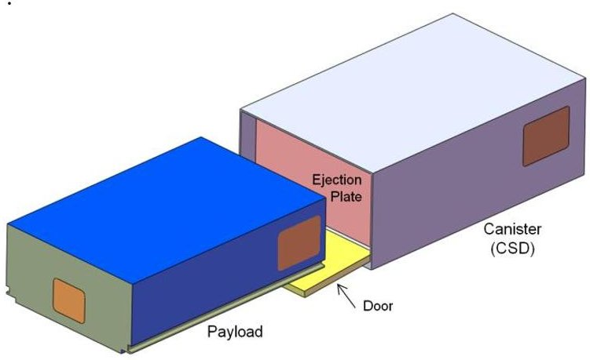

Figure 1: A 6U Payload and CSD

Payload Comparisons

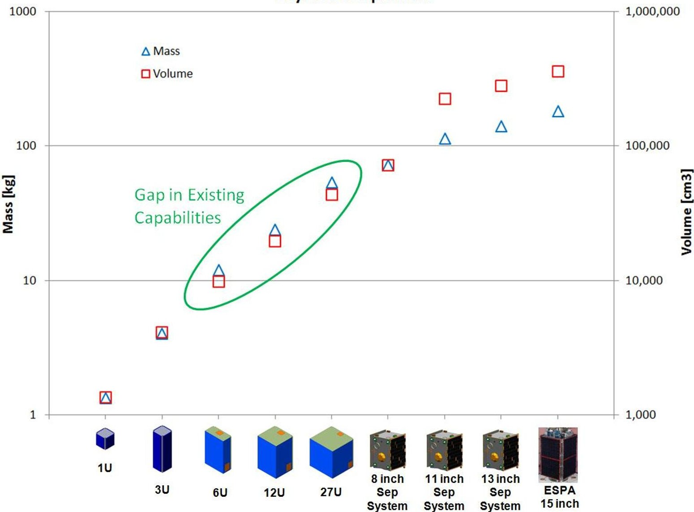

Figure 2: Need for 6U, 12U and 27U Payloads

<!-- PDF_PAGE: 3 -->

## ADVANCED FEATURES

The 6U, 12U and 27U payloads and canisters incorporate several features aimed at increasing performance, reducing complexity and minimizing integration costs.

1. Tabs: Two tabs run the length of the payload and are intended to be gripped by the canister, functioning similar to an automobile's brake caliper and rotor. This eliminates excessive payload chatter during launch. It also provides a predictable and thus model-able dynamic environment. This is significant for the launch vehicle, especially as payloads increase in mass. It is also reassuring for critical payloads with sensitive instruments. The tabs also serve the benefit of reducing manufacturing complexity as only the tab thickness is tightly controlled. Furthermore, eliminating the rails at the other two corners provides more room for body-mounted or deployable solar panels.

2. Mass: The density of the 6U-27U payloads has increased slightly allowing more mission enabling technologies. The considerable mass can reduce thermal extremes on-orbit and increase orbit life.

3. Non-Constrained Deployables: The payload has the option to use the canister as the means of constraining deployables. This reduces the complexity and volume of the restraint/release mechanism. It also eliminates a potential failure mode.

4. LV Electrical Interface: A DB-9 socket connector is the standardized canister interface to the LV. The pin-outs and electrical parameters are predefined, allowing the LV to plan ahead and eliminate variances that inevitability increase cost. The connector is located on a consistent face to enable the LV to size and locate their harness. This inexpensive and compact connector has significant flight heritage on several separation systems.

5. LV Mechanical Interface: The standard mounting pattern is a repeatable square grid pattern, independent of canister size. Additional patterns may be added to allow compatibility with existing deployers.

6. Placard: The payload and canisters may be integrated several months or years ahead of launch. A placard informs the LV of the contents, provides traceability, and reaffirms conformance to a specification giving the LV and primary payload assurance of mission success.

## PAYLOAD AND CSD SPECIFICATIONS

Following are the 6U,12U and 27U Payload and CSD specifications. The Payload, 2002206 Rev A, is a standalone specification intended for payload designers. They can build to this spec without need to reference the CSD. The CSD, 2002220 Rev -, is intimately linked to the Payload. It is intended to inform canister designers as well as launch service providers. The CSD designers must necessarily examine the payload spec to ensure compatibility. By examining both the payload and CSD specs the launch service provider has all information necessary for integration. The launch vehicle can allocate space for one or multiple CSDs without knowledge of the specific payload.

<!-- PDF_PAGE: 4 -->

This is a standalone specification intended to inform payload designers. CSD manufacturers may also reference this specification to ensure compatibility.

## FEATURES

These payloads are designed to be fully contained within Canisterized Satellite Dispensers (canister or CSD) during launch. A canister encapsulates the payload during launch and dispenses it on orbit. Canisters reduce risk to the primary payload and so maximize potential launch opportunity. Canisters also ease restrictions on payload materials and components. This specification currently encompasses three sizes of payloads. The 6U, 12U and 27U incorporate two tabs running the length of the ejection axis. The canister may grip these tabs, providing a secure, modelable, preloaded junction during launch. To maintain compatibility with existing standards the 6U can be made with typical rails as used in CubeSat. Note however with rails the payload is not preloaded in its canister and may chatter during launch.

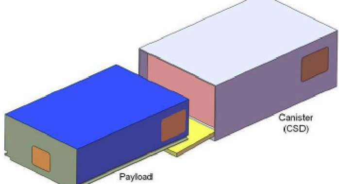

Figure 1: Payload deploying from Canister

## CONTENTS

<table><tr><td>FEATURES</td><td>1</td></tr><tr><td>CONTENTS</td><td>1</td></tr><tr><td>REVISION HISTORY</td><td>1</td></tr><tr><td>INHIBIT AND ARM CIRCUIT</td><td>1</td></tr><tr><td>PARAMETERS</td><td>2</td></tr><tr><td>COMMON REQUIREMENTS</td><td>2</td></tr><tr><td>BENEFIT OF TABS</td><td>2</td></tr><tr><td>6U, 12U &amp; 27U PAYLOADS WITH TABS</td><td>3</td></tr><tr><td>6U PAYLOAD WITH RAILS</td><td>4</td></tr><tr><td>TEST AND INTEGRATION FLOW</td><td>5</td></tr><tr><td>ADDITIONAL INFORMATION</td><td>5</td></tr><tr><td>AUTHORS</td><td>5</td></tr></table>

<table border="1"><tr><td>Revision</td><td>Date</td><td>Design</td><td>Review</td></tr><tr><td>-</td><td>18-Apr-2011</td><td>RH</td><td>WH</td></tr><tr><td>A</td><td>13-Jun-2011</td><td>RH</td><td>WH</td></tr></table>

## REVISION HISTORY

Changes from previous revision:

Added Fig 1. Added Requirements. Added 12U and 27U to Fig. 2. Added Inhibit and Arm Circuit. Added Parameters. Added +/- Y face access zones. Added Benefits of Tabs. Allowed non-constrained deployables. Changed Environmental Testing. Changed Figs. 5-8. Added Test and Integration Flow. Added Additional Information. Added Authors.

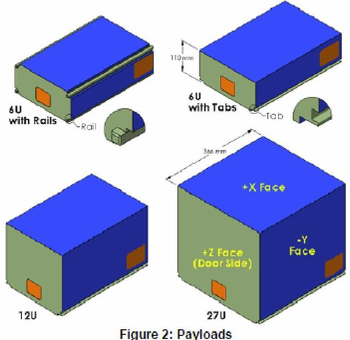

Figure 2: Payloads

## INHIBIT AND ARM CIRCUIT

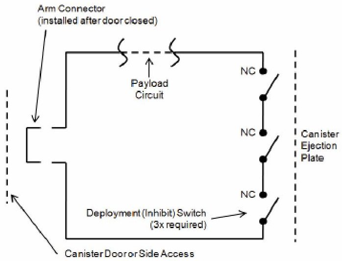

Figure 3: Payload inhibit and safe/arm circuit.

<!-- PDF_PAGE: 5 -->

PARAMETERS

<table border="1"><tr><td rowspan="2">SYM</td><td rowspan="2">Parameter</td><td rowspan="2">Conditions</td><td rowspan="2">Unit</td><td colspan="2">6U with Rails</td><td colspan="2">6U with Tabs</td><td colspan="2">12U with Tabs</td><td colspan="2">27U with Tabs</td></tr><tr><td>Min</td><td>Max</td><td>Min</td><td>Max</td><td>Min</td><td>Max</td><td>Min</td><td>Max</td></tr><tr><td>M</td><td>Mass</td><td>At launch</td><td>kg</td><td>0</td><td>12</td><td>0</td><td>12</td><td>0</td><td>24</td><td>0</td><td>54</td></tr><tr><td>CMx</td><td>Center of mass,X</td><td>Stowed in canister</td><td>mm</td><td>30</td><td>70</td><td>10</td><td>70</td><td>55</td><td>125</td><td>100</td><td>180</td></tr><tr><td>CMy</td><td>Center of mass,Y</td><td>Stowed in canister</td><td>mm</td><td>-40</td><td>40</td><td>-40</td><td>40</td><td>-40</td><td>40</td><td>-60</td><td>60</td></tr><tr><td>CMz</td><td>Center of mass,Z</td><td>Stowed in canister</td><td>mm</td><td>133</td><td>233</td><td>133</td><td>233</td><td>133</td><td>233</td><td>133</td><td>233</td></tr><tr><td>Depth</td><td>Maximum payload depth,+X dimension</td><td></td><td>mm</td><td>-</td><td>-</td><td>0</td><td>106.4</td><td>0</td><td>219.1</td><td>0</td><td>331.8</td></tr><tr><td>Width</td><td>Maximum payload width from origin,±Y dimension</td><td></td><td>mm</td><td>-</td><td>-</td><td>0</td><td>119.5</td><td>0</td><td>119.5</td><td>0</td><td>175.9</td></tr><tr><td>Tab Width</td><td>±Y dimension</td><td></td><td>mm</td><td>-</td><td>-</td><td>237.6</td><td>238.0</td><td>237.6</td><td>238.0</td><td>350.3</td><td>350.7</td></tr><tr><td>Tab Length</td><td>+Z dimension</td><td></td><td>mm</td><td>-</td><td>-</td><td>360.9</td><td>365.9</td><td>360.9</td><td>365.9</td><td>360.9</td><td>365.9</td></tr><tr><td>DSX</td><td>+X dimension defining allowable zone for deployment switches</td><td></td><td>mm</td><td>-</td><td>-</td><td>-</td><td>100</td><td>-</td><td>212</td><td>-</td><td>325</td></tr><tr><td>FDS</td><td>Force from deployment switches, summated,Z axis</td><td>When contacting CSD ejection plate</td><td>N</td><td>0</td><td>2.2</td><td>0</td><td>2.2</td><td>0</td><td>2.2</td><td>0</td><td>2.2</td></tr><tr><td>DDS</td><td>Payload separation from ejection plate necessary to change deployment switch state,Z axis</td><td></td><td>mm</td><td>1.3</td><td>12</td><td>1.3</td><td>12</td><td>1.3</td><td>12</td><td>1.3</td><td>12</td></tr><tr><td>FFD</td><td>Friction force imparted on deployables from canister walls during ejection, summated</td><td></td><td>N</td><td>0</td><td>2.0</td><td>0</td><td>2.0</td><td>0</td><td>2.0</td><td>0</td><td>2.0</td></tr><tr><td>FND</td><td>Normal force deployables impart on canister walls during ejection, per wall</td><td></td><td>N</td><td>0</td><td>4.0</td><td>0</td><td>4.0</td><td>0</td><td>4.0</td><td>0</td><td>4.0</td></tr><tr><td>EL</td><td>External load on payload, any direction</td><td>supported solely by tabs or rails</td><td>g</td><td>29</td><td>(1)</td><td>29</td><td>(1)</td><td>23</td><td>(1)</td><td>16</td><td>(1)</td></tr><tr><td>TML</td><td>Total Mass Loss</td><td>Per ASTM E 595-77/84/90</td><td>%</td><td>0</td><td>1.0</td><td>0</td><td>1.0</td><td>0</td><td>1.0</td><td>0</td><td>1.0</td></tr><tr><td>CVCM</td><td>Collected Volatile Condensable Material</td><td>Per ASTM E 595-77/84/90</td><td>%</td><td>0</td><td>0.1</td><td>0</td><td>0.1</td><td>0</td><td>0.1</td><td>0</td><td>0.1</td></tr><tr><td>DP</td><td>Canister de-pressurization rate</td><td>During launch</td><td>psi/sec</td><td>0</td><td>0.5</td><td>0</td><td>0.5</td><td>0</td><td>0.5</td><td>0</td><td>0.5</td></tr></table>

(1) Load increases with reduced payload mass. Load[g] = 51-8.75*ln(mass[kg]).

## COMMON REQUIREMENTS

1. Tabs or rails shall be 100% continuous hard anodized aluminum per MIL-A-8625 or similar. Minimum 0.001 inch total thickness (0.0005

penetration + 0.0005 build-up). Teflon impregnation is acceptable. Maximum surface roughness of rails = 0.8 $ \mu $m Ra.

2. No debris shall be generated that will inhibit separation

3. Deployment (inhibit) switches shall reside in specified zone on -Z face. Will activate upon contact with canister ejection plate.

4. Safe/Arm plug, if necessary, shall reside in specified zone on +Z, +Y, or -Y face.

5. All non-constrained deployables shall be hinged near the +Z face to minimize snagging hazards during ejection.

6. -2 face of payload shall withstand a 200 N force imparted by canister ejection plate during launch or ejection.

7. Payload may be electrically grounded by contacting canister ejection plate within inhibit switch zone.

8. Perform fit-check of payload with canister at earliest possible time.

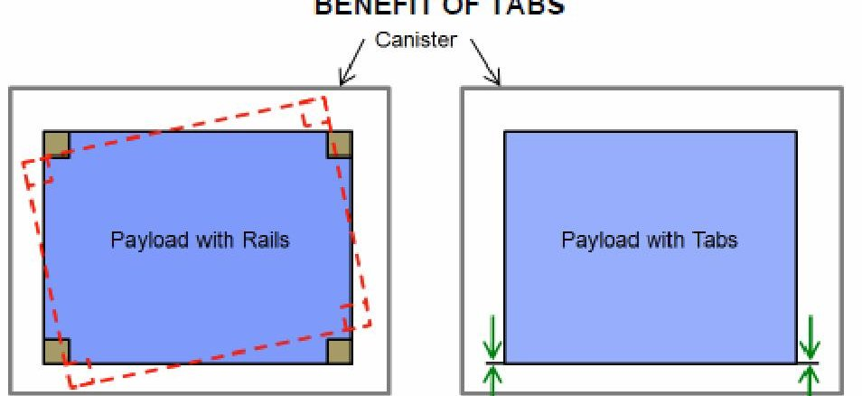

Payload may vibrate in canister because of small gap between rails and canister walls.

Tabs guarantee an invariant load path, allowing useful predictions of dynamic response.

<!-- PDF_PAGE: 6 -->

## 6U, 12U & 27U PAYLOADS WITH TABS

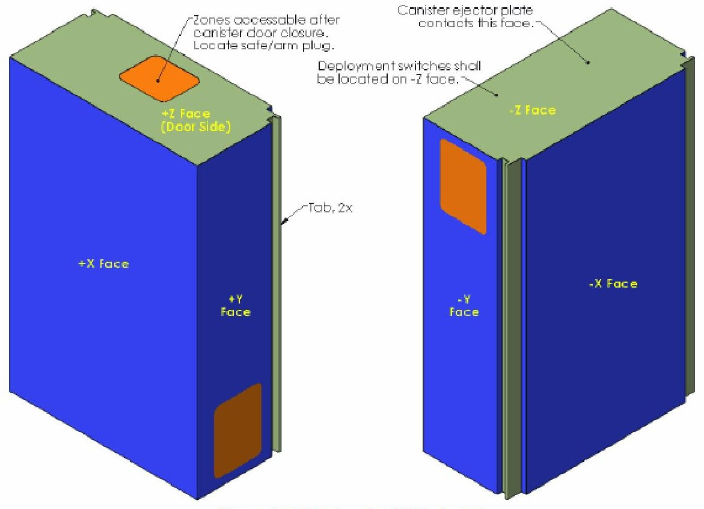

Figure 4: Tabbed payload (6U shown)

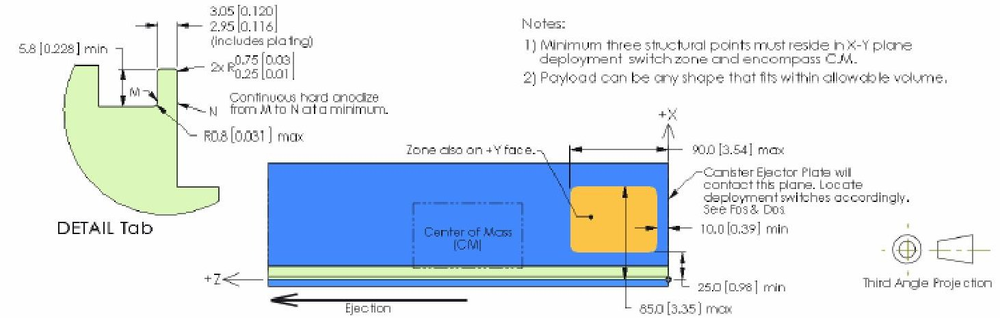

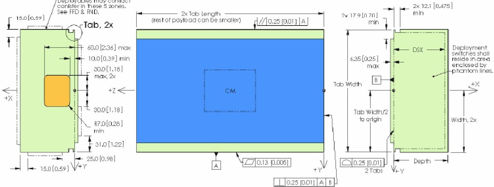

Figure 5: Tabbed payload, mm [in]

<!-- PDF_PAGE: 7 -->

6U PAYLOAD WITH RAILS

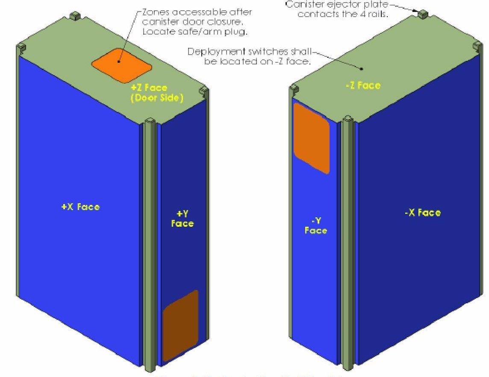

Figure 6: Payload with rails (6U only)

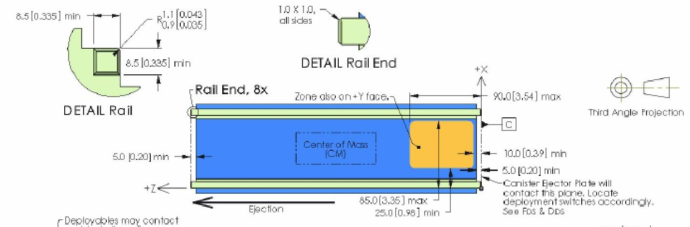

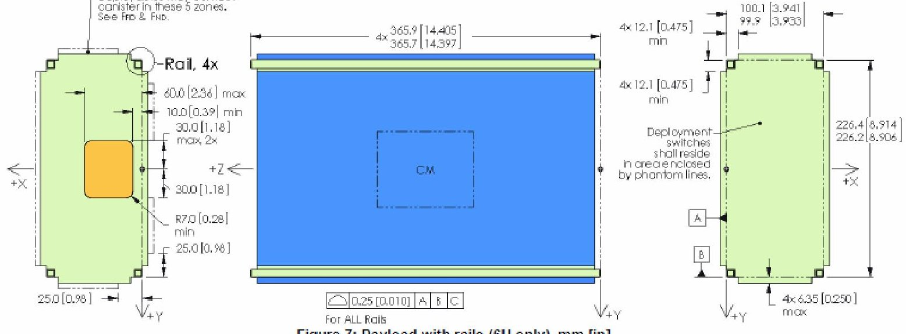

<!-- PDF_PAGE: 8 -->

TEST AND INTEGRATION FLOW Test levels are for launch environment, not necessarily on-orbit.

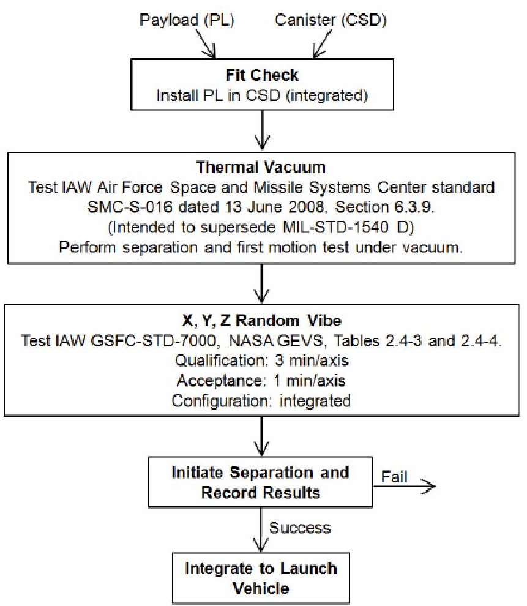

## ADDITIONAL INFORMATION

Verify this is the latest revision of the specification by visiting www.planetarysystemscorp.com. Simple step models and 3D PDFs of the payloads and canisters are also available. Please contact Ryan Hevner, ryanh@planetarysystemscorp.com with questions or comments. Feedback is welcome in order to realize the full potential of this technology.

## AUTHORS

Specification created by: Ryan Hevner, Planetary Systems Corp Walter Holemans, Planetary Systems Corp Jordi Puig-Suari, Cal. Poly. San Luis Obispo Robert Twiggs, Morehead State University

With contributions from and special thanks to: Bruce Yost, NASA Ames Jim White, Colorado Satellite Services Andrew Kalman, Pumpkin Inc. Adam Reif, Pumpkin Inc.

<!-- PDF_PAGE: 9 -->

This specification is intended to inform CSD manufacturers and launch service providers. It is compatible with 2002206 Rev A "Payload Specification for 6U, 12U and 27U".

## FEATURES

A Canisterized Satellite Dispenser (canister or CSD) is a box that encapsulates the payload (PL) during launch and dispenses it on orbit. Canisters reduce risk to the primary payload and so maximize potential launch opportunity. Their relatively small size enables placement on most launch vehicles (LV). Canisters also ease restrictions on payload materials and components. This specification currently encompasses canisters for three sizes of payloads. The 6U, 12U and 27U incorporate two tabs running the length of the ejection axis. The canister may grip these tabs, providing a secure, modelable, preloaded junction during launch. To maintain compatibility with existing standards the 6U can be made with typical rails as used in CubeSat. Note however with rails the payload is not preloaded in its canister and may chatter during launch.

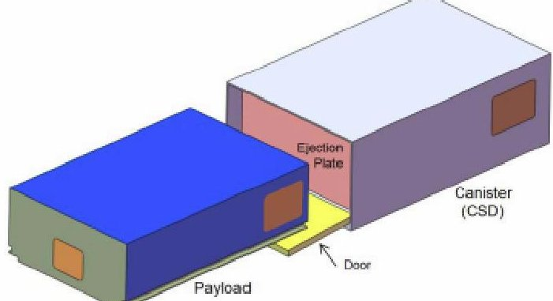

Figure 1: Payload Deploying From CSD

## CONTENTS

FEATURES ... 1

CONTENTS ... 1

REVISION HISTORY ... 1

COMMON REQUIREMENTS ... 1

ELECTRICAL INTERFACE TO LV ... 1

PARAMETERS ... 2

PLACARD ... 2

6U, 12U & 27U CSD ... 3

TEST AND INTEGRATION FLOW ... 4

ADDITIONAL INFORMATION ... 4

AUTHORS ... 4

REVISION HISTORY

<table border="1"><tr><td>Revision</td><td>Date</td><td>Design</td><td>Review</td></tr><tr><td>-</td><td>13-Jun-2011</td><td>RH</td><td>WH</td></tr></table>

Changes from previous revision: This is the initial release.

## COMMON REQUIREMENTS

1. Mounting surface to LV shall be electrically conductive.

2. Access panels to payload shall be removable with small flat or Phillips screwdriver or 3/32 in hex key. Torque spec, if applicable, shall be imprinted on CSD.

3. An ejection plate shall push on -Z face of payload to deploy. Plate shall fully encompass payload deployment switch zone and be flat to 0.5mm. See payload specification for deployment switch zone dimensions.

4. Payload shall be oriented in CSD per Figure 6.

5. Ejection Plate shall be electrically grounded to CSD walls. Payload side of ejection plate shall be conductive.

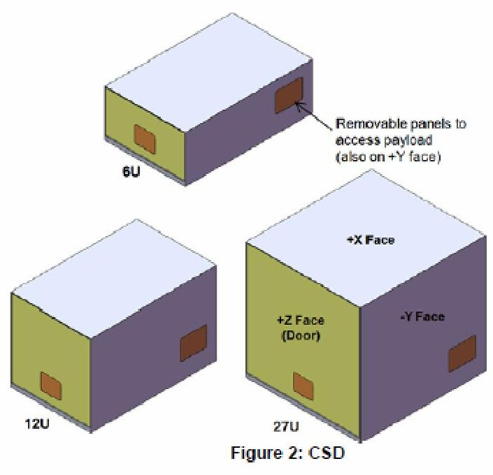

ELECTRICAL INTERFACE TO LV

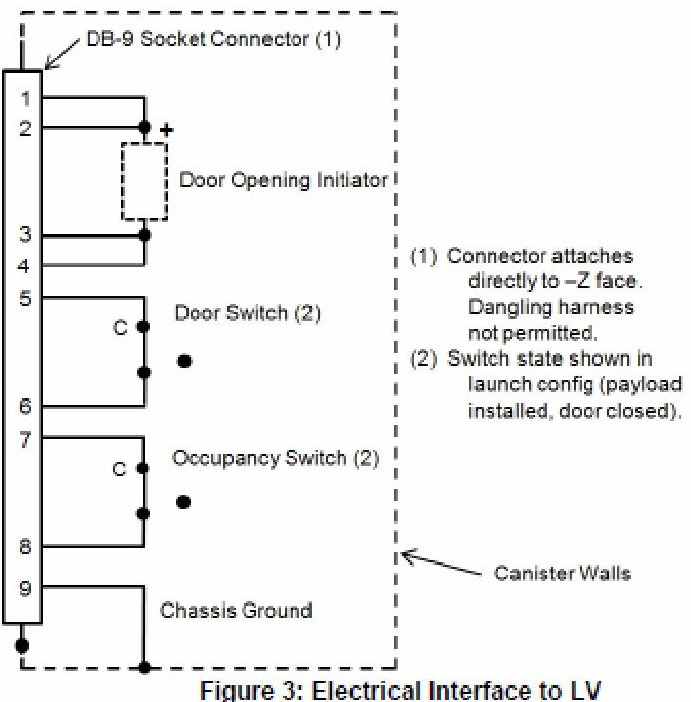

Figure 3: Electrical Interface to LV

<!-- PDF_PAGE: 10 -->

PARAMETERS

<table border="1"><tr><td rowspan="2">SYM</td><td rowspan="2">Parameter</td><td rowspan="2">Conditions</td><td rowspan="2">Units</td><td colspan="2">6U</td><td colspan="2">12U</td><td colspan="2">27U</td></tr><tr><td>Min</td><td>Max</td><td>Min</td><td>Max</td><td>Min</td><td>Max</td></tr><tr><td>M</td><td>Mass</td><td>Empty</td><td>kg</td><td>-</td><td>7.2</td><td>-</td><td>10.8</td><td>-</td><td>15.1</td></tr><tr><td>Depth</td><td>CSD depth, from origin,+X</td><td></td><td>mm</td><td>-</td><td>163</td><td>-</td><td>276</td><td>-</td><td>389</td></tr><tr><td>Width</td><td>CSD width, from origin,+/-Y</td><td></td><td>mm</td><td>-</td><td>140</td><td>-</td><td>140</td><td>-</td><td>195</td></tr><tr><td>Length</td><td>CSD length, from origin,+Z</td><td>Door closed</td><td>mm</td><td>-</td><td>470</td><td>-</td><td>470</td><td>-</td><td>470</td></tr><tr><td>ΔV</td><td>Payload ejection velocity</td><td>Max payload mass, infinite CSD mass</td><td>m/sec</td><td>0.5</td><td>5.0</td><td>0.5</td><td>5.0</td><td>0.5</td><td>5.0</td></tr><tr><td>V</td><td>Voltage provided from LV to open door</td><td>-34 to +71℃, power to pins 1&amp;2, return from pins 3&amp;4</td><td>Vdc</td><td>22</td><td>36</td><td>22</td><td>36</td><td>22</td><td>36</td></tr><tr><td>I</td><td>Current available from LV to open door</td><td>-34 to +71℃, power to pins 1&amp;2, return from pins 3&amp;4</td><td>A</td><td>5.0</td><td>-</td><td>5.0</td><td>-</td><td>5.0</td><td>-</td></tr><tr><td>T</td><td>Electrical pulse width provided from LV to open door</td><td>-34 to +71℃, power to pins 1&amp;2, return from pins 3&amp;4</td><td>sec</td><td>4.0</td><td>10.0</td><td>4.0</td><td>10.0</td><td>4.0</td><td>10.0</td></tr><tr><td>Wire</td><td>Electrical wiring</td><td>Wiring shown in Figure 3.</td><td>AWG</td><td>20</td><td>26</td><td>20</td><td>26</td><td>20</td><td>26</td></tr><tr><td>RS</td><td>Switch terminal resistance</td><td>Closed circuit, door and occupancy switches</td><td>ohm</td><td>0.0</td><td>0.2</td><td>0.0</td><td>0.2</td><td>0.0</td><td>0.2</td></tr><tr><td>IIR</td><td>Inrush current capacity of switch</td><td>&lt;0.5 sec,30 Vdc,&lt;10e-5 torr, Door and occupancy switches</td><td>A</td><td>-</td><td>4.0</td><td>-</td><td>4.0</td><td>-</td><td>4.0</td></tr><tr><td>ISS</td><td>Steady state current capacity of switch</td><td>30 Vdc,&lt;10e-5 torr, door and occupancy switches</td><td>A</td><td>-</td><td>2.0</td><td>-</td><td>2.0</td><td>-</td><td>2.0</td></tr><tr><td>PT</td><td>Payload travel required for occupancy switch change state</td><td>+Z travel from launch position</td><td>mm</td><td>300</td><td>440</td><td>300</td><td>440</td><td>300</td><td>440</td></tr><tr><td>DP</td><td>Door position for door switch change of state</td><td>Angle(0deg is closed)</td><td>deg</td><td>0.4</td><td>5.0</td><td>0.2</td><td>5.0</td><td>0.15</td><td>5.0</td></tr><tr><td>FEP</td><td>Ejection plate force on payload</td><td>During launch and deployment</td><td>N</td><td>0</td><td>200</td><td>0</td><td>200</td><td>0</td><td>200</td></tr><tr><td>LVF</td><td>LV flatness</td><td>Interface to CSD-X face</td><td>mm</td><td>0.0</td><td>0.3</td><td>0.0</td><td>0.3</td><td>0.0</td><td>0.5</td></tr><tr><td>TML</td><td>Total Mass Loss</td><td>Per ASTM E 595-77/84/90</td><td>%</td><td>0</td><td>1.0</td><td>0</td><td>1.0</td><td>0</td><td>1.0</td></tr><tr><td>CVCM</td><td>Collected Volatile Condensable Material</td><td>Per ASTM E 595-77/84/90</td><td>%</td><td>0</td><td>0.1</td><td>0</td><td>0.1</td><td>0</td><td>0.1</td></tr><tr><td>DP</td><td>LV de-pressurization rate</td><td>During launch</td><td>psi/sec</td><td>0</td><td>0.5</td><td>0</td><td>0.5</td><td>0</td><td>0.5</td></tr></table>

## PLACARD

## Requirements

1. Locate on +Z face (door).

2. Minimum text height 0.12 in.

3. Engrave, etch or stamp.

4. Tag shall be replaceable.

5. Text shall be legible in poorly lit room and under direct sunshine.

6. May add additional information as desired.

<!-- PDF_PAGE: 11 -->

CSD SPECIFICATION FOR 6U, 12U AND 27U

6U,12U & 27U CSD

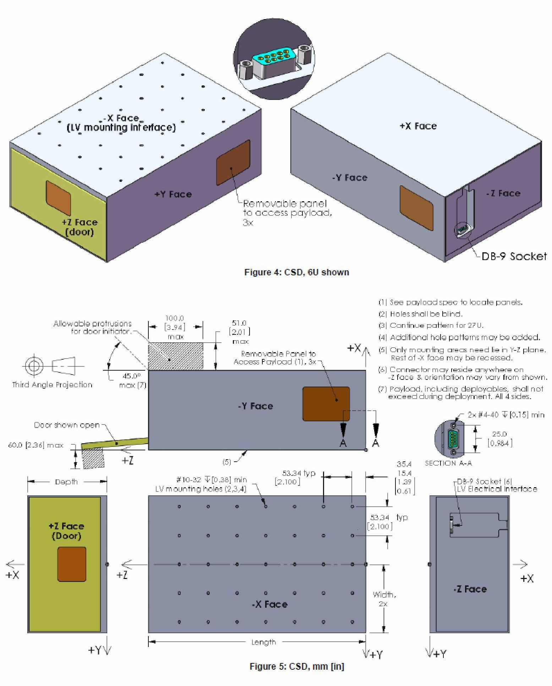

<!-- PDF_PAGE: 12 -->

CSD SPECIFICATION FOR 6U, 12U AND 27U

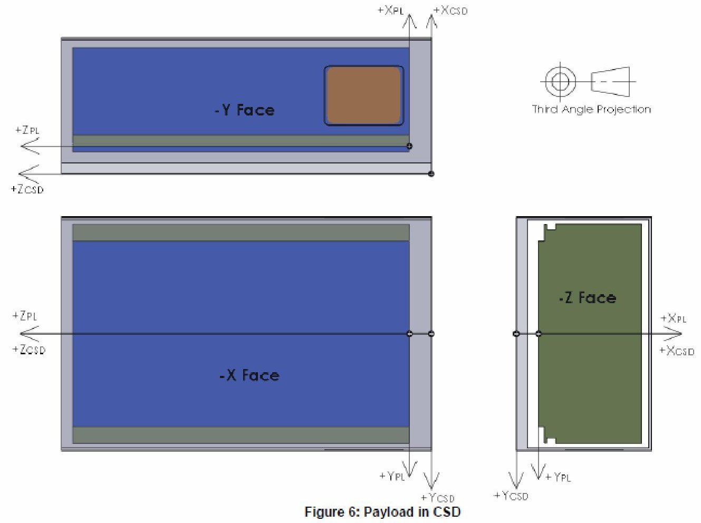

TEST AND INTEGRATION FLOW Test levels are for launch environment, not necessarily on-orbit.

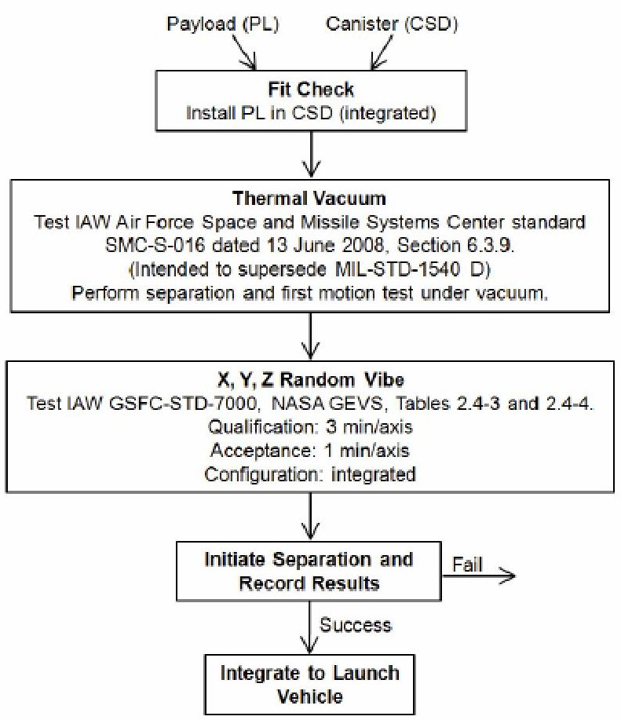

## ADDITIONAL INFORMATION

Verify this is the latest revision of the specification by visiting www.planetarysystemscorp.com. Simple step models and 3D PDFs of the payloads and canisters are also available. Please contact Ryan Hevner. ryanh@planetarysystemscorp.com with questions or comments. Feedback is welcome in order to realize the full potential of this technology.

## AUTHORS

Specification created by: Ryan Hevner, Planetary Systems Corp Walter Holemans, Planetary Systems Corp Jordi Puig-Suari, Cal. Poly. San Luis Obispo Robert Twiggs, Morehead State University

With contributions from and special thanks to: Bruce Yost, NASA Ames Jim White, Colorado Satellite Services Andrew Kalman, Pumpkin Inc. Adam Reif, Pumpkin Inc.