<!-- PDF_PAGE: 1 -->

# From Model-Based Requirements to an Intelligent Systems Engineering Advisor that Identifies Gaps in Requirements: An Application to Space Systems

Alejandro Salado $ ^{1} $ Virginia Tech, Blacksburg, VA 24060, USA

Requirements have traditionally had a prominent role in the development of space systems. Engineers pursue completeness when establishing sets of requirements to avoid inadvertently developing or accepting systems that are present interoperability problems or a simply not fit for purpose. Yet, requirement gaps are common in the development of space systems. If lucky, those gaps are identified (and costly corrected) before the space system is deployed. Otherwise, those gaps reduce the success of the space mission as the system becomes operational. Unfortunately, the completeness of a set of requirements cannot be demonstrated; rather, completeness is a pursuit. Hence, the level of comprehensiveness of a set of requirements that can be attained is heavily driven by the engineer or team put to the task of defining the problem space. In this paper, we present a proof-of-concept of a virtual systems engineering (SE) advisor that supports the engineer in identifying gaps in the sets of requirements. The SE advisor evaluates requirements that are formulated as models and leverages a knowledge repository to reason about the meaning of the model-based requirements. If potential gaps in the set of requirements are identified, then the SE advisor presents them to the engineer, who decides how to address the gaps. For the proof-of-concept presented in this paper, requirements of a notional communications payload were modeled using the True Model-Based Requirements (TMBR) framework, which was implemented using an extension of the Systems Modeling Language (SysML). The SE advisor was embedded as a plug-in in a Model-Based Systems Engineering (MBSE) environment. The knowledge repository was limited to a set of hardcoded rules that captured knowledge associated to structural relationships of the model. Specifically, the rules capture fundamental meaning of model objects instead of syntactic ones. In this way, the SE advisor is purposed towards assessing requirements validation, not verifying model construction.

## I. Introduction

Requirements are a common systems engineering artifact in the development of space systems [1]. Requirements define the problem boundaries within which contractors seek acceptable solutions [2]. Furthermore, customers use requirements to set forth the criteria to measure the extent to which the contractor has fulfilled their contract [3,4]. In this context, the quality of a requirement set can be determined by the fidelity with which it captures the right problem and the level of contractual safety that it provides. From a customer's perspective, missing requirements can lead to the development and inadvertent acceptance of space systems that are not fit for purpose. Similarly, from a satellite developer's perspective, missing requirements may foster anchoring to a solution that is contractually acceptable for the customer, but which does not satisfy its needs.

Achieving completeness is therefore a necessary objective to avoid gaps in the problem formulation [5]. Here, we understand completeness of a requirement set as the state in which "there are no other requirements necessary for the set of related requirements to fulfill their collective purpose or mission of defining what a given system must be and

<!-- PDF_PAGE: 2 -->

do, with respect to some specific context" [6]. Yet, requirement gaps are common in the development of space systems [7] because they are very difficult to identify [8]. In fact, the completeness of a set of requirements cannot be formally proven [9, 10]. Even though methods that leverage traceability relationships or derivation analyses can be used to detect unallocated stakeholder needs [9, 11], uncertainty about completeness of both the derivation of stakeholder needs into system requirements and the elicitation of stakeholder needs themselves remains. This implies that, since completeness cannot be demonstrated, it should be treated as an objective that can only be pursued on best-effort basis. Under these conditions, the human (engineer or team of engineers) becomes a major factor in the comprehensiveness of the resulting set of requirements [12].

We suggest that an intelligent systems engineering (SE) advisor can aid the (human) engineer during problem formulation to improve the completeness of resulting sets of requirements. Pursuing this idea, in this paper, we show how, by adopting a model-based approach to requirements formulation, a computer system can interpret model constructs and provide recommendations about potential requirement gaps. Particularly, we present a proof-of-concept for an intelligent SE advisor, called Houston, which supports the (human) engineer in identifying gaps as requirements are formulated. Houston applies a set of predefined model construct rules [13] to requirements that are modeled using the True Model-Based Requirements (TMBR) approach [14]. The SE advisor proof-of-concept was implemented as a plugin for the Cameo Systems Modeler environment and applied to a few notional requirements for a satellite communication system.

The rest of the paper is organized as follows. Section II provides summaries of background work in the areas of evaluation of requirement completeness, model-based requirements, and intelligent advisors in the field of systems engineering. The TMBR approach is summarized in Section III, followed in Section IV by a description of the conceptual design of Houston, together with the structural evaluation rules. The application of Houston to the notional requirements of a satellite communication system is presented in Section V. Finally, the conclusions of the paper are summarized in Section VI.

## II. Background

## A. Evaluation of Requirements Completeness

Both producing complete sets of requirements and assessing the completeness of existing sets of requirements have been attempted in the past [6]. Pre-established templates or checklists that guide the types of requirements that the engineer may want to consider (e.g., [15-19]), expert review [20], eliciting operational scenarios and use cases [18, 21, 22], and performing context analysis and stakeholder identification [11, 23] are common in literature and practice. Regardless of the methodology, Mar [24] suggest that five criteria are necessary for establishing requirements completeness: (i) all categories of requirements are addressed, (ii) all responsibilities allocated from higher-level specifications are recognized, (iii) all scenarios and states are recognized, (iv) all assumptions are documented, (v) unambiguous terminology is employed. Experience suggests that the first and third criteria are the most difficult to achieve [11]. Research shows though that addressing all categories of requirements may be problematic when eliciting stakeholder needs and not so much when deriving system requirements [25]. Identification of scenarios and states is central to the intelligent SE advisor presented in this paper.

## B. Model-Based Requirements

Most of the literature in model-based requirements deals with aspects related to requirements management (e.g., requirements traceability and allocation [26-33] or requirements engineering and management processes [30, 34-36]). Because such work does not address epistemological and structural aspects of model-based requirements, the resulting models cannot be used to detect requirement gaps.

Modeling the actual requirements is currently been accomplished with one of two approaches. The first approach defines a specific type of model object that encapsulates the requirement, which is formulated using a textual statement. For example, SysML uses elements called requirement element and requirement diagram [37]. Given the inherent vagueness of natural language to formulate requirements [14], such modeling approach provides minimal improvement with respect to working with textual documents (from the perspective of enabling computational assessment of requirement completeness). While parsing textual requirement statements into a set of properties or constraints associated to objects has been shown to be feasible in software systems [38], since parsing protocols rely on the structure of natural language, and not on meaning, the resulting requirements model inherits the vagueness of natural language.

In the second approach, system models are directly flagged as requirements. They often use behavioral models and/or state machines to capture functional requirements [39-45], and non-functional requirements are captured as properties or attributes of the system [46, 47]. For example, in SysML, this is achieved by defining values for the

<!-- PDF_PAGE: 3 -->

physical block that represents the system for which requirements are being formulated [36, 48]. However, this second approach presents two weaknesses, which are discussed at length by Salado and Wach in [14]. First, the separation between functional and non-functional requirements is ambiguous [19], since, from a systems-theoretic standpoint, such a distinction does not really exist [14]. Requirements modeled in such way may therefore inaccurately capture the requirement of concern. Second, since directly using behavioral models of the system of interest imposes a solution as the requirement [49], such requirements may also unnecessarily over constrain the solution space [50].

To overcome these problems, formal requirement models that prescribe a requirement structure without relying on pre-existing textual statement have been proposed [28, 51]. For example, Micouin defines a requirement as a combination of a condition (e.g., when flying), a carrier (e.g., the system), a property (e.g., power consumption), and a domain (e.g., less than 100 W) [51]. While internally consistent, these structures do not prescribe the type of property that may be defined. As a result, they allow for imposing a system solution by defining design-dependent requirements, which are considered a poor practice in requirements engineering [49] because they unnecessarily over constrain the solution space [50].

Alternatively, requirements have also been modeled as exchanges in which the system of interest participates. Three approaches are predominant: model requirements as data exchanges [52], as exchanges between actors [53], and as input/output transformations through physical interfaces at the system boundary [14]. The first approach is insufficient to model space system requirements because it is only capable of modeling data exchanges, not physical aspects of the problem space. The second approach, modeling requirements as exchanges between actors, while may be promising to model stakeholder needs, it is not adequate for system requirements. This is because the requirement remains unbounded (dependent on the actions of external systems), which is considered a poor practice in requirements engineering [49]. The third approach, which is the basis of TMBR, is consistent with the principles of systems theory and the guidelines for writing good requirements [14]. Hence, it was selected to underpin the development of Houston.

## C. Intelligent Advisors in Systems Engineering

An intelligent SE advisor has been conceptualized as an assistant to a systems engineer that evaluates information artifacts and answers queries by finding data, displaying data, choosing the best way to display data, bring in experts when needed, and contrasting assumptions with facts, among others [54]. As of the time of writing this paper, the most known intelligent SE advisor, if not the only one, is Daphne, developed and led by Selva.

Daphne is a cognitive assistant that helps a (human) engineer during conceptual design and system architecture by populating tradespaces for space missions [55]. Furthermore, the engineer can also query Daphne to explain the decisions pertaining to the exploration path it makes, the selection of solutions as possible recommendations, and the presentation of results, among others [56]. Future development is expected to make Daphne a companion that proactively searches new design spaces, encourages the (human) engineer to diversify his/her search, and provides live suggestions as the (human) engineer modifies the design [57]. Current applications of Daphne include Earth observation distributed spacecraft missions [55], entry, descent, and landing architecture [58], and crew support to treat flight anomalies [59].

## III. True Model-Based Requirements (TMBR)

## A. Theoretical Construct

TMBR [14] is a formal modeling paradigm to model system requirements. System requirements define a solution space, enabling distinguishing systems (solutions) that are acceptable from those that are not [50]. We explicitly distinguish in this paper system requirements from stakeholder needs and address only modeling of the latter. A stakeholder need refers to a desired outcome of an interaction between the system and an external system or actor [14, 19]. A system requirement defines the conditions that a system needs to meet to enable the desired interaction captured in the form of stakeholder needs [14, 19], thus capturing the solution space as a set of systems that fulfill the requirements [14, 50, 60].

TMBR's modeling constructs are consistent with the systems-theoretic modeling constructs of Wymore's mathematical framework [60] and leverage formal taxonomies of requirements [19] and interfaces [61]. These foundations guarantee avoiding formal flaws in terms of bounding the solution space [14]. Wymore's definition of a system model is central to TMBR's theoretical framework. Assuming Wymore's position that all systems can be modeled as a transformation of input trajectories into output trajectories [60], TMBR attempts to model any type of requirement (i.e., functional, performance, resource, and environmental [19]) as a set (or sets) of required input/output transformations [14]. This is achieved by capturing any requirement as a construct of the type The system shall accept/provide something under certain conditions through an interface [14], where something is an item in the form of information, energy, or material [61].

<!-- PDF_PAGE: 4 -->

## B. Modeling Framework and Model Elements

In this paper, TMBR is implemented as an extension of behavioral and structural model elements of SysML [37]. The usage of the different model elements relies on semantics that differ from those corresponding to the original model elements in SysML. Specifically, the models presented in this paper capture solution spaces (sets of solutions), not systems (single solutions). While SysML models are used for diagrammatic purposes, their meaning differs from the traditional SysML specification. In particular, TMBR's implementation in SysML is architected as follows:

1) An extended sequence diagram captures the required logical transformation required to the system.

2) Signals capture required logical inputs and outputs with their required attributes.

3) Ports in block elements capture the required physical interfaces and their required properties through which inputs and outputs are conveyed.

4) An extended state machine diagram is used to capture mode requirements, which capture the simultaneity aspects of requirements applicability.

A visual representation of the basic construct of a requirement modeled as an input/output transformation is shown below in Fig. 1. Blocks are used to represent the system of interest for which requirements are being defined and sequence diagrams are used to capture the required flow of inputs (and outputs) to (and from) the system. In this way, the system remains a solid line, preventing the modeler from defining design-dependent or inner aspect of the system; only the system's behavior at its boundary in the form of external inputs and outputs is allowed. In (and out)-flows to (and from) the system are defined as items (i.e., energy, information, or material) not as actions, hence guaranteeing consistency with systems theoretic principles for system requirements.

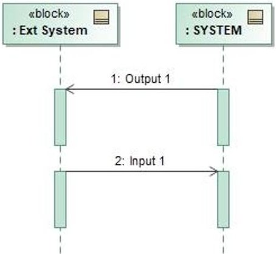

Fig. 1: Input/Output Transformation Sequence between a System and an External System

The signal element is used to capture the required input and output characteristics. Attributes of the signal are used to capture the required characteristics of the inputs and outputs. Examples of an input and an output are shown below in Fig. 2. The required interfaces through which the required inputs and outputs must be exchanged are captured using ports. An example of this is shown in Fig. 3. The required properties of the interfaces are captured using InterfaceBlocks. Properties and values are used to capture requirements on the physical and transport (data) layers of the interface. An example of a modeled interface is shown in Fig. 4.

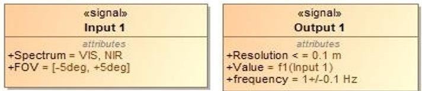

Fig. 2: Example of Input/Output Signals

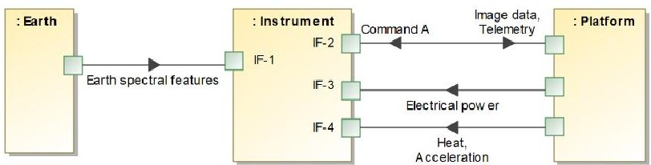

Fig. 3: Example of logical capture of interfaces

<!-- PDF_PAGE: 5 -->

<table border="1"><tr><td>《interfaceBlock》
P1</td></tr><tr><td>properties
《connector》 Connector = TSP</td></tr><tr><td>values
Pin allocation = List of pins
Voltage range = 0...5V
Thermal conductivity = [x,y] W/mK</td></tr></table>

Fig. 4: Example of the use of an InterfaceBlock to capture the characteristics of an interface

Simultaneity of requirements applicability is captured by extending the use of SysML state machine diagrams rather than capturing all requirement in one large sequence diagram. This is defined as a mode requirement, which captures all requirements that "do not have conflicting requirements and that must be fulfilled simultaneously" [14]. An example of this is shown in Fig. 5. In this example, the Accept external energy requirement and the Compute tasks requirements need to be fulfilled simultaneously.

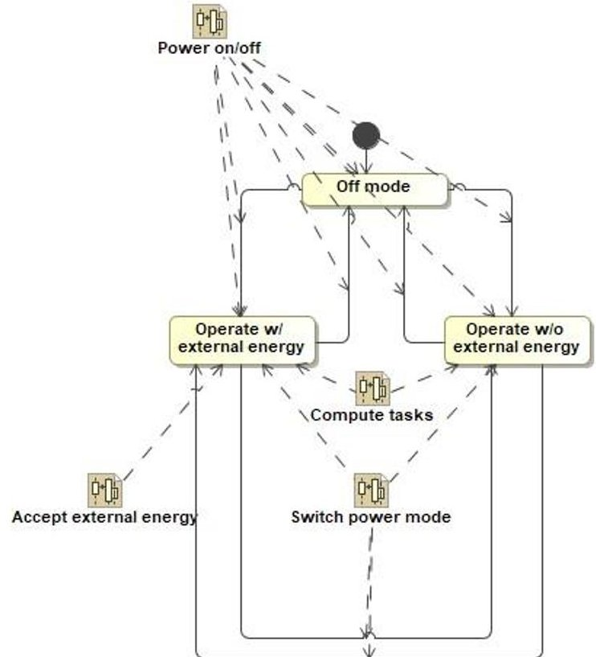

Fig. 5: Example of a mode requirement used to capture requirement simultaneity

It is critical to note that the state objects in the state diagram do not represent states in the traditional sense of SysML. They are only used in this implementation of TMBR to capture operational scenarios under which different requirements are expected to be fulfilled at the same time. The model does not impose any design constraint for the system, such as what states it will have; such design decision is left open. Eventually, a real state machine diagram that captures the actual behavior of a potential system (not the required one) may have a completely different set of state elements (in the diagram) than the mode requirement diagram contains for indicating requirements applicability (i.e., as used in this paper). This is because in a solution model, state elements capture system states, whereas, as indicated, state elements in TMBR capture operational conditions that differ in the requirements that need be fulfilled simultaneously. This choice avoids unnecessarily over constraining the solution space [62].

## IV. Houston: An Intelligent SE Advisor for Requirements

## A. Overview

Houston's conceptual design was first presented by Salado and Tan in [13]. Houston reads the requirement models and evaluates them against a knowledge repository to identify requirement gaps. If Houston identifies potential gaps in the set of requirements, then it presents them to the (human) engineer, who then decides how to address the gaps. Here, gaps refer to the potential need to explore a missing scenario, situation, or condition. Currently, Houston is not intended to predict or create requirements, because requirements are derived from stakeholder needs and such

<!-- PDF_PAGE: 6 -->

decisions should be made with the corresponding stakeholders, or at least with an understanding of stakeholder needs and desires. A conceptual sketch for Houston's interaction with the (human) engineer is shown in Fig. 6.

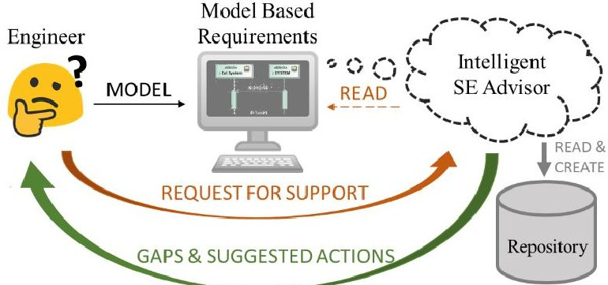

Fig. 6: Houston's concept [13].

Once presented with the potential gaps, the (human) engineer may take one of three actions:

1) Do not address the suggested scenario or conditions, that is, do not formulate/create requirement models for the identified gap.

2) Expand a given set of required conditions to include those in the identified gap.

3) Create a new requirement model that specifically addresses the identified gap.

A conceptual flow is represented in Fig. 7.

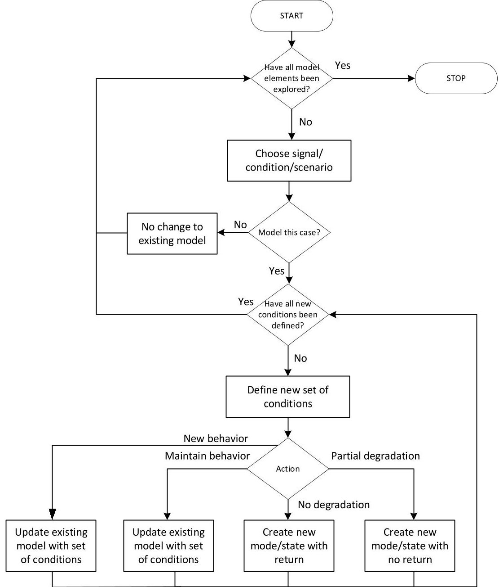

Fig. 7: Conceptual flow of Houston's evaluation process (adapted from [13]).

<!-- PDF_PAGE: 7 -->

## B. Roadmap

Houston's development is planned in three main sages. In each stage, an increasing level of sophistication of the knowledge repository and how it is leveraged is planned. In the first stage, the knowledge repository contains a set of hardcoded rules that capture knowledge associated to structural relationships of the model elements (TMBR in this case). Specifically, the rules capture fundamental meaning of model objects instead of syntactic ones. In this way, Houston is purposed towards assessing requirements validation, not verifying model construction. In the second stage, the knowledge repository is planned to be extended with a formal ontology to incorporate knowledge about the meaning captured in each model element, not just their structural relationships. By doing so, Houston will be provided with interpretation capabilities. For example, while in the first developmental stage Houston can only distinguish between an object being an input or an output, in the second developmental stage Houston can recognize if an input is incoming energy, a safety critical command, or a low priority request, evaluating and responding differently depending on the typology of the signals. In the third stage of development, learning capabilities are incorporated, allowing Houston to expand its knowledge repository by capturing engineering decisions within an organization, the consequences of those decisions, and the specific working patterns of the modelers.

A proof-of-concept implementation for Houston's first developmental stage was presented by Salado and Tan in [13]. Its knowledge repository contained five main structural rules, which are presented in the next section. The rules may be applied individually or collectively to each model object that is set for evaluation by the (human) engineer. Houston can in this sense be iteratively called for support, as new requirements are modeled. Convergence aspects, such as recording cases for which an action has taken (including the action to not address the concern) to avoid repeated suggestions, were not implemented. In this paper, we apply such first proof-of-concept to a communications space system notional problem.

## C. Gap Identification Rules

Table 1 lists the five main structural rules in Houston's first developmental proof-of-concept implementation presented in reference [13], which we will leverage in the application example presented in this paper.

## D. Implementation

Houston's implementation in this paper is identical to the one reported by Salado and Tan in [13]. Houston was implemented as a jython plug-in that utilizes Cameo Systems Modeler's Open API and SysML plug-in. The rules may be invoked on the requirements model through the "File" menu. The primary class for the implementation is the ProjectReviewer, which contains functions to facilitate rule invocation. The ProjectReviewer creates user interface elements as JOptionPanes, where the (human) engineer can use command-style text inputs to interact with Houston. The ProjectReviewer also provides functions for manipulating and creating elements in sequence diagrams, state machine diagrams, and block definition diagrams. With this implementation, the (human) engineer can review, decide on, and modify requirements based on the rules framework by following Houston's prompts.

## V. Application to the Requirements of a Satellite Communication System

## A. Case Description

For our application example, we consider a notional communication satellite that is intended to broadcast a certain signal. Specifically, we target its communication payload as the system of interest for which requirements will be established. In essence, the payload must accept a content signal from the satellite bus and broadcast it to a (set of) ground stations. In addition, we adopt the following assumptions on other requirements of interest:

1) The payload must deploy its antennas under command from the satellite bus.

2) The satellite bus will supply electrical power to the payload.

3) The payload must provide the satellite bus with status reports as telemetry under command.

The requirements above were chosen to illustrate the way Houston leverages the five rules presented in Section IV.D, while maintaining sufficient simplicity to easily convey the key insights of our work.

The application example is presented in three steps, collectively representing a notional snippet of the sequential interaction between the (human) engineer and Houston, as described in Fig. 6.

1) In Step 1, the (human) engineering establishes the initial requirements baseline. Requirements are presented as TMBR models. The requirements are notional and represent a given state in the requirements definition process. Only those details necessary to showcase Houston's concept have been specified.

2) In Step 2, the (human) engineer queries Houston to seek requirements gaps. Houston reads the requirements baseline and suggests several possible requirements gaps, together with possible actions that the (human) engineer may take.

<!-- PDF_PAGE: 8 -->

3) In Step 3, the (human) engineer makes decisions on how to address the possible requirements gaps identified by Houston and evolves the requirements into a next baseline. The decisions are notional and were selected to show a diversity of reactions that an engineer may have when dealing with Houston's suggestions.

Finally, it is assumed that all requirements are correct and there are no conflicts between them. This assumption is adopted for this paper because Houston's purpose is to identify requirements gaps, not to assess correctness or consistency of sets of requirements.

Table 1. Structural rules to support identification of requirements gaps.

<table border="1"><tr><td>Rule</td><td>Description</td><td>Parameters</td></tr><tr><td>1</td><td>An input signal is removed (i.e., not being received) for a specific amount of time in a given scenario.
Examples:
·A system loses its electrical power input while executing certain operation. The loss of power lasts 1 hour.
·A system loses its connection to the internet while uploading a file.</td><td>·Signal (the input that become missing).
·Duration of signal not being received.
·Starting point in time in which the signal stops being received.</td></tr><tr><td>2</td><td>Two or more inputs with a strictly defined sequence of reception, including sequence with respect to one or more outputs, are received in a different sequence.
Examples:
·A safety-critical system that expects to receive first an arming command and then a firing commands receives first a firing command and then an arming command.
·A system that expects to be powered on when receiving data receives data before it has been powered on.
·A system that expects to receive user input after the system has provided a notification to the user receives the user input before the system has provided the notification.</td><td>·Signal characteristic.
·Excursion range.
·Scenario where excursion occurs.</td></tr><tr><td>3</td><td>An input signal is received with levels outside the currently defined ranges.
Examples:
·A system expects to receive 1 command per second but receives 10 commands per second.
·A system expects to receive light input of 1,000 lumens or less but receives 2,000 lumens.</td><td>·Signal.
·Signal characteristic.
·Excursion range.
·Scenario where excursion occurs.</td></tr><tr><td>4</td><td>Two or more signals related by a time constraint between them (either defining a minimum or a maximum time between them) are received with a time difference different from the constraint.
Examples:
·A safety-critical system expects to receive a firing command between 1 s and 10 s after receiving an arming command but receives the firing command in 0.5 s after receiving the arming command.
·A system expects user input in no more than 1 minute after user credentials have been input but the user input is provided after 1 minutes.</td><td>·Signals.
·Time between reception and/or provision of the signals.
·Scenario where excursion occurs.</td></tr><tr><td>5</td><td>In a scenario of interest, one or more signals used in a different scenario are unexpectedly received.
Examples:
·A system is not expected to receive user input when in idle mode, yet the user provides input while the system is in idle mode.
·A system is not expected to receive electrical power and a switch on command while receiving water (e.g., rain -that is, the system is not expected to operate in rain conditions), yet the system receives water while having been switched on and receiving electrical power.</td><td>·Signals.
·Scenario where unexpected input occurs.
·Starting point where unexpected input occurs.</td></tr></table>

<!-- PDF_PAGE: 9 -->

## B. Step 1: The (Human) Engineer Establishes the Initial Requirements Baseline

The (human) engineer establishes the Context System, including the required interfaces (both logical items and physical conduits), depicted in Fig. 8. The two external systems (satellite bus and ground station) are shown for context. As per TMBR, this diagram indicates that the payload shall provide 4 physical interfaces (Data bus, TMTC bus, Power bus, Discrete commands, and Sat-GS Link), shall accept 5 input signals (Content through Data Bus, TM req command through TMTC bus, Electrical Power through Power bus, Deployment arming through Discrete commands, and Deployment firing through Discrete commands), and shall provide 2 signals (Telemetry through TMTC bus and Broadcasted content through Sat-GS Link).

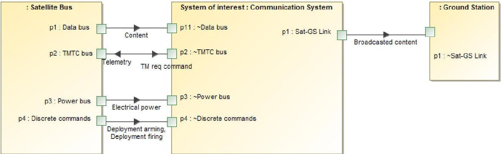

Fig. 8: General signal to interface requirement allocation

The (human) engineer also identifies two different subsets of requirements that will have to be fulfilled at different times, as depicted in Fig. 9. One subset has been identified as Stowed (and must fulfill the requirements captured in Deployment) and the other subset has been identified as Deployed antenna (and must fulfill the requirements captured in Nominal operation. Furthermore, the conditions under which each subset of requirements is applicable are defined in Deployment. Consistent with TMBR, this description reinforces the idea that the diagram in Fig. 9 should not be interpreted as a state machine diagram (although is similar), but just as the identification of subsets of requirements and applicability conditions. In other words, Fig. 9 does not impose any requirement on the states that the payload will have to exhibit or implement.

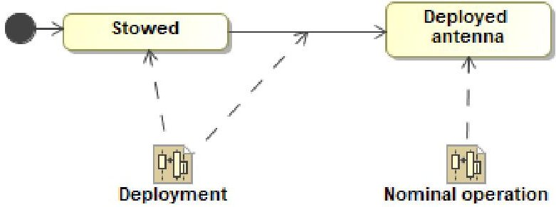

Fig. 9: Mode requirement

In Deployment, the (human) engineer establishes the requirements associated to deploying the communication payload antennas. These are modeled in Fig. 10 as a transition of requirements applicability. This is sensible because, for example, the requirement to broadcast a signal will apply only once the antennas have been deployed. The payload shall accept a firing and an arming command with certain time lapse between them and deploy the antennas only after both have been received. Furthermore, completion of the antenna deployment (and hence, applicability of Deployed antenna requirements) must be achieved in no more than 120 s after the payload receives the firing command. All these conditions only apply if the antennas have not yet been deployed.

In Nominal operation, the (human) engineer establishes the requirements associated to the nominal operation of the payload, that is, the broadcasting of a signal provided by the satellite bus. These are modeled in Fig. 11. The payload is required to execute two transformations while receiving electrical power. First, to broadcast the content provided by the satellite bus in less than 0.5 s after receiving such content. Second, to provide a telemetry signal (with health status) in between 0.2 and 0.5 s of receiving a command to do so, expecting commands to be received at a cadence of 0.9-1.1 Hz.

<!-- PDF_PAGE: 10 -->

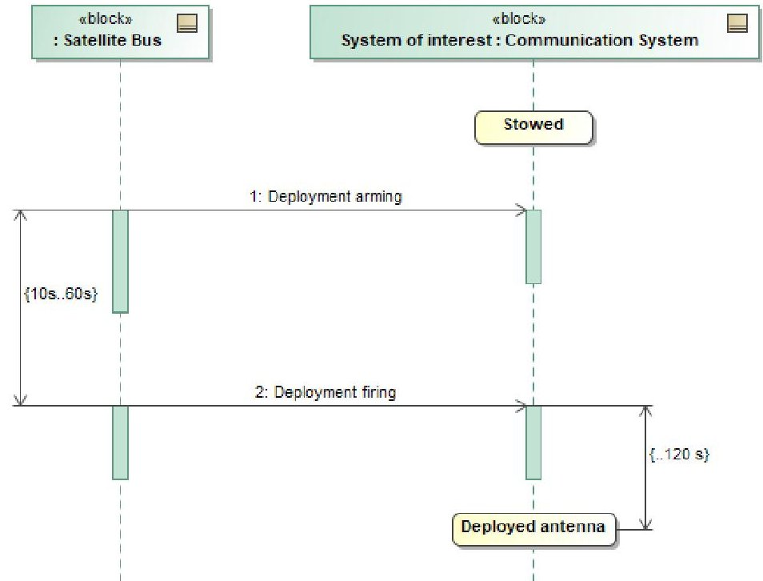

Fig. 10: 'Deployment' transformation requirement

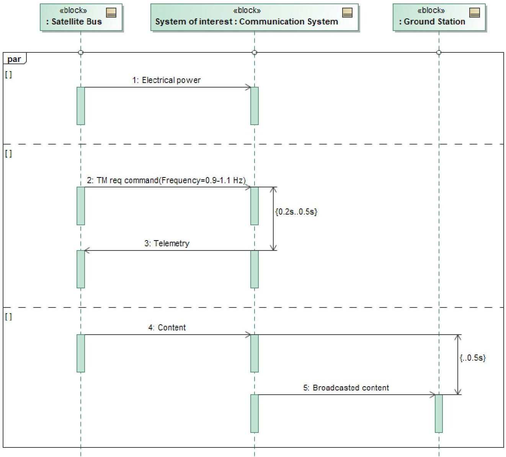

Fig. 11: 'Nominal operation' transformation requirement

<!-- PDF_PAGE: 11 -->

At this point, the (human) engineer has established an initial baseline for the payload requirements and queries Houston to support him/her in finding potential requirement gaps. This described in the next section.

## C. Step 2: Houston Evaluates Requirements and Provides Suggestions

Now that the requirements baseline has been established, the (human) engineer invokes Houston, which applies the 5 rules listed in Table 1 to the requirement models presented in Figs. 8-11. The search was limited to one gap per rule and Houston identified 5 potential requirements gaps, shown in Fig. 12. Currently, Houston's implementation provides its suggestions in the form of questions to reinforce the assistant idea, since it is the engineer's job to decide if such a suggestion is actually a gap for which requirements have to be defined, or if the suggestion can be ignored and the gap left as undefined instead.

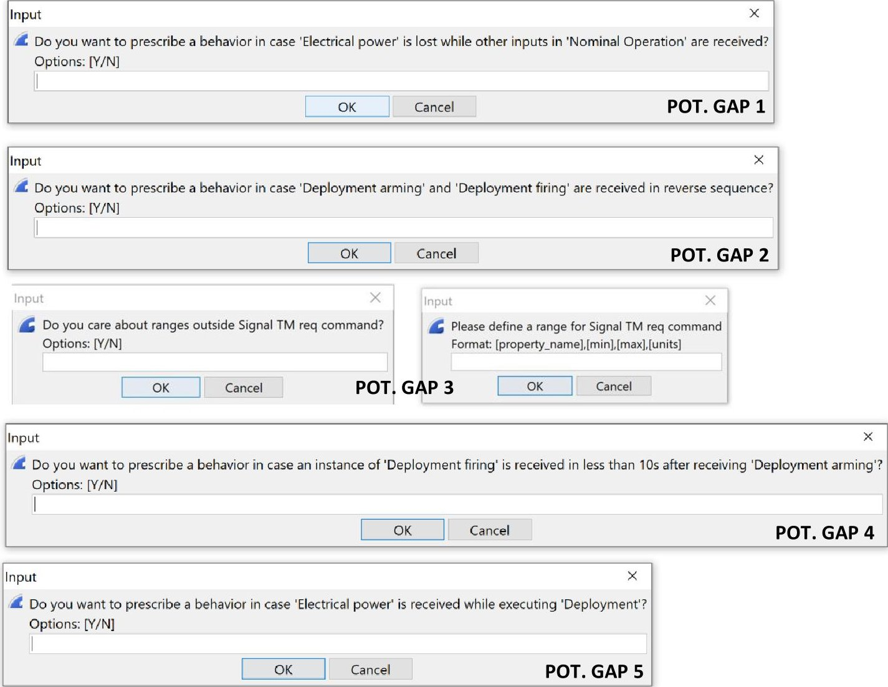

Fig. 12: Suggestions provided by Houston

Rule 1 was applied to the Nominal operation requirement model. Houston identifies situations in which input signals are missing while the other ones in that specific case are still received. In this case, Houston suggested, as Potential Gap 1, to explore the situation in which the payload may receive Content signal and TM req command signal while not receiving Electrical power. From a requirements definition standpoint, this could be a potential gap worth investigating, because, without requirements that prescribe a specific behavioral response to this scenario, the payload design could potentially become incompatible with the satellite bus design. For example, certain payload designs may malfunction or be permanently degraded if they receive an input radiofrequency signal (e.g., Content) without being electrically powered. If, given the satellite bus design, the bus inadvertently injects a Content signal without first powering it up, or there is a glitch in the power line while it is feeding Content to the payload, the payload could be damaged. It is, however, up to the (human) engineer to decide if the potential gap will not be considered such (e.g., because the situation is highly unlikely), in which case Houston will set up such scenario as undefined (ref. Fig. 13, left), or a new set of requirements will need to be defined to address that gap (for which Houston proposes different options, ref. Fig. 13, right). The (human) engineer's decision is addressed in the next section.

<!-- PDF_PAGE: 12 -->

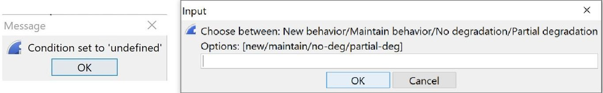

Fig. 13: Houston's suggested options to address potential requirement gaps

Rule 2 was applied to the Deployment requirement model. Houston searches for sequences of inputs and questions if there is a desire to prescribe a behavior for the case in which they are received in a different sequence. In this case, Houston suggested, as Potential Gap 2, to explore the possible scenario in which Deployment firing is received before Deployment arming. As in the previous case, not prescribing a behavioral response to this scenario could lead to interoperability problems between the payload and the satellite bus. For example, whereas the satellite bus might be designed with the capability to provide Deployment firing just once (under the assumption that sequence is not relevant, but triggering of both commands is), the payload might be designed to reset the deployment sequence, requiring a new Deployment firing command to be received.

Rule 3 was applied to the TM req command requirement model. Houston searches for bounded required attributes of a signal and questions if there is a need to prescribe a system behavior for out-of-bounds inputs. In this case, Houston suggested, as Potential Gap 3, to explore the case in which the frequency at which TM req command is received by the system is higher than currently specified. As in the previous cases, leaving such a situation unaddressed may yield payload and satellite bus designs that could exhibit interoperability problems. The payload could be designed to ignore faster commands, interrupt the current telemetry gathering and start a new one, or be uncontrolled and potentially get saturated into a malfunction state. All those options would be compliant to the set of requirements and hence would be chosen irrespective of a potential operational preference on the satellite bus side.

Rule 4 was also applied to the Deployment requirement model. Here, Houston searches for timing dependencies and questions if there is a desire to prescribe a behavior for the case in which the timing dependencies are not satisfied. In this case, Houston suggested, as Potential Gap 4, to explore the possible scenario that Deployment firing is received in less than 10 s after Deployment arming has been received. Similar interoperability problems to those presented for Potential Gap 2 could occur in this case, depending on the specific payload and satellite bus designs. For example, the payload could be designed to receive and process Deployment arming and Deployment firing command for all time lapses between them (which would enable it to perform the required operation), but it could instead be designed to ignore a Deployment firing command if received in less than 10 s after the Deployment arming command is received. Both would fulfill the requirement modeled in Deployment. However, the source for the time dependency could derive from inherent constraints in the satellite bus (or mission operation) to generate the two commands, or to actively enforce a firing window such that time acts as a firing condition.

Finally, Rule 5 was applied to the Stowed requirement model. Houston searches for signals that act as requirements in other mode requirements and questions if they may be potentially received by the system while fulfilling one or more the requirements in the explored mode requirement. In this case, Houston suggested, as Potential Gap 5, to explore a situation in which the system is electrically powered during or before it receives Deployment arming and Deployment firing commands. As in the previous cases, this potential gap could lead to interoperability problems. For example, certain payload designs could be such that high radiated power out of the antennas at certain distance of the deployment mechanisms could charge/heat the triggers and release them inadvertently. This situation would be avoided in this case by design, since the payload would not receive electrical power before triggering the release mechanisms, as per Stowed requirements. But inadvertent powering from the bus could lead to such situation. The (human) engineer could opt to keep the scenario undefined or instead choose to prescribe that the Stowed requirements need be fulfilled as well (although not necessarily) in the presence of electrical power.

It is important to clarify two aspects. First, the examples provided for the 5 potential gaps above are not intended to represent actual situations that will happen if additional requirements are not formulated. Rather, the examples represent possible situations that could happen because of the lack of prescription to control such behaviors. Second, we do not make any claim about the performance of Houston as compared to a (human) engineer doing a similar assessment since that is outside of the scope of this paper. Similarly, we do not claim that the examples we have provided would be missed or unidentified by the (human) engineer crafting the requirements baseline in Section IV.B. The intention of this section is only to illustrate how Houston operates and the type of potential gaps its current implementation can help discover. Once again, Houston is conceptualized as an assistant at the service of the (human) engineer. However, given the computational power of computers, we hypothesize that Houston's performance could

<!-- PDF_PAGE: 13 -->

beat that of a (human) engineer when the requirement models are more sophisticated, and more gap identification rules are incorporated.

In the next step, the (human) engineer responds to Houston's suggestions.

## D. Step 3: The (Human) Engineer Makes Decisions on Houston's Suggestions

When presented with the potential gaps identified by Houston, the (human) engineer will first need to choose if the potential gap is worth addressing or not. If addressed, requirements would be defined for such a gap. Note that all (human) engineer decisions described below are notional and for illustrative purposes only. It is assumed that they are based on informed architectural choices at satellite level.

Let us assume that the (human) engineer responds to the gaps identified by Houston in Fig. 12 as follows. He/she decides to address Potential Gap 1 and identifies the need to sustain such a situation without degradation, but without having to meet the requirements imposed on broadcasting. He/she creates a new mode requirement Deployed/No electrical power (ref. Fig. 14), the new set of requirements to be met when power is unavailable (denoted as Power loss, ref. Fig. 15), and updates Deployed antenna requirements to incorporate the conditions under which they are applicable (ref. Fig. 16).

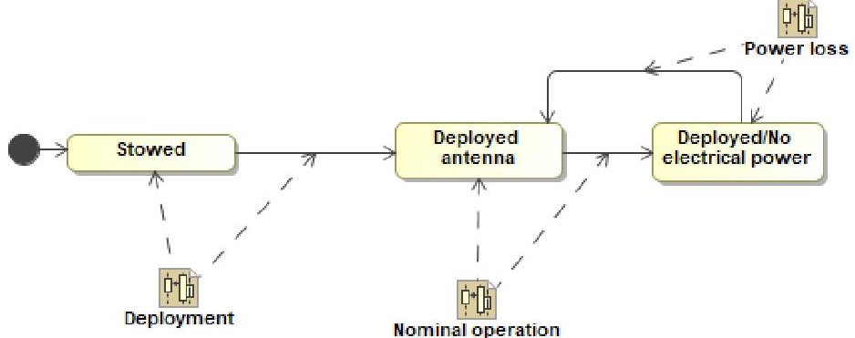

Fig. 14: Updated mode requirements after addressing Potential Gap 1

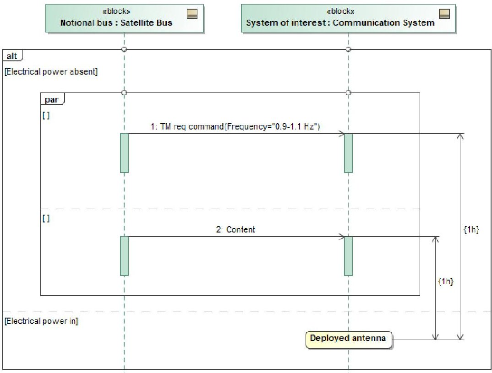

Fig. 15: New 'Deployed/No electrical power' requirements after addressing Potential Gap 1

For Potential Gap 2, the (human) engineer assesses that the likelihood that the payload receives Deployment arming and Deployment firing in reversed sequence is very unlikely, so such scenario will remain undefined.

For Potential Gap 3, the (human) engineer decides to derive further requirements as a new desired behavior. Specifically, it is established that the payload shall ignore any new TM req command that is received while it is processing a prior command and should respond to any command that is received otherwise. This is achieved by

<!-- PDF_PAGE: 14 -->

updating requirement Deployed antenna (ref. Fig. 17; note how the frequency of TM req command has been increased to 0.9-2Hz).

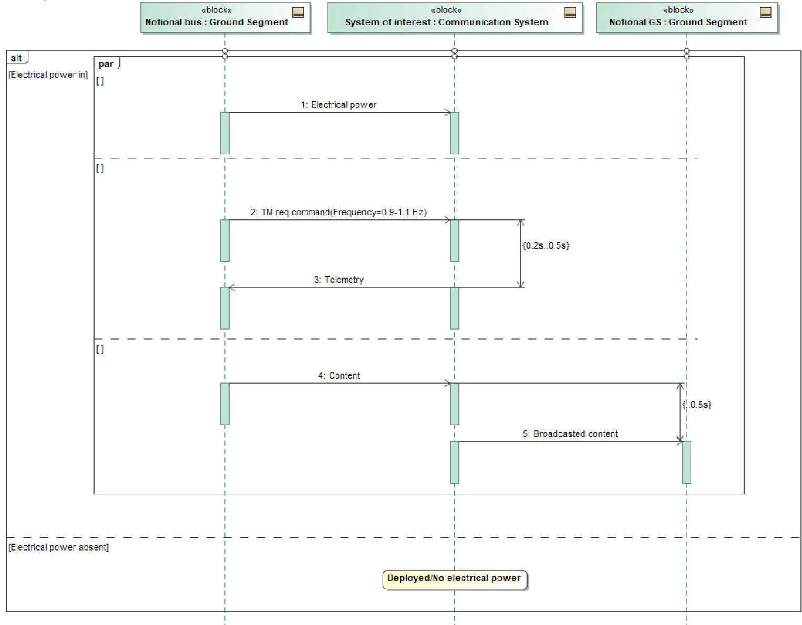

Fig. 16: Updated 'Deployed antenna' requirements after addressing Potential Gap 1

The (human) engineering also decides to address Potential Gap 4. He/she determines that it is required for the payload to ignore any Deployment firing command that is received in less than 10s after receiving Deployment arming command, but that it should not deactivate the arming command. This requirement is modeled by updating the Deployment requirement as shown in Fig. 18.

Finally, the (human) engineer decides to address Potential Gap 5, determining that the requirements initially defined in Stowed should also be fulfilled in the presence of electrical power. Hence, the corresponding requirement is updated as shown in Fig. 19.

<!-- PDF_PAGE: 15 -->

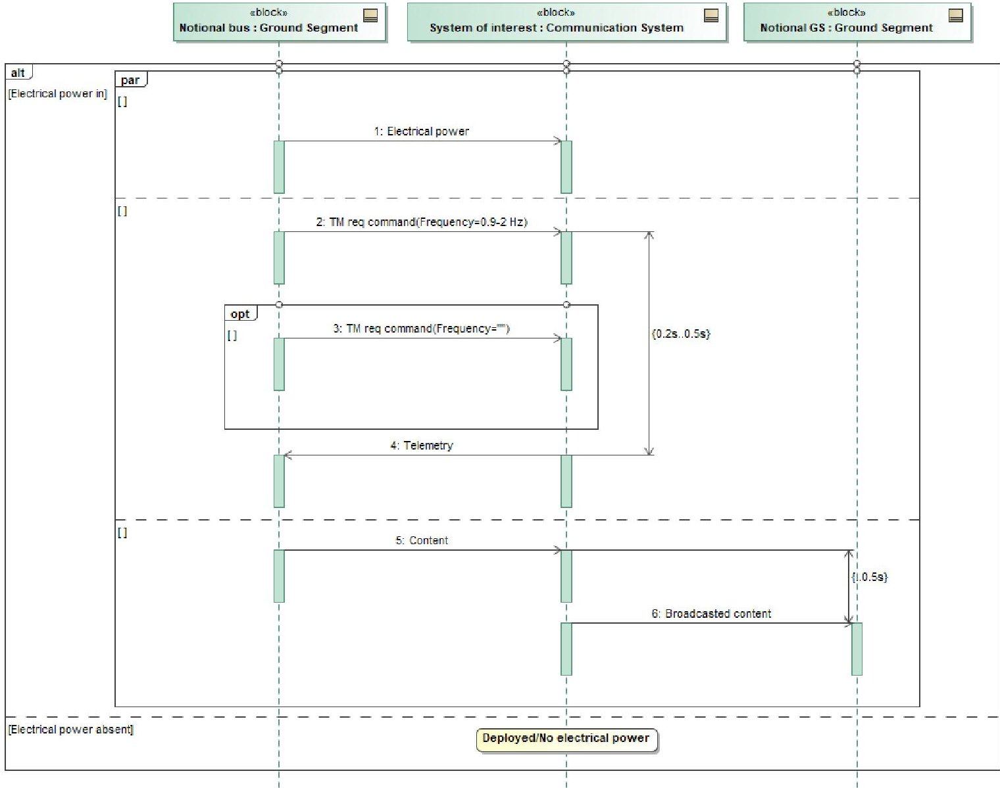

Fig. 17: Updated 'Deployed antenna' requirements after addressing Potential Gaps 1 and 3

<!-- PDF_PAGE: 16 -->

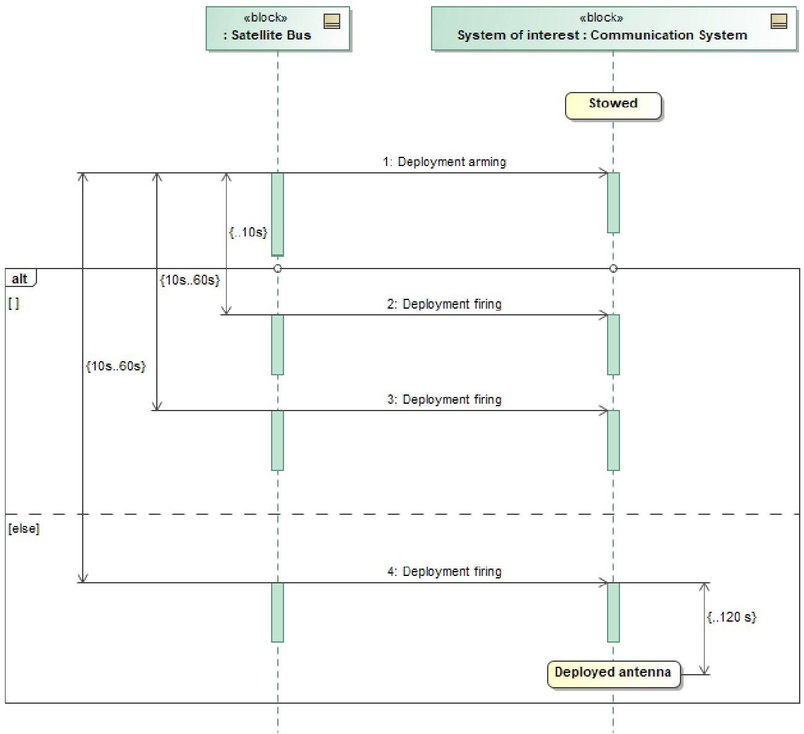

Fig. 18: Updated 'Deployment' requirements after addressing Potential Gap 4

<!-- PDF_PAGE: 17 -->

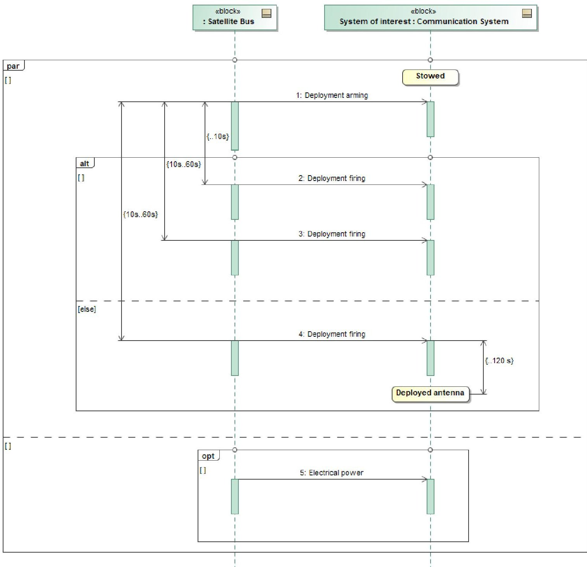

Fig. 19: Updated 'Deployment' requirements after addressing Potential Gaps 4 and 5

## VI. Conclusion

Gaps in requirements can lead to costly problems for both the customer and the supplier. As designs of systems becomes more complex, it is increasingly hard for human engineers to find gaps in requirements. In this regard, intelligent SE advisors that utilize data on past missions, the computational power afforded by modern embedded systems, and TMBSE can be leveraged to identify gaps in requirements and potentially revolutionize the field of systems engineering.

In this paper, we have presented a proof-of-concept of an intelligent SE advisor that supports the (human) engineer in identifying potential requirement gaps. The advisor, called Houston, was implemented as a SysML plug-in, and applied to a subset of notional requirements for a notional satellite communications payload. Although the current implementation of Houston is restricted to a repository of five structural rules, we have illustrated how Houston was able to identify potential gaps in requirements without difficulty by applying those rules to evaluate the construction of requirements modeled using TMBR.

<!-- PDF_PAGE: 18 -->

Houston acts as an assistant to the (human) engineer, by identifying potential gaps but not making decisions about how to respond to them. Decision making in this regard remains on the (human) engineer. In this way, the (human) engineer can decided to ignore the potential gap or to address it by establishing additional requirements.

While our application example was limited in scope, it showed how using requirement models instead of textual statements can enable the use of machines to aid in the requirements definition process.

## Acknowledgments

This material is based on work sponsored by the US Department of the Navy, Naval Engineering Education Consortium, award number N00174-19-1-0012. Any opinions, findings, and conclusions or recommendations expressed in this material are those of the authors and do not necessarily reflect the views of the Naval Engineering Education Consortium.

The intelligent SE advisor presented in this paper is patent pending under Serial No. 63/008,246.

Houston's proof-of-concept implementation used in this paper was developed by R. Tan.

The author thanks A.U. Kulkarni for reviewing and editing this manuscript.

## References

[1] NASA, "NASA Systems Engineering Handbook," National Aeronautics and Space Administration (NASA), Washington, DC, USA, 2016.

[2] A. Salado and R. Nilchiani, "On the Evolution of Solution Spaces Triggered by Emerging Technologies," Procedia Computer Science, vol. 44, pp. 155-163, // 2015, doi: http://dx.doi.org/10.1016/j.procs.2015.03.053.

[3] A. Salado and H. Kannan, "A mathematical model of verification strategies," Systems Engineering, vol. 21, pp. 583-608, 2018.

[4] INCOSE, Systems Engineering Handbook: A Guide for System Life Cycle Processes and Activities, version 4.0 ed. Hoboken, NJ, USA: John Wiley and Sons, Inc., 2015.

[5] P. Kar and M. Bailey, "Requirements Management Working Group: Characteristics of Good Requirements," INCOSE International Symposium, vol. 6, no. 1, pp. 1225-1233, 1996, doi: 10.1002/j.2334-5837.1996.tb02142.x.

[6] R. S. Carson, E. Aslaksen, and R. Gonzales, "Requirements completeness," in INCOSE International Symposium, 2004.

[7] N. G. Leveson, "Role of Software in Spacecraft Accidents," Journal of Spacecraft and Rockets, vol. 41, no. 4, pp. 564-575, 2004, doi: 10.2514/1.11950.

[8] K. E. Wiegers, Software Requirements. Redmond: Microsoft Press, 1999.

[9] R. S. Carson and T. Shell, "Requirements completeness: absolute or relative?," Systems Engineering, vol. 4, pp. 230-231, 2001.

[10] T. Shell, "System function implementation and behavioral modeling: a systems theoretic approach," Systems Engineering, vol. 4, pp. 58-75, 2001.

[11] R. S. Carson, "Requirement completeness: a deterministic approach," INCOSE International Symposium, vol. 8, pp. 738- 746, 1998.

[12] A. Salado and R. Nilchiani, "Reducing Excess Requirements Through Orthogonal Categorizations During Problem Formulation: Results of a Factorial Experiment," IEEE Transactions on Systems, Man, and Cybernetics: Systems, vol. 47, no. 3, pp. 405-415, 2017, doi: 10.1109/TSMC.2015.2502953.

[13] A. Salado and R. Tan, "Structural Rules for an Intelligent Advisor to Identify Requirements Gaps using Model-Based Requirements," in IEEE International Conference on Systems, Man and Cybernetics (SMC), Toronto, Canada, 2020.

[14] A. Salado and P. Wach, "Constructing True Model-Based Requirements in SysML," Systems, vol. 7, no. 2, p. 19, 2019.

[15] D. M. Buede and W. D. Miller, The Engineering Design of Systems: Models and Methods, Third edition ed. Hoboken, NJ, USA: John Wiley & Sons, Inc., 2016.

[16] A. Gabb et al., "4.7.1 Requirements Categorization," INCOSE International Symposium, vol. 11, no. 1, pp. 1075-1082, 2001, doi: 10.1002/j.2334-5837.2001.tb02412.x.

[17] ECSS, "Space Engineering - Technical Requirements Specification," European Cooperation for Space Standardization, ECSS-E-ST-10-06C, 2009.

[18] S. Robertson and J. Robertson, Mastering the requirements engineering process. Getting requirements right. Addison-Wesley, 2012.

[19] A. Salado and R. Nilchiani, "A Categorization Model of Requirements Based on Max-Neef's Model of Human Needs," Systems Engineering, vol. 17, no. 3, pp. 348-360, 2014, doi: 10.1002/sys.21274.

[20] J. O. Grady, System requirements analysis. Academic Press Inc., 2006.

[21] I. F. Hooks and K. A. Farry, "Customer-Centered Products: Creating Successful Products Through Smart Requirements Management," American Management Association, New York, NY: USA, 2001.

[22] S. H. Dam and D. Verma, "Concept of operations and system operational architecture," in Applied space systems engineering W. J. Larson, D. Kirkpatrick, J. J. Sellers, D. Thomas, and D. Verma, Eds.: The McGraw-Hill Companies, 2009.

[23] A. Salado and R. Nilchiani, "Contextual- and Behavioral-Centric Stakeholder Identification," Procedia Computer Science, vol. 16, pp. 908-917, 2013, doi: 10.1016/j.procs.2013.01.095.

<!-- PDF_PAGE: 19 -->

[24] B. W. Mar, "REQUIREMENTS FOR DEVELOPMENT OF SOFTWARE REQUIREMENTS," INCOSE International Symposium, vol. 4, no. 1, pp. 34-39, 1994, doi: 10.1002/j.2334-5837.1994.tb01679.x.

[25] A. Salado and R. Nilchiani, "Categorizing Requirements to Increase the Size of the Solution Space: Moving Away from NASA and ESA's Requirements Categorization Models," in 6th International Systems & Concurrent Engineering for Space Applications conference, Stuttgart, Germany, 2014.

[26] O. Badreddin, A. Sturm, and T. C. Lethbridge, "Requirement traceability: A model-based approach," presented at the 2014 IEEE 4th International Model-Driven Requirements Engineering Workshop (MoDRE), Karlskrona, 2014. [Online]. Available: http://ieeexplore.ieee.org/stamp/stamp.jsp?tp=&arnumber=6890829&isnumber=6890816.

[27] Y. Mordecai and D. Dori, "Model-based requirements engineering: Architecting for system requirements with stakeholders in mind," presented at the 2017 IEEE International Systems Engineering Symposium (ISSE), Vienna, Austria, 2017. [Online]. Available: http://ieeexplore.ieee.org/stamp/stamp.jsp?tp=&arnumber=8088273&isnumber=8088244.

[28] A. L. Borgne, N. Belloir, J. Bruel, and T. Nguyen, "Formal Requirements Engineering for Smart Industries: Toward a Model-Based Graphical Language," presented at the 2016 Intl IEEE Conferences on Ubiquitous Intelligence & Computing, Advanced and Trusted Computing, Scalable Computing and Communications, Cloud and Big Data Computing, Internet of People, and Smart World Congress (UIC/ATC/ScalCom/CBDCom/IoP/SmartWorld), Toulouse, France, 2016. [Online]. Available: http://ieeexplore.ieee.org.ezproxy.lib.vt.edu/stamp/stamp.jsp?tp=&arnumber=7816956&isnumber=7816796.

[29] D. Schmitz, H. W. Nissen, M. Jarke, and T. Rose, "Relating domain model based requirements management and situational method engineering," presented at the 2010 Third International Workshop on Managing Requirements Knowledge, Sydney, NSW, 2010.

[30] J. Holt, S. Perry, M. Brownsword, D. Cancila, S. Hallerstede, and F. O. Hansen, "Model-based requirements engineering for system of systems," presented at the 2012 7th International Conference on System of Systems Engineering (SoSE), Genova, Italy, 2012. [Online]. Available: http://ieeexplore.ieee.org/stamp/stamp.jsp?tp=&arnumber=6384145&isnumber=6355890.

[31] K. Holder et al., "Model-Based Requirements Management in Gear Systems Design Based On Graph-Based Design Languages," Applied Sciences, vol. 7, no. 11, p. 1112, 2017, doi: 10.3390/app7111112.

[32] F. G. C. Ribeiro, Pereira, C.E., Rettberg, A. et al., "Model-based requirements specification of real-time systems with UML, SysML and MARTE," Software & Systems Modeling, vol. 17, no. 1, pp. 343-361, 2018. [Online]. Available: https://link.springer.com/article/10.1007/s10270-016-0525-1.

[33] F. Marschall and M. Schoemnakers, "Towards model-based requirements engineering for Web-enabled B2B applications," presented at the 10th IEEE International Conference and Workshop on the Engineering of Computer-Based Systems, 2003. Proceedings, Huntsville, Alabama, USA, 2003. [Online]. Available: http://ieeexplore.ieee.org.ezproxy.lib.vt.edu/stamp/stamp.jsp?tp=&arnumber=1194813&isnumber=26873.

[34] S. P. J. Holt, M. Brownsword, D. Cancila, S. Hallerstede and F. O. Hansen, "Model-based requirements engineering for system of systems," presented at the 2012 7th International Conference on System of Systems Engineering (SoSE), Genova, Italy, 2012. [Online]. Available: http://ieeexplore.ieee.org/stamp/stamp.jsp?tp=&arnumber=6384145&isnumber=6355890.

[35] S. P. J. Holt, R. Payne, J. Bryans, S. Hallerstede and F. O. Hansen, "A Model-Based Approach for Requirements Engineering for Systems of Systems," IEEE Systems Journal, vol. 9, no. 1, pp. 252-262, 2015, doi: 10.1109/JSYST.2014.2312051.

[36] J. Holt, S. Perry, R. Payne, J. Bryans, S. Hallerstede, and F. O. Hansen, "A Model-Based Approach for Requirements Engineering for Systems of Systems," IEEE Systems Journal, vol. 9, no. 1, pp. 252-262, 2015, doi: 10.1109/JSYST.2014.2312051.

[37] S. Friedenthal, A. Moore, and R. Steiner, A Practical Guide to SysML - The Systems Modeling Language, 3rd ed. Waltham, MA, USA: Morgan Kaufman, 2015.

[38] C. Lu, C. Chang, W. C. Chu, Y. Cheng, and H. Chang, "A Requirement Tool to Support Model-Based Requirement Engineering," presented at the 2008 32nd Annual IEEE International Computer Software and Applications Conference, Turku, 2008. [Online]. Available: http://ieeexplore.ieee.org/stamp/stamp.jsp?tp=&arnumber=4591654&isnumber=4591503.

[39] M. dos Santos Soares and J. Vrancken, "Model-driven user requirements specification using SysML," vol. 3, pp. 57-68, 2008.

[40] M. Adedjouma, H. Dubois, and F. Terrier, "Requirements Exchange: From Specification Documents to Models," in Proceedings of the 16th IEEE International Conference on Engineering of Complex Computer Systems., Las Vegas, NV, USA, 27-29 April 2011 2011, pp. 350-354.

[41] M. K. S. Pandian et al., "Towards Industry 4.0: Gap Analysis between Current Automotive MES and Industry Standards Using Model-Based Requirement Engineering.," in Proceedings of the 2017 IEEE International Conference on Software Architecture Workshops (ICSAW), 3-7 April 2017 2017, pp. 29-35.

[42] S. Ouchani and G. Lenzinia, "Attacks Generation By Detecting Attack Surfaces," presented at the 5th International Conference on Ambient Systems, Networks and Technologies, 2014.

[43] D. Aceituna, G. Walia, H. Do, and S.-W. Lee, "Model-based requirements verification method: Conclusions from two controlled experiments," Information and Software Technology, vol. 56, no. 3, pp. 321-334, 2014/03/01/ 2014, doi: https://doi.org/10.1016/j.infsof.2013.11.004.

[44] D. Aceituna, H. Do, G. S. Walia, and S. Lee, "Evaluating the use of model-based requirements verification method: A feasibility study," presented at the Workshop on Empirical Requirements Engineering (EmpiRE 2011), Trento, 2011.

[45] K. H. a. R. G. S. Siegl, "Model Based Requirements Analysis and Testing of Automotive Systems with Timed Usage Models," presented at the 2010 18th IEEE International Requirements Engineering Conference, Sydney, NSW, 2010.

<!-- PDF_PAGE: 20 -->

http://ieeexplore.ieee.org.ezproxy.lib.vt.edu/stamp/stamp.jsp?tp=&arnumber=5636645&isnumber=5636534.

[46] A. C. a. M. S. M. Saadatmand, "Toward Model-Based Trade-off Analysis of Non-functional Requirements, software engineering; Unified Modeling Language; tradeoff analysis; nonfunctional requirements; generic approach; NFR; embedded systems; real-time system; UML profiling method; software development process; Unified modeling language; Analytical models; Software;Security; Batteries; Real-time systems; Time factors; Non-Functional Requirements; Trade-off Analysis; Non-Functional Properties; UML; MBD," presented at the 2012 38th Euromicro Conference on Software Engineering and Advanced Applications, Cesme, Izmir, 2012. [Online]. Available: http://ieeexplore.ieee.org/stamp/stamp.jsp?tp=&arnumber=6328142&isnumber=6328119.

[47] R. S. H. Reza, J. Straub and N. Alexander, "Toward model-based requirement engineering tool support," presented at the 2017 IEEE Aerospace Conference, Big Sky, MT, USA, 2017. [Online]. Available: http://ieeexplore.ieee.org/stamp/stamp.jsp?tp=&arnumber=7943647&isnumber=7943554.

[48] M. Fockel and J. Holtmann, "A requirements engineering methodology combining models and controlled natural language," presented at the 2014 IEEE 4th International Model-Driven Requirements Engineering Workshop (MoDRE), Karlskrona, 2014. [Online]. Available:

http://ieeexplore.ieee.org.ezproxy.lib.vt.edu/stamp/stamp.jsp?tp=&arnumber=6890827&isnumber=6890816.

[49] INCOSE, "Guide for writing requirements," The International Council of Systems Engineering, 2012.

[50] A. Salado, R. Nilchiani, and D. Verma, "A contribution to the scientific foundations of systems engineering: Solution spaces and requirements," J. Syst. Sci. Syst. Eng., journal article vol. 26, no. 5, pp. 549-589, 2017, doi: 10.1007/s11518-016-5315-3.

[51] P. Micouin, "Toward a property based requirements theory: System requirements structured as a semilattice," Systems Engineering, vol. 11, no. 2, 2008.

[52] D. M. a. D. R. S. Teufl, "MIRA: A Tooling-Framework to Experiment with Model-Based Requirements Engineering," presented at the 2013 21st IEEE International Requirements Engineering Conference (RE), Rio de Janeiro, 2013.

[53] B. L. a. P. Miotto, "Model-based requirement generation," presented at the 2014 IEEE Aerospace Conference, Big Sky, MT, 2014.

[54] W. B. Rouse, "AI as Systems Engineering Augmented Intelligence for Systems Engineers," INSIGHT, vol. 23, no. 1, pp. 52- 54, 2020, doi: 10.1002/inst.12286.

[55] A. V. i. Martin and D. Selva, "Daphne: A Virtual Assistant for Designing Earth Observation Distributed Spacecraft Missions," IEEE Journal of Selected Topics in Applied Earth Observations and Remote Sensing, vol. 13, pp. 30-48, 2020, doi: 10.1109/JSTARS.2019.2948921.

[56] A. V. Martin and D. Selva, "Explanation Approaches for the Daphne Virtual Assistant," in AIAA Scitech 2020 Forum, 2020.

[57] A. V. Martin and D. Selva, "From Design Assistants to Design Peers: Turning Daphne into an AI Companion for Mission Designers," in AIAA Scitech 2019 Forum, 2020.

[58] S. S. D. León, D. Selva, and D. W. Way, "A Cognitive Assistant for Entry, Descent, and Landing Architecture Analysis," in 2019 IEEE Aerospace Conference, 2-9 March 2019 2019, pp. 1-12, doi: 10.1109/AERO.2019.8742177.

[59] P. Dutta et al., "Virtual Assistant for Anomaly Treatment in Long Duration Exploration Missions," in AIAA Scitech 2020 Forum, 2020.

[60] A. W. Wymore, Model-based systems engineering. Boca Raton, FL: CRC Press, 1993.

[61] A. Kossiakoff, W. N. Sweet, S. J. Seymour, and S. M. Biemer, Systems Engineering Principles and Practice, 2nd ed. Hoboken, NJ, USA: John Wiley & Sons, Inc., 2011.

[62] P. Wach and A. Salado, "The Need for Semantic Extension of SysML to Model the Problem Space," presented at the Conference on Systems Engineering Research (CSER), Redondo Beach, CA, USA, 2020.