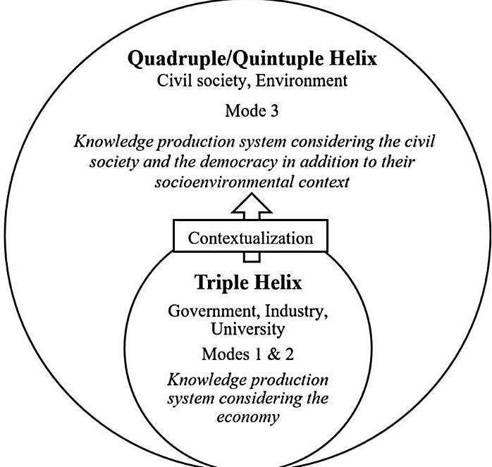
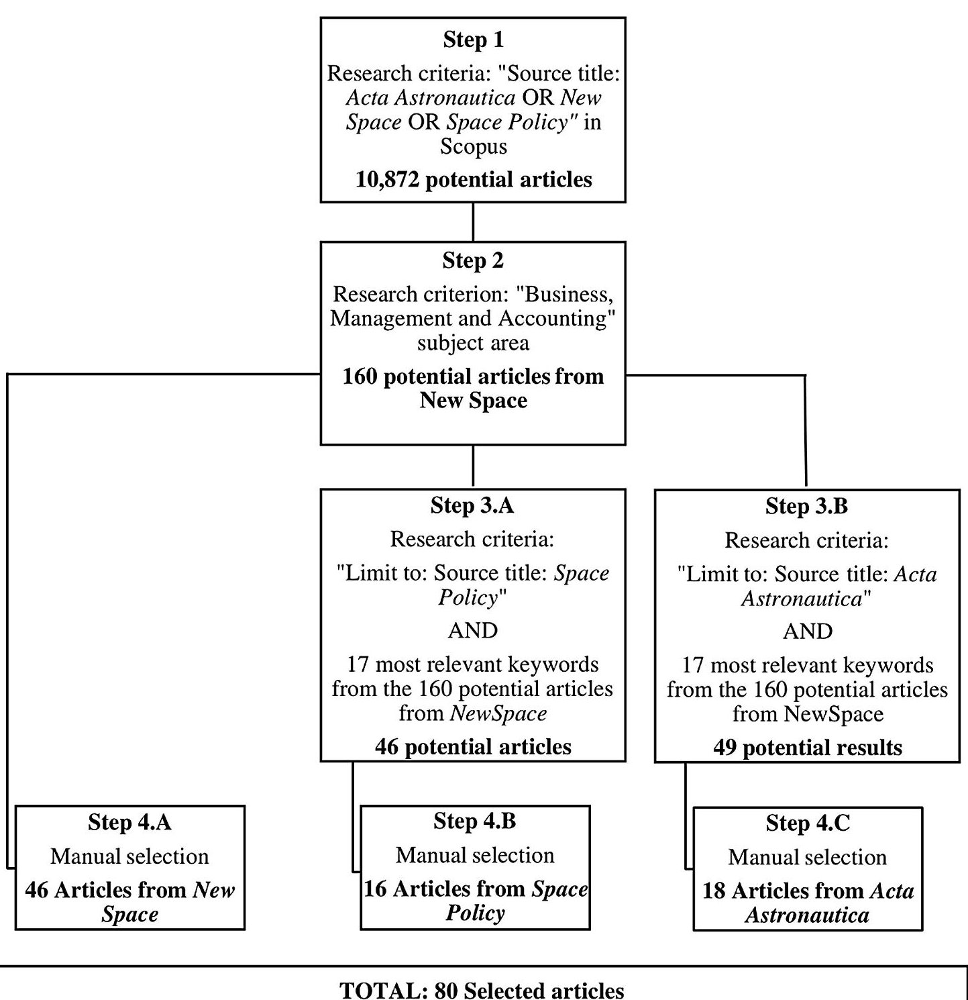
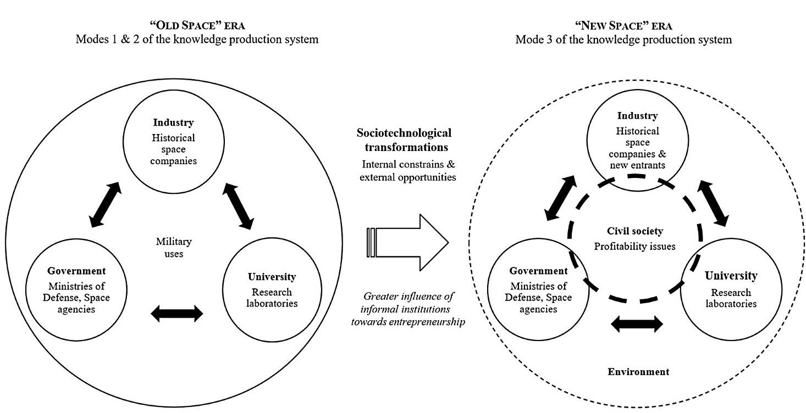

<!-- PDF_PAGE: 1 -->

# The quadruple/quintuple helix model in entrepreneurial ecosystems: an institutional perspective on the space case study

Aveline Cloitre $ ^{1,2,*} $ , Victor Dos Santos Paulino $ ^{1} $ and Christina Theodoraki $ ^{1} $

$ ^{1} $ "Entrepreneurship and Strategy" Laboratory, TBS Education, 1 Place Alphonse Jourdain, 31000, Toulouse, Occitanie France. a.cloitre@tbs-education.fr, v.dossantospaulino@tbs-education.fr c.theodoraki@tbs-education.fr

$ ^{2} $ "Strategy" Department, Toulouse School of Management, 2 Rue du Doyen Gabriel Marty, 31000, Toulouse, Occitanie France. a.cloitre@tbs-education.fr

Although entrepreneurial ecosystems (EEs) have attracted increasing conceptual interest in the academic literature, little research has been conducted on their dynamics regarding the sociotechnological transformations that they undergo. To gain a bigger picture of this process, the theoretical underpinning is lacking. This research aims to address this theoretical gap by relying on the quadruple/quintuple (Q/Q) helix model to contextualize the dynamics fueling the development of EEs. We supplement this model with the institutional perspective to gain a better understanding of the dynamic interplay of EE institutions within their broader socioenvironmental context. Through an exploratory qualitative study based on secondary data from 1985 to 2021, we focus on the space EE as an illustrative case that has experienced major sociotechnological changes since the mid-2000s. Likewise, we find that sociotechnological transformations lead to a change of focus in the knowledge production system, which is fostered by internal constraints and external opportunities. Indeed, informal institutions have a major influence on entrepreneurial dynamics by supporting an entrepreneurial culture within the Q/Q helix spheres, as they enable the inclusion of external actors in the innovation process. Ultimately, we point out the role of entrepreneurial support organizations in the inclusion of civil society and the environment in society and democracy-based knowledge production systems to enhance the development of EEs.

## 1. Introduction

While entrepreneurial ecosystems (EEs) have attracted increasing theoretical interest in the

literature, the quadruple/quintuple (Q/Q) helix model constitutes a useful theoretical tool for understanding the development of EEs (Carayannis et al., 2018). This model emphasizes how civil society and its

<!-- PDF_PAGE: 2 -->

environmental considerations (i.e., the environment) play a major role in the knowledge production system for innovation and entrepreneurship due to the dynamic interplay of EE institutions - university, industry, government, civil society, and the environment. Such dynamic interplay is characterized by the mutual influence of institutions within a multilevel iteration, with reciprocal and cause-effect relationships over time. While formal institutions - legislation and public policies - and informal institutions - sociocultural norms - are used separately to explain the dynamic interplay of EE institutions (North, 1990; O'Connor et al., 2018; Urbano et al., 2019), both types of institutions play a major role in the key strategic directions of an EE regarding its sociotechnological transformations in specific territories or industrial sectors (Malerba, 2004; Carayannis et al., 2018; Urbano et al., 2019).

The Q/Q helix model enables researchers to consider all these types of institutions, both formal and informal. This model is composed of five different spheres, which provide a better understanding of the dynamic interplay of EE institutions regarding the interdependencies of the spheres within an EE. However, there is no conceptual evidence that sheds light on how sociotechnological transformations impact the dynamic interplay of EEs. Little research on the institutions that shape EEs has been conducted, and there is a need for a better understanding of the diversity of policy contexts (the level of government, the country context) and models of ecosystem governance (Phillips and Ritala, 2019; Spigel et al., 2020; Thomas and Ritala, 2021). Both the EE approach and the Q/Q helix model include the study of formal and informal institutions regarding sociotechnological transformations (North, 1990; Miller et al., 2018). Lamine et al. (2021) called for more research on the institutional perspective in studies of the dynamic interplay between the helix and EE literature within the context of the space EE. Following their suggestions, we raise the following research question: How do the spheres of the Q/Q helix interplay with each other in EEs through sociotechnological transformations?

Therefore, this research aims to provide a better understanding of the Q/Q helix model of the evolution of EEs by focusing on institutions in the context of major sociotechnological transformations (Meijer et al., 2006). To address this research question, we focus on the space EE, which has been through major changes since the beginning of the 2010s due to the acceleration of the commercialization of space activities (Barbaroux and Dos Santos Paulino, 2013). This case is of interest, both theoretically and empirically, by being highly regulated by institutions and by

addressing major sociotechnological transformations (Lamine et al., 2021). Thus, it seems to be a relevant empirical case for studying how the entrepreneurial dynamics of the space EE are influenced by institutions (OECD, 2019; Dos Santos Paulino, 2020; Lamine et al., 2021). To that end, we rely on a qualitative thematic analysis based on three space-oriented journals from 1985 to May 2021; thus analysis enables us to find promising theoretical insights into the emergence of EEs and their institutional interplay. We aim to contribute to the literature on the Q/Q helix model by highlighting the influence of civil society on the institutional governance of EEs and by showing why informal institutions play a major role in the emergence of EEs through sociotechnological transformations. Moreover, our research highlights crucial empirical implications for existing large organizations by focusing on the need for co-opetition with smaller actors through entrepreneurial support organizations (Theodoraki et al., 2020).

This paper is structured as follows: Section 2 provides an extensive literature review on the N-helix model of dynamic interplay with the EE concept through the institutional perspective and the relevant application in the space case study. Section 3 describes the exploratory qualitative approach through secondary data by adopting the longitudinal lens of space entrepreneurial dynamics. Section 4 reveals and discusses our findings and conclusions with the implications of this study and perspectives for future research.

## 2. Literature review

## 2.1. Dynamic characteristics of the Q/Q helix model

Originally, Etzkowitz and Leydesdorff (2000) developed a macrolevel model of innovation to describe the research and development (R&D) process within three traditional spheres, the triple helix model of the knowledge production system. This model includes universities, industry, and government. These spheres are composed of both formal and informal institutions that are specific to each sphere. Some of these institutions are at the intersection of various spheres (Etzkowitz and Leydesdorff, 2000; Lew et al., 2018; Meyer et al., 2019): 'Industry operates in the Triple helix as the locus of production; government as the source of contractual relations that guarantee stable interactions and exchange; the university as a source of new knowledge and technology, the generative principle of knowledge-based economies' (Etzkowitz, 2003, p. 295). Indeed, the

<!-- PDF_PAGE: 3 -->

knowledge production system is at the heart of the conceptual discussions of helix models, as it fuels innovation in the R&D process and, thus, entrepreneurship (Hulsbeck and Pickave, 2014). Two main modes of the knowledge production system are described in the triple helix model: the 'Mode 1' university-based knowledge production system and 'Mode 2' problem-solving (Carayannis et al., 2018, p.151) for fostering innovation (Borgh et al., 2012). While Mode 1 focuses on a context governed by universities from a long-term perspective, Mode 2 targets the application of the produced knowledge from a shorter-term perspective. The knowledge production system of Modes 1 and 2 is economy based, as it is fueled by economic activity (Carayannis and Campbell, 2013).

With respect to the initial triple helix model of Etzkowitz and Leydesdorff (2000), Carayannis and Campbell (2009, 2021) went further and added a fourth sphere to the model, civil society, by focusing on users $ ^{1} $ who drive innovation in a society and democracy-based knowledge (see Figure 1). A fifth sphere emphasizing the socioenvironmental context of civil society has been included in the model to develop ecologically sensitive knowledge (Carayannis et al., 2012). These two added spheres enable the initial model to be contextualized by taking into account external actors and factors (i.e., civil society and the environment) that can have a direct impact on the knowledge production system of the model. This Q/Q helix model leads to a 'Mode 3' of the knowledge production system, which develops the notion of the ecosystem as a helix consisting of

Figure 1. From the triple helix model to the Q/Q helix model. Source: Adapted from Carayannis et al. (2018).

multi-layered, multi-nodal, and multi-lateral systems' (Carayannis et al., 2018, p. 149). Indeed, Mode 3 enables Mode 1 and Mode 2 to coexist and coevolve in the dynamic, complex and nonlinear knowledge production system of the Q/Q helix model.

The dynamic interplay of the five spheres is characterized by 'agglomerations of human, social, intellectual and financial capital stocks and flows,' which enable innovation through a continuous knowledge production system (Carayannis, 2008, p. 346). This interplay induces a constant evolution of the spheres, which form, re-form and dissolve depending on the sociotechnological transformations that their EE undergoes. While an EE is composed of the three traditional spheres of the triple helix model, the Q/Q helix model enables researchers to consider external actors that also contribute to the innovation process, such as those coming from other EEs. Understanding the EE as a helix opens new conceptual insights for the EE literature by making it possible to explore the entrepreneurial dynamics of the Q/Q helix model within the ecosystem approach. In a broader institutional context, the Q/Q helix model offers a more holistic perspective on EEs. This means that the quadruple helix model situates civil society at the heart of the innovation process, while the quintuple helix model contextualizes the 'natural environment of society' (Carayannis et al., 2012; Rosenlund et al., 2017; McAdam and Debackere, 2018).

## 2.2. Institutional perspective on EEs and the Q/Q helix model

To gain a better understanding of the conceptual links between the Q/Q helix model and EE studies, we need to explain how institutions fill the gap between these two streams of research. Extended theoretical literature reviews have been performed on EEs since the mid-2000s, especially on the characteristics of EEs and their definition (Spigel, 2017; Audretsch et al., 2019; Theodoraki et al., 2022). An EE is composed of entrepreneurial dynamics that are characterized by actors with key roles and various levels of relationships connecting them together to provide means for fostering innovation and entrepreneurship within specific sociotechnological transformations (Carayannis et al., 2018; Stam and van de Ven, 2021). Among these actors, entrepreneurial support organizations (Spigel, 2016) play a crucial role in the making of EEs (Theodoraki et al., 2022). From an institutional perspective, there are diverse entrepreneurial support organizations that aim to foster entrepreneurship and connect all other EE institutions. The sociotechnological transformations that

<!-- PDF_PAGE: 4 -->

an EE faces include a wide range of institutional settings that influence the entrepreneurial dynamics of EEs, such as resources, competitiveness, suppliers, consumers, and politics (Meijer et al., 2006). Hence, an institutional perspective is relevant for gaining a better understanding of these sociotechnological transformations, which mainly depend on institutional settings through a process of technological and institutional coevolution, co-opetition and cospecialization (Meijer et al., 2006; Carayannis, 2008; Cai, 2015).

Based on the initial works of North (1990 1991), who defined institutions as 'constraints' (Chavance, 2008, p. 59), two types of institutions have been studied in the literature to explain the evolution of EEs, that is, formal and informal institutions (North, 1991; Aldrich and Fiol, 1994; Stam and van de Ven, 2021). Formal institutions refer to regulations, public policies and laws, while informal institutions refer to sociocultural norms and practices (North, 1990, 1991; Salimath and Cullen, 2010). Both formal and informal institutions provide a macrolevel context for the various spheres of the Q/Q helix model and how they interact (Chavance, 2008). Institutions constitute a well-known framework used in entrepreneurship and in various helix models (Carayannis, 2008; Garud et al., 2013; Eesley et

al., 2018; Liu and Cai, 2018). They aim to improve the interface and exchange of knowledge between the actors of one EE to foster innovation (Meijer et al., 2006). Moreover, it has been shown that institutions constitute a relevant theoretical perspective for contextualizing and examining sociocultural norms that can directly impact entrepreneurial culture in entrepreneurial activity (Hayton and Cacciotti, 2013).

In this context, Carayannis and Roy (2000) explored the co-opetitive process fostering the structure and dynamics of technological innovation in the small satellite industry. Without mentioning it explicitly, they highlighted how both formal and informal institutions influence and are also influenced by sociotechnological transformations in the case of this industry. Moreover, in the same industrial context, Lamine et al. (2021) identified six institutions that formally or informally shape space entrepreneurship (see Table 1). They pointed out that institutions can be considered obstacles or enablers of the innovation process to foster entrepreneurship. By analyzing the nature and power of institutions across the French-European space EE, Lamine et al. (2021) explained how formal institutions combined with informal institutions shape the innovation process for entrepreneurship. Therefore, they called for further longitudinal research on

Table 1. Institutions impacting space entrepreneurship

<table border="1"><tr><td>Institutions identified</td><td>Type</td><td>Description</td></tr><tr><td>1. Competitive structure that discourages entrepreneurship</td><td>Formal</td><td>Due to long-term national and international political strategies,the traditional spheres of the EE leave little space for new entrants. They work together in a co-operative manner, and they dominate the market of the EE</td></tr><tr><td>2. Closed EE network</td><td>Formal and informal</td><td>Regional EE policies generate a closed,narrow,and exclusive network of traditional spheres that do not easily include external actors. To enter,there is a need for socialization with well-known actors</td></tr><tr><td>3. EE structure</td><td>Formal</td><td>The technological and commercial segments in the value chain of the EE constitute the basis of the structure of the EE; thus,they direct the strategic development of the EE</td></tr><tr><td>4. EE entrepreneurial dynamics</td><td>Formal</td><td>The institutional organization and financial incentives for entrepreneurship of the EE</td></tr><tr><td>5. Technological context and standards</td><td>Formal and informal</td><td>The technological standards of the EE that foster or decelerate entrepreneurial activity. These technological standards are based on traditional and historical technologies that are difficult for new entrants to challenge</td></tr><tr><td>6. Cultural and social institutions</td><td>Informal</td><td>Sociocultural norms ruling the entrepreneurial activity of the EE. They include vision,language,and beliefs due to history and media,which influence entrepreneurs in their activities</td></tr></table>

Source: Adapted from Lamine et al. (2021).

<!-- PDF_PAGE: 5 -->

how N-helix models work in different national space EEs through institutions. Nevertheless, they also warned of the difficulties in applying this conceptual model, which may not include all the specificities of the space case study. Recent sociotechnological developments in the space EE have led to the increasing importance of civil society and the environment, bringing external actors to the space EE. The inclusion of these actors leads to the Mode 3 of the knowledge production system, which makes the Q/Q helix model more suitable for studying EEs. Therefore, we suggest that the Q/Q helix model (Carayannis et al., 2018) enables us to adopt a broader perspective than the triple helix model to include all the specificities shaped by institutions in the space EE.

## 3. Method

## 3.1. Research design

In the remainder of this research, the main conceptual objective guiding our study is to deepen the findings of the Q/Q helix model of EEs. We focus on the dynamic interplay of institutions in shaping the entrepreneurial dynamics of the space EE. To do so, we rely on an exploratory qualitative approach by using secondary data from 1985 to May 2021. Elsahn et al. (2020) highlighted the methodological need for extending data collection methods to provide pluralistic ways of studying technological and innovation concepts in management. A content analysis provides interesting insights into the different spheres of the Q/Q helix model. It offers detailed descriptions of both the technological and social challenges faced by the space EE regarding the growth of its entrepreneurial dynamics since the 2010s. Moreover, this methodology allows the collection of continuous and homogeneous data for a qualitative exploratory study.

Reviewing an emerging field of study with literature coming from heterogeneous subject areas constitutes a methodological challenge. Hence, it is crucial to rely on a transparent and reproducible method to ensure methodological rigor. Similarly, Fosso Wamba et al. (2013) and Pinkse et al. (2014) used a rigorous methodological protocol by conducting an extended literature review of specific case studies and used their findings to present the current and future research directions in this area. To do so, they mobilized the relevant databases to identify peer-reviewed articles to obtain a classification framework of journal articles dealing with the selected case studies. Both Fosso Wamba et al. (2013) and Pinkse et al. (2014) presented original longitudinal studies to summarize the relevant

articles to obtain the bigger picture of their case studies (i.e., radio frequency identification (RFID) technology-based healthcare services and the automotive industry, respectively). Their approaches are suitable for cases for which there are very few empirical studies on the topic, such as the space case study. Therefore, we follow the main steps, and we adapt the methods used by Fosso Wamba et al. (2013) and Pinkse et al. (2014) to the space case study.

## 3.2. The space case study

The worldwide space EE has an estimated annual global commercial revenue of USD 280-300 billion (OECD, 2019), with several created start-ups that increased nearly fivefold over a 10-year span (The Tauri Group, 2013), making it one of the most promising technological sectors regarding entrepreneurial dynamics. Thus, the space EE seems to be a relevant case of growing empirical interest to policy makers and practitioners regarding its worldwide economic growth (OECD, 2019; UNOOSA, 2021). The world's leader space agencies, such as the National Aeronautics and Space Administration (NASA), the European Space Agency (ESA), and the National Center of Space Studies (or Centre National d'Etudes Spatiales, CNES), have implemented large entrepreneurial incentives within the international space EE to connect with local entrepreneurial support organizations, such as hackathons, platforms, incubators and accelerators, and to foster entrepreneurship through co-opetitive strategies between the various spheres of the space EE (OECD, 2014; Spigel, 2016; De Silva and Wright, 2019).

More precisely, the space sector as a whole can be considered an EE (Lamine et al., 2021) and, more precisely, an 'entrepreneurial ecosystem' (European Commission, 2016, p. 6) witnessing major internal constraints and external opportunities since the 2010s with the recent acceleration of the commercialization of space activities, which is called the 'New Space' era (Dos Santos Paulino and Le Hir, 2016). These internal constraints and external opportunities deal with return on investment and commercial applications of space technologies in the wake of major public funding to develop the space EE. Therefore, there are both conceptual and empirical challenges to studying an EE that has witnessed major changes since the 2010s, with numerous entrepreneurs entering the ecosystem (Zervos and Siegel, 2008; Terjesen, 2016; OECD, 2019). From a broader perspective, the space case study is relevant, as it enables researchers to investigate

<!-- PDF_PAGE: 6 -->

the importance of small and large actors in emergent EEs through the Q/Q helix model. The 'New Space' era embodies a panel of major sociotechnological transformations that have led to the recent acceleration of the commercialization of space activities. The space case study also offers interesting conceptual perspectives regarding the literature on the Q/Q helix model, as it is strongly regulated by institutions (Dabrowska et al., 2019) and has undergone major sociotechnological transformations since the mid-2000s (OECD, 2019; Dos Santos Paulino and Gudmundsson, 2021).

## 3.3. Data collection

To conduct our data collection, we followed the literature review method based on journal articles that was adopted by Fosso Wamba et al. (2013) and Pinkse et al. (2014). In line with our exploratory research objectives and our longitudinal approach, this data collection method enables 'academics and practitioners alike [to] use journals most often for acquiring information and disseminating new findings and represent the highest level of research' (Ngai and Wat, 2002, p. 416). Regarding the timeframe of our research, we focused on the acceleration of the commercialization of space activities and their entrepreneurial dynamics, which began in the 2010s (Dos Santos Paulino, 2020; Dos Santos Paulino and Gudmundsson, 2021) and is referred to as the 'New Space' era (Dos Santos Paulino and Le Hir, 2016). We mainly selected articles from the 2010s to 2021, but we also included seven articles dating back to 1985, which were useful for historical data triangulation (Yin, 2009). Then, regarding the selection of journals, we relied on our previous experience in space entrepreneurship research to select space-oriented and peer-reviewed journals $ ^{2} $ producing articles from 1985 to May 2021 with a managerial perspective: Acta Astronautica, New Space and Space Policy (see Figure 2). These journals provide empirical articles related to space entrepreneurial activities with a strong focus on the European and North American contexts, although they also deal with the non-Western managerial issues that the space EE has faced since the mid-2000s (i.e., emergence of new space agencies and businesses in developing countries). We chose not to limit our research to a specific geographical area because we aim to present a global approach to the space EE, which does not belong to one specific geographical area.

We found 10,872 journal articles in these three journals in the Scopus database, which is the only platform where the three journals that we chose

are registered (see Step 1 in Figure 2). We refined our results by limiting them to the 'Business, Management and Accounting' subject area (see Step 2 in Figure 2). We obtained 160 results, only from the journal New Space, and we screened these articles to identify seventeen keywords $ ^{3} $ that were used to characterize the space EE. We used New Space as a reference point because this journal focuses only on space entrepreneurial and innovation dynamics, which is not the case of the two other journals (i.e., Space Policy and Acta Astronautica). Thus, we found 46 articles in Space Policy and 49 articles in Acta Astronautica on research based on the 17 keywords identified (see Step 3.A and 3.B in Figure 2). However, numerous articles within this preliminary selection were too engineering oriented and did not provide major managerial perspectives on space entrepreneurial and innovative dynamics. Therefore, we read each abstract, and we manually excluded these articles to obtain 46, 16, and 18 articles in New Space, Space Policy, and Acta Astronautica, respectively (see Step 4.A, 4.B and 4.C in Figure 2). Finally, we identified 80 articles that met all our selection criteria.

## 3.4. Data analysis

Because the space EE is smaller than other industrial sectors (Dos Santos Paulino, 2020) and thus induces a smaller data set than those analyzed by Fosso Wamba et al. (2013) and Pinkse et al. (2014), we chose not to rely on qualitative data analysis software but to proceed manually to a thematic analysis of the articles that we selected (Tranfield et al., 2003; Cao and Shi, 2020; Cho et al., 2021). Doing so allowed us to identify and synthesize concepts that do not have a well-known defined construct, such as for the emergent entrepreneurial dynamics in the space EE (Thomas and Harden, 2008; Barnett-Page and Thomas, 2009). We based our thematic analysis on the findings of Lamine et al. (2021) summarized in Table 1, which constituted our analysis grid when extracting and coding quotes to deepen the dynamic influence of institutions on the space EE in the frame of the Q/Q helix model. Thus, the final selection of 80 articles was read in detail and coded to extract from each selected article the six institutions impacting space entrepreneurship found by Lamine et al. (2021) (Table 1). Finally, we cross-checked them with the spheres of the Q/Q helix model described by Carayannis et al. (2018). Doing so enabled us to present the institutional dynamics of the space EE through sociotechnological transformations. Owing to this method, we explain the institutional

<!-- PDF_PAGE: 7 -->

TOTAL: 80 Selected articles

Figure 2. Selection process framework. Source: Authors. Note: See the Appendix for the exact query strings and keywords per step searched on Scopus.

dynamic interplay found in light of the Q/Q helix model.

## 4. Findings

To best describe our findings, we build the synthetic figure below, which aims to summarize the main dynamics of the institutional spheres of the helix in the space EE due to sociotechnological transformations. This figure relies on the two eras characterizing the space EE evolution, that is, the 'Old Space' era and the 'New Space' era. Each era has its own EE

dynamics and modes of the knowledge production system.

## 4.1. The evolution of the 'Old Space' era

## 4.1.1. A small and closed EE

Until the 2000s, government, industry and universities constituted a very small actor network by being highly regulated by governmental and geopolitical interests regarding military uses. This was due to the historical origins of the space EE after the Second World War as well as the tense political and military context of the Cold War. During

<!-- PDF_PAGE: 8 -->

Figure 3. Evolution of the dynamic interplay of the spheres of the helix model in the space EE. Source: Authors.

this period, the triple helix characterizes the institutional interdependencies of the three spheres in the space EE (see Figure 3, the 'Old Space' era). To protect the military uses that constituted the fuel of the development of the space EE in the 'Old Space' era, the interplay of the three spheres was closed to external actors. Therefore, the latter could not access the space EE and its knowledge production system. Indeed, they could have threatened the development of the space EE in industry by challenging the initial knowledge production system, which was publicly funded and focused on military uses. These military uses refer to 'the transport of ballistic warheads [which] accelerated the development of rockets from the year 1940 onward. After this period, the knowledge was less focused on the military uses, but compatible with the Cold War period, there was a new aspect added, namely national prestige [...] Space activities were well funded publicly during this period of the Space Race' (NS33). Such a tense military context put ministries of defense at the heart of the traditional spheres to manage the R&D process of the space EE. Together with industry and universities, the three spheres concentrated their efforts on a knowledge production system focusing on military uses. They relied on a university-based (Mode 1) and problem-solving (Mode 2) knowledge production system to foster innovation in the two segments of structure of the space EE, the space EE is divided between the upstream and downstream segments in the value chain. While the upstream segment mostly refers to Mode 1 of the knowledge production system, which enables basic research

in research laboratories, the downstream segment refers to Mode 2, which targets the application of basic research improvements. More precisely, the two modes supplement each other to foster innovation.

## 4.1.2. The prevalence of formal institutions

The 'Old Space' era is characterized by formal institutions that strongly restricted entrepreneurship. Even though these formal institutions continued to regulate the 'New Space' era, they were much more influential in the 'Old Space' era. Space activities were highly regulated by formal institutions such as legislation and public policies, which enabled or restricted entrepreneurial dynamics in the industry: 'At present, private industry has virtually no control of the means of access to space. The most important parameters of this component [...] are controlled by NASA and may all be influence by nonbusiness considerations' (AA18). This era is characterized by a competitive structure that discourages entrepreneurship through the integration of national public-private companies created to help governments implement military uses of space activities (see Figure 3, the 'Old Space' era), such as Airbus Defense and Space and Thales Alenia Space in the French-European context. Such interplay between industry and government could be carried out with the launch of space agencies to interact and to manage military uses with industry and universities in the 1950s-1960s. $ ^{4} $ Since the mid-2000s, ministries of defense have become less prevalent in the government sphere, and they have let space agencies be the orchestrators of their national space EE by

<!-- PDF_PAGE: 9 -->

trying to make them the actors with which all the other actors of the space EE interact. This helped to better structure the dynamics of the space EE for innovation. Space agencies act as representatives of states but with a less formal and military-oriented image. They are the legitimate orchestrators of the space EE, and based on its historical and traditional structure, they are strongly regulated by public actors: 'the Italian Space Agency (ASI) has acted as an architect of a strengthened national space system based on identified strategic objectives' (NS15). Various space agencies have emerged or have faced major sociotechnological transformations due to the acceleration of the commercialization of space activities. This is the consequence of the change in their governance objectives to promote entrepreneurship and stay competitive at an international level. In addition to this competitive structure, which discourages entrepreneurship, the space EE requires a high technological context and standards due to the outer space environment. More precisely, launching a satellite requires a series of technological tests in addition to a panel of administrative tasks. These formalities make the inclusion of external actors in the knowledge production system of the space EE particularly difficult for starting entrepreneurial activities.

## 4.2. The emergence of the 'New Space' era

## 4.2.1. Change of focus in the knowledge production system

However, a series of sociotechnological transformations challenges the 'Old Space' era. These transformations deal with internal constraints and external opportunities that lead to a change of focus in the knowledge production system. 'There are many new things happening in space: new investors, new start-ups, new policies, new threats, new needs, new technologies, new value chains. All have impact on the space ecosystem' (AA5). Indeed, the focus on military uses evolved into profitability issues. The latter appeared in the 2000s with several sociotechnological transformations that challenged the institutional structure of the space EE and led to a better inclusion of civil society through commercial needs. The internal constraints resulted from the massive public investments made by governments in industry and universities to meet the enormous need for military uses during the Cold War and for ministries of defense to continue to ensure political sovereignty. After this period, the traditional spheres started to want to make profit from these initial investments in infrastructures and know-how to pursue their activities. In other

words, they faced internal constraints that they could not address alone, and thus, their innovation goals changed, as did the focus of their knowledge production system. The structure of the space EE became more porous to external actors, as it enabled new entrants to enter the industry, with small and medium-sized enterprises (SMEs) and start-ups focusing on space applications: 'In fact, when a new space application is developed in relation with a terrestrial market where a demand already exists, we found important economic indirect impacts [...] these applications allow users to have access to precious information help to solve complex societal or environmental issues' (NS38). Moreover, external opportunities contributed to the sociotechnological transformations challenging the space EE and contributed to the emergence of the 'New Space' era. These opportunities deal with the rise of information communications technology (ICT) activities that are correlated with space technological improvements, such as the standardization and miniaturization of small satellites to launch satellite constellations. The acceleration of ICT activities relying on space technologies exerted pressure on the space industry to provide more services for the commercial uses of ICT. Moreover, the development of Earth Observation (EO) and global navigation satellite system (GNSS) satellites induced more downstream applications for ICT activities, seeking lower prices for the services and the products provided by the space EE. Therefore, this acceleration of the commercialization of space activities in the downstream segment generated new institutional settings encouraging the space EE to open its closed frontiers to external actors to address increasing profitability issues: 'Space agencies, together with industry and research centres, should play the major role in developing product- and market-oriented R&D strategies aimed at demonstrating the economic and commercial value of emerging applications of space technology and novel services' (AA16). In other words, the space EE has become a technological and commercial 'Eldorado' for entrepreneurs. The rise of ICT activities offers external opportunities for the space EE to address the internal constraints it is facing. Hence, these external opportunities strongly encourage the traditional spheres of the space EE to open itself to external actors. This could not have happened without including civil society and the environment in the knowledge production system.

4. 2.2. Inclusion of civil society and the environment As sociotechnological transformations induce a change of focus in the knowledge production system

<!-- PDF_PAGE: 10 -->

of the space EE to external opportunities, they foster the inclusion of external actors in the R&D process for commercial applications. In sum, profitability issues could not be solved by the traditional spheres alone; thus, new spheres had to be integrated into the knowledge production system, such as those coming from the ICT EE: '[...] downstream firms, operating within the broader ICT sphere, tend to exhibit many of the features of the entrepreneurial culture of the ICT sector in the 2000s and 2010s. [...] This "culture" is becoming pervasive [...]: "follow your nose and get creative!" (AA4). To address these profitability issues, the traditional spheres of the space EE need to consider fostering the entrepreneurial dynamics of the space EE and take into account civil society. This means restructuring the institutional organization and financial incentives for entrepreneurship to make space activities profitable. To do so, it is crucial to understand the needs of end-users, who belong to civil society and who will pay for a service or product based on space technologies, often through ICT products and services that rely on space activities themselves (i.e., EO, GNSS, telecommunications). More precisely, civil society appears to be a central sphere regarding the reconfiguration of the entrepreneurial dynamics of the space EE for the acceleration of the commercialization of space activities, characterizing the 'New Space' era. By being more democracy-based through the inclusion of civil society in the knowledge production system, it enhanced a Mode 3 of the knowledge production system, enabling Mode 1 and Mode 2 to coexist and coevolve in the dynamic, complex and nonlinear knowledge production system of the Q/Q helix model. This mode enables the space EE to develop 'multilayered, multinodal, and multilateral systems' with other EEs, such as those of ICT. Such a knowledge production system focuses on the considerations and needs coming from civil society through various initiatives, such as hackathons and citizen debates on the development of space activities: '[ESA] organized what was called a "Citizens" Debate on Space'[...] around 100 persons met for a day in each of its 22 Member States to discuss space issues under the guidance of a moderator [...] Another instrument are prizes. [...] The most modern means in this respect is certainly the hackathon. While it does not really popularise to the broadest level of society, it can tell stories of space, its infrastructure and its applications' (SP8).

## 4.2.3. Influence of informal institutions

The inclusion of civil society in the knowledge production system has been strongly fostered by informal institutions that depend on a wide variety of factors influencing the entrepreneurial

culture in the space EE, such as history, media, entertainment, and beliefs. They slowly influence entrepreneurial dynamics of the EE and its socio-cultural institutions. The acceleration of the commercialization of space activities leads to a more society- and democracy-based knowledge production system, which makes space activities more reachable regarding the beliefs of civil society. The increasing mediatization of space tourism events has challenged this vison, making space more connected to our Earth, as well as its environmental issues both on Earth and in outer space (i.e., carbon footprint, space debris). Informal institutions help space EE actors to be more aware of these issues and hence try to address them in a sustainable manner regarding the environment and address the expectations of civil society regarding the socioenvironmental impacts of space activities. Even though sociocultural institutions are not well established in the space EE, entrepreneurial support organizations (i.e., hackathons, prizes, incubators) appear to be the institutions that best support an entrepreneurial culture in the knowledge production system of the 'New Space' era (see Figure 3, the 'New Space' era). Indeed, they constitute institutions that bring together civil society, universities and industry, as well as socioenvironmental considerations to address the profitability issues faced by the space EE: 'Sustainability in space is closely linked to sustainability on Earth [...] much more sustainable behaviour is required from now on. [...] In accordance with a 2017 survey conducted by Eurobarometer on the attitude of Europeans towards the environment and climate change, nearly three-quarters of citizens (74%) consider climate change to be a very serious problem and more than 9 in 10 (92%) see it as a serious problem [...] Recent exciting developments in the private space sector have grabbed the public's attention in an unprecedented way and have managed to build a global community that is interested in space science and technology, especially through the extensive use of social media' (NS25). They foster a shared vision and language regarding space entrepreneurship among all the spheres of the Q/Q helix model. A panel of entrepreneurial support organizations can be found in the space EE, from the ideation phase to the acceleration phase. Even if they each have different roles, they all converge on a common goal, which is fostering profitability in space entrepreneurship, through its related socioenvironmental concerns. Indeed, entrepreneurial support organizations enable all the spheres of the Q/Q Helix to coevolve, co-opete and cospecialize by focusing on cooperation in Mode 3 in the

<!-- PDF_PAGE: 11 -->

knowledge production system. This R&D context fostered by entrepreneurial support organizations greatly enhances the development of an entrepreneurial culture within the space EE.

## 5. Conclusion & discussion

## 5.1. Theoretical contributions

Throughout this research, we aim to make a theoretical contribution to the Q/Q helix model regarding the dynamic interplay of EE institutions for sociotechnological transformations. Our research helps scholars gain a better understanding of the connections between the diverse spheres of the Q/Q helix model in EEs. These complementary conceptual perspectives are useful for studying entrepreneurial dynamics from a holistic perspective because they include civil society and its environment. More generally, our research shows that EE institutions are strongly influenced by sociotechnological transformations, both internal and external to EEs. By connecting the various spheres of the helix models described by Carayannis et al. (2018), we highlight the crucial interdependencies of the institutions shaping an entrepreneurial culture and leading to the emergence of a new knowledge production system in the R&D process. More precisely, as our main theoretical contribution, we point out that sociotechnological transformations lead to a change of focus in the knowledge production system, which is enhanced by internal constraints and external opportunities. The inclusion of external actors supports the change of the knowledge production system from Modes 1 and 2 to Mode 3 by bringing socioenvironmental considerations into the innovation process. Consistent with Carayannis et al. (2018) and Stam and van de Ven (2021), our results show that this broader knowledge production system is more society and democracy based through the inclusion of civil society and its natural environment. This can be achieved through entrepreneurial support organizations that foster an entrepreneurial culture in EEs.

Moreover, as Meijer et al. (2006) suggest, the institutional perspective that we adopted enables us to determine that such a change in the knowledge production system is largely influenced by informal institutions, which strongly encourage the spheres of the Q/Q helix to coevolve, co-opete and cospecialize. Among these informal institutions, history, media, entertainment, and beliefs slowly influence the entrepreneurial dynamics of EEs and sociocultural institutions. We deepened

the findings of Lamine et al. (2021) by showing that informal institutions play a major role in EE dynamics by supporting an entrepreneurial culture within the spheres of the Q/Q helix. While formal institutions tend to limit the interplay of traditional spheres with external spheres, informal institutions act as catalysts for innovation. Their evolution depends on the sociotechnological transformations that EEs face and need to adapt through institutional change. Even if informal institutions require more time than formal institutions to evolve, they induce stronger and deeper changes in the interplay of the Q/Q helix model.

## 5.2. Empirical implications

From an empirical perspective, our research offers interesting empirical implications regarding the R&D issues induced by the acceleration of the commercialization of space activities since the 2010s. Indeed, there is a need to build stronger institutional connections between traditional spheres and external actors. It would help the space EE to better adapt the sociotechnological transformations of the 'New Space' era and to adopt intelligent co-opetition strategies to overcome institutional changes.

As Spigel (2016) highlights, there is a need to embrace entrepreneurial support organizations in a more holistic process. Thus, we first recommend that R&D managers should strengthen their efforts in entrepreneurial support organizations, as they act as catalysts of Mode 3 of the knowledge production system in the Q/Q helix model. Such organizations encourage the inclusion of the needs of civil society and accelerate the development of an entrepreneurial culture in the 'New Space' era. In line with Theodoraki et al. (2022), reinforcing entrepreneurial support organizations will also help the industry to develop co-opetitive dynamics with actors that are external to the space EE and thus stay competitive in the worldwide space ecosystem. Second, we recommend relying on space agencies as EE orchestrators to manage the emerging co-opetition strategies in the space EE. Space agencies have the legitimacy to foster a more society- and democracy-based knowledge production system, as they embody the government and can have a direct impact on formal institutions, such as legislation and public policies. This gives them the power to influence space EE actors to better develop entrepreneurial support organizations. Ultimately, both recommendations aim to reinforce an entrepreneurial culture through entrepreneurial

<!-- PDF_PAGE: 12 -->

support organizations by bringing more external actors into the knowledge production system.

## 5.3. Limitations and further research perspectives

Nevertheless, there are some limitations in our research that should be addressed. On the one hand, we base our qualitative inquiry on external secondary data, but it would be relevant to deepen our research with primary data to develop a triangulation of the data (Yin, 2009) and to refine the links between institutions and the development of EEs during their emergence phase (Salimath and Cullen, 2010). This could be applied to other EEs to pursue the generalization of our theoretical contributions. High-technological EEs such as the ICT EE could constitute a relevant example to do so, as it is also facing major socio-technological transformations (i.e., the external opportunities that it provides to the space EE). On the other hand, it would be relevant to explore the role(s) of entrepreneurial support organizations that link the five spheres of the Q/Q helix model by considering socioenvironmental considerations in Mode 3 of the knowledge production system. Theoretical studies should deepen our understanding of how they contribute to the inclusion of civil society and the environment in the innovation process, leading to more entrepreneurship. Consequently, to shed light on their impact on the democratic and participative process in the emergence of EEs, further research on this topic would be relevant. One possible research avenue would be to determine precisely which and how institutions rule them in EEs. Ultimately, this study constitutes a basis for further research addressing the role of entrepreneurial support organizations in EEs through the Q/Q helix model.

## Funding information

This research has been conducted within the SIRIUS chair in Toulouse. SIRIUS is a corporate chair, based on an original public-private partnership between three major operators in the global space sector (CNES, Airbus Defense and Space and Thales Alenia Space) and two renowned higher education institutions: TBS Business School and Toulouse 1 Capitole University.

## Data availability statement

Data can be provided by the corresponding author upon request.

## REFERENCES

Aldrich, H.E. and Fiol, C.M. (1994) Fools rush in? The institutional context of industry creation. Academy of Management Review, 19, 4, 645-670. Available from: https://doi.org/10.5465/amr.1994.9412190214.

Arnkil, R., Järvensivu, A., Koski, P., and Piirainen, T. (2010) Exploring Quadruple Helix: Outlining UserOriented Innovation Models. Työraportteja 85/2010 Working Papers. Tampere: University of Tampere, Institute for Social Research.

Audretsch, D.B., Cunningham, J.A., Kuratko, D.F., Lehmann, E.E., and Menter, M. (2019) Entrepreneurial ecosystems: economic, technological, and societal impacts. The Journal of Technology Transfer, 44, 2, 313-325. Available from: https://doi.org/10.1007/s10961-018-9690-4.

Barbaroux, P. and Dos Santos Paulino, V. (2013) Le rôle de la défense dans l'émergence d'une nouvelle industrie: le cas de l'industrie spatiale. Innovations, 42, 3, 39-58. Available from: https://doi.org/10.3917/inno.042.0039.

Barnett-Page, E. and Thomas, J. (2009) Methods for the synthesis of qualitative research: a critical review. BMC Medical Research Methodology, 9, 59. Available from: https://doi.org/10.1186/1471-2288-9-59.

Borgh, M., Cloodt, M., and Romme, A.G.L. (2012) Value creation by knowledge-based ecosystems: evidence from a field study. R&D Management, 42, 2, 150-169. Available from: https://doi.org/10.1111/j.1467-9310. 2011.00673.x.

Cai, Y. (2015) What contextual factors shape 'innovation in innovation'? Integration of insights from the triple helix and the institutional logics perspective. Social Science Information, 54, 3, 299-326. Available from: https://doi.org/10.1177/0539018415583527.

Cao, Z. and Shi, X. (2020) A systematic literature review of entrepreneurial ecosystems in advanced and emerging economies. Small Business Economics, 57, 1, 75-110. Available from: https://doi.org/10.1007/s11187-0200326-y.

Carayannis, E.G. (2008) Knowledge-driven creative destruction, or leveraging knowledge for competitive advantage: strategic knowledge arbitrage and serendipity as real options drivers triggered by co-opetition, co-evolution and co-specialization. Industry and Higher Education, 22, 6, 343-353. Available from: https://doi.org/10.5367/000000008787225957.

Carayannis, E.G., Barth, T.D., and Campbell, D.F.J. (2012) The quintuple helix innovation model: global warming as a challenge and driver for innovation. Journal of Innovation and Entrepreneurship, 1, 1, 2. Available from: https://doi.org/10.1186/2192-5372-1-2.

Carayannis, E.G. and Campbell, D.F.J. (2009) 'Mode 3' and 'Quadruple Helix': toward a 21st century fractal innovation ecosystem. International Journal of Technology Management, 46, 3/4, 201-234. Available from: https://doi.org/10.1504/ijtm.2009.023374.

Carayannis, E.G. and Campbell, D.F.J. (2013) Mode 3 knowledge production in quadruple helix

<!-- PDF_PAGE: 13 -->

innovation systems: quintuple helix and social ecology. In: Carayannis, E.G. (ed.), Encyclopedia of Creativity, Invention, Innovation and Entrepreneurship. New York: Springer. pp. 1293-1300.

Carayannis, E.G. and Campbell, D.F.J. (2021) Democracy of climate and climate for democracy: the evolution of quadruple and quintuple helix innovation systems. Journal of the Knowledge Economy, 12, 4, 2050-2082. Available from: https://doi.org/10.1007/s13132-021-00778-x.

Carayannis, E.G., Grigoroudis, E., Campbell, D.F.J., Meissner, D., and Stamati, D. (2018) The ecosystem as helix: an exploratory theory-building study of regional co-opetitive entrepreneurial ecosystems as quadruple/ quintuple helix innovation models. R&D Management, 48, 1, 148-162. Available from: https://doi.org/10.1111/ radm.12300.

Carayannis, E.G. and Roy, R.I.S. (2000) Davids vs Goliaths in the small satellite industry: the role of technological innovation dynamics in firm competitiveness. Technovation, 20(6), 287-297. Available from: https://doi.org/10.1016/s0166-4972(99)00137-6.

Chavance, B. (2008) Formal and informal institutional change: the experience of postsocialist transformation. The European Journal of Comparative Economics, 5, 1, 57.

Cho, D.S., Ryan, P., and Buciuni, G. (2021) Evolutionary entrepreneurial ecosystems: a research pathway. Small Business Economics, 58, 4, 1865-1883. Available from: https://doi.org/10.1007/s11187-021-00487-4.

Dabrowska, J., Lopez-Vega, H., and Ritala, P. (2019) Waking the sleeping beauty: Swarovski's open innovation journey. R&D Management, 49, 5, 775-788. Available from: https://doi.org/10.1111/radm.12374.

De Silva, M. and Wright, M. (2019) Entrepreneurial cocreation: societal impact through open innovation. R&D Management, 49, 3, 318-342. Available from: https:// doi.org/10.1111/radm.12362.

Dos Santos Paulino, V. (2020) Innovation Trends in the Space industry. London: Wiley-ISTE.

Dos Santos Paulino, V. and Gudmundsson, S.V. (2021) Market diffusion of industrial products and regulatory barriers to adoption: the case of satellites. Journal of Innovation Economics & Management, 36, 3, 117-138. Available from: https://doi.org/10.3917/jie.pr1.0097.

Dos Santos Paulino, V. and Le Hir, G. (2016) Industry structure and disruptive innovations: the satellite industry. Journal of Innovation Economics & Management, 20, 2, 37-60. Available from: https://doi.org/10.3917/jie.020.0037.

Eesley, C.E., Eberhart, R.N., Skousen, B.R., and Cheng J.L.C. (2018) Institutions and entrepreneurial activity: the interactive influence of misaligned formal and informal institutions. Strategy Science, 3, 2, 393-407. Available from: https://doi.org/10.1287/stsc.2018.0060.

Elsahn, Z., Callagher, L., Husted, K., Korber, S., and Siedlok, F. (2020) Are rigor and transparency enough? Review and future directions for case studies in technology and innovation management. R&D Management, 50, 3, 309-328. Available from: https://doi.org/10.1111/ radm.12412.

Etzkowitz, H. (2003) Innovation in innovation: the triple helix of university-industry-government relations. Social Science Information, 42, 3, 293-337. Available from: https://doi.org/10.1177/05390184030423002.

Etzkowitz, H. and Leydesdorff, L. (2000) The dynamics of innovation: from national systems and "Mode 2" to a triple helix of university-industry-government relations. Research Policy, 29, 2, 109-123. Available from: https:// doi.org/10.1016/s0048-7333(99)00055-4.

European Commission. (2016) Communication from the Commission to the European Parliament, the Council, the European Economic and Social Committee and the Committee of the Regions. Space strategy for Europe. European Commission: Brussels.

Fosso Wamba, S., Anand, A., and Carter, L. (2013) A literature review of RFID-enabled healthcare applications and issues. International Journal of Information Management, 33, 5, 875-891. Available from: https:// doi.org/10.1016/j.ijinfomgt.2013.07.005.

Garud, R., Hardy, C., and Maguire, S. (2013) Institutional entrepreneurship. In: Carayannis, E.G. (ed.), Encyclopedia of Creativity, Invention, Innovation and Entrepreneurship. New York: Springer. pp. 1069-1074.

González-Martinez, P., García-Pérez-De-Lema, D., Castillo-Vergara, M., and Hansen, P.B. (2021) Systematic review of the literature on the concept of civil society in the quadruple helix framework. Journal of Technology Management & Innovation, 16, 4, 85-95. Available from: https://doi.org/10.4067/s0718-27242021000400085.

Hayton, J.C. and Cacciotti, G. (2013) Is there an entrepreneurial culture? A review of empirical research. Entrepreneurship & Regional Development, 25, 9-10, 708-731. Available from: https://doi.org/10.1080/08985 626.2013.862962.

Höglund, L. and Linton, G. (2018) Smart specialization in regional innovation systems: a quadruple helix perspective. R&D Management, 48, 1, 60-72. Available from: https://doi.org/10.1111/radm.12306.

Hulsbeck, M. and Pickave, E.N. (2014) Regional knowledge production as determinant of high-technology entrepreneurship: empirical evidence for Germany. International Entrepreneurship and Management Journal, 10, 1, 121-138. Available from: https://doi.org/10.1007/s11365-011-0217-9.

Lamine, W., Anderson, A., Jack, S.L., and Fayolle, A. (2021) Entrepreneurial space and the freedom for entrepreneurship: institutional settings, policy, and action in the space industry. Strategic Entrepreneurship Journal, 15, 2, 309-340. Available from: https://doi.org/10.1002/sej.1392.

Lew, Y.K., Khan, Z., and Cozzio, S. (2018) Gravitating toward the quadruple helix: international connections for the enhancement of a regional innovation system in Northeast Italy. R&D Management, 48, 1, 44-59. Available from: https://doi.org/10.1111/radm.12227.

Liu, C. and Cai, Y. (2018) Triple helix model and institutional logics in Shenzhen special economic zone. Science and Public Policy, 45, 2, 221-231. Available from: https://doi.org/10.1093/scipol/scx059.

<!-- PDF_PAGE: 14 -->

Malerba, F. (2004) Sectoral systems of innovation: a framework for linking innovation to the knowledge base, structure and dynamics of sectors. Economics of Innovation and New Technology, 14, 1-2, 63-82. Available from: https://doi.org/10.1080/1043859042000228688.

McAdam, M. and Debackere, K. (2018) Beyond 'triple helix' toward 'quadruple helix' models in regional innovation systems: implications for theory and practice. R&D Management, 48, 1, 3-6. Available from: https:// doi.org/10.1111/radm.12309.

Meijer, I.S.M., Hekkert, M.P., Faber, J., and Smits, R.E.H.M. (2006) Perceived uncertainties regarding socio-technological transformations: towards a framework. International Journal of Foresight and Innovation Policy, 2, 2, 214. Available from: https://doi.org/10.1504/ ijfip.2006.009316.

Meyer, M., Kuusisto, J., Grant, K., De Silva, M., Flowers, S., and Choksy, U. (2019) Towards new triple helix organisations? A comparative study of competence centres as knowledge, consensus and innovation spaces. R&D Management, 49, 4, 555-573. Available from: https://doi.org/10.1111/radm.12342.

Miller, K., McAdam, R., and McAdam, M. (2018) A systematic literature review of university technology transfer from a quadruple helix perspective: toward a research agenda. R&D Management, 48, 1, 7-24. Available from: https://doi.org/10.1111/radm.12228.

Ngai, E.W.T. and Wat, F.K.T. (2002) A literature review and classification of electronic commerce research. Information & Management, 39, 5, 415-429. Available from: https://doi.org/10.1016/s0378-7206(01)00107-0.

North, D. (1991) Institutions, ideology, and economic performance. Cato Journal, 11, 3, 477-496.

North, D.C. (1990) Institutions, Institutional Change and Economic Performance, Political Economy of Institutions and Decisions. Cambridge: Cambridge University Press.

O'Connor, A., Stam, E., Sussan, F., and Audretsch, D.B. (2018) Entrepreneurial Ecosystems: Place-Based Transformations and Transitions. New York: Springer International Publishing.

OECD. (2014) Entrepreneurial Ecosystems and Growth Oriented Entrepreneurship. Paris: OECD.

OECD. (2019) The Space Economy in Figures-How Space Contributes to the Global Economy. Paris: OECD.

Phillips, M.A. and Ritala, P. (2019) A complex adaptive systems agenda for ecosystem research methodology. Technological Forecasting and Social Change, 148, 119739. Available from: https://doi.org/10.1016/j.techfore.2019.119739.

Pinkse, J., Bohnsack, R., and Kolk, A. (2014) The role of public and private protection in disruptive innovation: the automotive industry and the emergence of low-emission vehicles. Journal of Product Innovation Management, 31, 1, 43-60. Available from: https://doi.org/10.1111/jpim.12079.

Rosenlund, J., Rosell, E., and Hogland, W. (2017) Overcoming the triple helix boundaries in an environmental research collaboration. Science and Public

Policy, 44, 2, 153-162. Available from: https://doi.org/10.1093/scipol/scw045.

Salimath, M.S. and Cullen, J.B. (2010) Formal and informal institutional effects on entrepreneurship: a synthesis of nation-level research. International Journal of Organizational Analysis, 18, 3, 358-385. Available from: https://doi.org/10.1108/19348831011062175.

Spigel, B. (2016) Developing and governing entrepreneurial ecosystems: the structure of entrepreneurial support programs in Edinburgh, Scotland. International Journal of Innovation and Regional Development, 7, 2, 141-160. Available from: https://doi.org/10.1504/ ijird.2016.077889.

Spigel, B. (2017) The relational organization of entrepreneurial ecosystems. Entrepreneurship Theory and Practice, 41(1), 49-72. Available from: https://doi.org/10.1111/etap.12167.

Spigel, B., Kitagawa, F., and Mason, C. (2020) A manifesto for researching entrepreneurial ecosystems. Local Economy, 35, 5, 482-495. Available from: https://doi.org/10.1177/0269094220959052.

Stam, E. and van de Ven, A. (2021) Entrepreneurial ecosystem elements. Small Business Economics, 56, 2, 809-832. Available from: https://doi.org/10.1007/s11187-019-00270-6.

Terjesen, S. (2016) The right stuff: a NASA technology based new venture and the search for markets on earth. Entrepreneurship Theory and Practice, 40, 3, 713-726. Available from: https://doi.org/10.1111/etap.12144.

The Tauri Group. (2013) NASA Socio-Economic Impacts Alexandria: The Tauri Group.

Theodoraki, C., Dana, L.P., and Caputo, A. (2022) Building sustainable entrepreneurial ecosystems: a holistic approach. Journal of Business Research, 140, 346-360. Available from: https://doi.org/10.1016/j.jbusres.2021.11.005.

Theodoraki, C., Messeghem, K., and Audretsch, D.B. (2020) The effectiveness of incubators' co-opetition strategy in the entrepreneurial ecosystem: empirical evidence from France. IEEE Transactions on Engineering Management, 69, 4, 1-14. Available from: https://doi.org/10.1109/TEM.2020.3034476.

Thomas, J. and Harden, A. (2008) Methods for the thematic synthesis of qualitative research in systematic reviews. BMC Medical Research Methodology, 8, 45. Available from: https://doi.org/10.1186/1471-2288-8-45.

Thomas, L.D.W. and Ritala, P. (2021) Ecosystem legitimacy emergence: a collective action view. Journal of Management, 48(3), 515-541. Available from: https:// doi.org/10.1177/0149206320986617.

Tranfield, D., Denyer, D., and Smart, P. (2003) Towards a methodology for developing evidence-informed management knowledge by means of systematic review. British Journal of Management, 14, 3, 207-222. Available from: https://doi.org/10.1111/1467-8551.00375.

UNOOSA. (2021) Space Economy Initiative - 2020 Outcome Report. Austria: UNOOSA.

Urbano, D., Aparicio, S., and Audretsch, D. (2019) Twenty-five years of research on institutions, entrepreneurship, and economic growth: what has been learned? Small

<!-- PDF_PAGE: 15 -->

Business Economics, 53, 1, 21-49. Available from: https://doi.org/10.1007/s11187-018-0038-0.

Yin, K.R. (2009) Case Study Research. Design and Methods. Thousand Oaks, CA: Sage.

Zervos, V. and Siegel, D.S. (2008) Technology, security, and policy implications of future transatlantic partnerships in space: lessons from Galileo. Research Policy, 37, 9, 1630-1642. Available from: https://doi.org/10.1016/j.respol.2008.06.008.

## Notes

$ ^{1} $Regarding the fourth helix of the quadruple helix mode, there is a theoretical debate on the differentiation between the terms "civil society" and "users." According to Arnkil et al. (2010), the quadruple helix model emphasizes user-driven innovation through the inclusion of civil society. "Civil society" includes four perspectives: the demand side, media and culture, independent nonprofits, and intermediary organizations (Höglund and Linton, 2018; González-Martinez et al., 2021).

$ ^{2} $We did not include high-ranking journals in business because space entrepreneurial activities remain a very marginal topic in these publications.

The 17 keywords were as follows: "Space Sustainability", "Commercialization", "New Space", "NewSpace", "Innovation", "Open Innovation", "Space Commercialization", "Sustainability", "Commercial Space", "Commercial Space Transportation", "Crowdfunding", "Crowdsourcing", "Economic Impact", "Popularisation", "Private Space Activities", "Popularization", and "Prize Competition".

$ ^{4} $NASA was created in 1958 (USA), the CNES in 1961 (France), the ESA in 1975 (EU), and ROSCOSMOS in 1992 (Russia-after the fall of the USSR).

$ ^{5} $Blue Origin, Virgin Galactic, and SpaceX are the three companies that made headlines in the mid-2010s to early 2020s regarding the beginning of space tourism.

Aveline Cloitre began a PhD thesis in management science dealing with space entrepreneurship, cosupervised by TBS Business School and Toulouse School of Management. Her research focuses on the entrepreneurial dynamics of the French-European space ecosystem, and more specifically

on the analysis of public and private support structures that promote entrepreneurship in the space sector. She conducted a socio-political study on space European institutions at the University Space Center of Grenoble in 2019. This enabled her to join the Innovation and Applications Department of the French space agency, in order to work on the ideation process and thus to prepare her PhD thesis. These experiences enabled her to obtain the support of major space industrial players in the international space sector to carry out her PhD through the SIRIUS Academic and Industrial Chair in Toulouse.

Victor Dos Santos Paulino is associate Professor at TBS Business School, France. Since 2013, he is the Co-Director of the SIRIUS Chair which aims at conducting business research applied to space activities. His current research interests focus on industrial dynamics, strategic innovation management and high-technology industries. He authored academic articles published in Supply Chain Management: An International Journal, International Journal of Innovation Management, Journal of Organizational Change Management, Journal of Innovation Economics & Management, and other journals.

Christina Theodoraki defended her Ph.D. degree in management from the University of Montpellier, France, in 2017, which received two Best Dissertation in Management and Entrepreneurship Awards. She is currently an Assistant Professor in entrepreneurship and strategic management at TBS - Toulouse Business School, Senior Research Fellow at the Institute for Development Strategies at the University of Indiana and Business Development Manager at the Entrepreneurial Ecosystem Research Network. Her research interests include entrepreneurial ecosystems, entrepreneurial support, and interorganizational strategies with a focus on business incubators. Her research has been published in journals such as Small Business Economics, M@n@gement, IEEE Transactions on Engineering Management, The Journal of Technology Transfer, International Journal of Entrepreneurship and Small Business, and other journals.

<!-- PDF_PAGE: 16 -->

APPENDIX

DATA COLLECTION-FINAL ARTICLES SELECTED

<table border="1"><tr><td>Year</td><td>Author(s)</td><td>Title</td><td>ID</td></tr><tr><td colspan="4">Acta Astronautica
JOURNAL</td></tr><tr><td>2021</td><td>Davidian K.</td><td>What makes space activities commercial?</td><td>AA1</td></tr><tr><td>2020</td><td>Sommariva A., Gori L., Chizzolini B., Pianorsi M.</td><td>The economics of moon mining</td><td>AA2</td></tr><tr><td>2020</td><td>Joseph C., Wood D.</td><td>Fostering innovation via ambidexterity in aerospace organizations</td><td>AA3</td></tr><tr><td>2020</td><td>Vidmar M., Rosiello A., Vermeulen N., Williams R., Dines J.</td><td>New Space and Agile Innovation: Understanding transition to open innovation by examining innovation networks and moments</td><td>AA4</td></tr><tr><td>2020</td><td>Denis G., Alary D., Pasco X., Pisot N., Texier D., Toulza S.</td><td>From new space to big space: How commercial space dream is becoming a reality</td><td>AA5</td></tr><tr><td>2018</td><td>Wong A., Burg E.V., Giannopapa C.</td><td>Institutional patterns in the Austrian space sector</td><td>AA6</td></tr><tr><td>2017</td><td>van Burg E., Giannopapa C., Reymen I.M.M.J.</td><td>Open innovation in the European space sector: Existing practices, constraints and opportunities</td><td>AA7</td></tr><tr><td>2015</td><td>Johannsson M., Wen A., Kraetzig B., Cohen D., Liu D., Liu H., Palencia H., Wagner H., Stotesbury I., Jaworski J., Tallineau J., Laib K., Dubois L.-E., Lander M., Claude M., Shouppe M., Gallagher M., Brogan M., Brito N.L., Cyr P., Ewing R., Marcu S.D., Bareksten S., Suma M.N., Sreerekha U., Sharma T., Li T., Yang W., Chen W., Ricard W., Meerbeeck W.V., Cui Y., Trolley Z., Zhao Z.</td><td>Space and Open Innovation: Potential, limitations and conditions of success</td><td>AA8</td></tr><tr><td>2013</td><td>Salt D.</td><td>NewSpace-delivering onthedream</td><td>AA9</td></tr><tr><td>2012</td><td>Summerer L.</td><td>Evaluating research for disruptive innovation in the space sector</td><td>AA10</td></tr><tr><td>2011</td><td>Cornell A.</td><td>Five key turning points in the American space industry in the past 20 years: Structure, innovation, and globalization shifts in the space sector</td><td>AA11</td></tr><tr><td>2010</td><td>Sridhara Murthi K.R., Shoba T.S.</td><td>Technology transfer trends in Indian space programme</td><td>AA12</td></tr><tr><td>2010</td><td>Bütfering P.</td><td>Regional convergence platforms in Europe-Innovation for space through technology partnerships</td><td>AA13</td></tr><tr><td>2010</td><td>Lindenmoyer A., Stone D.</td><td>Status of NASA&#x27;s commercial cargo and crew transportation initiative</td><td>AA14</td></tr><tr><td>2009</td><td>Holmes Jr. J.S.</td><td>Societal and economic valuation of technology-transfer deals</td><td>AA15</td></tr><tr><td>1999</td><td>Atzei A., Groepper P., Novara M., Pseiner K.</td><td>Innovations for competitiveness: European views on &#x27;better-faster-cheaper&#x27;</td><td>AA16</td></tr></table>

<!-- PDF_PAGE: 17 -->

APPENDIX (Continued)

<table border="1"><tr><td>Year</td><td>Author(s)</td><td>Title</td><td>ID</td></tr><tr><td>1997</td><td>Rossi David A., Bland Jr. Daniel A.</td><td>Pathfinder for international space commercialization</td><td>AA17</td></tr><tr><td>1989</td><td>Kohli R., Harr M.</td><td>Perspectives on the international commercial space infrastructure</td><td>AA18</td></tr><tr><td colspan="4">New Space JOURNAL</td></tr><tr><td>2020</td><td>Nakahodo S.N., Gonzalez S.</td><td>Creating Startups with NASA Technology</td><td>NS1</td></tr><tr><td>2020</td><td>Ronci R., Christensen I., Ocasio-Christian J., Backes C., Lincoln Hines R., Paul N.</td><td>Communicating Value: Investigating Terminology Challenges in‘newspace’and‘commercial Space’</td><td>NS2</td></tr><tr><td>2020</td><td>Davidian K.</td><td>Space Tourism Industry Emergence: Description and Data</td><td>NS3</td></tr><tr><td>2020</td><td>Vidmar M.</td><td>New Space and Innovation Policy: Scotland’s Emerging‘Space Glen’</td><td>NS4</td></tr><tr><td>2020</td><td>Moranta S., Donati A.</td><td>Space Ventures Europe 2018-Entrepreneurship and Private Investment in the European Space Sector</td><td>NS5</td></tr><tr><td>2019</td><td>MaL., Xie P., Liu D., Wu Y.</td><td>Research on the influence of China’s commercial spaceflight on the economic and social development of the regions along the belt and road</td><td>NS6</td></tr><tr><td>2019</td><td>Cannon K.M., Britt D.T.</td><td>Feeding one million people on mars</td><td>NS7</td></tr><tr><td>2019</td><td>Borowitz M.</td><td>Government engagement with commercial remote sensing companies:A framework for evaluating public data buys</td><td>NS8</td></tr><tr><td>2019</td><td>Sumah K.</td><td>How can African nations effectively develop a space industry? Positioning Ghana using the dual double diamond model</td><td>NS9</td></tr><tr><td>2019</td><td>Behrens J.R., Lal B.</td><td>Exploring trends in the global small satellite ecosystem</td><td>NS10</td></tr><tr><td>2019</td><td>Guerster M., Crawley E., De Neufville R.</td><td>Commercial Viability Evaluation of the Suborbital Space Tourism Industry</td><td>NS11</td></tr><tr><td>2019</td><td>Tompa R.E., Kochenderfer M.J.</td><td>Efficient Aircraft Rerouting during Commercial Space Launches</td><td>NS12</td></tr><tr><td>2019</td><td>Speicher L.L., Blue R.S., Vanderploeg J.M.</td><td>Vehicle Restraint Considerations for Commercial Spaceflight</td><td>NS13</td></tr><tr><td>2018</td><td>Graziola G.</td><td>The space economy and its statistics:What do they tell us?</td><td>NS14</td></tr><tr><td>2018</td><td>Ciaccio S.D., Cramarossa A., Fatica M.</td><td>New space:A glance at Italy</td><td>NS15</td></tr><tr><td>2018</td><td>Thomas D., Schumann G., Timm M.</td><td>Human spaceflight mishap investigations:Enabling a better model for future nasa and commercial investigations</td><td>NS16</td></tr><tr><td>2018</td><td>Monge L., Aguilar R.</td><td>Developing Innovative Business Models for Small Space Programs Spin-Outs,‘dit Space’Start-Up Experience in Costa Rica</td><td>NS17</td></tr></table>

<!-- PDF_PAGE: 18 -->

APPENDIX (Continued)

<table border="1"><tr><td>Year</td><td>Author(s)</td><td>Title</td><td>ID</td></tr><tr><td>2018</td><td>Autry G.</td><td>Commercial Orbital Transportation Services: A Case Study for National Industrial Policy</td><td>NS18</td></tr><tr><td>2018</td><td>Reddy V.S.</td><td>The SpaceX Effect</td><td>NS19</td></tr><tr><td>2018</td><td>Kim M.J.</td><td>The Potential Speculative Bubble in the U.S. Commercial Space Launch Industry and the Implications to the United States</td><td>NS20</td></tr><tr><td>2018</td><td>Murthi K.R.S.</td><td>New Paradigms for Commercial Benefits from India&#x27;s Earth Observation Activities</td><td>NS21</td></tr><tr><td>2018</td><td>Frischauf N., Horn R., Kauerhoff T., Wittig M., Baumann I., Pellander E., Koudelka O.</td><td>NewSpace: New Business Models at the Interface of Space and Digital Economy: Chances in an Interconnected World</td><td>NS22</td></tr><tr><td>2018</td><td>Benjamin S.</td><td>Exploration to Exploitation: An Industry Analysis of Suborbital Space Tourism</td><td>NS23</td></tr><tr><td>2017</td><td>Bacsardi L., Birkeland R., Hornig A., Shar M., Morrison B., Tsodikovich Y.</td><td>Present and the Future of Space Internet: The Space Generation Perspective</td><td>NS24</td></tr><tr><td>2017</td><td>Nagendra N.P., Segert T.</td><td>Challenges for NewSpace Commercial Earth Observation Small Satellites</td><td>NS25</td></tr><tr><td>2017</td><td>Entrena Utrilla C.M., Welch C.</td><td>Development Roadmap and Business Case for a Private Mars Settlement</td><td>NS26</td></tr><tr><td>2017</td><td>Kfir S., Perry I.</td><td>Title IV of the U.S. Commercial Space Launch Competitiveness Act of 2015: A Critical Step Forward in Facilitating the Development of a Viable Space Infrastructure</td><td>NS27</td></tr><tr><td>2017</td><td>Coste J.-D., Gatzke S.</td><td>A Novel Approach to Innovation Platforms: Symbiotic On/Off Spaces, Cross-Industry Sponsor</td><td>NS28</td></tr><tr><td>2017</td><td>Homer P.K.</td><td>Genesis of a Commercial Space Suit from Dining Room Table to Revolutionary Space Company</td><td>NS29</td></tr><tr><td>2017</td><td>Paikowsky D.</td><td>What Is New Space? the Changing Ecosystem of Global Space Activity</td><td>NS30</td></tr><tr><td>2016</td><td>Davidian K.</td><td>Do &#x27;commercial&#x27; Space Companies Exist?</td><td>NS31</td></tr><tr><td>2016</td><td>Murthi K.R.S., Rao M.K.</td><td>Privatizing Space Missions: The Critical Route to Boost Indian Space Economy</td><td>NS32</td></tr><tr><td>2016</td><td>Peeters W.A.R.</td><td>New Space Analogues</td><td>NS33</td></tr><tr><td>2015</td><td>Denis G., Pasco X.</td><td>The Challenge of Future Space Systems and Services in Europe: Industrial Competitiveness Without a Level Playing Field</td><td>NS34</td></tr><tr><td>2015</td><td>Balcom B.</td><td>Improving Crowdsourcing and Citizen Science as a Policy Mechanism for NASA</td><td>NS35</td></tr></table>

<!-- PDF_PAGE: 19 -->

APPENDIX (Continued)

<table border="1"><tr><td>Year</td><td>Author(s)</td><td>Title</td><td>ID</td></tr><tr><td>2015</td><td>Payson D., Davidian K.</td><td>Transition of the Russian Rocket and Space Industry</td><td>NS36</td></tr><tr><td>2015</td><td>Raitt D.I.</td><td>A Historical Look at the Concept of Space Elevators</td><td>NS37</td></tr><tr><td>2015</td><td>Ricard W., Grandadam D., Prado-Saldanha F., Cohendet P., Stojak L.</td><td>A New Perspective on Innovation in Space and Its Implications on the Tools and Measures Used to Assess the Indirect Impacts of Public Investment in the Space Sector</td><td>NS38</td></tr><tr><td>2015</td><td>Graziola G., Cristini A., Di Ciaccio S.</td><td>The Importance of the Technological Spillovers for the Returns to Space Investments, with an Empirical Application to the Italian High-Tech and Space Sectors</td><td>NS39</td></tr><tr><td>2015</td><td>Sridhara Murthi K.R., Rao M.K.</td><td>India&#x27;s Space Industry Ecosystem: Challenges of Innovations and Incentives</td><td>NS40</td></tr><tr><td>2014</td><td>Daniels M., Gerson D.</td><td>The Stanford Student Space Initiative</td><td>NS41</td></tr><tr><td>2014</td><td>Hanson W.</td><td>Directing Innovation with Prizes</td><td>NS42</td></tr><tr><td>2014</td><td>Tepper E.</td><td>New Israeli Civil Space Policy to Boost R&amp;D and Commercial Space Industrial Base</td><td>NS43</td></tr><tr><td>2013</td><td>Pomerantz W.J., Isakowitz S.J.</td><td>Virgin Galactic</td><td>NS44</td></tr><tr><td>2013</td><td>Krolikowski A., David E.</td><td>Commercial On-Orbit Satellite Servicing: National and International Policy Considerations Raised by Industry Proposals</td><td>NS45</td></tr><tr><td>2013</td><td>Hertzfeld H.R.</td><td>The State of Space Economic Analyses: Real Questions, Questionable Results</td><td>NS46</td></tr><tr><td colspan="4">Space Policy JOURNAL</td></tr><tr><td>2020</td><td>Chrysaki M. Orlova A.</td><td>The Sustainable Commercialisation of Space: The Case for a Voluntary Code of Conduct for the Space Industry</td><td>SP1</td></tr><tr><td>2020</td><td>Nogueira R., Chimenti P.</td><td>The Present and Future of the Space Sector: A Business Ecosystem Approach</td><td>SP2</td></tr><tr><td>2019</td><td>Vidmar M.</td><td>Agile Space Living Lab – The Emergence of a New High-Tech Innovation Paradigm</td><td>SP3</td></tr><tr><td>2019</td><td>Mahjoom M.S., Isfahani A.M., Kordnaeij A., Hosseini S.H.K.</td><td>Barriers to the Commercialization of Civilian Space Technology in Iran</td><td>SP4</td></tr><tr><td>2019</td><td>Whealan George K.</td><td>The Economic Impacts of the Commercial Space Industry</td><td>SP5</td></tr><tr><td>2019</td><td>Pomeroy C., Calzada-Diaz A., Bielicki D.</td><td>Fund Me to the Moon: Crowdfunding and the New Space Economy</td><td>SP6</td></tr></table>

<!-- PDF_PAGE: 20 -->

APPENDIX (Continued)

<table border="1"><tr><td>Year</td><td>Author(s)</td><td>Title</td><td>ID</td></tr><tr><td>2019</td><td>Hao L., Tronchetti F.</td><td>The American Space Commerce Free Enterprise Act of 2017: The Latest Step in Regulating the Space Resources Utilization Industry or Something More?</td><td>SP7</td></tr><tr><td>2017</td><td>Schrogl, K. U.</td><td>The popularization of space-A European perspective</td><td>SP8</td></tr><tr><td>2017</td><td>Entrena Utrilla C.M.</td><td>Asteroid-COTS: Developing the cislunar economy with private-public partnerships</td><td>SP9</td></tr><tr><td>2016</td><td>Nagendra N.P., Basu P.</td><td>Demystifying space business in India and issues for the development of a globally competitive private space industry</td><td>SP10</td></tr><tr><td>2015</td><td>Gustetic J.L., Crusan J., Rader S., Ortega S.</td><td>Outcome-driven open innovation at NASA</td><td>SP11</td></tr><tr><td>2015</td><td>Delgado-López L.</td><td>Beyond the Moon Agreement: Norms of responsible behavior for private sector activities on the Moon and celestial bodies</td><td>SP12</td></tr><tr><td>2013</td><td>Anderson C.</td><td>Rethinking public-private space travel</td><td>SP13</td></tr><tr><td>2004</td><td>Zhao Y.</td><td>The 1972 Liability Convention: Time for revision?</td><td>SP14</td></tr><tr><td>1986</td><td>Logsdon J.M.</td><td>Status of space commercialization in the USA</td><td>SP15</td></tr><tr><td>1985</td><td>Hazelrigg G.A., Hymowitz M.E.</td><td>Space commercialization. Lessons from history</td><td>SP16</td></tr></table>