<!-- PDF_PAGE: 1 -->

# An MDO augmented value-based systems engineering approach to holistic design decision-making: A satellite system case study

by

Hanumanthrao Kannan

# A dissertation submitted to the graduate faculty in partial fulfillment of the requirements for the degree of DOCTOR OF PHILOSOPHY

Major: Aerospace Engineering

Program of Study Committee: Dr. Christina Bloebaum, Major Professor Dr. Eliot Winer Dr. Paul Componation Dr. Ran Dai Dr. Richard Wlezien

Iowa State University

Ames, Iowa

2015

Copyright © Hanumanthrao Kannan, 2015. All rights reserved.

<!-- PDF_PAGE: 2 -->

## TABLE OF CONTENTS

| | Page |

| :--- | :--- |

| LIST OF FIGURES | iv |

| LIST OF TABLES | vi |

| ACKNOWLEDGMENTS | viii |

| ABSTRACT | ix |

| CHAPTER 1 INTRODUCTION | 1 |

| Research Questions | 4 |

| Organization of Dissertation | 5 |

| CHAPTER 2 BACKGROUND | 7 |

| Systems Engineering | 7 |

| Multidisciplinary Design Optimization | 10 |

| Value-Driven Design | 14 |

| Decision Analysis | 16 |

| CHAPTER 3 SATELLITE SYSTEM | 22 |

| Lower Fidelity Model | 22 |

| Higher Fidelity Model | 25 |

| CHAPTER 4 CONSISTENCY IN SYSTEM PREFERENCES | 28 |

| Traditional Objective Function Formulations | 29 |

| Value Function Formulation | 44 |

| CHAPTER 5 PHYSICS-BASED CONSISTENCY IN VALUE FUNCTION DECOMPOSITION | 54 |

| Scorecards | 56 |

| Capturing couplings in Value Function Decomposition | 59 |

| Dependency issue | 62 |

| From Requirements to Value | 78 |

<!-- PDF_PAGE: 3 -->

CHAPTER 6 OPTIMIZATION IN THE CONTEXT OF VDD ... 82

Optimization using Scorecards ... 82

Value-Based Systems Engineering Framework ... 85

Decision Support using Visualization ... 92

CHAPTER 7 CONSISTENCY IN RISK PREFERNCES ... 96

Impact of Risk bias on Decision-making ... 97

VBSE Framework with uncertainties ... 103

CHAPTER 8 SUMMARY, CONCLUSION AND FUTURE WORK ... 109

Summary and Conclusion ... 109

Future Work ... 109

REFERENCES ... 112

APPENDIX A LOWER FIDELITY SATELLITE MODEL ... 118

APPENDIX B HIGHER FIDELITY SATELLITE MODEL ... 135

<!-- PDF_PAGE: 4 -->

## LIST OF FIGURES

| | | Page |

| :--- | :--- | :--- |

| Figure 2.1 | Systems Engineering V-model | 8 |

| Figure 2.2 | Hierarchical Decomposition of a satellite system (Preliminary design) | 9 |

| Figure 2.3 | Coupled System | 12 |

| Figure 2.4 | Design Structure Matrix | 12 |

| Figure 2.5 | Multidisciplinary Design Feasible (MDF) Framework | 13 |

| Figure 2.6 | Simple Coupled System | 14 |

| Figure 2.7 | Global Sensitivity Equation (GSE) | 14 |

| Figure 2.8 | Value-Driven Design Process | 15 |

| Figure 2.9 | Deterministic Design Alternatives | 17 |

| Figure 2.10 | Uncertain Design Alternatives | 17 |

| Figure 2.11 | Risk Preferences | 20 |

| Figure 3.1 | Discipline-based DSM (Conceptual) | 23 |

| Figure 3.2 | Discipline-based DSM (Preliminary) | 26 |

| Figure 3.3 | Attribute-based DSM (Preliminary) | 27 |

| Figure 3.4 | Hierarchical decomposition of a satellite system (Preliminary design) | 27 |

| Figure 4.1 | Total Revenue vs. Transponders with Composite SNR=20db | 47 |

| Figure 4.2 | Total Revenue vs. Transponders with Composite SNR=10db | 48 |

<!-- PDF_PAGE: 5 -->

Figure 5.1 Discipline-based DSM (Preliminary) ... 54

Figure 5.2 Hierarchical decomposition of a satellite system

(Preliminary design) ... 54

Figure 5.3 Attribute functional relationships ... 60

Figure 5.4 Attribute dependency ... 62

Figure 5.5 Design variable dependency ... 62

Figure 5.6 Simple two level system ... 65

Figure 5.7 Attribute Impact-Satellite system ... 70

Figure 5.8 Reflecting Requirements as Value ... 79

Figure 5.9 Impact of Dst on Total Cost ... 79

Figure 5.10 Impact of Dst on Revenue ... 80

Figure 5.11 Impact of Dst on System Value ... 81

Figure 6.1 Value-based Systems Engineering Framework ... 86

Figure 6.2 Optimization using VBSE framework ... 91

Figure 6.3 (Top) Total sensitivities of SL1 attributes with respect to

Value (Bottom) Parallel Coordinate Plot of SL1 Attributes ... 93

Figure 6.4 VDSM of four subsystem attributes ... 94

Figure 7.1 Probability Distributions of Design Alternatives on Value ... 97

Figure 7.2a Less Risk Averse Utility Function ... 98

Figure 7.2b Higher Risk Averse Utility Function ... 99

Figure 7.3 Value-based Systems Engineering framework ... 104

Figure 7.4 Distributions associated with Dst ... 106

<!-- PDF_PAGE: 6 -->

## LIST OF TABLES

Table 3.1 Description of Design Variables ... 24

Table 3.2 Description of Behavior Variables ... 24

Table 3.3 Description of Couplings ... 25

Table 4.1 Traditional objective function formulations ... 30

Table 4.2 Optimal Design for Cases 1 and 2 ... 34

Table 4.3 Optimal Design for Cases 3 and 4 ... 37

Table 4.4 Optimal Design for Case 5 ... 40

Table 4.5 Optimal Design for Case 6 ... 42

Table 4.6 Optimal Design for Value Function Formulation ... 51

Table 4.7 Net Present Profit of all cases ... 52

Table 5.1 Subsystem Value Functions ... 57

Table 5.2 Scorecard without couplings ... 58

Table 5.3 Scorecard with couplings ... 59

Table 5.4 Scorecard - Attribute dependency ... 63

Table 5.5 Attribute dependency ... 64

Table 5.6 Scorecard for simple system at SL1, SS1 ... 66

Table 5.7 Scorecard for simple system at SL1, SS2 ... 67

Table 5.8 Initial design – simple example ... 68

Table 5.9 Final design – SS1 ... 68

Table 5.10 Final design – SS2 ... 68

Table 5.11 System Level Scorecard – Satellite Example ... 72

<!-- PDF_PAGE: 7 -->

Table 5.12 SL1 Scorecard – Satellite Example ... 73

Table 5.13 SL1 (Payload) Scorecard – Satellite Example ... 73

Table 5.14 SL2 Scorecard – Satellite Example ... 74

Table 5.15 SL3 Scorecard – Satellite Example ... 75

Table 6.1 SL2, SS1 Scorecard – Satellite Example ... 83

Table 6.2 Scorecard – Optimization ... 83

Table 6.3 Final design – Optimization using Scorecard ... 84

Table 6.4 Optimization using VBSE framework ... 90

Table 7.1 Decreasing degree of absolute risk aversion ... 101

Table 7.2 Impact of Risk Bias ... 102

Table 7.3 VBSE framework with uncertainties ... 108

<!-- PDF_PAGE: 8 -->

## ACKNOWLEDGEMENTS

First and foremost, I would like to express my sincere gratitude to my advisor, Dr. Christina Bloebaum for her continuous support and guidance. I could not have imagined having a better mentor for my PhD program.

I would also like to thank the rest of my committee members, Dr. Eliot Winer, Dr. Paul Componation, Dr. Ran Dai, and Dr. Richard Wlezien, for their encouragement and constructive criticism. I am also grateful to Dr. Leifur Leifsson for agreeing to fill in for Dr. Wlezien at short notice. My sincere thanks also goes to Dr. Bryan Mesmer, who gave me direction and helped me immensely throughout the course of my research.

I wish to thank my friends and fellow lab mates Ben, Garima, Elliott, Erik, David, Chris, Suresh, Subu and Nazareen for easing the struggle and making my time at Iowa State University a wonderful experience.

I must thank my parents for believing in me and supporting me in all my endeavors. Last but not the least, I must acknowledge my wife, Meera without whose love, patience and editing assistance, I would not have finished this thesis.

<!-- PDF_PAGE: 9 -->

## ABSTRACT

The design of large scale complex engineered systems (LSCES) involves hundreds or thousands of designers making decisions at different levels of an organizational hierarchy. Traditionally, these LSCES are designed using systems engineering methods and processes, where the preferences of the stakeholder are flowed down the hierarchy using requirements that act as proxies for preference. Current processes do not provide a system level guidance to subsystem designers. Value-Driven Design (VDD) offers a new perspective on complex system design, where the value preferences of the stakeholder are communicated directly through a decomposable value function, thereby providing a mechanism for improved system consistency.

Requirements-based systems engineering approaches do not offer a mathematically rigorous way to capture the couplings present in the system. Multidisciplinary Design Optimization (MDO) was specifically developed to address couplings in both analysis and optimization thereby enabling physics-based consistency. MDO uses an objective function with constraints but does not provide a way to formulate the objective function. Current systems engineering processes do not provide a mathematically sound way to make design decisions when designers are faced with uncertainties. Designers tend to choose designs based on their preferences towards risky/uncertain designs, and past research has shown that there needs to be a consistency in risk preferences to enable design decisions that are consistent with stakeholder's desires.

This research exploits the complimentary nature of VDD, MDO and Decision Analysis (DA) to enable consistency in communication of system preferences, consistency in physics and consistency in risk preferences. The role of VDD in this research is in formulating a value function for true preferences, whereas the role of MDO is to capture couplings and enable optimization using the value function, and the role of DA is to enable consistent design decision-making under

<!-- PDF_PAGE: 10 -->

uncertainties. A holistic framework for system optimization called the Value-Based Systems Engineering (VBSE) framework is proposed in this research. This framework acts as the first step towards enabling overall system consistency in decision-making in the design of LSCES. A commercial communication geo-stationary satellite model is created and used as a testbed throughout to demonstrate the different aspects of this research.

<!-- PDF_PAGE: 11 -->

## CHAPTER 1

## INTRODUCTION

Large-scale complex engineered systems (LSCES) are typically composed of tightly coupled interacting subsystems (spanning many levels of the design hierarchy) that yield a collective behavior. Often, these complex systems interact with other complex systems (such as a fighter jet interacting with an aircraft carrier). The design of these LSCES is increasingly being recognized as a decision-making process as stated by George Hazelrigg [1]. Numerous workshops have been conducted by NASA and NSF on the challenges of designing LSCES [2-6]. With so many design decisions being made by a number of individuals spread across the hierarchy of an organization and at times also across multiple organizations, it is crucial to have consistency in design decision making.

Traditionally, these LSCES are designed using systems engineering methods and processes, where the preferences of the stakeholder are flowed down the hierarchy using requirements. Requirements are defined for the expected behavior of the system, which is essentially stating what is not desired of the system. Requirements are usually formed based on customer needs, physical interfaces, environmental limitations, legacy knowledge, etc. These primary requirements are then passed down to the teams designing the sub-systems. These lower level teams base their design on the requirements, at the same time forming their own requirements and passing them down to further subsystem levels. This continues further and the subsystems are designed based on the requirements set forth. The designs are then integrated to form a complete system. While integrating, if there is a misalignment with respect to requirements, the requirements are altered until a preferred design is obtained. Any integrated system that meets all requirements is then considered acceptable. However, this approach does not capture the true preferences of the

<!-- PDF_PAGE: 12 -->

stakeholders as requirements only serve as proxies to the actual preferences. They represent what the stakeholder does not want rather than what is wanted. This leads to a lack of consistency in the communication of preferences across the subsystems (and even organizations) involved. Also, current systems engineering processes do not offer a mathematical foundation to compare designs that satisfy requirements and therefore all the designs that satisfy requirements are treated equal. In other words, there is no existing framework for system optimization. Requirements restrict design exploration thereby constraining designer freedom. An alternative systems engineering approach called Value-Driven Design (VDD) offers a new perspective on complex system design, where the preferences of the stakeholder are communicated through a decomposable mathematical function called value function, while reducing the number of requirements placed on the design space [7]. Hence, VDD enables an improved means of promoting system consistency in communicating preferences. VDD is a way of thinking and does not provide any tools or methods to design. The value function, which is a special case of an objective function, is singular in unit and enables direct comparison of design alternatives.

Requirements-based systems engineering approaches use Interface Control Documents (ICDs) to address interactions [8], which do not mathematically capture the physics-based couplings present in the system. Multidisciplinary Design Optimization (MDO), a field that evolved from structural optimization was established to enable optimization of the system by addressing the inherent interactions to achieve system consistency associated with physics [9-11]. Couplings are captured both in analysis and optimization. In traditional MDO, preferences are communicated using an objective function subject to constraints from traditional systems engineering [12]. It should be noted that MDO does not provide a way to formulate an objective function. Traditionally, designers formulate optimization problems using some proxies for the

<!-- PDF_PAGE: 13 -->

objective functions, such as mass or cost in the case of a commercial system, whereas the true preference might be net present profit. The role of VDD is to represent the true preference(s) of the stakeholder in a value function (which serves as the objective function), with a side benefit of reducing constraints due to requirements.

Current approaches in systems engineering do not offer a rigorous method on how to make design decisions when uncertainties are present. As mentioned earlier, design is a decision-making process and it involves a number of individuals, and past research has already shown that when uncertainties are present, an improper communication or no communication of risk preferences will result in designers making decisions based on their own risk preference [13]. This results in designs that are not consistent with the stakeholder's desires. Decision Analysis (DA), a normative model, facilitates decision-making under uncertainties [14]. DA provides a mathematical framework for decision-making in an uncertain design environment using expected utility theory [14, 15]. In utility theory, the value and risk preferences of an individual are captured using a utility function and the most preferred design has the highest expected utility [16].

The focus of this research is to address the consistency issues present in the current systems engineering processes by bringing together Value-Driven Design (VDD), Multidisciplinary Design Optimization (MDO) and Decision Analysis (DA).

<!-- PDF_PAGE: 14 -->

## Research Questions

The following specific research questions were formed based on the issues identified in the current systems engineering processes.

## Research question 1

"Can Value-Driven Design (VDD) and Multidisciplinary Design Optimization (MDO) together enable system designs that are consistent with stakeholder desires and consistent in system physics?"

This research question will be addressed by creating a value function formulation associated with a satellite system example that captures the true preference(s) of the stakeholder and by capturing the couplings present in the system using multidisciplinary analysis thereby ensuring consistency in system physics. Comparisons will be made between traditional objective function formulations and value formulation to reflect how a value-based approach yields the stakeholder-desired system design.

## Research question 2

"Can incorporation of coupling information in value function decomposition in a hierarchically decomposed system provide greater potential for system optimization by enabling consistency in communication of system value preferences as well as enabling more realistic and informed tradeoffs?"

This research question will be tackled by proposing a Value-Based Systems Engineering (VBSE) framework that is founded on VDD and MDO principles that supports system optimization in a

<!-- PDF_PAGE: 15 -->

hierarchically decomposed system. Couplings will be captured mathematically and incorporated into the framework in the context of system decomposition, thereby representing the inherent interactions to enable proper tradeoffs. The satellite system example will be used as a test case.

## Research question 3

"Can communication of both value and risk preferences of the stakeholder when uncertainties are present enable design decisions that are consistent with the desire of the stakeholder?"

This question will be addressed by exploiting the complimentary nature of VDD, MDO and DA using the VBSE framework and contrasting the effects of miscommunication or no communication of risk and value preferences in a hierarchical organization using utility functions, which capture both risk and value preferences.

## Organization of Dissertation

The dissertation will be organized starting with the necessary background and then moving into defining the satellite example and finally into the core research. In this chapter the motivation behind the research and the issue pertaining to the current systems engineering processes were discussed. Chapter 2 focuses on all the necessary background needed for the research. Chapter 3 focuses on describing the satellite model associated with both the conceptual and preliminary design phases. Chapter 4 focusses on addressing the issues associated with consistency in system preferences using a value function formulation. A value function for the satellite system is created in this chapter in addition to other traditional objective function formulations. Chapter 5 focuses on addressing the consistency issues associated with communication of system preferences in a hierarchically decomposed satellite system in addition to focusing on incorporating coupling

<!-- PDF_PAGE: 16 -->

information in value function decomposition. Chapter 6 focuses on system optimization in a hierarchically decomposed environment by proposing the VBSE framework. Chapter 7 focuses on addressing the issues with miscommunication or no communication of risk preferences to enable consistent design decision-making. Utility functions are used in this chapter to capture risk and value preferences and are used in the proposed VBSE framework to communicate the preferences.

<!-- PDF_PAGE: 17 -->

## CHAPTER 2

## BACKGROUND

Most modern Large-Scale Complex Engineered Systems (LSCES) are extremely complex and multidisciplinary, involving diverse disciplines spanning geographical locations working towards a single system design. These elements make it difficult to address the design of LSCES as a whole. Systems Engineering (SE) evolved as a discipline during the second half of the 20th century as a means to tackle the challenge of design of LSCES thereby enabling the realization of successful systems. It is fundamentally concerned with identifying the building blocks of a large system design, characterizing the relationships between those blocks or elements and verifying that the design is assembled and operated as intended in its environment [17-20]. NASA defines the process of SE as identification and quantification of system goals, creation of alternative system design concepts, performance of design trades, selection and implementation of the best design, verification that the design is properly built and integrated, and post-implementation assessment of how well the system meets (or met) the goals [17]. The process of SE can be explained in more detail using the classic V-model (Fig. 2.1), which represents the steps in systems development lifecycle [18].

## Systems Engineering

<!-- PDF_PAGE: 18 -->

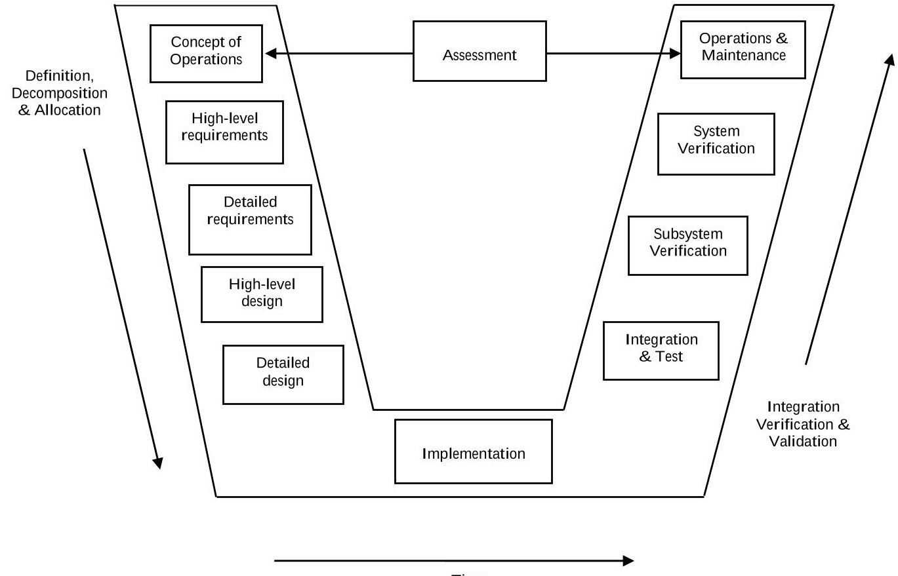

Figure 2.1: Systems Engineering V-model

The process starts with identifying customer needs and these are then communicated to subsystems using system requirements. The subsystem requirements are further broken down and communicated to smaller teams that design a component. This is indicated by the 'Definition, Decomposition and Allocation' phase in Fig. 2.1. This is followed by design implementation, integration and verification of the design, where iterations are performed on the design to meet stakeholder desires, if they don't match the preferences. Requirements are used as proxies for the actual preferences and are flowed down the hierarchy. In essence, the requirements represent what the stakeholder does not want rather than what is wanted. They define a hyperspace in which design variables (parameters) must fall, but provide no system level guidance as to a best choice within the hyperspace. For example, a very high level requirement based on cost is communicated in such a way that the stakeholder does not want a system that exceeds a certain cost. This also limits the exploration of other designs that are expensive but yield more profit. In addition to not

<!-- PDF_PAGE: 19 -->

providing a framework for system optimization, the requirements-driven SE approaches also limits design space exploration. The lack of system optimization results in the lower level designers being unaware of the impact of subsystem design decisions on the overall system. All this leads to a lack of system consistency in preference communication across the organizations involved.

The conventional systems engineering process incorporates a hierarchical decomposition based on a requirement-based framework, as shown in Fig. 2.2. The design process is decomposed into smaller sub-systems, which are characterized either by disciplines or by function. This decomposition results in creation of couplings/artificial boundaries, which are then addressed by using Interface Control Documents [17, 18, 21]. By taking into account the processes in the systems engineering approach and by considering the reality of large-scale systems, it is clear that the behavior of the couplings is highly complex and cannot be addressed by just using the Interface Control Documents (ICD) and that a rigorous mathematical representation of couplings is needed. The failure to address physics-based interactions results in a system that is not consistent in physics.

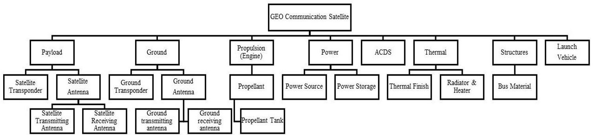

Figure 2.2: Hierarchical decomposition of a satellite system (Preliminary design)

In addition to inconsistency in communication of system preference and physics, requirementsdriven SE approaches also have the issue of inconsistency in design decision-making when uncertainties are present. In the requirements world, uncertainties are treated in the form of tolerances and the attitude of design decision-makers towards uncertain designs has not been

<!-- PDF_PAGE: 20 -->

addressed [13, 22]. The design process associated with LSCES involves decision-making at all levels of the hierarchy [1]. LSCES like satellites and aircraft are extremely complex and involve a huge number of individuals making decisions throughout the hierarchy of the organization. The Boeing Company alone employs 167,865 people as of October 30th, 2014 to serve both their commercial and defense sectors [10]. With so many decisions being made by thousands of people, it is crucial to have consistency across the system to result in a system that is desired by the stakeholder.

## Multidisciplinary Design Optimization

Multidisciplinary Design Optimization (MDO) was promoted in the 1980s as a means of enabling optimization of a system as a whole involving couplings between disciplines or subsystems of the system, where the impact of couplings was modeled in both analysis and optimization. MDO leverages the couplings between subsystems to create sophisticated optimization frameworks to handle systems composed of many subsystems, thereby enabling consistency in physics [9]. Initially MDO focused on bi-level hierarchical decompositions [23] and evolved into focusing on total system optimizations [11,24,25]. To meld MDO to the system practices that were in use, requirements were implemented into the frameworks as constraints. However, due to the use of an objective function, the designer is able to differentiate between feasible designs. While making MDO applicable for use in practice, the requirements reduce the abilities of the optimization process by restricting the design space. In MDO the choice of objective function is often left to component or subsystem teams, rather than reflecting the system preference. It should be noted that MDO does not provide a means for generating an objective

<!-- PDF_PAGE: 21 -->

function but assumes such a function already exists. MDO enables the differentiation among feasible designs (those that are bounded by requirements) using the objective function. However, the objective function generally is only a proxy for the true system preference (e.g. cost, weight, or performance). Often, multi-objective optimization is used as a means of including more than one objective in a single function in an attempt to explore trade-offs amongst these objectives [12, 26].

## Design Structure Matrix (DSM)

One of the useful ways to represent couplings in a system is by using a Design Structure Matrix (DSM) as shown in Fig. 2.4 [27-31]. Let us consider a simple coupled system consisting of three disciplines (Aerodynamics, Structures and Controls) as shown in Fig. 2.3. The X's and Y's in Fig 2.3 represent the design variables and coupling variables (which are a subset of behavior variables) respectively. Design variables are the independent variables associated with each discipline that define the design, whereas behavior variables represent the behavior of a particular discipline associated with a specific design. Coupling variables represent the interactions between these disciplines as indicated by Y's in Fig. 2.3. The presence of couplings is represented using dots in the DSM (Fig 2.4). When the number of interacting disciplines increase, representing the interactions using Fig. 2.3 becomes challenging. DSM makes it easier to represent the interactions between the subsystems/disciplines when the number of disciplines explode.

<!-- PDF_PAGE: 22 -->

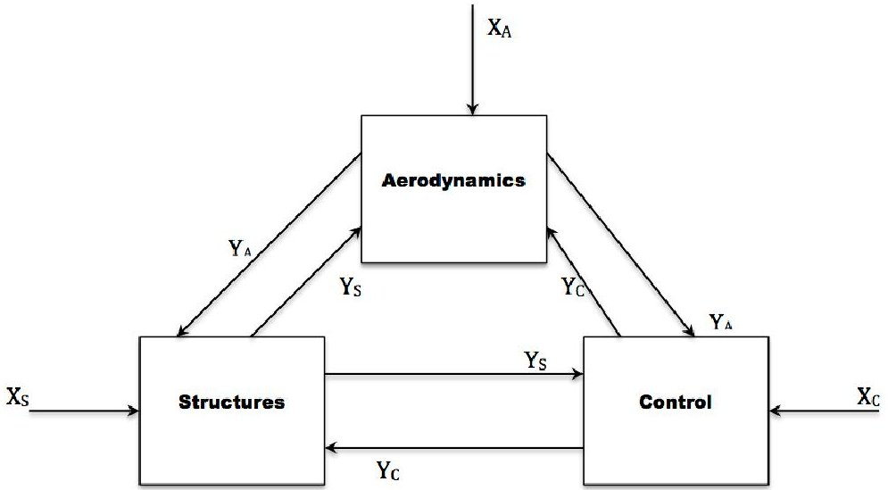

Figure 2.3: Coupled System

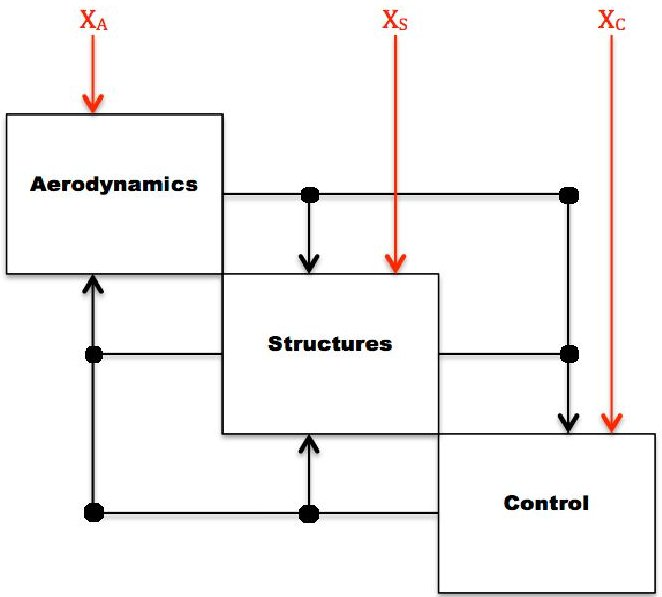

Figure 2.4: Design Structure Matrix (DSM)

Multidisciplinary Design Feasible (MDF) Framework

Past researchers [11, 32-35] have reviewed the many frameworks that have been developed in the field of MDO. This research particularly uses the Multidisciplinary Design Feasible (MDF) framework shown in Fig 2.5. MDF [32, 35] is an MDO framework that uses a single system level optimizer. The optimizer distributes design variable values to a system analysis which sends back system outputs for use in the optimization method. The system analysis converges the coupled subsystems (SS1, SS2 and SS3) to ensure both subsystem and system consistency for each set of design variables determined by the system optimizer.

<!-- PDF_PAGE: 23 -->

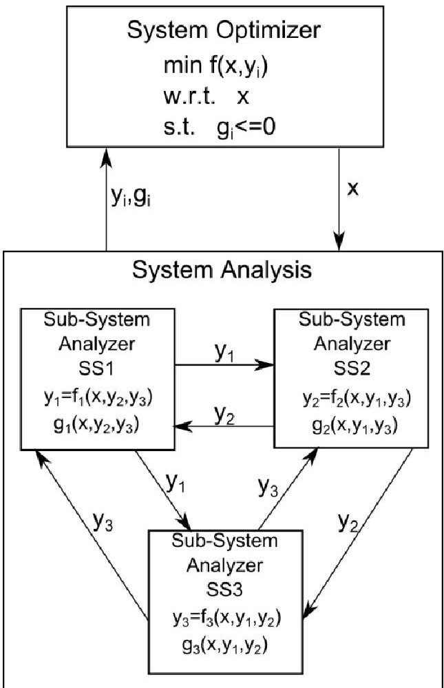

Figure 2.5: Multidisciplinary Design Feasible (MDF) Framework

## Global Sensitivity Equations (GSE)

Sensitivity analysis provides a way to determine the effect of a design variable on the behavior of the system. This is really useful during post-processing as well as in creating lower-fidelity models based on sensitivities. One of the methods that provides a means of obtaining sensitivities is the Global Sensitivity Equation (GSE) method [36]. The GSE method provides a means for obtaining system sensitivities in terms of local (disciplinary) sensitivities. The sensitivity information obtained from GSE can then be used to construct a linear approximation to the behavior response. These system sensitivities are also useful in coupling suspension and reduction [37, 38], and subsystem/system optimization. The GSE will be used extensively in this research as it provides a cost effective way of computing derivatives as opposed to other methods like finite difference

<!-- PDF_PAGE: 24 -->

method [39, 40], complex step derivative method [41], adjoint methods [42], which are computationally expensive. The Global Sensitivity Equation associated with the simple coupled system, provided in Fig. 2.6, is represented in Fig 2.7. Figure 2.7 represents the total or global sensitivities of the behavior variables with respect to all the design variables in terms of the local or partial derivatives.

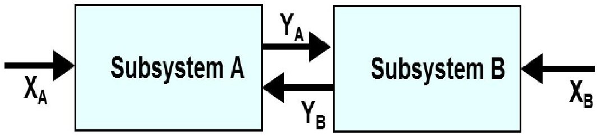

Figure 2.6: Simple Coupled System

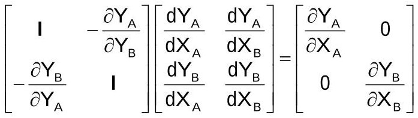

Figure 2.7: Global Sensitivity Equation (GSE)

## Value-Driven Design

Recently, a new systems engineering approach (VDD) has been proposed as an alternative to traditional systems engineering approaches [7,43]. VDD enables system optimization by capturing the true preferences of the stakeholder through a single value function (an objective function) and reducing the requirements placed on the design space thereby providing further freedom to the designer [7]. The VDD process is represented in Fig. 2.8, which shows how optimization can be performed in the context of VDD.

Value functions are formed as a function of system characteristics known as attributes. The value function has a singular unit (such as dollars or probability of mission success) that directly

<!-- PDF_PAGE: 25 -->

correlates to the stakeholder's preference, with attributes being functions of lower level attributes and design variables. This formulation of a value function allows for a direct comparison of design alternatives from a wide range of systems that share the same set of attributes, as trade-offs are inherently captured in the value function through a single mathematical relationship. For example, a value function might be constructed as a function of attributes such as speed, cost, range, etc., that could lead to the design of two radically different system alternatives, such as a boat or a plane. This enables the two alternatives to be compared with one another in the unit of dollars by using a value function of maximizing profit. In VDD, the value function is decomposed and distributed to lower level subsystems to enable more informed and consistent decision making [44].

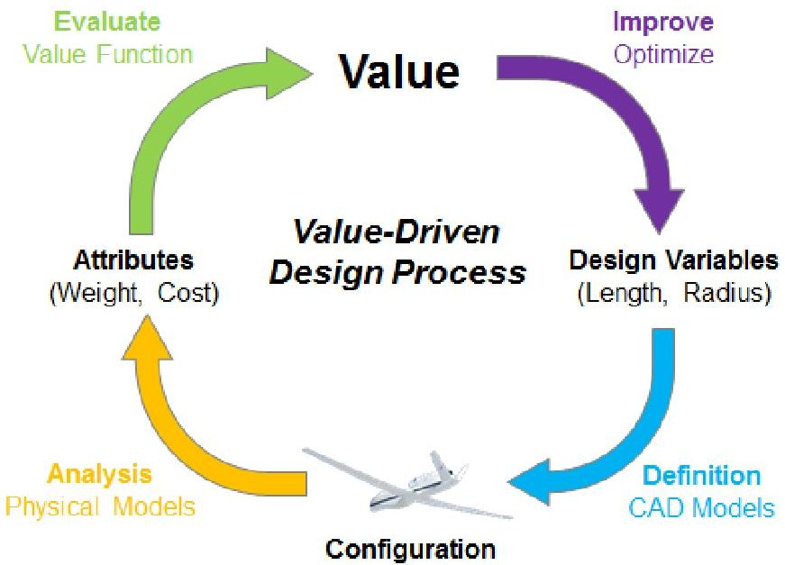

Figure 2.8: Value-Driven Design Process

One of the important aspects of VDD is aiding the designer in problem formulation. One of the focuses of this research is to show how VDD aids the designer in formulating the problem to true preferences by capturing the desires in an objective function/value function and by reducing/eliminating constraints due to requirements [12].

<!-- PDF_PAGE: 26 -->

## Decision Analysis (DA)

## Decision-Making under Uncertainty

Traditionally, designers use tolerances and factors of safety on the design to address uncertainty. These tolerances and safety factors do not have a mathematical foundation and are usually determined from past experience and knowledge. Previous researchers have addressed these issues by quantifying uncertainties [45-51] and propagating [52-55] them throughout the design by aiming at improving the robustness and reliability of the system [22]. In this dissertation, only the uncertainties associated with the design variables are considered and are modeled through probability distributions. The uncertainties are then propagated using Monte-Carlo Sampling (MCS) method [53], where repeated sampling and simulation is performed to obtain the behavioral response. Other lower order methods exist that are used in propagating uncertainties.

Designing with uncertainty in the context of MDO has also been addressed [22]. Mean and standard deviation of objective function subject to constraints were used to reflect the design preference with uncertainties, both in robust design optimization (RDO) [56-58] and reliabilitybased design optimization (RBDO) [22, 58-60]. Decisions made on mean and standard deviations are only applicable to distributions that are normal, whereas when the distributions are skewed, a more rigorous method is needed to make decisions. In the past research, the risk preference of the designer was not captured and was assumed to be risk neutral [13, 22]. Studies have shown that in an uncertain design environment an improper communication or no communication of risk preferences will result in designers making decisions based on their own risk preference [13].

<!-- PDF_PAGE: 27 -->

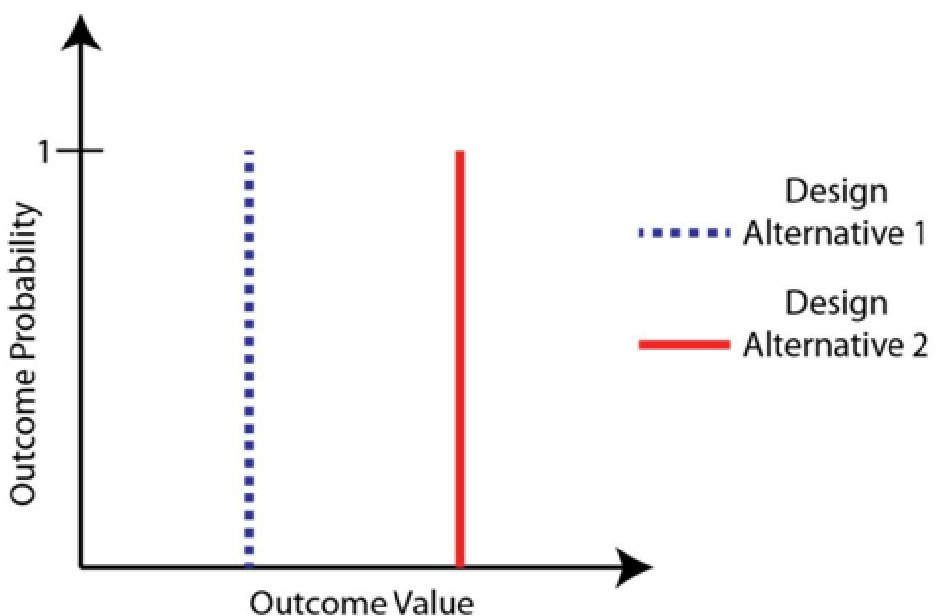

Figure 2.9: Deterministic Design Alternatives

It is straightforward to choose between alternatives in a value-based environment if the designs are deterministic, where only the value preference of the stakeholder is needed, as shown in Fig. 2.9. The preferred design is alternative 2 as it has more outcome value than design alternative 1. However, when uncertainties are present it becomes challenging in selecting design alternatives. It can be seen from the probability distributions provided in Fig. 2.10 that it is not straightforward to choose between the design alternatives. Choosing a design alternative under uncertainty requires both the value and risk preference of the individual, where the risk preference captures the person's desires concerning uncertainties.

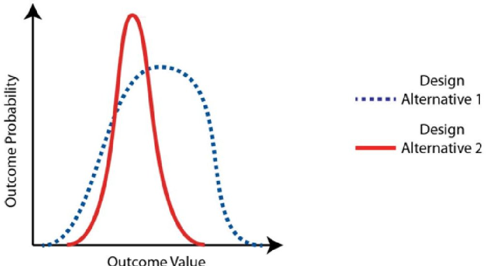

Figure 2.10: Uncertain Design Alternatives

<!-- PDF_PAGE: 28 -->

Decision Theory deals with the analysis of the behavior of an individual facing uncertainties. Normative or prescriptive decision theory is concerned with how individuals should make decisions, whereas descriptive decision theory deals with how decisions are made [61-64]. Decision Analysis (DA) is a normative approach that provides a framework for decision-making while uncertainties are present using expected utility theory [16]. Other variants exist like subjective expected utility theory, which uses subjective probabilities in the form of beliefs compared to objective probabilities in expected utility theory [65]. Some of the other normative models that are closely related to expected utility theory are Causal decision theory and evidential decision theory [66-68]. On the side of descriptive decision theory, prospect theory deals with how choices are made rather than optimal choices using heuristics [69]. This research particularly deals with normative decision theory as it deals with optimal choices rather than real life choices.

## Expected Utility Theory

Expected utility theory is a mathematical method that is used to collapse probability distributions associated with uncertain outcomes into a single expected utility that is consistent with the risk preferences of the individual [70]. In utility theory, the risk preferences of an individual are captured using a utility function and the most preferred design has the highest expected utility [16]. Equation 2.1 shows an example of a utility function that relates an outcome (V) to the value (U) that a person receives.

$$
U (V) = - \frac {1}{a} e ^ {- a V}
$$

<!-- PDF_PAGE: 29 -->

Construction of utility functions are outside the scope of this research and readers are recommended to read the stated references, which use experimental methods to elicit risk preferences [71]. Utility functions that are widely used in literature have been used in this research by tweaking the risk parameters to result in a desired risk preference, as will be seen in chapter 7. Utility functions are constructed in such a way that they follow the von-Neumann-Morgenstern preference axioms [16]. Before delving into risk preferences, it is important to understand the following terminologies that characterize the preferences.

- Expected outcome represents the anticipated measurement of the lottery and is represented as shown in Eq. 2.2, where $ V_{i} $ is the measurement associated with alternative i and P(i) is the probability of that measurement occurring.

$$
\text {E x p e c t e d O u t c o m e} = \sum_ {i} V _ {i} \times P \left(V _ {i}\right)
$$

- Equation 2.3 represents the utility of expected outcome, where U represents the utility function as seen in Eq. 2.1. Equation 2.3 represents the player's value of expected outcome if given to him directly.

$$
U t i l i t y o f E x p e c t e d O u t c o m e = U (E x p e c t e d O u t c o m e)
$$

- Expected utility, as shown in Eq.2.4, is the player's anticipated value of the lottery, which captures the preferences of the individual towards risky choices.

$$
\text {E x p e c t e d U t i l i t y} = \sum_ {i} U \left(V _ {i}\right) \times P \left(V _ {i}\right)
$$

<!-- PDF_PAGE: 30 -->

- Equation 2.5 represents certainty equivalent, which is the minimum measurement that the player would accept instead of playing the game.

$$
C e r t a i n t y E q u i v a l e n t = U ^ {- 1} (E x p e c t e d U t i l i t y)
$$

## Risk preferences

Generally risk preferences can be grouped into three categories namely risk averse, risk-loving and risk neutral. When faced with design alternatives under uncertainty, people tend to be risk averse (avoiding risk).

## Risk averse

If an individual's utility of expected outcome of the lottery is greater than his/her expected utility from the lottery, then he/she is said to have a risk averse preference. These individuals avoid risk and will always sell the lottery ticket for the expected outcome (likely for less as well) than play the lottery. The utility function associated with this preference is concave down as indicated by the blue curve in Fig. 2.11

<!-- PDF_PAGE: 31 -->

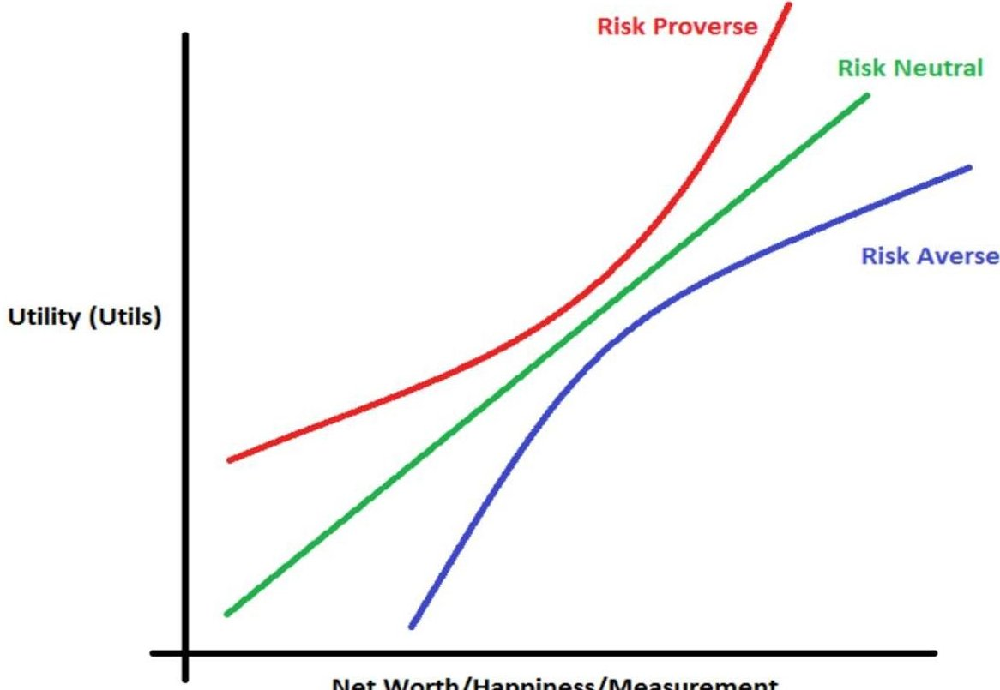

Figure 2.11: Risk Preferences

## Risk loving

An individual is said to have a risk loving preference if the utility of expected outcome is less than his/her expected utility from the game. These individuals will always buy the lottery ticket for expected outcome (likely for more as well) than not play the lottery. The utility function associated with a risk loving individual is represented by the red curve in Fig. 2.11.

## Risk neutral

If an individual has the utility of expected outcome equal to his/her expected utility from the game, then he/she is said to have a risk neutral preference. These individuals are indifferent between selling the lottery ticket for the expected outcome and keeping the ticket. The risk neutral utility function is represented by the green line in Fig. 2.11.

<!-- PDF_PAGE: 32 -->

## CHAPTER 3

## SATELLITE SYSTEM

A geo-stationary commercial communication satellite system has been created as a testbed for the research. The fidelity of the models increase in complexity going from the conceptual to preliminary design phase. It should be noted that the models created in this chapter are approximate and are based on past data and knowledge with some educated assumptions.

## Lower Fidelity Satellite Model

The satellite system includes a communication satellite, a set of ground stations and a launch vehicle to get the satellite into orbit. A communication satellite is essentially a transmission relay. It receives a signal from a transmitting ground station, amplifies the received signal, processes the signal, and then transmits the signal back to a different receiving ground station. The satellite has a payload that accomplishes the mission objective of the satellite. The satellite's bus consists of all the subsystems that aid the satellite in accomplishing the mission objective. The mission objective of a television broadcast satellite is to re-transmit the signals received from a ground station to another ground station efficiently and effectively. In this example, the three main systems involved are the satellite, ground support, and launch vehicle, with subsystems associated with two of these. Each of the individual subsystems and the payload of the satellite are described in Appendix A, as well as the associated analysis equations.

<!-- PDF_PAGE: 33 -->

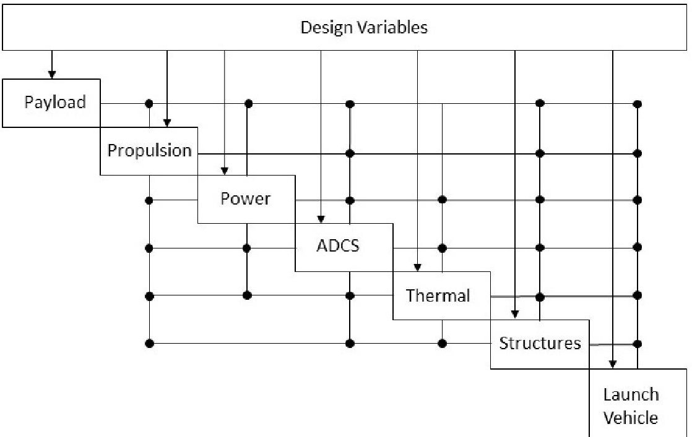

Figure 3.1: Discipline-based DSM (Conceptual)

Figure 3.1 shows the discipline-based DSM for the conceptual phase, which has a total of 9 continuous design variables (Table 3.1), 22 behavior variables (Table 3.2), and 4 system attributes. Here, the term discipline-based is used to represent the interaction of disciplinary analysis models in the system. Feed-forwards are indicated in the upper right quadrant and feed-backs in the lower left. This lower fidelity model of the satellite system is primarily used in Chapter 4 of the research, in which the importance of capturing the true stakeholder preferences using a value function is demonstrated.

<!-- PDF_PAGE: 34 -->

Table 3.1: Description of Design Variables

<table border="1"><tr><td>Design Variable</td><td>Description</td></tr><tr><td>fdown</td><td>Downlink frequency in Hz</td></tr><tr><td>fup</td><td>Uplink frequency in Hz</td></tr><tr><td>Pt</td><td>Satellite Transmitter power in Watts</td></tr><tr><td>Pgt</td><td>Ground Transmitter power in Watts</td></tr><tr><td>Dsat,trans</td><td>Satellite transmitting antenna diameter in m</td></tr><tr><td>Dsat,rec</td><td>Satellite receiving antenna diameter in m</td></tr><tr><td>Dground,rec</td><td>Ground receiving antenna diameter in m</td></tr><tr><td>Dground,trans</td><td>Ground transmitting antenna diameter in m</td></tr><tr><td>$\varepsilon$</td><td>Energy density of the battery in $\frac{W-hr}{kg}$</td></tr></table>

Table 3.2: Description of Behavior Variables

<table border="1"><tr><td>Behavior variable</td><td>Description</td></tr><tr><td>Mpayload</td><td>Mass of the payload in kg</td></tr><tr><td>Ppayload</td><td>Power required by the payload in Watts(W)</td></tr><tr><td>Mtransponders</td><td>Mass of the transponders in kg</td></tr><tr><td>Mpropellant</td><td>Mass of the propellant in kg</td></tr><tr><td>MSA</td><td>Mass of the solar array in kg</td></tr><tr><td>Mbattery</td><td>Mass of the battery in kg</td></tr><tr><td>Array size</td><td>Area of the solar array inm2</td></tr><tr><td>MADCS</td><td>Mass of the ADCS inkg</td></tr><tr><td>PADCS</td><td>Power required by the ADCS inW</td></tr><tr><td>MRW</td><td>Mass of the reaction wheels inkg</td></tr><tr><td>Mthermal</td><td>Mass of the thermal system inkg</td></tr><tr><td>Pthermal</td><td>Power required by the thermal system inW</td></tr><tr><td>Mbus</td><td>Mass of the satellite bus inkg</td></tr><tr><td>Ls</td><td>Length of the bus inm</td></tr><tr><td>rs</td><td>Radius of the bus inm</td></tr><tr><td>ts</td><td>Thickness of the satellite bus inm</td></tr><tr><td>Msat,trans</td><td>Mass of satellite transmitting antenna inkg</td></tr><tr><td>Msat,rec</td><td>Mass of satellite receiving antenna inkg</td></tr><tr><td>Vprop</td><td>Volume of the propellant tank inm3</td></tr><tr><td>VBattery</td><td>Battery volume inm3</td></tr><tr><td>VRW</td><td>Volume of the reaction wheel inm3</td></tr><tr><td>Vtrans</td><td>Volume of the satellite transponders inm3</td></tr></table>

Table 3.3 describes the couplings between the subsystems. The first column of Table 3.3 depicts the receiving subsystems with their corresponding row detailing the behavior variables

<!-- PDF_PAGE: 35 -->

disseminated to them by the other subsystems. The header of the column of each behavior variable determines the subsystem from which the behavior variable originates. For example, in Table 3.3 consider the $ 3^{\mathrm{rd}} $ row, representing the Power subsystem. The Power subsystem receives the power needed by the Payload （ $ P_{\mathrm{payload}} $ ）, ADCS （ $ P_{\mathrm{ADCS}} $ ）, and Thermal （ $ P_{\mathrm{thermal}} $ ） subsystems as inputs. As seen in Fig. 3.1 and Table 3.3, the example satellite system is highly coupled, representative of a typical LSCES.

Table 3.3: Description of Couplings

<table border="1"><tr><td>Sending</td><td rowspan="2">Payload</td><td rowspan="2">Propulsion</td><td rowspan="2">Power</td><td rowspan="2">ADCS</td><td rowspan="2">Thermal</td><td rowspan="2">Structures</td><td rowspan="2">Launch Vehicle</td></tr><tr><td>Receiving</td></tr><tr><td>Payload</td><td>-</td><td>-</td><td>-</td><td>-</td><td>-</td><td>-</td><td>-</td></tr><tr><td>Propulsion</td><td>Mpayload</td><td>-</td><td>MSA,Mbattery</td><td>MADCS</td><td>Mthermal</td><td>Mbus</td><td>-</td></tr><tr><td>Power</td><td>Ppayload</td><td>-</td><td>-</td><td>PADCS</td><td>Pthermal</td><td>-</td><td>-</td></tr><tr><td>ADCS</td><td>Msat,transMsat,rec</td><td>Mpropellant</td><td>MSA,Mbattery,Array size</td><td>-</td><td>Mthermal</td><td>Mbus,Ls,rs,ts</td><td>-</td></tr><tr><td>Thermal</td><td>-</td><td>-</td><td>Array size</td><td>-</td><td>-</td><td>Ls,rs</td><td>-</td></tr><tr><td>Structures</td><td>Mpayload,Vtrans</td><td>Mpropellant,Vprop</td><td>MSA,Mbattery,VBattery</td><td>MADCS,VRW</td><td>Mthermal</td><td>-</td><td>-</td></tr><tr><td>Launch Vehicle</td><td>Mpayload</td><td>Mpropellant</td><td>MSA,Mbattery</td><td>MADCS</td><td>Mthermal</td><td>Mbus</td><td>-</td></tr></table>

## Higher Fidelity Satellite Model

In Chapters 5-7, a higher fidelity model of the satellite system is used (associated with a preliminary design phase) that corresponds to the organizational decomposition shown in Figure 3.4. In the higher fidelity model, the satellite system is decomposed into three levels of hierarchy and eight major subsystems at level 1 as shown in Fig. 3.4. The eight major subsystems at level 1 are further decomposed into lower level subsystems as shown in Fig. 3.4. The discipline-based and

<!-- PDF_PAGE: 36 -->

attribute-based DSM's are shown in Figures 3.2 and 3.3. The attribute-based DSM represents the organizational (team-based) couplings which are present between the different subsystems at subsystem level 1 (SL1), the first level of the hierarchy. A total of 36 design variables define the satellite system, out of which 14 are continuous and 22 are discrete. Most of the discrete design variables define technology choices associated with each of the subsystem. A detailed description of the attributes and design variables associated with all the levels of the hierarchy is provided in the Appendix. Attributes are critical in this study as the value function comprises of relationships of attributes. These attributes that characterize the subsystems may be functions of lower level attributes. These attribute might be behavior variables or may themselves be functions of behavior variables.

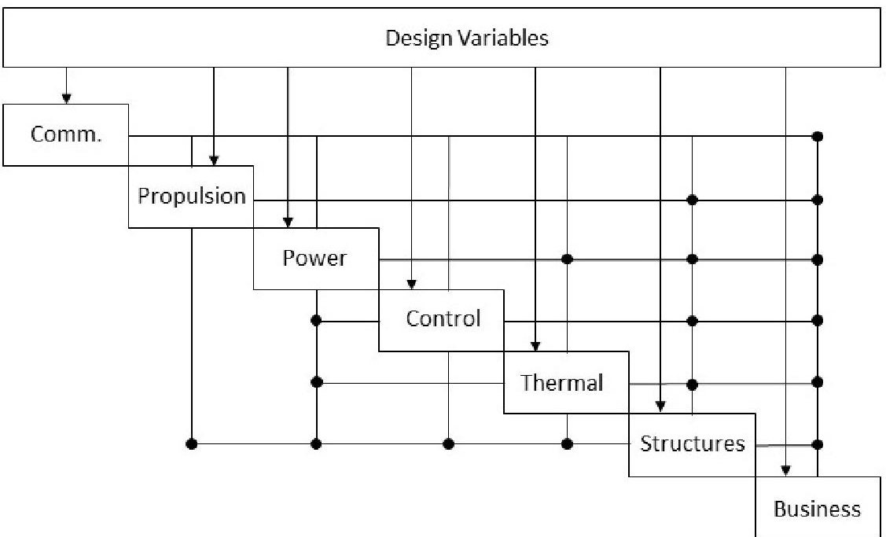

Figure 3.2. Discipline-based DSM (Preliminary)

<!-- PDF_PAGE: 37 -->

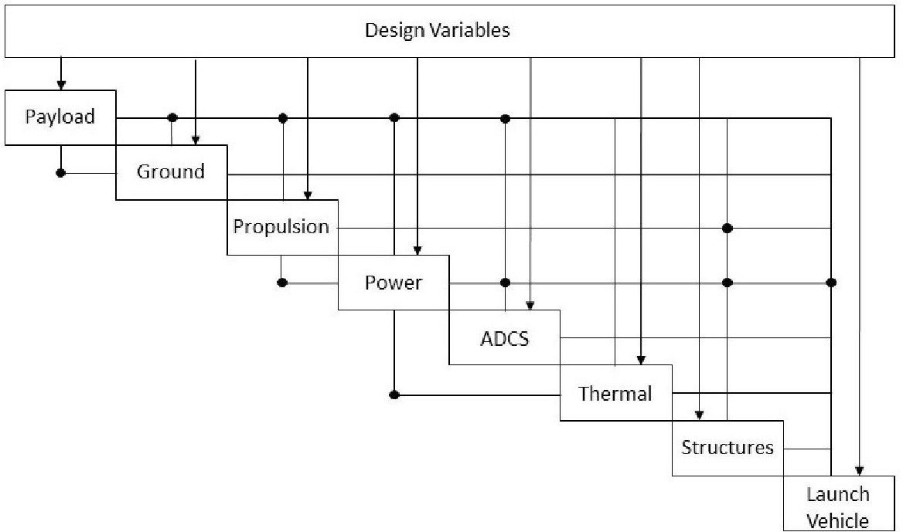

Figure 3.3. Attribute-based DSM (Preliminary)

This higher fidelity model is used to demonstrate the necessity of including system sensitivities in the decomposition of the value function (Chapter 5), including scorecard representations. It is also used in Chapter 6 and 7, in which the proposed Value-Based Systems Engineering (VBSE) framework is demonstrated to support system optimization, incorporating VDD, MDO and DA principles.

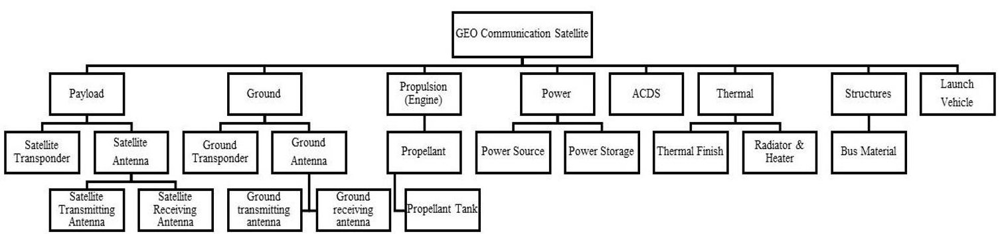

Figure 3.4: Hierarchical decomposition of a satellite system (Preliminary design)

<!-- PDF_PAGE: 38 -->

## CHAPTER 4

## CONSISTENCY IN SYSTEM PREFERENCES

In traditional systems engineering approaches, the requirements are viewed as a pass/fail characteristic, such that if a requirement is violated, the design is a failure. This would necessitate a redesign or possible trade-off of requirements across the system, resulting in time and cost delays. Also, all designs that pass the requirements are viewed as equal, without an overarching design objective. Using pass/fail criteria is insufficient to differentiate between designs that fail slightly versus those that fail significantly. These issues are magnified when requirements are based on such origins as legacy design knowledge or organization traditions, often restricting the design space unnecessarily.

Present systems engineering procedures make implementation of MDO across the system difficult, if not impossible. MDO has found application in industries within lower level teams, generally during detailed design. It is also used in conceptual design phases, where an abstraction of the actual system is visualized for multi-objective optima. In these applications, the design team often chooses an objective function most relevant to the component or subsystem being designed. Hence, the problem formulation, while relevant to the component or subsystem, will not provide direct insight to the system as a whole. This leads to inconsistency in design preferences across the system, which then leads to a final system design that none of the disciplines actually prefer. The primary focus of this chapter is to tackle research question 1 by emphasizing why and how problem formulation is important in reflecting the true preferences of the stakeholder of the system, and ultimately how system consistency can be improved using an MDO augmented VDD

<!-- PDF_PAGE: 39 -->

formulation. The lower fidelity models associated with the conceptual phase of the satellite system design process, defined in Chapter 4, is used here for demonstration purposes.

In traditional satellite MDO applications, designers are interested in formulating optimization problems using mass of the satellite, cost of the satellite or some combination of characteristics as the objective function [26, 51, 72-81]. These objectives are chosen as proxies for the true preference, such as profit or mission success. It will be demonstrated in this study that vastly different systems will be obtained with these proxy objective functions, compared to using the true preference directly.

The optimization software used in this study is built-in MATLAB optimizer [82], validated using independently coded C++ optimization algorithms. The optimization method used in the various MDO frameworks for constrained problems (traditional objective function/requirement formulations) is the MATLAB function 'fmincon,' using the interior-point algorithm. The constrained problem solutions are verified using the heuristic optimization algorithm, Particle Swarm Optimization (PSO) [83, 84], with a penalty function to account for constraint violations and a neighborhood approach to increase the likelihood of finding the global optimum [85, 86]. PSO is used for the value function formulation due to the need for a robust method as the design space is non-restricted and more complex than the traditional proxy objective functions investigated.

## Traditional Objective Function Formulations (Cases 1-6)

The traditional satellite MDO problem formulations using proxies as objective functions are first examined, followed by a value function problem formulation. Six different examples of

<!-- PDF_PAGE: 40 -->

traditional satellite MDO objective function/requirement formulations are presented, as outlined in Table 4.1. For each objective function, two cases are explored pertaining to whether the launch vehicle has been predetermined or not.

Table 4.1: Traditional objective function formulations

<table border="1"><tr><td>Case</td><td>Objective Function</td><td>Predetermined Launch Vehicle</td></tr><tr><td>1</td><td>Minimize Mass</td><td>Yes</td></tr><tr><td>2</td><td>Minimize Mass</td><td>No</td></tr><tr><td>3</td><td>Minimize Total Cost</td><td>Yes</td></tr><tr><td>4</td><td>Minimize Total Cost</td><td>No</td></tr><tr><td>5</td><td>Multi-Objective</td><td>Yes</td></tr><tr><td>6</td><td>Multi-Objective</td><td>No</td></tr><tr><td>7</td><td>Value Function</td><td>No</td></tr></table>

Traditional objective function and requirements: Cases 1 and 2 - Minimize mass

In traditional satellite system design formulations, a common objective function is that of the minimization of the mass of the satellite [26, 51, 72-74, 76, 77, 87]. This objective function has been traditionally used in aerospace systems due to its relationship with the cost of the system. Generally, as the mass of an aerospace system increases the cost of the system increases. This relationship stems from the heavy financial burden of placing each pound of payload into orbit [88]. The constraints used in the traditional proxy objective function formulation are representations of the desires of the stakeholder, indicating regions of the design space that they have deemed infeasible. There are many origins of constraints, some of which (especially for incremental designs) are legacy design knowledge and organization traditions, providing the stakeholder or designer a starting point in constraint determination.

<!-- PDF_PAGE: 41 -->

Several constraints are created for the satellite system example to reflect the traditional system design practice. Two scenarios concerning the launch vehicle for the satellite are considered, one in which the launch vehicle is predetermined and one in which it is not. When the launch vehicle is predetermined, many constraints must be considered. These constraints represent the stakeholder's desire for the satellite system to be delivered into orbit by a particular launch vehicle. These constraints relate to the launch vehicle's payload capability in terms of both mass and size. For the example, one requirement formed is that the sum of mass of all the subsystems is constrained to be less than 1000 kg. Also, the array size must be less than $ 4 0 \mathrm{m}^{2} $ to fit in the payload envelope of the launch vehicle and the dimensions of the satellite bus must be less than the payload envelope diameter and length. The signal to noise ratio constraint exists not because of a launch requirement but rather a performance requirement.

Apart from inequality constraints, side constraints (side bounds on design variables) are imposed on the example problem. These side constraints are derived from common satellite system design practices [89]. The uplink and downlink frequencies are bounded within the High Frequency (HF) to Very High Frequency (VHF) range. The satellite transmitter power $ \left(P_{t}\right) $ is bounded in the range of 300-3000 W, which for this satellite corresponds to 10-100 onboard transponders, as $ P_{t} $ is directly proportional to the number of onboard transponders (the power per transponder is 30 W). A wider bounding range is used for ground transmitter power $ \left(P_{gt}\right) $ due to the flexibility associated with the ground equipment. The diameters of the satellite antennae and the ground antennae are constrained in accordance to industry standards. The energy density of the satellite battery is constrained based on typically used batteries.

<!-- PDF_PAGE: 42 -->

$$
f i n d \mathbf {X} = \left[ f _ {d o w n}, f _ {u p}, P _ {t}, P _ {g t}, D _ {s a t, t r a n s}, D _ {s a t, r e c}, D _ {g r o u n d, r e c}, D _ {g r o u n d, t r a n s}, \varepsilon \right] ^ {\top}
$$

$$
M i n f (\boldsymbol {X}, \boldsymbol {y}) = M _ {t o t a l}
$$

$$
s. t. \quad g _ {1}: 1 0 d B - S N R _ {c o m p o s i t e} \leq 0
$$

$$
g _ {2}: M _ {p a y l o a d} + M _ {p r o p e l l a n t} + M _ {p o w e r} + M _ {A D C S} + M _ {t h e r m a l} + M _ {s t r u c t u r e s} - 1 0 0 0 \leq 0
$$

$$
g _ {3}: A r r a y s i z e - 4 0 m ^ {2} \leq 0
$$

$$
g _ {4}: L _ {s} - 5 m \leq 0
$$

$$
g _ {5}: r _ {s} - 2. 5 m \leq 0
$$

$$
1 \mathrm {G H z} \leq f _ {d o w n} \leq 1 0 0 \mathrm {G H z}
$$

$$
1 \mathrm {G H z} \leq f _ {u p} \leq 1 0 0 \mathrm {G H z}
$$

$$
3 0 0 W \leq P _ {t} \leq 3 0 0 0 W
$$

$$
3 0 0 W \leq P _ {g t} \leq 3 0 0 0 0 W
$$

$$
0. 5 m \leq D _ {s a t, t r a n s} \leq 2. 5 m,
$$

$$
0. 5 m \leq D _ {s a t, r e c} \leq 2. 5 m,
$$

$$
2 m \leq D _ {g r o u n d. r e c} \leq 2 0 m
$$

$$
2 m \leq D _ {g r o u n d, t r a n s} \leq 2 0 m
$$

$$
3 5 \frac {W - h r}{k g} \leq \varepsilon \leq 2 0 0 \frac {W - h r}{k g}
$$

Design case 1: Minimize mass with specified launch vehicle

The formal optimization statement in standard notation for the traditional Case 1 is shown in Eq. (4.1), which includes all of the requirements described previously. The optimal system design, as well as the associated objective functions and inequality constraint values for the

<!-- PDF_PAGE: 43 -->

traditional proxy objective function formulation Cases 1 and 2, are shown in Table 4.2. It is shown that some of the design variables are driven to either their upper or lower bounds at the optimum. Variables not driven to their bounds do have the possibility of influencing the design. For example, the frequencies are not directly related to system mass (i.e. a change in only frequency does not correlate directly to a change in mass) but are indirectly related through the signal to noise ratio, the gain and the antenna diameters. Similar relationships can be observed for the ground antennae diameters and the ground transmitter power. The values shown in Table 4.2 for the design variables which are not at a bound are equivalent to their initial optimization algorithm settings. Design variables that only impact constraints will remain at their initial values until the constraint becomes active. Hence, a multitude of optimal solutions will result based upon the initial values chosen. This example illustrates a flaw in the traditional formulation, where as long as a preference represented by a constraint is satisfied, there is no need to improve the system characteristics captured solely by that constraint. For example, all Signal to Noise Ratios above 10db are viewed as acceptable, where in actuality the signal will be impacted with differing acceptable ratios. The bound to which the design variables that reside on a side constraint are driven correlates to the design variable's relationship to the mass of the system, as the objective function is simply concerned with minimizing mass. For example, smaller diameter antennas and lower transmitter power (resulting in less transponders on board) result in a system with less mass.

The traditional proxy objective function formulation demonstrates the influence that constraints have on a design. The constraints do not allow exploration into the infeasible region and provides a solution that doesn't actually capture the true preference of the stakeholder. The objective function captures a system characteristic (mass), that is related to an economic system characteristic (cost), which is not the stakeholder's true preference (such as maximize profit).

<!-- PDF_PAGE: 44 -->

Table 4.2. Optimal Design for Cases 1 and 2

<table border="1"><tr><td colspan="3">Cases1and2</td><td></td><td colspan="2"></td></tr><tr><td>DesignVariable</td><td>InitialValues</td><td>OptimalValues</td><td></td><td>Constraints andObjectivefunction</td><td>Values</td></tr><tr><td>fdown</td><td>5GHz</td><td>5GHz</td><td></td><td colspan="2">Case1</td></tr><tr><td>fup</td><td>5GHz</td><td>5GHz</td><td></td><td>F</td><td>422.9</td></tr><tr><td>Pt</td><td>500W</td><td>300W</td><td></td><td>g1</td><td>-10.97</td></tr><tr><td>Pgt</td><td>500W</td><td>500W</td><td></td><td>g2</td><td>-577</td></tr><tr><td>Dsat,trans</td><td>1m</td><td>0.5m</td><td></td><td>g3</td><td>-22.3</td></tr><tr><td>Dsat,rec</td><td>1m</td><td>0.5m</td><td></td><td>g4</td><td>-4.04</td></tr><tr><td>Dground,rec</td><td>5m</td><td>5m</td><td></td><td>g5</td><td>-2.18</td></tr><tr><td>Dground,trans</td><td>5m</td><td>5m</td><td></td><td colspan="2">Case2</td></tr><tr><td>$\varepsilon$</td><td>50$\frac{W-hr}{kg}$</td><td>200$\frac{W-hr}{kg}$</td><td></td><td>F</td><td>422.9</td></tr><tr><td></td><td></td><td></td><td></td><td>g1</td><td>-10.9</td></tr></table>

Design case 2: Minimize mass without specified launch vehicle

The problem formulation associated with Case 2 is identical to Case 1 with the exception that the design of the satellite is no longer constrained by the launch vehicle requirements. For this case, it is assumed that a launch vehicle is always available that can accommodate the optimal satellite design. To represent this case the problem represented in Eq. 4.1 is modified by eliminating the inequality constraints $ \mathrm{g}_{2}-\mathrm{g}_{5} $ , which capture the requirements imposed by the preselected launch vehicle. Table 4.2 represents the optimal design of the satellite using the formulation of Case 2 (Eq. (4.1) without $ \mathrm{g}_{2}-\mathrm{g}_{5} $ ). It can be seen from Table 4.2 that even after eliminating the constraints, the optimal design is the same as Case 1. The optimal designs are identical due to the restrictions that the side constraints are placing on the design space and the inactivity of the predetermined launch vehicle constraints. Case 1 and 2 exemplify a downfall of

<!-- PDF_PAGE: 45 -->

traditional formulations in which the constraints restrict exploration of the design space. In these cases of traditional use of requirements, design variables that are primarily related to the determination of a constraint variable, such as signal to noise, may have a range of optimal values which produce a satisfied constraint and identical objective function values.

## Traditional objective function and requirements: Cases 3 and 4 - Minimize cost

The objective functions of Cases 1 and 2 use mass as an approximation of cost. To explore the impact that a more accurate cost model has on the design of the example satellite system, empirical cost relationships are constructed [89] and used to form an objective function based on cost. Cost is commonly used as an objective function in the satellite industry, as is mass. While this cost model is still only an approximation, it captures much of the complexity of a realistic system cost model. The formulation for the system design incorporating the cost model is shown in Eq. 4.2.

$$
\begin{array}{l} f i n d \mathbf {X} = \left[ f _ {d o w n}, f _ {u p}, P _ {t}, P _ {g t}, D _ {s a t, t r a n s}, D _ {s a t, r e c}, D _ {g r o u n d, r e c}, D _ {g r o u n d, t r a n s}, \varepsilon \right] ^ {\prime} \\ \mathrm {M i n} f (\mathbf {X}, \mathbf {y}) = \mathrm {T o t a l C o s t} \\ s. t. g _ {1}: 1 0 d B - S N R _ {c o m p o s i t e} \leq 0 \\ g _ {2}: M _ {p a y l o a d} + M _ {p r o p e l l a n t} + M _ {p o w e r} + M _ {A D C S} + M _ {t h e r m a l} + M _ {s t r u c t u r e s} - 1 0 0 0 \leq 0 \\ g _ {3}: \mathrm {A r r a y s i z e} - 4 0 m ^ {2} \leq 0 \\ g _ {4}: L _ {s} - 5 m \leq 0 \\ g _ {5}: r _ {s} - 2. 5 m \leq 0 \\ 1 \mathrm {G H z} \leq f _ {d o w n} \leq 1 0 0 \mathrm {G H z} \\ 1 \mathrm {G H z} \leq f _ {u p} \leq 1 0 0 \mathrm {G H z} \\ 3 0 0 W \leq P _ {t} \leq 3 0 0 0 W \\ 3 0 0 W \leq P _ {g t} \leq 3 0 0 0 0 W \\ 0. 5 m \leq D _ {s a t, t r a n s} \leq 2. 5 m, \\ 0. 5 m \leq D _ {s a t, r e c} \leq 2. 5 m, \\ 2 m \leq D _ {g r o u n d. r e c} \leq 2 0 m \\ 2 m \leq D _ {g r o u n d, t r a n s} \leq 2 0 m \\ 3 5 \frac {W - h r}{k g} \leq \varepsilon \leq 2 0 0 \frac {W - h r}{k g} \\ \end{array}
$$

<!-- PDF_PAGE: 46 -->

The cost based objective function is used for both Cases 3 and 4, with the difference between the cases resulting from the elimination of launch vehicle constraints, as was done with Cases 1 and 2. Given that the cost model takes into account the cost of the launch vehicle, the launch vehicle constraints here are associated with a maximum launch vehicle (in terms of payload size and mass), that the stakeholder wishes to use based on a belief that larger launch vehicles would be too costly. The system cost equations are given in Appendix A. These equations take into account various relationships between the design variables and the capital necessary to achieve the system design. For example, the system cost model takes into account the direct relationship between increasing ground transmitter power and increasing cost due to the equipment necessary to achieve the increase, a direct relationship that was not captured in the minimize mass objective function of Cases 1 and 2. Costs including maintenance and end of life product disposal are not included in this model, but could be added if desired. Table 4.3 represents the optimal design and the values of the objective function and constraints that were obtained using Eq. (4.2). Table 4.3 also represents the results for Case 4 where the maximum launch vehicle is not predetermined.

The results of Cases 3 and 4 are very similar to that of Cases 1 and 2, with the difference reflected in the ground antennae diameters and the ground transmitter power. As was true with Cases 1 and 2, the side constraints of Cases 3 and 4 are the dominating constraints, making the elimination of the launch vehicle constraints a non-factor for this specific satellite design. In Cases 3 and 4, the ground antennae construction and material costs are taken into account, resulting in the ground antennae diameters being driven towards their lower bounds. This was not seen in Cases 1 and 2 as the ground antennas had no impact on the mass of the satellite. The ground transmitter power is driven to its lower bound due to the lower cost in purchasing equipment to

<!-- PDF_PAGE: 47 -->

supply and handle lower power demands. The similarities between the solutions for Cases 1 and 2, and Cases 3 and 4 reveal that the use of an approximate cost model based on system mass has merit. The mass of the system does have a large impact on system cost, as reflected in the cost model used in Cases 3 and 4. However, while the mass objective function used in traditional satellite design practices can be shown to have merit in approximating system cost, the question must be raised again - is minimizing cost the true preference of the stakeholder?

Table 4.3. Optimal Design for Cases 3 and 4

<table border="1"><tr><td colspan="3">Cases3and4</td><td></td><td colspan="2"></td></tr><tr><td>DesignVariable</td><td>InitialValues</td><td>OptimalValues</td><td></td><td>Constraints andObjective function</td><td>Values</td></tr><tr><td>fdown</td><td>5GHz</td><td>5GHz</td><td></td><td colspan="2">Case3</td></tr><tr><td>fup</td><td>5GHz</td><td>5GHz</td><td></td><td>F</td><td>9.2e+6</td></tr><tr><td>Pt</td><td>500W</td><td>300W</td><td></td><td>g1</td><td>-2.76</td></tr><tr><td>Pgt</td><td>500W</td><td>300W</td><td></td><td>g2</td><td>-577</td></tr><tr><td>Dsat,trans</td><td>1m</td><td>0.5m</td><td></td><td>g3</td><td>-22.33</td></tr><tr><td>Dsat,rec</td><td>1m</td><td>0.5m</td><td></td><td>g4</td><td>-4.04</td></tr><tr><td>Dground,rec</td><td>5m</td><td>2m</td><td></td><td>g5</td><td>-2.18</td></tr><tr><td>Dground,trans</td><td>5m</td><td>2m</td><td></td><td colspan="2">Case4</td></tr><tr><td>$\varepsilon$</td><td>50$\frac{W-hr}{kg}$</td><td>200$\frac{W-hr}{kg}$</td><td></td><td>F</td><td>9.2e+6</td></tr><tr><td></td><td></td><td></td><td></td><td>g1</td><td>-2.76</td></tr></table>

Traditional objective function and requirements: Cases 5 and 6 - Multi-objective formulation

Another common technique used in traditional MDO formulations, and the engineering industry at large, is to create a multi-objective function. A multi-objective function allows a stakeholder to express his preferences on multiple characteristics of the system. Here, a multi-

<!-- PDF_PAGE: 48 -->

objective function is formed that captures mass and transmitter power, and is stated in Eq. 4.3 for Cases 5 and 6.

$$
\begin{array}{l} f i n d \mathbf {X} = \left[ f _ {d o w n}, f _ {u p}, P _ {t}, P _ {g t}, D _ {s a t, t r a n s}, D _ {s a t, r e c}, D _ {g r o u n d, r e c}, D _ {g r o u n d, t r a n s}, \varepsilon \right] ^ {\top} \\ M i n f \left(\boldsymbol {X}, \boldsymbol {y}\right) = w _ {1} \times M _ {t o t a l} - w _ {2} \times P _ {t} \\ \end{array}
$$

where: $ w_{1} $ and $ w_{2} $ are weighting factors

$$
s. t. \quad g _ {1}: 1 0 d B - S N R _ {c o m p o s i t e} \leq 0
$$

$$
\begin{array}{l} g _ {2}: M _ {p a y l o a d} + M _ {p r o p e l l a n t} + M _ {p o w e r} + M _ {A D C S} + M _ {t h e r m a l} + M _ {s t r u c t u r e s} - 1 0 0 0 \leq 0 \\ g _ {3}: A r r a y s i z e - 4 0 m ^ {2} \leq 0 \\ \end{array}
$$

$$
g _ {4}: L _ {s} - 5 m \leq 0
$$

$$
g _ {5}: r _ {s} - 2. 5 m \leq 0
$$

$$
1 \mathrm {G H z} \leq f _ {d o w n} \leq 1 0 0 \mathrm {G H z}
$$

$$
1 \mathrm {G H z} \leq f _ {u p} \leq 1 0 0 \mathrm {G H z}
$$

$$
3 0 0 W \leq P _ {t} \leq 3 0 0 0 W
$$

$$
3 0 0 W \leq P _ {g t} \leq 3 0 0 0 0 W
$$

$$
0. 5 m \leq D _ {s a t, t r a n s} \leq 2. 5 m,
$$

$$
0. 5 m \leq D _ {s a t, r e c} \leq 2. 5 m,
$$

$$
2 m \leq D _ {g r o u n d. r e c} \leq 2 0 m
$$

$$
2 m \leq D _ {g r o u n d, t r a n s} \leq 2 0 m
$$

$$
3 5 \frac {W - h r}{k g} \leq \varepsilon \leq 2 0 0 \frac {W - h r}{k g}
$$

The constraints for the multi-objective function formulation are identical to the previous cases expressed in Eq. 4.1 and Eq. 4.2. The multi-objective function is the minimization of the

<!-- PDF_PAGE: 49 -->

mass of the system as well as the maximization of the transmitter power, two system objectives that are representations of cost and revenue, upon which the stakeholder has preferences. Transmitter power is related to revenue proportionally. As the transmitter power is increased, more transponders can be accommodated on the satellite, enabling the stakeholder to increase the number of customers and hence, increase revenue. Due to the objectives captured in multiobjective functions typically having non-consistent units and the stakeholder possibly having preferences on each objective's overall importance, weights are associated with the objectives. These weights are difficult to determine as they are typically associated with competing stakeholder preferences. The optimal designs for this formulation (assuming a predetermined launch vehicle), the constraints as well as the objective function values, are seen in Table 4.4. In this table there are multiple sets of weights that are explored, varying the impact that the two system objectives have on the multi-objective function. These normalized weights also indicate a stakeholder who is uncertain of the importance of each objective compared to the other. In all of the various weight configurations the optimal design falls on constraints, which is typical for traditional MDO formulations.

The results seen in Table 4.4 demonstrate the balancing act that is occurring between the two diametrically opposed objectives of the multi-objective function. While the multi-objective function is trying to minimize mass, it is also trying to maximize transmitter power. As transmitter power increases the mass of the satellite increases due to the larger components needed to handle the increased power draw and supply. When the transmitter power objective has a significant associated weight, such as for weight set [0.1, 0.9], the optimal design is for the transmitter power to be increased until it is constrained. For the multi-objective functions with transmitter power objectives of significant weight (as seen with weight sets [0.1, 0.9], [0.25, 0.75] and [0.5, 0.5]),

<!-- PDF_PAGE: 50 -->

the inequality constraint limiting further multi-objective function improvement is $ \mathrm{g}_{3} $ (related to the array size limitation due to the predetermined launch vehicle). As the satellite transmitter power design variable grows, the system is required to generate the power demanded. The power is generated from solar arrays. Therefore, increased power demands result in a need for increased solar panel area represented by the array size.

Table 4.4. Optimal Design for Case 5

<table border="1"><tr><td rowspan="2">Design Variable</td><td colspan="6">Values</td></tr><tr><td>W1=0.1;W2=0.9</td><td>W1=0.25;W2=0.75</td><td>W1=0.5;W2=0.5</td><td>W1=0.636;W2=0.364</td><td>W1=0.75;W2=0.25</td><td>W1=0.9;W2=0.1</td></tr><tr><td>fdown</td><td>5GHz</td><td>5GHz</td><td>5GHz</td><td>5GHz</td><td>5GHz</td><td>5GHz</td></tr><tr><td>fup</td><td>5GHz</td><td>5GHz</td><td>5GHz</td><td>5GHz</td><td>5GHz</td><td>5GHz</td></tr><tr><td>Pt</td><td>1202.94W</td><td>1202.94W</td><td>1202.94W</td><td>541.7047W</td><td>300W</td><td>300W</td></tr><tr><td>Pgt</td><td>500W</td><td>500W</td><td>500W</td><td>500W</td><td>500W</td><td>500W</td></tr><tr><td>Dsat,trans</td><td>0.5m</td><td>0.5m</td><td>0.5m</td><td>0.5m</td><td>0.5m</td><td>0.5m</td></tr><tr><td>Dsat,rec</td><td>0.5m</td><td>0.5m</td><td>0.5m</td><td>0.5m</td><td>0.5m</td><td>0.5m</td></tr><tr><td>Dground,rec</td><td>5m</td><td>5m</td><td>5m</td><td>5m</td><td>5m</td><td>5m</td></tr><tr><td>Dground,trans</td><td>5m</td><td>5m</td><td>5m</td><td>5m</td><td>5m</td><td>5m</td></tr><tr><td>$\varepsilon$</td><td>200$\frac{W-hr}{kg}$</td><td>200$\frac{W-hr}{kg}$</td><td>200$\frac{W-hr}{kg}$</td><td>200$\frac{W-hr}{kg}$</td><td>200$\frac{W-hr}{kg}$</td><td>200$\frac{W-hr}{kg}$</td></tr><tr><td>F and g&#x27;s</td><td></td><td></td><td></td><td></td><td></td><td></td></tr><tr><td>F</td><td>-987.4</td><td>-664.11</td><td>-125.28</td><td>158.72</td><td>242.24</td><td>350.69</td></tr><tr><td>g1</td><td>-10.97</td><td>-10.97</td><td>-10.97</td><td>-10.97</td><td>-10.97</td><td>-10.97</td></tr><tr><td>g2</td><td>-47.62</td><td>-47.62</td><td>-47.62</td><td>-440.39</td><td>-577.00</td><td>-577</td></tr><tr><td>g3</td><td>493.7e-12</td><td>1.3e-09</td><td>49.9e-09</td><td>-16.35</td><td>-22.32</td><td>-22.32</td></tr><tr><td>g4</td><td>-3.74</td><td>-3.74</td><td>-3.74</td><td>-3.95</td><td>-4.04</td><td>-4.04</td></tr><tr><td>g5</td><td>-2.08</td><td>-2.08</td><td>-2.08</td><td>-2.15</td><td>-2.18</td><td>-2.18</td></tr></table>

As the weight associated with the transmitter power is reduced, the mass objective becomes more influential, driving the transmitter power design variable down in order to decrease the mass. The driving down of the transmitter power is seen with weight set [0.636, 0.364] where g3 is no longer active and the transmitter power is reduced from the value of 1202.94 Watts that are seen in weight sets [0.1, 0.9], [0.25, 0..75] and [0.5, 0.5]. This is the first traditional proxy objective

<!-- PDF_PAGE: 51 -->

function in the research that does not reside completely on a set of constraints, as the transmitter power is not at a side constraint and the inequality constraints are inactive. Eventually, the objective associated with mass becomes so influential that the system is once again completely bounded by constraints, as the transmitter power is driven to its lower bound of 300 Watts, as seen in weight sets [0.75, 0.25] and [0.9, 0.1]. In all weight sets examined for the multi-objective functions, the design variables that are only impacting the mass of the satellite (satellite antennae diameters and battery energy density) are driven to their bounds in order to reduce the mass. Design variables that are not captured in the multi-objective function and are not affected by the active constraints (frequencies, ground transmitter power and ground antennae diameters) remain at their initial values, highlighting once again the possibility of a range of optimal designs with traditional MDO formulations.

In Case 6, the multi-objective function problems are examined without the constraints formed from a predetermined launch vehicle, with the results shown in Table 4.5. Similar results are observed to that of Case 5. A difference is seen when the transmitter power objective has significant weight (as seen with weight sets [0.1, 0.9], [0.25, 0.75] and [0.5, 0.5]). The transmitter power is no longer restricted by a predetermined launch vehicle inequality constraint, but is now restricted by its upper bound. This results in the optimal designs under the associated weight sets to have transmitter powers of 3000 Watts compared to 1202.94 Watts, as seen in Case 5. The multi-objective function values associated with these weight sets in Case 6 are significantly improved compared to the more restrictive Case 5. For example, for weight set [0.1, 0.9] the multi-objective function value for Case 6 is -2501.18, compared to Case 5's multi-objective function value of -987.4087, highlighting the impact of constraints on design space exploration. With this improvement comes the understanding that the cost of the launch vehicle was not captured in this

<!-- PDF_PAGE: 52 -->

multi-objective function, leading to a design when the inequality constraints are removed that produces an improved multi-objective function value, but may be less preferred by the stakeholder in accordance to his true preference (such as maximizing profit) due to the cost of a larger launch vehicle.

Table 4.5. Optimal Design for Case 6

<table border="1"><tr><td rowspan="2">Design Variable</td><td colspan="6">Values</td></tr><tr><td>W1=0.1;W2=0.9</td><td>W1=0.25;W2=0.75</td><td>W1=0.5;W2=0.5</td><td>W1=0.636;W2=0.364</td><td>W1=0.75;W2=0.25</td><td>W1=0.9;W2=0.1</td></tr><tr><td>fdown</td><td>5GHz</td><td>5GHz</td><td>5GHz</td><td>5GHz</td><td>5GHz</td><td>5GHz</td></tr><tr><td>fup</td><td>5GHz</td><td>5GHz</td><td>5GHz</td><td>5GHz</td><td>5GHz</td><td>5GHz</td></tr><tr><td>Pt</td><td>3000W</td><td>3000W</td><td>3000W</td><td>541.7047W</td><td>300W</td><td>300W</td></tr><tr><td>Pgt</td><td>500W</td><td>500W</td><td>500W</td><td>500W</td><td>500W</td><td>500W</td></tr><tr><td>Dsat,trans</td><td>0.5m</td><td>0.5m</td><td>0.5m</td><td>0.5m</td><td>0.5m</td><td>0.5m</td></tr><tr><td>Dsat,rec</td><td>0.5m</td><td>0.5m</td><td>0.5m</td><td>0.5m</td><td>0.5m</td><td>0.5m</td></tr><tr><td>Dground,rec</td><td>5m</td><td>5m</td><td>5m</td><td>5m</td><td>5m</td><td>5m</td></tr><tr><td>Dground,trans</td><td>5m</td><td>5m</td><td>5m</td><td>5m</td><td>5m</td><td>5m</td></tr><tr><td>$\varepsilon$</td><td>200$\frac{W-hr}{kg}$</td><td>200$\frac{W-hr}{kg}$</td><td>200$\frac{W-hr}{kg}$</td><td>200$\frac{W-hr}{kg}$</td><td>200$\frac{W-hr}{kg}$</td><td>200$\frac{W-hr}{kg}$</td></tr><tr><td>F and g&#x27;s</td><td></td><td></td><td></td><td></td><td></td><td></td></tr><tr><td>F</td><td>-2501.18</td><td>-1752.95</td><td>-505.9</td><td>158.72</td><td>242.24</td><td>350.69</td></tr><tr><td>g1</td><td>-10.97</td><td>-10.97</td><td>-10.97</td><td>-10.97</td><td>-10.97</td><td>-10.97</td></tr></table>

A major complication concerning multi-objective function formulations is the determination of the weights of objectives which do not have consistent units. In this case, the designer is trying to determine a single value for a design in terms of an objective that may be represented by the units of kilograms and an objective that may be represented by the units of watts. Furthermore, the multi-objective function, while incorporating multiple aspects of the system, still succumbs to the same concerns associated with traditional MDO formulations, pertaining to constraints and capturing the true preference of the stakeholder.

<!-- PDF_PAGE: 53 -->

Traditional objective function formulations discussion

Traditional proxy formulations, such as in Cases 1 and 2, have a tendency of focusing on a few key characteristics of a system to approximate a larger objective (such as using satellite mass as an approximation for system cost). This narrowing of focus to key characteristics is also seen in the multi-objective function formulation. Recall that mass was used as an approximation of cost and transmitter power was an approximation of revenue. At times these approximations can be relatively accurate and the focus on key characteristics allows for the objective functions to be easily interpreted by designers. For an objective function such as mass it is easy for the designer to visualize how to achieve the objective in terms of component attributes and design variables. A further benefit of traditional formulations is found in multi-objective functions, which enable stakeholder preferences to be captured for multiple system characteristics (e.g. mass and transmitter power). The constraints were shown in the example to impact the satellite design greatly; however, they are easy for the stakeholder to disseminate down a hierarchical organization. This dissemination is conducted using traditional system engineering approaches such as the waterfall process [90].

While providing benefits to the designer, traditional formulations also have drawbacks in determining the best system design. The use of system characteristics to approximate the true stakeholder preference leads to optimized designs that are inconsistent with what the stakeholder truly desires. For example, a preference to minimize mass does not encapsulate the stakeholder's true preference in a commercial setting of maximizing profit. Another downfall of traditional formulations is that multi-objective functions, formed from objectives with inconsistent units, require a process for determining the correct weights to associate with each objective. To form a useful multi-objective function, the weights must relate the objectives to a single unit. As seen in

<!-- PDF_PAGE: 54 -->

all of the traditional proxy objective formulation design cases in the previous sections, the constraints play a major role in the optimal result, and in fact were the drivers in the optimization. This leads the designer to design within a restricted space, eliminating designs that may produce a higher objective function value. Clearly, a method that enables proper capture of stakeholder preference together with greater design freedom would be an advantage.

## Value Function Formulation: Case 7

As mentioned in the background section, VDD aids the designer in capturing the true preferences of the stakeholder through a single value function, which can be used as an objective function in MDO frameworks [9]. Since the satellite being designed is a commercial television communication satellite, the driving desire behind the industrial organization designing the satellite is to maximize profit. Hence, the revenue, cost, and profit equations used to create the value function are in the units of U.S. dollars, consistent with the stakeholder's preference of maximizing profit. System profit can be obtained by subtracting the total cost of the system from the total revenue. The formal optimization statement using the value function is seen in Eq. 4.4 which has no constraints. While it is recognized that in some industries a complete elimination of constraints is not possible, particularly with regards to those pertaining to policy, VDD's goal is to reduce as many constraints as possible, incorporating those preferences that have traditionally been communicated by requirements into the value function through relationships to the attributes. This incorporation provides a more meaningful preference communication (i.e. through a value function) than the discrete acceptable or unacceptable preference communicated through requirements. In the VDD approach to system engineering, all designers are given the value

<!-- PDF_PAGE: 55 -->

function to enable decisions consistent with that of the stakeholder. Next chapter will deal with the decomposition and distribution of value function to lower tiers in a hierarchically decomposed complex system. Requirement based communication simply requires the lower level designer to determine a design that fits within a restricted space, not providing the information to the designer that is necessary to make meaningful decisions between designs within that space. The analysis associated with the value function formulation in Eq. 4.4 is presented here for completeness and to demonstrate how constraints (i.e. requirements) can be reposed in terms of attribute relationships to a value function.

$$
\begin{array}{l} f i n d \mathbf {X} = \left[ f _ {d o w n}, f _ {u p}, P _ {t}, P _ {g t}, D _ {s t}, D _ {s r}, D _ {g r}, D _ {g t}, \varepsilon \right] ^ {T} \\ M i n f \left(\boldsymbol {X}, \boldsymbol {y}\right) = - N e t p r e s e n t p r o f i t \\ \end{array}
$$

The approximate cost model of the satellite system (Appendix A) used in Cases 3 and 4 is used here. An approximate revenue model of the satellite is developed here based on the number of useful transponders onboard the satellite with the incorporation of market demand for the number of transponders. The market also dictates the leasing price per transponder. A maximum leasing price of $1.1M per transponder per year is assumed, which is consistent with similar approximations [91]. With this revenue statement, the inclination might be to infinitely increase the number of transponders, however the utilization rate of the transponders [91-94] also becomes an important factor in the statement. A market demand of 50 transponders is assumed and the transmitter power needed per transponder is assumed to be 30 watts, consistent with ranges discussed in [89]. The satellite has an operational life of 10 years and over that time a percentage of transponders are anticipated to fail each year, reducing the usable transponders available each

<!-- PDF_PAGE: 56 -->

year. To capture this, a lower yearly revenue will result for each consecutive year as transponders fail. This can be seen in Eq. (4.5), where $ N_{Leased} $ represents the number of leased transponders for year y, FR represents failure rate (2% per year) and NOnBoard represents number of on board transponders. Equation 4.5 represents the number of leased transponders each year in terms of the failure rate and the number of onboard transponders.

$$
N _ {L e a s e d, y} = \left\{ \begin{array}{c c} N _ {O n B o a r d} * (1 - F R) ^ {y} & N _ {O n B o a r d} * (1 - F R) ^ {y} \leq 5 0 \\ 5 0 & N _ {O n B o a r d} * (1 - F R) ^ {y} > 5 0 \end{array} \right.
$$

where:

$$
N _ {O n B o a r d} = \left(\frac {P _ {t}}{3 0}\right)
$$

The revenue is also dependent on the composite signal to noise ratio （ $ \mathrm{SNR}_{\mathrm{composite}} $ ）. A high $ \mathrm{SNR}_{\mathrm{composite}} $ results in a high quality signal, culminating in customers willing to pay more to lease a transponder. A composite SNR below 5db results in an unusable signal, generating zero market demand and, hence, zero revenue. A composite SNR above 30db is deemed excessive and unnecessary, resulting in constant revenue above this value, since customers are not willing to spend more on higher signal quality which is unusable to them. This is captured using an unitless parameter called signal quality ratio (QR) as seen in Eq. (4.6). The range for usable signal quality is assumed in this research.

$$
Q R = \left\{ \begin{array}{c c} 0 & S N R _ {c o m p o s i t e} \leq 5 \\ S N R _ {c o m p o s i t e} / 3 0 & 5 < S N R _ {c o m p o s i t e} \leq 3 0 \\ 1 & S N R _ {c o m p o s i t e} > 3 0 \end{array} \right.
$$

The yearly revenue, as a function of the number of leased transponders (which is a function of transmitter power, $ P_{t} $ ) per year and composite SNR is shown in Eq. (4.7). For the lower fidelity

<!-- PDF_PAGE: 57 -->

satellite model with 9 design variables, the number of transponders is assumed to be continuous and not discrete. Equation 4.7 represents a linear relationship between the number of leased transponders per year and the yearly revenue, taking into account the failure rate of the transponders and the saturation points due to market demands. The quality of the signal is also incorporated into the yearly revenue through the signal quality ratio. Consideration of the market demand (50 transponders) results in constant revenue once the satellite has reached this saturation point.

$$
R e v e n u e _ {y} = N _ {L e a s e d, y} * 1. 1 * 1 0 ^ {6} * Q R
$$

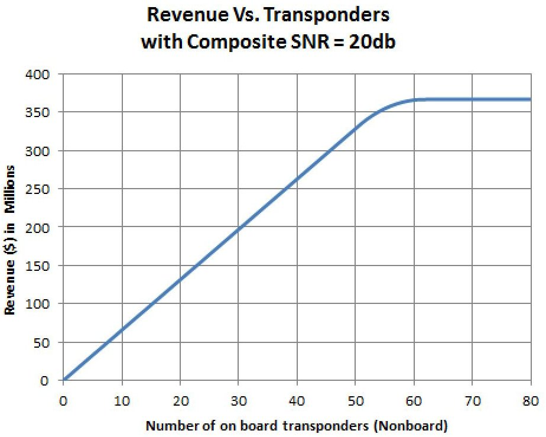

Figure 4.1. Total Revenue vs. Transponders with Composite SNR = 20db

<!-- PDF_PAGE: 58 -->

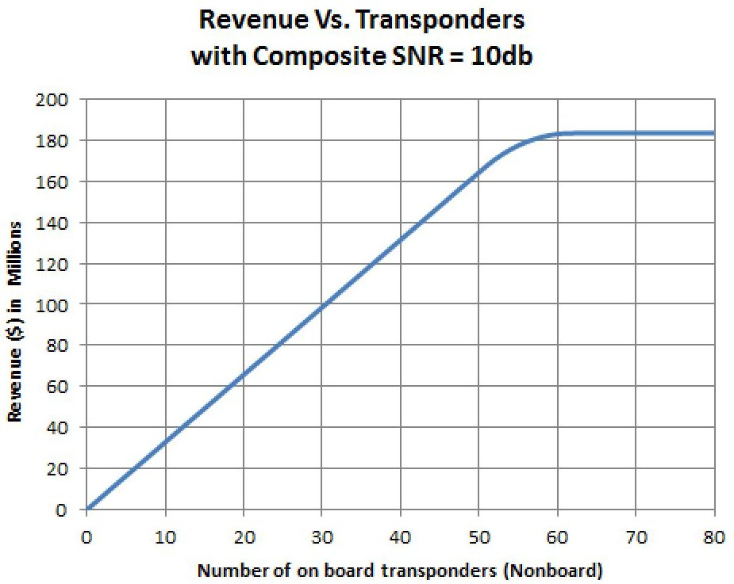

Figure 4.2. Total Revenue vs. Transponders with Composite SNR = 10db

Graphical representations of the revenue model associated with the number of transponders are seen in Figs. 4.1 and 4.2, with different composite SNR values. In these figures, the revenue is the total revenue over the course of 10 years (simply the summation of the yearly revenues). Due to the incorporation of a failure rate, the peak revenues associated with the number of on board transponders greater than 50, the market saturation point. In a formal industrial setting, the revenue equation would be highly modified and would evolve into a significantly more complex function. However, for the purpose of this demonstration and comparison, the key aspects of revenue have been captured.

The profit for the satellite system is simply the total revenue less the cost, as shown in Eq. 4.8. In order to determine the net present value of future money, a discount rate is applied to future revenues [95].

$$
Profit = \sum_ {y = 1} ^ {O L} Revenue _ {y} - T o t a l C o s t
$$

<!-- PDF_PAGE: 59 -->

A discount rate is not applied to total cost as the cost is assumed to occur in year 0. The revenues are received in years 1 through 10 and therefore are discounted to present worth. The incorporation of the discount rate $ \left(r_{\mathrm{d}}\right) $ is seen in the net present profit calculation of Eq. 4.9, where OL represents operational lifetime (10 years). The discount rate is chosen for the satellite example to be 10%, a rate that is within the typical range of 10-20% for industrial firms [96]. The incorporation of time preference in the form of a discount equation produces a net present profit that is less than the total profit of the system due to the delay in revenue flow.

$$
\text {N e t p r e s e n t p r o f i t} = - \text {T o t a l C o s t} + \sum_ {y = 1} ^ {O L} \frac {\text {R e v e n u e} _ {y}}{\left(1 + r _ {d}\right) ^ {y}}
$$

When constructing a value function, a deep comprehension of the system and subsystems is needed to understand the impact each design variable and attribute has on the cost and revenue. Unanticipated behavior of the system occurs when a cost or revenue driver is missing, and is detected when the optimal system tends to drive towards unattainable variable values. This is a situation equivalent to having missing or contradictory requirements in the present system engineering approaches. It is critical that all influential system characteristics be captured in the value function, which can result in a complex function. The value function is deemed sufficiently accurate when the rank order of design alternatives due to the value function is equivalent to the rank order due to the stakeholder's preference. In the case of the satellite example, this translates to the desire to achieve the most net present profit.

The optimal design for the satellite system using the value function defined is shown in Table 4.6, as well as the value function and some of the system attribute values. Without constraints placed on the design space, the designer, using the value function formulation, is able to perform an unrestricted search for the best design. In the value function formulation for the

<!-- PDF_PAGE: 60 -->

satellite problem there is a singular optimum, unlike the range of optima that resulted in Cases 1- 6. The results of the value function formulation are driven to maximize the system's net present profit, contrary to the traditional satellite MDO formulations that minimized cost or maximized a pseudo profit, as characterized by cost and transmitter power in the multi-objective function. For some design variables (i.e. frequencies, powers, and ground antennae diameters), the optimum value function formulation values actually satisfy the imposed side constraints from Cases 1-6, even though they aren't explicitly part of the optimization statement. Other design variables (i.e. the satellite antennae diameters and the battery energy density) would be infeasible according to the previously imposed side constraints. This demonstrates the fact that the value function offers greater design freedom to achieve the system preference. For the satellite antennae diameters, a lower bound constraint indicates an imposed limitation due to the stakeholder wanting a high quality signal. The optimum satellite antennae diameters in the value function formulation are smaller than the lower bounds set in the traditional cases, impacting the SNR negatively. The small satellite antennae reduce the cost of placing the satellite into orbit by reducing mass. The satellite system as a whole compensates for the smaller satellite antennae by creating large ground antennae, which increases manufacturing costs but are beneficial to the system as a whole in terms of the signal quality. This type of trade would not have been easily captured in the traditional formulations.

<!-- PDF_PAGE: 61 -->

Table 4.6. Optimal Design for Value Function Formulation

<table border="1"><tr><td>Design Variable</td><td>Values</td><td></td><td>Outputs</td><td>Values</td></tr><tr><td>fdown</td><td>10GHz</td><td></td><td>Net present profit</td><td>311.08×106$</td></tr><tr><td>fup</td><td>10GHz</td><td></td><td>SNR</td><td>30dB</td></tr><tr><td>Pt</td><td>1799.10W</td><td></td><td>Spacecraft total mass</td><td>1179.83kg</td></tr><tr><td>Pgt</td><td>5811.74W</td><td></td><td>Array size</td><td>54.77m2</td></tr><tr><td>Dsat,trans</td><td>0.35m</td><td></td><td>Bus Length</td><td>1.35m</td></tr><tr><td>Dsat,rec</td><td>0.15m</td><td></td><td>Bus Radius</td><td>0.45m</td></tr><tr><td>Dground,rec</td><td>10.30m</td><td></td><td></td><td></td></tr><tr><td>Dground,trans</td><td>4.55m</td><td></td><td></td><td></td></tr><tr><td>$\varepsilon$</td><td>1421.86$\frac{W-hr}{kg}$</td><td></td><td></td><td></td></tr></table>

In the value function formulation results, the design variable associated with the energy density $ \mathcal{E} $ of the satellite battery also violates the side constraints imposed in the traditional formulations. In the traditional proxy objective function formulations, the upper bound of the side constraint may be imposed due to stakeholder desires such as not wanting to invest in new battery technology as it is viewed as too costly or wanting to use commercial off the shelf (COTS) components. The battery energy density for the optimum satellite system from value function formulation is significantly larger than the upper bound of 200 W-hr/kg imposed in the traditional formulations. The larger battery energy density yields expensive technologically advanced batteries that will increase cost significantly. However, the cost increase is offset by a reduction in mass and volume of the batteries, reducing the associated manufacturing and launch vehicle costs. The satellite frequencies are partially driven to 10 GHz due to the impact of the environment on signal quality, taken into account by the rain attenuation factor [97, 98]. The satellite system's SNR is driven to 30db in order to increase revenue. The satellite transmitter power is also driven to a large value in order to increase revenue by increasing the number of possible transponders to be leased. The increase in transponders causes the cost of the system to increase due to an increase

<!-- PDF_PAGE: 62 -->

in mass and solar array area necessary to enable the satellite system to structurally support the additional transponders and to generate the necessary power. The optimum values of the design variables and the associated system attributes in the value function formulation inherently reflect the tradeoff between revenue and cost in order to determine the maximum system net present profit. No constraints or multi-objective formulations were required to achieve this.

Table 4.7: Net Present Profit of all Cases

<table border="1"><tr><td>Problem Formulation</td><td>Net Present Profit($)</td></tr><tr><td>Case1</td><td>$33.61\times10^{6}$</td></tr><tr><td>Case2</td><td>$33.61\times10^{6}$</td></tr><tr><td>Case3</td><td>$16.94\times10^{6}$</td></tr><tr><td>Case4</td><td>$16.94\times10^{6}$</td></tr><tr><td>Case5</td><td>$151.61\times10^{6}$</td></tr><tr><td>Case6</td><td>$192.74\times10^{6}$</td></tr><tr><td>Case7</td><td>$311.08\times10^{6}$</td></tr></table>

The net present profits that are associated with each of the optimal designs of the cases in Table 4.1, using Eq. 4.9, are shown in Table 4.7. This table shows how the different objective functions and sets of constraints from Cases 1-7 impact the profitability of the satellite system (with the understanding that the traditional cases do not have objective functions of maximize net present profit). Table 4.7 illustrates the impact that misrepresentations of the stakeholder's true preference have on the system design. The net present profit values seen in Table 4.7 are associated directly with the optima found in the previous sections, which all used identical initial design variable sets in the optimization algorithms. It is interesting to note that the net present profit associated with Cases 3 and 4 (cost) is less than the net present profit associated with Cases 1 and 2 (mass). The formation of a more accurate cost function is generally performed with the

<!-- PDF_PAGE: 63 -->

expectation that a system will result in the company making more money. However, Cases 3 and 4 show that the company actually makes less money. It can be seen quite clearly that the traditional proxy objective function formulations produced significantly lower net present profits than the value function formulation. In an effort to drive the cost down using the mass of the system, the traditional formulations inadvertently reduced the profits that the company would receive. It is also seen that the optimal design resulting from the value function formulation would never be achievable using the traditional formulations, given that the requirements from Cases 1-6 (which are typically formed from company legacy or industry traditions) are violated.

The focus of this chapter was on emphasizing the importance of capturing true preferences of the stakeholder in a non-hierarchically decomposed system by bringing together VDD and MDO and ultimately addressing the research question 1. This is the first step towards enabling a design decision that is consistent with the system preference, involving all the disciplines in the system. The next chapter will deal with decomposing a value function in a hierarchically decomposed system and focusing on improving system consistency by capturing couplings.

<!-- PDF_PAGE: 64 -->

## CHAPTER 5

# PHYSICS-BASED CONSISTENCY IN VALUE FUNCTION DECOMPOSITION

Most modern LSCES are extremely complex and multidisciplinary, involving diverse disciplines spanning geographical locations working towards a single system design. These elements make it difficult to address the design of LSCES as a whole. Past researchers have focused on decoupling the system to make the design

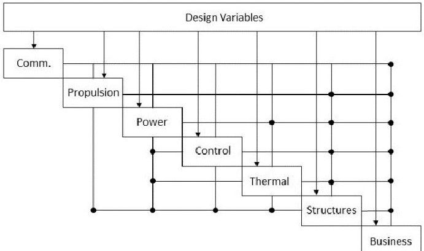

Figure 5.1: Discipline-based DSM (Preliminary).

process easier. This decomposition can be achieved either hierarchically or non-hierarchically [10, 27]. Hierarchical decompositions are adopted in systems where the system can be decomposed into smaller subsystems involving levels of hierarchy as shown in Fig. 5.2, whereas non hierarchical decompositions are used in systems where it is difficult to identify top-down hierarchy, due to inherent couplings. A widely used representation for a non-hierarchical decomposition is the Design Structure Matrix (DSM), which is shown in Fig. 5.1.

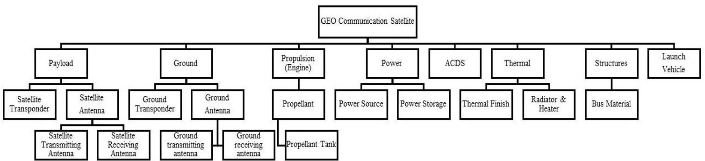

Figure 5.2: Hierarchical decomposition of a satellite system (Preliminary design)

Modern LSCES like satellites and aircrafts are typically designed by large organizations. These large organizations are composed of several hierarchical levels consisting of decision

<!-- PDF_PAGE: 65 -->

makers at each level. Traditionally, these LSCES are designed using the conventional requirements-based system engineering methodology [90]. The systems engineering approach simply provides requirements to be flowed down to the lower level designers, thereby leaving them unaware of the impact of their subsystem design on the system as a whole. VDD aids in addressing this issue by providing a system value function that captures the true preference(s) of the stakeholder. Since, value function captures the true preference(s) of the stakeholder and is singular in unit, it can be decomposed and flowed down to any subsystem/team in a hierarchically decomposed system to enable consistent design decision-making to achieve the true system preference [12, 99, 100]. Researchers in VDD have used scorecards to communicate a linearized value function down to the lower levels [43, 44, 101]. Scorecards offer a way of representing the impacts of lower-level attributes on the overall value function, but does not take couplings into consideration [102, 103]. More recently, couplings were addressed using a Value Influence (VI) factor [102], which represents the influence of one attribute on the other attribute's value. However, this VI factor is purely empirical and application-specific. The quantification of couplings and the understanding of the impacts of these couplings on the overall value of the system are important in performing trade-offs within and among different levels of hierarchy in the design process. The couplings in a system are not easy for one person to comprehend, and great care must be taken in identifying the couplings and representing them in meaningful ways. The capture of couplings in system decomposition allows for the designers/managers at all levels to clearly understand the impact of their design decision on the overall system value. This chapter focuses on addressing research question 2 partly by incorporating system couplings from MDO in decomposing the value function using the scorecard approach, to obtain the impact on system value of a subsystem at any level of the hierarchy. The couplings are captured using GSE in terms

<!-- PDF_PAGE: 66 -->

of total derivatives [36, 99] and are then incorporated into the scorecard approach from VDD. A mathematical formulation is created in this chapter to incorporate coupling information in obtaining the value impact of a subsystem at any level of the hierarchy to enable physics-based consistency associated with the system during the design process.

## Scorecards

Previous studies have focused on obtaining the lower level value functions by linearizing the system level value function around an initial point [101-103]. These linearized subsystem level value functions are seen in Table 5.1. The formulation of these value functions is based on the knowledge that the system attributes are a function of attributes that originate one or more levels lower in the hierarchy.

The traditional decomposed subsystem value functions (seen in Table 5.1) only capture the interactions in the hierarchy and fail to capture the lateral interactions across the system (i.e. the value functions listed here assume that the lower level attributes are just inputs to the subsystems directly above them in the hierarchy). The first subscript associated with attributes (A) in Table 5.1 indicate the tier number, whereas the second subscript indicates the subsystem number associated with a particular level and the third subscript represents the attribute number at that level. For example, let us consider the attribute $ A_{3 m_{3} p_{3}} $ . The first subscript (number 3) represents $ 3^{\mathrm{rd}} $ level in the hierarchy, second subscript $ (m_{3}) $ represents the subsystem number at $ 3^{\mathrm{rd}} $ level and third subscript $ (p_{3}) $ represents the attribute number at that level. Capturing couplings is very important in understanding the true impact of an attribute on the system value. These couplings can be mathematically captured by calculating the total derivatives that represent the total change in system value due to a change in attribute. A change in system value due to a change in a specific

<!-- PDF_PAGE: 67 -->

attribute is mathematically represented in Eq. (5.1). The total derivative term on the right hand side of the equation can be solved in terms of partial derivatives and is discussed in detail using a simple example in the forthcoming sections.

Table 5.1: Subsystem Value Functions

<table border="1"><tr><td>Level</td><td>Value function</td></tr><tr><td>System</td><td>$\sum_{p=1}^{P}\left(\frac{\partial V}{\partial A_{01p}}\right)_{A_{01p},0}\left(A_{01p}-A_{01p,0}\right)$</td></tr><tr><td>Subsystem level 1(SSL1)</td><td>$\sum_{p=1}^{P}\left(\sum_{m_{1}=1}^{M_{1}}\left(\sum_{p_{1}=1}^{P_{1}}\left(\frac{\partial V}{\partial A_{01p}}\frac{\partial A_{01p}}{\partial A_{1m_{1}p_{1}}}\right)_{A_{1m_{1}p_{1},0}}\left(A_{1m_{1}p_{1}}-A_{1m_{1}p_{1},0}\right)\right)$</td></tr><tr><td>Subsystem level 2(SSL2)</td><td>$\sum_{p=1}^{P}\left(\sum_{m_{1}=1}^{M_{1}}\left(\sum_{p_{1}=1}^{P_{1}}\left(\sum_{m_{2}=1}^{M_{2}}\left(\sum_{p_{2}=1}^{P_{2}}\left(\frac{\partial V}{\partial A_{01p}}\frac{\partial A_{01p}}{\partial A_{1m_{1}p_{1}}}\frac{\partial A_{1m_{1}p_{1}}}{\partial A_{2m_{2}p_{2}}}\right)_{A_{2m_{2}p_{2},0}}\left(A_{2m_{2}p_{2}}-A_{2m_{2}p_{2},0}\right)\right)\right)$</td></tr><tr><td>Subsystem level 3(SSL3)</td><td>$\sum_{p=1}^{P}\left(\sum_{m_{1}=1}^{M_{1}}\left(\sum_{p_{1}=1}^{P_{1}}\left(\sum_{m_{2}=1}^{M_{2}}\left(\sum_{p_{2}=1}^{P_{2}}\left(\sum_{m_{3}=1}^{M_{3}}\left(\sum_{p_{3}=1}^{P_{3}}\left(\frac{\partial V}{\partial A_{01p}}\frac{\partial A_{01p}}{\partial A_{1m_{1}p_{1}}}\frac{\partial A_{1m_{1}p_{1}}}{\partial A_{2m_{2}p_{2}}}\right)_{A_{3m_{3}p_{3},0}}\left(A_{3m_{3}p_{3}}-A_{3m_{3}p_{3},0}\right)\right)\right)\right)$</td></tr></table>

The attributes associated with a subsystem characterizes that subsystem. For example, the attributes that characterize the satellite transponders block (in Fig. 5.1) are mass of the transponders, volume of the transponders, power required by the payload, etc. It should be noted that the attributes are a function of design variables, behavior variables, parameters, and lower level attributes. Design variables are the inputs to the subsystems that are changed to optimize the design. Behavior variables represent the outputs of the subsystems. Parameters represent the constants associated with subsystem models. There is yet another variable type called coupling variables that is a subset of behavior variables. These coupling variables are the outputs of subsystems that are inputs to other subsystems.

Where P is the number of system level attributes, $ P_{1-3} $ is the number of attributes at SSL1 through SSL3, $ M_{1-3} $ is the number of subsystems at SSL1 through SSL3, p is the attribute number at system

<!-- PDF_PAGE: 68 -->

level, $ p_{1-3} $ is the attribute number at SSL1 through SSL3 and $ m_{1-3} $ is the subsystem number at SSL1 through SSL3.

$$
\frac {d V}{d A _ {x y z}} = \frac {\partial V}{\partial A _ {x , y , z}} + \sum_ {p = 1} ^ {P} \left(\frac {\partial V}{\partial A _ {0 1 p}} \frac {d A _ {0 1 p}}{d A _ {x y z}}\right)
$$

Where x is the Tier number (0 being the system level to N being the total number of levels), y is the subsystem number, z is the attribute number, V is a function of system level attributes (such as $ f ( A_{0 1 1} A_{0 1 2}, A_{0 1 3}, \dots A_{0 1 P} ) $ ), and P is the number of attributes at the system level.

As mentioned previously, scorecards are useful in flowing down the value function to the lower levels of the hierarchy to obtain the impact of lower level subsystem attributes on the system value. A typical scorecard used in previous research that uses the subsystem value function formulations without couplings is seen in Table 5.2 [101-103]. This scorecard calculates the impact on value $ (\Delta V) $ by all the attributes of a subsystem at a particular level. In essence, the scorecard calculates the terms in the second column of Table 5.1.

Table 5.2: Scorecard without couplings

<table border="1"><tr><td>Attributes</td><td>Change in status</td><td></td><td>Gradient</td><td></td><td>Value Impact</td></tr><tr><td>A111</td><td>A111-A111,0</td><td>×</td><td>$\sum_{p=1}^{P}\left(\frac{\partial V}{\partial A_{01p}}\frac{\partial A_{01p}}{\partial A_{111}}\right)_{A_{111,0}}$</td><td>=</td><td></td></tr><tr><td>A112</td><td>A112-A112,0</td><td>×</td><td>$\sum_{p=1}^{P}\left(\frac{\partial V}{\partial A_{01p}}\frac{\partial A_{01p}}{\partial A_{112}}\right)_{A_{112,0}}$</td><td>=</td><td></td></tr><tr><td>A121</td><td>A121-A121,0</td><td>×</td><td>$\sum_{p=1}^{P}\left(\frac{\partial V}{\partial A_{01p}}\frac{\partial A_{01p}}{\partial A_{121}}\right)_{A_{121,0}}$</td><td>=</td><td></td></tr><tr><td colspan="4">Change in System value</td><td></td><td>$\sum\left(\begin{array}{c}Value\\ Impact\end{array}\right)$</td></tr></table>

The first column of the scorecard represents the attributes of a subsystem at a particular level. The second column calculates the change in attribute value from initial value (that the value function is linearized at). The gradient column represents the partial derivative terms on the

<!-- PDF_PAGE: 69 -->

equations. The value obtained by multiplying the gradient column term by the change in status is captured in the last column. The last column gives the value impact $ (\Delta V) $ of each individual attribute on the system value. The last row of the table represents the total impact on value by the entire subsystem that is a summation of the individual attribute value impacts. The individual impact on value by the attributes can be used to get an idea of which subsystem attributes affect the value the most. This knowledge aids the designers in focusing their efforts in the design variables which contribute to those attributes. It should also be noted that the attributes cannot be changed directly but can only be changed by changing the corresponding design variables. A scorecard with couplings can be formed where the total derivative in Eq. (5.1) is used in the gradient column (as seen in Table 5.3).

Table 5.3: Scorecard with couplings

<table border="1"><tr><td>Attributes</td><td>Change in status</td><td></td><td>Gradient</td><td></td><td>Value Impact</td></tr><tr><td>A111</td><td>A111-A111,0</td><td>×</td><td>[dV/dA111]A111,0</td><td>=</td><td></td></tr><tr><td>A112</td><td>A112-A112,0</td><td>×</td><td>[dV/dA112]A112,0</td><td>=</td><td></td></tr><tr><td>A121</td><td>A121-A121,0</td><td>×</td><td>[dV/dA121]A121,0</td><td>=</td><td></td></tr><tr><td colspan="4">Change in System value</td><td></td><td>∑(Value Impact)</td></tr></table>

## Capturing couplings in Value Function Decomposition

As the attributes are functions of other variables, a proper capturing of these functional relationships is required in order to accurately calculate the total change in value. This can be demonstrated using a coupled two level system shown in Fig. 5.3.

<!-- PDF_PAGE: 70 -->

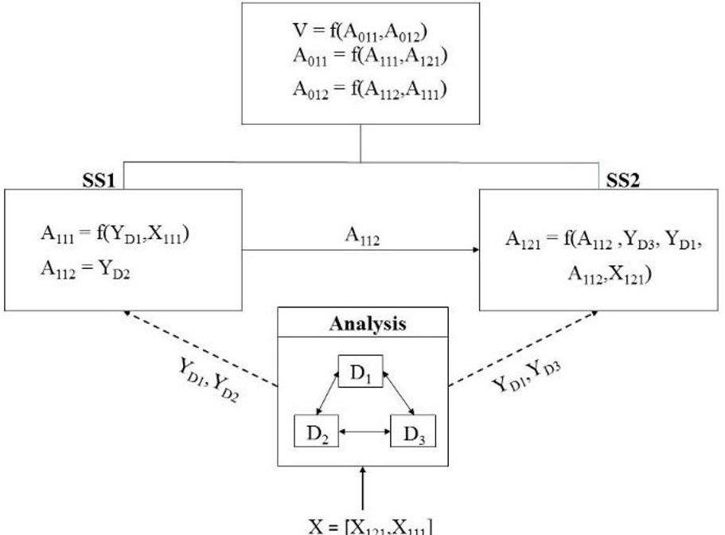

Figure 5.3: Attribute functional relationships

It can be seen from Fig. 5.3 that the value function at the top level is a function of system level attributes such as $ A_{011} $ and $ A_{012} $ , which are functions of lower level attributes and behavior variables. The first subscript associated with the attributes (A) indicate the tier number, the second subscript indicates the subsystem number associated with a particular level, and the third subscript represents the attribute number at that level. For example, the attribute $ A_{322} $ represents an attribute associated with tier number 3, subsystem number 2 at that tier and attribute number 2 associated with that subsystem. The functional relationships between attributes at level 1 are shown in Fig. 5.3. The Y's in the figure denote behavior variables with the subscript representing the discipline number, i.e., $ D_{2} $ indicates discipline 2. The analysis associated with disciplines 1-3 are represented in Eqs. (5.2)-(5.4).

$$
D _ {1} \left(\left(X _ {1 1 1}, Y _ {D _ {2}} \text {o r} A _ {1 1 2}\right), Y _ {D _ {1}}\right) = 0
$$

$$
D _ {2} \left(\left(X _ {1 2 1}, X _ {1 1 1}, Y _ {D _ {1}}, Y _ {D _ {3}}\right), Y _ {D _ {2}}\right) = 0
$$

<!-- PDF_PAGE: 71 -->

$$
D _ {3} \left(\left(X _ {1 2 1}, Y _ {D _ {1}}, Y _ {D _ {2}}\right), Y _ {D _ {3}}\right) = 0
$$

The figure shows that the attributes at level 1 are functions of other attributes, design variables, and behavior variables. In order to obtain the total change in value due to the attributes at level 1 the attribute couplings between SS1 and SS2 and the physics-based couplings need to be captured. To see this more clearly, let us consider obtaining the total change in value due to the attribute $ A_{112} $ , which is represented in Eq. (5.5).

$$
\frac {d V}{d A _ {1 1 2}} = \frac {\partial V}{\partial A _ {1 1 2}} + \frac {\partial V}{\partial A _ {0 1 1}} \frac {d A _ {0 1 1}}{d A _ {1 1 2}} + \frac {\partial V}{\partial A _ {0 1 2}} \frac {d A _ {0 1 2}}{d A _ {1 1 2}}
$$

Eq. (5.6) represents the total change in the system level attribute $ A_{011} $ due to $ A_{112} $ , which is needed to solve Eq. (5.5).

$$
\frac {d A _ {0 1 1}}{d A _ {1 1 2}} = \frac {\partial A _ {0 1 1}}{\partial A _ {1 1 1}} \frac {d A _ {1 1 1}}{d A _ {1 1 2}} + \frac {\partial A _ {0 1 1}}{\partial A _ {1 2 1}} \frac {d A _ {1 2 1}}{d A _ {1 1 2}}
$$

Eq. (5.7) represents the total change in $ A_{111} $ due to $ A_{112} $ , which is needed to solve Eq. (5.6)

$$
\frac {d A _ {1 1 1}}{d A _ {1 1 2}} = \frac {\partial A _ {1 1 1}}{\partial Y _ {D _ {1}}} \frac {d Y _ {D _ {1}}}{d A _ {1 1 2}}
$$

In Eq. (5.7), $ A_{1 1 2} $ is both an attribute and a behavior variable $ (Y_{D2}) $ . It should either be considered an attribute or a behavior variable in order to avoid counting its impact twice. This will be dealt with in detail in the next section. Since $ Y_{D1} $ is a function of $ A_{1 1 2} $ , the total derivative of $ Y_{D1} $ with respect to $ A_{1 1 2} $ exists and this can be obtained from Eq. (5.8) as follows.

$$
\frac {d Y _ {D _ {1}}}{d A _ {1 1 2}} = \frac {\partial Y _ {D _ {1}}}{\partial A _ {1 1 2}}
$$

In a similar manner the total change in $ A_{012} $ with respect to $ A_{112} $ can be obtained. It is clear from the above example that a capturing of the couplings at the behavior-variable-level is needed to provide a more detailed representation of the interactions present in the system.

<!-- PDF_PAGE: 72 -->

## Dependency Issue

The designer at a particular level must be careful in selecting the attributes to be represented in the scorecards. It must be made sure that the attributes are independent of each other. This can be done by calculating the sensitivities between attributes. Consider a simple coupled two-subsystem example as shown in Fig. 5.4. The designer wishes to maximize the value function as shown in the figure that is a function of lower level attributes. Subsystems 1 and 2 are coupled via attributes and attributes in a subsystem are functions of other attributes in that subsystem (the attribute $ A_{112} $ is a function of $ A_{111} $ ). The scorecard representing the value impact of SL2 attributes is represented in Table 5.4. The scorecard shows that the total $ \Delta V=24.88 $ , however the actual change in value $ (\Delta V) $ that is obtained when the new attribute values (listed in "Change in status" column of scorecard) are substituted in the value function is 8.68. This discrepancy is due to the dependency of attributes. Figure 5.4 shows that the only independent attribute is $ A_{122} $ and all the other attributes are functions of $ A_{122} $ both directly and indirectly via another attribute.

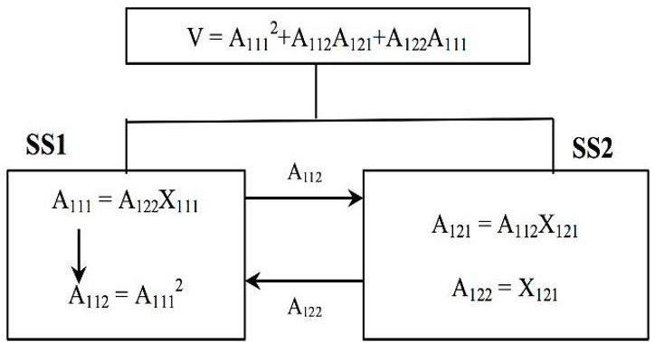

Figure 5.4: Attribute dependency

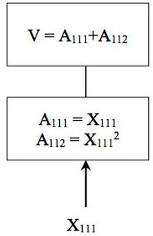

Figure 5.5: Design variable dependency

The value impact of $ A_{122} $ is counted once, when the value impact of $ A_{111} $ is calculated because $ A_{111} $ is a function of $ A_{122} $ and the value impact of $ A_{122} $ is counted again via $ A_{111} $ , during

<!-- PDF_PAGE: 73 -->

the calculation of $ A_{112} $ . This is the major cause for the huge discrepancy in $ \Delta V $ in addition to linearization with respect to the value function.

Table 5.4: Scorecard - Attribute dependency

<table border="1"><tr><td>Attributes</td><td>Change in status</td><td>x</td><td>Gradient</td><td>=</td><td>Change in Value</td><td>∑Value impact</td><td>Actual value impact</td></tr><tr><td>A111</td><td>2.2-2</td><td>x</td><td>[dV/dA111]0=37</td><td>=</td><td>7.4</td><td rowspan="4">24.88</td><td rowspan="4">8.68</td></tr><tr><td>A112</td><td>4.84-4</td><td>x</td><td>[dV/dA112]0=8</td><td>=</td><td>6.72</td></tr><tr><td>A121</td><td>4.84-4</td><td>x</td><td>[dV/dA121]0=4</td><td>=</td><td>3.36</td></tr><tr><td>A122</td><td>1.1-1</td><td>x</td><td>[dV/dA122]0=74</td><td>=</td><td>7.4</td></tr></table>

Another area of concern is due to attributes that are functions of the same design variables. Consider the simple one subsystem, two level system shown in Fig. 5.5, where the designer wishes to maximize the value function. The attributes at SL1 (the second level of the hierarchy), $ A_{111} $ and $ A_{112} $ are a function of the same design variable $ X_{111} $ . The scorecard for SL1 is depicted in Table 5.5. This scorecard calculates the value impact due to changes in attributes $ A_{111} $ and $ A_{112} $ . The design variable responsible for the change in both $ A_{111} $ and $ A_{112} $ is $ X_{111} $ . For a desired value of $ A_{111} $ = 2.1, the corresponding value of $ X_{111} $ = 2.1, whereas for a desired value of $ A_{112} $ = 4.1, $ X_{111} $ = 2.02. This indicates that the system is physically inconsistent and does not represent a real system. This inconsistency is due to both attributes being dependent on each other through $ X_{111} $ . This dependency issue can be overcome by characterizing the system at SL1 by using either $ A_{111} $ or $ A_{112} $ .

<!-- PDF_PAGE: 74 -->

Table 5.5: Attribute dependency

<table border="1"><tr><td>Attributes</td><td>Change in status</td><td>x</td><td>Gradient</td><td>=</td><td>Change in Value</td><td>∑Value impact</td></tr><tr><td>A111</td><td>2.1-2</td><td>x</td><td>[dV/dA111]0=1</td><td>=</td><td>0.1</td><td rowspan="2">0.2</td></tr><tr><td>A112</td><td>4.1-4</td><td>x</td><td>[dV/dA112]0=1</td><td>=</td><td>0.1</td></tr></table>

## Case Studies

A simple two level system and a more complex satellite system are considered in this dissertation to contrast the effects of capturing couplings. As mentioned earlier, the total derivative terms on the right hand side of the Eq. (5.1) are solved in terms of partial derivatives for the simple system. Similar equations are used to explore the satellite. The results associated with both the systems are discussed in detail in the results section.

## Simple System

A simple example consisting of only two levels of hierarchy and two subsystems is shown in Fig.5.6. This system is used to explore the effects of couplings and to investigate the representation of the total derivative terms on the right hand side of Eq. (5.1) in terms of partial derivatives. The example considered here is a minimization problem where the value function (V) is minimized to find the optimum. Each of the two subsystems at SSL1 consists of attributes and design variables. Fig. 5.6 represents the coupling that links the two subsystems by an arrow between them.

<!-- PDF_PAGE: 75 -->

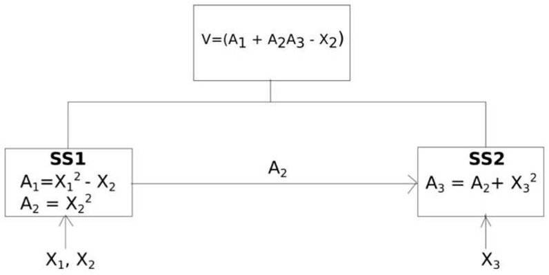

Figure 5.6. Simple two level system

The total impact of attributes on value with couplings for this simple example can be represented in a matrix form, shown in Eq. (5.9) (that is a matrix representation of Eq. (5.1)). The terms on the right hand side of Eq. (5.9) represent the value impact of each attribute, used in the gradient column of the scorecard. The elements in the 3x3 matrix on the left hand side of Eq. (5.9) represents the total derivative terms previously seen in the right hand side of Eq. (5.1). The matrix elements can be solved by knowing the functional relationships between attributes. The partial derivative terms can be obtained either analytically or numerically using finite difference. The calculation of the matrix elements of Eq. (5.10) (using partial derivative terms) is seen in Eq. (5.10).

$$
\left[ \begin{array}{l l l} \frac {\partial V}{\partial A _ {1}} & \frac {\partial V}{\partial A _ {2}} & \frac {\partial V}{\partial A _ {3}} \end{array} \right] \left[ \begin{array}{c c c} \frac {d A _ {1}}{d A _ {3}} & \frac {d A _ {1}}{d A _ {2}} & 1 \\ \frac {d A _ {2}}{d A _ {3}} & 1 & \frac {d A _ {2}}{d A _ {1}} \\ 1 & \frac {d A _ {3}}{d A _ {2}} & \frac {d A _ {3}}{d A _ {1}} \end{array} \right] = \left[ \begin{array}{c c c} \frac {d V}{d A _ {3}} & \frac {d V}{d A _ {2}} & \frac {d V}{d A _ {1}} \end{array} \right]
$$

<!-- PDF_PAGE: 76 -->

$$
\left[ \begin{array}{c c c c c c} 1 & 0 & 0 & 0 & 0 & - \frac {\partial A _ {1}}{\partial A _ {3}} \\ 0 & 1 & 0 & - \frac {\partial A _ {2}}{\partial A _ {3}} & 0 & 0 \\ 0 & 0 & 1 & 0 & - \frac {\partial A _ {1}}{\partial A _ {1}} & 0 \\ 0 & - \frac {\partial A _ {3}}{\partial A _ {2}} & 0 & 1 & 0 & 0 \\ 0 & 0 & - \frac {\partial A _ {2}}{\partial A _ {1}} & 0 & 1 & 0 \\ - \frac {\partial A _ {3}}{\partial A _ {1}} & 0 & 0 & 0 & 0 & 1 \end{array} \right] \left[ \begin{array}{l} \frac {d A _ {1}}{d A _ {2}} \\ \frac {d A _ {2}}{d A _ {1}} \\ \frac {d A _ {1}}{d A _ {3}} \\ \frac {d A _ {3}}{d A _ {1}} \\ \frac {d A _ {2}}{d A _ {3}} \\ \frac {d A _ {3}}{d A _ {2}} \end{array} \right] = \left[ \begin{array}{l} \frac {\partial A _ {1}}{\partial A _ {2}} \\ \frac {\partial A _ {2}}{\partial A _ {1}} \\ \frac {\partial A _ {1}}{\partial A _ {3}} \\ \frac {\partial A _ {3}}{\partial A _ {1}} \\ \frac {\partial A _ {2}}{\partial A _ {3}} \\ \frac {\partial A _ {3}}{\partial A _ {2}} \end{array} \right]
$$

The scorecard with and without couplings for the simple two level system is shown in Table 5.6 ("with couplings" takes into account the interaction between attribute 2 and attribute 3). This scorecard only represents the impact on value due to the change in attributes. It is understood that the attributes cannot be changed directly without changing the corresponding design variables.

Table 5.6: Scorecard for simple system at SL1, SS1

<table border="1"><tr><td></td><td>Attributes</td><td>Change in status</td><td>x</td><td>Gradient</td><td>=</td><td>Change in Value</td><td>$\sum \left( \begin{array}{c} Value \\ Impact \end{array} \right)$</td></tr><tr><td rowspan="2">With coupling</td><td>A1</td><td>-1.76+1.75</td><td>x</td><td>$\left[ \frac{dV}{dA_{1}} \right]_{0}=1$</td><td>=</td><td>-0.017</td><td rowspan="2">-0.69</td></tr><tr><td>A2</td><td>3.96-4</td><td>x</td><td>$\left[ \frac{dV}{dA_{2}} \right]_{0}=17$</td><td>=</td><td>-0.68</td></tr><tr><td rowspan="2">Without coupling</td><td>A1</td><td>-1.76+1.75</td><td>x</td><td>$\left[ \frac{\partial V}{\partial A_{1}} \right]_{0}=1$</td><td>=</td><td>-0.017</td><td rowspan="2">-0.53</td></tr><tr><td>A2</td><td>3.96-4</td><td>x</td><td>$\left[ \frac{\partial V}{\partial A_{2}} \right]_{0}=13$</td><td>=</td><td>-0.52</td></tr></table>

It can be seen from Table 5.6 that the value impact due to SS1, with the couplings captured, is greater than the value impact due to SS1 without couplings (Note that this is not necessarily the case where value impact always increases). If the designer at SS1 uses a scorecard with no couplings he might conclude that the attributes at SS1 are not worth changing since they don't

<!-- PDF_PAGE: 77 -->

result in a drastic decrease in value. The designer will be able to make a more accurate (and meaningful) assessment if he also captures the pathway that attribute 2 impacts the value through attribute 3. This emphasizes that care must be taken in capturing the couplings to obtain sensitivity information.

A similar scorecard comparison can be created for subsystem 2. This comparison is seen in Table 5.7. As shown, the information provided by the scorecards are identical. This identical information is due to attribute 3 having no pathway to impact the value through attributes 1 and 2. The only way in which that attribute 3 can change the value is directly.

Table 5.7: Scorecard for simple system at SSL1, SS2

<table border="1"><tr><td></td><td>Attributes</td><td>Change in status</td><td>x</td><td>Gradient</td><td>=</td><td>Change in Value</td><td>$\sum(Value Impact)$</td></tr><tr><td>With coupling</td><td>A3</td><td>12.87-13</td><td>x</td><td>$\left[\frac{dV}{dA_{3}}\right]_{0}=4$</td><td>=</td><td>-0.52</td><td>-0.52</td></tr><tr><td>Without coupling</td><td>A3</td><td>12.87-13</td><td>x</td><td>$\left[\frac{\partial V}{\partial A_{3}}\right]_{0}=4$</td><td>=</td><td>-0.52</td><td>-0.52</td></tr></table>

As previously mentioned, the attribute values above must be related to a set of design variables in order for the system design to be consistent. The set of design variables which are related to the attributes from Tables 5.6 and 5.7 is shown in Table 5.8. Table 5.9 represents the modified attributes from the changes made by the designer of the first subsystem (as performed in Table 5.6). The set of design variables are chosen to ensure system consistency with the modified attributes. The actual value of the new system is determined, as is the change in the actual value. The expected change in values predicted by the scorecards (from Table 5.6) are compared with the actual change through percentage error calculation. It is seen that the percentage error in the change in value with couplings is smaller than without couplings. This further highlights the

<!-- PDF_PAGE: 78 -->

greater accuracy gained by incorporating couplings into the scorecard. Table 5.10 represents a similar comparison of expected value changes relating to the scorecard for SS2 at SSL1 with and without couplings (Table 5.7). It can be seen that the value impacts are the same for both of the cases. This identical error is due to attribute 3 not being an input to SS1.

Table 5.8: Initial design - simple example

<table border="1"><tr><td>Design Variable</td><td>A1</td><td>A2</td><td>A3</td><td>Value</td></tr><tr><td>X1=0.5</td><td rowspan="3">-1.75</td><td rowspan="3">4</td><td rowspan="3">13</td><td rowspan="3">48.25</td></tr><tr><td>X2=2.0</td></tr><tr><td>X3=3.0</td></tr></table>

Table 5.9: Final design - SS1

<table border="1"><tr><td>Design Variable</td><td>A1</td><td>A2</td><td>A3</td><td>Value</td><td>Actual value change</td><td>Expected value change from coupled SS1 scorecard</td><td>% error in ΔV with couplings</td><td>Expected value change from non-coupled SS1 scorecard</td><td>% error in ΔV without couplings</td></tr><tr><td>X1=0.471</td><td rowspan="3">-1.76</td><td rowspan="3">3.96</td><td rowspan="3">13</td><td rowspan="3">47.49</td><td rowspan="3">-0.75</td><td rowspan="3">-0.69</td><td rowspan="3">1.92</td><td rowspan="3">-0.53</td><td rowspan="3">28.35</td></tr><tr><td>X2=1.989</td></tr><tr><td>X3=3.000</td></tr></table>

Table 5.10: Final design - SS2

<table border="1"><tr><td>Design Variable</td><td>A1</td><td>A2</td><td>A3</td><td>Value</td><td>Actual value change</td><td>Expected value change from coupled SS1 scorecard</td><td>% error in ΔV with couplings</td><td>Expected value change from non-coupled SS1 scorecard</td><td>% error in ΔV without couplings</td></tr><tr><td>X1=0.500</td><td rowspan="3">-1.75</td><td rowspan="3">4</td><td rowspan="3">12.87</td><td rowspan="3">47.72</td><td rowspan="3">0.52</td><td rowspan="3">-0.52</td><td rowspan="3">1.98</td><td rowspan="3">-0.52</td><td rowspan="3">1.98</td></tr><tr><td>X2=2.000</td></tr><tr><td>X3=2.978</td></tr></table>

<!-- PDF_PAGE: 79 -->

It is important to note that the final designs determined from the two subsystem scorecards are different. This emphasizes the need for a system-wide iteration to ensure system-wide consistency. It is also important to note that a change in attribute 3 may mean a change in attribute 2. Realizing the couplings that exist is a critical step when forming scorecards to ensure that the change in value is meaningful.

## Satellite System

Now let us consider the hierarchically decomposed satellite system as described in Chapter III to demonstrate the importance of capturing couplings in system decomposition in the context of VDD. The satellite system example is best perceived as a preliminary design. The desire of the stakeholder is assumed to be to maximize profit as this is a commercial endeavor. As such, the system level value function is net present profit [12, 104]. A total of 36 design variables define the satellite system (out of which 14 are continuous and 22 are discrete). A detailed description of the attributes and design variables associated with all the levels of the hierarchy is provided in the Appendix. The interactions between the eight SL1 subsystems can be visualized in a DSM (shown in Fig. 5.1). The dots in the DSM indicate the presence of a coupling between the corresponding subsystems. The total derivatives that are needed for various scorecard implementations are derived in a similar manner to that of the simple system example. An example which determines the derivative associated with the impact in value due to a change in payload power $ P_{\mathrm{payload}} $ is demonstrated. Figure 5.7 shows the pathway that $ P_{\mathrm{payload}} $ takes to impact the value through the Power subsystem. The pathways in which an attribute can affect another attribute can be vast. Proper capturing of these pathways is needed to fully understand a change in one attribute due to a change in another.

<!-- PDF_PAGE: 80 -->

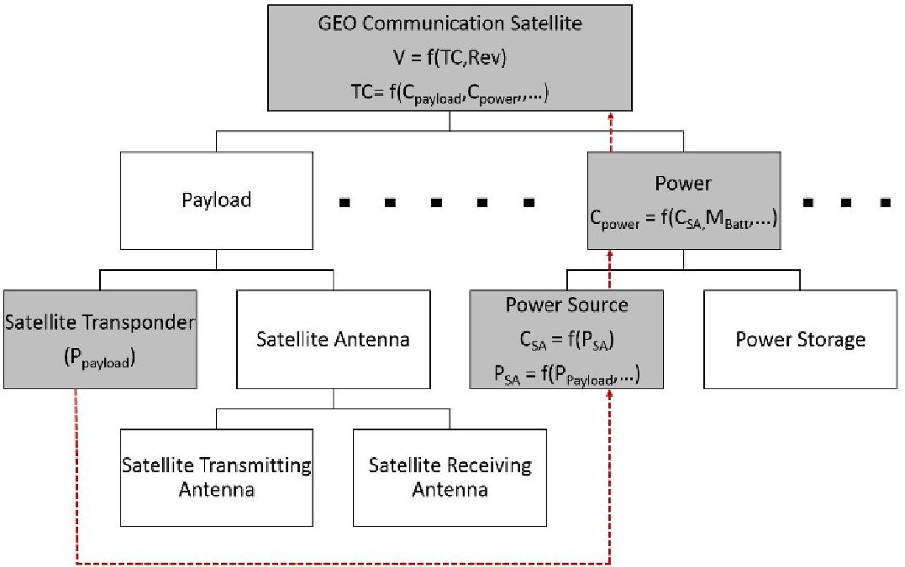

Figure 5.7. Attribute impact - Satellite system

Equation (5.11) represents the top level attributes which the value function is formed from, revenue and cost.

$$
\begin{array}{l} V = f (T C, R e v) = - T C + \sum_ {y = 1} ^ {O L} \frac {R e v _ {y}}{\left(1 + r _ {d}\right) ^ {y}} \\ r _ {d}: d i s c o u n t f a c t o r = 10 \% \\ O L: O p e r a t i o n A l l i f e t i m e = 1 0 y e a r s \\ \end{array}
$$

$$
y: y e a r
$$

Where TC is total cost and Rev is revenue. Equation (5.12) represents the impact on value due to payload power required as it relates to cost and revenue.

$$
\frac {d V}{d P _ {\mathrm {p a y l o a d}}} = \frac {\partial V}{\partial P _ {\mathrm {p a y l o a d}}} + \frac {\partial V}{\partial (T C)} \frac {d (T C)}{d P _ {\mathrm {p a y l o a d}}} + \frac {\partial V}{\partial (R e v)} \frac {d (R e v)}{d P _ {\mathrm {p a y l o a d}}}
$$

Where $ P_{\mathrm{payload}} $ is the power required by payload. Equation 5.13 represents the total derivative associated with the impact on total cost due to a change in payload power required (as seen in Eq. (5)). The ways in which payload power required may impact total cost is through the attributes by which it is formed (the individual costs of the subsystems).

<!-- PDF_PAGE: 81 -->

$$
\begin{array}{l} \frac {d (T C)}{d P _ {p a y l o a d}} = \frac {\partial (T C)}{\partial P _ {p a y l o a d}} + \frac {\partial (T C)}{\partial P _ {p a y l o a d}} \frac {d C _ {p a y l o a d}}{d P _ {p a y l o a d}} + \frac {\partial (T C)}{\partial P _ {g r o u n d}} \frac {d C _ {g r o u n d}}{d P _ {p a y l o a d}} \\ + \frac {\partial (T C)}{\partial P _ {p o w e r}} \frac {d C _ {p o w e r}}{d P _ {p a y l o a d}} + \dots \\ \end{array}
$$

Where $ C_{\mathrm{payload}} $ is the cost of the payload subsystem, $ C_{\mathrm{ground}} $ is the cost of the ground subsystem, and $ C_{\mathrm{power}} $ is the cost of the power subsystem. The cost of the power subsystem is a function of the costs of the solar array and battery. Equation (5.14) expands the derivative associated with the change in power cost due to the change in payload power required by using the attributes associated with the power cost.

$$
\frac {d C _ {p o w e r}}{d P _ {p a y l o a d}} = \frac {\partial C _ {p o w e r}}{\partial P _ {p a y l o a d}} + \frac {\partial C _ {p o w e r}}{\partial C _ {S A}} \frac {d C _ {S A}}{d P _ {p a y l o a d}} + \frac {\partial C _ {p o w e r}}{\partial C _ {B a t t}} \frac {d C _ {B a t t}}{d P _ {p a y l o a d}}
$$

Where $ C_{S A} $ is the cost of the solar array and $ C_{B a t t} $ is the cost of the battery. The cost of the solar array is a function of the power required by all of the subsystems and the material of the solar array. Note that the derivative of a change in solar array material due to a change in power required by payload is meaningless due to the solar array material being a design variable. Hence, this derivative is not represented. Similar to the previous equations, Eq. (5.15) expands the derivative associated with solar array cost.

$$
\frac {d C _ {S A}}{d P _ {p a y l o a d}} = \frac {\partial C _ {S A}}{\partial P _ {p a y l o a d}} + \frac {\partial C _ {S A}}{\partial P _ {0}} \frac {d P _ {0}}{d P _ {p a y l o a d}}
$$

Where $ P_{0} $ is the power required by all of the subsystems. Power required by all of the subsystems is a function of power required by payload, power required by ADCS, and power required by thermal subsystem. Battery cost is a function of the power required by all of the subsystems and the battery type (where battery type is a design variable). Equation (5.16) expands the derivative associated with the battery cost from Eq. (5.14).

<!-- PDF_PAGE: 82 -->

$$
\frac {d C _ {B a t t}}{d P _ {p a y l o a d}} = \frac {\partial C _ {B a t t}}{\partial P _ {p a y l o a d}} + \frac {\partial C _ {B a t t}}{\partial P _ {0}} \frac {d P _ {0}}{d P _ {p a y l o a d}}
$$

In a similar manner we can determine the change in revenue due to a change in power required by payload. As the revenue is not a function of payload power required (directly or indirectly through couplings) the derivative is zero. As can be seen the pathways in which an attribute can affect another attribute can be vast. Proper capturing of these pathways are needed to fully understand a change in one attribute due to a change in another.

The system level scorecard with and without couplings is seen in Table 5.11. Table 5.12 represents the scorecard for the attributes at the next subsystem level (SSL1). Due to the large number of attributes at this level only four are represented (payload cost, downlink signal to noise ratio, ground cost, and uplink signal to noise ratio), with the understanding that many more would be represented to capture the entire impact of the SSL1 attributes.

Table 5.11: System Level Scorecard - Satellite Example

<table border="1"><tr><td></td><td>Attributes</td><td>Change in status</td><td>x</td><td>Gradient</td><td>=</td><td>Change in Value</td><td>$\sum \binom{Value}{Impact}$</td></tr><tr><td rowspan="2">With coupling</td><td>Total cost</td><td>$-4.22\times10^{5}$</td><td>x</td><td>$\left[\frac{dV}{dTotal cost}\right]_{0}=-1$</td><td>=</td><td>$4.22\times10^{5}$</td><td rowspan="2">$2.66\times10^{6}$</td></tr><tr><td>Revenue</td><td>$2.24\times10^{6}$</td><td>x</td><td>$\left[\frac{dV}{dRevenue}\right]_{0}=1$</td><td>=</td><td>$2.24\times10^{6}$</td></tr><tr><td rowspan="2">Without coupling</td><td>Total cost</td><td>$-4.22\times10^{5}$</td><td>x</td><td>$\left[\frac{\partial V}{\partial Total cost}\right]_{0}=-1$</td><td>=</td><td>$4.22\times10^{5}$</td><td rowspan="2">$2.66\times10^{6}$</td></tr><tr><td>Revenue</td><td>$2.24\times10^{6}$</td><td>x</td><td>$\left[\frac{\partial V}{\partial Revenue}\right]_{0}=1$</td><td>=</td><td>$2.24\times10^{6}$</td></tr></table>

<!-- PDF_PAGE: 83 -->

Table 5.12: SL1 Scorecard - Satellite Example

<table border="1"><tr><td></td><td>Attributes</td><td>Change in status</td><td>x</td><td>Gradient</td><td>=</td><td>Change in Value</td></tr><tr><td>1.</td><td></td><td>Cpayload-Cpayload,0</td><td>x</td><td>[dV/dCpayload]0</td><td>=</td><td></td></tr><tr><td>2.</td><td></td><td>SNRdown-SNRdown,0</td><td>x</td><td>[dV/dSNRdown]0</td><td>=</td><td></td></tr><tr><td>3.</td><td></td><td>Cground-Cground,0</td><td>x</td><td>[dV/dCground]0</td><td>=</td><td></td></tr><tr><td>4.</td><td></td><td>SNRup-SNRup,0</td><td>x</td><td>[dV/dSNRdown]0</td><td>=</td><td></td></tr><tr><td>.</td><td></td><td>.</td><td></td><td>.</td><td></td><td>∑(Value Impact)</td></tr><tr><td>.</td><td></td><td>.</td><td></td><td>.</td><td></td><td></td></tr><tr><td></td><td></td><td></td><td></td><td></td><td></td><td></td></tr></table>

Only the scorecards associated with the Payload subsystem for all the levels of hierarchy are presented in this research due to the complexity of the satellite system. Similar scorecards can be made for the other subsystems. The scorecard at SL1, SS1 of payload yields the same value impact with and without couplings (as shown in Table 5.13). This is due to the attributes, Cpayload and $ \mathrm{SNR_{down}} $ , being direct inputs to the system and are not inputs to any other subsystem.

Table 5.13: SL1 (Payload) Scorecard - Satellite example

<table border="1"><tr><td rowspan="5">SL1SS1</td><td></td><td>Attributes</td><td>Change in status</td><td>x</td><td>Gradient</td><td>=</td><td>Change in Value</td><td>$\sum \binom{Value}{Impact}$</td></tr><tr><td rowspan="2">With coupling</td><td>$C_{\text{payload}}$</td><td>-602.78</td><td>x</td><td>$\left[\frac{dV}{dC_{\text{paylaod}}}\right]_{0}=-1$</td><td>=</td><td>602.787</td><td rowspan="2">$2.42\times10^{6}$</td></tr><tr><td>$SNR_{\text{down}}$</td><td>0.24</td><td>x</td><td>$\left[\frac{dV}{dSNR_{\text{down}}}\right]_{0}=10.10\times10^{6}$</td><td>=</td><td>$2.42\times10^{6}$</td></tr><tr><td rowspan="2">Without coupling</td><td>$C_{\text{payload}}$</td><td>-602.78</td><td>x</td><td>$\left[\frac{\partial V}{\partial C_{\text{paylaod}}}\right]_{0}=1$</td><td>=</td><td>602.787</td><td rowspan="2">$2.42\times10^{6}$</td></tr><tr><td>$SNR_{\text{down}}$</td><td>0.24</td><td>x</td><td>$\left[\frac{\partial V}{\partial SNR_{\text{down}}}\right]_{0}=9.99\times10^{6}$</td><td>=</td><td>$2.42\times10^{6}$</td></tr></table>

The scorecard for SL2 is represented in Table 5.14. The subsystems at this level are the payload satellite transponder and payload satellite antennae subsystems. It can be seen that the value impact due to the change in attributes at SL2, SS1 with couplings is much greater than the one without couplings. This is due to the interactions not being captured (i.e., for the scorecard without couplings, the partial derivative terms just represent the interactions in the hierarchy (only within

<!-- PDF_PAGE: 84 -->

Payload subsystem), whereas it fails to capture the lateral interactions across the satellite system). More clearly, the attribute $ P_{\mathrm{payload}} $ gets input into the Power subsystem. Due to this coupling, an increase in $ P_{\mathrm{payload}} $ will result in an increase in Solar Array area and Battery mass that in turn will result in an increase in the cost and mass of the satellite. An increase in cost and mass of the satellite results in a decrease in value. Hence, the real impact of $ P_{\mathrm{payload}} $ on the system value can only be captured using total derivative (as shown in Table 5.14 with couplings). Without knowledge of the total impact of $ P_{\mathrm{payload}} $ on the value, the designer at SL2 SS1 may easily make decisions that would result in the satellite company losing profit

Table 5.14: SL2 Scorecard- Satellite example

<table border="1"><tr><td rowspan="5">SL2SS1</td><td></td><td>Attributes</td><td>Change in status</td><td>x</td><td>Gradient</td><td>=</td><td>Change in Value</td><td>$\sum \binom{Value}{Impact}$</td></tr><tr><td rowspan="2">With coupling</td><td>$M_{\mathrm{trans}}$</td><td>-0.15</td><td>x</td><td>$\left[\frac{dV}{dM_{\mathrm{trans}}}\right]_{0}=-500$</td><td>=</td><td>75</td><td rowspan="2">$-3.4\times10^{4}$</td></tr><tr><td>$P_{\mathrm{payload}}$</td><td>13.325</td><td>x</td><td>$\left[\frac{dV}{dP_{\mathrm{payload}}}\right]_{0}=-2558$</td><td>=</td><td>$-3.4\times10^{4}$</td></tr><tr><td rowspan="2">Without coupling</td><td>$M_{\mathrm{trans}}$</td><td>-0.15</td><td>x</td><td>$\left[\frac{\partial V}{\partial C_{\mathrm{payload}}}\frac{\partial C_{\mathrm{payload}}}{\partial M_{\mathrm{trans}}}+\frac{\partial V}{\partial SNR_{\mathrm{down}}}\frac{\partial SNR_{\mathrm{down}}}{\partial M_{\mathrm{trans}}}\right]_{0}=-500$</td><td>=</td><td>75</td><td rowspan="2">75</td></tr><tr><td>$P_{\mathrm{payload}}$</td><td>13.325</td><td>x</td><td>$\left[\frac{\partial V}{\partial C_{\mathrm{payload}}}\frac{\partial C_{\mathrm{payload}}}{\partial P_{\mathrm{payload}}}+\frac{\partial V}{\partial SNR_{\mathrm{down}}}\frac{\partial SNR_{\mathrm{down}}}{\partial P_{\mathrm{payload}}}\right]_{0}=0$</td><td>=</td><td>0</td></tr><tr><td rowspan="2">SL2SS2</td><td>With coupling</td><td>$C_{\mathrm{sat,ant}}$</td><td>-527.78</td><td>x</td><td>$\left[\frac{dV}{dC_{\mathrm{sat,ant}}}\right]_{0}=-1$</td><td>=</td><td>527.78</td><td>527.78</td></tr><tr><td>Without coupling</td><td>$C_{\mathrm{sat,ant}}$</td><td>-527.78</td><td>x</td><td>$\left[\frac{\partial V}{\partial C_{\mathrm{payload}}}\frac{\partial C_{\mathrm{payload}}}{\partial C_{\mathrm{sat,ant}}}+\frac{\partial V}{\partial SNR_{\mathrm{down}}}\frac{\partial SNR_{\mathrm{down}}}{\partial C_{\mathrm{sat,ant}}}\right]_{0}=-1$</td><td>=</td><td>527.78</td><td>527.78</td></tr></table>

<!-- PDF_PAGE: 85 -->

Table 5.15: SSL3 Scorecard- Satellite example

<table border="1"><tr><td rowspan="6">SL3 SS1</td><td></td><td>Attributes</td><td>Change in status</td><td>x</td><td>Gradient</td><td>=</td><td>Change in Value</td><td>$\sum \binom{Value}{Impact}$</td></tr><tr><td rowspan="2">With coupling</td><td>$G_{st}$</td><td>266.19</td><td>x</td><td>$\left[\frac{dV}{dG_{st}}\right]_{0}=1622$</td><td>=</td><td>$4.31 \times 10^{5}$</td><td rowspan="2">$4.32 \times 10^{5}$</td></tr><tr><td>$M_{st}$</td><td>-0.65</td><td>x</td><td>$\left[\frac{dV}{dM_{st}}\right]_{0}=-399.96$</td><td>=</td><td>263.86</td></tr><tr><td rowspan="2">Without coupling</td><td>$G_{st}$</td><td>266.19</td><td>x</td><td>$\left[\frac{\partial V}{\partial Revenue}\frac{\partial Revenue}{\partial SNR_{d}}\frac{\partial SNR_{d}}{\partial G_{st}}\right]_{0}=1.622 \times 10^{3}$</td><td>=</td><td>$4.31 \times 10^{5}$</td><td rowspan="2">$4.32 \times 10^{5}$</td></tr><tr><td>$M_{st}$</td><td>-0.65</td><td>x</td><td>$\left[\frac{\partial V}{\partial Total cost}\frac{\partial Total cost}{\partial C_{payload}}\frac{\partial C_{payload}}{\partial C_{sat,ant}}\frac{\partial C_{sat,ant}}{\partial M_{st}}\right]_{0}=-400$</td><td>=</td><td>263.89</td></tr><tr><td rowspan="4">SL3 SS2</td><td rowspan="2">With coupling</td><td>$G_{sr}$</td><td>263.55</td><td>x</td><td>$\left[\frac{dV}{dG_{sr}}\right]_{0}=39.70$</td><td>=</td><td>$1.04 \times 10^{4}$</td><td rowspan="2">$1.074 \times 10^{5}$</td></tr><tr><td>$M_{sr}$</td><td>-0.659</td><td>x</td><td>$\left[\frac{dV}{dM_{sr}}\right]_{0}=-399.96$</td><td>=</td><td>263.86</td></tr><tr><td rowspan="2">Without coupling</td><td>$G_{sr}$</td><td>263.55</td><td>x</td><td>0</td><td>=</td><td>0</td><td rowspan="2">263.89</td></tr><tr><td>$M_{sr}$</td><td>-0.65</td><td>x</td><td>$\left[\frac{\partial V}{\partial Total cost}\frac{\partial Total cost}{\partial C_{payload}}\frac{\partial C_{payload}}{\partial C_{sat,ant}}\frac{\partial C_{sat,ant}}{\partial M_{sr}}\right]_{0}=-400$</td><td>=</td><td>263.89</td></tr></table>

The scorecard representing SL3 (satellite transmitting antenna and satellite receiving antenna subsystems) is seen in Table 5.15. A minor difference is observed between the value impacts due to $ M_{st} $ (mass of satellite transmitting antenna) at SL3 SS1 (satellite transmitting antenna subsystem) when couplings are taken into account and when they are not. The effect of not capturing the couplings is also seen in the SL3 SS2 scorecard (satellite receiving antenna subsystem), shown in Table 5.15. The attribute $ G_{sr} $ (gain of satellite receiving antenna) is only an input into the Ground subsystem. Hence, the only path for the attribute to impact the system value is through the ground subsystem. This pathway for impact is captured through the total derivative used in the "with coupling" scorecard. Without the couplings the interaction is not captured and, since the attribute

<!-- PDF_PAGE: 86 -->

is not an input into any subsystem directly above the satellite receiving antenna subsystem, the gradient is zero.

The desired change in value can be achieved by determining the design variables responsible for the changes in attributes that are considered. For example, the attribute $ \mathrm{SNR}_{down} $ (downlink signal to noise ratio) at SSL1 SS1 that is a function of a number of attributes and design variables (shown in Eqn. (5.17)). It has already been found from the scorecard at SSL1 SS1 (Table 5.13) that an increase in $ \mathrm{SNR}_{down} $ will result in an increase in value. A change in $ \mathrm{SNR}_{down} $ can be achieved in multiple ways. One way to change the downlink signal to noise ratio is by changing $ G_{st} $ (gain of satellite transmitting antenna), an attribute at SSL3 SS1. $ G_{st} $ is a function of $ D_{sat,trans} $ (diameter of satellite transmitting antenna) and $ f_{down} $ (downlink frequency) (Eqn. (5.18)) which are design variables at SSL3 SS1. Changing these design variables will result in a change in. The change in $ G_{st} $ will result in a change in $ \mathrm{SNR}_{down} $ leading to a change in value. However, care must be taken in changing the design variables, since some design variable changes might result in increased cost rather than revenue. For example, the designer might increase $ D_{sat,trans} $ under the belief that it will result in an increase in $ G_{st} $ and hence an increase in value. This may not result in a net value increase as an increase in $ D_{sat,trans} $ will result in an increase in mass and an associated cost.

$$
S N R _ {d o w n} = f \left(P _ {s t}, G _ {s t}, G _ {g r}, L _ {s}\right)
$$

$$
G _ {s t} = f \left(D _ {s a t, t r a n s}, f _ {d o w n}\right)
$$

Similarly, a desired change in $ P_{\mathrm{payload}} $ can be achieved by changing the design variables which modify the attribute (as shown in Eqn. (5.19)).

$$
P _ {p a y l o a d} = f \left(N, P _ {s t}\right)
$$

<!-- PDF_PAGE: 87 -->

As mentioned earlier, the effect of changing the design variables on the value must be explored before changing them. The impact of a particular design variable on value at any level can also be captured by obtaining the total derivative, which captures all the interactions going on in the system. For example, a change in the design variable $ P_{st} $ (satellite transmitter power) will change the system value through multiple paths, including payload power and downlink signal to noise ratio.

The use of scorecards in VDD provides a means of understanding the impact on value various attributes may have. This is useful at all levels of the system hierarchy to enable informed design decisions. Traditionally, the scorecards have focused on obtaining value impacts by just capturing the interactions in the hierarchy and not capturing the lateral interactions across the system. This chapter has focused on addressing research question 2 partly by emphasizing the importance of capturing couplings during the value function decomposition and representation in scorecards to enable consistency in physics. A mathematical formulation to capture couplings in system decomposition in the context of VDD, using Global Sensitivity Equations (GSE), was introduced. It is evident from the scorecard examples that a failure to capture couplings in the scorecard will result in a misrepresentation of a change in value. This misrepresentation is seen mathematically by the use of partial derivative rather than total derivatives. This misrepresentation may drive the designers to make misinformed design decisions resulting in a net value loss. Another important realization in this chapter was the need to understand attribute dependency to other attributes and design variables. The attribute impacts on value act as a starting point for designers at different levels of the hierarchy to focus on the areas which impact the system value more. In order to actually maximize value, the design variables corresponding to the attributes that impact the value positively should be changed by taking the dependency issues into consideration.

<!-- PDF_PAGE: 88 -->

The next chapter addresses the issues associated with using scorecards for optimization emphasizing how these issues can be rectified using a new Value-Based Systems Engineering (VBSE) framework.

## From requirements to value

Chapter 4 showed how a value function formulation expanded the design space by reducing the requirements placed on the design. It is understandable that not all requirements can be eliminated. For example, in the case of an aircraft, the wing span is restricted by the hanger dimensions. These are mandatory requirements. However, there exist a vast quantity of requirements that are only a product of legacy knowledge and those which arise when the system requirements are broken down. The following example demonstrates how such a requirement placed on the diameter of satellite transmitting antenna can be reflected in terms of value, such that all the internal trades are captured. Figure. 5.8 shows how a constraint placed on a design variable can be reflected on to the final system value through few of the multiple pathways. From Eq. 4.1, the design variable $ D_{st} $ (diameter of the satellite transmitting antenna) is constrained between 0.5m and 2.5m resulting in a limited design space exploration. This requirement is usually deduced from mass and payload envelope requirement of the launch vehicle. This requirement can be relaxed if the cost for using a bigger launch vehicle due to an increase in $ D_{st} $ is overcome by the revenue generated due to $ D_{st} $ . This can be done by reflecting the effect of the requirement on $ D_{st} $ through attributes at different levels of hierarchy and then mapping to value function.

<!-- PDF_PAGE: 89 -->

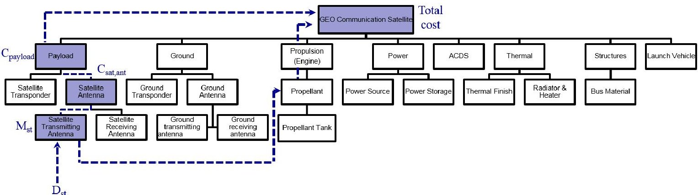

Figure 5.8: Reflecting Requirements as Value

For instance, when $ D_{st} $ is increased, it increases $ M_{st} $ (mass of satellite transmitting antenna), which in turn increase $ C_{sat,ant} $ (cost of satellite transmitting antenna) leading to an increase in $ C_{payload} $ (cost of payload). Cost of payload then increases the total cost associated with the system, which is a system level attribute. This can be seen in Fig. 5.9, which represents the functional relationships between $ D_{st} $ and Total cost.

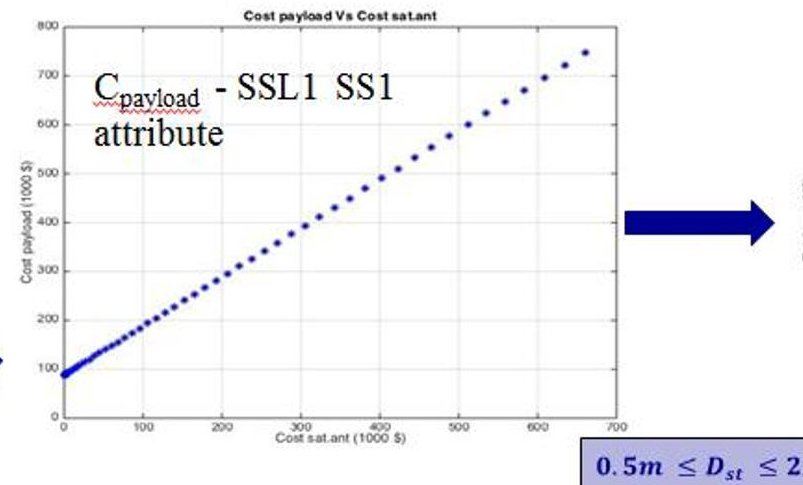

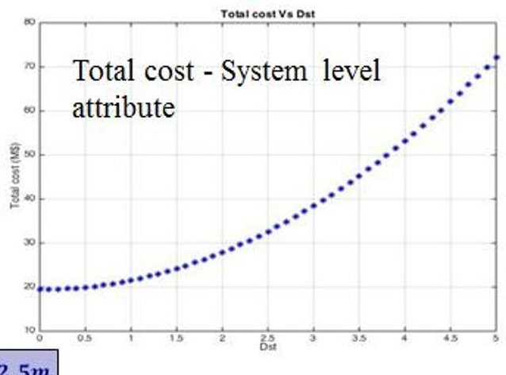

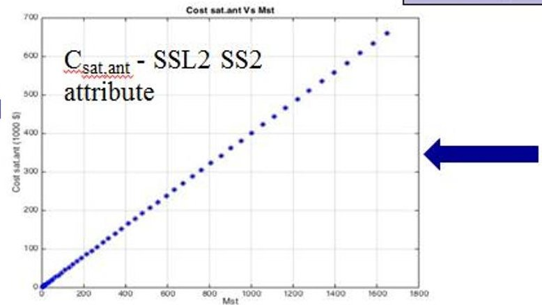

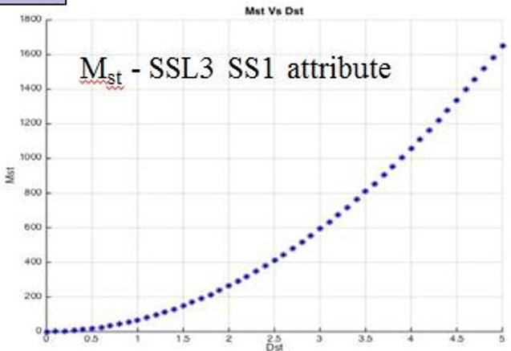

Figure 5.9: Impact of Dst on Total Cost

<!-- PDF_PAGE: 90 -->

Also, increasing $ D_{st} $ increases the signal quality by improving the gain and Signal to Noise Ratio (SNR) of the satellite. SNR is an attribute associated with the Payload that contributes to the revenue stream in the value function, which can be seen in Fig. 5.10.

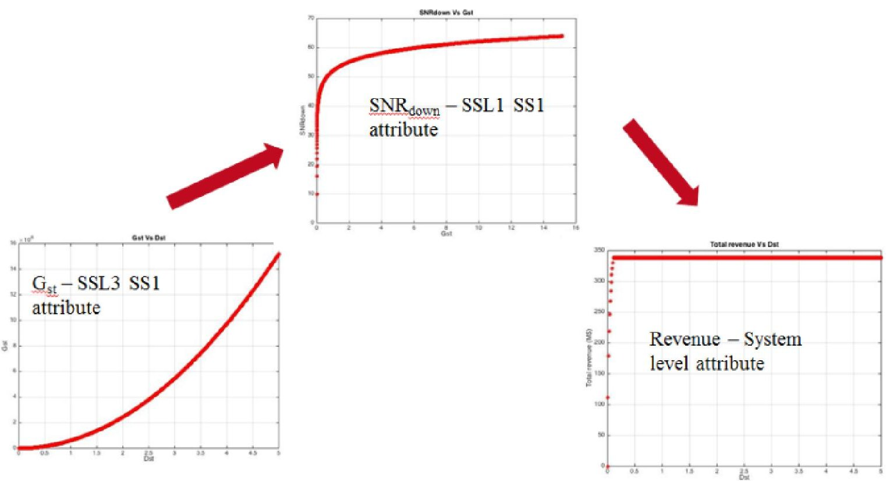

Figure 5.10: Impact of Dst on Revenue

Figure 5.11 represents the final impact of Dst on value by mapping the total cost and revenue. In this manner, it is possible to identify the true effect of the requirements imposed on $ D_{st} $ based on different pathways it takes to impact the value.

<!-- PDF_PAGE: 91 -->

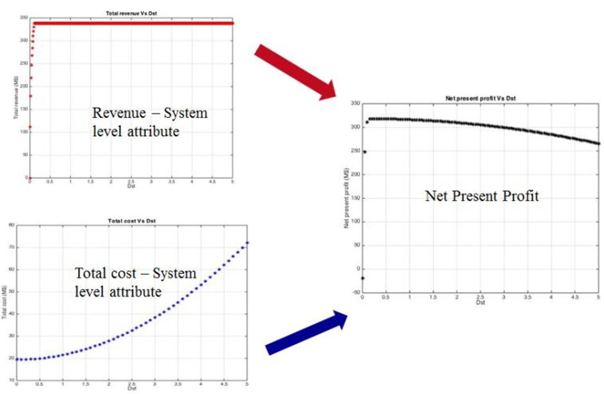

Figure 5.11: Impact of Dst on System Value

Similarly, this can be extended to other constraints. In this manner, in a value formulation, the need to use constraints to obtain meaningful designs in traditional MDO is taken care of by mapping them to system attributes via lower level attributes.

<!-- PDF_PAGE: 92 -->

## CHAPTER 6

## OPTIMIZATION IN THE CONTEXT OF VALUE-DRIVEN DESIGN

The focus of previous chapter has been on enabling consistency in physics by capturing couplings in decomposing value functions using the scorecard approach. The use of scorecards in VDD provides a means of understanding the value impact of attributes. This is useful at all levels of the system hierarchy to enable informed design decisions. However, just the impact of attributes on value is not enough in making a design decision as attributes are functions of design variables, behavior variables, other attributes, parameters, etc. Therefore, in order to actually achieve a change in attribute, the corresponding design variables need to identified and changed. Once the value impacts of attributes are obtained, the changes in status of attributes can then be used to solve for the design variables. In other words, the changes in attributes in the scorecards are used as a guidance for the designers to optimize for design variables. This chapter addresses the issues with using scorecards and attempts to tackle research question 2 by emphasizing the need for a holistic framework that enables more realistic and informed design decision-making by providing an architecture for system optimization in a hierarchically decomposed system.

## Optimization using Scorecards

An example of a scorecard associated with Satellite transponders subsystem, subsystem level 2 (SL2), subsystem 1 (SS1), associated with the satellite system shown in Fig. 5.2 can be seen in Table 6.1 [105].

<!-- PDF_PAGE: 93 -->

Table 6.1: SL2, SS1 Scorecard - Satellite system

<table border="1"><tr><td>Attributes</td><td>Change in status</td><td>x</td><td>Gradient</td><td>=</td><td>Change in Value</td><td>$\sum \binom{Value}{Impact}$</td></tr><tr><td>$M_{trans}$</td><td>-0.15</td><td>x</td><td>$\left[\frac{dV}{dM_{trans}}\right]_{0}=-500$</td><td>=</td><td>75</td><td rowspan="2">$3.40\times10^{4}$</td></tr><tr><td>$P_{payload}$</td><td>-13.32</td><td>x</td><td>$\left[\frac{dV}{dP_{payload}}\right]_{0}=-2558$</td><td>=</td><td>$3.40\times10^{4}$</td></tr></table>

One of the ways to solve the design variables is setting up a sub-optimization problem (Eq. (6.2)) i.e., the change in status of the attributes represented in the scorecard is used as an objective function and/or as equality constraints to obtain the corresponding design variables. Another method for solving is using a nonlinear solver, by which the design variables are solved directly from the system of non-linear equations. The following example demonstrates updating the design variables using scorecards. Let us consider the scorecard with couplings associated with SL2, SS1 in Table 6.1. The attribute $ P_{\mathrm{payload}} $ has a positive impact on the value if decreased as shown in Table 6.2.

Table 6.2: Scorecard - Optimization

<table border="1"><tr><td>Attributes</td><td>Change in status</td><td>x</td><td>Gradient</td><td>=</td><td>Change in Value</td></tr><tr><td>Ppayload</td><td>-13.32</td><td>x</td><td>$\left[\frac{dV}{dP_{payload}}\right]_{0}=-2558$</td><td>=</td><td>3.40×104</td></tr></table>

From Eq. (6.1), it is clear that $ P_{\mathrm{payload}} $ is a function of two discrete design variables Amp and N and one continuous design variable, $ P_{\mathrm{st}} $

$$
P _ {p a y l o a d} = f \left(A m p, N, P _ {s t}\right) = N \times \left(2. 9 3 \times P _ {s t} + 1 2\right)
$$

<!-- PDF_PAGE: 94 -->

In order to obtain the corresponding values of these design variables from the change in $ P_{\mathrm{payload}} $ , a sub-optimization problem is setup as shown in Eq. (6.2), where N is assumed to be continuous.

$$
\begin{array}{l} f i n d X = \left[ N, P _ {s t} \right] ^ {T} \\ \operatorname {M i n} f (\mathbf {X}) = N \times \left(2. 9 3 \times P _ {s t} + 1 2\right) \\ s. t. h _ {1}: N \times \left(2. 9 3 \times P _ {s t} + 1 2\right) - 1 3 1 9. 1 7 5 = 0 \\ \end{array}
$$

It is obvious from Table 6.3 that there is a huge discrepancy in obtaining the change in value when just the attribute impacts on value are used as a guidance. This huge discrepancy is a result of not capturing the true impacts of design variable on the overall system. In this example, the designer aims at reducing the Power required by the payload $ \left( P_{\mathrm{payload}} \right) $ by reducing the number of transponders (N) onboard the satellite and reducing the satellite transmitter power $ \left( P_{\mathrm{st}} \right) $ . The number of transponders actually is a revenue generating design variable, the true effect of which is not captured in the attribute impacts represented in the scorecard. Thus, it has resulted in a loss in value as opposed to value gain. This is one of the major issues of using a scorecard in performing an optimization. This emphasizes a need for a more holistic framework that can address the issues faced while using a scorecard in the context of optimization, which leads to research question 2. The next section will be an attempt to address research question 2 by proposing a new framework.

Table 6.3: Final Design - Optimization using Scorecard

<table border="1"><tr><td>Initial design</td><td>Change in status ($\Delta P_{payload}$)</td><td>Final design</td><td>Total change in value from scorecard</td><td>Actual change in value</td><td>% discrepancy</td></tr><tr><td>N=50</td><td rowspan="2">-13.32</td><td>N=49.98</td><td rowspan="2">$3.40\times10^{4}$</td><td rowspan="2">$-3.69\times10^{4}$</td><td rowspan="2">192%</td></tr><tr><td>Pst=5</td><td>Pst=4.91</td></tr></table>

<!-- PDF_PAGE: 95 -->

## Value-Based Systems Engineering Framework

As mentioned in the previous section, just the value impact of attributes is not enough in performing an optimization, as a more detailed capture of impacts of design variables is also needed. A new value-based systems engineering framework is created in attempt to address research question 2, as shown in Fig. 6.1 that addresses the issues with scorecards and aids in optimization of a hierarchically decomposed system. The framework only uses the attribute impacts on value for identification of significant attributes, as opposed to direct optimization in scorecards. Once the significant attributes are identified, the corresponding design variables are tracked down and the total change in value due to the design variables is calculated to see how the change in design variable impacts the value. Finally, the design variables are changed. This process is iterative and can be explained clearly using the flowchart in Fig. 6.1. In the real world, a large-scale complex engineered system as a satellite consists of hundreds of design variables ranging from satellite bus configuration to bolt diameter. Therefore using the design variables directly by skipping identification of significant attributes increases the complexity. The identification of significant attributes enables the designers to focus on only certain design variables, thereby reducing the burden of taking all the design variables into account. An easier way to identify significant attributes is by visualizing the value impact of attribute. Next section of this chapter will focus on identifying significant attributes by visualization.

<!-- PDF_PAGE: 96 -->

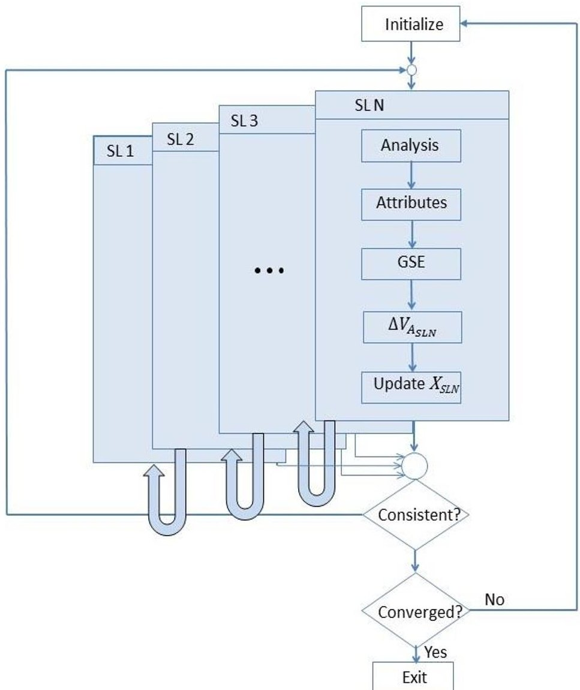

Figure 6.1: Value-based Systems Engineering Framework

The framework starts with initializing a design and performing system analysis, the output of which is used to calculate the attributes at SL1. After system analysis, the global sensitivities of the behavior variables with respect to all the design variables at SL1 are obtained using the Global Sensitivity Method [36]. These global sensitivities will be used in calculating the total derivatives of value with respect to attributes and design variables in order to capture the physics-based couplings as well. After obtaining the attributes and global sensitivities of behavior variables, the next step is to calculate the total change in value due to attributes $ \left( \Delta V_{ASL1} \right) $ at subsystem level 1 using attribute and physics-based couplings. It should be noted that the subsystems at SL1 might need the attributes at lower levels as inputs. For example, the payload subsystem in Fig. 5.2 needs

<!-- PDF_PAGE: 97 -->

$ G_{\mathrm{st}} $ an attribute at SL3 (Satellite transmitting antenna subsystem). Initially, these lower level attributes are assumed while calculating derivatives and are changed after updating the design. Once the significant attributes are determined from $ \Delta V_{A_{SL1}} $ the design variables associated with them are identified. The total derivatives associated with value with respect to those design variables are obtained next. After capturing all the impacts due to a particular design variable in the same manner as attributes the design variable is updated to result in a positive change (for maximization problems) in total value impact due to design variables $ (\Delta V_{X_{SL1}}) $ based on the total derivative. These updated design variables at SL1 are then flowed down to the lower levels. The lower level attributes are recalculated for the updated SL1 design variables and are passed back. Now, the assumed lower level attributes at SL1 are updated and this process is repeated again until SL1 is consistent with the lower level attributes. The final updated design variables at SL1 are then flowed down to SL2, where the whole process is repeated again as indicated in the flowchart. The design update process continues until the system is converged, thereby achieving an optimum. The design variables are updated based on the error as shown in Eq. 6.3. The error in Eq. 6.3 represents the discrepancy in value due to linearization compared to the actual value. The design variables are changed by 5% of their old values if the error is less than or equal to 3% and are changed by 1% if the error due to linearization is more than 3%.

$$
\Delta X = \left\{ \begin{array}{l l} 0. 0 5 \times X _ {o l d} & e r r o r \leq 0. 0 3 \\ 0. 0 1 \times X _ {o l d} & e r r o r > 0. 0 3 \end{array} \right.
$$

where:

$$
e r r o r = a b s \left(\frac {V a l u e - A c t u a l v a l u e}{A c t u a l v a l u e}\right)
$$

<!-- PDF_PAGE: 98 -->

Case study - Satellite system

Table 6.4 shows the optimized design for the hierarchically decomposed satellite system using the value-based systems engineering framework. The value function used here is Net Present Profit, which is described in Eq. (6.4) [12, 105, 106]. Equation (6.4) represents the top-level attributes, which the value function is formed from where TC is total cost and Rev is revenue.

$$
V = f (T C, R e v) = - T C + \sum_ {y = 1} ^ {O L} \frac {R e v _ {y}}{\left(1 + r _ {d}\right) ^ {y}}
$$

$$
r _ {d}: d i s c o u n t f a c t o r = 10 \%
$$

$$
O L: O p e r a t i o n L i f e t i e = 1 0 y e a r s
$$

$$
y: y e a r
$$

Only the continuous design variables associated with the satellite system at all the levels are considered here for simplicity. This can be extended in a similar manner to discrete design variables as well. The only difference is replacing $ \left( \frac{dA}{dX} \right) $ with $ \Delta A_{X} $ , where $ \Delta A_{X} $ represents the total change in an attribute due to a change in the discrete design variable. This can be more clearly seen by comparing Eqs. (6.5) and (6.6).

$$
\Delta V _ {X _ {1 1 1}} = \left[ \frac {\partial V}{\partial X _ {1 1 1}} + \frac {\partial V}{\partial A _ {0 1 1}} \frac {d A _ {0 1 1}}{d X _ {1 1 1}} + \frac {\partial V}{\partial A _ {0 1 2}} \frac {d A _ {0 1 2}}{d X _ {1 1 1}} \right] \left(X _ {1 1 1 _ {n}} - X _ {1 1 1 _ {0}}\right)
$$

$$
\Delta V _ {X _ {1 1 2}} = \frac {\partial V}{\partial A _ {0 1 1}} \Delta A _ {0 1 1 X _ {1 1 2}} + \frac {\partial V}{\partial A _ {0 1 2}} \Delta A _ {0 1 2 X _ {1 1 2}}
$$

$$
W h e r e \Delta A _ {0 1 1 _ {X _ {1 1 2}}} = A _ {0 1 1} \left(X _ {1 1 2, B}, \dots\right) - A _ {0 1 1} \left(X _ {1 1 2, A}\right)
$$

Equation (6.5) represents the value impact of a continuous design variable and Eq. (6.6) represents the value impact of a discrete design variable. Equation (6.7) represents the total change in attribute

<!-- PDF_PAGE: 99 -->

$ A_{011} $ with respect to the discrete design variable $ X_{112} $ . Here $ X_{112,A} $ represents discrete choice A and $ X_{112,B} $ represents choice B. In this satellite example, the discrete design variables represent mostly technology choices associated with a subsystem. For example, the design variable Amp associated with the Payload subsystem, as described in Appendix, represents the type of high power amplifier onboard the satellite. The two options considered for Amp in this example are Solid State Amplifier (SSA) and TWTA (Travelling Wave Tube Amplifier). These discrete design variables can be updated by calculating the value impact. This will also be useful in evaluating new technologies. Further analysis of discrete design variable in the value-based systems engineering framework is left for future work.

The final design obtained using the VBSE framework is presented in Table 6.4. The continuous design variables are grouped based on the tiers. The third column in Table 6.4 represents the initial design, which is chosen at random. The next column represents the final design obtained using the value-based systems engineering framework. The Net Present Profit (system value) associated with the final design obtained using the framework is around $325M as seen in the table. Since, the new framework uses linearized value functions, there were errors associated with the final value. The error due to linearization was around 2.3% for the final design. The error percentages varied through cycles that determined the change in the design variables, as shown in Eq. 6.3.

<!-- PDF_PAGE: 100 -->

Table 6.4: Optimization using VBSE framework

<table border="1"><tr><td>Subsystem level</td><td>Design variables</td><td>Initial design</td><td>Final design using VBSE</td><td>Optimal design using Genetic Algorithm</td></tr><tr><td rowspan="5">SL1</td><td>Satellite long.</td><td>100°W</td><td>85.12°W</td><td>301.33°W</td></tr><tr><td>Ground long.</td><td>100°W</td><td>81.97°W</td><td>97.57°W</td></tr><tr><td>Ground lat.</td><td>40°N</td><td>25.23°N</td><td>39.42°N</td></tr><tr><td>Ground long. receiving</td><td>75°W</td><td>80.71°W</td><td>104.98°W</td></tr><tr><td>Ground lat. receiving</td><td>40°N</td><td>25.23°N</td><td>37.33°N</td></tr><tr><td rowspan="2">SL2</td><td>Pst</td><td>50W</td><td>5W</td><td>5W</td></tr><tr><td>Pgt</td><td>500W</td><td>300W</td><td>865.97W</td></tr><tr><td rowspan="6">SL3</td><td>fdown</td><td>50GHz</td><td>100GHz</td><td>96.02GHz</td></tr><tr><td>Dst</td><td>5m</td><td>0.50m</td><td>0.12m</td></tr><tr><td>Dsr</td><td>5m</td><td>0.40m</td><td>0.12m</td></tr><tr><td>Dgt</td><td>15m</td><td>2.54m</td><td>12.63m</td></tr><tr><td>fup</td><td>50GHz</td><td>100GHz</td><td>81.40GHz</td></tr><tr><td>Dgr</td><td>15m</td><td>2.54m</td><td>2.77m</td></tr><tr><td>$V_{n}=V_{0}+\Delta V_{Total}$</td><td>-</td><td>-</td><td>$325.34M</td><td>-</td></tr><tr><td>$V_{actual}$</td><td>-</td><td>$181.57M</td><td>$318.04M</td><td>$319.16M</td></tr><tr><td>% error due to linearization</td><td>-</td><td>-</td><td>2.3%</td><td>-</td></tr></table>

Design improvement with respect to the optimization cycles using the VBSE framework is shown in Fig. 6.2. It is clear from the figure that the overall system value increases as the optimization progresses. For comparison, the hierarchically decomposed satellite problem was modelled as a single MDO problem with no hierarchy. The optimal design associated with the problem is provided in the last column of Table 6.4. The built-in Genetic Algorithm in MATLAB Global Optimization Toolbox was used for optimization as this problem involved a number of discrete design variables. The optimum discrete design variables obtained using GA are used as design choices for the VBSE framework as only continuous variables are used for optimization in the framework. It can be seen from Table 6.4 that the NPP associated with using the new framework has a relatively low error from the NPP using GA. However, the values of some of the design

<!-- PDF_PAGE: 101 -->

variables obtained using the VBSE framework are vastly different compared to the results using GA. One of the reasons for this difference in design variable values is linearization as it leads to local minimum, which depends on the initial design point. When initialized with different design points, the optimum values for the design variables using the VBSE framework changed with the Net Present Profit (Value) being close to $318 million. Another reason is the internal trade-offs occurring between design variables. For instance, in Table 6.4, the optimum value for $ D_{st} $ (diameter of satellite transmitting antenna) is 0.5 m using the VBSE framework as compared to 0.12 m using GA. The difference in this design variable is compensated by $ D_{gt} $ (diameter of ground transmitting antenna). In other words, there is a balance between $ D_{st} $ and $ D_{gt} $ as these design variables affect the signal to noise ratio (SNR), which in turn affects the Net Present Profit. Additionally, the VBSE framework aims at maximizing the anticipated value $ (V_{n}) $ that is the summation of value from previous cycle $ (V_{0}) $ and the change in value in the current cycle $ (\Delta V_{Total}) $ due to the change in design variables at all levels. The anticipated value $ (V_{n}) $ is the outcome of a linearization process in the VBSE framework, which differs from the actual value $ (V_{actual}) $ obtained by a complete system analysis.

<!-- PDF_PAGE: 102 -->

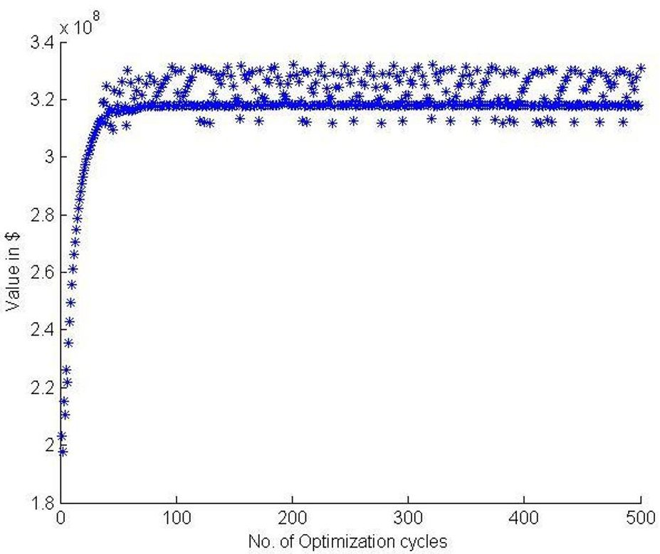

Figure 6.2: Optimization using VBSE framework

Even though the new framework has limitations because of errors due to linearization and common optimization concerns such as local minimum, it is the first step towards incorporating principles of VDD in current systems engineering processes by replacing communication of requirements with communication of value functions. The new framework enables consistent and more informed design decision-making in a hierarchical organization, where the designers at all the levels are aware of the impacts of their design decisions on the system value. As mentioned before, it is challenging to identify the significant attributes, especially in LSCES like satellites and aircrafts where the number of attributes may range from hundreds to thousands. The focus of next section is on a visualization tool that can aid designers in identifying these attributes easily.

## Decision Support using Visualization

The VBSE framework involves a step of identifying significant attributes, which is a mathematically tedious process. In the real world, it is difficult to pick attributes using just numbers (total derivatives) particularly when many attributes exist. An easier way to identify significant

<!-- PDF_PAGE: 103 -->

attributes is to visualize the value impact of the attributes. The visualization of the attributes in this section aids the designers in identifying the important attributes as shown in Fig. 6.3 and also will aim at providing a greater understating of attribute relationships as shown in Fig. 6.4 [106, 107]. Figure 6.3 is a combination of a bar chart and parallel coordinate plot. The bars represent the normalized global sensitivities of each subsystem level 1 attribute with respect to the system value, and the parallel coordinate plot shows how changes in these attributes affect the value function. Both plots describe sensitivities; one through the mathematical relationships that exist in the background equations (total derivatives) and one through the analytical results of the value function. Using these plots together affords the designer a more holistic understanding of the sensitivities of the value function to each attribute. It is clearly apparent from the derivative bar charts, that attributes associated with the Power and Launch vehicle subsystems have large normalized global derivatives. From the parallel coordinate plot, it can be seen that these attributes also have low value variability. Therefore, the value function is relatively sensitive to changes in the Power and Launch vehicle subsystems. Whereas, the signal-to-noise ratios （ $ \mathrm{SNR}_{down} $ and $ \mathrm{SNR}_{up} $ ）have low normalized global sensitivity values and large value variability in the parallel coordinate plot. Therefore, the value function is relatively insensitive to changes in the signal-to-noise ratios after a certain range. From this figure it is seen that the attributes that have higher value impacts at subsystem level 1 are $ C_{\mathrm{power}} $ and $ C_{\mathrm{LV}} $ . The plots in Fig. 6.3 tell us there is potential for higher value change, by focusing on these significant attributes, in an understandable way.

<!-- PDF_PAGE: 104 -->

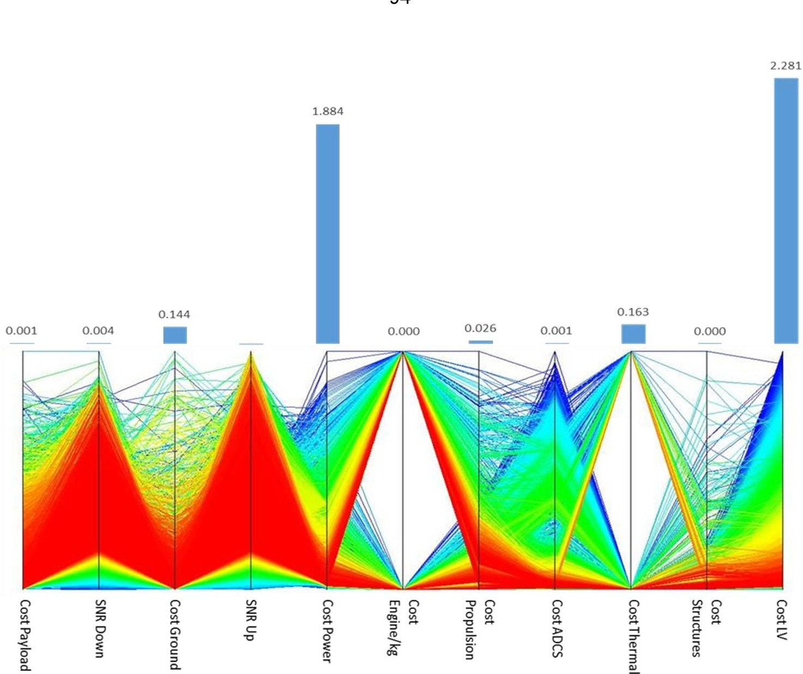

Figure 6.3. (Top) Total sensitivities of SL1 attributes with respect to Value (Bottom) Parallel Coordinate Plot of SL1 Attributes

The visual design structure matrix (VDSM) is an interactive DSM that allows the designer to select which subsystem relationships they would like to analyze. Figure 6.4 shows a sample VDSM with four subsystem attributes: Array Size, Propellant Mass, Transponder Mass, and Payload Power. The total derivative of each attribute with respect to value $ \left( \frac{dV}{dA} \right) $ , change the size of each box. The propellant mass has the greatest effect on the total value, and the transponder mass and payload power have the lowest effects. This is due to the background cost function which is greatly affected by the mass of the propellant. The lines that connect each attribute box represent their local derivatives. These lines change thickness based on the strength of the local coupling. The placement of the line, above or below the box, represents the direction of the local coupling.

<!-- PDF_PAGE: 105 -->

For example, the thick line between array size and payload power corresponds to a strong local derivative. Within the value space, the output of the payload power has a strong effect on the array size, but a small effect on the propellant mass.

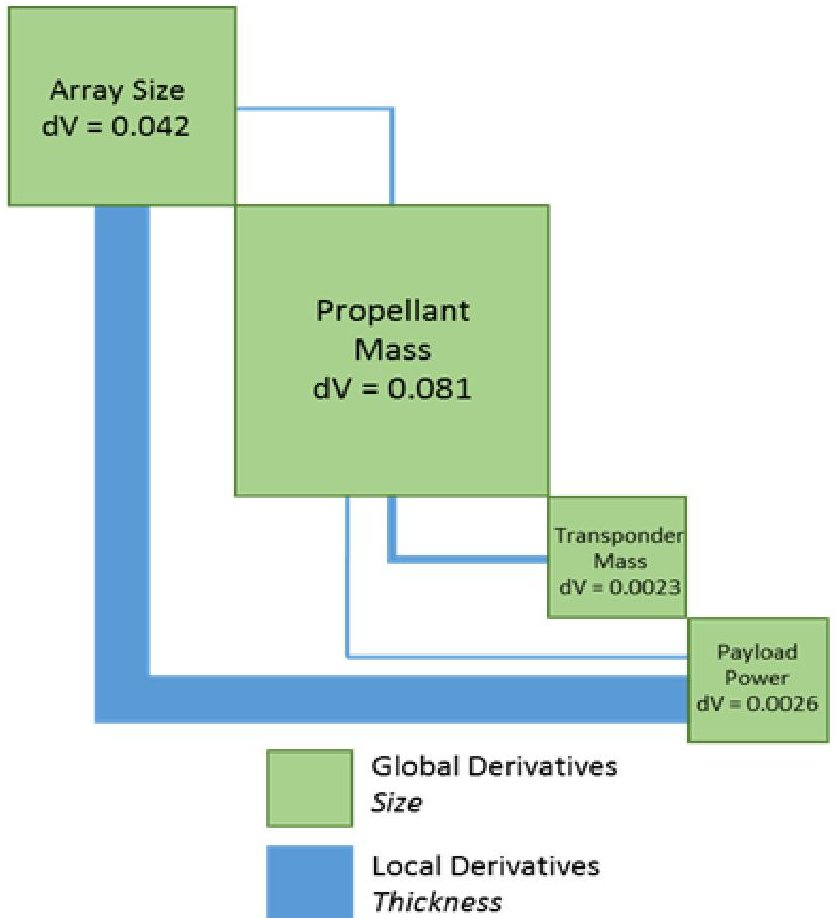

Figure 6.4. VDSM of four subsystem attributes

The VDSM provides a tool for a designer to analyze all of the couplings within a system. The interactive nature of the VDSM allows the designer to target specific subsystems or disciplines and enhance their understanding of the sensitivities. This will allow designers to make decisions on suspension/elimination of couplings to reduce computational cost [37, 38]. Suspension of couplings using visualization is left for future work. This chapter has focused on enabling consistency in design decision-making associated with communication of system preference and consistency in physics by proposing a Value-Based Systems Engineering (VBSE) framework thereby tackling research question 2 by providing a framework for system optimization in a hierarchically decomposed environment. The next chapter will focus on quantifying the

<!-- PDF_PAGE: 106 -->

uncertainties present, propagating them throughout the system and finally will explore how a consistency in preferences towards risk can be achieved using the VBSE framework.

<!-- PDF_PAGE: 107 -->

## CHAPTER 7

## CONSISTENCY IN RISK PREFERENCES

The design process associated with Large-Scale Complex Engineered Systems (LSCES) involves a number of individuals making decisions at all the levels of the hierarchy in an organization. Previous chapters addressed consistency issues in communicating stakeholder's preference(s) in decision-making by ensuring consistency in physics of the system using the Value-Based Systems Engineering (VBSE) framework thereby addressing research questions 1 and 2. The focus of this chapter is to address research question 3 on enabling consistency in both risk and value preferences throughout the system, when uncertainties are present, using the VBSE framework. As mentioned before in the background section, it is straightforward to choose between designs when the alternatives are deterministic. It becomes challenging when uncertainties are involved as the attitude of individual designers towards uncertainty or risk becomes an important aspect. As the design of LSCES involves hundreds to thousands of decision makers, it is therefore very critical to capture and communicate the risk preferences of the stakeholder to result in a desired design. The failure to communicate risk preferences will result in designers using their own preference towards uncertain designs, resulting in a system design that is not preferred by the stakeholder. This chapter will first demonstrate the effect of risk bias on uncertain design alternatives and then will explore the VBSE framework in enabling consistency in both value and risk preferences throughout the system by bringing together Value-Driven Design (VDD), Multidisciplinary Design Optimization (MDO) and Decision Analysis (DA). As seen in the previous chapters and the background section, VDD ensures consistency in communication of system value preferences, MDO enables consistency in physics across the system and DA provides a framework for decision-making under uncertainty. The ultimate goal of this chapter is to exploit the complimentary nature

<!-- PDF_PAGE: 108 -->

of these three areas to achieve a holistic framework that will enable consistency in decision making. The higher fidelity satellite system, described in Chapter IV will be used as a test case here to demonstrate the importance of capturing and communicating risk preferences.

## Impact of Risk Bias on Decision-Making

Four different design alternatives with varying degrees of uncertainties associated with continuous design variables, for the satellite example described in Chapter IV, are considered here to demonstrate the impact of risk preferences on design with uncertainties. Design alternative 1 has less uncertainty associated with it compared to alternatives 2-4, however design alternatives 2-4 have regions in the distribution that may yield higher valued outcomes. The uncertainties in the design variables are propagated using Monte-Carlo sampling method [52, 53], with a sample size of 100000. Figure 7.1 shows the probability distribution of Net Present Value, in dollars, associated with each of the design alternatives after being propagated throughout the system. It can be seen from Fig. 7.1 that design alternative 1 is less risky (narrower distribution) compared to others.

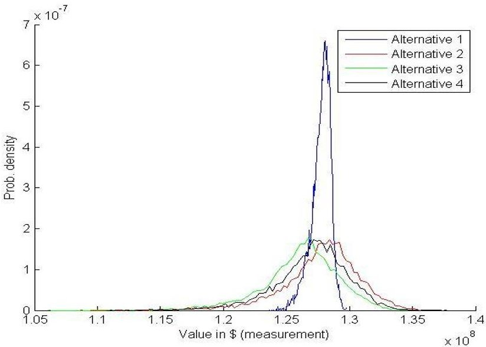

Figure 7.1: Probability Distributions of Design Alternatives on Value

<!-- PDF_PAGE: 109 -->

Table 7.2 represents four different cases of utility functions representing varying risk preferences. These are some of the commonly used utility functions in literature [13, 108, 109]. Utility functions specific to an individual can be modeled by conducting numerous lotteries on the individual. Readers are referred to [71] for experimental methods to elicit risk preferences. Modeling a completely new utility function is out of the scope of this research. For demonstration purposes, existing utility functions are used here and the corresponding parameters of the utility functions are modified to result in a desired risk preference. For example, for the utility function listed as case 3 in Table 7.2, the risk parameters $ \alpha=-0.2 $ and $ \alpha=0.5 $ represent higher and lower degrees of risk aversion. This can also be seen in Fig. 7.2a and Fig. 7.2b, where the curvature changes according to the risk preference. The utility curve becomes flatter, closer to risk neutral preference (which will be a straight line across the curve), with lower degrees of risk aversion as seen in the figure. Convex curves represent a risk-loving attitude.

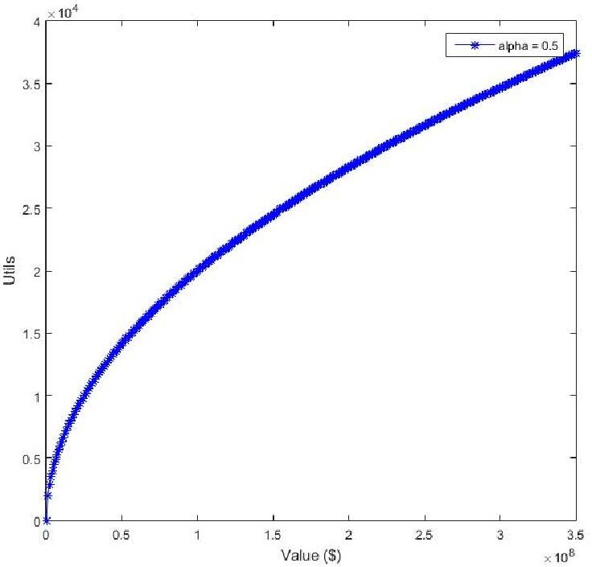

Figure 7.2a: Less Risk Averse Utility Function

<!-- PDF_PAGE: 110 -->

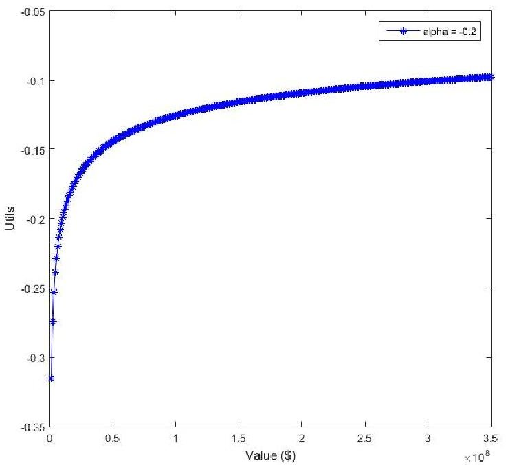

Figure 7.2b. Higher risk averse utility function

As people are usually risk averse, utility functions that are only risk averse are considered here. These four cases represent different degrees of risk aversion, as people tend to differ in their risk attitude. For example, a stakeholder compared to a designer at a lower level may be less risk averse in his preferences. Cases 1-2 represent utility functions with constant absolute risk aversion, i.e., the risk attitude will remain the same with change in wealth (value). The parameter 'a' is varied in cases 1-2 to result in varying degrees of constant absolute risk aversion. Case 1 represents a lower risk aversion, whereas case 2 represents higher risk aversion. Cases 3-4 represent utility functions with decreasing degree of absolute risk aversion. The individual with decreasing degree of absolute risk aversion will become less risk averse with increase in wealth (value). This can be seen in Table 7.1. Table 7.1 demonstrates the effect of decreasing absolute risk aversion on the selection of design alternatives. Alternatives 1 and 2 associated with Fig. 7.1 are considered here. As mentioned before, alternative 1 is less risky but has lower expected outcome, whereas alternative 2 is more risky and has higher expected outcome. One of the discrete design variables (Number of transponders, N) of the design alternatives is changed to yield a higher expected

<!-- PDF_PAGE: 111 -->

outcome, such that there is no change in the probability distribution itself, but just in the expected outcome. As can be seen in Table 7.1, two different cases of expected outcome (~127 M$ and ~251 M$) are used to demonstrate the difference in varying degree of absolute risk aversion. For the case with lower expected outcome (~127 M$), the chosen design alternative is 1 for both constant and decreasing absolute risk aversion, whereas for the case with higher expected outcome (~251 M$), the design alternatives chosen for constant absolute risk aversion and decreasing absolute risk aversion are 1 and 2 respectively. The reason for this change in design alternative associated with "decreasing degree of absolute risk aversion" utility function is due to the decrease in risk aversion with increase in wealth (value). It is also clear by comparing the certainty equivalents of the two utility functions in Table 7.1, associated with the higher expected outcome design alternatives, that the designers with a decreasing degree of absolute risk aversion would pay more (~254 M$) for alternative 2 as compared to design alternative 1 (~251 M$). Even though design alternative 2 is riskier comparatively, the designers still prefer it because of their decreasing degree of absolute risk aversion with increase in wealth.

<!-- PDF_PAGE: 112 -->

Table 7.1 Decreasing degree of absolute risk aversion

<table border="1"><tr><td>Utility function</td><td>Coefficient of absolute risk aversion (Ra)</td><td>Cases</td><td>Alternative</td><td>Expected outcome in $ (Mean)</td><td>Certainty Equivalent in $</td><td>Expected Utility</td><td>Chosen design alternative</td></tr><tr><td rowspan="5">$U(V)=-\frac{1}{a}e^{-aV}$ (Constant absolute risk aversion)</td><td rowspan="5">a=9e-7</td><td rowspan="2">Lower exp. outcome alternatives</td><td>1</td><td>127.23e+6</td><td>125.92e+6</td><td>-66.71e-45</td><td rowspan="2">1</td></tr><tr><td>2</td><td>127.41e+6</td><td>121.52e+6</td><td>-3.51e-42</td></tr><tr><td rowspan="2">Higher exp. outcome alternatives</td><td>1</td><td>251.73e+6</td><td>249.49e+6</td><td>-33.52e-93</td><td rowspan="2">1</td></tr><tr><td>2</td><td>251.87e+6</td><td>242.58e+6</td><td>-16.86e-90</td></tr><tr><td colspan="7"></td></tr><tr><td rowspan="5">$U(V)=\frac{1}{\alpha}V^{\alpha}$ (Decreasing degree of absolute risk aversion)</td><td rowspan="5">$\alpha=-0.2$</td><td rowspan="2">Lower exp. outcome alternatives</td><td>1</td><td>127.23e+6</td><td>127.26e+6</td><td>-0.119681</td><td rowspan="2">1</td></tr><tr><td>2</td><td>127.41e+6</td><td>127.23e+6</td><td>-0.119688</td></tr><tr><td rowspan="2">Lower exp. outcome alternatives</td><td>1</td><td>251.73e+6</td><td>251.96e+6</td><td>-0.1044</td><td rowspan="2">2</td></tr><tr><td>2</td><td>251.87e+6</td><td>254.39e+6</td><td>-0.1042</td></tr></table>

Table 7.2 has the ranking of the design alternatives based on expected utility associated with each of the four utility functions. It can be seen from the table that the rank ordering has changed between cases 1 (higher risk aversion) and 2 (lower risk aversion) due to a change in risk preference. The risk preference is changed by manipulating the parameter "a", which reflects the constant degree of risk aversion associated with cases 1 and 2. As case 1 represents individuals with higher risk aversion compared to case 2, design alternative 1 was chosen as it is less risky compared to other alternatives. Case 2 represents comparatively lesser risk averse individuals, which resulted in design alternative 2 being chosen. Cases 3 and 4 represent higher risk averse individuals. Also for case 3, the parameter $ \alpha $ can be changed to represent desired risk aversion.

<!-- PDF_PAGE: 113 -->

Table 7.2. Impact of Risk Bias

<table border="1"><tr><td>Cases</td><td>Utility functionU(V)</td><td>Util. function parameter</td><td>Coefficient of absolute risk aversion(Ra)</td><td>Design ranking</td><td>Certainty Equivalent in$</td><td>Expected utility</td><td>Expected Outcome in$ (Mean)</td><td>Chosen design alternative</td></tr><tr><td rowspan="4">Case1(constant absolute risk aversion)</td><td rowspan="4">$-\frac{1}{a}e^{-aV}$</td><td rowspan="4">a=9e-7(higher risk aversion)</td><td rowspan="4">N/A</td><td>1</td><td>125.92e+6</td><td>-66.71e-45</td><td>127.23e+6</td><td rowspan="4">1</td></tr><tr><td>2</td><td>121.52e+6</td><td>-3.511e-42</td><td>127.41e+6</td></tr><tr><td>4</td><td>118.15e+6</td><td>-72.94e-42</td><td>125.70e+6</td></tr><tr><td>3</td><td>117.33e+6</td><td>-152.8e-42</td><td>126.42e+6</td></tr><tr><td colspan="9"></td></tr><tr><td rowspan="4">Case2(constant absolute risk aversion)</td><td rowspan="4">$-\frac{1}{a}e^{-aV}$</td><td rowspan="4">a=1e-7(lower risk aversion)</td><td rowspan="4">N/A</td><td>2</td><td>126.70e+6</td><td>-31.41</td><td>127.23e+6</td><td rowspan="4">2</td></tr><tr><td>1</td><td>126.25e+6</td><td>-32.87</td><td>127.41e+6</td></tr><tr><td>4</td><td>125.96e+6</td><td>-33.83</td><td>125.70e+6</td></tr><tr><td>3</td><td>125.17e+6</td><td>-36.61</td><td>126.42e+6</td></tr><tr><td colspan="9"></td></tr><tr><td rowspan="4">Case3(decreasing absolute risk aversion)</td><td rowspan="4">$\frac{1}{\alpha}V^{\alpha}$</td><td rowspan="4">$\alpha=-0.2$</td><td rowspan="4">$\frac{(1-a)}{V}$</td><td>1</td><td>127.26e+6</td><td>-0.119681</td><td>127.23e+6</td><td rowspan="4">1</td></tr><tr><td>2</td><td>127.23e+6</td><td>-0.119688</td><td>127.41e+6</td></tr><tr><td>4</td><td>125.49e+6</td><td>-0.120018</td><td>125.70e+6</td></tr><tr><td>3</td><td>125.44e+6</td><td>-0.119837</td><td>126.42e+6</td></tr><tr><td colspan="9"></td></tr><tr><td rowspan="4">Case4(decreasing absolute risk aversion)</td><td rowspan="4">ln(V)</td><td rowspan="4">N/A</td><td rowspan="4">1/V</td><td>1</td><td>127.26e+6</td><td>18.6618</td><td>127.23e+6</td><td rowspan="4">1</td></tr><tr><td>2</td><td>127.22e+6</td><td>18.6615</td><td>127.41e+6</td></tr><tr><td>4</td><td>125.49e+6</td><td>18.6478</td><td>125.70e+6</td></tr><tr><td>3</td><td>126.44e+6</td><td>18.6553</td><td>126.42e+6</td></tr></table>

It can be seen from this simple demonstration that there is a need to capture risk preferences carefully in decision-making when uncertainties are present. This example emphasizes the necessity for having a rigorous mathematical foundation for decision-making to reflect the preferences of an individual towards risk. It is also crucial to have consistent risk preferences in a hierarchically decomposed system in order to result in a system actually desired by the stakeholder. The focus of the next section will be on communication of risk preferences using the VBSE framework.

<!-- PDF_PAGE: 114 -->

## Value-Based Systems Engineering Framework (VBSE) with Uncertainties

In the previous section, we found that with varying risk preferences under uncertainty, the designers tend to choose completely different designs. When this is expanded to the hierarchically decomposed satellite system, there will be inconsistency in the design due to people at different levels of hierarchy. The focus of this section will be on using the VBSE framework to optimize the satellite system when uncertainties are present by enabling consistency in risk preferences in addition to achieving consistency in physics and communication of preferences (as discussed in Chapter 6). In Chapter 6, the decomposed value functions were used to communicate system preference, whereas in this section, utility functions will be used to communicate both the risk and system preference. Designers/managers at each level will have their own risk preference towards uncertain designs. It will be demonstrated using the satellite example that the final design obtained using the VBSE framework will be completely different if designers at different tiers tend to use their own utility functions instead of a consistent utility function that captures both risk and value preference of the stakeholder.

A modified VBSE framework that enables communication of both value and risk preferences using utility functions is shown in Fig. 7.3. The framework works in a similar manner to the deterministic case (Chapter 6). The key difference here is on the updating of design variables. The design variables are updated at each level based on the change in expected utility $ \left( \Delta E(U) \right) $ associated with each level, instead of change in value $ \left( \Delta V \right) $ , to result in an increase in overall expected utility. Similar to the previous section, only the uncertainties associated with the continuous design variables are considered and other uncertainties like satellite system model uncertainties are left for future work. The uncertainties are modelled using probability

<!-- PDF_PAGE: 115 -->

distributions. For simplicity, the probability distributions considered here are triangular. Future work will be considering other probability distributions like normal, lognormal, Poisson, etc.

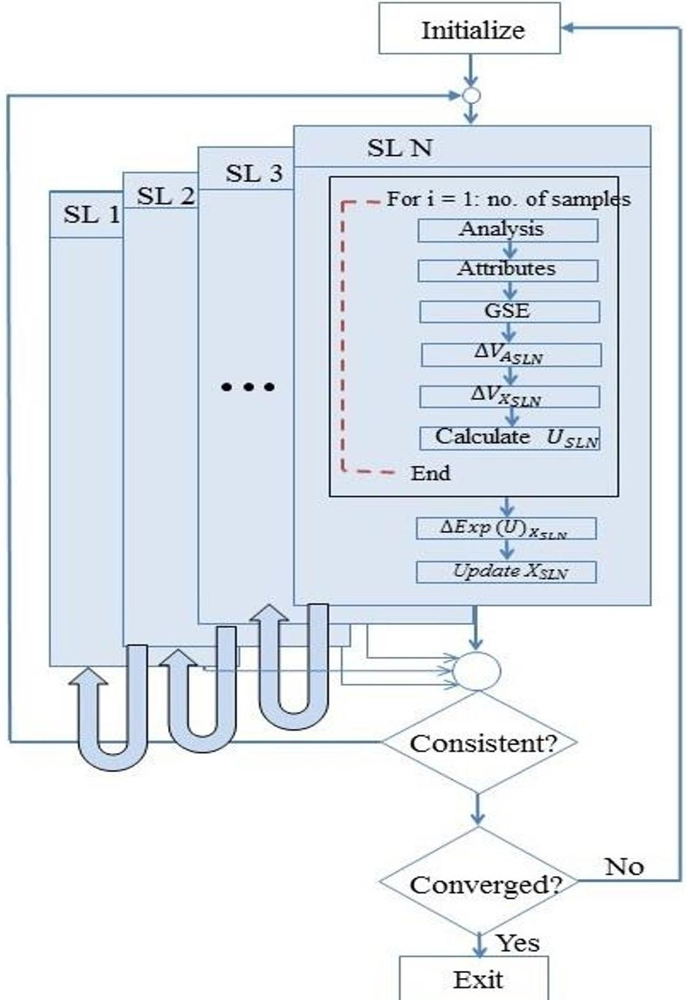

Figure 7.3: Value-based Systems Engineering Framework

The distributions associated with design variables at subsystem level 2 (SL2) and subsystem level 3 (SL3) are set in such a way that the upper and lower bounds change with respect to the design variable value to account for machining tolerances and transmitter power accountability. For example, in the case of design variable $ D_{\mathrm{st}} $ (diameter of satellite transmitting

<!-- PDF_PAGE: 116 -->

antenna), the distribution is set to be narrower when the diameter is lower (say around 0.5 meters) and the distribution is set to be broader (say around 3 meters) to reflect machining tolerance of antenna, i.e., the higher the diameter, the higher the machining tolerance. This can be seen in Fig. 7.4. These distributions are then propagated using Monte-Carlo sampling at each level of the hierarchy as shown in Fig. 7.3. The design variables are changed by 5% of their old values if the error is less than or equal to 3% and are changed by 1% as shown if the error is greater than 3% in Eq. 7.1. The number of design cycles performed are 30.

$$
\Delta X = \left\{ \begin{array}{l l} 0. 0 5 \times X _ {o l d} & e r r o r \leq 0. 0 3 \\ 0. 0 1 \times X _ {o l d} & e r r o r > 0. 0 3 \end{array} \right.
$$

where:

$$
e r r o r = a b s \left(\frac {E x p e c t e d U t i l i t y _ {V B S E} - A c t u a l E x p e c t e d U t i l i t y}{A c t u a l E x p e c t e d U t i l i t y}\right)
$$

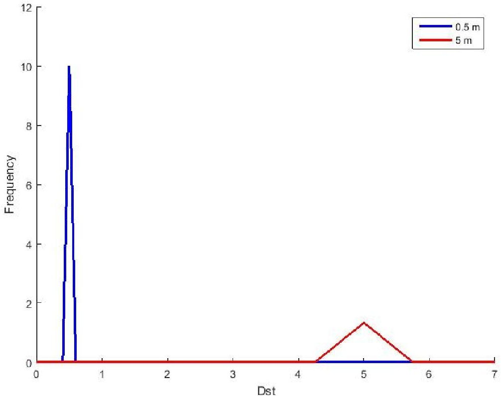

Figure 7.4. Distributions associated with Dst

<!-- PDF_PAGE: 117 -->

Table 7.3 shows the designs associated with two different utility functions with varying degrees of risk aversion. The framework is initialized with the same initial design as in the deterministic case (Table 6.4). The uncertainties in the design are propagated using Monte-Carlo method with a sample size of 10000. Case 1 in the Table 7.3 represents a utility function with decreasing degree of risk aversion (case 4 in Table 7.2). It is assumed that all the designers at one particular level have the same risk preference for simplicity. Modeling the risk preference of designers associated with each subsystem is left for future work. Cases 1.a and 1.b in Table 7.3 represent scenarios with the same risk preference at all the three levels of the hierarchy, where the risk parameter $ \alpha $ has the same value, with case 1.a being more risk averse compared to 1.b. This means that the risk preferences of the designers at all the levels are consistent with the stakeholder. Case 1.c in the table represents a scenario where the designers tend to decide on their own risk preference. It can be seen from Table 7.3 that each of these cases (Case 1.a-1.c) have completely different designs due to the variation in risk preferences. In case 1.a, designers at levels SL2 and SL3 tend to pick designs with lower uncertainty, as they are more risk averse compared to case 1.b, where the risk aversion is very low. As discussed before, the uncertainty associated with the design variables increase with increase in their values as shown in Fig. 7.4. Since only the uncertainties associated with the diameters and transmitter powers (shown in red in Table 7.3) were modeled that way, there is a vast difference in values associated with those design variables. In case 1.c, the designers at each level make decisions based on their own risk preference as seen in Table 7.3, where there is a huge discrepancy in the final design compared to case 1.b. Similarly case 2 in Table 7.3 represents a scenario where the designers at SL1 and other levels have completely different utility functions, i.e., SL1 has a utility function associated with case 2 from Table 7.2, whereas SL2 and SL3 have utility functions associated with case 4 in Table 7.2. As designers at the lower levels are

<!-- PDF_PAGE: 118 -->

usually more risk averse compared to a higher-level manager, they tend to choose designs that are not desired by the stakeholder as seen in Table 7.3.

Table 7.3. VBSE framework with uncertainties

<table border="1"><tr><td colspan="2">Risk parameters</td><td>Case 1.a: $\alpha_{SL1}=-0.005$ $\alpha_{SL2}=-0.005$ $\alpha_{SL3}=-0.005$</td><td>Case 1.b: $\alpha_{SL1}=2$ $\alpha_{SL2}=2$ $\alpha_{SL3}=2$</td><td>Case 1.c: $\alpha_{SL1}=2$ $\alpha_{SL2}=-0.005$ $\alpha_{SL3}=-0.5$</td><td>Case 2 a$_{SL1}=1$e-7 $\alpha_{SL2}=0.75$ $\alpha_{SL3}=0.75$</td></tr><tr><td rowspan="5">SL1</td><td>Satellite longitude</td><td>85.5°W</td><td>100°W</td><td>90°W</td><td>90°W</td></tr><tr><td>Ground longitude</td><td>94.5°W</td><td>100°W</td><td>90°W</td><td>110°W</td></tr><tr><td>Ground latitude</td><td>34.2°N</td><td>40°N</td><td>36°N</td><td>36°N</td></tr><tr><td>Ground long. rec</td><td>86.6°W</td><td>75°W</td><td>82.5°W</td><td>82.5°W</td></tr><tr><td>Ground lat. rec</td><td>34.2°N</td><td>40°N</td><td>36°N</td><td>36°N</td></tr><tr><td rowspan="2">SL2</td><td>$P_{st}$</td><td>7.8W</td><td>42.75W</td><td>6.79W</td><td>6.12W</td></tr><tr><td>$P_{gt}$</td><td>300W</td><td>427.5W</td><td>300W</td><td>300W</td></tr><tr><td rowspan="6">SL3</td><td>$f_{down}$</td><td>55.55GHz</td><td>50GHz</td><td>55GHz</td><td>55GHz</td></tr><tr><td>$D_{st}$</td><td>0.81m</td><td>4.45m</td><td>0.97m</td><td>0.95m</td></tr><tr><td>$D_{sr}$</td><td>0.65m</td><td>4.45m</td><td>0.80m</td><td>0.78m</td></tr><tr><td>$D_{gt}$</td><td>2.45m</td><td>13.36m</td><td>2.93m</td><td>2.87m</td></tr><tr><td>$f_{up}$</td><td>55.55GHz</td><td>50GHz</td><td>55GHz</td><td>55GHz</td></tr><tr><td>$D_{gr}$</td><td>2.45m</td><td>13.36m</td><td>2.93m</td><td>2.87m</td></tr></table>

The primary focus of this section has been on exploring how both risk and value preferences can be communicated using a utility function in a Value-Based Systems Engineering framework. Table 7.3 shows how design decisions vary when the risk preferences are inconsistent in a hierarchically decomposed environment where it is crucial to make decisions aligned with the stakeholder's preference(s). This chapter has addressed research question 3, which focuses on overcoming consistency issues, associated with both value and risk preferences, in design decision-making in a complex system with uncertainties. This is achieved by capturing both the risk and value preferences using a utility function and decomposing it using the VBSE framework, which enables consistent design decision-making by providing a way for system optimization.

<!-- PDF_PAGE: 119 -->

## CHAPTER 8 SUMMARY, CONCLUSION AND FUTURE WORK

## Summary and Conclusion

Keeping in mind all the consistency issues that are faced while implementing a systems engineering process, an effort is being made to bring together all the components of the new design science of Large-Scale Complex Engineered Systems (LSCES), namely MDO, VDD and DA, that result in a better design by aiming at minimizing the schedule delays, cost overruns and maximizing the true preference. This is achieved using the proposed Value-Based Systems Engineering (VBSE) framework that enables design decision-making that is consistent with both the value and risk preferences of the stakeholder. This research has shown how different objective function formulations yield completely different designs and thereby has emphasized the importance of capturing the true preference(s) of the stakeholder using a value function. In addition to that, this research has also shown why communication of system preferences is important and how system preferences can be communicated using value functions. The issue of physics-based consistency in the context of value function decomposition has also been addressed to enable more realistic and informed design decision-making using the VBSE framework. The research has also investigated the effect of risk bias on the system design when uncertainties are present and has validated that a proper communication of both risk and value preferences is needed in an uncertain environment.

## Future Work

Due to the variety of fields involved, there exist vast opportunities for future work. Future work concerning value function formulation will be on exploring the value formulation for a space

<!-- PDF_PAGE: 120 -->

exploration government satellite. This will focus on capturing attributes in a value function that are responsible for the overall effective success of the mission with low cost. In addition to that, translating requirements to value will be a huge part of future work to enable practical application in industries, as industries struggle to recognize the difference between multi-objective functions and value functions (author's view). As mentioned in the previous chapters, the VBSE framework is just a first step in incorporating VDD principles in systems engineering. There exist plenty of opportunities in enhancing the framework to make it widely applicable. One of the focuses in the future will be on the incorporation of discrete design choices in the VBSE framework. The other major focus concerning the VBSE framework with uncertainties will be on the investigation of belief updating. It was assumed in this research that the higher level managers completely replace their beliefs on lower level attributes. However, in reality, the higher level managers have an initial belief on the lower level attribute based on experience or prior knowledge. These beliefs will then be updated based on where the information is coming from and type of information. For example, if the manager gets a new information based on an experimental test that is not so rigorous, his beliefs on the initial information will not be updated to a large extent. Belief updating can be done using Bayesian theorem.

Future work will also involve modeling different uncertainties associated with the satellite model. Only uncertainties associated with the design variables were modeled in this research. Future work will explore other uncertainties like model-based, operational environment, etc. This research used the Monte-Carlo Sampling method for propagating uncertainties. This method is computationally expensive and therefore a lower order model with not much sacrifice in accuracy would be very handy. Response Surfaces will be modelled in the future to create lower order models that have similar behavioral response as the actual system.

<!-- PDF_PAGE: 121 -->

## REFERENCES

1. Hazelrigg, G.A., A framework for decision-based engineering design. Journal of mechanical design, 1998. 120: p. 653.

2. Bloebaum, C.L., P. Collopy, and G.A. Hazelrigg, NSF/NASA Workshop on the Design of Large-Scale Complex Engineered Systems - From Research to Product Realization, in 14th AIAA/ISSMO Multidisciplinary Analysis and Optimization Conference. 2012: Indianapolis, Indiana.

3. Paul, C., A Research Agenda for the Coming Renaissance in Systems Engineering, in 50th AIAA Aerospace Sciences Meeting including the New Horizons Forum and Aerospace Exposition. 2012, American Institute of Aeronautics and Astronautics.

4. Brown, O., P. Eremenko, and P. Collopy, Value-Centric Design Methodologies for Fractionated Spacecraft: Progress Summary from Phase I of the DARPA System F6 Program. 2009.

5. Becz, S., et al. Design system for managing complexity in aerospace systems. in 10th AIAA Aviation Technology, Integration, and Operations (ATIO) Conference. 2010.

6. Deshmukh, A. and P. Collopy. Fundamental Research into the Design of Large-Scale Complex Systems. in 13th AIAA/ISSMO Multidisciplinary Analysis and Optimization Conference. 2010. Fort Worth, TX: AIAA.

7. Collopy, P.D. and P.M. Hollingsworth, Value-Driven Design. Journal of Aircraft, 2011. 48(3): p. 749-759.

8. Buede, D.M., The Engineering Design of Systems : Models and Methods. Vol. 55. 2009: John Wiley & Sons.

9. Martins, J. and A.B. Lambe, Multidisciplinary design optimization: Survey of architectures. AIAA Journal, 2012. 51(9): p. 2049-2075.

10. Bloebaum, C., P. Hajela, and J. Sobieszczanski-Sobieski, Non-hierarchic system decomposition in structural optimization. Engineering Optimization+ A35, 1992. 19(3): p. 171-186.

11. Sobieszczanski-Sobieski, J. and R.T. Haftka, Multidisciplinary aerospace design optimization: survey of recent developments. Structural and Multidisciplinary Optimization, 1997. 14(1): p. 1-23.

12. Mesmer, B.L., C.L. Bloebaum, and H. Kannan, Incorporation of Value-Driven Design in Multidisciplinary Design Optimization, in 10th World Congress of Structural and Multidisciplinary Optimization (WCSMO). 2013: Orlando, Florida.

13. Mesmer, B.L. and C.L. Bloebaum, Addressing Impact of Risk Bias in Design Through Decision Analysis in MDO/VDD Frameworks, in 10th World Congress of Structural and Multidisciplinary Optimization (WCSMO), Orlando, FL. 2013.

14. Bernoulli, D., Specimen theoriae novae de mensura sortis. 1968: Gregg.

15. Von Neumann, J. and O. Morgenstern, Theory of games and economic behavior. 2007: Princeton university press.

16. Neumann, L.J. and O. Morgenstern, Theory of games and economic behavior. 1947: Princeton University Press Princeton, NJ.

17. NASA, NASA Systems Engineering Handbook. Vol. NASA/SP-2007-6105 Rev1. 2007, Washington, D.C.

18. INCOSE, INCOSE Systems Engineering Handbook v3.2. 2010, www.icose.org: International Council on Systems Engineering.

<!-- PDF_PAGE: 122 -->

19. Sage, A.P., Systems engineering. Vol. 6. 1992: John Wiley & Sons.

20. Goode, H.H., R.E. Machol, and T. Teichmann, System Engineering: An Introduction to the Design of Large-Scale Systems. Physics Today, 2009. 10(9): p. 34-36.

21. Blanchard, B.S., W.J. Fabrycky, and W.J. Fabrycky, Systems engineering and analysis Vol. 4. 1990: Prentice Hall Englewood Cliffs, New Jersey.

22. Yao, W., et al., Review of uncertainty-based multidisciplinary design optimization methods for aerospace vehicles. Progress in Aerospace Sciences, 2011. 47(6): p. 450- 479.

23. Sobiesczanski-Sobieski, J., B.B. James, and M. Riley, Structural Optimization by Generalized, Multilevel Decomposition. NASA Technical Memorandum 87605, 1985.

24. Bloebaum, C.L., P. Hajela, and J. Sobieszczanski-Sobieski, Non-Hierarchic System Decomposition in Structural Optimization. Engineering Optimization, 1992. 19(3): p. 171-186.

25. Hajela, P., C.L. Bloebaum, and J. Sobieszczanski-sobieski, Application of global sensitivity equations in multidisciplinary aircraft synthesis. Journal of Aircraft, 1990. 27: p. Medium: X; Size: Pages: 1002-1010.

26. Hassan, R.A. and W.A. Crossley, Multi-objective optimization of communication satellites with two-branch tournament genetic algorithm. Journal of spacecraft and rockets, 2003. 40(2): p. 266-272.

27. Bloebaum, C.L., Formal and heuristic system decomposition methods in multidisciplinary synthesis. 1991, University of Florida, Gainsville, Florida.

28. Browning, T.R., Applying the design structure matrix to system decomposition and integration problems: a review and new directions. Engineering Management, IEEE Transactions on, 2001. 48(3): p. 292-306.

29. Eppinger, S.D. and T.R. Browning, Design structure matrix methods and applications. 2012: MIT press.

30. Yassine, A., An introduction to modeling and analyzing complex product development processes using the design structure matrix (DSM) method. Urbana, 2004. 51(9): p. 1-17.

31. Yassine, A. and D. Braha, Complex concurrent engineering and the design structure matrix method. Concurrent Engineering, 2003. 11(3): p. 165-176.

32. Martins, J.R.R.A. and A.B. Lambe, Multidisciplinary Design Optimization: Survey of Architectures. AIAA Journal, 2012.

33. Cramer, E., et al., Problem Formulation for Multidisciplinary Optimization. SIAM Journal on Optimization, 1994. 4(4): p. 754-776.

34. Ruben, P., L. Hugh, and B. Kamran, Evaluation of Multidisciplinary Optimization Approaches for Aircraft Conceptual Design, in 10th AIAA/ISSMO Multidisciplinary Analysis and Optimization Conference. 2004, American Institute of Aeronautics and Astronautics.

35. Marriage, C., Automatic Implementation of Multidisciplinary Design Optimization Architectures Using PiMDO. 2008: Library and Archives Canada = Bibliothèque et Archives Canada.

36. Sobieszczanski-Sobieski, J., Sensitivity of complex, internally coupled systems. AIAA journal, 1990. 28(1): p. 153-160.

37. English, K., C. Bloebaum, and E. Miller, Development of multiple cycle coupling suspension in the optimization of complex systems. Structural and Multidisciplinary Optimization, 2001. 22(4): p. 268-283.

<!-- PDF_PAGE: 123 -->

38. English, K., E. Miller, and C. Bloebaum. Total derivative based coupling suspension for system reduction in complex design. in Proc. of the Sixth AIAA/USAF/NASA/OAI Symposium on Multidisciplinary Analysis and Optimization, Seattle, WA. 1996.

39. Wilmott, P., S. Howison, and J. Dewynne, The mathematics of financial derivatives: a student introduction. 1995: Cambridge University Press.

40. Folland, G.B., Introduction to partial differential equations. 1995: Princeton University Press.

41. Martins, J.R., P. Sturdza, and J.J. Alonso, The complex-step derivative approximation. ACM Transactions on Mathematical Software (TOMS), 2003. 29(3): p. 245-262.

42. Martins, J.R., A Couple-Adjoint Method for High-Fidelity Aero-Structural Optimization, in Department of Aeronautics and Astronautics. 2002, Stanford Univesity.

43. Collopy, P.D., C.L. Bloebaum, and B.L. Mesmer, The Distinct and Interrelated Roles of Value-Driven Design, Multidisciplinary Design Optimization, and Decision Analysis, in 12th AIAA Aviation Technology, Integration and Operations (ATIO) Conference and 14th AIAA/ISSMO Multidisciplinary Analysis and Optimization Conference. 2012, AIAA: Indianapolis, Indiana.

44. Collopy, P.D., Economic-Based Distributed Optimal Design, in AIAA Space 2001 - Conference and Exposition. 2001: Albuquerque, NM.

45. Thunnissen, D.P. Uncertainty classification for the design and development of complex systems. in 3rd annual predictive methods conference. 2003.

46. Thunnissen, D.P., Propagating and mitigating uncertainty in the design of complex multidisciplinary systems. 2005, California Institute of Technology.

47. Dhanesh, P., Reliability-based optimization for multidisciplinary system design. 2003, A PhD Dissertation submitted to the Graduate School of the University of Notre Dame, Indiana July.

48. DeLaurentis, D.A. and D.N. Mavris. Uncertainty modeling and management in multidisciplinary analysis and synthesis. in AIAA Aerospace Sciences Meeting, Paper No. AIAA-2000-422. 2000.

49. Batill, S.M., J.E. Renaud, and X. Gu, Modeling and simulation uncertainty in multidisciplinary design optimization. AIAA paper, 2000. 4803.

50. Smith, N. and S. Mahadevan, Probabilistic methods for aerospace system conceptual design. Journal of spacecraft and rockets, 2003. 40(3): p. 411-418.

51. Hassan, R. and W. Crossley, Spacecraft reliability-based design optimization under uncertainty including discrete variables. Journal of Spacecraft and Rockets, 2008. 45(2): p. 394-405.

52. Helton, J.C., et al., Survey of sampling-based methods for uncertainty and sensitivity analysis. Reliability Engineering & System Safety, 2006. 91(10): p. 1175-1209.

53. Landau, D.P. and K. Binder, A guide to Monte Carlo simulations in statistical physics. 2014: Cambridge university press.

54. Gu, X., et al., Worst case propagated uncertainty of multidisciplinary systems in robust design optimization. Structural and Multidisciplinary Optimization, 2000. 20(3): p. 190- 213.

55. Cao, H. and B. Duan. Uncertainty analysis for multidisciplinary systems based on convex models. in 10th AIAA/ISSMO multidisciplinary analysis and optimization conference. 2004.

56. Park, G.-J., et al., Robust Design: An Overview. AIAA Journal, 2006. 44(1): p. 181-191.

<!-- PDF_PAGE: 124 -->

57. Beyer, H.-G. and B. Sendhoff, Robust optimization-A comprehensive survey. Computer Methods in Applied Mechanics and Engineering, 2007. 196(33-34): p. 3190-3218.

58. Lee, B.D., S.C. Thompson, and C.J. Paredis. A Review of Methods for Design Under Uncertainty From the Perspective of Utility Theory. in ASME 2010 International Design Engineering Technical Conferences and Computers and Information in Engineering Conference. 2010. American Society of Mechanical Engineers.

59. Padmanabhan, D., Reliability-based optimization for multidisciplinary system design. 2003.

60. Agarwal, H., Reliability based design optimization: formulations and methodologies. 2004.

61. Abelson, R.P. and A. Levi, Decision making and decision theory. Handbook of social psychology, 1985. 1: p. 231-309.

62. MacCrimmon, K.R., Descriptive and normative implications of the decision-theory postulates. Risk and uncertainty, 1968. 3: p. 32.

63. Kassouf, S.T., Normative decision making. 1970: Prentice Hall.

64. Slovic, P., B. Fischhoff, and S. Lichtenstein, Behavioral decision theory. Annual review of psychology, 1977. 28(1): p. 1-39.

65. Savage, L.J., The foundations of statistics. 1972: Courier Corporation.

66. Gibbard, A. and W.L. Harper, Counterfactuals and two kinds of expected utility. 1981: Springer.

67. Lewis, D., Causal decision theory. Australasian Journal of Philosophy, 1981. 59(1): p. 5- 30.

68. Joyce, J.M., The foundations of causal decision theory. 1999: Cambridge University Press.

69. Kahneman, D. and A. Tversky, Prospect theory: An analysis of decision under risk. Econometrica: Journal of the Econometric Society, 1979: p. 263-291.

70. Fernandez, M.G., et al., Decision support in concurrent engineering-the utility-based selection decision support problem. Concurrent Engineering, 2005. 13(1): p. 13-27.

71. Charness, G., U. Gneezy, and A. Imas, Experimental methods: Eliciting risk preferences. Journal of Economic Behavior & Organization, 2013. 87: p. 43-51.

72. Boudjemai, A., et al. Small Satellite Structural Optimisation Using Genetic Algorithm Approach. in Recent Advances in Space Technologies, 2007. RAST '07. 3rd International Conference on. 2007.

73. Ebrahimi, M., M. Farmani, and J. Roshanian, Multidisciplinary design of a small satellite launch vehicle using particle swarm optimization. Structural and Multidisciplinary Optimization, 2011. 44(6): p. 773-784.

74. Hassan, R.A. and W.A. Crossley. Conceptual design of communication satellites with a genetic algorithm. in Proceedings-42nd AIAA/ASME/ASCE/AHS/ASC Structures, Structural Dynamics and Materials Conference. 2001.

75. John, H., et al., Large-Scale MDO of a Small Satellite using a Novel Framework for the Solution of Coupled Systems and their Derivatives, in 54th AIAA/ASME/ASCE/AHS/ASC Structures, Structural Dynamics, and Materials Conference. 2013, American Institute of Aeronautics and Astronautics.

76. Mosher, T. Spacecraft design using a genetic algorithm optimization approach. in Aerospace Conference, 1998 IEEE. 1998.

<!-- PDF_PAGE: 125 -->

77. Ravanbakhsh, A., M. Mortazavi, and J. Roshanian. Multidisciplinary design optimization approach to conceptual design of a leo earth observation microsatellite. in Proceeding of AIAA SpaceOps 2008 Conference. 2008.

78. Richie, D.J., V.J. Lappas, and P.L. Palmer, Sizing/Optimization of a Small Satellite Energy Storage and Attitude Control System. Journal of Spacecraft and Rockets, 2007. 44(4): p. 940-952.

79. Wang, X.H., Y. Xu, and R.W. Xia, Multidisciplinary Design Optimization for an Earth Observation Satellite. Advanced Materials Research, 2012. 591: p. 132-135.

80. Wu, W., et al., Satellite Multidisciplinary Design Optimization with a High-Fidelity Model. Journal of Spacecraft and Rockets, 2013. 50(2): p. 463-466.

81. Wu, W.R., H. Huang, and B.B. Wu, Application of Multidisciplinary Design Optimization to a Resource Satellite. Applied Mechanics and Materials, 2012. 195: p. 1066-1077.

82. The MathWorks, I. MATLAB. 2015

83. Clerc, M. and J. Kennedy, The particle swarm-explosion, stability, and convergence in a multidimensional complex space. Evolutionary Computation, IEEE Transactions on, 2002. 6(1): p. 58-73.

84. Kennedy, J. and R. Eberhart. Particle swarm optimization. in Neural Networks, 1995. Proceedings., IEEE International Conference on. 1995.

85. Veeramachaneni, K., et al. Optimization using particle swarms with near neighbor interactions. in Genetic and Evolutionary Computation—GECCO 2003. 2003. Springer.

86. Suganthan, P.N. Particle swarm optimiser with neighbourhood operator. in Evolutionary Computation, 1999. CEC 99. Proceedings of the 1999 Congress on. 1999. IEEE.

87. Hassan, R.A. and W.A. Crossley, Spacecraft reliability-based design optimization under uncertainty including discrete variables. Journal of Spacecraft and Rockets, 2008. 45(2): p. 394-405.

88. Futron, Space Transportation Costs: Trends in Price Per Pound to Orbit 1990-2000. 2002, Futron Corporation: Bethesda, Maryland.

89. Wertz, J. and W.J. Larson, Space Mission Analysis and Design. Vol. 8. 1999: Kluwer Academic Pub.

90. Shishko, R., NASA systems engineering handbook. 1995.

91. Saleh, J. and J. Torres Padilla, Beyond cost models: communications satellite revenue models. Integrating cost considerations into a value-centric mindset. International Journal of Satellite Communications and Networking, 2007. 25(1): p. 69-92.

92. Saleh, J., et al., Utilization Rates of Geostationary Communication Satellites: Models of Loading Dynamics. Journal of Spacecraft and Rockets, 2006. 43(4): p. 903-909.

93. Saleh, J.H., Flawed metrics: Satellite cost per transponder and cost per day. Aerospace and Electronic Systems, IEEE Transactions on, 2008. 44(1): p. 147-156.

94. Brathwaite, J. and J.H. Saleh, Value-centric framework and pareto optimality for design and acquisition of communication satellites. International Journal of Satellite Communications and Networking, 2009. 27(6): p. 330-348.

95. Samuelson, P.A., A Note on Measurement of Utility. The Review of Economic Studies, 1937. 4(2): p. 155-161.

96. Collopy, P.D., Aerospace System Value Models: A Survey and Ovservations, in AIAA Space 2009 - Conference and Exposition. 2009: Pasadena, CA.

<!-- PDF_PAGE: 126 -->

97. Ippolito Jr, L.J., Satellite communications systems engineering: atmospheric effects, satellite link design and system performance. Vol. 6. 2008: John Wiley & Sons.

98. Maral, G. and M. Bousquet, Satellite communications systems: systems, techniques and technology. 2011: Wiley. com.

99. Kannan, H., C. Bloebaum, and B. Mesmer. Incorporation of Coupling Strength Models in Decomposition Strategies for Value-Based MDO. in AIAA Aviation 2014 (15th AIAA/ISSMO Multidisciplinary Analysis and Optimization Conference). 2014. Atlanta, GA.

100. Collopy, P. Economic-Based Distributed Optimal Design. in AIAA Space 2001 Conference and Exposition. 2001. Albuquerque, NM.

101. Cheung, J., et al., Application of Value-Driven Design to Commercial AeroEngine Systems. Journal of Aircraft, 2012(3): p. 688-702.

102. Mullan, C., et al. Surplus Value Sensitivity and Subsystem Analysis. in Air Transport and Operations: Proceedings of the Third International Air Transport and Operations Symposium 2012. 2012. IOS PressInc.

103. Mullan, C., et al. A Study of Aircraft Susbsytem Impacts within a Value Driven Design Framework. in Air Transport and Operations: Proceedings of the Second International Air Transport and Operations Symposium 2011. 2011. Ios PressInc.

104. Mesmer, B., C.L. Bloebaum, and H. Kannan, Incorporation of Value-Driven Design in Multidisciplinary Design Optimization for a Satellite System Application. submitted to Structural and Multidisciplinary Optimization, 2014.

105. Kannan, H., C.L. Bloebaum, and B.L. Mesmer, Incorporation of Coupling Strength Models in Decomposition Strategies for Value-based MDO, in 15th AIAA/ISSMO Multidisciplinary Analysis and Optimization Conference. 2014, American Institute of Aeronautics and Astronautics.

106. Kannan, H., C.L. Bloebaum, and B.L. Memser, Incorporation of Coupling Strength Models in a Value-based Systems Engineering framework for optimization, in AIAA Aviation 2015 (16th AIAA/ISSMO Multidisciplinary Analysis and Optimization Conference). 2015: Dallas, TX.

107. Tibor, E., Visualization-Based Decision Support for Value-Driven System Design, in Aerospace Engineering. 2014, Iowa State University: Ames, Iowa.

108. Pratt, J.W., Risk aversion in the small and in the large. Econometrica: Journal of the Econometric Society, 1964: p. 122-136.

109. Cox, J.C. and V. Sadiraj, Implications of small-and large-stakes risk aversion for decision theory. Unpublished Manuscript, 2004.

<!-- PDF_PAGE: 127 -->

## APPENDIX A LOWER FIDELITY SATELLITE MODEL

Appendix A will discuss each of the satellite system subsystems, associated with the lower fidelity model, as well as define the equations used in each of the subsystem's analysis.

## Variable Definitions

The variables used for the VDD/MDO value function calculations are shown in the following table. Referenced refers to [89].

<table border="1"><tr><td>Variables and Parameters</td><td>Description</td><td>Type</td><td>Value</td></tr><tr><td>A</td><td>Rain attenuation in dB</td><td>Calculated</td><td>----</td></tr><tr><td>Abus</td><td>Surface area of the Spacecraft bus</td><td>Calculated</td><td>----</td></tr><tr><td>Acr</td><td>Cross sectional area of the bus in m2</td><td>Calculated</td><td>----</td></tr><tr><td>Asat trans</td><td>Surface area of satellite transmitting antenna</td><td>Calculated</td><td>----</td></tr><tr><td>Asat rec</td><td>Surface area of satellite receiving antenna</td><td>Calculated</td><td>----</td></tr><tr><td>Ap,SA</td><td>Projected area of the insulated layers of Solar array</td><td>Calculated</td><td>----</td></tr><tr><td>Ap,sat trans</td><td>Projected area of the insulated layers of Satellite transmitting antenna</td><td>Calculated</td><td>----</td></tr><tr><td>Ap,sat rec</td><td>Projected area of the insulated layers of Satellite receiving antenna</td><td>Calculated</td><td>----</td></tr><tr><td>Ap,bus</td><td>Projected area of the insulated layers of Spacecraft bus</td><td>Calculated</td><td>----</td></tr><tr><td>Aradiator,battery</td><td>Area of radiator for battery</td><td>Calculated</td><td>----</td></tr><tr><td>Aradiator,RW</td><td>Area of radiator for reaction wheel</td><td>Calculated</td><td>----</td></tr><tr><td>Aradiator,proptank</td><td>Area of radiator for propellant tank</td><td>Calculated</td><td>----</td></tr><tr><td>As</td><td>Surface area of the satellite</td><td>Calculated</td><td>----</td></tr><tr><td>BM</td><td>Bending moment</td><td>Calculated</td><td>----</td></tr><tr><td>CADCS</td><td>Cost of ADCS</td><td>Calculated</td><td>----</td></tr><tr><td>Cg,ant</td><td>Cost of ground antennae</td><td>Calculated</td><td>----</td></tr><tr><td>Cg,transmitter</td><td>Cost of ground transmitter</td><td>Calculated</td><td>----</td></tr><tr><td>Cground support</td><td>Cost of ground support and operations</td><td>Calculated</td><td>----</td></tr><tr><td>Cintegration,test,assembly</td><td>Cost of integration, test and assembly</td><td>Calculated</td><td>----</td></tr></table>

<!-- PDF_PAGE: 128 -->

<table border="1"><tr><td>$C_{Iv}$</td><td>Cost of launch vehicle</td><td>Calculated</td><td>----</td></tr><tr><td>$C_{payload}$</td><td>Cost of payload</td><td>Calculated</td><td>----</td></tr><tr><td>$C_{power}$</td><td>Cost of power system</td><td>Calculated</td><td>----</td></tr><tr><td>$C_{propulsion}$</td><td>Cost of propulsion system</td><td>Calculated</td><td>----</td></tr><tr><td>$C_{structures}$</td><td>Cost of structures</td><td>Calculated</td><td>----</td></tr><tr><td>$C_{thermal}$</td><td>Cost of thermal system</td><td>Calculated</td><td>----</td></tr><tr><td>DOD</td><td>Depth of discharge</td><td>Referenced</td><td>0.8</td></tr><tr><td>E</td><td>Young&#x27;s modulus</td><td>Referenced</td><td>71.7 GPa</td></tr><tr><td>FOSultimate</td><td>Ultimate factor of safety</td><td>Referenced</td><td>1.6</td></tr><tr><td>FOSyield</td><td>Yield factor of safety</td><td>Referenced</td><td>1.4</td></tr><tr><td>FS</td><td>Solar flux</td><td>Constant</td><td>1367 W/m^{2}$</td></tr><tr><td>$F_{tu}$</td><td>Ultimate tensile strength</td><td>Referenced</td><td>572 MPa</td></tr><tr><td>$F_{ty}$</td><td>Yield tensile strength</td><td>Referenced</td><td>503 MPa</td></tr><tr><td>Fultimate</td><td>Ultimate load</td><td>Calculated</td><td>----</td></tr><tr><td>$G_{ground,rec}$</td><td>Ground receiving antenna gain</td><td>Calculated</td><td>----</td></tr><tr><td>$G_{ground,trans}$</td><td>Ground transmitting antenna gain</td><td>Calculated</td><td>----</td></tr><tr><td>$G_{sat,rec}$</td><td>Satellite receiving antenna gain</td><td>Calculated</td><td>----</td></tr><tr><td>$G_{sat,trans}$</td><td>Satellite transmitting antenna gain</td><td>Calculated</td><td>----</td></tr><tr><td>H</td><td>Discharging efficiency</td><td>Assumed</td><td>94%</td></tr><tr><td>ISP</td><td>Specific Impulse of the propulsion system in seconds</td><td>Assumed</td><td>300 s</td></tr><tr><td>ISP,Iv</td><td>Specific Impulse of launch vehicle in seconds</td><td>Assumed</td><td>300 s</td></tr><tr><td>Ix</td><td>Mass moment of inertia of the spacecraft along the x-axis in kg-m^{2}$</td><td>Calculated</td><td>----</td></tr><tr><td>Iy</td><td>Mass moment of inertia of the spacecraft along the y-axis in kg-m^{2}$</td><td>Calculated</td><td>----</td></tr><tr><td>Iz</td><td>Mass moment of inertia of the spacecraft along the z-axis in kg-m^{2}$</td><td>Calculated</td><td>----</td></tr><tr><td>Kb</td><td>Boltzmann constant</td><td>Constant</td><td>$1.3807\times10^{-23}m^{2}kg/s^{2}K$</td></tr><tr><td>La</td><td>Transmission path loss</td><td></td><td>0.890</td></tr><tr><td>Laxial</td><td>Axial load factor</td><td>Referenced</td><td>6</td></tr><tr><td>LBM</td><td>Bending moment load factor</td><td>Referenced</td><td>3</td></tr><tr><td>LI</td><td>Lateral load factor</td><td>Referenced</td><td>3</td></tr><tr><td>LI,r</td><td>Line loss between receiver &amp; antenna</td><td>Assumed</td><td>0.89</td></tr><tr><td>LI,t</td><td>Line loss between transmitter &amp; antenna</td><td>Assumed</td><td>0.89</td></tr><tr><td>LS,down</td><td>Space loss (downlink)</td><td>Calculated</td><td>----</td></tr><tr><td>LS,up</td><td>Space loss (uplink)</td><td>Calculated</td><td>----</td></tr><tr><td>MB</td><td>Burnout mass considered in propulsion system in kg</td><td>Calculated</td><td>----</td></tr><tr><td>MB,Iv</td><td>Burnout mass considered in the launch vehicle in kg</td><td>Calculated</td><td>----</td></tr><tr><td>Mdry</td><td>Dry mass of the spacecraft in kg</td><td>Calculated</td><td>----</td></tr></table>

<!-- PDF_PAGE: 129 -->

<table border="1"><tr><td>Mins</td><td>Mass of insulator</td><td>Calculated</td><td>----</td></tr><tr><td>Mpropellant,Iv</td><td>Mass of propellant needed to get to GTO from launch station in kg</td><td>Calculated</td><td>----</td></tr><tr><td>Mradiator</td><td>Mass of radiator in kg</td><td>Calculated</td><td>----</td></tr><tr><td>Msensors</td><td>Mass of attitude sensors in kg</td><td>Referenced</td><td>3kg</td></tr><tr><td>Mstructures</td><td>Mass of the bus including the masses of only the subsystems inside the bus in kg</td><td>Calculated</td><td>----</td></tr><tr><td>MS</td><td>Margin of Safety</td><td>Calculated</td><td>----</td></tr><tr><td>MS/C</td><td>Spacecraft Mass in kg</td><td>Calculated</td><td>----</td></tr><tr><td>P0</td><td>Power required by all the subsystems in W</td><td>Calculated</td><td>----</td></tr><tr><td>Paxial</td><td>Axial load</td><td>Calculated</td><td>----</td></tr><tr><td>Pcr</td><td>Critical buckling load</td><td>Calculated</td><td>----</td></tr><tr><td>Peq</td><td>Equivalent load</td><td>Calculated</td><td>----</td></tr><tr><td>Pheater,battery</td><td>Power required by heater for battery</td><td>Calculated</td><td>----</td></tr><tr><td>Pheater,RW</td><td>Power required by heater for reaction wheel</td><td>Calculated</td><td>----</td></tr><tr><td>Pheater,proptank</td><td>Power required by heater for propellant tank</td><td>Calculated</td><td>----</td></tr><tr><td>PRW</td><td>Power needed by RW motor</td><td>Calculated</td><td>----</td></tr><tr><td>PSA</td><td>Required solar array output in W</td><td>Calculated</td><td>----</td></tr><tr><td>Psensors</td><td>Power needed by sensors</td><td>Assumed</td><td>10W</td></tr><tr><td>Pst</td><td>Satellite transmitter power</td><td>Assumed</td><td>30W</td></tr><tr><td>PF</td><td>Packing factor</td><td>Referenced</td><td>0.9</td></tr><tr><td>Qint</td><td>Internal heat generated</td><td>Assumed</td><td>400W</td></tr><tr><td>R</td><td>Desired data rate</td><td>Assumed</td><td>8Mbps</td></tr><tr><td>RM</td><td>Mass ratio</td><td>Calculated</td><td>----</td></tr><tr><td>r</td><td>Radius of the orbit</td><td>Calculated</td><td>----</td></tr><tr><td>RE</td><td>Radius of earth</td><td>Constant</td><td>6374.4km</td></tr><tr><td>Riv</td><td>Mass ratio for launch vehicle</td><td>Calculated</td><td>----</td></tr><tr><td>SNRcomposite</td><td>Composite Signal to Noise ratio</td><td>Calculated</td><td>----</td></tr><tr><td>SNRdown</td><td>Signal to Noise ratio (downlink)</td><td>Calculated</td><td>----</td></tr><tr><td>SNRup</td><td>Signal to Noise ratio (uplink)</td><td>Calculated</td><td>----</td></tr><tr><td>TD</td><td>Total disturbance torque</td><td>Calculated</td><td>----</td></tr><tr><td>TE</td><td>Maximum eclipse time</td><td>Referenced</td><td>1.2hours</td></tr><tr><td>Tg</td><td>Gravity-gradient torque</td><td>Calculated</td><td>----</td></tr><tr><td>Tbus,max</td><td>Maximum operating temperature of spacecraft bus</td><td>Referenced</td><td>50°C</td></tr><tr><td>Tbatt,max</td><td>Maximum operating temperature of battery</td><td>Referenced</td><td>15°C</td></tr><tr><td>TRW,max</td><td>Maximum operating temperature of reaction wheel</td><td>Referenced</td><td>50°C</td></tr><tr><td>Tsensors,max</td><td>Maximum operating temperature of attitude sensors</td><td>Referenced</td><td>30°C</td></tr></table>

<!-- PDF_PAGE: 130 -->

<table border="1"><tr><td>$T_{\mathrm{proptank,max}}$</td><td>Maximum operating temperature of the propellant tank</td><td>Referenced</td><td>$40^{\circ}\mathrm{C}$</td></tr><tr><td>$T_{\mathrm{sat trans,max}}$</td><td>Maximum operating temperature of the transmitting antenna</td><td>Referenced</td><td>$100^{\circ}\mathrm{C}$</td></tr><tr><td>$T_{\mathrm{sat rec,max}}$</td><td>Maximum operating temperature of receiving antenna</td><td>Referenced</td><td>$100^{\circ}\mathrm{C}$</td></tr><tr><td>$T_{\mathrm{SA,max}}$</td><td>Maximum operating temperature of the Solar array</td><td>Referenced</td><td>$110^{\circ}\mathrm{C}$</td></tr><tr><td>$T_{\mathrm{batt,min}}$</td><td>Minimum operating temperature of battery</td><td>Referenced</td><td>$0^{\circ}\mathrm{C}$</td></tr><tr><td>$T_{\mathrm{RW,min}}$</td><td>Minimum operating temperature of reaction wheel</td><td>Referenced</td><td>-$10^{\circ}\mathrm{C}$</td></tr><tr><td>$T_{\mathrm{sensors,min}}$</td><td>Minimum operating temperature of attitude sensors</td><td>Referenced</td><td>$0^{\circ}\mathrm{C}$</td></tr><tr><td>$T_{\mathrm{proptank,min}}$</td><td>Minimum operating temperature of propellant tank</td><td>Referenced</td><td>$15^{\circ}\mathrm{C}$</td></tr><tr><td>$T_{\mathrm{antenna,min}}$</td><td>Minimum operating temperature of both the antennae (receiving and transmitting)</td><td>Referenced</td><td>-$100^{\circ}\mathrm{C}$</td></tr><tr><td>$T_{\mathrm{SA,min}}$</td><td>Minimum operating temperature of the Solar array</td><td>Referenced</td><td>-$150^{\circ}\mathrm{C}$</td></tr><tr><td>$T_{0}$</td><td>Total orbital period</td><td>Constant</td><td>24 hours</td></tr><tr><td>$T_{\mathrm{RW}}$</td><td>Reaction wheel torque needed</td><td>Calculated</td><td>----</td></tr><tr><td>$T_{S}$</td><td>Maximum sunlit time</td><td>Calculated</td><td>----</td></tr><tr><td>$T_{s,down}$</td><td>System noise temperature (downlink)</td><td>Referenced</td><td>424 K</td></tr><tr><td>$T_{SP}$</td><td>Torque due to solar radiation</td><td>Calculated</td><td>----</td></tr><tr><td>$T_{s,up}$</td><td>System noise temperature (uplink)</td><td>Referenced</td><td>614 K</td></tr><tr><td>$V_{\mathrm{bus}}$</td><td>Volume of the satellite bus in m³</td><td>Calculated</td><td>----</td></tr><tr><td>$V_{\mathrm{sub}}$</td><td>Sum of volume of all subsystems inside the bus in m³</td><td>Calculated</td><td>----</td></tr><tr><td>$b_{\mathrm{SA}}$</td><td>Width of solar array</td><td>Calculated</td><td>----</td></tr><tr><td>$c$</td><td>Velocity of light</td><td>Constant</td><td>$2.9978\times10^{8}\mathrm{m/s}$</td></tr><tr><td>deg</td><td>Degradation</td><td>Assumed</td><td>0.3</td></tr><tr><td>$eff_{\mathrm{cell}}$</td><td>Cell efficiency</td><td>Assumed</td><td>14%</td></tr><tr><td>$f_{\mathrm{nat,a}}$</td><td>Natural frequency along axial direction</td><td>Referenced</td><td>25 Hz</td></tr><tr><td>$f_{\mathrm{nat,l}}$</td><td>Natural frequency along lateral direction</td><td>Referenced</td><td>15 Hz</td></tr><tr><td>$g_{\mathrm{e}}$</td><td>Acceleration due to gravity on the surface of earth</td><td>Constant</td><td>$9.81\mathrm{m/s^{2}}$</td></tr><tr><td>$h_{0}$</td><td>Orbital altitude</td><td>Constant</td><td>35786 m</td></tr><tr><td>$h_{c}$</td><td>Charging efficiency</td><td></td><td>92%</td></tr><tr><td>$h$</td><td>Total angular momentum needed</td><td>Calculated</td><td>----</td></tr></table>

<!-- PDF_PAGE: 131 -->

<table border="1"><tr><td>$h_{D}$</td><td>Angular momentum needed to counter disturbance torques</td><td>Calculated</td><td>----</td></tr><tr><td>$h_{p}$</td><td>Angular momentum needed for pointing accuracy</td><td>Calculated</td><td>----</td></tr><tr><td>i</td><td>Sun incidence angle</td><td>Referenced</td><td>$23.5^{\circ}$</td></tr><tr><td>$I_{SA}$</td><td>Length of solar array</td><td>Calculated</td><td>----</td></tr><tr><td>q</td><td>Surface sensitivity of the satellite</td><td>Referenced</td><td>0.6</td></tr><tr><td>r</td><td>Distance from the center of earth to the satellite in m</td><td>Calculated</td><td>----</td></tr><tr><td>temp</td><td>Temperature effect</td><td>Calculated</td><td>----</td></tr><tr><td>$t_{0}$</td><td>Operating temperature of solar panels</td><td>Referenced</td><td>$60^{\circ}C$</td></tr><tr><td>$t_{ground,trans}$</td><td>Thickness of ground transmitting antenna in m</td><td>Assumed</td><td>0.1 m</td></tr><tr><td>$t_{ground,rec}$</td><td>Thickness of ground receiving antenna in m</td><td>Assumed</td><td>0.1 m</td></tr><tr><td>$t_{ref}$</td><td>Reference temperature</td><td>Referenced</td><td>$28^{\circ}C$</td></tr><tr><td>$t_{SA}$</td><td>Thickness of solar array</td><td></td><td>0.03 m</td></tr><tr><td>$t_{req,1}$</td><td>Thickness required for ultimate strength</td><td>Calculated</td><td>----</td></tr><tr><td>$t_{req,2}$</td><td>Thickness required for yield strength</td><td>Calculated</td><td>----</td></tr><tr><td>$t_{sat,rec}$</td><td>Thickness of satellite receiving antenna</td><td>Assumed</td><td>0.03 m</td></tr><tr><td>$t_{sat,trans}$</td><td>Thickness of satellite transmitting antenna</td><td>Assumed</td><td>0.03 m</td></tr><tr><td>$t_{1}$</td><td>Thickness to meet the axial natural frequency requirement</td><td>Calculated</td><td>----</td></tr><tr><td>$t_{2}$</td><td>Thickness to meet the lateral natural frequency requirement</td><td>Calculated</td><td>----</td></tr><tr><td>$\alpha$</td><td>absorptivity of the insulating material</td><td>Calculated</td><td>----</td></tr><tr><td>$\frac{\alpha}{\varepsilon}$</td><td>Ratio between absorptivity and emissivity of the insulating material</td><td>Referenced</td><td>0.5</td></tr><tr><td>$\Delta V$</td><td>Change in velocity needed to get to Geo-stationary orbit from Geo transfer orbit (GTO) and to make orbital and attitude corrections</td><td>Assumed</td><td>2000 m/s</td></tr><tr><td>$\Delta V_{LEO}$</td><td>Delta-V required to get to Geo transfer orbit (GTO) from launch station</td><td>Assumed</td><td>10000 m/s</td></tr><tr><td>$\varepsilon$</td><td>emissivity of the insulating material</td><td>Calculated</td><td>----</td></tr><tr><td>$\gamma$</td><td>Parameter 1 for calculating buckling stress</td><td>Calculated</td><td>----</td></tr><tr><td>$\varepsilon_{\mathrm{rad}}$</td><td>emissivity of the radiator</td><td>Assumed</td><td>0.8</td></tr><tr><td>$\eta_{\mathrm{ground,rec}}$</td><td>Ground receiving antenna efficiency</td><td>Assumed</td><td>60%</td></tr><tr><td>$\eta_{\mathrm{ground,trans}}$</td><td>Ground transmitting antenna efficiency</td><td>Assumed</td><td>60%</td></tr></table>

<!-- PDF_PAGE: 132 -->

<table border="1"><tr><td>$\eta_{\mathrm{sat,trans}}$</td><td>Satellite transmitting antenna efficiency</td><td>Assumed</td><td>60%</td></tr><tr><td>$\eta_{\mathrm{sat,rec}}$</td><td>Satellite receiving antenna efficiency</td><td>Assumed</td><td>60%</td></tr><tr><td>$\theta$</td><td>Maximum deviation from the vertical</td><td>Assumed</td><td>$1^{\circ}$</td></tr><tr><td>$\theta_{\mathrm{d}}$</td><td>Pointing accuracy needed</td><td>Assumed</td><td>$0.1^{\circ}$</td></tr><tr><td>$\lambda_{\mathrm{down}}$</td><td>Downlink wavelength in m</td><td>Calculated</td><td>----</td></tr><tr><td>$\lambda_{\mathrm{up}}$</td><td>Uplink wavelength in m</td><td>Calculated</td><td>----</td></tr><tr><td>$\mu$</td><td>Gravitational constant of earth</td><td>Constant</td><td>$3.986\times10^{14}\mathrm{m}^{3}/\mathrm{s}^{2}$</td></tr><tr><td>$\rho$</td><td>Density of the material used for satellite bus</td><td>Referenced</td><td>$2810\mathrm{kg}/\mathrm{m}^{3}$</td></tr><tr><td>$\rho_{\mathrm{Battery}}$</td><td>Density of the battery</td><td>Referenced</td><td>$3500\mathrm{kg}/\mathrm{m}^{3}$</td></tr><tr><td>$\rho_{\mathrm{RW}}$</td><td>Density of reaction wheel material</td><td>Referenced</td><td>$2800\mathrm{kg}/\mathrm{m}^{3}$</td></tr><tr><td>$\rho_{\mathrm{prop}}$</td><td>Density of the propellant</td><td>Referenced</td><td>$1021\mathrm{kg}/\mathrm{m}^{3}$</td></tr><tr><td>$\rho_{\mathrm{ground,rec}}$</td><td>Density of ground receiving antenna in kg</td><td>Referenced</td><td>$2800\frac{\mathrm{kg}}{\mathrm{m}^{3}}$</td></tr><tr><td>$\rho_{\mathrm{ground,trans}}$</td><td>Density of ground transmitting antenna in kg</td><td>Referenced</td><td>$2800\frac{\mathrm{kg}}{\mathrm{m}^{3}}$</td></tr><tr><td>$\rho_{\mathrm{sat,rec}}$</td><td>Density of satellite receiving antenna in kg</td><td>Referenced</td><td>$2800\frac{\mathrm{kg}}{\mathrm{m}^{3}}$</td></tr><tr><td>$\rho_{\mathrm{sat,trans}}$</td><td>Density of satellite transmitting antenna in kg</td><td>Referenced</td><td>$2800\frac{\mathrm{kg}}{\mathrm{m}^{3}}$</td></tr><tr><td>$\rho_{\mathrm{trans}}$</td><td>Density of satellite transponders</td><td>Referenced</td><td>$2700\frac{\mathrm{kg}}{\mathrm{m}^{3}}$</td></tr><tr><td>$\sigma$</td><td>Stefan Boltzmann constant</td><td>Constant</td><td>$5.67051\times10^{-8}\mathrm{Wm}^{-2}\mathrm{K}^{-4}$</td></tr><tr><td>$\sigma_{\mathrm{cr}}$</td><td>Buckling stress</td><td>Calculated</td><td>----</td></tr><tr><td>$\varphi$</td><td>Parameter 2 for calculating buckling stress</td><td>Calculated</td><td>----</td></tr></table>

## Payload

The payload for a communications satellite contains transponders and antennas. The function of a transponder is to serve as a communication channel between the uplink and the downlink antennas. Antennas receive and transmit signals. The analysis equations of the payload are given as follows.

Downlink:

$$
\lambda_ {d o w n} = \frac {\mathrm {c}}{\mathrm {f} _ {d o w n}}
$$

<!-- PDF_PAGE: 133 -->

$$
G _ {\mathrm {s a t , t r a n s}} = \eta_ {\mathrm {s a t , t r a n s}} \left(\frac {\left(\pi \times D _ {\mathrm {s a t , t r a n s}}\right)}{\lambda_ {\mathrm {d o w n}}}\right) ^ {2}
$$

$$
\mathrm {G} _ {\mathrm {g r o u n d , r e c}} = \eta_ {\mathrm {g r o u n d , r e c}} \left(\frac {\left(\pi \times \mathrm {D} _ {\mathrm {g r o u n d , r e c}}\right)}{\lambda_ {\mathrm {d o w n}}}\right) ^ {2}
$$

$$
\mathrm {L} _ {\mathrm {S}, \mathrm {d o w n}} = \left(\frac {\mathrm {c}}{4 \times \pi \times \mathrm {h} \times \mathrm {f} _ {d o w n}}\right) ^ {2}
$$

$$
S N R _ {d o w n}: \frac {\mathrm {E} _ {\mathrm {b}}}{\mathrm {N} _ {0}} = \frac {\mathrm {P} _ {\mathrm {s t}} \times \mathrm {L} _ {\mathrm {l , t}} \times \mathrm {G} _ {\mathrm {s a t , t r a n s}} \times \mathrm {L} _ {\mathrm {S , d o w n}} \times \mathrm {L} _ {\mathrm {a}} \times \mathrm {G} _ {\mathrm {g r o u n d , r e c}} \times \mathrm {L} _ {\mathrm {l , r}}}{\mathrm {K} _ {\mathrm {b}} \times \mathrm {T} _ {\mathrm {s , d o w n}} \times \mathrm {R}}
$$

Uplink:

$$
\lambda_ {u p} = \frac {\mathrm {c}}{\mathrm {f} _ {u p}}
$$

$$
\mathrm {G} _ {\mathrm {g r o u n d , t r a n s}} = \eta_ {\mathrm {g r o u n d , t r a n s}} \left(\frac {\left(\pi \times \mathrm {D} _ {\mathrm {g r o u n d , t r a n s}}\right)}{\lambda_ {u p}}\right) ^ {2}
$$

$$
G _ {\mathrm {s a t , r e c}} = \eta_ {\mathrm {s a t , r e c}} \frac {\left(\pi \times D _ {\mathrm {s a t , r e c}}\right) ^ {2}}{\lambda_ {u p}}
$$

$$
\mathrm {L} _ {\mathrm {S}, \mathrm {u p}} = \left(\frac {\mathrm {c}}{4 \times \pi \times \mathrm {h} \times \mathrm {f} _ {u p}}\right) ^ {2}
$$

$$
S N R _ {u p}: \frac {\mathrm {E} _ {\mathrm {b}}}{\mathrm {N} _ {0}} = \frac {\mathrm {P} _ {\mathrm {g t}} \times \mathrm {L} _ {\mathrm {l , t}} \times \mathrm {G} _ {\mathrm {g r o u n d , t r a n s}} \times \mathrm {L} _ {\mathrm {S , u p}} \times \mathrm {L} _ {\mathrm {a}} \times \mathrm {G} _ {\mathrm {s a t , r e c}} \times \mathrm {L} _ {\mathrm {l , r}}}{\mathrm {K} _ {\mathrm {b}} \times \mathrm {T} _ {\mathrm {s , u p}} \times \mathrm {R}}
$$

$$
S N R _ {c o m p o s i t e} = \frac {S N R _ {d o w n} \times S N R _ {u p}}{1 + S N R _ {d o w n} + S N R _ {u p}} [ 8 9 ]
$$

A rain attenuation factor of (-A) is added to the Signal to Noise ratio in dB, for both uplink and downlink, when the frequency of transmission increases beyond 10 GHz. This factor is linearly dependent on the frequency. A simple empirical equation, given below, was derived for (A) based on the plots from references [89, 97, 98].

$$
A = 1 0 \times \left(6. 8 9 6 6 \times 1 0 ^ {- 1 2} \times f + 0. 9 3 1 3\right) d B
$$

<!-- PDF_PAGE: 134 -->

$$
M _ {s a t, t r a n s} = \pi \times \rho_ {s a t, t r a n s} \times t _ {s a t, t r a n s} \times \left(\frac {D _ {s a t , t r a n s}}{2}\right) ^ {2}
$$

$$
M _ {s a t, r e c} = \pi \times \rho_ {s a t, r e c} \times t _ {s a t, r e c} \times \left(\frac {D _ {s a t , r e c}}{2}\right) ^ {2}
$$

$$
M _ {t r a n s p o n d e r s} = 3 \times \frac {P _ {t}}{3 0}
$$

$$
M _ {\mathrm {p a y l o a d}} = M _ {s a t, t r a n s} + M _ {s a t, r e c} + M _ {t r a n s p o n d e r s}
$$

$$
\mathrm {P} _ {\mathrm {p a y l o a d}} = \left(1. 9 5 \times P _ {t}\right) + 6. 5 \left(\mathrm {l i n e a r a p p r o x i m a t i o n} [ 8 9 ]\right)
$$

$$
V _ {t r a n s} = \frac {M _ {t r a n s p o n d e r s}}{\rho_ {t r a n s}}
$$

## Propulsion

The propulsion system consists of small thrusters that are used for station keeping. This subsystem aids the satellite in maintaining the desired trajectory, controlling spin and maintaining three-axis stability. The analysis equations of the propulsion system are given below.

$$
M _ {B} = M _ {S / C} - M _ {p r o p e l l a n t}
$$

$$
R _ {M} = \mathrm {e} ^ {\left(\frac {\Delta V}{I _ {\mathrm {s p}} g _ {\mathrm {e}}}\right)}
$$

$$
M _ {p r o p e l l a n t} = \left(R _ {M} \times M _ {B}\right) - M _ {B}
$$

$$
V _ {p r o p} = \frac {M _ {p r o p e l l a n t} \times M a r g i n f a c t o r}{\rho_ {p r o p}}
$$

Where:

Margin factor = 1.1

<!-- PDF_PAGE: 135 -->

Power

The power subsystem consists of batteries, solar panels and other power generating sources. The power subsystem provides all the subsystems and the payload with power. The design of this subsystem is governed by the power needed by the other subsystems. The analysis equations of the power subsystem are given below.

$$
\mathrm {P} _ {0} = \mathrm {P} _ {\mathrm {A D C S}} + \mathrm {P} _ {\mathrm {P a y l o a d}} + \mathrm {P} _ {\mathrm {T h e r m a l}}
$$

$$
T _ {S} = T _ {o} - T _ {E}
$$

$$
\mathrm {P} _ {\mathrm {S A}} = \mathrm {P} _ {0} + \mathrm {P} _ {0} \times \left(\frac {\mathrm {T} _ {\mathrm {E}}}{\mathrm {T} _ {\mathrm {S}}}\right) \left(\frac {1}{\mathrm {H} \times \mathrm {h} _ {c}}\right)
$$

$$
\mathrm {M} _ {\mathrm {S A}} = 0. 0 4 \times \mathrm {P} _ {\mathrm {S A}} (\mathrm {a p p r o x i m a t i o n} [ 8 9 ])
$$

$$
A r r a y s i z e = \frac {\left[ \frac {\mathrm {P} _ {\mathrm {S A}}}{\{(1 - \mathrm {d e g}) \times (1 - \mathrm {t e m p}) \}} \right]}{\mathrm {F} _ {S} \times \cos (\mathrm {i}) \times \mathrm {e f f} _ {c e l l} \times \mathrm {P F}} \quad \mathrm {W h e r e :} t e m p = \left(t _ {0} - t _ {r e f}\right) \times 0. 0 0 5
$$

$$
B a t t e r y c a p a c i t y = \frac {\mathrm {P} _ {0} \times \mathrm {T} _ {\mathrm {E}}}{(\mathrm {D O D}) \times \mathrm {H}} \mathrm {W} - \mathrm {h r}
$$

$$
\mathrm {M} _ {\mathrm {B a t t e r y}} = \frac {\mathrm {B a t t e r y c a p a c i t y}}{\mathcal {E}}
$$

$$
M _ {P o w e r} = M _ {S A} + M _ {B a t t e r y}
$$

$$
V _ {B a t t e r y} = \frac {\mathrm {M} _ {B a t t e r y}}{\rho_ {B a t t e r y}}
$$

Attitude Determination and Control

The Attitude Determination and Control Subsystem (ADCS) consists of sensors such as star trackers and solar trackers to track the attitude and orientation of the spacecraft. The ADCS also contains components to control the attitude and orientation of the satellite such as momentum wheels, gyros and thrusters. The analysis equations of the ADCS are given as follows.

<!-- PDF_PAGE: 136 -->

$$
r = \left(h _ {0} + R _ {E}\right)
$$

$$
T _ {g} = \frac {3 \times \mu \times \left| I _ {\mathrm {z}} - I _ {\mathrm {y}} \right| \times \sin (2 \theta)}{2 \times \mathrm {r} ^ {3}}
$$

The moment of inertia of the satellite was calculated based on the configuration in Fig. 4.

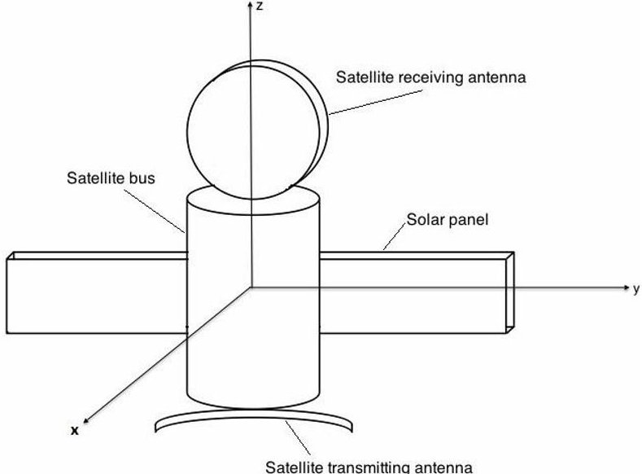

Fig. 4: Satellite configuration

$$
M _ {s t r u c t u r e s} = M _ {p r o p e l l a n t} + M _ {b a t t e r y} + M _ {t h e r m a l} + M _ {b u s}
$$

Moments of Inertia of the bus:

$$
I x _ {s t r u c t u r e s} = \frac {M _ {s t r u c t u r e s} \times \left(3 \times r _ {s} ^ {2} + \left(r _ {s} - t _ {s}\right) ^ {2} + L _ {s} ^ {2}\right)}{1 2}
$$

$$
I y _ {s t r u c t u r e s} = I x _ {s t r u c t u r e s}
$$

$$
I z _ {s t r u c t u r e s} = \frac {M _ {s t r u c t u r e s} \times \left(r _ {s} ^ {2} + \left(r _ {s} - t _ {s}\right) ^ {2}\right)}{2}
$$

Moments of Inertia of Solar array:

$$
b _ {S A} = \sqrt {\frac {A r r a y s i z e}{6}} [ 8 9 ]
$$

$$
l _ {S A} = 3 \times b _ {S A} (a s s u m p t i o n)
$$

$$
I x _ {S A} = \frac {1}{1 2} \times M _ {S A} \times \left(t _ {S A} ^ {2} + l _ {S A} ^ {2}\right)
$$

<!-- PDF_PAGE: 137 -->

$$
I y _ {S A} = \frac {1}{1 2} \times M _ {S A} \times \left(b _ {S A} ^ {2} + t _ {S A} ^ {2}\right)
$$

$$
I z _ {S A} = \frac {1}{1 2} \times M _ {S A} \times \left(b _ {S A} ^ {2} + l _ {S A} ^ {2}\right) + \left(r _ {s} + l _ {S A}\right) ^ {2} \times M _ {S A}
$$

Moments of Inertia of payload:

Transmitting antenna:

$$
\begin{array}{l} I x _ {s a t, t r a n s} = \frac {1}{1 2} \times M _ {s a t, t r a n s} \times \left(3 \times D _ {s a t, t r a n s} ^ {2} + t _ {s a t, t r a n s} ^ {2}\right) \\ + M _ {s a t, t r a n s} \times \left(\frac {t _ {s a t , t r a n s}}{2} + \frac {L _ {s}}{2}\right) ^ {2} \\ \end{array}
$$

$$
I y _ {s a t, t r a n s} = I x _ {s a t, t r a n s}
$$

$$
I z _ {s a t, t r a n s} = \frac {M _ {s a t , t r a n s}}{2} \times \left(\frac {D _ {s a t , t r a n s}}{2}\right) ^ {2}
$$

Receiving antenna:

$$
I x _ {s a t, r e c} = M _ {s a t, r e c} \times \left(\frac {D _ {s a t , r e c}}{2}\right) ^ {2} + M _ {s a t, r e c} \times \left(\frac {t _ {s a t , r e c}}{2} + \frac {L _ {s}}{2}\right) ^ {2}
$$

$$
I y _ {s a t, r e c} = I x _ {s a t, r e c}
$$

$$
I z _ {s a t, r e c} = \frac {1}{1 2} \times M _ {s a t, r e c} \times \left(3 \times D _ {s a t, r e c} ^ {2} + t _ {s a t, r e c} ^ {2}\right)
$$

$$
I x = I x _ {s t r u c t u r e s} + I x _ {S A} + I x _ {s a t, t r a n s} + I x _ {s a t, r e c}
$$

$$
I y = I y _ {s t r u c t u r e s} + I y _ {S A} + I y _ {s a t, t r a n s} + I y _ {s a t, r e c}
$$

$$
I z = I z _ {s t r u c t u r e s} + I z _ {S A} + I z _ {s a t, t r a n s} + I z _ {s a t, r e c}
$$

$ T_{SP}\approx 0. 3\times F $ approximation [34]

Where:

$$
F = \frac {\mathrm {F} _ {\mathrm {s}}}{\mathrm {c}} \times A _ {\mathrm {s}} \times (1 + \mathrm {q}) \times \cos (\mathrm {i})
$$

$$
A _ {s} = \left(2 \times L _ {s} \times r _ {s}\right) + \left(2 \times l _ {S A} \times b _ {S A}\right) + \left(t _ {\mathrm {s a t , t r a n s}} \times D _ {\mathrm {s a t , t r a n s}}\right) + \left(t _ {\mathrm {s a t , r e c}} \times D _ {\mathrm {s a t , r e c}}\right)
$$

<!-- PDF_PAGE: 138 -->

$$
T _ {D} = T _ {S P} + T _ {g}
$$

$$
\begin{array}{l} \mathrm {T} _ {\mathrm {R W}} = T _ {D} \times M a r g i n f a c t o r \\ \mathrm {W h e r e :} \\ \mathrm {M a r g i n F a c t o r} = (1. 3) [ 8 9 ] \\ \end{array}
$$

$$
\mathrm {h} _ {\mathrm {d}} = \left(\frac {\mathrm {T} _ {\mathrm {R W}} \times 2 4 \times 6 0 \times 6 0}{4}\right) \times 0. 7 0 7
$$

$$
h _ {p} = \frac {\mathrm {T} _ {\mathrm {R W}} \times 2 4 \times 6 0 \times 6 0 \times 1 8 0}{4 \times \theta_ {\mathrm {d}} \times \pi}
$$

Total angular momentum needed by RW:

$$
\mathrm {h} = \mathrm {h} _ {\mathrm {d}} + \mathrm {h} _ {\mathrm {p}}
$$

$$
\mathrm {M} _ {\mathrm {R W}} = \frac {(\mathrm {h} + 4 4)}{2 2 . 2} (\mathrm {o b t a i n e d f r o m l i n e a r i n t e r p o l a t i o n} [ 8 9 ])
$$

Total mass of ADCS:

$$
\mathrm {M} _ {\mathrm {A D C S}} = \mathrm {M} _ {\mathrm {R W}} + \mathrm {M} _ {\mathrm {s e n s o r s}}
$$

$$
\mathrm {P} _ {\mathrm {R W}} = \frac {(\mathrm {h} + 3 9 . 5 6)}{3 . 9 9 6} \quad (\mathrm {l i n e a r i n t e r p o l a t i o n} [ 8 9 ])
$$

Total power required by ADCS:

$$
\mathrm {P} _ {\mathrm {A D C S}} = \mathrm {P} _ {\mathrm {R W}} + \mathrm {P} _ {\mathrm {s e n s o r s}}
$$

$$
V _ {R W} = \frac {\mathrm {M} _ {R W}}{\rho_ {R W}}
$$

## Thermal Control

The satellite will be exposed to high and low temperature extremes during its operational lifetime. The operating temperature of most of the subsystems and the payload are not in this range. A thermal shield must be provided for all the components of the satellite to function properly. Thermal control of the satellite can be accomplished by using insulators, radiators and heaters. The analysis equations of the thermal subsystem are given as follows. The operating

<!-- PDF_PAGE: 139 -->

temperature ranges of all the components were assumed. The emissivity was assumed the same value for all the components.

It was assumed that only the components which are directly exposed to sunlight required insulators or thermal finishes (Solar array, Transmitting antenna, Receiving antenna and Spacecraft bus) , whereas the other important internal components required heaters and radiators to operate in the extreme temperature range. The internal components considered were Battery, Reaction wheel and Propellant tank.

Insulators:

Solar array:

$$
A _ {p, S A} = \frac {\sigma \times \mathrm {T} _ {S A , m a x} ^ {4} \times \mathrm {A r r a y s i z e}}{\mathrm {F} _ {S} \times \frac {\alpha}{\varepsilon}}
$$

Transmitting antenna:

$$
A _ {p, s a t t r a n s} = \frac {\sigma \times \mathrm {T} _ {s a t t r a n s , m a x} ^ {4} \times \mathrm {A} _ {s a t t r a n s}}{\mathrm {F} _ {S} \times \frac {\alpha}{\varepsilon}}
$$

Where:

$$
\begin{array}{l} A _ {s a t t r a n s} = \left(2 \times \pi \times \left(\frac {D _ {s a t , t r a n s}}{2}\right) ^ {2}\right) \\ + \left(2 \times \pi \times \left(\frac {D _ {s a t , t r a n s}}{2}\right) \times t _ {s a t, t r a n s}\right) \\ \end{array}
$$

Receiving antenna:

$$
A _ {p, s a t r e c} = \frac {\sigma \times \mathrm {T} _ {s a t r e c , m a x} ^ {4} \times A _ {s a t r e c}}{\mathrm {F} _ {S} \times \frac {\alpha}{\varepsilon}}
$$

Where:

$$
A _ {s a t r e c} = \left(2 \times \pi \times \left(\frac {D _ {s a t , r e c}}{2}\right) ^ {2}\right) + \left(2 \times \pi \times \left(\frac {D _ {s a t , r e c}}{2}\right) \times t _ {s a t, r e c}\right)
$$

Spacecraft bus:

$$
A _ {p, b u s} = \frac {\sigma \times \mathrm {T} _ {b u s , m a x} ^ {4} \times \mathrm {A} _ {b u s}}{\mathrm {F} _ {S} \times \frac {\alpha}{\varepsilon}}
$$

Where:

$$
A _ {b u s} = \left(2 \times \pi \times r _ {s} ^ {2}\right) + \left(2 \times \pi \times r _ {s} \times L _ {S}\right)
$$

<!-- PDF_PAGE: 140 -->

$$
M _ {i n s} = 0. 7 3 \times \left(A _ {p, S A} + A _ {p, s a t t r a n s} + A _ {p, s a t r e c} + A _ {p, b u s}\right)
$$

Radiator:

Battery:

$$
A _ {r a d i a t o r, b a t t e r y} = \frac {\mathrm {Q} _ {\mathrm {i n t}}}{\varepsilon_ {\mathrm {r a d}} \times \sigma \times \mathrm {T} _ {b a t t , m a x} ^ {4}}
$$

Reaction Wheel (RW):

$$
A _ {r a d i a t o r, R W} = \frac {\mathrm {Q} _ {\mathrm {i n t}}}{\varepsilon_ {\mathrm {r a d}} \times \sigma \times \mathrm {T} _ {R W , m a x} ^ {4}}
$$

Propellant tank:

$$
A _ {r a d i a t o r, p r o p t a n k} = \frac {\mathrm {Q} _ {\mathrm {i n t}}}{\varepsilon_ {\mathrm {r a d}} \times \sigma \times \mathrm {T} _ {p r o p t a n k , m a x} ^ {4}}
$$

$$
M _ {r a d i a t o r} = 3. 3 \times \left(A _ {r a d i a t o r, b a t t e r y} + A _ {r a d i a t o r, R W} + A _ {r a d i a t o r, p r o p t a n k}\right)
$$

Heater:

Battery:

$$
P _ {\text {h e a t e r}, \text {b a t t e r y}} = \varepsilon_ {\text {r a d}} \times \sigma \times A _ {\text {r a d i a t o r}, \text {b a t t e r y}} \times T _ {\text {b a t t}, \min } ^ {4}
$$

Reaction Wheel (RW):

$$
P _ {h e a t e r, R W} = \varepsilon_ {r a d} \times \sigma \times A _ {r a d i a t o r, R W} \times T _ {R W, m i n} ^ {4}
$$

Propellant tank:

$$
P _ {h e a t e r, p r o p t a n k} = \varepsilon_ {r a d} \times \sigma \times A _ {r a d i a t o r, p r o p t a n k} \times T _ {p r o p t a n k, m i n} ^ {4}
$$

$$
M _ {h e a t e r} \approx 0
$$

Structures

The satellite bus establishes the basic geometry of the satellite, which provides a physical presence for all the subsystems to be located. The structure and configuration of the bus plays a major role in the overall design of the satellite. The bus acts as a chassis for circuitry, computers, gyroscopes, etc. A cylindrical bus is considered in the lower fidelity model. The analysis equations for the structures subsystem are given as follows.

<!-- PDF_PAGE: 141 -->

Estimation of length and radius of the bus:

$$
\begin{array}{l} V _ {\mathrm {b u s}} = \mathrm {M a r g i n f a c t o r} \times V _ {s u b} \\ \mathrm {W h e r e :} \\ \mathrm {M a r g i n f a c t o r} = 1. 2 \\ \end{array}
$$

$$
V _ {s u b} = V _ {p r o p} + V _ {t r a n s} + V _ {B a t t e r y} + V _ {R W}
$$

$$
\mathrm {r} _ {\mathrm {s}} = \frac {\mathrm {L} _ {\mathrm {s}}}{3} (\mathrm {a s s u m p t i o n})
$$

$$
\mathrm {L} _ {s} = \frac {V _ {b u s}}{\pi \times \left(r _ {s}\right) ^ {2}}
$$

$$
\mathrm {L} _ {\mathrm {s}} = \left[ \left(9 \times \frac {\mathrm {V} _ {\mathrm {b u s}}}{\pi}\right) ^ {1 / 3} \right]
$$

Structure sizing for rigidity to meet the natural frequency requirements:

$$
\mathrm {t} _ {1} = \frac {\left(f _ {n a t , a} / 0 . 2 5\right) ^ {2} \times M _ {S / C} \times L _ {S}}{2 \pi r _ {S} E}
$$

$$
\mathrm {t} _ {2} = \frac {\left(f _ {n a t , l} / 0 . 5 6\right) ^ {2} \times M _ {S / C} \times L _ {S} ^ {3}}{\pi r _ {S} ^ {3} \times E}
$$

Structure sizing for tensile strength:

$$
P _ {a x i a l} = 9. 8 1 \times M _ {S / C} \times L _ {a x i a l}
$$

$$
B M = 9. 8 1 \times M _ {S / C} \times \frac {L _ {S}}{2} \times L _ {B M}
$$

$$
\mathrm {P} _ {\mathrm {e q}} = \mathrm {P} _ {\mathrm {a x i a l}} + \frac {2 \times \mathrm {B M}}{\mathrm {r} _ {\mathrm {s}}}
$$

$$
\mathrm {F} _ {\mathrm {u l t i m a t e}} = \mathrm {P} _ {\mathrm {e q}} \times \mathrm {F O S} _ {\mathrm {u l t i m a t e}}
$$

Thickness required:

$$
t _ {\mathrm {r e q}, 1} = \frac {\mathrm {F} _ {\mathrm {u l t i m a t e}}}{\mathrm {F} _ {\mathrm {t u}} \times \left(2 \pi \times \mathrm {r} _ {\mathrm {s}}\right)}
$$

<!-- PDF_PAGE: 142 -->

$$
t _ {\mathrm {r e q}, 2} = \frac {\mathrm {P} _ {\mathrm {e q}} \times \mathrm {F O S} _ {\mathrm {y i e l d}}}{\mathrm {F} _ {\mathrm {t y}} \times \left(2 \pi \times \mathrm {r} _ {\mathrm {s}}\right)}
$$

Thickness:

$$
t _ {s} = \max \left(t _ {1}, t _ {2}, t _ {r e q, 1}, t _ {r e q, 2}\right)
$$

Sizing for Stability (Compressive Strength):

$$
\begin{array}{l} \sigma_ {\mathrm {c r}} = 0. 6 \times \gamma \times \frac {\mathrm {E} \times t _ {s}}{\mathrm {r} _ {s}} \\ \mathrm {W h e r e :} \\ \gamma = 1 - 0. 9 0 1 \times \left(1 - \mathrm {e} ^ {- \varphi}\right) \\ \varphi = \frac {1}{1 6} \sqrt {\frac {\mathrm {r} _ {s}}{\mathrm {t} _ {s}}} \\ \end{array}
$$

$$
\begin{array}{l} \mathrm {P} _ {\mathrm {c r}} = A _ {c r} \times \sigma_ {\mathrm {c r}} \\ \mathrm {W h e r e :} \\ A _ {c r} = 2 \times \pi \times r _ {s} \times t _ {s} \\ \end{array}
$$

The bus must be capable of withstanding the applied load, i.e., $ P_{\mathrm{e q}} $ . If $ P_{\mathrm{c r}}<F_{\mathrm{u l t i m a t e}} $ then the structure is not adequate. Thickness should be changed in order to make the structure adequate. Structure adequacy means that the Margin of Safety (MS) of the structure should be positive. MS can be obtained by the following equation.

$$
\mathrm {M S} = \frac {\mathrm {P} _ {\mathrm {c r}}}{F _ {\mathrm {u l t i m a t e}}} - 1
$$

The thickness of the structure should be changed until the MS value reaches positive value or the desired limit.

Mass of the bus:

$$
\mathrm {M} _ {\mathrm {b u s}} = \rho \times \pi \times \mathrm {L} _ {\mathrm {s}} \times \left(r _ {s} ^ {2} - \left(r _ {s} - t _ {s}\right) ^ {2}\right)
$$

<!-- PDF_PAGE: 143 -->

## Launch Vehicle

The launch vehicle subsystem consists of an apparatus that delivers the satellite to a desired orbit. The selection of the launch vehicle, not addressed in the lower fidelity model, is greatly influenced by the altitude of the orbit, type of orbit (i.e., GEO, Molniya or Sun- synchronous), and the mass and dimensions of the spacecraft. The higher fidelity model deals with launch selection.

$$
M _ {B, l v} = M _ {S / C}
$$

$$
R _ {l v} = e ^ {\left(\frac {\Delta V _ {\mathrm {L E O}}}{\left(\mathrm {I} _ {\mathrm {s p , l v}}\right) \times \mathrm {g} _ {\mathrm {e}}}\right)}
$$

Mass of propellant needed to get to GTO:

$$
M _ {p r o p e l l a n t, l v} = \left[ \left(R _ {l v} \times M _ {B, l v}\right) - M _ {B, l v} \right] \times \mathrm {M a r g i n f a c t o r} \quad \mathrm {W h e r e : M a r g i n f a c t o r = 1 . 2}
$$

Cost Model

$$
M _ {S / C} = \mathrm {M} _ {\mathrm {p r o p e l l a n t}} + \mathrm {M} _ {\mathrm {t h e r m a l}} + \mathrm {M} _ {\mathrm {S A}} + \mathrm {M} _ {\mathrm {B a t t e r y}} + \mathrm {M} _ {\mathrm {b u s}} + \mathrm {M} _ {\mathrm {A D C S}} + \mathrm {M} _ {\mathrm {p a y l o a d}}
$$

$$
C _ {p a y l o a d} = 3 5 3. 3 \times \mathrm {M} _ {\mathrm {p a y l o a d}}
$$

$$
C _ {l v} = \left(1 0 0 0 0 \times M _ {S / C}\right) + \left(1 0 0 \times M _ {p r o p e l l a n t, l v}\right)
$$

$$
\begin{array}{l} C _ {p o w e r} = \left(- 9 2 6 + 3 9 6 \left(\mathrm {M} _ {\mathrm {S A}} + \mathrm {M} _ {\mathrm {B a t t e r y}}\right) ^ {0. 7 2}\right) + \left(- 2 1 0 6 3 1 + 2 1 3 5 2 7 \times \mathrm {A r r a y S i z e} ^ {0. 0 0 6 6}\right) \\ + \left(3 7 5 + 4 9 4 \left(\frac {\mathrm {B a t t e r y C a p a c i t y}}{5 0}\right) ^ {0. 7 5 4}\right) + 1 0 0 \times \mathcal {E} \\ \end{array}
$$

$$
C _ {t h e r m a l} = \left(2 4 6 + 4. 2 \times \mathrm {M} _ {t h e r m a l} ^ {2}\right) + \left(- 1 8 3 + 1 8 1 \times \mathrm {P} _ {T h e r m a l} ^ {0. 2 2}\right)
$$

$$
C _ {A D C S} = 1 3 5 8 + \left(8. 5 8 \times \mathrm {M} _ {A D C S} ^ {2}\right) + 3 4 1 + \left(2 6 5 1 \times \theta^ {- 0. 5}\right)
$$

$$
C _ {s t r u c t u r e s} = 1 5 7 \times \left(\mathrm {M} _ {\mathrm {b u s}} ^ {0. 8 3}\right)
$$

$$
C _ {p r o p u l s i o n} = 6 5. 6 + \left(2. 9 1 \times \mathrm {M} _ {d r y} ^ {1. 2 6 1}\right)
$$

<!-- PDF_PAGE: 144 -->

$$
\mathrm {M} _ {d r y} = M _ {S / C} - \mathrm {M} _ {p r o p e l l a n t}
$$

$$
\begin{array}{l} C _ {i n t e g r a t i o n, t e s t, a s s e m b l y} \\ = 9 8 9 + 0. 2 1 5 \\ \times \left(C _ {p a y l o a d} + C _ {p o w e r} + C _ {p r o p u l s i o n} + C _ {A D C S} + C _ {t h e r m a l} + C _ {s t r u c t u r e s}\right) \\ + C _ {l a u n c h v e h i c l e}) \\ \end{array}
$$

$$
\begin{array}{l} C _ {g, a n t} = 1 0 \times \left(\rho_ {g r o u n d, t r a n s} \times t _ {g r o u n d, t r a n s} \times D _ {g r o u n d, t r a n s} ^ {2} + \rho_ {g r o u n d, r e c} \times t _ {g r o u n d, r e c} \right. \\ \times D _ {g r o u n d, r e c} ^ {2}) \\ \end{array}
$$

$$
C _ {g, t r a n s m i t t e r} = 1 0 \times \mathrm {P} _ {g t}
$$

$$
\begin{array}{l} C _ {g r o u n d s u p p o r t} = 9. 2 6 2 \times \left(C _ {p a y l o a d} + C _ {p o w e r} + C _ {p r o p u l s i o n} + C _ {A D C S} + C _ {t h e r m a l} + \right. \\ \left. C _ {s t r u c t u r e s} + C _ {l a u n c h v e h i c l e}\right) ^ {0. 6 4 2} \\ \end{array}
$$

$$
\begin{array}{l} T o t a l C o s t = 1. 3 0 8 \times \left(C _ {p a y l o a d} + C _ {p o w e r} + C _ {p r o p u l s i o n} + C _ {A D C S} + C _ {t h e r m a l} + C _ {s t r u c t u r e s} + \right. \\ C _ {l a u n c h v e h i c l e} + C _ {i n t e g r a t i o n, t e s t, a s s e m b l y} + C _ {g r o u n d s u p p o r t}) \\ \end{array}
$$

<!-- PDF_PAGE: 145 -->

## APPENDIX B

## HIGHER FIDELITY SATELLITE MODEL

Appendix B will discuss each of the satellite system subsystems, associated with the higher fidelity model, as well as define the equations used in each of the subsystem's analysis. The following table identifies the attributes and design variable associated with each of the subsystems in Fig 3.4.

<table border="1"><tr><td colspan="3">Tiers</td><td>Attributes</td><td>Design variables</td></tr><tr><td colspan="3">SYSTEM(Geo Communication Satellite)</td><td>Total cost, Revenue</td><td>Single satellite or satellite constellation?</td></tr><tr><td rowspan="9">Subsystem level 1</td><td colspan="2">(SS1) Payload</td><td>Cpayload,SNRd</td><td>N,Type of HPA,Satellite longitude</td></tr><tr><td colspan="2">(SS2) Ground Station</td><td>Cground,SNRup</td><td>Ground longituderec,Ground latituderecGround longitudetrans,Ground latitudetrans</td></tr><tr><td colspan="2">(SS3) Power</td><td>Cpower</td><td>Type of power source</td></tr><tr><td colspan="2">(SS4) Propulsion</td><td>CEngine/kg,Cpropulsion</td><td>Type of liquid propulsion system(mono/bi)</td></tr><tr><td colspan="2">(SS5) ADCS</td><td>CADCS</td><td>Type of controller</td></tr><tr><td colspan="2">(SS6) Thermal</td><td>Cthermal</td><td>Type of passive thermal control</td></tr><tr><td colspan="2">(SS7) Structures</td><td>Cstructures</td><td>Configuration of bus</td></tr><tr><td colspan="2">(SS8) Launch vehicle</td><td>CLV</td><td>Launch site,Type of launch vehicle</td></tr><tr><td rowspan="11">Subsystem level 2</td><td rowspan="2">Payload</td><td>(SS1) Satellite Transponders</td><td>Mtrans,Ppayload,Vtrans</td><td>Pst</td></tr><tr><td>(SS2) Satellite antennae</td><td>Csat,ant,Msat ant</td><td>Antenna type(Parabolic/Helical antenna)</td></tr><tr><td rowspan="2">Ground station</td><td>(SS1) Ground transponder</td><td>Cg,transmitter</td><td>Pgt</td></tr><tr><td>(SS2) Ground antennae</td><td>Cg,antennae</td><td>Antenna type(Parabolic/Helical antenna)</td></tr><tr><td rowspan="2">Power</td><td>(SS1) Solar Array</td><td>CSA,Array size,MSA</td><td>SA_material</td></tr><tr><td>(SS2) Battery</td><td>CBatt,Battery mass,Battery capacity,Vbatt</td><td>Battery type</td></tr><tr><td>Propulsion</td><td>(SS1) Propellant</td><td>Mpropellant,Vpropellant,CEngine,Cpropellant</td><td>Propellant</td></tr><tr><td rowspan="2">Thermal</td><td>(SS1) Surface Finish</td><td>Cthermalfinish</td><td>$\left(\frac{\alpha}{\varepsilon}\right)_{SA},\left(\frac{\alpha}{\varepsilon}\right)_{sat,trans},\left(\frac{\alpha}{\varepsilon}\right)_{sat,rec},\left(\frac{\alpha}{\varepsilon}\right)_{l}$</td></tr><tr><td>(SS2) Radiator and Heater</td><td>Pthermal,Cradiator,Cheater,Mradiator</td><td>$\varepsilon_{radbattery},\varepsilon_{radRW},\varepsilon_{radproptank}$</td></tr><tr><td>Structures</td><td>(SS1) Bus</td><td>Cbus/kg,</td><td>Bus material</td></tr></table>

<!-- PDF_PAGE: 146 -->

<table border="1"><tr><td rowspan="5">Subsystem level 3</td><td rowspan="4"></td><td rowspan="2">Satellite antennae</td><td>(SS1) Satellite transmitting antenna</td><td>Gst,Mst</td><td>fdown,Dst</td></tr><tr><td>(SS2) Satellite receiving antenna</td><td>Gsr,Msr</td><td>Dsr</td></tr><tr><td rowspan="2">Ground antennae</td><td>(SS1) Ground transmitting antenna</td><td>Mgt,Ggt</td><td>Dgt,fup</td></tr><tr><td>(SS2) Ground receiving antenna</td><td>Mgr,Ggr</td><td>Dgr</td></tr><tr><td>Propulsion</td><td>Propellant</td><td>(SS1) Propellant tank</td><td>Mproptank,Vproptank,Cproptank</td><td>Propellant tank material</td></tr></table>

Payload (SL1, SS1):

$$
G = S a t _ {l o n g} - G r o u n d _ {l o n g}
$$

$$
E l e v a t i o n = \frac {1 8 0}{\pi} \times \left(\operatorname {a t a n} \left(\frac {\left(c o s (G) \times c o s \left(G r o u n d _ {l a t}\right) - 0 . 1 5 1 2\right)}{\left(\sqrt {\left(1 - \left(\left(c o s (G)\right) ^ {2} \times \left(c o s \left(G r o u n d _ {l a t}\right)\right) ^ {2}\right)}\right)}\right)\right)
$$

$$
G _ {r} = S a t _ {l o n g} - G r o u n d _ {l o n g, r}
$$

$$
E l e v a t i o n _ {r} = \frac {1 8 0}{\pi} \times \left(\operatorname {a t a n} \left(\frac {\left(c o s \left(G _ {r}\right) \times c o s \left(G r o u n d _ {l a t , r}\right) - 0 . 1 5 1 2\right)}{\left(\sqrt {\left(1 - \left(\left(c o s \left(G _ {r}\right)\right) ^ {2} \times \left(c o s \left(G r o u n d _ {l a t , r}\right)\right) ^ {2}\right)\right)}\right)}\right)
$$

$$
E b _ {N o, d o w n} = \frac {\left((P s t) \times L _ {l t} \times G t _ {s a t} \times L _ {s} \times \left(s i n (E l e v a t i o n _ {r})\right) ^ {2} \times L _ {a} \times G r _ {g r o u n d} \times L _ {l r}\right)}{\left(k b \times T s _ {d o w n} \times R\right)}
$$

$$
S N R _ {d o w n} = 1 0 \times \log_ {1 0} \left(E b _ {N o, d o w n}\right)
$$

$$
M _ {p a y l o a d} = M _ {t r a n s p o n d e r s} + M _ {s a t, a n t}
$$

$$
C o s t _ {t r a n s p o n d e r s} = \left\{ \begin{array}{l l} 5 0 0 \times M _ {t r a n s p o n d e r s}, & \text {i f S S A} \\ 1 0 0 0 \times M _ {t r a n s p o n d e r s}, & \text {i f T W T A} \end{array} \right.
$$

<!-- PDF_PAGE: 147 -->

$$
C o s t _ {p a y l o a d} = C o s t _ {s a t, a n t} + C o s t _ {t r a n s p o n d e r s}
$$

Payload (SL2, SS1) - Satellite Transponders

If SSA

$$
M _ {t r a n s} = \left\{ \begin{array}{c l} N \times P _ {s t}, & P _ {s t} \leq 1 0 \\ 0. 5 \times N \times P _ {s t}, & P _ {s t} > 1 0 a n d P _ {s t} \leq 3 5 \\ N \times \left(0. 0 4 \times P _ {s t} + 0. 6\right), & P _ {s t} > 3 5 a n d P _ {s t} \leq 6 0 \\ N \times \left(0. 1 2 5 \times P _ {s t} + 4. 5\right), & P _ {s t} > 6 0 \end{array} \right.
$$

$$
P _ {p a y l o a d} = N \times \left(2. 9 3 \times P _ {s t} + 1 2\right)
$$

If TWTA

$$
M _ {t r a n s} = N \times \left(0. 1 1 1 1 \times P _ {s t} + 0. 8 8 8 8 8\right)
$$

$$
P _ {p a y l o a d} = N \times \left(0. 8 5 \times P _ {s t} + 1 2. 5\right)
$$

$$
V _ {t r a n s} = \frac {M _ {t r a n s}}{2 7 0 0}
$$

Payload (SL2, SS2) - Satellite Antenna

$$
M _ {s a t, a n t} = M _ {p a y l o a d, r} + M _ {p a y l o a d, t}
$$

$$
C o s t _ {s a t, a n t} = \left\{ \begin{array}{l l} 4 0 0 \times M _ {s a t, a n t}, & \text {i f p a r a b o l i c a n t e n n a} \\ 2 0 0 0 \times M _ {s a t, a n t}, & \text {i f h e l i c a l a n t e n n a} \end{array} \right.
$$

Payload (SL3, SS1) - Satellite transmitting antenna

$$
L _ {s, d o w n} = \left(\frac {c}{4 \times \pi \times h \times f _ {d o w n}}\right) ^ {2}
$$

$$
G _ {s a t, t r a n s} = \left\{ \begin{array}{l l} \eta_ {s a t, t r a n s} \left(\frac {\pi \times D _ {s a t , t r a n s}}{\lambda_ {d o w n}}\right) ^ {2}, & \text {i f p a r a b o l i c a n t e n n a} \\ 6. 2 \times \pi^ {2} \times D _ {s a t, t r a n s} ^ {2} \times 1 0 \times 0. 0 5 \times \left(\frac {f _ {d o w n}}{c}\right) ^ {3}, & \text {i f h e l i c a l a n t e n n a} \end{array} \right.
$$

$$
M _ {p a y l o a d, t r a n s} = \left\{ \begin{array}{l l} 2 8 0 0 \times \pi \times t _ {s a t, t r a n s} \times \left(\frac {D _ {s a t , t r a n s}}{2}\right) ^ {2}, & \text {i f p a r a b o l i c a n t e n n a} \\ 2 8 0 0 \times N \times (\pi \times D _ {s a t, t r a n s} + S) \times t _ {s a t, t r a n s}, & \text {i f h e l i c a l a n t e n n a} \end{array} \right.
$$

<!-- PDF_PAGE: 148 -->

$$
A = \left\{ \begin{array}{c l} 1 0 \times (6. 8 9 6 6 \times 1 0 ^ {- 1 2} \times f + 0. 9 3 1 3), & \text {i f} f > 1 0 \times 1 0 ^ {9} \\ 1, & \text {i f} f \leq 1 0 \times 1 0 ^ {9} \end{array} \right.
$$

Payload (SL3, SS2) - Satellite receiving antenna

$$
G _ {s a t, r e c} = \left\{ \begin{array}{l l} \eta_ {s a t, r e c} \left(\frac {\pi \times D _ {s a t , r e c}}{\lambda_ {u p}}\right) ^ {2}, & \text {i f p a r a b o l i c a n t e n n a} \\ 6. 2 \times \pi^ {2} \times D _ {s a t, r e c} ^ {2} \times 1 0 \times 0. 0 5 \times \left(\frac {f _ {u p}}{c}\right) ^ {3}, & \text {i f h e l i c a l a n t e n n a} \end{array} \right.
$$

$$
M _ {p a y l o a d, r e c} = \left\{ \begin{array}{l l} 2 8 0 0 \times \pi \times t _ {s a t, r e c} \times \left(\frac {D _ {s a t , r e c}}{2}\right) ^ {2}, & \text {i f p a r a b o l i c a n t e n n a} \\ 2 8 0 0 \times N \times (\pi \times D _ {s a t, r e c} + S) \times t _ {s a t, r e c}, & \text {i f h e l i c a l a n t e n n a} \end{array} \right.
$$

Ground (SL1, SS1):

$$
S N R _ {u p} = \frac {P g t \times L _ {l t} \times G t _ {g r o u n d} \times L _ {s , u p} \times L _ {a} \times G r _ {s a t} \times L _ {l r}}{k b \times T s _ {u p} \times R _ {u p}}
$$

Cost groundstation,trans

$$
= \left\{ \begin{array}{l l} 1 0 \times \left(C o s t _ {g r o u n d, t r a n s} + C o s t _ {g r o u n d, t r a n s, a n t}\right), & \text {i f} 6 6 \leq G r o u n d _ {l o n g} \leq 8 0 \text {a n d} 2 5 \leq G r o u n d _ {l a t} \leq 3 5 \\ 8 \times \left(C o s t _ {g r o u n d, t r a n s} + C o s t _ {g r o u n d, t r a n s, a n t}\right), & \text {i f} 6 6 \leq G r o u n d _ {l o n g} \leq 8 0 \text {a n d} 3 5 < G r o u n d _ {l a t} \leq 5 0 \\ 2 \times \left(C o s t _ {g r o u n d, t r a n s} + C o s t _ {g r o u n d, t r a n s, a n t}\right), & \text {i f} 8 0 < G r o u n d _ {l o n g} \leq 9 0 \text {a n d} 2 5 \leq G r o u n d _ {l a t} \leq 3 5 \\ 1. 5 \times \left(C o s t _ {g r o u n d, t r a n s} + C o s t _ {g r o u n d, t r a n s, a n t}\right), & \text {i f} 8 0 < G r o u n d _ {l o n g} \leq 9 0 \text {a n d} 3 5 < G r o u n d _ {l a t} \leq 5 0 \\ 2. 5 \times \left(C o s t _ {g r o u n d, t r a n s} + C o s t _ {g r o u n d, t r a n s, a n t}\right), & \text {i f} 9 0 < G r o u n d _ {l o n g} \leq 1 1 0 \text {a n d} 2 5 \leq G r o u n d _ {l a t} \leq 3 5 \\ \left(C o s t _ {g r o u n d, t r a n s} + C o s t _ {g r o u n d, t r a n s, a n t}\right), & \text {i f} 9 0 < G r o u n d _ {l o n g} \leq 1 1 0 \text {a n d} 3 5 < G r o u n d _ {l a t} \leq 5 0 \\ 1 1 \times \left(C o s t _ {g r o u n d, t r a n s} + C o s t _ {g r o u n d, t r a n s, a n t}\right), & \text {i f} 1 1 0 < G r o u n d _ {l o n g} \leq 1 2 5 \text {a n d} 2 5 \leq G r o u n d _ {l a t} \leq 3 5 \\ 2 \times \left(C o s t _ {g r o u n d, t r a n s} + C o s t _ {g r o u n d, t r a n s, a n t}\right), & \text {i f} 1 1 0 < G r o u n d _ {l o n g} \leq 1 2 5 \text {a n d} 3 5 < G r o u n d _ {l a t} \leq 5 0 \end{array}
$$

Costgroundstation,rec

$$
= \left\{ \begin{array}{l l} 1 0 \times \left(C o s t _ {g r o u n d, r e c, a n t}\right), & \text {i f} 6 6 \leq G r o u n d _ {l o n g, r e c} \leq 8 0 \text {a n d} 2 5 \leq G r o u n d _ {l a t, r e c} \leq 3 5 \\ 8 \times \left(C o s t _ {g r o u n d, r e c, a n t}\right), & \text {i f} 6 6 \leq G r o u n d _ {l o n g, r e c} \leq 8 0 \text {a n d} 3 5 < G r o u n d _ {l a t, r e c} \leq 5 0 \\ 2 \times \left(C o s t _ {g r o u n d, r e c, a n t}\right), & \text {i f} 8 0 < G r o u n d _ {l o n g, r e c} \leq 9 0 \text {a n d} 2 5 \leq G r o u n d _ {l a t, r e c} \leq 3 5 \\ 1. 5 \times \left(C o s t _ {g r o u n d, r e c, a n t}\right), & \text {i f} 8 0 < G r o u n d _ {l o n g, r e c} \leq 9 0 \text {a n d} 3 5 < G r o u n d _ {l a t, r e c} \leq 5 0 \\ 2. 5 \times \left(C o s t _ {g r o u n d, r e c, a n t}\right), & \text {i f} 9 0 < G r o u n d _ {l o n g, r e c} \leq 1 1 0 \text {a n d} 2 5 \leq G r o u n d _ {l a t, r e c} \leq 3 5 \\ \left(C o s t _ {g r o u n d, r e c, a n t}\right), & \text {i f} 9 0 < G r o u n d _ {l o n g, r e c} \leq 1 1 0 \text {a n d} 3 5 < G r o u n d _ {l a t, r e c} \leq 5 0 \\ 1 1 \times \left(C o s t _ {g r o u n d, r e c, a n t}\right), & \text {i f} 1 1 0 < G r o u n d _ {l o n g, r e c} \leq 1 2 5 \text {a n d} 2 5 \leq G r o u n d _ {l a t, r e c} \leq 3 5 \\ 2 \times \left(C o s t _ {g r o u n d, r e c, a n t}\right), & \text {i f} 1 1 0 < G r o u n d _ {l o n g, r e c} \leq 1 2 5 \text {a n d} 3 5 < G r o u n d _ {l a t, r e c} \leq 5 0 \end{array}
$$

$$
\begin{array}{l} C o s t _ {g r o u n d, a n t} = C o s t _ {g r o u n d, t r a n s, a n t} + C o s t _ {g r o u n d, r e c, a n t} \\ C o s t _ {g r o u n d s t a t i o n} = C o s t _ {g r o u n d s t a t i o n, t r a n s} + C o s t _ {g r o u n d s t a t i o n, r e c} \\ \end{array}
$$

<!-- PDF_PAGE: 149 -->

Ground (SL2, SS1) - Ground transponders

$$
C o s t _ {g r o u n d, t r a n s} = 1 0 \times P g t
$$

Ground (SL2, SS2)-Ground antenna

$$
C o s t _ {g r o u n d, t r a n s, a n t} = \left\{ \begin{array}{l l} 1 0 \times M _ {g r o u n d, t r a n s}, & \text {i f p a r a b o l i c a n t e n n a} \\ 5 0 \times M _ {g r o u n d, t r a n s}, & \text {i f h e l i c a l a n t e n n a} \end{array} \right.
$$

$$
C o s t _ {g r o u n d, r e c, a n t} = \left\{ \begin{array}{c c} 1 0 \times M _ {g r o u n d, r e c}, & i f p a r a b o l i c a n t e n n a \\ 5 0 \times M _ {g r o u n d, r e c}, & i f h e l i c a l a n t e n n a \end{array} \right.
$$

Ground (SL3, SS1) - Ground transmitting antenna

$$
L _ {s, u p} = \left(\frac {c}{4 \times \pi \times h \times f _ {u p}}\right) ^ {2}
$$

$$
G _ {g r o u n d, t r a n s} = \left\{ \begin{array}{c} \eta_ {g r o u n d, t r a n s} \left(\frac {\pi \times D _ {g r o u n d , t r a n s}}{\lambda_ {u p}}\right) ^ {2}, \\ 6. 2 \times \pi^ {2} \times D _ {g r o u n d, t r a n s} ^ {2} \times 1 0 \times 0. 1 \times \left(\frac {f _ {u p}}{c}\right) ^ {3}, \end{array} \right.
$$

if parabolic antenna

if helical antenna

$$
\begin{array}{l} M _ {g r o u n d, t r a n s} \\ = \left\{ \begin{array}{l l} 2 8 0 0 \times \pi \times t _ {g r o u n d} \times \left(\frac {D _ {g r o u n d , t r a n s}}{2}\right) ^ {2}, & \text {i f p a r a b o l i c a n t e n n a} \\ 2 8 0 0 \times 1 0 \times (\pi \times D _ {g r o u n d, t r a n s} + 0. 1) \times t _ {g r o u n d}, & \text {i f h e l i c a l a n t e n n a} \end{array} \right. \\ \end{array}
$$

$$
A _ {u p} = \left\{ \begin{array}{c l} 1 0 \times \left(6. 8 9 6 6 \times 1 0 ^ {- 1 2} \times f _ {u p} + 0. 9 3 1 0 3\right), & \text {i f} f > 1 0 \times 1 0 ^ {9} \\ 1, & \text {i f} f \leq 1 0 \times 1 0 ^ {9} \end{array} \right.
$$

Ground (SL3, SS2) - Ground receiving antenna

$$
G _ {g r o u n d, r e c} = \left\{ \begin{array}{l l} \eta_ {g r o u n d, r e c} \left(\frac {\pi \times D _ {g r o u n d , r e c}}{\lambda}\right) ^ {2}, & \text {i f p a r a b o l i c a n t e n n a} \\ 6. 2 \times \pi^ {2} \times D _ {g r o u n d, r e c} ^ {2} \times 1 0 \times 0. 1 \times \left(\frac {f}{c}\right) ^ {3}, & \text {i f h e l i c a l a n t e n n a} \end{array} \right.
$$

<!-- PDF_PAGE: 150 -->

$$
M _ {g r o u n d, r e c} = \left\{ \begin{array}{l l} 2 8 0 0 \times \pi \times t _ {g r o u n d} \times \left(\frac {D _ {g r o u n d , r e c}}{2}\right) ^ {2}, & \text {i f p a r a b o l i c a n t e n n a} \\ 2 8 0 0 \times 1 0 \times (\pi \times D _ {g r o u n d, r e c} + 0. 1) \times t _ {g r o u n d}, & \text {i f h e l i c a l a n t e n n a} \end{array} \right.
$$

Propulsion (SL1, SS1)

$$
M _ {B} = M _ {p a y l o a d} + M _ {S A} + B a t t e r y _ {m a s s} + M _ {A D C S} + M _ {t h e r m a l} + M _ {b u s}
$$

$$
C o s t _ {e n g i n e p e r k g} = \left\{ \begin{array}{l l} 1 0 0 0, & \text {i f M o n o - p r o p e l l a n t s y s t e m} \\ 2 0 0 0, & \text {i f B i - p r o p e l l a n t s y s t e m} \end{array} \right.
$$

$$
C o s t _ {p r o p u l s i o n} = C o s t _ {e n g i n e} + C o s t _ {p r o p e l l a n t} + C o s t _ {p r o p e l l a n t t a n k}
$$

Propulsion (SL2, SS1) - Propellant

$$
M _ {p r o p u l s i o n} = M _ {p r o p e l l a n t} + M _ {p r o p e l l a n t t a n k} + E n g i e n _ {m a s s}
$$

$$
V _ {p r o p e l l a n t} = \frac {M _ {p r o p e l l a n t} \times M a r g i n _ {p r o p e l l a n t}}{\rho_ {p r o p e l l a n t}}
$$

$$
C o s t _ {e n g i n e} = C o s t _ {e n g i n e p e r k g} \times E n g i n e _ {m a s s}
$$

$$
M _ {p r o p e l l a n t} = \left(R \times M _ {B} - M _ {B}\right)
$$

$$
R _ {M} = \exp \left(\frac {\Delta V _ {t o t a l}}{(I s p \times g e)}\right)
$$

If Mono-propellant

$$
C o s t _ {p r o p e l l a n t} = \left\{ \begin{array}{c l} \frac {2 . 4 8 \times 7 \times M _ {p r o p e l l a n t}}{0 . 4 5 3}, & \text {i f h y d r a z i n e} \\ \frac {4 . 5 0 \times M _ {p r o p e l l a n t}}{0 . 4 5 3}, & \text {i f h y d r o g e n p e r o x i d e} \end{array} \right.
$$

$$
\rho_ {p r o p e l l a n t} = \left\{ \begin{array}{l l} 1 0 2 1, & \text {i f h y d r a z i n e} \\ 1 4 4 0, & \text {i f h y d r o g e n p e r o x i d e} \end{array} \right.
$$

$$
I _ {S P} = \left\{ \begin{array}{l l} 2 2 0, & \text {i f h y d r a z i n e} \\ 1 6 0, & \text {i f h y d r o g e n p e r o x i d e} \end{array} \right.
$$

$$
E n g i n e _ {m a s s} = \left\{ \begin{array}{l l} 1 0, & \mathrm {i f h y d r a z i n e} \\ 2 0, & \mathrm {i f h y d r o g e n p e r o x i d e} \end{array} \right.
$$

<!-- PDF_PAGE: 151 -->

If liquid propellant

$$
C o s t _ {p r o p e l l a n t} = \left\{ \begin{array}{l l} \frac {2 . 4 8 \times 4 . 5 \times M _ {p r o p e l l a n t}}{0 . 4 5 3}, & \text {i f L 0 a n d L H} \\ \frac {2 . 4 8 \times 6 . 6 \times M _ {p r o p e l l a n t}}{0 . 4 5 3}, & \text {i f N} _ {2} O _ {4} \text {a n d M M H} \\ \frac {2 . 4 8 \times 2 0 \times M _ {p r o p e l l a n t}}{0 . 4 5 3}, & \text {i f F} _ {2} \text {a n d N} _ {2} H _ {4} \\ \frac {2 . 4 8 \times 1 0 0 \times M _ {p r o p e l l a n t}}{0 . 4 5 3}, & \text {i f O F} _ {2} \text {a n d B} _ {2} H _ {6} \end{array} \right.
$$

$$
\rho_ {p r o p e l l a n t} = \left\{ \begin{array}{l l} 3 5 8, & \text {i f L 0 a n d L H} \\ 1 1 9 0, & \text {i f N} _ {2} O _ {4} \text {a n d M M H} \\ 1 3 1 0, & \text {i f F} _ {2} \text {a n d N} _ {2} H _ {4} \\ 1 0 1 0, & \text {i f O F} _ {2} \text {a n d B} _ {2} H _ {6} \end{array} \right.
$$

$$
I _ {S P} = \left\{ \begin{array}{l l} 4 5 5. 3, & \text {i f L 0 a n d L H} \\ 3 4 1. 5, & \text {i f N} _ {2} O _ {4} \text {a n d M M H} \\ 4 3 0. 1, & \text {i f F} _ {2} \text {a n d N} _ {2} H _ {4} \\ 4 5 5. 6, & \text {i f O F} _ {2} \text {a n d B} _ {2} H _ {6} \end{array} \right.
$$

$$
E n g i n e _ {m a s s} = \left\{ \begin{array}{l l} 1 6 8, & \text {i f L 0 a n d L H} \\ 2 5, & \text {i f N} _ {2} O _ {4} \text {a n d M M H} \\ 5 0, & \text {i f F} _ {2} \text {a n d N} _ {2} H _ {4} \\ 1 5 0, & \text {i f O F} _ {2} \text {a n d B} _ {2} H _ {6} \end{array} \right.
$$

$$
d p = \sqrt [ 3 ]{\left(\frac {6 \times V _ {p r o p e l l a n t}}{\pi}\right)}
$$

$$
V _ {p r o p e l l a n t} = \frac {\left(M _ {p r o p e l l a n t} * M a r g i n _ {p r o p e l l a n t}\right)}{\rho_ {p r o p e l l a n t}}
$$

$$
I _ {p r o p e l l a n t} = \frac {2}{5} \times M _ {p r o p e l l a n t} \times \left(\frac {d p}{2}\right) ^ {2}
$$

Propulsion (SL3, SS1) - Propellant tank

$$
I _ {p r o p, t a n k} = \frac {8}{1 5} \times \pi \times r o _ {p r o p e l l a n t t a n k} \times \left(\left(\frac {d p + 0 . 0 1}{2}\right) ^ {5} - \left(\frac {d p}{2}\right) ^ {5}\right)
$$

$$
\rho_ {p r o p e l l a n t, t a n k} = \left\{ \begin{array}{l l} 2 7 0 0, & \text {i f A l u m i n u m} \\ 7 8 6 0, & \text {i f S t e e l} \\ 2 0 0 0, & \text {i f C o m p o s i t e} \end{array} \right.
$$

<!-- PDF_PAGE: 152 -->

$$
d p = \sqrt [ 3 ]{\left(\frac {6 \times V _ {p r o p e l l a n t t a n k}}{\pi}\right)}
$$

$$
V _ {p r o p e l l a n t t a n k} = \frac {\pi}{6} \times \left(\left(d p + 0. 0 1\right) ^ {3} - d p ^ {3}\right)
$$

$$
M _ {p r o p e l l a n t t a n k} = V _ {p r o p e l l a n t t a n k} * r o _ {p r o p e l l a n t t a n k}
$$

$$
C o s t _ {p r o p e l l a n t t a n k} = \left\{ \begin{array}{l l} 1 0 0 \times M _ {p r o p e l l a n t t a n k}, & \text {i f a l u m i n u m} \\ 1 0 \times M _ {p r o p e l l a n t t a n k}, & \text {i f s t e e l} \\ 5 0 0 \times M _ {p r o p e l l a n t t a n k}, & \text {i f c o m p o s i t e} \end{array} \right.
$$

Power (SL1, SS1)

$$
P _ {0} = P _ {p a y l o a d} + P _ {A D C S} + P _ {t h e r m a l}
$$

$$
C o s t _ {P o w e r} = \left\{ \begin{array}{c l} C o s t _ {S A} + C o s t _ {B a t t}, & \text {i f s o l a r a r r a y a n d b a t t e r y} \\ 5 0 \times 1 0 ^ {6}, & \text {i f n u c l e a r} \end{array} \right.
$$

Power (SL2, SS1)

$$
B a t t e r y c a p a c i t y = \frac {P _ {0} \times T E}{D O D \times H _ {b a t t}}
$$

$$
B a t t e r y m a s s = \frac {B a t t e r y c a p a c i t y}{E n e r g y d e n s i t y}
$$

$$
V _ {b a t t} = \frac {B a t t e r y m a s s}{\rho_ {b a t t}}
$$

$$
C o s t _ {b a t t} = \left\{ \begin{array}{l l} 1 0 0 0 \times E n e r g y d e n s i t y \times B a t t e r y m a s s, & \text {i f B a t t e r y i s N i - C d} \\ 1 5 0 0 \times E n e r g y d e n s i t y \times B a t t e r y m a s s, & \text {i f N i - H} _ {2} \\ 1 2 0 0 \times E n e r g y d e n s i t y \times B a t t e r y m a s s, & \text {i f L i - i o n} \end{array} \right.
$$

$$
D O D = \left\{ \begin{array}{l l} 0. 5, & \text {i f N i - C d} \\ 0. 7, & \text {i f N i - H} _ {2} \\ 0. 2 5, & \text {i f L i - i o n} \end{array} \right.
$$

$$
E n e r g y d e n s i t y = \left\{ \begin{array}{l l} 4 0, & \text {i f N i - C d} \\ 6 0, & \text {i f N i - H} _ {2} \\ 1 3 0, & \text {i f L i - i o n} \end{array} \right.
$$

<!-- PDF_PAGE: 153 -->

$$
\rho_ {B a t t e r y} = \left\{ \begin{array}{c c} 1 2 5 0, & \text {i f N i - C d} \\ 3 5 0 0, & \text {i f N i - H} _ {2} \\ 2 3 0 7. 6, & \text {i f L i - i o n} \end{array} \right.
$$

Power (SL2, SS1)

$$
P _ {S A} = P _ {0} + P _ {0} \times \frac {T E}{T S} \times \frac {1}{H \times h}
$$

$$
A r r a y s i z e = \frac {\left(\frac {P _ {S A}}{\left((1 - d e g r a d a t i o n) \left(1 - t e m p _ {e f f e c t}\right)\right)}\right)}{\mathrm {S o l a r f l u x} \times \cos d (\alpha) \times c e l l e f f i c i e n c y \times p a c k i n g f a c t o r}
$$

$$
M _ {S A} = \rho_ {S A m a t e r i a l} \times t _ {S A} \times A r r a y s i z e
$$

$$
C o s t _ {S A} = \left\{ \begin{array}{l l} 5 \times P _ {S A}, & \text {i f S o l a r a r r a y m a t e r i a l i s S i l o c o n (S i)} \\ 2 0 \times P _ {S A}, & \text {i f G a l l i u m A r e s e n i d e (G a A s)} \\ 2 5 0 \times P _ {S A}, & \text {i f m u l t i j u n c t i o n} \end{array} \right.
$$

$$
c e l l e f f i c i e n c y = \left\{ \begin{array}{l l} 0. 1 4 8, & \text {i f S i} \\ 0. 1 8 5, & \text {i f G a A s} \\ 0. 2 2, & \text {i f m u l t i j u n c t i o n} \end{array} \right.
$$

$$
\rho_ {S A} = \left\{ \begin{array}{l l} 2 3 2 9, & \text {i f S i} \\ 5 3 1 7. 6, & \text {i f G a A s} \\ 5 5 2 0. 8, & \text {i f m u l t i j u n c t i o n} \end{array} \right.
$$

Thermal (SL1, SS1)

$$
C o s t _ {t h e r m a l} = \left\{ \begin{array}{l l} C o s t _ {t h e r m a l f i n i s h} + C o s t _ {r a d i a t o r} + C o s t _ {h e a t e r}, & \text {i f t h e r m a l f i n i s h} \\ C o s t _ {h e a t p i e} + C o s t _ {r a d i a t o r} + C o s t _ {h e a t e r}, & \text {i f h e a t p i e} \end{array} \right.
$$

$$
C o s t _ {h e a t p i p e} = 5 \times 1 0 ^ {6}
$$

$$
M _ {t h e r m a l} = M _ {r a d i a t o r} + M _ {t h e r m a l f i n i s h}
$$

<!-- PDF_PAGE: 154 -->

Thermal (SL2, SS1) - Thermal finish

$$
\propto_ {e p s S A} = \left\{ \begin{array}{l l} 0. 1 2, & \text {i f T h e r m a l f i n i s h i s A l u m i n i z e d t e f l o n} \\ 0. 5 6, & \text {i f T h e r m a l f i n i s h i s K a p t o n} \\ 0. 2 7 5, & \text {i f T h e r m a l f i n i s h i s A l c o a t e d b l a c k k a p t o n} \\ 0. 3 7, & \text {i f T h e r m a l f i n i s h i s B e t a c l o t h} \end{array} \right.
$$

$$
\rho_ {S A} = \left\{ \begin{array}{l l} 0. 2 7, & \text {i f A l u m i n i z e d t e f l o n} \\ 0. 1 9, & \text {i f K a p t o n} \\ 0. 0 9 5, & \text {i f A l c o a t e d b l a c k k a p t o n} \\ 0. 2 3 7, & \text {i f B e t a c l o t h} \end{array} \right.
$$

$$
A p _ {S A} = \frac {\sigma \times \left(T _ {S A} + 2 7 3\right) ^ {4} \times A r r a y s i z e}{S \times \propto_ {e p s S A}}
$$

$$
M _ {t h e r m a l f i n i s h, S A} = \rho_ {S A} \times A p _ {S A} \times t _ {s u r f a c e f i n i s h}
$$

$$
C o s t _ {t h e r m a l f i n i s h S A} = \left\{ \begin{array}{l l} 1 0 \times M _ {t h e r m a l f i n i s h S A}, & \text {i f A l u m i n i z e d t e f l o n} \\ 5 0 \times M _ {t h e r m a l f i n i s h S A}, & \text {i f K a p t o n} \\ 3 0 \times M _ {t h e r m a l f i n i s h S A}, & \text {i f A l c o a t e d b l a c k k a p t o n} \\ 4 0 \times M _ {t h e r m a l f i n i s h S A}, & \text {i f B e t a c l o t h} \end{array} \right.
$$

$$
\propto_ {e p s t r a n s, a n t e n n a} = \left\{ \begin{array}{l l} 0. 1 2, & \text {i f A l u m i n i z e d t e f l o n} \\ 0. 5 6, & \text {i f K a p t o n} \\ 0. 2 7 5, & \text {i f A l c o a t e d b l a c k k a p t o n} \\ 0. 3 7, & \text {i f B e t a c l o t h} \end{array} \right.
$$

$$
\rho_ {t r a n s, a n t e n n a} = \left\{ \begin{array}{l l} 0. 2 7, & \text {i f A l u m i n i z e d t e f l o n} \\ 0. 1 9, & \text {i f K a p t o n} \\ 0. 0 9 5, & \text {i f A l c o a t e d b l a c k k a p t o n} \\ 0. 2 3 7, & \text {i f B e t a c l o t h} \end{array} \right.
$$

$$
A _ {a n t e n n a, t r a n s} = 2 \pi \times \left(\frac {D _ {s a t , t r a n s}}{2}\right) ^ {2} + 2 \pi \times \left(\frac {D _ {s a t , t r a n s}}{2}\right) \times t s a t _ {t r a n s} \times D s a t _ {t r a n s}
$$

$$
A p _ {a n t e n n a, t r a n s} = \frac {\sigma \times \left(T _ {a n t e n n a} + 2 7 3\right) ^ {4} \times A _ {a n t e n n a , t r a n s}}{S \times \propto_ {e p s t r a n s , a n t e n n a}}
$$

$$
M _ {t h e r m a l f i n i s h, t r a n s, a n t} = \rho_ {t r a n s, a n t e n n a} \times A p _ {a n t e n n a, t r a n s} \times t _ {s u r f a c e f i n i s h}
$$

<!-- PDF_PAGE: 155 -->

$$
C o s t _ {t h e r m a l f i n i s h, t r a n s, a n t} = \left\{ \begin{array}{l l} 1 0 \times M _ {t h e r m a l f i n i s h, t r a n s, a n t}, & \text {i f A l u m i n i z e d t e f l o n} \\ 5 0 \times M _ {t h e r m a l f i n i s h, t r a n s, a n t}, & \text {i f K a p t o n} \\ 3 0 \times M _ {t h e r m a l f i n i s h, t r a n s, a n t}, & \text {i f A l c o a t e d b l a c k k a p t o n} \\ 4 0 \times M _ {t h e r m a l f i n i s h, t r a n s, a n t}, & \text {i f B e t a c l o t h} \end{array} \right.
$$

$$
\propto_ {e p s r e c, a n t e n n a} = \left\{ \begin{array}{l l} 0. 1 2, & \text {i f A l u m i n i z e d t e f l o n} \\ 0. 5 6, & \text {i f K a p t o n} \\ 0. 2 7 5, & \text {i f A l c o a t e d b l a c k k a p t o n} \\ 0. 3 7, & \text {i f B e t a c l o t h} \end{array} \right.
$$

$$
\rho_ {r e c, a n t e n n a} = \left\{ \begin{array}{l l} 0. 2 7, & \text {i f A l u m i n i z e d t e f l o n} \\ 0. 1 9, & \text {i f K a p t o n} \\ 0. 0 9 5, & \text {i f A l c o a t e d b l a c k k a p t o n} \\ 0. 2 3 7, & \text {i f B e t a c l o t h} \end{array} \right.
$$

$$
A _ {a n t e n n a, r e c} = 2 \pi \times \left(\frac {D _ {s a t , r e c}}{2}\right) ^ {2} + 2 \pi \times \left(\frac {D _ {s a t , r e c}}{2}\right) \times t s a t _ {t r a n s} \times D s a t _ {r e c}
$$

$$
A p _ {a n t e n n a, r e c} = \frac {\sigma \times \left(T _ {a n t e n n a} + 2 7 3\right) ^ {4} \times A _ {a n t e n n a , r e c}}{S \times \propto_ {e p s r e c , a n t e n n a}}
$$

$$
M _ {t h e r m a l f i n i s h, r e c, a n t} = \rho_ {r e c, a n t e n n a} \times A p _ {a n t e n n a, r e c} \times t _ {s u r f a c e f i n i s h}
$$

$$
C o s t _ {t h e r m a l f i n i s h, r e c, a n t} = \left\{ \begin{array}{l l} 1 0 \times M _ {t h e r m a l f i n i s h, r e c, a n t}, & \text {i f A l u m i n i z e d t e f l o n} \\ 5 0 \times M _ {t h e r m a l f i n i s h, r e c, a n t}, & \text {i f K a p t o n} \\ 3 0 \times M _ {t h e r m a l f i n i s h, r e c, a n t}, & \text {i f A l c o a t e d b l a c k k a p t o n} \\ 4 0 \times M _ {t h e r m a l f i n i s h, r e c, a n t}, & \text {i f B e t a c l o t h} \end{array} \right.
$$

If bus configuration is cylindrical

$$
\propto_ {e p s b u s} = \left\{ \begin{array}{l l} 0. 1 2, & \text {i f A l u m i n i z e d t e f l o n} \\ 0. 5 6, & \text {i f K a p t o n} \\ 0. 2 7 5, & \text {i f A l c o a t e d b l a c k k a p t o n} \\ 0. 3 7, & \text {i f B e t a c l o t h} \end{array} \right.
$$

$$
\rho_ {b u s} = \left\{ \begin{array}{l l} 0. 2 7, & \text {i f A l u m i n i z e d t e f l o n} \\ 0. 1 9, & \text {i f K a p t o n} \\ 0. 0 9 5, & \text {i f A l c o a t e d b l a c k k a p t o n} \\ 0. 2 3 7, & \text {i f B e t a c l o t h} \end{array} \right.
$$

<!-- PDF_PAGE: 156 -->

$$
A _ {b u s} = 2 \pi \times r _ {s t r u c t u r e s} ^ {2} + 2 \pi \times r _ {s t r u c t u r e s} \times L _ {s t r u c t u r e s}
$$

$$
A p _ {b u s} = \frac {\sigma \times \left(T _ {b u s} + 2 7 3\right) ^ {4} \times A _ {b u s}}{S \times \propto_ {e p s b u s}}
$$

$$
M _ {\text {t h e r m a l f i n i s h , b u s}} = \rho_ {b u s} \times A p _ {b u s} \times t _ {\text {s u r f a c e f i n i s h}}
$$

$$
C o s t _ {t h e r m a l f i n i s h, b u s} = \left\{ \begin{array}{l l} 1 0 \times M _ {t h e r m a l f i n i s h, b u s}, & \text {i f A l u m i n i z e d t e f l o n} \\ 5 0 \times M _ {t h e r m a l f i n i s h, b u s}, & \text {i f K a p t o n} \\ 3 0 \times M _ {t h e r m a l f i n i s h, b u s}, & \text {i f A l c oated black k a p t o n} \\ 4 0 \times M _ {t h e r m a l f i n i s h, b u s}, & \text {i f B e t a cl o t h} \end{array} \right.
$$

If bus configuration is rectangular

$$
\propto_ {e p s b u s} = \left\{ \begin{array}{l l} 0. 1 2, & \text {i f A l u m i n i z e d t e f l o n} \\ 0. 5 6, & \text {i f K a p t o n} \\ 0. 2 7 5, & \text {i f A l c o a t e d b l a c k k a p t o n} \\ 0. 3 7, & \text {i f B e t a c l o t h} \end{array} \right.
$$

$$
\rho_ {b u s} = \left\{ \begin{array}{l l} 0. 2 7, & \text {i f A l u m i n i z e d t e f l o n} \\ 0. 1 9, & \text {i f K a p t o n} \\ 0. 0 9 5, & \text {i f A l c o a t e d b l a c k k a p t o n} \\ 0. 2 3 7, & \text {i f B e t a c l o t h} \end{array} \right.
$$

$$
A _ {b u s} = 2 \times w s ^ {2} + 4 \times h s \times w s
$$

$$
A p _ {b u s} = \frac {\sigma \times \left(T _ {b u s} + 2 7 3\right) ^ {4} \times A _ {b u s}}{S \times \propto_ {e p s b u s}}
$$

$$
M _ {t h e r m a l f i n i s h, b u s} = \rho_ {b u s} \times A p _ {b u s} \times t _ {s u r f a c e f i n i s h}
$$

$$
C o s t _ {t h e r m a l f i n i s h, b u s} = \left\{ \begin{array}{l l} 1 0 \times M _ {t h e r m a l f i n i s h, b u s}, & \text {i f A l u m i n i z e d t e f l o n} \\ 5 0 \times M _ {t h e r m a l f i n i s h, b u s}, & \text {i f K a p t o n} \\ 3 0 \times M _ {t h e r m a l f i n i s h, b u s}, & \text {i f A l c oated black k a p t o n} \\ 4 0 \times M _ {t h e r m a l f i n i s h, b u s}, & \text {i f B e t a cl o t h} \end{array} \right.
$$

$$
\begin{array}{l} M _ {\text {t h e r m a l f i n i s h}} = M _ {\text {t h e r m a l f i n i s h}, S A} + M _ {\text {t h e r m a l f i n i s h a n t e n n a}, \text {t r a n s}} + M _ {\text {t h e r m a l f i n i s h a n t e n n a}, \text {r e c}} \\ + M _ {\text {t h e r m a l f i n i s h}, b u s} \\ C o s t _ {t h e r m a l f i n i s h} \\ = C o s t _ {t h e r m a l f i n i s h, S A} + C o s t _ {t h e r m a l f i n i s h, t r a n s a n t e n n a} \\ + C o s t _ {t h e r m a l f i n i s h, r e c a n t e n n a} + C o s t _ {t h e r m a l f i n i s h, b u s} \\ \end{array}
$$

<!-- PDF_PAGE: 157 -->

Thermal (SL2, SS2) - Heater and Radiator

$$
e p s _ {b a t t} = \left\{ \begin{array}{l l} 0. 7 8, & \text {i f R a d i a t o r m a t e r i a l i s 5 m i l A l u m i n i z e d T e f l o n} \\ 0. 9 2, & \text {i f R a d i a t o r m a t e r i a l i s W h i t e p a i n t (Z 9 3)} \end{array} \right.
$$

$$
A _ {r a d i a t o r b a t t e r y} = \frac {Q _ {i n t}}{\sigma \times e p s _ {b a t t} \times \left(T _ {b a t t e r y} + 2 7 3\right) ^ {4}}
$$

$$
P _ {h e a t e r b a t t e r y} = e p s _ {b a t t} \times \sigma \times A _ {r a d i a t o r b a t t e r y} \times \left(T _ {b a t t e r y m i n} + 2 7 3\right) ^ {4}
$$

$$
C o s t _ {h e a t e r b a t t e r y} = 2 0 \times P _ {h e a t e r b a t t e r y}
$$

$$
C o s t _ {r a d i a t o r b a t t e r y} = \left\{ \begin{array}{c l} 0. 2 7 \times A _ {r a d i a t o r b a t t e r y} \times 1 0, & \text {i f 5 m i l a l u m i n i z e d t e f l o n} \\ 2 0 0 \times A _ {r a d i a t o r b a t t e r y}, & \text {i f w h i t e p a i n t (Z 9 3)} \end{array} \right.
$$

$$
e p s _ {R W} = \left\{ \begin{array}{l l} 0. 7 8, & \text {i f R a d i a t o r m a t e r i a l i s 5 m i l A l u m i n i z e d T e f l o n} \\ 0. 9 2, & \text {i f R a d i a t o r m a t e r i a l i s W h i t e p a i n t (Z 9 3)} \end{array} \right.
$$

$$
A _ {r a d i a t o r R W} = \frac {Q _ {i n t}}{\sigma \times e p s _ {R W} \times \left(T _ {R W} + 2 7 3\right) ^ {4}}
$$

$$
P _ {h e a t e r R W} = e p s _ {R W} \times \sigma \times A _ {r a d i a t o r R W} \times \left(T _ {R W m i n} + 2 7 3\right) ^ {4}
$$

$$
C o s t _ {h e a t e r R W} = 2 0 \times P _ {h e a t e r R W}
$$

$$
C o s t _ {r a d i a t o r R W} = \left\{ \begin{array}{c c} 0. 2 7 \times A _ {r a d i a t o r R W} \times 1 0, & \text {i f 5 m i l a l u m i n i z e d t e f l o n} \\ 2 0 0 \times A _ {r a d i a t o r R W}, & \text {i f w h i t e p a i n t (Z 9 3)} \end{array} \right.
$$

$$
e p s _ {p r o p, t a n k} = \left\{ \begin{array}{l l} 0. 7 8, & \text {i f R a d i a t o r m a t e r i a l i s 5 m i l A l u m i n i z e d T e f l o n} \\ 0. 9 2, & \text {i f R a d i a t o r m a t e r i a l i s W h i t e p a i n t (Z 9 3)} \end{array} \right.
$$

$$
A _ {r a d i a t o r t a n k} = \frac {Q _ {i n t}}{\sigma \times e p s _ {p r o p , t a n k} \times \left(T _ {t a n k} + 2 7 3\right) ^ {4}}
$$

$$
P _ {h e a t e r t a n k} = e p s _ {p r o p, t a n k} \times \sigma \times A _ {r a d i a t o r t a n k} \times \left(T _ {t a n k m i n} + 2 7 3\right) ^ {4}
$$

$$
C o s t _ {h e a t e r t a n k} = 2 0 \times P _ {h e a t e r t a n k}
$$

$$
C o s t _ {r a d i a t o r t a n k} = \left\{ \begin{array}{c c} 0. 2 7 \times A _ {r a d i a t o r t a n k} \times 1 0, & \text {i f 5 m i l a l u m i n i z e d t e f l o n} \\ 2 0 0 \times A _ {r a d i a t o r t a n k}, & \text {i f w h i t e p a i n t (Z 9 3)} \end{array} \right.
$$

$$
M _ {r a d i a t o r} = 3. 3 \times \left(A _ {r a d i a t o r b a t t e r y} + A _ {r a d i a t o r R W} + A _ {r a d i a t o r t a n k}\right)
$$

<!-- PDF_PAGE: 158 -->

$$
P _ {\mathrm {t h e r m a l}} = P _ {\mathrm {h e a t e r b a t t e r y}} + P _ {\mathrm {h e a t e r R W}} + P _ {\mathrm {h e a t e r t a n k}}
$$

$$
C o s t _ {r a d i a t o r} = C o s t _ {r a d i a t o r b a t t e r y} + C o s t _ {r a d i a t o r R W} + C o s t _ {r a d i a t o r t a n k}
$$

$$
C o s t _ {h e a t e r} = C o s t _ {h e a t e r b a t t e r} + C o s t _ {h e a t e r R W} + C o s t _ {h e a t e r t a n k}
$$

ADCS (SL1, SS1)

$$
I _ {p r o p u l s i o n} = I _ {p r o p e l l a n t} + I _ {P r o p T a n k}
$$

To calculate MI of Solar Array

$$
b _ {S A} = \sqrt {\frac {A r r a y S i z e}{6}}
$$

$$
l _ {S A} = 3 * b _ {S A}
$$

$$
I _ {x _ {S A}} = \left(\frac {1}{1 2}\right) * \left(\frac {M _ {S A}}{2}\right) * \left(t _ {S A} ^ {2} + \left(\frac {l _ {S A}}{2}\right) ^ {2}\right)
$$

$$
I _ {y _ {S A}} = \left(\frac {1}{1 2}\right) * \left(\frac {M _ {S A}}{2}\right) * \left(b _ {S A} ^ {2} + t _ {S A} ^ {2}\right)
$$

$$
I _ {z S A} = \left(\frac {1}{1 2}\right) * \left(\frac {M _ {S A}}{2}\right) * \left(b _ {S A} ^ {2} + \left(\frac {l _ {S A}}{2}\right) ^ {2}\right) + \left(r _ {s t r u c t u r e s} + \frac {l _ {S A}}{4}\right) ^ {2} * \left(\frac {M _ {S A}}{2}\right)
$$

To calculate MI of Payload

Bus configuration: Cylindrical

$$
\begin{array}{l} I _ {x _ {T r a n s A n t}} = \left(\frac {1}{1 2}\right) * M _ {p a y l o a d} _ {t} * \left(3 * D _ {S a t T r a n s} ^ {2} + t _ {p a y l o a d} ^ {2}\right) + M _ {p a y l o a d} _ {t} \\ * \left(\frac {t _ {p a y l o a d}}{2} + \frac {L _ {s t r u c t u r e s}}{2}\right) ^ {2} = I _ {y _ {T r a n s A n t}} \\ \end{array}
$$

$$
I _ {z T r a n s A n t} = \frac {M _ {p a y l o a d _ {t}}}{2} * \left(\frac {D _ {S a t T r a n s}}{2}\right) ^ {2}
$$

$$
I _ {x _ {R e c A n t}} = \left(\frac {M _ {p a y l o a d} _ {r}}{2}\right) * \left(\frac {D _ {S a t R e c}}{2}\right) ^ {2} + M _ {p a y l o a d} _ {r} * \left(\frac {t _ {p a y l o a d}}{2} + \frac {L _ {s t r u c t u r e s}}{2}\right) ^ {2} = I _ {y _ {R e c A n t}}
$$

$$
I _ {z R e c A n t} = \left(\frac {1}{1 2}\right) * M _ {p a y l o a d _ {r}} * \left(3 * \left(\frac {D _ {S a t R e c}}{2}\right) ^ {2} + t _ {p a y l o a d} ^ {2}\right)
$$

$$
I _ {x} = I _ {x _ {s t r u c t u r e s}} + 2 * I _ {x _ {S A}} + I _ {x _ {T r a n s A n t}} + I _ {x _ {R e c A n t}} + I _ {p r o p u l s i o n}
$$

<!-- PDF_PAGE: 159 -->

$$
I _ {y} = I _ {y _ {s t r u c t u r e s}} + 2 * I _ {y _ {S A}} + I _ {y _ {T r a n s A n t}} + I _ {y _ {R e c A n t}} + I _ {p r o p u l s i o n}
$$

$$
I _ {z} = I _ {z s t r u c t u r e s} + 2 * I _ {z S A} + I _ {z T r a n s A n t} + I _ {z R e c A n t} + I _ {p r o p u l s i o n}
$$

$$
A _ {s} = L _ {s t r u c t u r e s} * 2 * r _ {s t r u c t u r e s} + 2 l _ {S A} b _ {S A} + t _ {p a y l o a d} * D _ {S a t T r a n s} + t _ {p a y l o a d} * D _ {S a t R e c}
$$

$$
F = \left(\frac {F _ {s}}{c}\right) * A _ {s} (1 + q) \cos (\alpha)
$$

$$
T _ {s p} = 0. 3 F
$$

Bus configuration: Rectangular

$$
\begin{array}{l} I _ {x _ {T r a n s A n t}} = \left(\frac {1}{1 2}\right) * M _ {p a y l o a d _ {t}} * \left(3 * D _ {S a t T r a n s} ^ {2} + t _ {p a y l o a d} ^ {2}\right) + M _ {p a y l o a d _ {t}} * \left(\frac {t _ {p a y l o a d}}{2} + \frac {h s}{2}\right) ^ {2} \\ = I _ {y _ {T r a n s A n t}} \\ \end{array}
$$

$$
I _ {z T r a n s A n t} = \frac {M _ {p a y l o a d _ {t}}}{2} * \left(\frac {D _ {S a t T r a n s}}{2}\right) ^ {2}
$$

$$
I _ {x _ {R e c A n t}} = \left(\frac {M _ {p a y l o a d} _ {r}}{2}\right) * \left(\frac {D _ {S a t R e c}}{2}\right) ^ {2} + M _ {p a y l o a d} _ {r} * \left(\frac {t _ {p a y l o a d}}{2} + \frac {h s}{2}\right) ^ {2} = I _ {y _ {R e c A n t}}
$$

$$
I _ {z R e c A n t} = \left(\frac {1}{1 2}\right) * M _ {p a y l o a d} _ {r} * \left(3 * \left(\frac {D _ {S a t R e c}}{2}\right) ^ {2} + t _ {p a y l o a d} ^ {2}\right)
$$

$$
I _ {x} = I _ {x _ {s t r u c t u r e s}} + 2 * I _ {x _ {S A}} + I _ {x _ {T r a n s A n t}} + I _ {x _ {R e c A n t}} + I _ {p r o p u l s i o n}
$$

$$
I _ {y} = I _ {y _ {s t r u c t u r e s}} + 2 * I _ {y _ {S A}} + I _ {y _ {T r a n s A n t}} + I _ {y _ {R e c A n t}} + I _ {p r o p u l s i o n}
$$

$$
I _ {z} = I _ {z s t r u c t u r e s} + 2 * I _ {z S A} + I _ {z T r a n s A n t} + I _ {z R e c A n t} + I _ {p r o p u l s i o n}
$$

$$
A _ {s} = h s * w s + 2 l _ {S A} b _ {S A} + t _ {p a y l o a d} * D _ {S a t T r a n s} + t _ {p a y l o a d} * D _ {S a t R e c}
$$

$$
F = \left(\frac {F _ {s}}{c}\right) * A _ {s} (1 + q) \cos (\alpha)
$$

$$
T _ {s p} = 0. 3 F
$$

$$
T _ {g} = \frac {3 \mu * a b s \left(I _ {z} - I _ {y}\right) * \sin (2 \theta)}{2 R ^ {3}}
$$

We then have, $ T_{d}=T_{g}+T_{sp} $

- Controller: Reaction Wheel

$$
T _ {R W} = 1. 3 T _ {d}
$$

$$
h d = T _ {R W} * \left(2 4 * 6 0 * \frac {6 0}{4}\right) * 0. 7 0 7
$$

<!-- PDF_PAGE: 160 -->

$$
\theta_ {d} = \frac {0 . 1 * \pi}{1 8 0}
$$

$$
h p = \left(T _ {R W} * 2 4 * 6 0 * 6 0\right) / \left(4 * \theta_ {d}\right)
$$

$$
A n g u l a r M o m e n t u m _ {R W} = h d + h p
$$

$$
M _ {R W} = \frac {A n g u l a r M o m e n t u m _ {R W} + 4 4}{2 2. 2}
$$

$$
M _ {s e n s o r s} = 3
$$

$$
M _ {A D C S} = M _ {R W} + M _ {s e n s o r s}
$$

$$
P _ {R W} = \frac {\text {A n g u l a r M o m e n t u m} _ {R W} + 3 9 . 5 6}{3 . 9 9 6}
$$

$$
V _ {R W} = \frac {M _ {R W}}{2 8 0 0}
$$

$$
P _ {s e n s o r s} = 1 0
$$

$$
P _ {A D C S} = P _ {R W} + P _ {s e n s o r s}
$$

$$
C o s t _ {A D C S} = 4 6 4 * M _ {A D C S} ^ {0. 8 6 7}
$$

- Controller: Hydrazine Thrusters

$$
T _ {t h r u s t e r} = 1. 3 T _ {d}
$$

$$
h d = T _ {t h r u s t e r} * \left(2 4 * 6 0 * \frac {6 0}{4}\right) * 0. 7 0 7
$$

$$
\theta_ {d} = \frac {0 . 1 * \pi}{1 8 0}
$$

$$
h p = \left(T _ {t h r u s t e r} * 2 4 * 6 0 * 6 0\right) / \left(4 * \theta_ {d}\right)
$$

Angular Momentum $ _{thruster}=hd+hp $

$$
F F = \left\{ \begin{array}{l l} \frac {A n g u l a r M o m e n t u m _ {t h r u s t e r}}{r _ {s t r u c t u r e s}} & \text {i f b u s = c y l i n d r i c a l} \\ \frac {A n g u l a r M o m e n t u m _ {t h r u s t e r}}{\frac {w s}{2}} & \text {i f b u s = r e c t a n g u l a r} \end{array} \right.
$$

$$
I _ {s p} = 2 0 0
$$

$$
g e = 9. 8 1
$$

<!-- PDF_PAGE: 161 -->

$$
\rho_ {p r o p} = 1 0 2 1
$$

$$
M _ {s e n s o r s} = 3
$$

$$
P _ {s e n s o r s} = 1 0
$$

$$
\rho_ {p t} = 2 8 0 0
$$

$$
M _ {p r o p} = \frac {1 0 0 0 0 F F}{I _ {s p} * g e}
$$

$$
V _ {p} = \frac {1 . 2 M _ {p r o p}}{\rho_ {p r o p}}
$$

$$
d p = \left(\frac {6 V _ {p}}{\pi}\right) ^ {\frac {1}{3}}
$$

$$
V _ {p t} = \frac {\pi}{6} * (d p + 0. 0 1) ^ {3 - d p ^ {3}}
$$

$$
M _ {p t} = V _ {p t} * \rho_ {p t}
$$

$$
M _ {A D C S} = \left(M _ {p t} + M _ {p r o p}\right) + M _ {s e n s o r s}
$$

$$
P _ {R W} = 0
$$

$$
M _ {R W} = M _ {p t} + M _ {p r o p}
$$

$$
V _ {R W} = V _ {p t}
$$

$$
P _ {A D C S} = P _ {s e n s o r s}
$$

Angular Momentum $ _{RW}=0 $

$$
C o s t _ {A D C S} = \frac {2 . 4 8 * 7 * M _ {p r o p}}{0 . 4 5 3}
$$

Launch Vehicle (SL1, SS1)

$$
\begin{array}{l} S p a c e c r a f t _ {m a s s} \\ = M _ {p r o p u l s i o n} + M _ {t h e r m a l} + M _ {S A} + B a t t e r y _ {m a s s} + M _ {b u s} + M _ {A D C S} + M _ {p a y l o a d} \\ \end{array}
$$

$$
V _ {i} = 3. 0 8 * 1 0 ^ {3}
$$

$$
\theta = \left\{ \begin{array}{l l} 2 8 & \text {i f l a u n c h s i t e = C a p e C a n a v e r a l} \\ 3 4 & \text {i f l a u n c h s i t e = V a n d e n b e r g A B} \\ 3 7 & \text {i f l a u n c h s i t e = W a l l o p s , V A} \end{array} \right.
$$

$$
\delta_ {V p l a n e c h a n g e} = 2 V _ {i} \sin \left(\frac {\theta}{2}\right)
$$

<!-- PDF_PAGE: 162 -->

$$
\delta_ {V _ {L E O}} = 1 0 0 0 0
$$

$$
\delta_ {V _ {G T O}} = 2. 4 6 * 1 0 ^ {3}
$$

$$
\delta_ {V p l a n e c h a n g e} = 2 V _ {i} \sin \left(\frac {\theta}{2}\right)
$$

$$
M _ {B _ {l v}} = M _ {p a y l o a d} + M _ {S A} + M _ {B a t t e r y} + M _ {A D C S} + M _ {t h e r m a l} + M _ {b u s} + M _ {p r o p u l s i o n}
$$

- Launch Vehicle: Atlas 5

$$
I s p _ {1} = 3 1 1
$$

$$
I s p _ {2} = 4 5 0
$$

$$
R _ {1} = e ^ {\left(\frac {\delta_ {V _ {L E O}}}{I s p _ {1} * g e}\right)}
$$

$$
M _ {p r o p e l l a n t _ {1}} = \left(R _ {1} * M _ {B _ {l v}} - M _ {B _ {l v}}\right) * 1. 2
$$

$$
R _ {2} = e ^ {\frac {\delta_ {V G T O} + \delta_ {V p l a n e c h a n g e}}{I s p _ {2} * g e}}
$$

$$
M _ {p r o p e l l a n t _ {2}} = \left(R _ {2} * M _ {B _ {l v}} - M _ {B _ {l v}}\right) * 1. 2
$$

$$
M _ {p r o p e l l a n t _ {l v}} = M _ {p r o p e l l a n t _ {1}} + M _ {p r o p e l l a n t _ {2}}
$$

$$
C o s t _ {l v} = \left\{ \begin{array}{l l} 1 5 0 0 0 * S p a c e c r a f t _ {m a s s} + 1 0 0 * M _ {p r o p e l l a n t _ {l v}} & i f l a u n c s i t e = C C \\ 1 2 0 0 0 * S p a c e c r a f t _ {m a s s} + 1 0 0 * M _ {p r o p e l l a n t _ {l v}} & i f l a u n c s i t e = V A B \\ 1 1 0 0 0 * S p a c e c r a f t _ {m a s s} + 1 0 0 * M _ {p r o p e l l a n t _ {l v}} & i f l a u n c s i t e = V A \end{array} \right.
$$

- Launch vehicle: Delta 2

$$
I s p _ {1} = 3 0 2
$$

$$
I s p _ {2} = 3 1 9
$$

$$
I s p _ {3} = 2 8 6
$$

$$
R _ {1} = e ^ {\left(\frac {\delta_ {V _ {L E O}}}{I s p _ {1} * g e}\right)}
$$

$$
M _ {p r o p e l l a n t _ {1}} = \left(R _ {1} * M _ {B _ {l v}} - M _ {B _ {l v}}\right) * 1. 2
$$

$$
R _ {2} = e ^ {\frac {\delta_ {V G T O} + \delta_ {V p l a n e c h a n g e}}{I s p _ {2} * g e}}
$$

<!-- PDF_PAGE: 163 -->

$$
M _ {p r o p e l l a n t _ {2}} = \left(R _ {2} * M _ {B _ {l v}} - M _ {B _ {l v}}\right) * 1. 2
$$

$$
R _ {3} = e ^ {\frac {\delta_ {V p l a n e c h a n g e}}{I s p _ {3} * g e}}
$$

$$
M _ {p r o p e l l a n t _ {3}} = \left(R _ {3} * M _ {B _ {l v}} - M _ {B _ {l v}}\right) * 1. 2
$$

$$
\begin{array}{l} M _ {p r o p e l l a n t _ {l v}} = M _ {p r o p e l l a n t _ {1}} + M _ {p r o p e l l a n t _ {2}} + M _ {p r o p e l l a n t _ {3}} \\ C o s t _ {l v} = \left\{ \begin{array}{l l} 1 3 0 0 0 * S p a c e c r a f t _ {m a s s} + 1 0 0 * M _ {p r o p e l l a n t _ {l v}} & \text {i f l a u n c h s i t e = C C} \\ 1 1 0 0 0 * S p a c e c r a f t _ {m a s s} + 1 0 0 * M _ {p r o p e l l a n t _ {l v}} & \text {i f l a u n c h s i t e = V A B} \\ 1 0 5 0 0 * S p a c e c r a f t _ {m a s s} + 1 0 0 * M _ {p r o p e l l a n t _ {l v}} & \text {i f l a u n c h s i t e = V A} \end{array} \right. \\ \end{array}
$$

- Launch vehicle: Falcon 9

$$
I s p _ {1} = 3 1 1
$$

$$
I s p _ {2} = 3 4 2
$$

$$
R _ {1} = e ^ {\left(\frac {\delta_ {V _ {L E O}}}{I s p _ {1} * g e}\right)}
$$

$$
M _ {p r o p e l l a n t _ {1}} = \left(R _ {1} * M _ {B _ {l v}} - M _ {B _ {l v}}\right) * 1. 2
$$

$$
R _ {2} = e ^ {\frac {\delta_ {V G T O} + \delta_ {V p l a n e c h a n g e}}{I s p _ {2} * g e}}
$$

$$
M _ {p r o p e l l a n t _ {2}} = \left(R _ {2} * M _ {B _ {l v}} - M _ {B _ {l v}}\right) * 1. 2
$$

$$
M _ {p r o p e l l a n t _ {l v}} = M _ {p r o p e l l a n t _ {1}} + M _ {p r o p e l l a n t _ {2}}
$$

$$
C o s t _ {l v} = \left\{ \begin{array}{l l} 1 2 8 0 0 * S p a c e c r a f t _ {m a s s} + 1 0 0 * M _ {p r o p e l l a n t _ {l v}} & \text {i f l a u n c h s i t e = C C} \\ 1 0 5 0 0 * S p a c e c r a f t _ {m a s s} + 1 0 0 * M _ {p r o p e l l a n t _ {l v}} & \text {i f l a u n c h s i t e = V A B} \\ 1 0 0 0 0 * S p a c e c r a f t _ {m a s s} + 1 0 0 * M _ {p r o p e l l a n t _ {l v}} & \text {i f l a u n c h s i t e = V A} \end{array} \right.
$$

- Launch vehicle: Titan 4

$$
I s p _ {1} = 3 0 2
$$

$$
I s p _ {2} = 3 1 6
$$

$$
I s p _ {3} = 4 4 4
$$

<!-- PDF_PAGE: 164 -->

$$
R _ {1} = e ^ {\left(\frac {\delta_ {V _ {L E O}}}{I s p _ {1} * g e}\right)}
$$

$$
M _ {p r o p e l l a n t _ {1}} = \left(R _ {1} * M _ {B _ {l v}} - M _ {B _ {l v}}\right) * 1. 2
$$

$$
R _ {2} = e ^ {\frac {\delta_ {V G T O} + \delta_ {V p l a n e c h a n g e}}{I s p _ {2} * g e}}
$$

$$
M _ {p r o p e l l a n t _ {2}} = \left(R _ {2} * M _ {B _ {l v}} - M _ {B _ {l v}}\right) * 1. 2
$$

$$
R _ {3} = e ^ {\frac {\delta_ {V p l a n e c h a n g e}}{I s p _ {3} * g e}}
$$

$$
M _ {p r o p e l l a n t _ {3}} = \left(R _ {3} * M _ {B _ {l v}} - M _ {B _ {l v}}\right) * 1. 2
$$

$$
M _ {p r o p e l l a n t _ {l v}} = M _ {p r o p e l l a n t _ {1}} + M _ {p r o p e l l a n t _ {2}} + M _ {p r o p e l l a n t _ {3}}
$$

$$
C o s t _ {l v} = \left\{ \begin{array}{l l} 1 4 0 0 0 * S p a c e c r a f t _ {m a s s} + 1 0 0 * M _ {p r o p e l l a n t _ {l v}} & \text {i f l a u n c h s i t e = C C} \\ 1 1 5 0 0 * S p a c e c r a f t _ {m a s s} + 1 0 0 * M _ {p r o p e l l a n t _ {l v}} & \text {i f l a u n c h s i t e = V A B} \\ 1 0 7 5 0 * S p a c e c r a f t _ {m a s s} + 1 0 0 * M _ {p r o p e l l a n t _ {l v}} & \text {i f l a u n c h s i t e = V A} \end{array} \right.
$$

Structures (SL1, SS1)

- Bus configuration: Cylindrical

$$
V _ {b u s _ {1}} = 1. 2 \left(V _ {p r o p e l l a n t t a n k} + V _ {R W} + V _ {b a t t e r y} + V _ {t r a n s}\right)
$$

$$
L _ {s t r u c t u r e s} = \left(\frac {9 * V _ {b u s _ {1}}}{\pi}\right) ^ {\frac {1}{3}}
$$

$$
r _ {s t r u c t u r e s} = \frac {L _ {s t r u c t u r e s}}{3}
$$

$$
f n a t _ {a} = \left\{ \begin{array}{l l} 1 5 & i f l a u n c h v e h i c l e = A t l a s 5 \\ 3 5 & i f l a u n c h v e h i c l e = D e l t a 2 \\ 2 5 & i f l a u n c h v e h i c l e = F a l c o n 9 \\ 2 4 & i f l a u n c h v e h i c l e = T i t a n 4 \end{array} \right.
$$

<!-- PDF_PAGE: 165 -->

$$
f n a t _ {l} = \left\{ \begin{array}{l l} 1 0 & i f l a u n c h v e h i c l e = A t l a s 5 \\ 1 5 & i f l a u n c h v e h i c l e = D e l t a 2 \\ 1 5 & i f l a u n c h v e h i c l e = F a l c o n 9 \\ 1 0 & i f l a u n c h v e h i c l e = T i t a n 4 \end{array} \right.
$$

$$
\begin{array}{l} M _ {S C} = M _ {A D C S} + M _ {t h e r m a l} + M _ {p r o p e l l a n t} + M _ {b a t t e r y} + M _ {S A} + M _ {p a y l o a d} \\ t _ {1} = \frac {\left(\frac {f n a t _ {a}}{0 . 2 5}\right) ^ {2} * M _ {S C} * L _ {s t r u c t u r e s}}{2 * \pi * r _ {s t r u c t u r e s} * E} \\ \end{array}
$$

$$
t _ {2} = \frac {\left(\frac {f n a t _ {l}}{0 . 5 6}\right) ^ {2} * M _ {S C} * L _ {s t r u c t u r e s} ^ {3}}{\pi * r _ {s t r u c t u r e s} ^ {3} * E}
$$

$$
P _ {a x i a l} = M _ {S C} * L F _ {a} * 9. 8 1
$$

$$
P _ {l a t e r a l} = M _ {S C} * L F _ {l} * 9. 8 1
$$

$$
B M = P _ {l a t e r a l} * \frac {L _ {s t r u c t u r e s}}{2}
$$

$$
P _ {e q} = P _ {a x i a l} + \frac {2 B M}{r _ {s t r u c t u r e s}}
$$

$$
F _ {u l t i} = P _ {e q} * F O S _ {u l t i}
$$

$$
t _ {r e q _ {1}} = \frac {F _ {u l t i}}{F _ {t u} * 2 * \pi * r _ {s t r u c t u r e s}}
$$

$$
t _ {r e q _ {2}} = \frac {P _ {e q} * F O S _ {y i e l d}}{2 * \pi * r _ {s t r u c t u r e s} * F _ {t y}}
$$

$$
t t = \left[ t _ {r e q _ {1}} t _ {r e q _ {2}} t _ {1} t _ {2} \right]
$$

<!-- PDF_PAGE: 166 -->

$$
t = \max (t t)
$$

$$
\phi = \left(\frac {1}{1 6}\right) * \sqrt {\left(\frac {r _ {s t r u c t u r e s}}{t}\right)}
$$

$$
\gamma = 1 - 0. 9 0 1 \left(1 - e ^ {- \phi}\right)
$$

$$
\sigma_ {c r} = \frac {0 . 6 \gamma E t}{r _ {s t r u c t u r e s}}
$$

$$
A = 2 * \pi * r _ {s t r u c t u r e s} * t
$$

$$
P _ {c r} = A * \sigma_ {c r}
$$

$$
M S = \frac {P _ {c r}}{F _ {u l t i}} - 1
$$

$$
M _ {b u s} = \rho_ {b u s} * \pi * L _ {s t r u c t u r e s} * \left(r _ {s t r u c t u r e s} ^ {2} - \left(r _ {s t r u c t u r e s} - t _ {s t r u c t u r e s}\right) ^ {2}\right)
$$

$$
V _ {b u s} = \pi * L _ {s t r u c t u r e s} * \left(r _ {s t r u c t u r e s} ^ {2} - \left(r _ {s t r u c t u r e s} - t _ {s t r u c t u r e s}\right) ^ {2}\right)
$$

$$
I _ {x _ {s t r u c t u r e s}} = \left(\frac {1}{1 2}\right) * M _ {b u s} * \left(3 * r _ {s t r u c t u r e s} ^ {2} + \left(r _ {s r u c t u r e s} - t _ {s t r u c t u r e s}\right) ^ {2} + L _ {s t r u c t u r e s} ^ {2}\right)
$$

$$
I _ {y _ {s t r u c t u r e s}} = \left(\frac {1}{1 2}\right) * M _ {b u s} * \left(3 * r _ {s t r u c t u r e s} ^ {2} + \left(r _ {s r u c t u r e s} - t _ {s t r u c t u r e s}\right) ^ {2} + L _ {s t r u c t u r e s} ^ {2}\right)
$$

$$
I _ {z _ {s t r u c t u r e s}} = \left(\frac {1}{1 2}\right) * M _ {b u s} * \left(r _ {s t r u c t u r e s} ^ {2} + \left(r _ {s t r u c t u r e s} - t _ {s t r u c t u r e s}\right) ^ {2}\right)
$$

- Bus configuration: Rectangular

$$
\begin{array}{l} V _ {b u s _ {1}} = 1. 2 \left(V _ {p r o p e l l a n t t a n k} + V _ {R W} + V _ {b a t t e r y} + V _ {t r a n s}\right) \\ h s = \left(2 5 * V _ {b u s _ {1}}\right) ^ {\frac {1}{3}} \\ \end{array}
$$

<!-- PDF_PAGE: 167 -->

$$
w s = \frac {h s}{5} = d s
$$

$$
f n a t _ {a} = \left\{ \begin{array}{l l} 1 5 & i f l a u n c h v e h i c l e = A t l a s 5 \\ 3 5 & i f l a u n c h v e h i c l e = D e l t a 2 \\ 2 5 & i f l a u n c h v e h i c l e = F a l c o n 9 \\ 2 4 & i f l a u n c h v e h i c l e = T i t a n 4 \end{array} \right.
$$

$$
f n a t _ {l} = \left\{ \begin{array}{l l} 1 0 & i f l a u n c h v e h i c l e = A t l a s 5 \\ 1 5 & i f l a u n c h v e h i c l e = D e l t a 2 \\ 1 5 & i f l a u n c h v e h i c l e = F a l c o n 9 \\ 1 0 & i f l a u n c h v e h i c l e = T i t a n 4 \end{array} \right.
$$

$$
M _ {S C} = M _ {A C D S} + M _ {t h e r m a l} + M _ {p r o p e l l a n t} + M _ {b a t t e r y} + M _ {S A} + M _ {p a y l o a d}
$$

$$
t _ {1} = \frac {\left(\left(\frac {f n a t _ {a}}{0 . 2 5}\right) ^ {2} * M _ {S C} * h s\right)}{4 * w s * E}
$$

$$
t _ {2} = \frac {\left(\left(\frac {f n a t _ {l}}{0 . 5 6}\right) ^ {2} * M _ {S C} * h s ^ {3}\right)}{\pi * w s ^ {3} * E}
$$

$$
P _ {a x i a l} = M _ {S C} * L F _ {a} * 9. 8 1
$$

$$
P _ {l a t e r a l} = M _ {S C} * L F _ {l} * 9. 8 1
$$

$$
B M = P _ {l a t e r a l} * \frac {h s}{2}
$$

$$
P _ {e q} = P _ {a x i a l} + \frac {2 B M}{w s}
$$

$$
F _ {u l t i} = P _ {e q} * F O S _ {u l t i}
$$

$$
t _ {r e q _ {1}} = \frac {F _ {u l t i}}{F _ {t u} * 4 * w s}
$$

$$
t _ {r e q _ {2}} = \frac {P _ {e q} * F O S _ {y i e l d}}{4 * w s * F _ {t y}}
$$

$$
t t = \left[ t _ {r e q _ {1}} t _ {r e q _ {2}} t _ {1} t _ {2} \right]
$$

<!-- PDF_PAGE: 168 -->

$$
t = \max (t t)
$$

$$
P _ {c r} = \frac {4 * \pi^ {3} * E * w s ^ {3} * t}{h s ^ {2}}
$$

$$
M S = \frac {P _ {c r}}{F _ {u l t i}} - 1
$$

$$
M _ {o} = \rho_ {b u s} * w s * d s * h s
$$

$$
w s s = w s - 2 t
$$

$$
d s s = d s - 2 t
$$

$$
M _ {i} = \rho_ {b u s} * w s s * d s s * h s
$$

$$
M _ {b u s} = \rho_ {b u s} * h s * \left(w s * d s - (w s - 2 t) * (d s s - 2 t)\right)
$$

$$
V _ {b u s} = \frac {M _ {b u s}}{\rho_ {b u s}}
$$

$$
I _ {x s t r u c t u r e s} = \left(\frac {1}{1 2}\right) * \left(M _ {o} \left(h s ^ {2} + w s ^ {2}\right) - M _ {i} \left(h s ^ {2} + w s s ^ {2}\right)\right)
$$

$$
I _ {y _ {s t r u c t u r e s}} = \left(\frac {1}{1 2}\right) * \left(M _ {o} \left(h s ^ {2} + d s ^ {2}\right) - M _ {i} \left(h s ^ {2} + d s s ^ {2}\right)\right)
$$

$$
I _ {z s t r u c t u r e s} = \left(\frac {1}{1 2}\right) * \left(M _ {o} \left(d s ^ {2} + w s ^ {2}\right) - M _ {i} \left(d s s ^ {2} + w s s ^ {2}\right)\right)
$$

$$
C o s t _ {s t r u c t u r e s} = C o s t _ {b u s p e r k g} * M _ {b u s}
$$

Structures (SL2, SS1) - Bus material

$$
\rho_ {b u s} = \left\{ \begin{array}{l l} 2 8 5 0 & i f b u s m a t e r i a l = A l u m i n u m \\ 7 8 6 0 & i f b u s m a t e r i a l = S t e e l \\ 1 7 7 0 & i f b u s m a t e r i a l = M a g n e s i u m \\ 4 4 3 0 & i f b u s m a t e r i a l = T i t a n i u m \end{array} \right.
$$

$$
E = \left\{ \begin{array}{l l} 7 2 * 1 0 ^ {9} & \text {i f b u s m a t e r i a l = A l u m i n u m} \\ 1 9 6 * 1 0 ^ {9} & \text {i f b u s m a t e r i a l = S t e e l} \\ 4 5 * 1 0 ^ {9} & \text {i f b u s m a t e r i a l = M a g n e s i u m} \\ 1 1 0 * 1 0 ^ {9} & \text {i f b u s m a t e r i a l = T i t a n i u m} \end{array} \right.
$$

$$
E _ {t u} = \left\{ \begin{array}{l l} 4 2 0 * 1 0 ^ {6} & \text {i f b u s m a t e r i a l = A l u m i n u m} \\ 8 6 0 * 1 0 ^ {6} & \text {i f b u s m a t e r i a l = S t e e l} \\ 2 7 0 * 1 0 ^ {6} & \text {i f b u s m a t e r i a l = M a g n e s i u m} \\ 9 0 0 * 1 0 ^ {6} & \text {i f b u s m a t e r i a l = T i t a n i u m} \end{array} \right.
$$

<!-- PDF_PAGE: 169 -->

$$
E _ {t y} = \left\{ \begin{array}{l l} 3 2 0 * 1 0 ^ {6} & \text {i f b u s m a t e r i a l = A l u m i n u m} \\ 6 2 0 * 1 0 ^ {6} & \text {i f b u s m a t e r i a l = S t e e l} \\ 1 6 5 * 1 0 ^ {6} & \text {i f b u s m a t e r i a l = M a g n e s i u m} \\ 8 5 5 * 1 0 ^ {6} & \text {i f b u s m a t e r i a l = T i t a n i u m} \end{array} \right.
$$

$$
C o s t _ {b u s p e r k g} = \left\{ \begin{array}{l l} 2 0 & i f b u s m a t e r i a l = A l u m i n u m \\ 1 0 & i f b u s m a t e r i a l = S t e e l \\ 4 0 & i f b u s m a t e r i a l = M a g n e s i u m \\ 1 0 0 & i f b u s m a t e r i a l = T i t a n i u m \end{array} \right.
$$