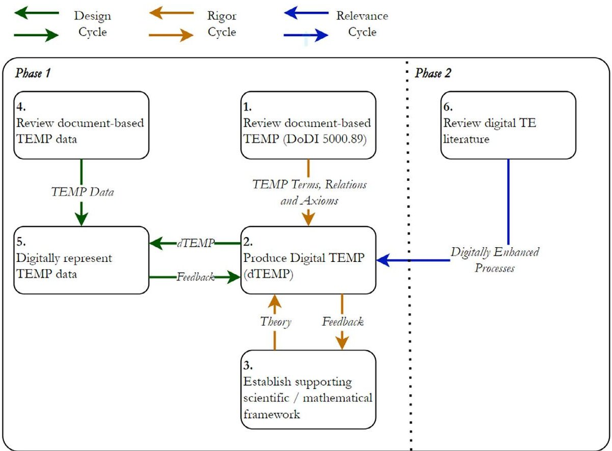
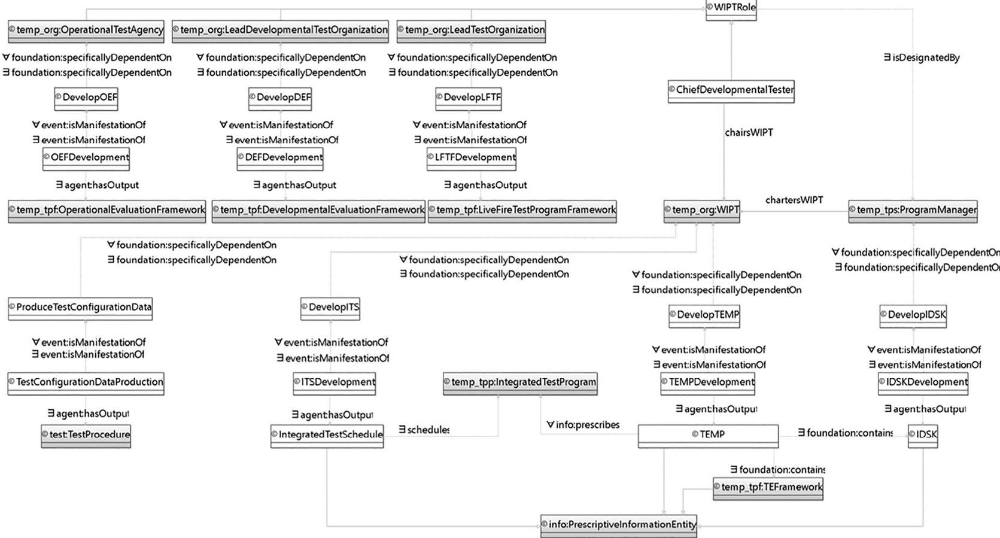

<!-- PDF_PAGE: 1 -->


<div align="center">

# An ontology-based digital test and evaluation master plan (dTEMP) compliant with DoD policy

</div>

Joe Gregory Alejandro Salado

Department of Systems and Industrial Engineering, The University of Arizona, Tucson, USA

Correspondence

Alejandro Salado, Department of Systems and Industrial Engineering, The University of Arizona, Tucson, USA. Email: alejandrosalado@arizona.edu

Funding information

## Abstract

U.S. Department of Defense, Grant/Award Numbers: HQ0034-19-D-0003, TO#0510

Test and evaluation (TE) planning is a critical part of systems engineering. However, it has not received as much attention from digital engineering efforts as early-stage design and analysis. Digital engineering has the potential to reduce the risk and effort associated with TE, while leveraging existing digital capabilities to add value. One aspect in particular that may benefit from such attention is the Department of Defense's Test and Evaluation Master Plan (TEMP). The purpose of the TEMP is to identify the key processes with respect to the TE of a product, and to specify the roles and responsibilities of key personnel and organizations. Concerns have been raised regarding the document-based nature of the TEMP and the increased risk and reduced reward that this entails. In this paper, we investigate the potential benefits of digitalizing the TEMP and outline an incremental approach for achieving this. We also present a set of ontologies, collectively known as the Digital TEMP (dTEMP), and investigate potential benefits and limitations by applying the dTEMP to an example test program.

KEYWORDS

digital engineering (DE), model-based systems engineering (MBSE), ontology, semantic technologies, test and evaluation

## 1 INTRODUCTION

It has been claimed that Model-Based Systems Engineering (MBSE) generally focuses on early phases of system development, while the later stages of systems engineering are often overlooked. $ ^{1-3} $ Verification activities, which usually take the form of a combination of analyses, inspections, and tests, consume a significant part, if not the biggest part, of the development costs of large scale engineered systems. $ ^{4} $ Traditionally, verification activities are "immersed in a perpetual documentation activity of decision tracking, open issues, and action items". $ ^{1} $ This document-based approach requires control of multiple documents, which can result in information consistencies, duplication of effort, and lack of change propagation. $ ^{5,6} $

Digital engineering has the potential to address some of the issues associated with traditional document-based test and evaluation (TE), being a fertile area of research: it "can guide test planners in developing test strategies and detailed test designs for evaluating technical

performance parameters". As tests are performed and data collected, the physical models can be updated with test data. $ ^{7} $ Yet, the application of MBSE and/or digital engineering to verification planning in general has been anecdotal and ad-hoc to specific projects and/or organizations. $ ^{1,2,8} $ The potential contributions in this area are much larger though $ ^{9} $:

- Digital Test and Evaluation Master Plan,

- Validated digital surrogates,

- Uncertainty Quantification (UQ),

- Digital critical decision points,

- Digital twin.

A possible approach to digitalize the TEMP is to leverage semantic web technologies. Ontologies and other semantic web technologies provide a means of structuring data in a way that offers potential in terms of reasoning and querying capabilities. $ ^{7,10,11} $ This approach

<!-- PDF_PAGE: 2 -->

enables the inference of knowledge and can provide insights into a dataset that would otherwise have been unavailable. $ ^{12} $ Semantic web technologies are particularly well-suited to highly connected data and have the potential to provide query results more efficiently than relational databases. $ ^{13,14} $ A variety of motivations regarding the use of ontologies have been established and presented in other work. These include the elimination of data heterogeneity / semantics problems, the improvement of interoperability, the facilitation of data integration, and the provision of semantic content for requirements and data analysis. $ ^{15} $ This work could leverage existing research on TE ontologies $ ^{16} $ and digital verification processes $ ^{5} $ to add value to a digital TEMP through the application of semantic web technologies.

In this paper, we investigate the potential of a digital approach to TE and present the first iteration of a digital TEMP (dTEMP), enabled by semantic web technologies, to leverage this potential. Relevant literature regarding the DoD approach to TE is reviewed in Section 2. A methodology to leverage digital TE techniques and develop the dTEMP is presented in Section 3. The dTEMP is described in Section 4 and is applied to an example TEMP document in Section 5. The outcomes of this application and the general approach are discussed alongside suggested future work in Section 6. The paper is concluded in Section 7.

## 2 BACKGROUND

The DoD has particular concerns with regards to TE programs—the approach of the DoD to TE is outlined in detail in the "Test and Evaluation Master Plan" (TEMP). $ ^{17,18} $ The purpose of the TEMP is to identify the key processes with respect to TE within the DoD, and to specify the roles and responsibilities of key personnel and organizations. $ ^{18} $ The TEMP itself has been traditionally document-based. It has been claimed that, on average, a TEMP requires 12 months to prepare and 10 months to review. $ ^{9} $ To address this, "the development and application of a digital, model-centric TEMP dynamically coupled to requirements and digitally maintained in a systems modeling language" has been proposed. $ ^{9} $

The Department of Defense (DoD) has outlined its goals with respect to a digital TEMP in Ref. 17, and some authors have started work in this area. Fundamentally, a digital TEMP would use models and data to digitally represent the system in a mission context to conduct integrated TE activities. Therefore, programs shall be accessible via a digital ecosystem. This digital ecosystem shall provide authoritative sources of models, data, and test artifacts. The digital ecosystem shall enable the automation, reuse, and auto-generation of test artifacts.

The DoD test program comprises Developmental Test and Evaluation (DT), Operational Test and Evaluation (OT), and Live-Fire Test and Evaluation (LT). DT corresponds to verification and is supported by the Developmental Evaluation Framework (DEF). OT corresponds to validation and is supported by the Operational Evaluation Framework (OEF). These definitions and relations are captured in the TEMP itself. $ ^{18} $ TE strategy begins at mission-modeling level. It shall be possible to continually revise the TE strategy as the system is developed.

One of the goals of the DoD is to produce a model-centric version of the DEF. $ ^{17,18} $ Following this, the goal would be to combine the evaluation frameworks to produce a "Virtual Operational Evaluation Framework". $ ^{19} $

One of main challenges regarding complex test strategies is the accumulation and management of data from multiple sources. $ ^{20,21} $ A digital approach has the potential to support the management of this data. A 2009 study of the growing challenges of TE identified multiple contributing factors. $ ^{22} $ The growing complexity of systems and environments, while maintaining a reasonable number of tests, was a major contributor to TE complexity. Another was the "small sample size challenge." This concerns the inclusion of multiple types of analysis and test, and the combination of their results. Similarly, the accumulation of test data (rather than its abandonment) as the system moves from test phase to test phase was identified as a challenge. A digital TEMP has the potential to address these issues by enabling the combination of test data from the multiple test phases outlined in the TEMP (DT, OT, LT).

## 3 METHODOLOGY

The research and development of the dTEMP was based on the design science research approach. The methodology is presented in Figure 1. Design science research is an approach that focuses on the development of an artifact to address a particular problem. $ ^{23-25} $ The artifact is then evaluated in terms of its applicability to the problem that was initially identified. $ ^{26} $ In 2007, Hevner published a "three cycle view of design science research". $ ^{27} $ The "rigor cycle" ensures that the artifact design is founded on robust mathematical and scientific theory and existing standards. The "relevance cycle" ensures that the artifact remains relevant to the stakeholders through requirements, testing, and feedback. The "design cycle" represents the process of designing and building the artifact while providing data to, and receiving feedback from, the other two cycles. This framework was expanded by defining five key design science research activities: problem identification, objective definition, design and development, demonstration, evaluation. $ ^{28,29} $

The research was divided into two phases and six tasks. This paper reports the results of the work performed in Phase 1. Phase 1 concerned the digitalization of the existing TEMP terminology, relations and axioms as defined in the DoD Instruction "Test and Evaluation" document (a draft version henceforth referred to as 'DoDI 5000.89'). $ ^{17} $ DoDI 5000.89 "establishes policy, assigns responsibilities, and provides procedures for test and evaluation TE programs". $ ^{17} $ As stated in, $ ^{9} $ however, digital TE refers to the use of "digitally enhanced processes, not just digitized forms of current processes". $ ^{9} $ In Phase 2, therefore, the goal will be to review the digital TE literature and identify digitally enhanced processes that can be incorporated into the dTEMP.

Task 1: Terms and relations were extracted from DoDI 5000.89 to form the basis of the dTEMP. This process followed the ontology development methodology defined in Ref. 30 whereby the lexicon is established before being mapped to a top-level ontology. Classes and relations specific to the TEMP (e.g., 'Operational Evaluation

<!-- PDF_PAGE: 3 -->





<div align="center">

FIGURE 1 The Design Science Research (DSR) methodology applied to development of the digital TEMP.

</div>

Framework') were organized into TEMP-specific groups that formed the basis of the dTEMP ontologies. More general classes and relations (e.g., 'Test') were extracted and organized into domains.

Task 2: During Task 1, nine TEMP definition groups were identified. In Task 2, nine dTEMP ontologies were produced. The dTEMP incorporates multiple modular ontologies that span the necessary definitions in DoDI 5000.89. Classes and relations specific to the TEMP have been represented as OML classes and relations in the dTEMP ontologies.

Task 3: As a result of Task 1, multiple domains were identified. To define the term "Test," for example', a "Test Ontology" was required. The University of Arizona (UA) Ontology Stack was developed to provide this support. The UA Ontology Stack has been structured in layers $ ^{12,31} $ and reuses existing ontologies wherever possible. Where it was not possible to reuse existing ontologies, new ontologies were developed to provide the required support. Together, Tasks 1-3 represent the "rigor cycle" as defined in the design science research methodology. This is an iterative process, and the supporting UA Ontology Stack will continue to be developed in the future.

Task 4: An example document-based TEMP, applied to a notional project, was made available to the authors. This document-based TEMP data were reviewed, and entities were represented as instances of appropriate classes defined in the dTEMP or the UA Ontology Stack. The objectives of this exercise were to:

1. Where possible, capture data contained in the example documentbased TEMP as OML data in accordance with the dTEMP.

2. Where it is not possible to capture data, identify the reason(s) why.

3. Based on the reasons identified, quantify the types of information in the example document-based TEMP.

4. Identify modifications that can be made to the dTEMP.

Task 5: A corresponding digital representation of this data, complete with relations and supported by the dTEMP, has been produced. The dataset has been validated against the dTEMP and seven example queries have been produced to investigate potential added value. The development of the dTEMP and subsequent application to example TEMP documents will continue to be an iterative process and is an example of a "design cycle" as defined in the design science research methodology.

## 4 DIGITAL TEST AND EVALUATION MASTER PLAN

## 4.1 dTEMP ontology language and structure

The benefits of semantic web technologies are realized through the effective use of a suitable ontology language, thoughtful structuring of the ontologies themselves, and the application of reasoning and querying capabilities. $ ^{11} $

A common way to organize ontologies and their dependencies is in a layered ontology stack. $ ^{12} $ These layers often incorporate foundational, core, and domain ontologies. $ ^{31} $ Libraries of standards instances can also be used. According to Gruber, ontologies play a central role in enabling reusable and interoperability between domains. $ ^{32,33} $ Federating the conceptualization of a domain across upper- and lower-level ontologies improves the reusability of higher-level terminology in other domains, and therefore improves interoperability between them. The foundational ontology defines only the most general classes and relations $ ^{34} $ and serves to unify the lower-level core and domain ontologies. $ ^{30} $ Core ontologies extend the foundational ontology to describe more specific classes, such as information and events, but are

<!-- PDF_PAGE: 4 -->

still applicable to a wide range of domains. $ ^{35} $ Domain ontologies formalize the terms that are used in a discipline. $ ^{36} $ Application ontologies can be used to enforce a particular approach within a domain and tend to represent the needs of a specific community as opposed to adopting a strictly "realist" approach. $ ^{37} $ The dTEMP presented in this paper is an application-layer set of modular ontologies supported by the University of Arizona (UA) Ontology Stack. The UA Ontology Stack comprises a foundational ontology, core and domain ontologies, and libraries.

The entire ontology stack has been written using the Ontological Modeling Language (OML). OML is an extension to the Description Logic profile of the Web Ontology Language (OWL 2 DL) and enables reification of relations and convenient use of mixing classes (as aspects). OML uses the concept of "bundles" to allow the modeler to group together multiple descriptions into a closed-world dataset that can be reasoned upon and queried. The closed-world assumption allows the reasoner to highlight the absence of expected information. Data can be then captured in OML descriptions. From these OML descriptions, the OML Rosetta tool can build a triple database in the Resource Description Framework (RDF) format. $ ^{38} $ OML Rosetta is an Eclipse-based tool that enables modelers to develop OML ontologies and descriptions. OML Rosetta has been used to support this work as it contains built-in validation and querying capabilities.

## 4.2 Digital TEMP overview

The dTEMP has been designed to reflect the terminology, relations and rules defined DoDI 5000.89. $ ^{17} $ The dTEMP is modular, and currently comprises nine individual ontologies with dependencies between them. A summary of the nine ontologies and the relevant section(s) in Ref. 17 is provided in Table 1.

The "Test Program Teams" ontology is one of the nine ontologies comprised by the dTEMP. The OML representation of this ontology is presented in Figure 2 as an example of the way in which allowable and necessary terms and relations are defined across the dTEMP. As stated in Table 1, the purpose of the "Test Program Teams" ontology is to define the functions of the various teams involved in a TE program and their expected outputs. This information has been collated from Section 3.1 ("Overview") and Section 3.4 ("TE Program Planning") of DoDI 5000.89. Terms in white boxes are defined in this ontology. Terms in grey boxes are defined in another ontology but elaborated in this ontology. Relations are defined as follows:

- A r B relation $r$ has domain A and range B.

- $ \forall $ A r B For all relations r with domain A, the range must be B.

- $ \exists $ A r B For all A, there must exist some relation r with domain A and range B.

Rather than defining only the allowable relations, therefore, the universal quantifier $ (\forall) $ and the existential quantifier $ (\exists) $ specify some limitations on the relations that can be defined at the data level. This proves powerful when validating the dataset. For example, given the "Test Program Teams" ontology presented in Figure 2, an inconsistency would be detected if the function "Develop Integrated Test Schedule" was specifically dependent on (i.e., 'a function of') anything other than a "Working Integrated Product Team (WIPT)." Similarly, an inconsistency would be detected if there existed an "Integrated Test Schedule" that did not schedule an "Integrated Test Program." Looking more closely at Figure 2, three "WIPT Roles" are defined: "Operational Test Agency," "Lead Developmental Test Organization" and "Lead Test Organization." These roles can only be filled by organizations. Each of these organizational roles have an associated function: "Develop Operational Evaluation Framework," "Develop Developmental Evaluation Framework" and "Develop Live Fire Test Framework," respectively. The structure of these frameworks and the information they contain is defined in the "Test Program Frameworks" ontology. The "WIPT"

<div align="center">

TABLE 1 dTEMP ontologies.

</div>

<table border="1"><tr><td>dTEMP ontology</td><td>Description</td><td>Section of DoDI 5000.89</td></tr><tr><td>Organization</td><td>Defines the roles that organizations can play in terms of the TE strategy and their structure.</td><td>Section 1.1: Applicability
Section 2.1: Director of OTE
Section 2.2: USD: (R&amp;E)</td></tr><tr><td>Test Program Policy</td><td>Defines the purpose of a Test Program and its relationship with a Defense Acquisition Program.</td><td>Section 1.2: Policy</td></tr><tr><td>Test Program Structure</td><td>Defines the types of Test Program, and how they combine to form the overall Test Program.</td><td>Section 3.1: Overview</td></tr><tr><td>Test Program Frameworks</td><td>Defines the frameworks that are used to prescribe Test Programs, and their structure.</td><td>Section 3.1: Overview</td></tr><tr><td>Execution and Reporting</td><td>Defines the types of output expected to be produced by the Test Programs, including reports and evaluation models.</td><td>Section 2.1: Director of OTE
Section 3.1: Overview
Section 3.3: TE Management</td></tr><tr><td>Test Program Teams</td><td>Defines the expected outputs of the functions that the organizations and individuals undertake.</td><td>Section 3.1: Overview
Section 3.4 TE Program Planning</td></tr><tr><td>Decision</td><td>Defines the terminology associated with decisions and the agents responsible for them.</td><td>Section 3.1: Overview
Section 3.2: TE Oversight List</td></tr><tr><td>Responsibility</td><td>Defines the responsibilities that organizations and individuals have.</td><td>Section 3.3: TE Management
Section 3.4 TE Program Planning</td></tr><tr><td>TE Oversight</td><td>Defines the technical oversight and the functions associated with this (e.g., notification of military).</td><td>Section 3.2: TE Oversight List</td></tr></table>

<!-- PDF_PAGE: 5 -->





<div align="center">

FIGURE 2 The "Test Program Teams" ontology-one of the nine ontologies comprised by the dTEMP. DEF, developmental evaluation framework; IDSK, integrated decision support key; ITS, integrated test schedule; LFTF, live-fire test framework; OEF, operational evaluation framework; TEMP, test and evaluation master plan; WIPT, working integrated product team.

</div>

itself has four functions: "Produce Test Configuration Data," "Develop Integrated Test Schedule," "Develop TEMP," and "Develop Integrated Decision Support Key." Each function must manifest in some occurrence of that function. Each manifestation must, in turn, yield some output. When combined with the closed-world assumption, the use of universal and existential quantifiers in this way enables a reasoner to determine the completeness of the dataset. The closed world assumption is the assumption that data not included in the dataset does not exist. This is in contrast to the open world assumption, which is the assumption that data not included in the dataset may or may not exist.

## 4.3 UA ontology stack

To adequately define terms such as "Test Program Framework," for example, it is necessary to define the terms "Test" and "Program." The dTEMP, therefore, builds on the UA Ontology Stack. The UA Ontology Stack is contained in a repository at. $ ^{39} $ Descriptions of the ontologies and libraries contained in the University of Arizona (UA) Ontology Stack are presented in Table 2.

The foundation of the UA Ontology Stack is the UA Foundation Ontology. This ontology is essentially a simplified OML representation of the Basic Formal Ontology (BFO). The BFO is a top-level ontology that is "designed for use in supporting information retrieval", analysis and integration in scientific and other domains. $ ^{40} $ BFO is an established top-level ontology that is the basis for many existing core- and domain-level ontologies.

All core ontologies except "Provenance" are based on the Common Core Ontologies (CCO) developed by Calspan-University at Buffalo Research Center (CUBRC). $ ^{35} $ The "Provenance" ontology is based on the W3C PROV-N notation. $ ^{41} $

The dTEMP makes use of nine domain ontologies from the UA Ontology Stack. $ ^{42} $ Where available, these domain ontologies will align with existing ontologies and standards. "System Architecture," for example, is aligned with ISO 42010. $ ^{43} $ So far, the domain ontologies have been developed according to a "just enough" policy-only terms necessary to support the dTEMP have been included and we have not attempted to provide complete representations of each domain. In other words, only terms explicitly stated in the DoDI 5000.89 have been included (e.g., 'Test', 'System', 'Software').

Libraries provide a convenient way of defining instances that can be reused across multiple OML Descriptions. Currently, the UA Ontology Stack makes use of two libraries. These libraries are currently limited but can be populated to reflect information contained in other such libraries, such as those used by the Systems Modeling Language (SysML) v2 standard libraries, $ ^{44} $ in the future.

## 4.4 Validation of a TEMP dataset

A key capability enabled by the dTEMP is the validation of the data models. Information represented as OML descriptions can be validated against the axioms defined in OML ontologies. One of the features of the OML Rosetta platform is its ability to reason on datasets. This process follows the following steps:

<!-- PDF_PAGE: 6 -->

<div align="center">

TABLE 2 The university of Arizona ontology stack.

</div>

<table border="1"><tr><td>Name</td><td>Level</td><td>Description</td></tr><tr><td>UA foundation</td><td>Foundation</td><td>Defines fundamental terminology required by all domains(e.g., object, process, role, quality)</td></tr><tr><td>Agent</td><td>Core</td><td>Defines the terminology associated with agency and the roles that agents may undertake(e.g., process owner, agent, organization).</td></tr><tr><td>Event</td><td>Core</td><td>Defines the relations associated with events(e.g., manifestation, participation, location in terms of space and time).</td></tr><tr><td>Information</td><td>Core</td><td>Defines the terminology associated with information and information artifacts(e.g., descriptive information entity, model).</td></tr><tr><td>Measurement</td><td>Core</td><td>Defines the relations between measurements and the quantities that they describe(e.g., measurement, unit,has value).</td></tr><tr><td>Provenance</td><td>Core</td><td>Defines the relations associated with metadata(e.g., generation, ownership, approval).</td></tr><tr><td>Acquisition</td><td>Domain</td><td>Defines the roles and relations associated with acquisition(e.g., purchaser, vendor, acquisition).</td></tr><tr><td>Data management</td><td>Domain</td><td>Defines the terminology associated with digital data management(e.g., repository, access,URL).</td></tr><tr><td>Mission</td><td>Domain</td><td>Defines the terms and relations associated with a system performing a mission(e.g., mission, environment, participation).</td></tr><tr><td>Modeling and simulation</td><td>Domain</td><td>Defines terms and relations associated with modeling and simulation(e.g., analysis,result).</td></tr><tr><td>Project management</td><td>Domain</td><td>Defines terminology associated with project management(e.g., project, project objective).</td></tr><tr><td>Requirements</td><td>Domain</td><td>Defines various types of requirements and their relations(e.g. functional requirement,satisfaction,verification).</td></tr><tr><td>Software</td><td>Domain</td><td>Defines terminology associated with software(e.g., software,software version,software agent).</td></tr><tr><td>System architecture</td><td>Domain</td><td>Defines the terminology and relations associated with system architecture(e.g., system,architecture,function,interface).</td></tr><tr><td>Test</td><td>Domain</td><td>Defines the terminology associated with testing(e.g.,test,test plan,test condition, tester,test site).</td></tr><tr><td>Dimensions</td><td>Library</td><td>Defines common dimensions(e.g.,time,length,mass,voltage,area).</td></tr><tr><td>Units</td><td>Library</td><td>Defines common units(e.g.,seconds,meters,kilograms,volts,square meters).</td></tr></table>

1. Data from selected OML Descriptions is bundled together.

2. OWL/RDF data are generated from the OML bundle.

3. These data are reasoned upon:

a. New information is inferred from asserted triples and axioms.

b. All information (asserted and inferred) is validated against the axioms and rules.

4. On completion of reasoning:

a. If data are inconsistent, the reasoner stops and generates a failure report.

b. If data are consistent, notification of a successful build is provided.

An example of a failed validation operation is presented in Figure 3. This failed validation operation results in a failure report. This XML file details the axiom that has been violated as well as the classes, relations and individuals that are involved. A snippet of this failure report is presented in Figure 4. In this case, a cardinality violation has been

identified. All functions are required to be "specifcallyDependentOn" (i.e., allocated to) one Continuant. The function "MakeMilestoneADecision," however, has not been allocated to a Continuant. If this is corrected, and the function "MakeMilestoneADecision" is allocated to an individual or an organization that is capable of performing the function "MakeMilestoneADecision," the validation operation results in a successful build of the dataset as shown in Figure 5.

## 5 APPLICATION

## 5.1 Application overview

An authentic TEMP document from a DoD contractor was provided to the team. For security reasons, the TEMP was sanitized, anonymized, and converted into a TEMP for a notional mine detection system called the "LMMDR" for this paper. The structure of the data itself and the

<!-- PDF_PAGE: 7 -->


Operation Duration

✓ Run build 1.906 s

> Calculate build tree task graph 0.026 s

Build started for file system watching 0.013 s

> Load build 0.025 s

✓ Run main tasks 1.519 s

✓ Run tasks 1.518 s

> :omlToOwl 1.028 s

> :owlReason 0.464 s

✓ Executing task ':owlReason' 0.454 s

Execute run for :owlReason 0.453 s

Snapshot inputs and outputs before executing task ':owlReason' 0.001 s

Snapshot outputs after executing task ':owlReason' 0.001 s

> :omlDependencies UP-TO-DATE 0.002 s

✓ Build finished for file system watching 0.001 s

> Configure build 0.308 s

<div align="center">

FIGURE 3 Failed validation operation, as presented by the OML Rosetta tool.

</div>

<owl:NamedIndividual rdf:about="http://uaontologies.com/DoD_Example/Part3#MakeMilestoneADecision">

  <rdf:type>

<owl:Restriction>

```xml

<owl:onProperty rdf:resource="http://uaontologies.com/UA_Foundation/UA_Foundation#specificallyDependentOn"/>

<owl:maxCardinality rdf:datatype="http://www.w3.org/2001/XMLSchema#nonNegativeInteger">0</owl:maxCardinality>

</owl:Restriction>

```

</rdf:type>

<UA_Event:manifestsIn rdf:resource="http://uaontologies.com/DoD_Example/Part3#MilestoneADecisionMade"/>

</owl:NamedIndividual>

FIGURE 4 Snippet of XML reasoning report identifying axiom violation.

Operation Duration

✓ Run build 2.232 s

✓ Run main tasks 1.882 s

✓ Run tasks 1.881 s

    :build 0.000 s

    > :omlDependencies 0.125 s

    > :owlReason 0.702 s

    > :omlToOwl 1.030 s

> Load build 0.013 s

> Calculate build tree task graph 0.022 s

> Configure build 0.291 s

    Build finished for file system watching 0.001 s

    Build started for file system watching 0.012 s

<div align="center">

FIGURE 5 Successful validation operation, as presented by the OML Rosetta tool.

</div>

<!-- PDF_PAGE: 8 -->

<div align="center">

TABLE 3 List of sections and content in the LMMDR document.

</div>

<table border="1"><tr><td>Section name</td><td>Content</td></tr><tr><td>1. Introduction</td><td>Describes the LMMDR system and mission, key interfaces, required hardware and software, required engineering tools and roles.</td></tr><tr><td>2. Test Program Management and Schedule</td><td>Describes the major test programs, the structure of the test organization responsible for them, individual roles and responsibilities, test result database requirements and reporting requirements.</td></tr><tr><td>3. Test and Evaluation Strategy</td><td>Describes required milestone decisions, required evaluation frameworks, individual tests, test objectives, design of experiments and certification.</td></tr><tr><td>4. Resource Summary</td><td>Summarizes test articles, test sites and instrumentation, models, simulations and special requirements (e.g. federal requirements). Also describes required personnel training.</td></tr></table>

relations between the individual entities, however, remain true to the original document. This document will henceforth be referred to as the LMMDR Document. We have attempted to capture the information within the LMMDR Document using the dTEMP paradigm presented in this paper.

The LMMDR Document is 20 pages long and contains four sections, described in Table 3. To make the data more manageable during modeling, the digital representation of this information has been divided into four separate OML descriptions (named Part 1-Part 4), corresponding to the sections in the LMMDR Document. These have been grouped together into a closed-world OML bundle so that they can be reasoned upon and queried.

## 5.2 Digital representation of information in LMMDR document

Information related to the LMMDR falls into one of the following five categories:

1. Information that is present in the LMMDR Document and can be captured by the dTEMP and does not violate any of the axioms defined in the dTEMP.

2. Information that is present in the LMMDR Document and can be captured by the dTEMP and is inconsistent with the axioms defined in the dTEMP.

3. Information that is present in the LMMDR Document and cannot be captured by the dTEMP due to an issue with the information itself, that is:

a. it is too vague,

b. it is outside the scope of the dTEMP, or

c. it is restating axioms declared in the dTEMP.

4. Information that is present in the LMMDR Document and cannot be captured by the dTEMP due to the lack of supporting ontology.

<div align="center">

TABLE 4 Information categories and their prevalence in the LMMDR document.

</div>

<table border="1"><tr><td>Category</td><td>Description</td><td>Number of lines</td></tr><tr><td>1</td><td>Information that is present in the LMMDR Document and can be captured by the dTEMP and does not violate the dTEMP</td><td>274(64%)</td></tr><tr><td>2</td><td>Information that is present in the LMMDR Document and can be captured by the dTEMP and is inconsistent with the dTEMP</td><td>35(8%)</td></tr><tr><td>3</td><td>Information that is present in the LMMDR Document and cannot be captured by the dTEMP due to an issue with the information itself</td><td>(29)7%</td></tr><tr><td>4</td><td>Information that is present in the LMMDR Document and cannot be captured by the dTEMP due to the lack of supporting ontology</td><td>90(21%)</td></tr></table>

5. Information that is not present in the LMMDR Document and is required by the dTEMP.

The LMMDR Document contains 428 lines of information. Where tables are presented, each cell is assumed to represent one line of information. Figures, section headings, and table column headings have not been included in the line count. Note that the LMMDR Document also contains multiple lists that gather information of the same type (e.g., all resources used in tests). These have not been defined explicitly in the dataset but can be generated using queries that pull this data automatically from the dataset and present it succinctly. They have been counted as one line of information. Information in the LMMDR Document can fall into categories 1-4, listed above. The category into which each line of information falls has been noted. Table 4 summarizes these findings. Further details are provided in Sections 5.2.1-5.2.4.

## 5.2.1 Category 2-Inconsistent information

Approximately 8% of the information contained in the LMMDR Document has not been captured because the information is inconsistent with the DoD policy as currently represented by the dTEMP. This information is listed in Table 5.

## 5.2.2 Category 3 -Flawed information

Approximately 7% of the information contained in the LMMDR Document has not been captured by the dTEMP because there is an issue at the data-level, that is, there is an issue with the information itself. In all cases described, the information is not inconsistent with the dTEMP, nor is it strictly required according to the dTEMP. The issues largely arise because of a misunderstanding of what can be asserted at the data level.

<!-- PDF_PAGE: 9 -->

<div align="center">

TABLE 5 Information in the LMMDR Document that is inconsistent with the dTEMP.

</div>

<table border="1"><tr><td>Information</td><td>Explanation</td></tr><tr><td>TE Working Group</td><td>This is an organizational role that is not defined in the dTEMP.</td></tr><tr><td>WIPT Functions</td><td>Multiple functions of the WIPT are defined that are not defined in the dTEMP.</td></tr><tr><td>Security TE Program</td><td>This is a TE Program that is not defined in the dTEMP. DoDI 5000.89 refers to another document, the‘DoD Cybersecurity T&amp;E Guidebook’, in which the‘Security TE Program’ is defined.</td></tr><tr><td>Type 1 Program</td><td>The LMMDR TE Program is designated a‘Type 1 Program’. This designation is not defined in the dTEMP.</td></tr><tr><td>Principal TE WIPT Member</td><td>This is a type of individual role that is not defined in the dTEMP.</td></tr><tr><td>ORG1 System Team Chair</td><td>This is an individual role that is not defined in the dTEMP.</td></tr><tr><td>Independent Developmental and Operational Evaluator</td><td>This is an individual role that is not defined in the dTEMP.</td></tr><tr><td>System Evaluation Plan</td><td>This is a plan, which is a type of prescriptive information entity, that is not defined in the dTEMP.</td></tr><tr><td>Operational Test Agency Milestone Assessment Report</td><td>This is a descriptive information entity that is not defined in the dTEMP.</td></tr><tr><td>Operational Test Agency Evaluation Report</td><td>This is a descriptive information entity that is not defined in the dTEMP.</td></tr><tr><td>Test Incident</td><td>This is an event that occurs during a test that is not defined in the dTEMP.</td></tr><tr><td>Risk Management Framework</td><td>This is a framework, which is a type of prescriptive information entity, that is not defined in the dTEMP.</td></tr><tr><td>Develop Integrated Master Schedule</td><td>This is a function that is not defined in the dTEMP, and therefore has not been allocated to any particular role.</td></tr><tr><td>Mission-Critical</td><td>The LMMDR is designated‘mission-critical’. This designation is not defined in the dTEMP.</td></tr><tr><td>CBTDEV</td><td>This is an individual role that is not defined in the dTEMP.</td></tr><tr><td>Customer Evaluator</td><td>This is an individual role that is not defined in the dTEMP.</td></tr></table>

The LMMDR Document contains a considerable number of comparisons that have been asserted without evidence. For example, it is explicitly stated that information contained in Document A is consistent with Document B. It is not possible to make such assertions using the dTEMP. However, it may be possible to investigate whether this is true through use of rules, validation, and queries. The LMMDR Document also contains multiple statements of best practice. For example, "the TEMP should be updated annually" or "contractors are required to store data at Repository1." It is not possible to capture this as data. However, it is possible to say that "the TEMP was reviewed on 1/1/2023", or "Contractor A stores data at Repository 1". To address this, relevant concepts, attributes, and rules can be added at the ontology-level. For example, a "Review Date" may be introduced and related to certain documentation. A rule can be added that raises a flag if the value of this entity is less than a particular value. Similarly, multiple statements of justification are made in the LMMDR Document. For example, "developmental testing incorporated corrective action periods during the testing, thus potentially improving reliability and allowing the evaluator to assess the effectiveness of any applied corrective actions." It is possible to capture that corrective actions have been included, but it is not currently possible to state that this is to potentially improve reliability. While information of this kind is not explicitly required according to the dTEMP, this capability could

potentially be included at both the ontology- and data-level. Some information contained in the LMMDR Document is too vague or too broad to include. For example, a "history of the LMMDR development process" cannot be included. This data may form the basis of a detailed system lifecycle dataset captured by a different ontology stack and the dTEMP does not have the capability of condensing information from a different domain into a relevant summary. It is possible, though, to point to other "Information Artifacts" (such as documents or models) that do capture this, or manage configuration control of the data assets.

## 5.2.3 Category 4-Information lacking ontological support

Significantly, 21% of the information contained in the LMMDR Document could not be captured as the dTEMP does not currently have the ontological capability to capture it. In this first iteration, for example, cybersecurity has not been included. The focus of this initial design cycle has been to represent the definitions of the key organizations and high-level aspects of the test programs and develop the relevant supporting domain ontologies in the UA Ontology Stack. Information described in this section cannot currently be captured in the dTEMP,

<!-- PDF_PAGE: 10 -->

but an extension to the dTEMP or the UA Ontology Stack in the future would address this.

In the LMMDR Document, it is stated that "possible workstations include the WS1 and WS2." It is not yet possible to capture possible physical components that satisfy a logical component definition. An extension to the "System Architecture" ontology would be required. Design of Experiments (DOE) is also referenced in the LMMDR Document. This cannot yet be captured as a "DOE" ontology at the domain level of the UA Ontology Stack would be required. The LMMDR Document defines the tests required to achieve certification. It is stated in DoDI 5000.89 that it is the responsibility of the "Program Manager" to determine which certifications are required. This can be included as a function of the "Program Manager" in the dTEMP, but a "Certification" ontology at the domain level of the UA Ontology Stack would be required first. Federal, state, and local requirements are discussed in the LMMDR Document. The approach that we have taken can be applied to other domains, and the dTEMP can be extended to include domain- and application-layer ontologies (as long as they are built on the same patterns defined in the foundation and core ontologies). For example, a "Regulatory" ontology could be included at the domain level of the UA Ontology Stack to capture these relations. Furthermore, a "Training" ontology would extend the "Role" entity (defined in the UA Foundation ontology) to describe the training required for an "Agent" to fulfill a particular "Role." The "Mission" domain ontology enables the definition of "Environments," "Missions" and "External Entities," but this would need to be extended to explicitly capture "Threats." "Reliability" is also not currently defined. This specific "Quality" may be included in a "Reliability" ontology, complete with methods of measurement and representation, to support this information.

## 5.2.4 Category 5 - Missing information

The previous three sections have described information that was present in the LMMDR Document but that could not be captured by the dTEMP.In this section, information that is explicitly required by the DoD policy (and hence the implementation of the dTEMP) but was not contained in the LMMDR Document is presented.In accordance with the domain-level "System Architecture" ontology, for example, it is not permissible to define a "Function" without defining the "Continuant" on which it depends.In all cases described in this section, data required by the dTEMP was missing from the dataset. These issues were identified during the validation process (described in Section 3.3). In order to successfully build a valid dataset and enable querying, corrections were applied to the issues listed here. These are also detailed.

The dTEMP specifies that the "WIPT" must comprise an "Operational Test Agency," a "Lead Developmental Test Agency," and a "Lead Test Organization." These have not been defined in the LMMDR Document. Correction: These organizational roles were defined (though no functions have been assigned to them).

"Recommended Corrective Actions (RCAs)" are "Prescriptive Information Entities" that must be contained in an "Integrated Decision

Support Key (IDSK).” "RCAs" were defined in the LMMDR Document but they were not allocated to an "IDSK" as required. Correction: The "RCAs" were specified to be contained in the "LMMDR IDSK"

All Information Entities must "be about" some subject. Specifically, "Prescriptive Information Entities" must "prescribe" some entity. It is implied that the RCAs prescribe the "LMMDR TE Program," though this has not been explicitly stated in the LMMDR Document. Correction: It has been explicitly stated that the "RCAs" prescribe the "LMMDR TE Program"

"Functions" such as "Produce Evaluation" have been defined in the LMMDR Document but they have not been allocated to any particular "Test Agency." The UA Foundation Ontology states that all "Functions" must be dependent on some "Continuant." Without this information, it is not possible to know who or what is capable of executing the "Produce Evaluation" functions, and therefore this responsibility is unclear. Correction: The "Produce Evaluation" functions have been allocated to the "Operational Test Agency"

## 5.3 Queries

The dTEMP also provides the user with the ability to query the data. As the OML Rosetta tool is capable of generating RDF representations of OML descriptions, the SPARQL Protocol and RDF Query Language (SPARQL) can be used to extract data from the RDF graphs. SPARQL employs a powerful graph-matching capability, whereby variables inside RDF triple patterns are matched against the RDF input graph. $ ^{45} $ Results are displayed as a set of mappings, where each mapping associates a set of variables with the RDF triple patterns that have been queried for. A set of seven queries have been defined to provide insights into the LMMDR dataset. Users can reuse these or define their own as they wish. All queries use the prefix definitions displayed in Figure 6 and are described in Table 6. The "List Unallocated Test" query is presented in Figure 7. Queries particular to a specific application can be added, and the default queries can be edited.

On completion of the successful validation of the dataset, these queries can be executed. The queries return the sets of variables that adhere to the RDF triple patterns defined in the query in JSON format. A simple HTML script has been used to format the JSON data and present each query result in a browser-style table. The results of these queries are also presented in Table 6. The result of the "List Unallocated Tests" query is presented in detail in Figure 8. In this case, four tests have been identified that occurred after $ 1^{\mathrm{st}} $ Jan 2022, and that have not been allocated to a "Test Program." It is not currently required that a "Test" must be allocated to a "Test Program," and so the validation process will not identify any unallocated tests. This query, therefore, provides a useful way to check for unallocated tests.

The results of these queries provide insights into dataset pulled from the LMMDR Document. Results from the "List Graphs" query, for example, show that the dataset is dependent on 39 graphs, including the four OML descriptions, the ontologies and libraries comprised by the UA Ontology Stack and the dTEMP, and the OML bundles that enable the closed world assumption. Results from the "Triple Count"

<!-- PDF_PAGE: 11 -->

<table><thead><tr><th>PREFIX</th><th>rdfs:</th><th>&lt;http://www.w3.org/2000/01/rdf-schema&gt;</th></tr></thead><tbody><tr><td>PREFIX</td><td>dc:</td><td>&lt;http://purl.org/dc/elements/1.1/&gt;</td></tr><tr><td>PREFIX</td><td>xsd:</td><td>&lt;http://www.w3.org/2001/XMLSchema&gt;</td></tr><tr><td>PREFIX</td><td>foundation:</td><td>&lt;http://uaontologies.com/UA_Foundation/UA_Foundation&gt;</td></tr><tr><td>PREFIX</td><td>agent:</td><td>&lt;http://uaontologies.com/UA_Core/UA_Agent&gt;</td></tr><tr><td>PREFIX</td><td>event:</td><td>&lt;http://uaontologies.com/UA_Core/UA_Event&gt;</td></tr><tr><td>PREFIX</td><td>info:</td><td>&lt;http://uaontologies.com/UA_Core/UA_Information&gt;</td></tr><tr><td>PREFIX</td><td>meas:</td><td>&lt;http://uaontologies.com/UA_Core/UA_Measurement&gt;</td></tr><tr><td>PREFIX</td><td>prov:</td><td>&lt;http://uaontologies.com/UA_Core/UA_Provenance&gt;</td></tr><tr><td>PREFIX</td><td>acq:</td><td>&lt;http://uaontologies.com/UA_Domain/UA_Acquisition&gt;</td></tr><tr><td>PREFIX</td><td>data:</td><td>&lt;http://uaontologies.com/UA_Domain/UA_DataManagement&gt;</td></tr><tr><td>PREFIX</td><td>mission:</td><td>&lt;http://uaontologies.com/UA_Domain/UA_Mission&gt;</td></tr><tr><td>PREFIX</td><td>ms:</td><td>&lt;http://uaontologies.com/UA_Domain/UA_ModelingAndSimulation&gt;</td></tr><tr><td>PREFIX</td><td>pm:</td><td>&lt;http://uaontologies.com/UA_Domain/UA_ProjectManagement&gt;</td></tr><tr><td>PREFIX</td><td>req:</td><td>&lt;http://uaontologies.com/UA_Domain/UA_Requirements&gt;</td></tr><tr><td>PREFIX</td><td>sw:</td><td>&lt;http://uaontologies.com/UA_Domain/UA_Software&gt;</td></tr><tr><td>PREFIX</td><td>sa:</td><td>&lt;http://uaontologies.com/UA_Domain/UA_SystemArchitecture&gt;</td></tr><tr><td>PREFIX</td><td>test:</td><td>&lt;http://uaontologies.com/UA_Domain/UA_Test&gt;</td></tr><tr><td>PREFIX</td><td>temp_dec:</td><td>&lt;http://uaontologies.com/DoD_TEMP_Framework/TEMP_Decision&gt;</td></tr><tr><td>PREFIX</td><td>temp_ear:</td><td>&lt;http://uaontologies.com/DoD_TEMP_Framework/TEMP_ExecutionAndReporting&gt;</td></tr><tr><td>PREFIX</td><td>temp_org:</td><td>&lt;http://uaontologies.com/DoD_TEMP_Framework/TEMP_Organization&gt;</td></tr><tr><td>PREFIX</td><td>temp_resp:</td><td>&lt;http://uaontologies.com/DoD_TEMP_Framework/TEMP_Responsibility&gt;</td></tr><tr><td>PREFIX</td><td>temp_teo:</td><td>&lt;http://uaontologies.com/DoD_TEMP_Framework/TEMP_TEOversight&gt;</td></tr><tr><td>PREFIX</td><td>temp_tpf:</td><td>&lt;http://uaontologies.com/DoD_TEMP_Framework/TEMP_TestProgramFrameworks&gt;</td></tr><tr><td>PREFIX</td><td>temp_tpp:</td><td>&lt;http://uaontologies.com/DoD_TEMP_Framework/TEMP_TestProgramPolicy&gt;</td></tr><tr><td>PREFIX</td><td>temp_tps:</td><td>&lt;http://uaontologies.com/DoD_TEMP_Framework/TEMP_TestProgramStructure&gt;</td></tr><tr><td>PREFIX</td><td>temp_tpt:</td><td>&lt;http://uaontologies.com/DoD_TEMP_Framework/TEMP_TestProgramTeams&gt;</td></tr></tbody></table>

<div align="center">

FIGURE 6 Default prefixes used by SPARQL queries defined in the dTEMP.

</div>

<div align="center">

TABLE 6 Descriptions and results of example queries.

</div>

<table border="1"><tr><td>Query name</td><td>Purpose</td><td>Result from LMMDR dataset</td></tr><tr><td>List graphs</td><td>In alphabetical order, return all graphs on which the dataset is dependent.</td><td>List of 39 OML Ontologies and Descriptions.</td></tr><tr><td>Information</td><td>Return all‘Information Entities’and the‘Information Artifacts’in which they reside.</td><td>List of 24‘Information Entities’,stored in 16 different‘Information Artifacts’.All‘Information Entities’in here in some‘Information Artifact’.</td></tr><tr><td>Test programs</td><td>List all‘Test Programs’that are contained within the‘Integrated Test Program’that is contained within the‘Major Defence Acquisition Program’called‘defaultname’.</td><td>The LMMDR‘Integrated Test Program’comprises four‘Test Programs’.</td></tr><tr><td>List unallocated tests</td><td>Return all‘Tests’that have not been allocated to a‘Test Program’and that are due to end after01/01/2022.</td><td>Four‘Tests’are due to be undertaken after01/01/2023and are not allocated to a‘Test Program’.</td></tr><tr><td>System architecture</td><td>Return all‘Systems’that are contained within a‘System’,the‘Functions’that are allocated to them,and the‘Functions’that comprise those functions.</td><td>The LMMDR‘System’comprises three sub-‘Systems’.One‘Function’inheres in the LMMDR‘System’.This‘Function’is decomposed into three sub-‘Functions’.Each subfunction inheres in one sub-‘System’.</td></tr><tr><td>Test programs by size</td><td>In descending order,return all‘Test Programs’and the number of‘Tests’that they comprise.</td><td>Five‘Test Programs’(including one allocated to the LMMDR)contain a total of13‘Tests’.The largest‘Test Program’contains four‘Tests’.</td></tr><tr><td>Triple count</td><td>Count the total number of RDF triples that this dataset comprises.</td><td>The LMMDR dataset contains13,042RDF triples.</td></tr></table>

query show that the dataset comprises 13,042 RDF triples, including those that have been asserted and those that have been inferred based on the ontological rules defined in the dTEMP and UA Ontology Stack. Results from the "Test Program by Size" query show that the LMMDR Integrated Test Program comprises four individual "Test Programs": two "Operational TE Programs" and two "Developmental TE Programs"

## 6 DISCUSSION AND FUTURE WORK

## 6.1 Analysis of results

In the Methodology section of this paper, the application of the design science research methodology to the development of the dTEMP was

<!-- PDF_PAGE: 12 -->

```sql

SELECT DISTINCT ?Test ?TestProgram ?datetime

WHERE {

    ?Test a test:Test .

    OPTIONAL {?Test temp_tpp:isPartOfProgram ?TestProgram} .

    FILTER (!BOUND(?TestProgram)) .

    ?Test event:occursOn ?TemporalRegion .

    ?TemporalRegion foundation:hasBeginInstant|foundation:hasEndInstant ?datetime .

    FILTER (?datetime > "2022-01-01T12:00:00"^^xsd:dateTime) .

}

```

FIGURE 7 "List Unallocated Tests" SPARQL query.

<table class="table table-bordered"><thead><tr><th>Test</th><th>Date</th></tr></thead><tbody><tr><td>LMMDR_OpsTest1</td><td>2023-01-17T15:00:00</td></tr><tr><td>LMMDR_OpsTest2</td><td>2023-07-09T12:00:00</td></tr><tr><td>LMMDR_CapabilityAnalysis</td><td>2022-11-10T16:30:00</td></tr><tr><td>LMMDR_DevTest3</td><td>2022-06-03T09:00:00</td></tr></tbody></table>

FIGURE 8 "List Unallocated Tests" SPARQL query result.

outlined. The work presented in this paper has focused on the "rigor cycle" (i.e., the development of a UA Ontology Stack with a grounding in relevant standards to support the dTEMP) and the "design cycle" (i.e., the iterative development of the dTEMP and subsequent application to example data to support evaluation). In this section, we review the application of the dTEMP to the LMMDR Document and identify possible avenues of future research. As stated in Section 3, the objectives of this exercise have been to:

1. Where possible, capture data contained in the LMMDR Document as OML data in accordance with the dTEMP.

2. Where it is not possible to capture data, identify the reason(s) why.

One of the first concerns noted when developing the dTEMP was that the TEMP itself is built on a set of implicit assumptions regarding terms and relations—such as "Test," "Program," "Program Manager," and "Responsibility." There was a need to codify these implicit assumptions as explicit definitions and relations in the UA Ontology Stack in a way that provided a foundation for a consistent dTEMP. Examples of the kind of questions that were raised are provided below:

- What is the distinction between a test plan and a test procedure?

- What is the distinction between desired test conditions, actual test conditions, and measured test conditions?

- What are the allowable subjects of a test?

- What is the output of a test program? (i.e., does a test program produce information artifacts or information entities?)

- How exactly is a test defined?

In order to answer some of these questions, the Common Core Ontologies (CCO), developed by CUBRC, were reviewed. The CCO comprises 11 midlevel ontologies that define various taxonomies of generic classes and relations across all domains of interest. $ ^{35} $ The "Information Entity Ontology," for example, defines prescriptive and descriptive information entities and the artifacts that contain them. The "Agent Ontology" defines terms and relations regarding roles and the people and organizations that can fill them. These have been used to provide a solid ontological foundation at the core level of the UA Ontology Stack. At the domain-level, a similar approach has been taken. So far, a "just enough" policy has been adopted, meaning that only terms necessary to support the dTEMP have been defined. The "System Architecture" ontology, for example, is based on ISO 42010 $ ^{43} $ but is not comprehensive. Only necessary terminology such as "System," "Function" and "Interface" have been defined. One of the challenges during further development of the dTEMP will be to expand the UA Ontology Stack while ensuring that these ontologies remain consistent with ontological theory, with each other and with the dTEMP.

The authors did not attempt to quantify if the sanitization process that anonymized the LMMDR document affected the results presented in Section 5. Every attempt was made to maintain the accurate representation and structure of the document and the kind of content it contains during this process, other than size. However, in future, we wish to apply the dTEMP to a real dataset.

The application of the dTEMP to the LMMDR Document has raised questions that need to be considered further. One such question regards the degree to which the dTEMP should restrict the data modeler. In Section 5.2.1, it was described how functions had been defined in the LMMDR Document that had been allocated to the LMMDR WIPT. In this case, these functions had not been explicitly defined as allowable functions of the WIPT, and so they were not included in the OML description. However, it would be possible to define instances of the general class "Function" and allocate them to the WIPT. The issue, however, is that these functions (or their possible omission in other examples) will not influence the outcome of the validation process as the dTEMP is not required to consider them. A possible mitigation of this problem is through the use of queries. A query of this kind was presented as an example in Section 5.3: "List Unallocated Tests." In this case, the validation process did not detect an inconsistency associated with the tests that were not allocated to a test program.

<!-- PDF_PAGE: 13 -->

Increasing modeler freedom to incorporate data not explicitly defined in the dTEMP reduces the power of the validation process. This reduction in ability may be mitigated to some extent by queries, but this trade-off needs to be considered in more detail, nonetheless.

The required granularity of the dTEMP also needs to be considered further. For example, while the dTEMP has been developed to capture the relations between "Test Programs," "Tests" and "Test Results," it is not clear whether it is within the current scope of the dTEMP to capture the value of the "Test Result" itself. The dTEMP is supported by the core-level "Measurement Ontology," and so it would be possible to capture quantities, values, and units. However, the dTEMP currently does not have the capability to verify requirements based on these test result values, for example. This could add value to the dTEMP, but this scope needs to be considered further.

Furthermore, this paper has not considered the business perspectives of such a digital transformation. As well as being a technical challenge, the implementation of a digital approach may be faced with multiple organizational inhibitors. $ ^{46} $ Research concerning the business considerations of the digital transformation is available and should be considered. $ ^{47-49} $

## 6.2 Future work

Section 5.2.3 has highlighted that 21% of the information in the LMMDR Document cannot currently be represented by the dTEMP due to lack of supporting domain ontologies. Future work might focus on the development of ontologies that define the terminology associated with training, regulations, DOE, and reliability. Other ontologies, such as the "Mission" ontology, may be extended to include other relevant terminology that cannot currently be captured (e.g., 'Threat').

Similarly, the dTEMP itself may be extended. DoDI 5000.89 references multiple other DoDI documents. The "DoD Cybersecurity TE Guidebook," for example, extends the security definitions presented in DoDI 5000.89. DoDI 8510.01, the "Risk Management Framework for DoD Systems" could also be considered. Together with further development of the supporting UA Ontology Stack, this would resolve the issues discussed in Section 4.2.3.

As highlighted in, $ ^{9} $ one aspect of the dTEMP with considerable potential is the incorporation of "enhanced digital processes." This does not refer to the digitalization of existing approaches, but the incorporation of advanced approaches made possible by the digitalization effort. Future work will consider how aspects such as dynamic verification strategy optimization $ ^{50} $ and digital uncertainty quantification $ ^{51} $ can be integrated in the overall digital approach to the TEMP. This is the purpose of the "relevance cycle," illustrated in Figure 1. Another possibility that will be explored is the use of ontology-based test generation to ensure complete coverage of all requirements. This approach has been documented in the context of autonomous driving by Li et al $ ^{52} $ and may be leveraged in the context of the dTEMP.

## 7 CONCLUSION

In this paper, the authors have presented the Digital Test and Evaluation Master Plan (dTEMP). The dTEMP is an ontology-based representation of the terminology and rules defined in the DoD TE Document (DoDI 5000.89). The dTEMP is built on the UA Ontology Stack, which contains three layers of supporting ontologies (foundation-, core- and domain-level). The UA Ontology Stack itself is based on the Basic Formal Ontology and the Common Core Ontologies. The entire ontology stack is written in the Ontological Modeling Language (OML).

To investigate the potential benefits and issues associated with the dTEMP, it has been applied to data contained in an example TEMP document—the LMMDR Document. The LMMDR Document defines the test strategy associated with the LMMDR mine detection system.

One of the areas in which the dTEMP has the potential to significantly add value is with regards to validation. The dTEMP identified four separate issues with the data contained in the LMMDR Document. All of these issues concerned missing information.

The dTEMP also enables the generation of aggregated data through the use of queries. A list of all tests, for example, can be gathered from across the entire dataset and presented in tabular form. Queries also enable the user to perform checks that may not be captured during the validation process.

It has been found that the dTEMP has been able to capture approximately 64% of the information contained in the LMMDR Document. Approximately 8% of the information was found to be inconsistent with DoD policy. 21% of information was not captured due to the lack of supporting ontologies (which can be developed in the future) and 7% of the information was not captured due to issues with the information itself (e.g., the assertion of a rule that should be modeled at the ontologylevel, the assertion of equality between two datasets). Furthermore, cases where information was requested by the TEMP but omitted in the dataset were highlighted.

Future work may include the extension of the dTEMP to incorporate other policy documents (such as those governing cybersecurity) and the extension of relevant domain ontologies to support other information relevant to the dTEMP (such as Design of Experiment). Questions have been raised regarding the freedom granted to data modelers to capture entities (e.g., roles, functions, organizations) not explicitly allowed by the dTEMP, and these will be explored further. The incorporation of "digitally enhanced processes," as opposed to simply "digitalized processes," will be a significant aspect of future development of the dTEMP.

## ACKNOWLEDGMENTS

This material is based upon work supported, in whole or in part, by the U.S. Department of Defense through the Office of the Under Secretary of Defense for Acquisition and Sustainment (OUSD(A&S)) and the Office of the Under Secretary of Defense for Research and Engineering (OUSD(R&E)) under Contract HQ0034-19-D-0003, TO#0510.

<!-- PDF_PAGE: 14 -->

## DATA AVAILABILITY STATEMENT

Data sharing is not applicable to this article as no new data were created or analyzed in this study.

## ORCID

Alejandro Salado https://orcid.org/0000-0001-9378-0795

## REFERENCES

1. Salado A. Efficient and effective systems integration and verification planning using a model-centric environment. 23rd Annu Int Symp Int Counc Syst Eng INCOSE 2013. 2013;2:1244-1258.

2. Salado A. Effective and Efficient System Integration and Verification Planning Using Integrated Model Centric Engineering: Lessons Learnt from a Space Instrument. SECESA. 2014. no. October.

3. Salado A. Model-Based V&V Planning. INCOSE International Symposium. 2013.

4. Engel A. Verification, Validation, and Testing of Engineered Systems. John Wiley & SonsJohn Wiley & Sons; 2010.

5. Gregory J, Salado A, Model-Based Verification Strategies Using SysML and Bayesian Networks. In Conference on Systems Engineering Research. 2023.

6. Gregory J, Salado A. A Semantic Approach to Spacecraft Verification Planning using Bayesian Networks. In IEEE Aerospace Conference, Big Sky, MT, USA; 2024.

7. Madni AM, Sievers M. Model-based systems engineering: motivation, current status, and research opportunities. Syst Eng. 2018;21(3):172- 190.

8. Selvy BM, Claver C, Angeli G. Using SysML for verification and validation planning on the Large Synoptic Survey Telescope (LSST). Model Syst Eng Proj Manag Astron VI. 2014;9150(August 2014):91500N.

9. Kraft EM, A Disruptive Application of Digital Engineering to Optimize Aircraft Developmental Test & Evaluation. In AIAA 2018 Aviation Systems Conference, Atlanta, GA; 2018.

10. Gregory J, Nair MH, Bullegas G, Saaj MC. Using Semantic Systems Engineering Techniques to Verify the Large Aperture Space Telescope Mission-Current Status. In Model Based Space Systems and Software Engineering (MBSE2021), Virtual Event; 2021:9-12.

11. Patel A, Jain S. Present and future of semantic web technologies: a research statement. Int. J. Comput. Appl. 2021;43(5):413-422. https:// doi.org/10.1080/1206212X.2019.1570666

12. Dunbar D, Hagedorn T, Blackburn M, et al. Driving digital engineering integration and interoperability through semantic integration of models with ontologies. Syst Eng. 2023;26:365378. https://doi.org/10.1002/sys.21662

13. Medhi S, Baruah HK. Relational database and graph database: a comparative analysis. J Process Manage new Technol. 2017;5(2):1-9.

14. Batra S, Tyagi C. Comparative analysis of relational and graph databases. Int J Soft Comput Eng. 2012;2(2):509-512.

15. Antunes AL, Cardoso E, Barateiro J. Incorporation of ontologies in data warehouse/business intelligence systems-a systematic literature review. Int J Inf Manag Data Insights. 2022;2(2).

16. Nachawati MO, et al. Towards an open platform for democratized model-based design and engineering of cyber-physical systems. In American Modelica Conference, Dallas, TX, USA; 2022.

17. Defense D. DoD Instruction 5000.89: Test and Evaluation; 2020.

18. Office of the Secretary of Defence. Director, Operational Test and Evaluation (DOT&E) Test and Evaluation Master Plan (TEMP) Guidebook. 2017.

19. Kraft EM. dTES-a Digital Engineering Enabled T&E Strategy. AIAA SCITECH 2022 Forum. 2022:437.

20. Freeman LJ, Fronczyk K. Improving reliability estimates with Bayesian statistics. IDA Document NS D-5452. Inst Def Anal. 2015.

21. Wilson AG, Fronczyk KM. Bayesian reliability: combining information. Qual. Eng. 2017;29(1):119-129.

22. Hill R, Chambal S, A framework for improving experimental design and statistical methods for test and evaluation. In US Air Force T & E Days 2009;2009:1708.

23. Nabukenya J, Combining case study, design science and action research methods for effective collaboration engineering research efforts. In 2012 45th Hawaii International Conference on System Sciences; 2012:343-352.

24. Baskerville R, Baiyere A, Gregor S, Hevner A, Rossi M. Design science research contributions: finding a balance between artifact and theory. J Assoc Inf Syst. 2018;19(5):3.

25. Dresch A, Lacerda DP, Miguel PAC. A distinctive analysis of case study action research and design science research. Rev Bras gestão negócios. 2015;17:1116-1133.

26. Pries-Heje J, Baskerville R, Venable JR, Strategies for design science research evaluation; 2008.

27. Hevner AR. A three cycle view of design science research. Scand J Inf Syst. 2007;19(2):4.

28. Hevner A, Chatterjee S. Design research in information systems. Theory and practice. Springer; 2010.

29. Hevner AR, March ST, Park J, Ram S. Design science in information systems research. Manag Inf Syst Q. 2008;28(1):6.

30. Orellana D, Mandrick W. The ontology of systems engineering: towards a computational digital engineering semantic framework. Proc Comput Sci. 2019;153:268-276.

31. Olsina L, Applicability of a foundational ontology to semantically enrich the core and domain ontologies. Int J Conf Knowl Discov Knowl Eng Knowl Manag IC3K-Proc. 2021;2(Ic3k):111-119.

32. Gruber TR, The role of common ontology in achieving sharable, reusable knowledge bases. Princ. Knowl. Represent. Reason. Proc. Second Int. Conf.; 1991:601-602.

33. Gruber TR. A translation approach to portable ontology specifications. Knowl Acquis. 1993;5(2):199-220.

34. ISO/IEC 21838-1. Information technology - Top-level ontologies (TLO) - Part 1: Requirements. 2021;2021:23.

35. Rudnicki R. An overview of the common core ontologies. CUBRC Rep; 2019.

36. McDaniel M, Storey VC. Evaluating domain ontologies: clarification, classification, and challenges. ACM Comput Surv. 2019;52(4):1-44.

37. Menzel C. Reference ontologies—application ontologies: either/or or both/and? KI Work Ref Ontol Appl Ontol. 2014;16(May):1-10.

38. World Wide Web Consortium. "Resource Description Framework (RDF) Model and Syntax." W3CW3C. 1997.

39. Gregory J, Salado A, UA Ontology Stack GitHub Repository. 2023. [Online]. Available: https://github.com/joegregoryphd/ UAOntologyStack

40. Arp R, Smith B, Spear A. Building Ontologies with Basic Formal Ontology. MIT Press; 2015.

41. Moreau L, Missier P, Cheney J, Soiland-Reyes S. PROV-N: the provenance notation. W3C Recomm. 2013(April):1-34.

42. Gregory J, Salado A. A systems engineering ontology stack to support students. In INCOSE International Symposium, Dublin, Ireland; 2024.

43. ISO, IEC, and IEEE. "ISO/IEC/IEEE 42010:2011(E)—Systems and software engineering—Architecture ddescription." Geneva, Switzerland; 2011.

44. Object Management Group. Systems Modeling Language (SysML) v2 Specification; 2023.

45. Schmidt M, Meier M, Lausen G, Foundations of SPARQL query optimization. In ACM International Conference Proceeding Series. 2010:433.

46. Gregory J, Berthoud L, Tryfonas T, Rossignol A, Faure L. The long and winding road: MBSE adoption for functional avionics of spacecraft. J Syst Softw. 2020;160:110453.

<!-- PDF_PAGE: 15 -->

47. Correani A, De Massis A, Frattini F, Petruzzelli AM, Natalicchio A. Implementing a digital strategy: learning from the experience of three digital transformation projects. Calif. Manage. Rev. 2020;62(4):37-56.

48. Ivancić L, Vuksić VB, Spremić M. Mastering the digital transformation process: business practices and lessons learned. Technol Innov Manag Rev. 2019;9(2):36-50.

49. Matzler K, von den Eichen S, Anschober M, Kohler T. The crusade of digital disruption. J. Bus. Strategy. 2018;39(6):13-20.

50. Salado A, Kannan H. Elemental patterns of verification strategies. Syst Eng. 2019;22(5):370-388.

51. Wilson AG, Anderson-Cook CM, Huzurbazar AV. A case study for quantifying system reliability and uncertainty. Reliab. Eng. Syst. Saf. 2011;96(9):1076-1084.

How to cite this article: Gregory J, Salado A. An ontology-based digital test and evaluation master plan (dTEMP) compliant with DoD policy. Systems Engineering. 2024;27:1012-1026. https://doi.org/10.1002/sys.21769