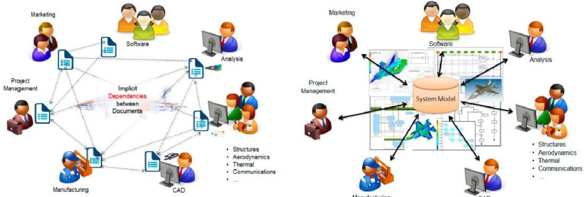
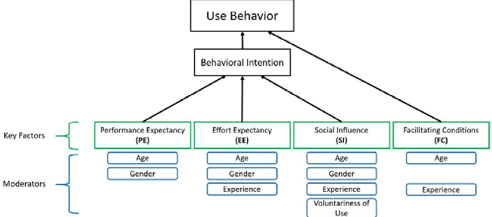
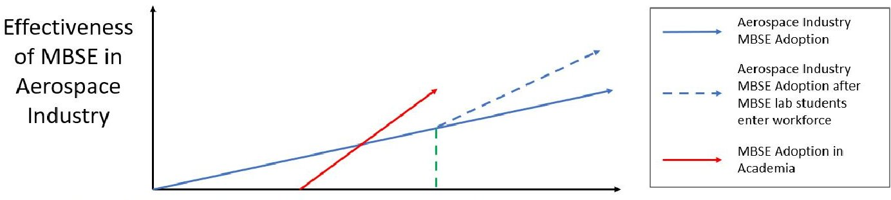
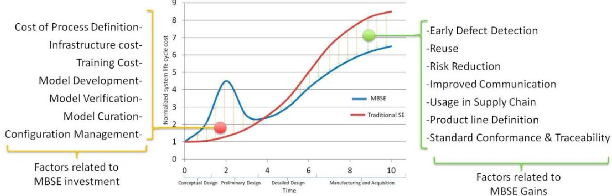

<!-- PDF_PAGE: 1 -->

# Analyzing the Integration of MBSE Approaches within the Aerospace Industry according to UTAUT

Marshall Pratt and Matthew Dabkowski

Department of Systems of Engineering United States Military Academy West Point, NY 10996

Corresponding author's Email: marshall.j.pratt.mil@army.mil

Author Note: Cadet Pratt is a fourth-year student in the Department of Systems Engineering at the United States Military Academy (USMA). His thesis advisor is Colonel Matthew Dabkowski, Director of the Systems Engineering Program at USMA.

Abstract: As modern systems grow increasingly complex and the physical workplace becomes increasingly digitized, many industries have recognized the need to transition from traditional document-based systems engineering to Model-Based Systems Engineering (MBSE). Despite this recognition, several industries have failed to fully embrace MBSE, notably aerospace. To understand this hesitation, relevant research regarding MBSE adoption within the aerospace industry was mapped to the key factors and moderators of the Unified Theory of Acceptance and Use of Technology (UTAUT). This mapping highlighted key challengers and enablers. Significant challengers to MBSE adoption appear to be upfront investment, uprooting of legacy methods and established norms, and reliance on an imperfect, training-intensive modeling language. Significant enablers to MBSE adoption appear to be collective organizational support, touted success in small-scale projects, and MBSE-driven studies in academia. Ultimately, conclusions drawn from this mapping present areas for future study and improvement to MBSE adoption approaches across all disciplines.

Keywords: Model-Based Systems Engineering, Unified Theory of Acceptance and Use of Technology, Aerospace.

## 1. Introduction

The traditional document-based engineering practices that proved robust in the past are struggling to maintain pace with the increasing scale and complexity requirements of modern systems (Sheard et al., 2015). This, combined with the gradual but advanced digitalization of the workplace, challenges today's engineering organizations to integrate comprehensive and synchronized project development efforts across multiple domains (Madni & Sievers, 2018). As scale and complexity grow, the sheer number of components, requirements, and disciplines involved in modern systems makes visualization and understanding of the complete system increasingly difficult to maintain, especially through a documents-based approach (Koßler & Paetzold, 2017). The response to this challenge has been a push for Model-Based Systems Engineering (MBSE).

MBSE is hailed as a "promising" solution in the face of exceedingly complex products and development programs (Huldt & Stenius, 2019), and it is considered by the International Council on Systems Engineering (INCOSE) as the "standard practice" of the future (INCOSE, 2014). The more complex the project, the more benefit there is to be gained from transitioning from document-based to model-based engineering. The aerospace industry was one of the first to realize this, and over the course of the last two decades, it has not only advanced the study of MBSE but also has led the way in its implementation. However, the innovative nature of MBSE, as with any process change, "causes a fundamental shift in the way an industry conducts business," thereby causing some engineers to be hesitant towards its adoption (Lippert & Forman, 2005).

## 2. Background and Related Works

## 2.1 Model Based Systems Engineering (MBSE)

## 2.1.1 Addressing Complexity Through Modeling

Traditional approaches to systems engineering generally rely on several documents to manage everything in a project's lifecycle from system architecture to cost analysis. Regardless of discipline or domain, every team involved in the development

<!-- PDF_PAGE: 2 -->

Figure 1. Document-Based (left) vs. Model-Based Systems Engineering (right) (Madni & Purohit, 2019, p. 4)

process relies on documents to communicate with one another. As the complexity of the project multiplies, there could be thousands of documents circulating amongst the project team, who by their nature share no explicit dependencies. So, reflecting a change in one document requires manual adjustment to the others in a "natural language (i.e., sentences and paragraphs) ... [that make it] difficult to verify their completeness and consistency, and to surface conflicting or contradictory information" (Madni & Purohit, 2019). This document-based approach effectively narrows the job of the engineer to "tedious document manipulation," where progress is arduous and error prone, and complete continuity is almost unattainable (Scheeren, 2014).

In contrast to this document-based approach is MBSE, which according to INCOSE, is "the formalized application of modeling to support system requirements, design, analysis, verification, and validation activities beginning in the conceptual design phase and continuing throughout development and later life cycle phases" (Chami, 2018). A modeling-centric approach facilitates effective communication across large, multidisciplinary networks, identifies and synchronizes the impact of design changes to the whole system, and allows for accurate performance analysis even before a system is built (Hart, 2015). As various engineers work parallel lines of effort, "consistent and up-to-date information in the integrated digital model" enables effective checks on system "completeness, consistency, traceability, and contradiction," as the system grows in scale and complexity (Madni & Purohit, 2019).

To achieve the coherent collaboration effects displayed in Figure 1, MBSE relies on three main modeling concepts: method, tools, and language (Chami & Bruel, 2018). When constructing an integrated system model, an MBSE design team will integrate these concepts by using "a dedicated modeling tool to perform a set of design tasks prescribed by a modeling method to add elements (and relationships between elements) to an integrated system model that is expressed in a standard modeling language" (Delligatti, 2014). As MBSE has progressed in its development, the tools and languages used to facilitate a relatively consistent methodology have experienced almost continuous revision (Scheeren, 2014). While there currently exists numerous MBSE tools often commercialized by companies such as IBM, Innoslate, and Lattix, the progression of their capabilities and operation remains fairly similar. In terms of languages, however, there exists only one that is standardized by INCOSE and used almost uniformly across industry: the Systems Modeling Language (SysML) (Hart, 2015).

## 2.1.2 Establishing a Common Language

At the heart of an effective MBSE methodology is a language that offers the ability to unambiguously communicate and provide meaning to the nature of a given model's elements and the relationships between them (Delligatti, 2014). In contrast to natural language, modeling languages rely on the construction of multiple, interconnected diagrams to accurately represent and manage the behavior, requirements, and structure of a complex system model in real time (Friedenthal et al., 2015). Currently, SysML represents the most common graphical modeling language used in MBSE practice. Developed by the Object Management Group and INCOSE, SysML is a vendor-neutral language that "supports the specification, analysis, design, verification, and validation of complex systems that include hardware, software, data, personnel, procedures, and facilities" (Wang, 2016). Important to note is the characterization of SysML as a supporter to these ends, as well as the suggestion of a careful balance that has defined the progress and development of MBSE. Without an effective methodology through which to be applied, a language is useless, and without an effective language to support it, a methodology is bound to fail (Chami, 2018).

## 2.1.3 MBSE and the Aerospace Industry

Organizations within the aerospace industry are considered to deal with the highest degrees of product-related and organizational complexity (Schoberl, 2020), produce products requiring long lifespans, and operate within a strict regulatory environment (Madni & Purohit, 2019). As such, with intensely complex systems such as aircraft and spacecraft, these

<!-- PDF_PAGE: 3 -->

organizations were some of the first to experience the debilitating strain associated with traditional approaches to systems engineering. Today, the aerospace industry represents one of the largest and most active embracers of MBSE methodology (Motamedian, 2013).

Aerospace system engineers from government, private industry, and academia have combined over the last two decades to pursue and maintain an open dialogue intended to progress the development of MBSE methods, tools, and language (Wang, 2016). The most notable and comprehensive record of this ongoing dialogue is catalogued through the INCOSE MBSE Initiative. Contributors to this ongoing dialogue include representatives from the National Aeronautical and Space Administration (NASA), Lockheed Martin, Airbus, Boeing, the Georgia Institute of Technology's Center for MBSE-enabled Overall Aircraft Design, and the University of Michigan's MBSE Leadership Lab. Despite the large investment and development within the aerospace industry, impediments to its complete integration of MBSE remain.

## 2.2 Unified Theory of Acceptance and Use of Technology (UTAUT)

## 2.2.1 Theories of Adoption and Diffusion

The study of why an innovation is or is not adopted and embraced by an individual, or within an organization, is an inherently complex endeavor that remains a topic of continued research across many disciplines (Straub, 2009). This research is typically defined according to two separate sets of theories: theories of adoption and theories of diffusion. Theories of adoption refer to analysis of an individual's decision to integrate a particular innovation into their daily life, while theories of diffusion refer to analysis of a larger group's eventual, collective adoption (Straub, 2009). Both sets of theories rely on previously established behavioral and social cognitive phenomenon to predict individual attitudes towards adoption (Straub, 2009). These attitudes are understood to directly affect one's "intention to use [a given innovation]” and eventually encourage one's "actual usage behavior" (Marchewka & Kostiwa, 2007).

Fred Davis, one of the first researchers to apply these theories more specifically to technology, further developed two distinct predictors of usage outcomes: ease of use and perceived usefulness (Marchewka & Kostiwa, 2009). Davis defined ease of use as the "degree to which a person believes that using a particular system would be free of mental effort" and perceived usefulness as the "degree to which a person believes that using a particular system would enhance his or her job performance" (Davis, 1989). Davis' work has served as the foundation for countless technology adoption and diffusion theories.

## 2.2.2 UTAUT Methodology

The Unified Theory of Adoption and Use of Technology (UTAUT) was proposed in 2003 by a research group headed by Viswanath Venkatesh whose initial goal was to conduct a study of eight different theoretical frameworks and models used to understand the adoption and use of technology (Venkatesh et al., 2016; Straub, 2017). From this study, Venkatesh was able to integrate core elements from each theory "to predict or [explain] new technology adoption, acceptance, and usage" into an overarching framework that he and his team dubbed UTAUT (Chao, 2019).

UTAUT presents an approach to technology adoption theory grounded in a relative view of time and a continuous process of defining and predicting behavioral intent in organizational contexts. UTAUT specifies "four key factors (i.e., performance expectancy, effort expectancy, social influence, and facilitating conditions) and four moderators (i.e., age, gender, experience, and voluntariness) related to predicting behavioral intention to use a technology and actual technology use" (Venkatesh, 2016). Moderators directly affect the extent to which key factors play a role, or the nature in which they are perceived by a given user, in determining future use of a target technology. For example, the extent to which a technology is expected to perform varies with the gender and age of the user, where the effect of perceived usefulness is far more significant for males and younger workers (Marchewka & Kostiwa, 2007). A graphical representation of UTAUT, clearly mapping moderators to key factors and key factors to behavioral intention and use behavior, can be seen in Figure 2.

When analyzing an individual or an organization's inclinations toward using a target technology, that user's Performance Expectancy (PE) of that technology is considered "the degree to which an individual believes that a technology will assist them in performing job duties" (Davis, 1989). Effort Expectancy (EE) is "the degree to which an individual perceives a particular technology to be easy to use" (Straub, 2017). Social Influence (SI) is "the degree to which an individual feels social influence pressure to use a particular information technology" (Straub, 2017). Finally, Facilitating Conditions (FC) is the measure of "a user's perception of the disposable resources and support when performing a task" (Alamiah et. al., 2019).

<!-- PDF_PAGE: 4 -->

Figure 2. Graphical representation of the Unified Theory of Acceptance and Use of Technology (Adapted from Figure 1 of Chao (2019, p. 4))

## 2.2.3 UTAUT and MBSE Motivation

The extended time horizon involved in the implementation of MBSE methodologies needs improving, but the question of whether focus should be on "MBSE itself [or] the way it is adopted" remains unanswered (Chami & Bruel, 2018). UTAUT provides an opportunity to answer this question by mapping MBSE to "a valid and robust model based on substantial empirical evidence" (Alamiah et al., 2019). Rather than analyzing MBSE through a technical evaluation of the tools and methods on which it relies, applying UTAUT to MBSE's adoption in its most applicable industry-Aerospace- (Schoberl, 2020) allows a determination and subsequent measurement of "a clear pattern of MBSE challenges" to be made (Chami & Bruel, 2018).

## 3. Discussion

Research relating to the nature of MBSE adoption in the aerospace industry will be mapped to the UTAUT methodology according to the theory's four key factors and their associated moderators. The intent of this mapping is to better understand the current state of MBSE adoption and identify the significant enablers and challenges to MBSE adoption in one of its most popular industries. Conclusions drawn from this mapping present specific areas for future study and improvement to MBSE adoption approaches across all disciplines.

## 3.1 Enablers to MBSE Adoption in the Aerospace Industry According to UTAUT

## 3.1.1 Performance Expectancy

When it comes to determining the extent to which MBSE provides meaningful benefit to its users, organizations within the aerospace industry have done well to encourage opportunities for their workforce to experiment with and learn MBSE methods, tools, and languages (Lippert & Forman, 2005). The industry has also done well to tout examples of MBSE success by publishing metrics that indicate improved design efficiency, production efficiency, and product quality in projects that utilize MBSE (Venkatesh, 2016; Wang, 2016). The establishment of institutions within academia that embrace MBSE-focused curriculum has also proved vital in encouraging performance expectancy among potential MBSE users (Motamedian, 2013).

Institutions like the University of Michigan's MBSE Leadership Lab and the Georgia Institute of Technology's Center for MBSE-enabled Overall Aircraft Design work to not only educate and inspire the future workforce with significant support from current heads of industry but also continue to solve MBSE-related challenges on a smaller scale. As depicted in Figure 3 (made in collaboration with George Halow, University of Michigan Aerospace Engineering Professor of Practice and lead architect for the MBSE Leadership Lab), the progress made in academia creates a jump in the state of MBSE effectiveness as students with hands-on experience (and thus higher levels of performance expectancy) begin to enter the industrial workforce as willing MBSE-trained engineers.

<!-- PDF_PAGE: 5 -->

Figure 3. Effect of MBSE-focused curriculum on the aerospace industry

## 3.1.2 Effort Expectancy

As suggested by Venkatesh and Davis, "a technology's perceived ease of use is only recognized after the individual engages in actual hands-on experience" (Lippert & Forman, 2005). Again, the aerospace industry's support of MBSE curriculum within various academic institutions is crucial to providing that hands-on experience to young, inexperienced engineers. In the expert opinion of Tony Moffatt, a principal research engineer at the University of Alabama in Huntsville's Rotorcraft Systems Engineering and Simulation Center, this is where the moderators play a key role in terms of the difficulties involved with having to "teach old dogs new tricks" while attempting to transition from document-based to model-based approaches within industry (Moffatt, personal communication, January 28, 2022).

## 3.1.3 Social Influence

According to UTAUT methodology, all four moderators - age, gender, voluntariness of use, and experience - apply to the social influence experienced by the user of a target technology. An older, more experienced user is less likely to be willing to embrace a change to established norms regardless of social influence, whereas a younger, less experienced user is far more inclined to embrace any new technology so long as it is supported by their social network (Lippert & Forman, 2005). The students at Georgia Tech and the University of Michigan pair with industry leaders to establish practical MBSE knowledge and receive affirmation from the industry they are about to enter. The presence of companies such as Siemens, Airbus, and Boeing within these academic institutions forces recruitment and pressure on students and instructors (Halow, personal communication, March 2 and 17, 2022).

## 3.1.4 Facilitating Conditions

There are few enablers in terms of facilitating conditions within the aerospace industry, but the support users experience from the top-down within both industry and academia remains a poignant example of the facilitating conditions that enable the adoption of MBSE. The aerospace industry has been pushing MBSE adoption for over a decade, with demands becoming only more intense in recent years (INCOSE, 2007). These demands are often initially met with a presentation that highlights definitions, applications, and details of success (Hart, 2015). While again more effective on the young and inexperienced, these presentations provide the visual reaffirmation to all users that management teams support the transition to MBSE (Motamedian, 2013).

## 3.2 Challengers to MBSE Adoption in the Aerospace Industry According to UTAUT

## 3.2.1 Performance Expectancy

Experimentation and hands-on experience provide the largest source of performance expectancy for a technology facing adoption (Lippert & Forman, 2005). However, while experimentation with tools and languages may be possible at a small scale in academia, there exists little to no ability to experiment within industry. As Dr. Dimitri Mavris suggests when asked why industry has yet to fully embrace MBSE methodologies, the sheer scale and complexity of modern system projects one of the main motivators behind adopting MBSE - causes organizations to pack too much into one MBSE solution (Mavris, personal communication, February 23, 2022). Put another way, experts and users maintain the perception that systems are too large and too complex to be fully integrated into an MBSE approach (Chami, 2018). This is supported by a survey analysis published in the International Journal of Scientific and Engineering Research where 48% of respondents within industry indicated a "lack of perceived value of MBSE" (Motamedian, 2013).

<!-- PDF_PAGE: 6 -->

## 3.2.2 Effort Expectancy

When it comes to the effort expectancy of MBSE implementation, there are several contributing issues that define this key factor as a significant challenge. Ultimately, there is a degree of cost-benefit analysis that MBSE is failing in the eyes of some engineers as "MBSE adoption requires a holistic and systematic approach" that not only disrupts production but also requires significant upfront investment of time, money, and effort (Chami, 2018). As seen in Figure 4, this investment often does not experience return until much later. The fact is, "legacy document centric approach[es] [already have] a trained workforce, some reusable assets such as templates, and defined processes with associated tools" (Wang, 2016). In contrast, there is virtually no library of reusable system models (Wang, 2016), and building models from the ground up is time consuming, especially if users need to be trained (Pawlikowski et al., 2020) or if experienced modelers - who are often unavailable - need to be consulted (Chami, 2018). Either way, "MBSE and SysML require a steep learning curve" (Cloutier & Bone, 2010). Ultimately, MBSE adoption is considered by many users to require "high effort while the benefit is often unclear or arises later on" (Koßler & Paetzold, 2017).

Figure 4. MBSE adoption timeline in terms of initial investment and realized gains (Madni & Purohit, 2019, p.13)

## 3.2.3 Social Influence

In line with previous comments from Moffatt, this idea of "old dogs" within the aerospace industry carries with it significant weight when it comes to considering the challenging effect of social influence on the adoption of MBSE (Moffatt, personal communication, January 28, 2022). In the same reviewed and published survey that pointed out a lack of performance expectancy among MBSE users, 48% of respondents from within industry indicated that a simple "resistance to change" was the reason for hesitation to adopt MBSE methodology (Motamedian, 2013). In a similar survey conducted more recently, 88% of respondents indicated change resistance as the principal challenge facing MBSE adoption (Chami and Bruel, 2018). Considering the moderators to social influence, members of industry "have different levels of MBSE knowledge" and experience (Chami, 2018) due to age or simple circumstance which, in combination with personal levels of innovativeness, cause a person to be far more resistant to change (Straub, 2017).

## 3.2.4 Facilitating Conditions

The challenge presented in terms of facilitating conditions involves access to the necessary resources and support to establish MBSE practices in the first place. Simply put, "there is no roadmap that can provide all the best practices required to successfully adopt [MBSE]," and most organizations suffer from a distinct lack of guidelines and processes to follow (Wang, 2016; Huldt & Stenius, 2019). Specifically, in the aerospace industry initiatives aimed at "increasing the know-how of MBSE by training, R&D, and pilot projects" are few and far between (Motamedian, 2013). Whenever a beginner modeler is faced with overcoming and mastering "the richness and complexity of the SysML language semantics," there is often only limited access to an experienced mentor, and the methods to building a model are taught at too high of a level rather than step-by-step (Wang, 2016).

Common language also presents a challenging facilitating condition for MBSE adoption. MBSE represents a holistic approach across multiple disciplines and domains, yet "some domains like mechanical engineers are not able to understand SysML behavior diagrams," as their modeling practices typically occur within computer aided design (CAD) tools (Koßler & Paetzold, 2017). Though SysML has become the industry standard and is a powerful and expressive modeling language, it is also considered too complex (Chami, 2018). Without a unifying language facilitating adoption, it is nearly impossible to fully

<!-- PDF_PAGE: 7 -->

integrate and experience the benefits of a proper MBSE approach (Cloutier & Bone, 2010; Spangelo et al., 2012). Figure 5 provides a graphical summary of the collective challenges and enablers of MBSE adoption.

<table border="1"><tr><td>Key Factors</td><td colspan="2">How Challenger</td><td colspan="2">How Enabler</td></tr><tr><td rowspan="2">Performance Expectancy(PE)</td><td colspan="2">-Virtually no ability to experiment within industry
- Sheer scale and complexity of modern systems cause organizations to pack too much into one MBSE solution(Mavris,2022)
- Lack of perceived value(Motamedian,2013)</td><td colspan="2">-Ability to experiment in small scales(Lippert,2016;Motamedian,2013)
-Published examples of success(Venkatesh,2016;Wang,2016)
-MBSE-focused curriculum established in academia contributing MBSE experience to the workforce(Halow,2022;Mavris,2022)</td></tr><tr><td>Challenger</td><td>PE</td><td>Enabler</td></tr><tr><td rowspan="3">Effort Expectancy(EE)</td><td colspan="2">-Significant upfront investment into tools, training,and infrastructure required(Chami,2018)
-Disruption to high-paced production lines(Chami,2018)
-Lack of legacy documents and framework examples to follow(Wang,2016)
-Building models is time consuming(Pawlikowski et al.,2020)
-Benefits arise over an extended time horizon(Kößler,2017)
-Steep learning curve associated with SysML(Bone,2010)</td><td colspan="2">-Ability to experiment in small scales(Lippert,2016;Motamedian,2013)
-MBSE-focused curriculum established in academia contributing MBSE experience to the workforce(Halow,2022;Mavris,2022)</td></tr><tr><td>Challenger</td><td>EE</td><td>Enabler</td></tr><tr><td colspan="2">-Cultural resistance to change from experienced document-based engineering(Moffat,2022;Motamedian,2013;Chami&amp;Bruel,2018)</td><td colspan="2">-Pressure from industry realized in newly formed academic institutions(Halow,2022)
-Young,inexperienced students easily persuaded by MBSE advantages(Lippert,2016;Halow,2022)</td></tr><tr><td rowspan="2">Social Influence(SI)</td><td colspan="2">Challenger</td><td>SI</td><td>Enabler</td></tr><tr><td colspan="2">Challenger</td><td colspan="2">Intense top-down support of MBSE transition within industry and academia(INCOSE,2020;Hart,2015;Motamedian,2013)</td></tr><tr><td rowspan="2">Facilitating Conditions(FC)</td><td colspan="2">Challenger</td><td>FC</td><td>Enabler</td></tr><tr><td colspan="2">Challenger</td><td colspan="2">Enabler</td></tr></table>

Figure 5. Characterization of the key factors of UTAUT as mapped to MBSE adoption in the aerospace industry

## 4. Conclusion

The aerospace industry represents one of the largest, most applicable industries through which MBSE is being embraced, but the nature of its incomplete adoption within the industry has received negligible research attention. Through the application of UTAUT, the various challengers and enablers of MBSE adoption were mapped according to key factors and moderators which found that future work should be aimed at exploring EE and FC as challengers, PE as an enabler, and the effect of moderators on the nature of SI. Initial research indicates transformational leadership (Venkatesh, 2016; Hallqvist & Larsson, 2016), the effects of trust (Chao, 2019), and costing (Madni & Purohit, 2019) are some of the many areas with potential application to MBSE adoption. Future research should also address the qualitative nature of UTAUT conclusions, the nonrandom nature of supporting data, and the general limitations of UTAUT in analyzing social attitudes based on individual perceptions without specific psychological analysis. Ultimately, the objective of follow-on studies should be to produce a prescribed method of MBSE adoption that can be applied within and beyond the aerospace industry.

## 5. References

Alamiah, M. A. et. al. (2019). Applying the UTAUT model to explain the students' acceptance of mobile learning in higher education. IEEE Access, 7.

Chami, M. & Bruel, J. M. (2018). A survey on MBSE adoption challenges. INCOSE EMEA Sector Systems Engineering Conference.

<!-- PDF_PAGE: 8 -->

A Regional Conference of the Society for Industrial and Systems Engineering

Chami, M. et al. (2018). Towards solving MBSE adoption challenges: the D3 MBSE adoption toolbox. INCOSE International Symposium, 28.

Chao, C. (2019). Factors Determining the Behavioral Intention to Use Mobile Learning: An Application and Extension of the UTAUT Model. Frontiers in Psychology, 10, 1-14.

Cloutier, R., & Bone, M. (2010). The current state of model based systems engineering: results from the OMG SysML request for information 2009. Conference on Systems Engineering Research.

Davis, F. D. (1989). Perceived usefulness, perceived ease of use, and user acceptance of information technology. MIS Quarterly. 13, pp. 319-340.

Delligatti, L. (2014). SysML distilled: A brief guide to the systems modeling language. Upper Saddle River, New Jersey: Pearson Education, Inc.

Friedenthal, S. et al. (2015). A practical guide to SysML: the systems modeling language. Burlington, MA: Morgan Kaufmann.

Hallqvist, J., & Larsson, J. (2016). Introducing MBSE using systems engineering principles. INCOSE International Symposium, 26.

Hart, L. E. (2015). Lockheed Martin Corporation: Introduction to model-based systems engineering (MBSE) and SysML. Delaware Valley INCOSE Chapter.

Huldt, T., & Stenius, I. (2019). State-of-practice survey of model-based systems engineering. Systems Engineering, 22, pp. 134-145.

INCOSE. (2007). Systems engineering vision 2020. San Diego, CA: INCOSE.

INCOSE. (2014). A world in motion: systems engineering vision 2025. San Diego, CA: INCOSE.

Koßler, J., & Paetzold, K. (2017). Integration of MBSE into existing development processes - expectations and challenges. International Conference on Engineering Design, 3, pp. 51-60.

Lippert, S. K., & Forman, H. (2005). Utilization of information technology: examining cognitive and experiential factors of post-adoption behavior. IEEE Transactions of Engineering Management, 53(3), pp. 363-381.

Madni, A. M., & Purohit, S. (2019). Economic analysis of model-based systems engineering. Systems.

Madni, A. M., & Sievers, M. (2018). Model-based systems engineering: Motivation, current status, and research opportunities. Systems Engineering, 21, pp. 172-190.

Marchewka, J. T., & Kostiwa, K. (2007). An application of the UTAUT model for understanding student perceptions using course management software. Communications of the IIMA, 7.

Motamedian, B. (2013). MBSE applicability analysis. International Journal of Scientific & Engineering Research, 4.

Pawlikowski, G. J. et. al. (2020). Independent assessment of perception from external/non-NASA systems engineering (SE) sources. NASA Tech Fellow for SE.

Scheeren, I., & Pereira, C. E., (2014). Combining model-based systems engineering, simulation and domain engineering in the development of industrial automation systems. IEEE International Symposium on Object/Component-Oriented Real-Time Distributed Computing, 17.

Schöberl, M. et al. (2020). Evaluating MBSE potential using product and development characteristics-a statistical investigation. International Design Conference - Design 2020. pp. 2385-2394.

Sheard, S. et al. (2015). A complexity primer for systems engineers. INCOSE Complex Systems Working Group White Paper, 1, pp. 1-10.

Spangelo, S. C. et al. (2012). Applying Model Based Systems Engineering (MBSE) to a standard CubeSat. IEEE Aerospace Conference. pp. 1-20.

Straub, E. T. (2017). Understanding technology adoption: theory and future direction for informal learning. Review of Education Research, 79(2), pp. 625-649.

Venkatesh, V. et al. (2016). Unified theory of acceptance and use of technology: a synthesis and the road ahead. Journal of the Association for Information System, 17, pp. 328-376.

Wang, L. (2016). Effort to accelerate MBSE adoption and usage at JSC. AIAA SPACE Forum.