<!-- PDF_PAGE: 1 -->

# Building a Sustainable In-Space Manufacturing Ecosystem: Positrusion $ ^{ \mathrm{TM}} $ and CRISSP $ ^{ \mathrm{TM}} $

Jesse I. Cushing $ ^{1} $ Rachel L. Muhlbauer, $ ^{2} $ Robert P. Hoyt, $ ^{3} $ Jeffrey T. Slostad, $ ^{4} $ Blaine Levedahl $ ^{5} $ Allison K. Porter $ ^{5} $ Kristen Turner $ ^{5} $ Mason Freedman $ ^{5} $ Robert Dyer $ ^{5} $ Jeff Wallace $ ^{5} $ Michael Pfaff $ ^{5} $ Greg Jimmerson $ ^{5} $ Tom McConnell $ ^{6} $ Greg Kachmarik $ ^{6} $ Tethers Unlimited, Inc. Bothell, WA 98011

Under SBIR funding and NASA Marshall Space Flight Center's In-Space-Manufacturing Program, Firmamentum, a division of Tethers Unlimited, Inc. (TUI) is developing technologies to enable in-space recycling of 3D printer materials. In this paper, we present recent progress in the development and testing of a system for in-situ recycling and additive manufacturing with scrap materials as well as sophisticated customized packaging materials designed for being recycled in space.

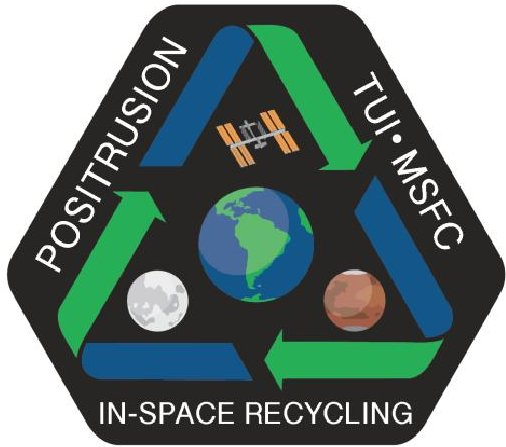

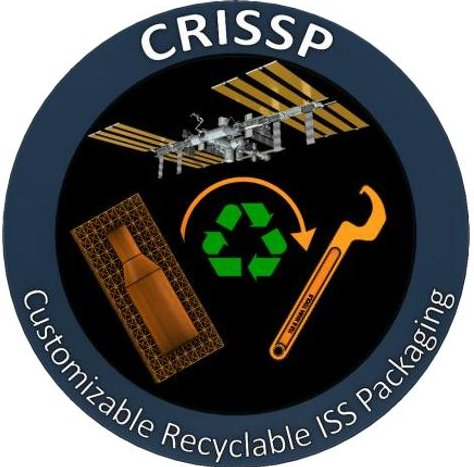

## I. Introduction

THE Positrusion SBIR Phase II-X effort is currently developing a payload that will demonstrate recycling of plastic 3D printer materials on the International Space Station. The novel Positrusion recycling process conditions and deconstructs scrap plastic materials of arbitrary geometry and converts them back into high quality 3D printer filament. The double-MDL EXPRESS Rack payload includes a 3D printer, which uses the recycled filament to fabricate new parts, alongside the Positrusion recycler unit. These systems work together to form a closed loop recycling and printing process. The initial technology demonstration flight will iteratively recycle the same plastic multiple times, creating material samples at each step, to enable measurements of any zero-gravity effects on the process or resulting material properties. The separate CRISSP SBIR effort recently entered its Phase II and is developing novel approaches to launch packaging materials to facilitate in-space recycling of what were formerly waste materials. The CRISSP effort has achieved two goals: (1) recycling currently used packaging materials into 3D printer filament and printed parts and (2) developing customizable and property-tunable replacement packaging solutions which utilize engineering-grade thermoplastics that are better suited for both the 3D printing processes as well as for multiple iterations of recycling. The CRISSP effort is facilitated by working closely with the Positrusion SBIR effort. By enabling reliable recycling of scraps and retired components into 3D

<!-- PDF_PAGE: 2 -->

printer filament, these efforts will minimize the requirements for resupplying and/or storing excess feedstock for NASA orbital and deep space missions that utilize 3D printing.

## II. Development of the Positrusion System for In-Space Recycling of 3D Printer Plastic

Positrusion is the name of the novel process technology that we developed for recycling scrap materials into 3D Printer Filament. The name is a portmanteau of 'Positive' and 'Extrusion'. The conventional process for producing 3D printer filament is called Plastic Extrusion. The 'Posi' refers to our two core innovations: the positive displacement pumps that compose the Processing Chamber that melts and pushes the scrap plastic through the process chain as well as the positive control over the filament forming process that the Continuous Molding system provides.

Among other requirements, NASA's solicitation for an in-space recycler called for techniques to mitigate common filament geometry defects. TUI previously created several custom composite 3D printer filaments for our radiation shielding effort, Versatile Structural Radiation Shielding (VSRS $ ^{\mathrm{TM}} $ ）(Air Force SBIR: FA9453-13-C 0102). Through this experience, we learned several lessons about the conventional plastic extrusion processes, including how sensitive the process is to any non-uniformities in the working plastic material, and the human operations normally required to perform it. Due to our concerns about the suitability of conventional plastic recycling and extrusion process for the space environment, we proposed a new and inherently more tightly controlled process, which is a continuous analogue of injection molding. By re-solidifying the plastic within a rigid mold tool, our approach eliminates the primary failure modes associated with conventional plastic extrusion. The Positrusion process architecture has a patent pending and is still somewhat proprietary, so further details of the process will be reserved for a future publication.

To reduce required crew time along with other mission benefits, the flight demonstration recycler payload was recently augmented to a double-MDL (mid deck locker) size to include an integrated 3D printer. The new payload concept is called the Refabricator $ ^{\mathrm{TM}} $ . Whereas NASA's original solicitation for a recycler called for processing acrylonitrile butadiene styrene (ABS) plastic, the Refabricator has been upgraded to recycle and print with Ultem 9085, an engineering grade blend of Polyetherimide (PEI) and Polycarbonate (PC) plastics, which has heritage on external satellite structures. The demonstration flight is targeted for early 2018.

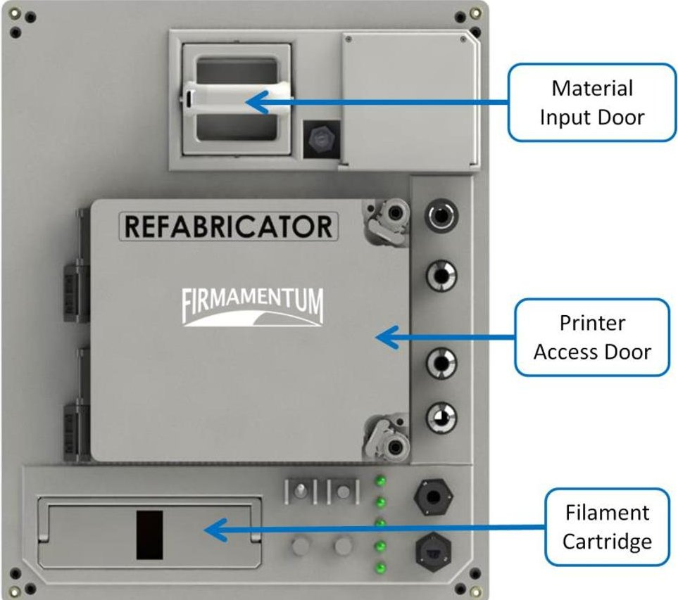

Figure 1. Refabricator $ ^{\mathrm{TM}} $ payload preliminary front panel design

<!-- PDF_PAGE: 3 -->

## III. Positrusion Test Results

The filament geometry that we have produced through testing the Positrusion process is superior to the highest quality filaments that are commercially available. This is significant because it enables tighter flow-rate control during the subsequent 3D printing process. Figure 2 shows a photographic comparison of two commercial filaments along with three different samples of Positruded filament made using different configurations of our Phase I prototype. Conventional plastic extrusion processes, like those used to make these commercial filaments, entail flowing hot liquid plastic out of the extrusion die and solidifying them unconstrained in air or water, which does not deterministically enforce the desired geometry onto the plastic. The following measurement data clarify the level of improvement in diameter control we have made over the conventional process.

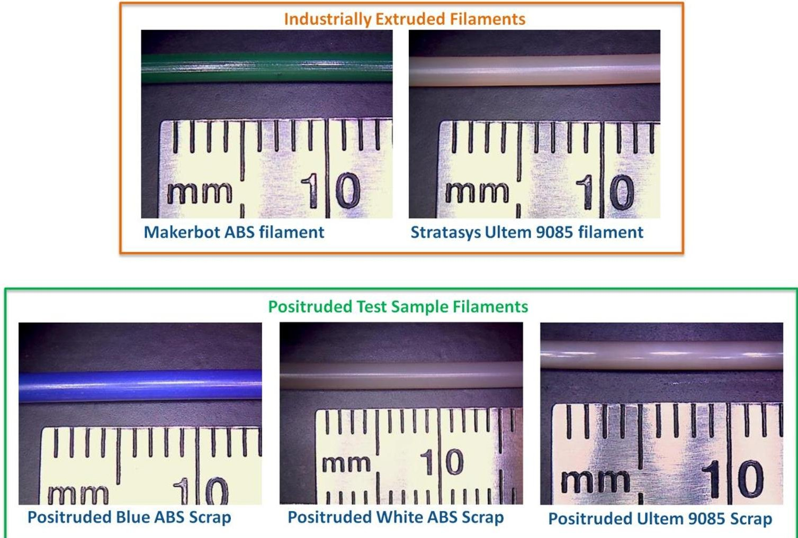

Figure 2. Photos of two commercial filaments as well as three positruded filaments

<!-- PDF_PAGE: 4 -->

Initial tests of the Positrusion process, produced filament with roughly an order of magnitude better cross-sectional area control than commercial filaments. Figure 3 shows the geometry fluctuations in three filaments: consumer grade ABS in red; commercial engineering grade Ultem 9085 in green; and Positruded Ultem 1000 in Blue. These unfiltered values are calculated from sequential micrometer measurements, and are expressed as relative deviation from each filament's average value.

Graph of Cross-Sectional-Area Deviation of Positruded Filament vs. Stratasys Filament (Based on approximation of perfectly round cross-section)

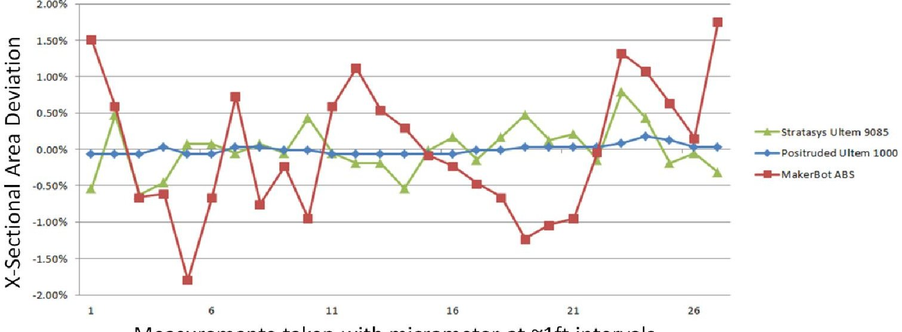

Figure 3. Cross-sectional area deviation graph

In Statistical Process Control terms, Table 1 summarizes the level of diameter control within each sample of filament. For expressing the process capability metric Cp, a diameter tolerance window of +/- .05mm was used. The much higher process capability exhibited by the Positruded filament is due to the more inherently stable action of Positrusion's continuous molding module.

Table 1. Summary of process diameter control capability.

<table border="1"><tr><td></td><td>Positruded Ultem
70 pts over 40 ft</td><td>Stratasys Ultem
50 pts over 15 ft</td><td>Makerbot ABS
60 pts over 21 ft</td></tr><tr><td>Standard Deviation(mm)</td><td>0.0043</td><td>0.0112</td><td>0.0214</td></tr><tr><td>Cp(Process Capability Metric)
relative to+/-.05mm tol</td><td>3.88</td><td>1.49</td><td>0.78</td></tr><tr><td>Sample Diameter Range(mm)</td><td>.014</td><td>.042</td><td>.115</td></tr></table>

<!-- PDF_PAGE: 5 -->

In addition to maintaining control over the geometry of the produced printer-feedstock-filament, an in-space recycling system must prevent excessive reduction of the plastic's mechanical properties. Minimizing the mechanical property degradation enables the same material to be re-used multiple times, increasing the potential mission benefits of the system. Figure 4 illustrates the basic iterative test loop we are using to track the effects of process tuning on these properties. A simplified material characterization routine is used, focusing on tensile testing, to economically screen for relative changes in mechanical properties over many material samples. These samples vary by how many times they have been recycled, as well as by the recycling process parameters used. We will perform this routine going forward to map the process parameter space, and refine the settings toward optimal performance. A more complete material characterization routine will be performed on the final ground and flight demo samples.

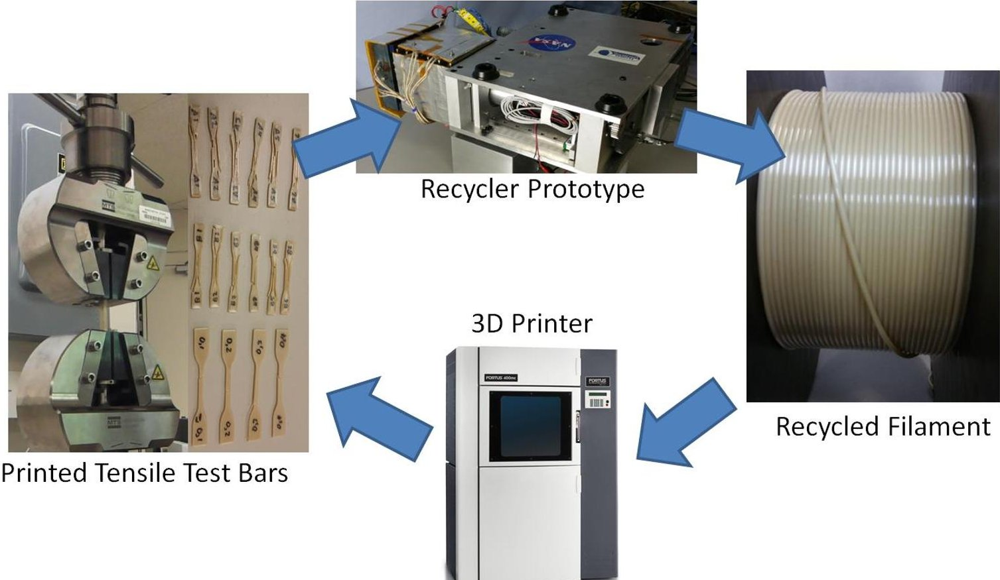

Figure 4. Flow chart of iterative printing/testing/recycling loop

<!-- PDF_PAGE: 6 -->

Since the Refabricator's printer is early in development, the test loop as performed to date (data summarized in Figure 5 and Figure 6) is not completely representative of the flight system. Rather than being printed into tensile test dogbones, the latest degradation rate measurements have been made by directly tensile testing samples of filament. In addition to being more economical, this method eliminates some sources of variation in the tensile test measurements related to the variable geometries of 3D printed tensile bars, and so it is useful for closely monitoring changes to the plastic's basic mechanical properties. However, this method may not be the most representative of what the properties will be of parts printed with the filament, so these numbers are highly preliminary. The ultimate tensile strength measurements show a slight upward trend as the plastic is recycled more times, gaining about 10% higher strength after 6 recycling loops. The strain at break is showing a more significant downward trend, losing nearly 20% after 6 passes through the recycler. The increase in strength is somewhat surprising and will likely not be apparent in printed tensile test coupons since the loss of toughness will interact with the numerous crack initiation points in 3D printed parts. It will likely show a slight decrease in ultimate strength when measured by that method.

Ultem 9085 Filament Ultimate Tensile Strength after 1 through 6 times being Recycled

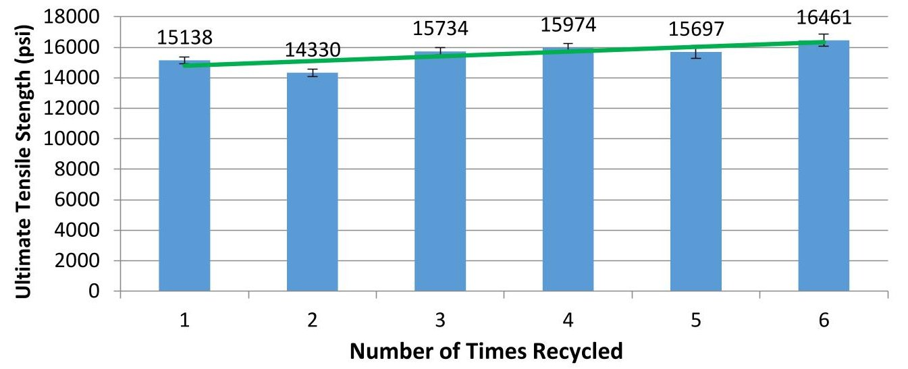

Figure 5. Graph of filament ultimate tensile strength, over 1-6 passes through the recycler

Ultem 9085 Filament Tensile Strain at Break after 1 through 6 times being Recycled

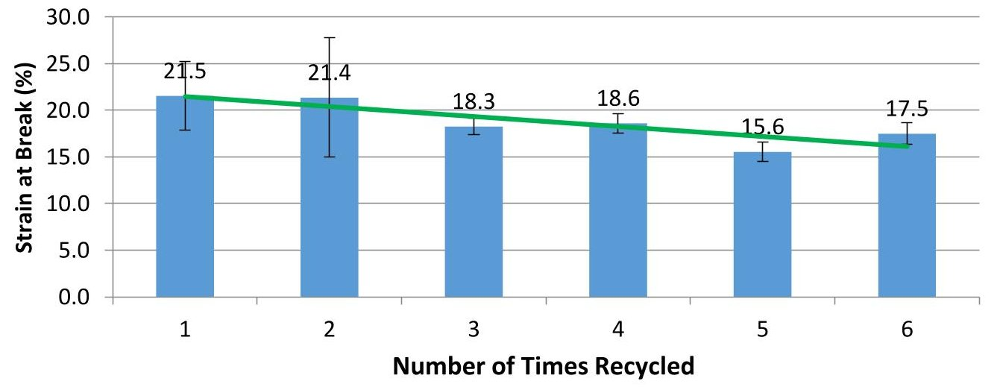

Figure 6. Graph of filament tensile strain at break, over 1-6 passes through the recycler

<!-- PDF_PAGE: 7 -->

## IV. Customizable Recyclable ISS Packaging (CRISSP) Concepts

The potential mission benefits of in-space recycling are rooted in reducing launch mass by transforming significant amounts of waste materials into new useful items. Realizing these benefits will require more than the recycling machine itself; it will require a systemic approach of strategic material selection and component design to properly utilize the 3D Printing and recycling capabilities. The CRISSP effort has begun developing the recycling-oriented mission ecosystem by evaluating potential near term options for recycling launch packaging waste on the ISS. One of the low-hanging-fruit categories of waste material on the ISS is the plastic packaging materials used for launching supplies. These materials become trash as soon as they are unpacked on the station, and can be a burden to dispose of. A sample crew provision launch manifest, published in September of 2014, included 23.6lbs of packaging. Applying the approximate cost of $10,000 per pound of mass launched to low earth orbit, this amounts to nearly a quarter-million dollars spent on launching the packaging materials in a single launch.

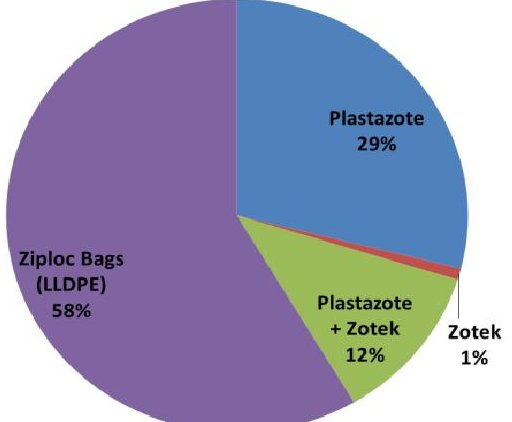

Figure 7. Pie chart of ISS launch packaging by polymer type

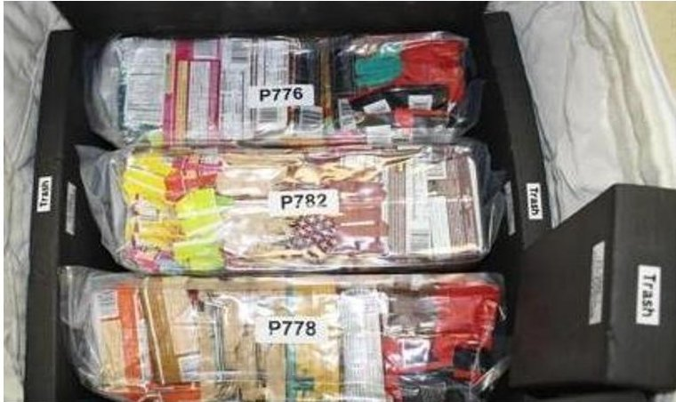

Figure 8. Photo of packaged ISS crew provisions

## V. CRISSP Recycling Test Results

The first approach explored in the CRISSP Phase I effort was to recycle the currently used packaging materials and evaluate their suitability for printing into new useful components. The Plastazote foams currently used are not melt-processable, so this approach focused on zip lock bags and bubble wrap, which are made of Linear Low Density Polyethylene (LLDPE). Polyethylenes have a glass transition well below room temperature, which makes them quite soft and difficult to print without grinding or buckling the filament in the feedhead. They also have very high rates of thermal expansion, which leads to relatively poor dimensional stability. Despite these challenges, they are interesting candidates for in-space recycling because they have extraordinary toughness (a main reason they're used in packaging) and unique radiation shielding properties due to their high hydrogen content. Figure 9 and Figure 10 show some results of successfully recycling Ziplock bags.

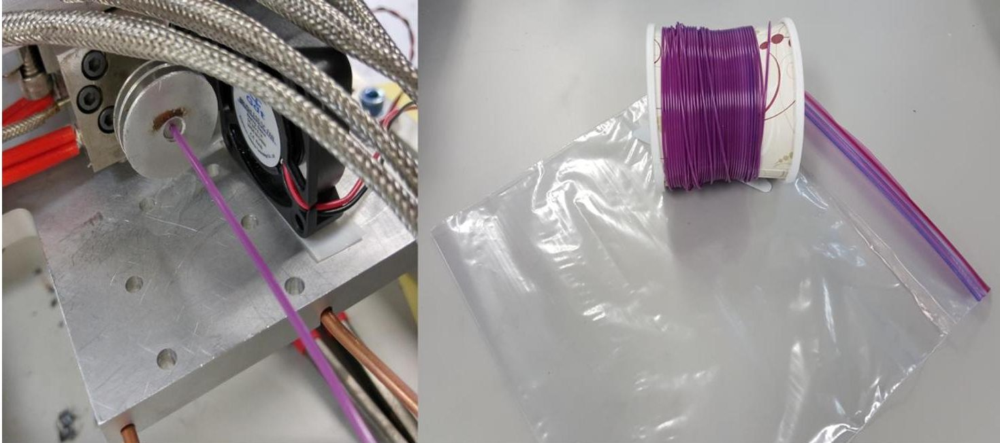

Figure 9. Photos of ziplock bags being recycled into 3D printer filament

<!-- PDF_PAGE: 8 -->

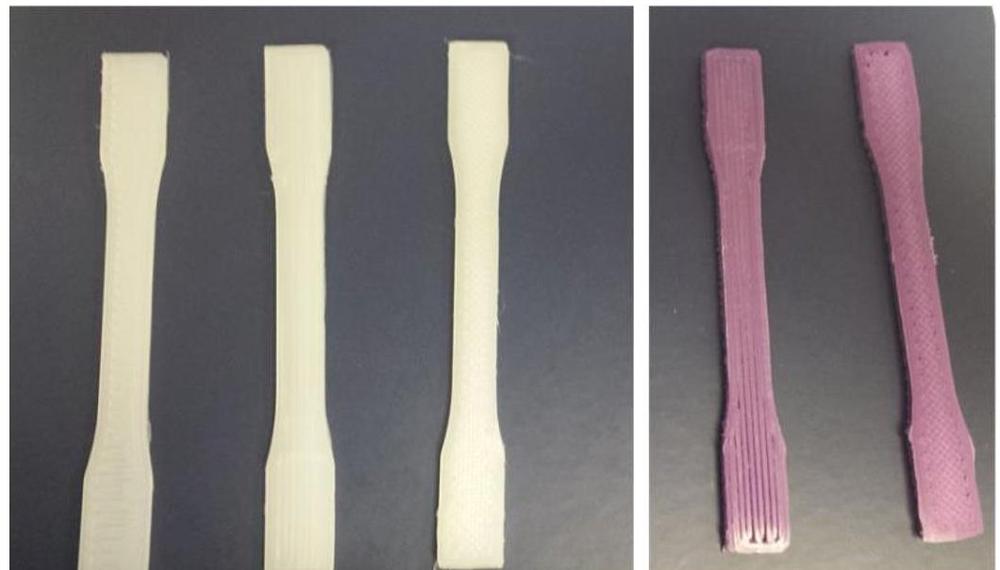

Figure 10. Tensile test specimens printed from virgin LLDPE filament (Left) and recycled ziplock bags (Right)

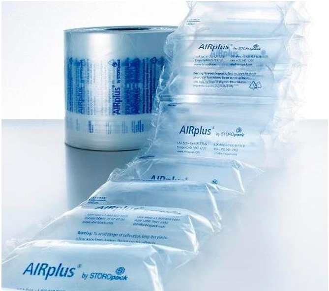

Figure 11. Common commercial PE bubble wrap

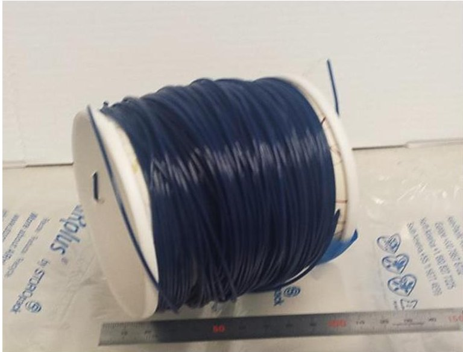

Figure 12. Photo of recycled filament made from bubble wrap

In addition to Ziplock Bags, bubble wrap is commonly used for general purpose padding. We experimented with recycling a common bubble wrap for ground shipments (Figure 11) to further demonstrate the recyclability of LLDPE into filament (Figure 12) using our Positrusion prototype, and the resulting filament quality was similarly good.

<!-- PDF_PAGE: 9 -->

In the current resupply packaging schemes, foam is added to fill in any spare space in each cargo transfer bag. To enable NASA to gain higher value from this launch packaging mass and volume, in the CRISSP Phase I effort we worked to develop an alternative to the foam packaging schemes. Because the foam materials currently in use for launch packaging are unsuitable for recycling and printing due to being cross-linked polymers, we began to study alternative solutions for cushioning which have foam-like properties. We first developed 3D printer infills which have varying modes of controlled compliance when 3D printed within a block shape. During this study, we looked into 3D printed structures made of ABS with out-of-the-ordinary infill percentages, flow rates, and directionalities. Variation in these parameters can impart very different mechanical properties on the final printed parts, including flexing and compression along the different axes as well as torsional behaviors. The flexing directions are labeled X, Y, Z, XY, and XZ/YZ and are shown in Figure 13. For these boxes, we are utilizing laminate schedule nomenclature to describe the orientation of each layer of the infill of the box. For example $ ( 0/90 )_{n} $ would be a box whose first layer is $ 0^{\circ} $ from the X direction and whose second layer is $ 90^{\circ} $ from the X-direction. This internal structure is repeated n times until the box is printed.

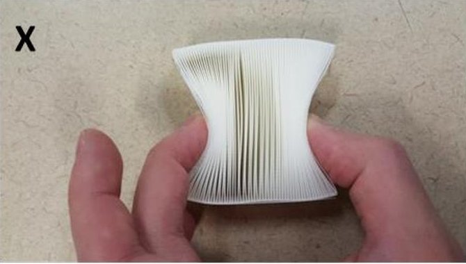

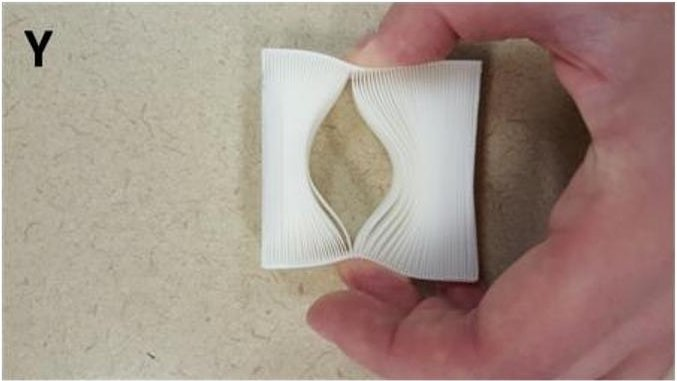

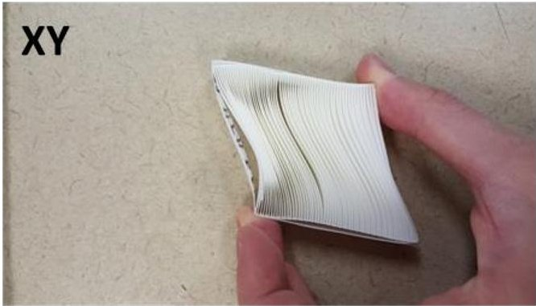

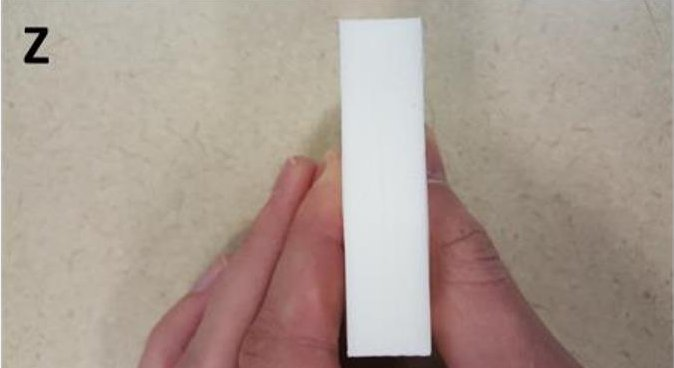

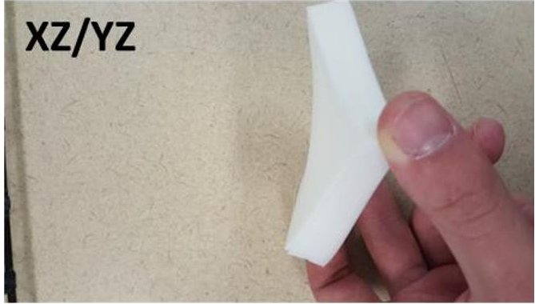

Figure 13: Flexing directions for the foam-like cushioning materials made of ABS; The boxes can flex along axes and diagonals depending upon the internal structure.

Depending on the total thickness of the system, its infill percentage, infill flow rate, the angles of the infill, and the pattern of those angles within the structure, different flexing directions can be enabled while others are disabled. In addition, the degree of compression/flexing in those directions can also be varied. For example, a box with an infill of 40% and a flow rate of 50% with an internal structure of $ ( 4 5^{\circ} /- 4 5^{\circ} )_{n} $ has no flexing direction. However, a box with the same parameters except the internal structure is $ ((4 5^{\circ})_{1 0} /(- 4 5^{\circ})_{1 0})_{n} $ (switches angles every 10 layers rather than every layer) has flex in X,Y, and Z. Thus far, we have created 15 different boxes with different flexing behaviors, and we have begun creating circles to further enhance the compression in the Z direction.

<!-- PDF_PAGE: 10 -->

In addition to varying unidirectional layers, we experimented with randomly curved (AKA 'Random Walk') infill patterns within each printed layer (example pattern shown in Figure 14). The printed items (example shown in Figure 15) had a macroscopic structure similar to the microstructure of open cell foam. Interlayer and intralayer bonding is present (similar to the crosslinked nature of foam materials), and voids permeated the structure. As presented in another submission to this conference $ ^{7} $ , various combinations of these parameters were tested for their response to a simulated launch vibration environment and compared to the vibration energy dissipation of currently used foam materials. The 3D printed foam-like material mitigated energy transfer up to an order of magnitude better than regular foam material. Results from that experiment can be seen in Figure 16, which compares the g(rms) measured within 3D printed materials of various infill structures to the g(rms) measured in three different foams (Plastazote, Zote foams, and Pyrell).

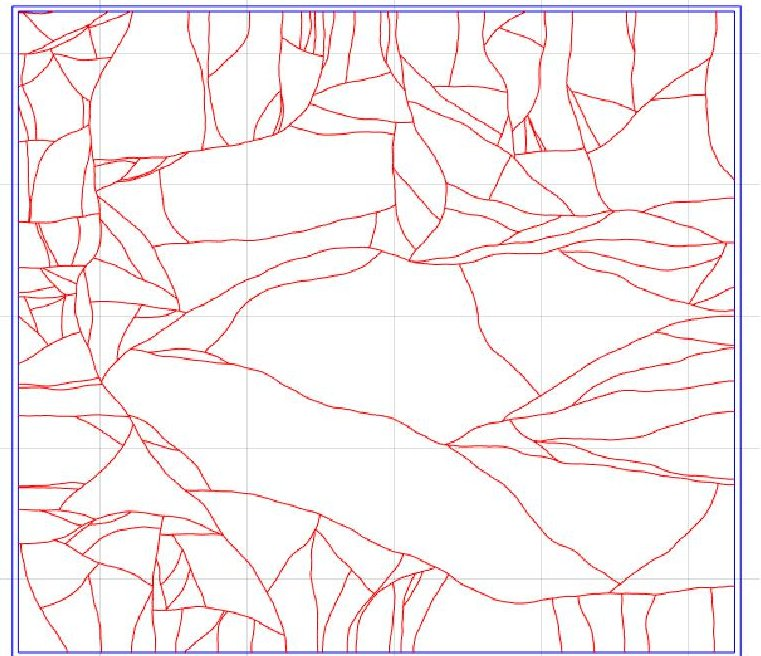

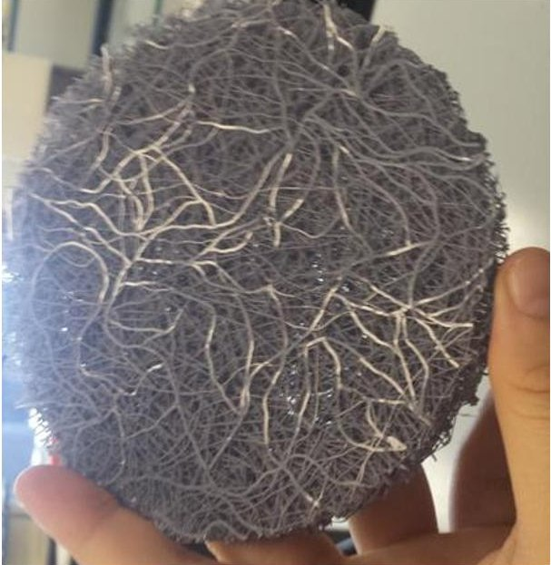

Figure 14. Random walk Infill Pattern Example at 10 degrees and 20% density

Figure 15. Printed ABS Sample with Random walk infill pattern

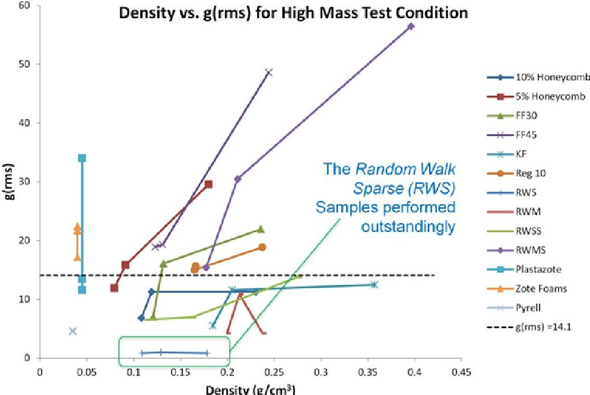

Figure 16. Graph of maximum g(rms) acceleration values measured on weights inside of Experimental CRISSP packaging boxes, compared with currently used foam padding materials

<!-- PDF_PAGE: 11 -->

## VI. Conclusions

The Refabricator payload is on track for flight demonstration of the plastic recycling on board the International Space Station. The novel Positrusion recycling process is being refined through iterative testing of the process cycle, and ongoing tuning of the process parameters, and showing promising levels of preservation of the plastic's material properties. The CRISSP effort is leveraging in-space recycling and 3D printing capabilities to reduce wasted up-mass by recycling launch packaging materials, as well as using 3D printing's capacity for customization and complexity to develop higher performance vibration isolation solutions to replace foam in launch packaging. Initial testing of CRISSP's novel infill systems has also shown promising results. Work on both projects is ongoing.

## Acknowledgements

The effort was funded by two NASA/MSFC SBIR contracts titled Positrusion: number NNX15CM06C, and CRISSP: number NNX16CM08C.