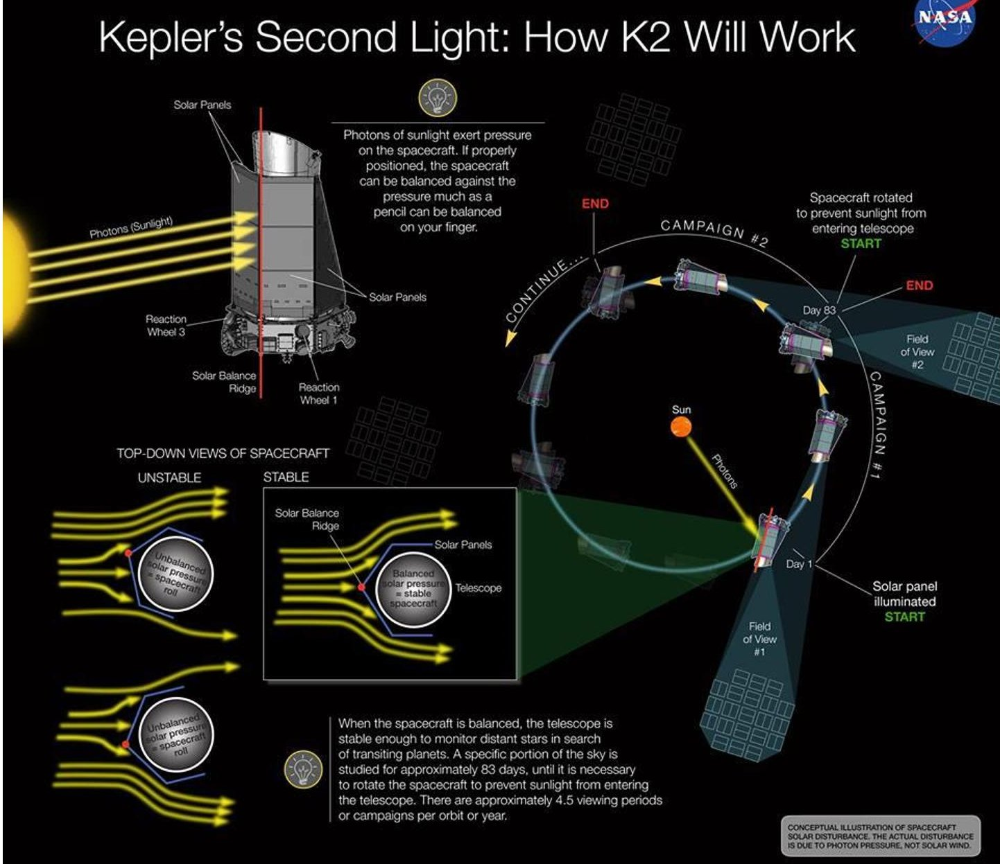
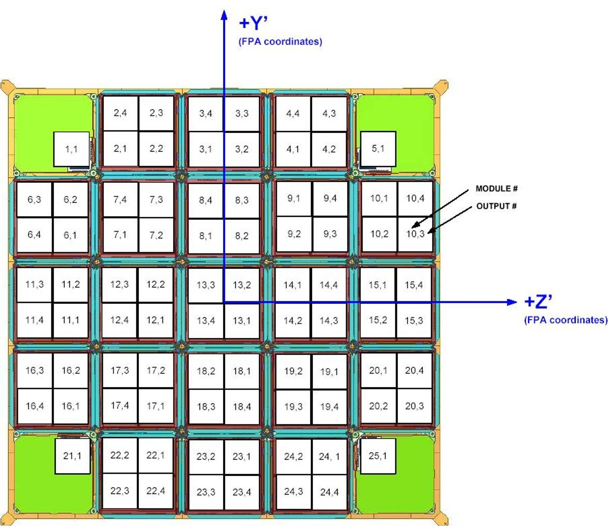

<!-- PDF_PAGE: 1 -->

# Transforming Kepler into K2: Spacecraft Software and System Test Bench Software Adaptations

Susan E. Ross $ ^{1} $ , Kipp A. Larson $ ^{2} $ , Colin A. Peterson $ ^{3} $ , and Katelynn M. McCalmont $ ^{4} $ Ball Aerospace and Technologies Corp. (BATC) Boulder, Colorado, 80301

The Kepler mission was transformed into a new mission called K2 after the failure of a second of four reactions wheels occurred four years into the mission. The mission was designed for three and a half years. The new mission made it necessary to reconfigure and operate the spacecraft in ways quite different from the original mission that stretched software capabilities in both the flight segment and ground support systems. Some of the changes were significant, including quite large new flight command sequences. Others were less dramatic. Although many of the adaptations sound simple, using the system in ways not originally intended frequently required multiple small but innovative solutions. This paper discusses some of the adaptions to the use of the flight segment software and updates to ground support software made to support the repurposing of the Kepler mission in to the new K2 mission.

## I. Introduction

The Kepler mission was launched in March of 2009 into an Earth-trailing orbit with the goal of searching for Earth-sized planets in the habitable zone around sun-like stars. It accomplished this by staring at one field of view for long periods of time and using the transit method to detect planets. The instrument Field Of View (FOV) is ten square degrees, and the initial Kepler star field had 170,000 targets. To date, the Kepler program has identified almost 4700 planet candidates, with 1030 of those confirmed. $ ^{5} $

In July of 2012 Kepler's first reaction wheel failed unexpectedly with no effect on Kepler performance. Approximately six months after the conclusion of the primary mission, the second reaction wheel failed leaving the Kepler spacecraft unable to continue its original mission due to inability to meet pointing requirements. This possibility had been predicted after the first wheel failure and the spacecraft was put in a stable Safe Mode using thrusters only while a new method of flying the spacecraft with two-wheels and thrusters was conceived and developed by the Ball Aerospace team and a new mission was conceived by the Mission team and science community. All this was managed by NASA's Ames Research Center. The new mission named K2 was rapidly designed, developed, and deployed. K2 has been taking science data for its new mission since spring of 2014. For more information about the conception of K2 from Kepler see Ref. 1.

With the reduced capability of the spacecraft, the K2 mission is limited to observations with the spacecraft pointed in the velocity vector (+X) or the anti-velocity vector (-X). This means for all of K2's new fields of view the

<!-- PDF_PAGE: 2 -->

spacecraft will pointed be in the solar ecliptic plane. Figure 1 shows the general scenario of the new mission. When in Science Collect Mode at the mid-point of each campaign window the spacecraft has the solar array normal (Y-axis) pointed at the sun. The X-axis (coaligned with instrument boresight) of the spacecraft is along the velocity vector. For all but one campaign, the instrument is pointed generally in the anti-velocity direction. K2 will stare at one unique FOV for each campaign. So there will be rotation about the Z-axis (high-gain antenna axis) as the spacecraft orbits around the sun. At the beginning of each anti-velocity vector campaign, the aft end of the spacecraft is tilted more toward the sun. At the end of the campaign the instrument boresight is pointed more toward the sun. These considerations end up bounding the length of the campaign to a maximum of about 90 days because of power limitations when solar normal angle decreases (-X axis < 37 degrees of the sun) and potential damage to the instrument when the instrument boresight is exposed(+X closer than 61 degrees). There are also thermal considerations. For more information about thermal constraints see Ref 2.

Figure 1: K2 Mission Scenario (Image Credit: NASA/Ball Aerospace)

With only the two reaction wheels remaining, the reaction wheels only have significant control authority about the Y and Z axes. K2 relies on solar pressure and thrusters to control rotation about the X axis, the optical axis. The balance isn't perfect and there is a slow drift that is periodically corrected using finely tuned bursts of specific thrusters. These thruster adjustments have been dubbed "tweaks." To provide a certain amount of momentum "stiffness" to the system the two reaction wheels are spun up to about 4700 RPM. In compensating for solar pressure contributions, the wheels slowly spin down. The wheels are periodically spun back up to about 4700 RPM, a process designated as "resaturation" or "resat." This maintenance of wheel speed is essentially the opposite of the prime

<!-- PDF_PAGE: 3 -->

mission, where the wheels slowly spin up in order to compensate for solar pressure and were periodically "desaturated."

Though the actual capability of staring at a FOV is up to 90 days, the period of the FOVs selected for the K2 mission have some overlap. Mission scientists then choose the times within the windows of opportunity that each campaign will begin and end. Actual campaign durations are therefore about 75-85 days for the 13 FOVs selected to date.

The new K2 mission made it necessary to reconfigure and operate the spacecraft in ways quite different from the original mission that stretched software capabilities in both the flight segment and ground support systems. In the interests of risk, cost, and schedule management, an emphasis was placed on using the flight software as-is, making full use of the existing flexibilities inherent in the design and any "back-doors" that could be found. The prospect of changing flight software was not completely off the table, but was considered to be more time consuming and higher risk and only to be used if other work-arounds could not be found. To date, all K2 requirements have been satisfied without the need for a flight software update. Even if many of the adaptations sound simple, using the system in ways not originally intended frequently required multiple small but innovative solutions, significant testing, and occasionally came with some surprises. It is exciting that there is still more to be learned even after years of successful operation of a spacecraft.

In addition to adaptations to flight configurations and commanding, adaptations for some ground assets and tools were made in order to adequately create, review, and test flight products. Also some special consideration for process had to be put on the table to expeditiously address the many new issues.

## II. K2 Implementation Background Sequence

Many of the biggest changes to the flight segment are accomplished via on-board command sequences. 60 of about 180 on-board sequences and parameter files were created or modified for K2, with incremental changes to many of these as K2 matured and reorganized sequence modularization. Each campaign is driven by its own large background sequence that activates subsequences with very detailed timing. K2 campaigns are left to run autonomously for anywhere from 75 to 90 days. This means that long detailed sequences are required. The K2 background sequence and all the expanded subsequences are typically between 25,000 and 28,000 commands, depending on the length of the campaign. The sequence calling depth is eight. By comparison, the longest sequences of the nominal mission static sequences <400 commands and a calling depth of at most four. Most sequences were fewer than 20 commands.

One of the reasons so much commanding is required is that K2 is using table commands designed to configure the spacecraft in order to achieve a very new method of attitude control. The nominal spacecraft design provides several different configurations of the attitude control system for different aspects of the Kepler mission. The primary attitude configurations were all wheel control during all attitudes with short commanded transitions enabling the thrusters very briefly about every 3 days in order to desaturate the wheels. The configurations are all table driven and the tables were all pre-configured and switched in an out at the appropriate times.

K2 utilizes the very adaptable table-driven system in a similar way to have unique table entries for each attitude task. Due to the special K2 needs of switching the thrusters in to correct the X-axis drift every 6 hours, some of the tables that used to be "set and leave" are now regularly reconfigured to trim the attitude with the best precision that can be managed with these coarse actuators. These attitude adjustments are called "tweaks" and there are different configurations of them used for different purposes. Katelynn McCalmont discusses in detail the adaptations and refinements to attitude control to support flying the spacecraft in the new K2 configurations in Ref 3.

## A. K2 Sequence Utility Explorer (K2SUE)

The Mission Operations Center (MOC) at the Laboratory for Atmospheric and Space Physics (LASP) had to rapidly deploy massive updates to the mission planning tools and templates used to generate the new background sequences that are the backbone of the commanding products. We quickly realized that a thorough review of these initial products inspecting for correct table commanding, timing of tweaks, timing of wheel resaturations, log captures, etc. was significantly difficult. K2SUE is a Python script written to navigate the calling sequence and generate the entire expanded command sequence and timing for a campaign. As capabilities were extended, the ability to automatically verify certain key aspects was added. In addition to the time-tagged expanded command list (a predictor of the final command log), it generates the Resat Schedule, Tweak Schedule, and Log Schedule and confirms they meet requirements. Also evaluated is the timing of spacecraft control with respect to the science data collection cadences. Baseline cadences, used as science image references, must not be disturbed by any thruster

<!-- PDF_PAGE: 4 -->

attitude adjustments. There is a significant attitude disturbance when the wheels are resaturated, and this must be timed so only one science cadence is lost.

K2SUE receives as command-line input the top-level procedure or sequence to be evaluated. As options, the sync time for the science cadences can be input along with a procedure start time if initial commanding in the top-level procedure or sequence isn't absolute. K2SUE then reads all referenced procedures and sequences from controlled source repositories as it expands the calling trees ingesting all commands. Each command is logged with its expected execution time, delta time, and all parameters.

K2SUE output is generated into a spreadsheet in order to facilitate any custom inspections required by special conditions. It can then be filtered for individual commands or sets of commands to evaluate what state different values are at different points in time.

The generation of these large background sequences has become fairly routine now that the new planning tool and template updates have stabilized. K2SUE is still executed, however, for each campaign background sequence as a tool facilitating meaningful review of flight products and detailed tracking of campaign progression.

## B. Flight Log storage

Kepler has a number of logs that are collected for health and status and diagnostic purposes. The main working logs include Command History Log, Command Sequence History Log, Fault and Major Event Log, Fault Response Log, and the SSR Storage Correlation Table Log. There are about 10 other logs that are analyzed to be less critical and/or highly un-likely to fill during a campaign. By design, the primary logs are stored on board in special limited memory and downlinked periodically to the ground by command. The storage allocation for each log is specified in the software at compile time and was designed to allocate resources to accommodate the nominal mission with adequate margin to allow for potentially missed ground to spacecraft contacts. Table 1 summarizes resource allocation for the key operational logs handled specially by K2 operations and highlights the initial shortcoming that K2 operations needed to address.

Table 1: Key Flight Log Storage

<table border="1"><tr><td>Log name</td><td>Purpose</td><td>Max Number of Entries</td><td>EXPECTED Max Number of K2 Entries per Campaign</td></tr><tr><td>Command Sequence History Log</td><td>List of all commands executed on the spacecraft both from ground and flight sequences</td><td>250</td><td>7200</td></tr><tr><td>Immediate Command History Log</td><td>Start and Stop log of all flight sequences</td><td>2000</td><td>32000</td></tr><tr><td>Fault and Major Event Log</td><td>Logs significant fault occurrences</td><td>1000</td><td>&lt;20</td></tr><tr><td>Fault Response Log</td><td>Logs responses executed, if any, for each fault</td><td>1000</td><td>&lt;5</td></tr><tr><td>SSR Storage Correlation Table Log</td><td>Mapping for science data sets stored in the SSR to support the retransmission of individual CCSDS packets</td><td>3120</td><td>4450</td></tr></table>

In the nominal mission, flight engineering data logs were routinely downlinked weekly during science data collection. Also the amount of commanding occurring during nominal science collection mode was relatively small, so the logs were never near capacity. The capacity is not, however, adequate to capture logs for an entire ~80 day campaign without dumping them, as required by K2. Because the X-band antenna is pointed 90 degrees away from earth during science collection mode, the extremely limited downlink capability (~40 bps) won't accommodate

<!-- PDF_PAGE: 5 -->

regular downlinking of logs. Because of this, a scheme was developed to collect and store key logs in the on-board Non-Volatile Memory (NVM) for the full campaign.

K2 takes advantage of the fact that the downlink process creates a temporary file on the RAM drive before streaming the file via CCSDS File Delivery Protocol (CFDP) $ ^{6} $ to the fully configured downlink channel. The K2 adaptation was to develop new sequences that are periodically called by the background sequence that copies the temporary files to the NVM with date-stamped file names after commanding downlink. The three logs that will fill during the course of the campaign (Command, Sequence, SCT) are then cleared. This process happens on approximately a 1.5 day repeating schedule to assure no loss of data. That schedule is driven by the Immediate Command History Log fill rate. Note that the fault and response logs are not cleared because analysis and history show they are very unlikely to fill, and there is a short window of vulnerability between dumping and clearing during which if a fault condition occurred it would be cleared without having been logged. This is not a problem when we are doing routine operations during a ground contact but is undesirable while operating in the blind. In the unlikely event that the logs did fill and wrap, the versions that are stored all along contain the earliest faults and no data will be lost.

In addition to the storage issue, to make the new log scheme viable the system had to be put in a configuration to essentially fool the software into thinking it is streaming the data to the downlink. Otherwise the files are buffered and will back up in the downlink queues. The system needs to stream the data out in a relatively quick period of time so as to occur during times of no other commanding activity of the long command-intensive background sequence. In order to keep this activity as short as possible, the data was routed to the Ka-band downlink at the highest rate. The Ka-band transmitter, however, takes a lot of power and generates significant heat, so a non-standard hardware configuration was needed. Commanding in the background sequence configures the Mission Unique Board (MUB), which includes the Ka-band interface hardware, to enable the formatting channel to stream data to the transponder without actually turning the transmitter on. Since all that is needed is to grab the temporary file at the right time, the bit stream is basically allowed to "fall on the floor."

## III. Drive Storage Analysis and Adaptation

The spacecraft avionics NVM board is used to store a variety of mission data products. The NVM contains copies of flight software code images, all parameter files, sequence files and tables used in spacecraft and instrument configuration and commanding, some miscellaneous logs and the Telemetry Data Storage (TDS). The NVM is partitioned into three drives, one of which contains the more changeable mission products and was the focus of some scrutiny for K2.

The addition of the log-storage scheme, the significantly larger background sequence file, and the resumption of Fine Guidance Sensor (FGS) Full-Field Images $ (FFI)^{7} $ , and other miscellaneous K2 products added substantial burden to the storage space on the NVM mission products drive. The most significant storage on this drive is taken up by the Telemetry Data Storage (TDS) files. TDS files are engineering telemetry historical data used for diagnosing faults and trending spacecraft performance when we can't downlink SSR data. This is primarily a contingency option when SSR data can't be downlinked expeditiously. Their size is somewhat large and only changeable at flight software compile time (a lesson learned for future missions with potentially diminishing downlink rates).

There was a flight rule for Kepler that TDS storage should allow for 9 days of telemetry recording in Safe Mode without overwriting the historical engineering data it contains. This is so the telemetry events leading up to a Safing event could be trended and analyzed. For K2, we wanted to extend this to two weeks to accommodate missing a ground contact with the more sparse K2 contact schedule. To balance the needs of NVM storage and Safe Mode TDS data, the two tools in our tool box were to change the number of TDS files and adjust the telemetry subscription rates to the TDS files.

The reduction in the number of TDS files from the 750 files that was used during the primary mission to 500 files is an easy two-step process that involves commanding the number of files to be used and then deleting the existing files above that number. This had already been done during the commissioning of the spacecraft. Reducing TDS files gave us ample room for log files but diminished the amount of time we could be in Safe Mode before

<!-- PDF_PAGE: 6 -->

overwriting the engineering data history leading up to the Safing event to only ~3.5 days. This is addressed by updating the telemetry subscriptions to the TDS to be lower rates when in Safe Mode. See section IV.D.

## IV. Low-data rates

As the spacecraft gets further and further from earth the general data rate capabilities get lower and lower for uplink as well as downlink. The naturally diminishing data rates would have been realized for the Kepler mission had its extension proceeded this long. K2 has additional challenges with telecom in all of its attitudes. As previously mentioned, in Science Collect Mode, K2 operates pointed in the anti-velocity direction, very close to the ecliptic plane. When in this orientation, the antennae are pointed close to 90 degrees away from earth, a near worst-case for telecom. When in this attitude, commanding can be performed and telemetry data rates of 40-100 bps can be achieved (at this time) when using a 70 m dish at the ground station. Even when earth-pointed, K2 has less stable pointing because the thrusters are more coarse actuators than were the wheels, resulting in even lower link margin.

By using a 70 m dish, about once every two weeks, telemetry rates of 40-100 bps can be achieved at the science attitude. A small set of targeted operations can typically be performed with these contacts at this time. Usually the verification of the ADCS Subsystem being in Fine Pointing Mode and the Instrument actively collecting data are the most important. Other status and trending is possible, including the downlinking of Reference Pixel data to confirm pointing alignment with Science targets.

## C. Command Upload Timeout

Another minor change required was found when the uplink rate was adjusted to a rate lower than any that had previously been used, and a file upload was attempted. The spacecraft uses $ \mathrm{C F D P}^{8} $ to transmit files between the ground and the spacecraft. CFDP has a timeout once a file transmission has begun for receiving a Channel Access Data Unit (CADU). This is to prevent lockup of the command channel should there be a problem in transmission. The data rate was so low that a single CADU transmission exceeded the timeout. Root cause was quickly determined for the error, and a new time-out was commanded. This was the only configuration change required. It was decided to balance the timeout duration (potential command lockout period) with the lowest likely rate, rather than just commanding a timeout suitable for the lowest possible rate. Procedures are now in place to update this value readily when/if data rates drop below the currently configured timeout.

## D. Redefining Telemetry Modes

Kepler has eight different telemetry modes defined that can be commanded for different purposes. Each of these modes defines the subscription rates for CCSDS packets generated by each Computer Software Component (CSC) to each of multiple destinations, including real-time telemetry, the Solid State Recorder (SSR) Engineering Data Partition, and Telemetry Data Storage on the NVM. Multiple considerations for K2 have led to substantial refinement of Telemetry Modes for these destinations.

Low telemetry downlink rates have resulted in the need for redefining real-time telemetry subscriptions. New baseline subscription rates have been redefined for the real-time stream in all the primary operational telemetry modes to accommodate lower data rates. In addition to this, context-specific adaptions have been developed to modify baseline subscriptions for specific activities. Downlinking files at very low rates, for instance, requires that real-time subscriptions are reduced to very low rates for the duration of the file downlink. Subscriptions are restored after file downlink completion.

In addition to real-time rates, the storage rates to the SSR also had to be adjusted. The duration of the time between SSR data dumps has increased by a factor of approximately three over that of the original Kepler mission. Therefore subscriptions to SSR engineering partition would fill the recorder if not adjusted, resulting in lost data. The SSR is the primary source of trending data for spacecraft performance. SSR Engineering data partition subscriptions were reduced down to approximately half their original rate to fit a typical science campaign with suitable margin.

Two of the defined telemetry modes configure the telemetry subscriptions in the event the spacecraft is in Safe Mode. The subscription rates to TDS are the same for both modes, but a separate telemetry definition file exists for each of the modes. The TDS subscription rates in Safe Mode were decreased to about $ \frac{1}{4} $ their original total bandwidth, resulting in about 6 days of pre-fault engineering data after up to 14 days in Safe Mode. This is considered adequate to diagnosing the probable root cause of faults.

<!-- PDF_PAGE: 7 -->

Making a change to telemetry subscription rates is not difficult, but the significant number of changes made for K2 requires careful planning and the creation and upload of new telemetry mode parameter files. Each of the telemetry modes is configured with a parameter file that contains the set of commands specifying each subscribed packet and the packet rate, destination and priority of the subscription. Note that subscription rates for a given packet in a given telemetry mode can also be adjusted or individual packets pushed to any destination by command.

A spreadsheet existed from Kepler spacecraft commissioning that described the packet subscriptions for each telemetry mode and calculated the total data rate being sent to each destination. This spreadsheet had been used primarily for reference during the Kepler mission. For K2 that capability was extended to do three additional primary tasks.

1. Open existing flight telemetry parameter files directly from file source control to assure starting with flight configuration.

2. Provide easy adjustment of subscription parameters showing the resulting bandwidth utilization and the resulting frequency of each packet.

3. Create a new parameter source file from the adjusted subscription rates.

All adjustments to telemetry subscription rates were negotiated with appropriate subsystem leads, assuring that no loss in important trending capability would result. In some cases, based on Kepler and early K2 experience, subsystem engineers chose to use this as an opportunity to trade bandwidth of certain data items in their purview to emphasize some data and de-emphasize others.

## E. Telemetry Buffers Clearing

A less simple adaptation for K2 because of low data rates is the need to develop methods for flushing the downlink buffers of all data if data has become backed up. The data can get backed up if excessive amounts of data packets are pushed in addition to regularly subscribed telemetry or if multiple data sources are folded into the realtime stream, e.g. file downloads. Also, event messages are pushed by the software when certain notable events happen in the system. Other instances are when a lower data rate than planned is required for a given contact, or when file downlinking was active when ground contact was lost. With the very low data rates we now have, these kinds of occurrences can cause problems that would not have been problematic with the rates of the original mission. Various otherwise benign circumstances can cause real-time telemetry to back up into flight buffering mechanisms leading to substantial delays in receiving current engineering telemetry and operational messages. This is in no way deleterious to the spacecraft but can make real-time operations a bit confusing for the controllers on console.

The flight system has multiple layers of buffering data to account for these kinds of bursts of data. At the more nominal telemetry rates for which Kepler was designed, all of this buffering would clear relatively quickly just by being streamed to the ground. This is not the case for the data rates we are now seeing, especially in the velocity vector orientation.

To clear all the data from all the data paths, a combination of a flight sequence and a ground procedure were developed with a multi-layered process for clearing active requests, pending requests, and hardware and software buffers.

It should be noted that clearing all the buffers in such a way is a destructive process. All the cleared data is lost from real-time telemetry stream. The Engineering telemetry should all be available in stored telemetry if there are concerns requiring data trending for that time interval. Files can be re-downlinked. Some real-time messaging is at risk, though these are uncommon. The risk exposure is typically less than one hour.

## V. Command and Telemetry Database Updates/Maintenance

The Kepler Command and Telemetry Database (C&T DB) is a Microsoft Access Database tool. In addition to defining all characteristics of commands and telemetry, the database is used to create flight command sequences. It also contains fault protection configuration and mode management configuration. Historically, the tool provided many different outputs that fed into most different phases of spacecraft development, test, and operations, including things like autogenerated flight and ground software source files and ground test procedures. The database also

<!-- PDF_PAGE: 8 -->

generates OASIS-CC $ ^{9} $ database products used both to operate the K2 flight segment and the System Test Bench (STB).

In support of both the primary mission and K2 the database command defaults, and telemetry limits have been maintained in the Access database. Nearly all K2 command sequences are generated using the database. These aspects have been rather routine maintenance of the database. In addition to these more routine aspects, some atypical changes were made to support K2 special operations.

There is a set of commands in the database that are designated as test-only commands. These commands access special aspects of the flight software for purposes of special tests to hardware and software that are considered ill-advised in routine operations of the flight segment. Commands that are so designated are thoroughly reviewed and tested as are all commands, but these commands are not exported to the OASIS-CC database used to run the spacecraft nor can they be built by, the tool that compiles flight sequences. Because of the non-standard operation required for K2, a small number of these commands had to be upgraded to flight accessible commands and distributed to the MOC. The STBs already had test-only command capability.

A number of telemetry items had limits updates to support K2, most notably related to the ADCS and thermal subsystems. The attitude error limits, for example, are updated for the higher pointing error expected for K2. Similarly, thermal limits were changed to accommodate the aft end of the spacecraft getting more sun exposure at one end of every campaign. Many of these types of changes required updates to telemetry limits for OASIS-CC monitoring of real-time data and also for related fault protection limits. Some of these limits are changed as default settings, and some are commanded in sequences corresponding to different K2 activities.

A number of telemetry items had engineering conversion updates to support K2 changes. For example, fault protection was updated to redefine actions taken for certain conditions in the system. This meant that the interpretation of response numbers was significantly different. This kind of update has little bearing on overall system performance, but it helps reduce confusion of events for operator on console.

A final important aspect of the C&T DB is its output of the various handbooks documenting the operational system. Primary handbooks generated by the database and distributed to multiple organizations responsible for the K2 mission are: the Command Handbook, the Telemetry Handbook, the Command Sequence Handbook, The Fault Handbook, and the Response Handbook.

## VI. Mode management

Kepler Flight Software provides configurable spacecraft modes and mode transitions. The standard mode transition sequences for Kepler set up many power and attitude control configurations, among other things. Some of the defined Kepler configurations were incompatible with new K2 operations. In the early rapid operations development for K2, more simple transitions were created for some transitions using a back-door method of implementation. The back-door method performs an independent sequence of commanding to configure for the new mode and then "jam-loads" the FSW with that mode setting. Full transitional commanding was developed in a series of enhancements allowing the rapid incremental development paradigm used to deploy K2. The ability to "jam-load" the mode setting is an example of a test-only command that was released to flight operations for K2. See section V.

In the progressive refinements that were made once the basic K2 was working, formalizing the mode transitions back into the original paradigm was considered. At that point, it was decided that the working command sequencing put in place was higher risk to change than to leave in place. Changing it would not affect K2 performance in any way. The remaining update made to the Kepler Mode Management was to turn some transitions sequences from the main mission that were no longer required by or compatible with K2 operations into NOOP sequences in case of the unlikely event of inadvertent activation.

## VII. System Test Benches

K2 also required adaptation of the System Test Benches (STBs). The STBs were used for many pre-launch development activities of software, hardware, and operations. Since launch, they continue to be used to develop and to verify flight products and to validate operational approaches and anomaly resolution. The Kepler STB is composed of Engineering Model (EM) Avionics (including EM Kepler Control Box (KCB), EM Subsystem

<!-- PDF_PAGE: 9 -->

Interface Box (SIB), EM Precision Electronic Clock (PEC)), an EM SSR, a Dynamic Spacecraft Simulator (DSS) hardware & software, and Photometer Functional Simulator (PFS). These elements provide simulations and engineering models for all Kepler hardware and electronics interfaces, resulting in a flight-like test configuration.

In addition to fairly routine maintenance, multiple capabilities of the test benches were enhanced or updated to support K2. Enhancements include:

- Updates to Fine Guidance Sensor (FGS) simulation,

- Enhanced solar-pressure model,

- Refined thruster force vectors based on flight data,

- The ability to specify campaign-specific orbital position, attitude, date and time,

- K2-specific configurations of components,

- Modified startup script to remove Kepler seasonal configurations and add K2 Campaign configurations

## F. Fine Guidance Sensor (FGS) Simulation

The FGS simulation was enhanced to allow testing of command products related to defining FGS Pixels Of Interest (POI) and to allow the bench to provide the Fine-point ADCS Mode of operation closed-loop about the simulated data. FGS POIs are stars of sufficient magnitude that will be in the FGS Field of view for the campaign and are used as guide-star references fed into the Attitude Determination and Control Subsystem for best alignment with each Campaign science observation field. Figure 2 shows the Kepler focal plane layout. The FGS sensors are the single output sensors in each corner of the array of Charge Coupled Devices (CCDs) and are co-aligned with the science CCDs. For Kepler there was a single FOV installed into the STB to simulate the one star field for each FGS sensor. A single FGS star field was generated for each FGS sensor and installed into the bench to serve the entire mission.

For each K2 campaign, the spacecraft is loaded with tables defining POI blocks on the FGS sensors where the guide-stars will be located, along with the azimuth, elevation, and right ascension of the stars. Also loaded to the spacecraft for each campaign are the Science tables defining the locations on the science detectors for all science targets specific to each campaign. Precise control of attitude based on the FGS guide-stars aligns the science targets within the defined apertures read by the instrument during the campaign.

The STB software was modified to read in the FGS star field data and improve the resolution of the star simulations and the noise models. Additionally, for each campaign the star catalog data is configured into the test bench code. Once these two modifications are in place, the bench FGS simulation is fully configured for the existing simulation. Stars in the catalog are placed in the appropriate locations on the simulated FGS detectors based on simulated spacecraft attitude "truth."

In addition to the simulation software configuration update, support software was updated and a procedure developed for generating the star field and catalog data in the correct formats for input into the bench startup. These support tools receive inputs from the ADCS subsystem lead for each campaign defining the necessary elements. The bench startup script then activates the campaign-specific products for the simulation to use at bench configuration when the user inputs campaign number.

<!-- PDF_PAGE: 10 -->

Figure 2: Focal Plane Assembly (FPA) CCD Layout

## G. Thruster update

For Kepler the thrusters were only used for desaturation of the wheels and precise simulation was not a key issue. The force vectors for each thruster were defined to be the modeled design vectors. These were close enough to the installed flight system for Kepler, but for K2 the force vectors were updated using actual flight data to more accurately simulate our new more thruster-based attitude control.

## H. Solar Pressure Model

Similar to the thruster model, the solar pressure model was a simple low-fidelity force vector acting on a boxmodel of the spacecraft to approximate the loading of the wheels due to solar pressure during the course of the science observations. For K2 this was updated to a detailed lookup table based on flight actuals to better approximate the pressure exerted on the Kepler spacecraft surface profile by solar pressure.

## I. Campaign specific location and attitude

The initial STB started up with a generic time, spacecraft standby position and attitude, and four season-specific science attitudes. The STB was modified to remove all season-specific data. A spacecraft ephemeris data table was generated for the next two years. A Python script was created to read in this table and look up spacecraft location based on user-supplied date and time stamp. The script then auto-generates the OASIS-CC CSTOL procedure to command the simulation start time and corresponding position. These are "truth." The auto-generated procedure

<!-- PDF_PAGE: 11 -->

then issues commands to the STB avionics to jam-load the vehicle time and command the vehicle with the correct ephemeris update.

Similarly, campaign-specific CSTOL procedures load the flight campaign products defining science POI tables for the campaign science attitude, and the spacecraft target tables for the science attitude that control the spacecraft maneuver to the science attitude.

## J. Startup transition sequence

The bench startup OASIS-CC CSTOL procedure was dramatically overhauled to accommodate all the changes discussed above in bench reconfiguration for K2. In addition to this, the procedure will configure the bench to startup to any of the defined spacecraft Modes to serve as starting points for various types of testing. Once the simulation is generally configured and the spacecraft time and attitude initialized to the proper ephemeris and time, the procedure will run through flight-like steps to bring the system to the new K2 mode for the commanded campaign. Where practical, actual flight sequences are used during startup for spacecraft commanding. In some cases, actual spacecraft commanding can be prohibitively long for bench startup. In such cases, the flight sequencing is simplified in-line in the startup procedure with shortened delays. The objective is to end up in the proper state with all the proper flight settings in as short a time as possible. To accomplish this, Fault Protection must be disabled until the final configuration is reached, since attitude errors and rate errors resulting from short-cutting various maneuvers would otherwise result in spacecraft Safing.

## VIII. Process

During the Kepler mission, many of the mission operations products and documentation had changed very little or not at all since launch/commissioning. With K2 and the reinvention of how to fly the spacecraft, many products have been changed and entirely new ones created. In the immediate aftermath of the second wheel failure, the overall risk posture of the mission went from the very conservative operations of the Kepler mission to significantly higher risk activities being accomplished in much faster than normal periods of time in order to first save the spacecraft and then repurpose it. This rapid development of K2 led to some streamlining of processes, primarily lower documentation burdens and fast-track approvals.

Though some process streamlining was necessary to respond quickly enough, the standard Kepler process backbone was preserved. As K2 matured, a more conservative risk posture developed along with a push to rebaseline the products, processes and documentation that form that backbone. All work is sponsored by Kepler Action Change Requests and final delivery to the spacecraft required the approval of NASA Ames Project Management. At its core, the early process very much resembled the Agile Programming paradigm. A minimum of two sets of eyes and sometimes the collaboration of a four member team brainstormed, implemented, tested and reviewed all products. All flight products were version controlled. Changes were typically small and incrementally refined, i.e. we got something up there that we knew would work and then tuned up the performance over multiple iterations. As K2 has matured into routine operations now in its sixth campaign of science collection, the risk posture has reverted to the normal more conservative approach and the process is more in line with our normal maintenance and support of an active spacecraft, where every change is significantly analyzed, documented, discussed, and reviewed.

## IX. Conclusion

The success of transforming the Kepler mission into the K2 mission required the entire mission team to sharpen their pencils and come up with ways to rework the existing system into something significantly new. This paper discusses some the adaptations made to flight software configurations and operations that stretched existing software capabilities to accomplish K2 requirements. Also in order to test new flight operations, the STBs were updated to better create the new flight-like environment in our Flight Planning Center. These changes were essential to the creation and successful execution of the K2 mission, and were carried out without any additional funding or staffing growth in the Kepler plan.

Flight considerations included adapting set-once table configurations to highly dynamic time-critical attitude control adjustments, creating a new log capture method for operating in the blind for several months, updating telemetry subscriptions, and reallocating storage assets to accommodate performance trending.

Ground updates include improving Thruster model constants, Solar Pressure model, and Fine Guidance Sensor model in the System Test Bench, significant updates to the bench startup, and configuration scripting to better represent the "new" spacecraft, and updates to the Command and Telemetry Database products.

<!-- PDF_PAGE: 12 -->

The result is that the K2 mission is in its second year of operation collecting data for its sixth campaign. The spacecraft continuous to contribute to the catalog of discovered exoplanets. In addition to this, the new K2 mission is able to provide data to study other cosmological opportunities.

## X. Acknowledgments

The authors would like to thank Jeff Pugliano, Kevin Moore and Shane Swartz for keeping the ground support equipment and the system test benches up and running. The various subsystem and specialty engineers at BATC ensure the spacecraft remains healthy and happy. Mike Packard, Lee Reedy as well as a team of professionals and students work long and various hours at the LASP Mission Operations Center to develop, check and execute flight operations procedures. John Troeltzsch at BATC and the management and science staff at NASA Ames Research Center provide support to continue to operate the mission as a team.

## XI. References

1 Larson, K. A., McCalmont, K. M., Peterson, C. A., and Ross, S. E., "Kepler Mission Operations Response to Wheel Anomalies," 2014 AIAA SpaceOps Conference, Pasadena, CA, May 5-9 2014, Paper AIAA 2014-1882.

2 Peterson, C. A., Larson, K. A., McCalmont, K. M., and Ross, S. E., "K2 Mission Operations: Finding Balance in Year One," Accepted to AIAA Space 2015, Pasadena, CA, Aug. 31- Sep. 2, 2015 (submitted for publication).

3 McCalmont, K. M., Larson, K. A., Peterson, C. P., and Ross, S. E., "K2 Pointing Enhancements and Performance," AIAA Space 2015, Pasadena, CA, Aug 31- Sep. 2, 2015 (submitted for publication).