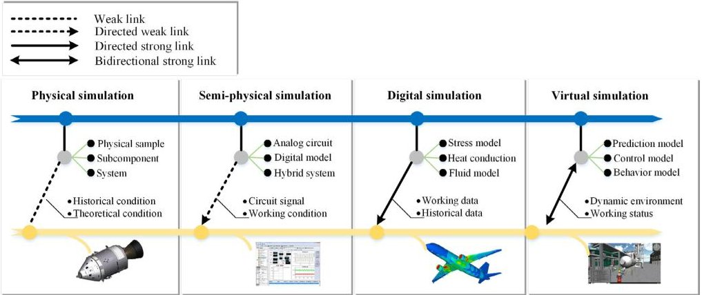
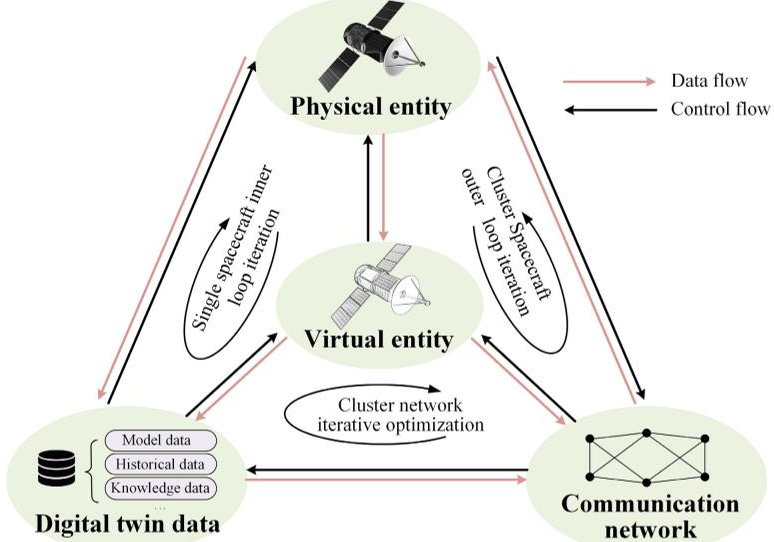
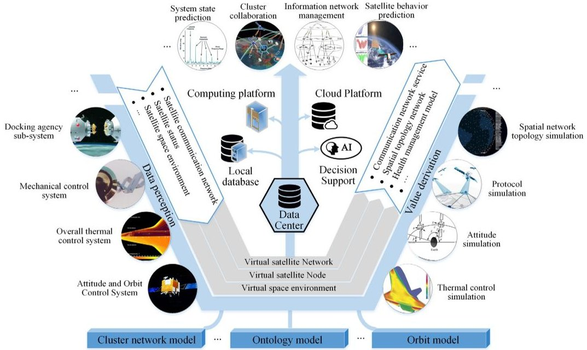
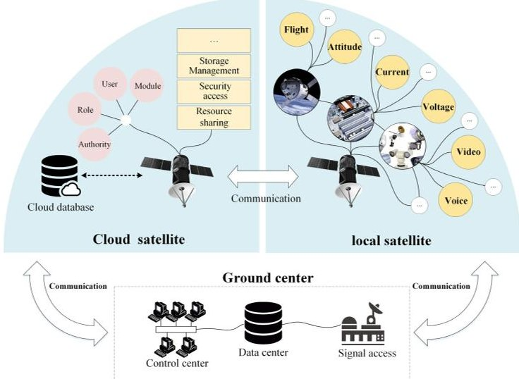
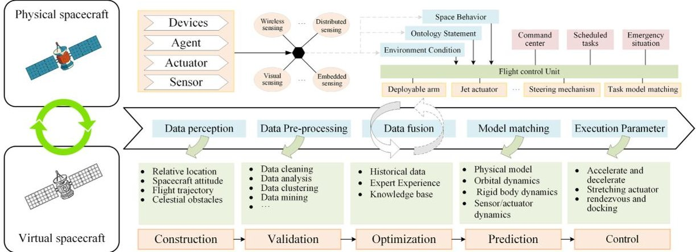
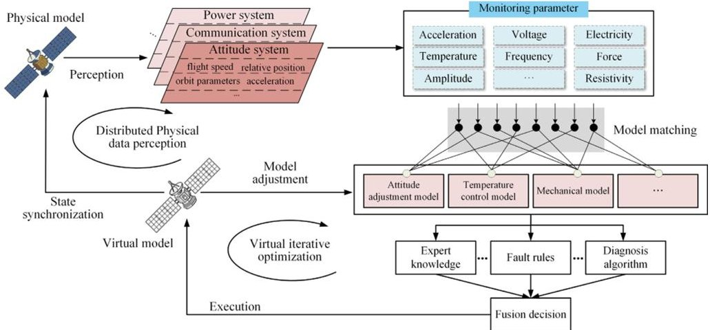
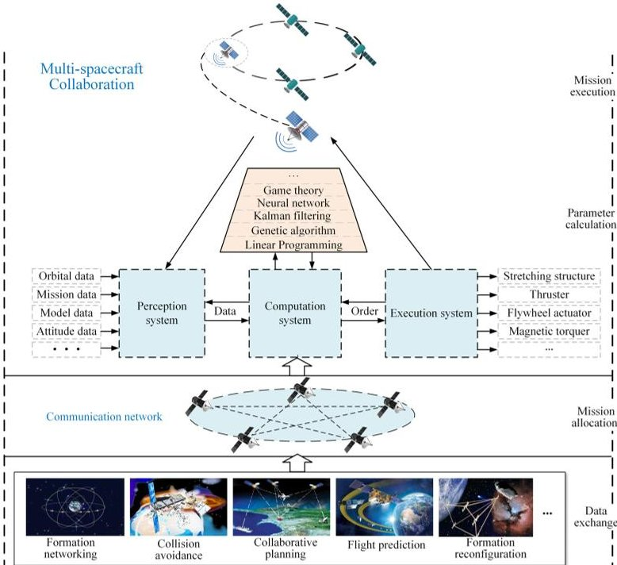
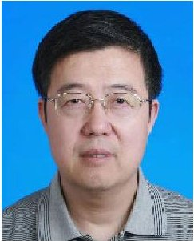

<!-- PDF_PAGE: 1 -->

Received June 13, 2021, accepted July 18, 2021, date of publication July 27, 2021, date of current version August 5, 2021. Digital Object Identifier 10.1109/ACCESS.2021.3100683

# Application Status and Prospect of Digital Twin for On-Orbit Spacecraft

WENQIANG YANG $ ^{iD1} $ , YU ZHENG $ ^{iD1} $ , (Member, IEEE), AND SHAOYANG LI $ ^{2} $ $ ^{1} $ School of Mechanical Engineering, Shanghai Jiao Tong University, Shanghai 200240, China $ ^{2} $ Shanghai Institute of Aerospace System Engineering, Shanghai 200240, China

Corresponding author: Yu Zheng (yuzheng@sjtu.edu.cn)

This work was supported in part by the National Natural Science Foundation of China under Grant 52075338, in part by the National Key Research and Development Program of China under Grant 2020YFB1710802, and in part by the Shanghai Key Laboratory of Advanced Manufacturing Environment.

ABSTRACT With cloud computing, big data, artificial intelligence and other new information technologies going into space, the era of space intelligence is coming. The spacecraft is facing more frequent and multi-task tests in an unprecedented complex environment, which set higher requirements for selfmanagement. The current challenge lies in how to further build an integrated system of the virtual and physical space for spacecraft. In this tendency, the integration of Digital twin(DT) with spacecraft is also in its evolutionary trend. DT provides a data and model-based systematic approach for operation and management in the entire service life of on-orbit spacecraft. In this context, as a basic space system entity, the method of constructing DT of spacecraft is explored in this paper. Firstly, the concept of Spacecraft Digital twin (SDT) is put forward and four stages of simulation development are discussed from the perspective of DT. Moreover, the conceptual structure of four-dimensional model is proposed to adapt spatial distribution. After that, the key problems of SDT are discussed, including data acquisition, system configuration, and data service model. Accordingly, the future intelligent applications of spacecraft based on DT in autonomous cognition, autonomous operation and maintenance, as well as cluster collaboration are presented respectively.

INDEX TERMS Spacecraft digital twin(SDT), digital twin, artificial intelligence, virtual-physical fusion modeling and simulation, cyber-physical system (CPS).

## I. INTRODUCTION

In recent years, Chinese aerospace industry booms and takes on an accelerating development trend. Satellites launched by China have been used in many fields including science (e.g. the Quantum Science Experiment Satellite "Micius") communication (e.g. "Dongfanghong" series satellites), meteorology (e.g. "Fengyun" Meteorological Satellite), resources (e.g. "ZY" and "Gaofen" series satellites), navigation (e.g. "BeiDou" Navigation Satellite). In 2020, Chinese Aerospace launched 39 missions, raking the world's second highest number of launches and mass of launch loads. The booming development of aerospace industry has spawned high-frequency and high-intensity launch missions.

Spacecraft evolves from simple structure and function towards ones with higher complexity. In addition, higher standards of performance and reliability is set to meet

the long-distance communication, long-term service and intelligent management. The demand of development in aerospace industry gives birth to new technology, and now the advantages of DT coincides with the application status of spacecraft. It is difficult to fully understand the working status of object from physical dimension, DT prompted the fusion of physical and virtual space, to achieve synchronization state of awareness, task execution, etc. across the entity domain, will provide virtual mirror of physical entity in components status, properties, and evolution of parameters such as full life cycle of a record and tracking, and realize the optimization and prediction of behavior state. The original concept of Digital twin was proposed in Product Lifecycle Management (PLM) course [1]. Due to the unique features in terms of expansibility, reproducibility and openness, DT has quickly extended its application from PLM to more fields like aerospace, oil gas, medicine, etc.

Many researches have been carried out since the concept of DT appeared. NASA released the "Modeling, Simulation,

<!-- PDF_PAGE: 2 -->

Information Technology and Processing" roadmap, which promotes DT technology in spacecraft field [2]. In 2011, NASA collaborated with US Air Force Research Laboratory(AFRL) and presented an example of future aircraft Digital twin [3] to predict the performance and conditions in reliability design phase, and proposed "Airframe Digital twin" for designing and maintaining [4], [5].

DT application has been exploring at the same time. The virtual manufacturing environment of Airbus A400M Final Assembly Line [6] modelled all processes and resources in space and monitored thousands of objects in real-time. The US Air Force collaborated with Boeing to construct the F-15C Digital twin [4] and developed an analytical framework. Lockheed Martin [7] introduced DT to increase the production efficiency of F-35 fighter, and applied DT to deep space exploration. With the help of DT, operators will be able to acquire working conditions, simulation data and solutions in real-time, thus intensive operation tasks can be performed more effectively.

In space working, any changes could be fatal, therefore all modifications of a space vehicle are tested on a detailed simulation model to ensure the change produces the desired effect [8]. As aerospace industry speeds up the digitalization process, the application of DT on spacecraft brings new consciousness awakening. After reviewing the literature and exploration, the integration of space system and DT technology is still in its infancy. It is a huge challenge to realize DT by synchronized mapping during the on-orbit working phase. For one thing, the application of DT revolves around the massive data of full life cycle, with problem of real-time data perception and storage from multiple sources and uncertainty prediction, data organization is therefore extremely difficult. For another, the maintenance cost of spacecraft is extremely high due to its complex internal structure, as well as variable external circumstances of space environment and long-distance communication. Therefore, exploring system configuration of SDT is a critical step for this purpose. This paper attempts to figure out the fusion between spacecraft and DT based on the massive amounts of on-orbit data and knowledge to facilitate deeply intelligent applications.

The rest of this paper is organized as follows: the second chapter reviews the procedure of evolution from Digital twin perspectives. The third chapter elaborates conceptual model of on-orbit SDT. The fourth chapter describes components of SDT information and structure, comprising data source, system configuration and data service model. In fifth chapter, based on the application of DT, paper discusses the future spacecraft and its development trend of intelligence. The last chapter summarizes the significance.

## II. APPLICATION AND EVOLUTION PROCESS OF SPACECRAFT DIGITAL TWIN

DT is derived from the concept of simulation on which basis it builds clear logical division and gives appropriate supplement to form a classic three-dimensional DT model. According to the defined scope of the DT in academia, the development of the DT is sorted out from the perspective of the carrier evolution of simulation technology and the development of data interaction (as shown in Figure 1).

## A. EVOLUTION OF SIMULATION CARRIER 1) PHYSICAL TESTING PHASE

Represented by real object simulation and physical effect simulation, physical simulation has been well applied in aerospace field. Physical simulation relies on physical object or scaled-down model to conduct the research, and it is introduced into specific design phase of spacecraft, e.g. wind tunnel test and model free flight test, it presents fine features of visual immediacy and high reliability. Therefore, though simulation technologies have been highly developed nowadays, it is still widely used as effective method. When performing the actual mission before launch, even if there is no sensor updating the parameters continuously, the model used for testing can still make response as well as determine damage and defect according to the historical missions or theoretical conditions. The response data will also be used as a reference to assist design decision-making. From DT perspective, the twin remains to be physical entity without instant data exchange, which reflects the status of physical entity by creating the same environment as possible. When physical entity is the only test object, destructive tests would

FIGURE 1. Simulation stage from Digital twin perspective. Blue line represents the physical development flow. Yellow line means the "twin" of virtual world.

<!-- PDF_PAGE: 3 -->

bring about expensive costs. The "Digital twin" of this stage is still material entity and its existence depends on real physical space.

## 2) SEMI-PHYSICAL SIMULATION

Semi-physical simulation connects physical components with complex physical mechanisms and signal-generating devices to form a closed simulation loop to obtain the performance and response of physical components, and is often used to analyze the performance of guidance and simulate on-board equipment. The test conditions began to deviate from the simulation based on physical entity. A hierarchical modeling method was adopted, that is, building simple computing modules at the bottom first, followed high-level modules step by step to simulate complex physical problems. It dates back to Apollo program, NASA has built a ground-based semi-physical simulation system with 15 simulator for training astronaut and mission controllers. One was used for completing the flight mission, and another remains on earth was called the twin [9]. At this stage, the simulation begins to break through the constraints of physical entities, forming the corresponding software logic on a separate simulation computer to replace part of the physical system, and interacting with the physical system, a directed weak link between physical and virtual model was formed. The physical simulation experiment turned into "semi-twin", guided by the analog signal calculation.

## 3) COMPUTATIONAL SIMULATION PHASE

As the simulation carrier changes, physical components are gradually replaced by digital models. Data begin to flow from physical entities towards virtual entities in one direction. For example, external loads (aerodynamic pressure and ground loads) are developed using specialized models, and the corresponding loads are specifically extracted during structural modeling and applied to the models for analysis [10]. In this phase, all relevant data between the physical and virtual models are directly connected in a closed network. The closed DT makes sense for a single asset, but is disconnected from integration with intelligent systems. NASA is designing lighter structures for future vehicles [3], but at the same time requiring higher loads and a higher service life under these extreme conditions. To simulate these conditions, computational simulation allow physical and virtual model to communicate with each other in a digital environment, a directed strong link was formed as shown in Figure 1. There is inevitably a lack of certain data dimensions when modeling and analysing physical problems, which leads to deviations in the results. Although the conceptual prototype has been existing for many years and doing simulation work as "semi-twin" for long, the DT was not proposed as a separated theory until 2010.

## B. DATA-INTERACTION EVOLUTION

The high level development of software and simulation technology has made it possible to replace various physical twin

object with computer system in terms of function and behavior, and on this basis, the idea of DT has become a matter of course [11].

## 1) DIGITAL TWIN UNIDIRECTIONAL MAPPING

Model information can be described in different forms and platforms, and it reflects the internal motion laws and external expression of system in intuitive visual form. The virtual simulation technology presents DT on the screen, which is typically applied in virtual prototype, flight simulator, virtual battlefield, etc. Taking the virtual prototype as an example, the "Iron Bird" of the German Aerospace Center, was designed for aircraft integration, optimization and validation [12].

Since the concept of DT was explicitly proposed, NASA and AFRL have done a lot of pioneering work in this field. DT was used by the AFRL to predict the structural life-time and ensure the structural integrity. The US Air Force has also been studying DT to predict crack propagation and estimated crack severity index (CSI). The limitation of virtual simulation is that the boundary condition parameters used in simulation analysis come from estimated task conditions or offline data. Although it can reflect the relationship between twins and physical entities to a certain extent, due to the lack of real-time data, only unidirectional mapping between the physical entity and digital level was completed, whereas the bidirectional interaction was not realized.

## 2) THE VIRTUAL-PHYSICAL INTERACTION

After more than half a century of development, simulation has formed a quite perfect and systematic technical system. At any moment, the DT exhibits the process and state of the aircraft correspondingly. The synchronized mapping offers a more intuitive experience visually, and real-time data evaluating and decision-making has more advantages technically. In fact, in the field of simulation, the technology of simulation by using dynamic real-time data has been studied for many years, such as Dynamic Data Driven Simulation (DDDs) and Embedded Simulation. However, real-time interaction is limited to the superficial data level, and deeper data mining remains to be developed. A single spacecraft is extremely complicated with various types of data, which makes it difficult to create and manage one complete DT. At present, simulation technology gets mature and it can solve some systematic and complex physical coupling problems, but it still requires further development.

## 3) THE FUTURES OF DIGITAL TWIN

Future spacecraft takes higher requirements for both data, models, and algorithms at the software level and protection, structure, and electronic equipment at the hardware level. The DT integrates excellent models, algorithms and advanced machine learning capabilities on it, enabling the spacecraft to maintain continuously knowledge acquisition, manipulation and the capabilities of decision-making, and assisting the potential faults discovery by finding out the differences

<!-- PDF_PAGE: 4 -->

between the prediction model and the physical entity. The future application of DT on spacecraft will be different from that on earth, as the SDT shall deal with more dispersed spatial locations and more complex environments, making the concentration and data exchange more difficult. However, it is precisely these characteristics that give DT more advantages.

## III. CONCEPTUAL MODEL OF SPACECRAFT DIGITAL TWIN

Digital twin facilitates the convergence of all available data, eliminating information asymmetries and allowing for an interconnected and converged scene in logical space, with a comprehensive collection of consistent spacecraft information used for more services. In order to accommodate the characteristics of space-working, the scalability and interoperability of the communication network should also be satisfied in addition to the general computational requirements of modeling [13], simulation and analysis. Specific representations oriented to three different scenarios are derived. For a single spacecraft, the creation of a DT cycle requires only three basic parts: physical entity, virtual entity, and twin data. Considering the physical entity, virtual entity and communication network layer, a cluster iteration structure of multiple spacecraft is formed to solve the problem of cluster system. The multi-entity interaction at the data level involves the interaction iteration at the network, virtual entity and data level, so as to achieve cluster data sharing, as shown in Figure 2.

FIGURE 2. Four-dimensional model of spacecraft Digital twin.

## A. PHYSICAL ENTITY LAYER

The physical entity of spacecraft is the foundation of system construction and data source of DT. Accurate and comprehensive analysis of spacecraft is the premise of building an high-fidelity model. Physical entity can be subdivided into multiple functional components according to the functional hierarchy, and complex spacecraft systems are accurately constructed by describing the coupling relationships between the subsystems. By means of distributed sensor, optical test equipment, embedded system, etc. to perceive multi-source

heterogeneous physical entity data. The association mapping with virtual entities is completed with the help of real-time data transmission and integrated with virtual entity data in the DT data layer. In addition, all physical entity nodes connected to the cluster network are interconnected to form a dynamically ordered network topology in the physical space.

## B. VIRTUAL ENTITY LAYER

Virtual entity is the digital mapping of physical entity, made up of geometric models, physical models, motion models and state models. The virtual entity layer is not simply a collection of information from the physical space, but it has the properties of rapid configuration and quickly response to typical physical problems, which adapts to specific problems and environmental changes through model reorganization, model coupling and model modification. Virtual models describe physical entity information from multiple levels to fit scenario descriptions of different scientific problems. The 3D virtual models derived from geometric features are used to solve device installation and layout, etc. Microscopic mathematical model descriptions derived from material properties and physical laws are used to solve structural, thermal conductivity, and other model computational problems. The physical performance descriptions obtained from multidisciplinary simulation models are used to solve the problems of thermomechanical coupling. Virtual model descriptions of specific physical problems can be created with the help of some commercial software, for example, ADAMS can be used for statics, kinematics and dynamics analysis. STK, MATLAB can be used for spacecraft orbit design, position, attitude and coverage analysis. For state model formulating, tools including Electronic design automation(EDA), Simulink, etc. are used to simulate the running model of real-time analog circuit, satellite communication link, etc. By mapping the actual data into DT system, realistic 3D visual animation can be presented, realizing a dynamic real-time monitoring of all-round on-orbit operation in multi-level from the whole to the details.

## C. DIGITAL TWIN DATA LAYER

Data layer is the core part of DT system, which includes physical entity data, virtual entity data, satellite communication network data and fusion-derived data that can be used for physical simulation, model-driven and performance prediction, and is the basis for value-added. Physical entity data mainly cover size, specification, function, performance, etc., which can be acquired from production information(e.g. BOM, PLM and supplier). The physical state includes data on flight speed, acceleration speed, orbital parameters, spacecraft attitude, etc., which are considered from the perspective of external behavior, data on temperature, humidity, oxygen concentration, carbon dioxide content, etc., which are considered from the external environment, and data from real-time operational status of various subsystems and equipment, as well as data on communication network topology, communication links, communication protocols, and attributes

<!-- PDF_PAGE: 5 -->

parameters of on-orbit satellite network nodes. Moreover, DT data also include expert knowledge, rule constraint, inference, common algorithm and model library, as well as data collected from the process of spacecraft behavior and process simulation based on available data and models. In addition to raw data and simulation data, it also include data transformation, pre-processing, classification, correlation, integration, virtual-physical fusion data, as well as multi-space-time related data, history data, etc., thus to realize information sharing and value-adding.

## D. COMMUNICATION NETWORK LAYER

The communication network layer is the extension of the physical entity of the spacecraft, and the network nodes are connected with each other via communication links to form an information network. Satellite communication network has developed from mutual connection between physical entities, to data exchange in virtual entity layer, and then realized the information transmission of DT fusion data, which connects different kinds of satellites with various structure and attributes into an orderly physical network. By means of the communication links, the spacecraft can exchange relay information (e.g. voice, image, video, data of remote sensing information), position (e.g. the relative distance, relative movement speed and positioning), orbit parameters (e.g. altitude, inclination angle and eccentricity) and control the command distribution. The network topology structure of satellite changes organically in accordance with the mission and quantity of satellites. The key elements to form satellite communication network include space layout (e.g. mutual visibility, distance and quantity of satellite), data transmission(e.g. transmission protocol, path loss calculation and modulation system) and payload division of the satellite nodes. The attribute information at the communication network level comes from the organic integration of a single entity in the twin data layer. The mutual communication between nodes enables multiple spacecraft to realize cluster cooperation and complete complex tasks that a single one could hardly complete.

## IV. DATA DESCRIPTION AND CONSTRUCTION OF SPACECRAFT DIGITAL TWIN

In the process of aerospace digitization, it becomes more and more important to collect, storage and analyze data. The rapid development of embedded sensors, low-power wireless communication and high-efficiency signal processing technologies pave the way of data-aware. Considering the building art and systematic structure is the critical point to realize the construction of DT system in various application scenarios.

## A. SOURCE OF SPACECRAFT SYSTEM PERCEPTION DATA

data collection and observation, etc. Typical data types of some spacecraft systems are listed below:

The structure of spacecraft is complicated, with a variety of devices and functional systems responsible for attitude adjustment, orbit control, thermal management, telemetry,

## 1) FLIGHT STATUS DATA

During the on-orbit working phase, the spacecraft has already left the earth's atmosphere, separated from the rocket and reached the predetermined working orbit. At this time, the monitoring of flight data should mainly focus on the relative position, acceleration of six degrees of freedom, flight speed, orbit parameters, etc. to describe the flight status of the spacecraft.

## 2) SURVIVAL ENVIRONMENT DATA

Environmental data are mainly used to monitor environmental temperature, air pressure, cabin temperature, humidity, carbon dioxide concentration, radiation, oxygen concentration, etc. Environmental monitoring and maintenance not only helps provide suitable living and working condition for astronauts, but also shapes operating environment basis for all kinds of equipment and devices.

## 3) FLIGHT ATTITUDE DATA

The measurement of attitude parameters for the spacecraft, depending on the solar sensor, star sensor, magnetometer, gyroscope and other measuring equipment which can accurately figure out the space position and azimuth orientation of the spacecraft, is an important step in completing space missions such as rendezvous and docking, earth observation and orbit correction. The attitude of the spacecraft can be expressed by Euler angles, unit quaternions, rotation matrix, rodriguez parameters, etc. The attitude, azimuth and other parameters of the spacecraft are calculated based on the measurement data from multiple sensors combining with corresponding algorithms. The monitoring requirements for attitude data exist in the entire operation cycle of the spacecraft.

## 4) SYSTEM TEMPERATURE DATA

All kinds of equipment need to be operated in spacecraft within a suitable temperature range. Inside the spacecraft, the heat is mainly delivered by directly contact and radiation conduction. However, the uncertainty of manufacturing and assembly causes differences in contact thermal resistance and surface emissivity. Therefore, for the internal temperature control of the spacecraft, it is necessary to collect and analyze the current temperature, and adjust the temperature control system on that basis, to make the temperature level controllable and balance the heat distribution inside the spacecraft.

## 5) WORKING STATE DATA

The working state data includes the operating parameters and performance parameters of the system, sub-system and single devices. Device state parameters can be subdivided into four categories as follows. 1) Basically unchanged. When the equipment works as normal, some parameters such as temperature, voltage and load current will remain stable or

<!-- PDF_PAGE: 6 -->

change slightly. 2) Monotonically changed. Some parameters will monotonically increase or decrease with the time passing, such as time, counts, divergence and convergence trend. 3) Periodically changed. For example, the satellite telemetry parameter changes with a fixed period. 4) Constantly changed. It will change according to the specific situation of the satellite or the working state setting of the devices. The monitoring data of the working state are the basis of spacecraft state evaluation and performance prediction.

## 6) VISUAL PERCEPTION DATA

The visual data of spacecraft provide important scene parameters for the system when completing missions of attitude measurement, rendezvous and docking, on-orbit maintenance and satellite debris cleaning. The visual data acquired from multiple levels using visible light images, infrared, laser images and spectral images, and the image input of cabin cameras and surveillance equipment which is used for astronaut face detection, human posture, gestures and body language recognition or cabin environmental monitoring.

## B. SYSTEMATIC CONFIGURATION OF SPACECRAFT DIGITAL TWIN

Due to the particularity of the working environment, including cross-space cooperation, large data interaction and dynamic evolution of the network, etc., the spacecraft is very different from the ground-based digital twin system. Digital twin evolved from the integration of an internal singlefunction system in one spacecraft to the complex networking communication and collaboration among multiple spacecraft, to achieve the evolution from single entity intelligence to swarm intelligence. The collaboration among various systems within the spacecraft is very important, which concerns data integration, planning and intelligent decision-making of each subsystem. The configuration structure has to be

developed before it is put into service which are able to integrate various dimensions, and transfer scatter data to interdisciplinary model. Moreover, As for DT system on spacecraft, it provides a reusable and extensible collection of model data. Accompanied with the collection of data during the on-orbit service and the evolution of the real physical system, DT simulates the physical entity and provides system behavior, performance evaluation and quality measurement.

The configuration of SDT system is shown in Figure 3. DT requires to establish a health correlation model between each perception systems and the physical satellite, making a description and correlation between data and satellite business scenario based on multi-source information perception, and establish a multi-disciplinary simulation model to describe the mathematical model of a variety of business problems, predicting actual problems through system modular simulation with the use of perception data as a source. DT integrates the physical information, virtual model, local and cloud data platform, together with intelligence and computing systems, and offers information and decision support for satellite body state changes, orbit model control and mission completion of satellite cluster networks by providing services such as system state prediction, cluster of collaborative simulation, information network monitoring and satellite behavior prediction.

## C. SPACECRAFT DIGITAL TWIN INFORMATION NETWORK MODEL

Information network model is described as a spatially dynamic and distributed information processing structure, which uses hierarchical integrated information network to realize the allocation of storage and computing resources. Information network evolves according to the data accumulation, with the local data, cloud service data, information network and ground data center space distribution to describe the data connection rule, realizing the seamless access of

FIGURE 3. Spacecraft Digital twin System Configuration Structure.

<!-- PDF_PAGE: 7 -->

FIGURE 4. Spacecraft network information hierarchical structure.

multi-dimensional network through the integration of the on-orbit physical data link and the network of ground base station. As shown in Figure 4.

## 1) LOCAL DATA SERVICE

Subsystems of spacecraft have a series of complex missions to be completed, but it is difficult to record every detail of these missions as all perception, execution and computation processes generate a lot of data in real-time. Taking remote sensing satellite as an example, with the development of remote sensing technology, the data types of remote sensing increased dramatically, which now includes full color, multispectral, hyperspectral, infrared, SAR (Synthetic Aperture Radar), laser radar, etc. Moreover, the spatial resolution, temporal resolution, spectral resolution and radiation resolution are getting higher, so the remote sensing data is increasing exponentially. As a consequence, the data collection system onboard needs to be updated constantly to accommodate the new missions as well. Mars Reconnaissance Orbiter (MRO) performed the Mars exploration mission, sent a total of 25TB of scientific data back to earth within 7 years. Domestic and foreign companies such as Orbital Insight and GAGO explore the application of satellite big data [14] to support the innovative application of big data in many fields such as land, forestry, ocean, agriculture, planning, industry, information technology, etc.. The spacecraft big data acquisition [15], [16] and processing modules are adapted to the system architecture and requirements. Integrating human knowledge into data-driven models and making fusion of multiple independent models can further improve performance and provide information sources for DT system, so that the pre-processed online data will be integrated. By performing operations such as data cleaning [17], structuring [18], and primary clustering [19], the data volume and data down-link of inter-satellites and satellites-earth can be reduced, which can decrease computer load and power consumption, making data transmission more efficient. Digital twin establishes a digital mirror of the entire life cycle for each spacecraft, and it records all data generated in the

whole business process from mission issuance, assignment completion to the evaluation for each mission completion. All data will be stored as a mission data backup in local and cloud databases, which could offer reference for completing the next similar missions.

## 2) CLOUD DATA SERVICE

Compared with the ground network, the power, computing, storage resources are quite limited, the information transmission bandwidth of satellite is insufficient and the on-board data processing capability is low, the computing and transmission efficiency of data would be a major problem. To store a large volume of data in local memory is a viable option, but it requires extra space and weight. What's more, communication and knowledge sharing could hardly be realized between spacecraft with different hardware and mission attributes. Cloud data services takes a single satellite as an integrated computing, storage, network cloud node, using virtualization and other cloud computing technologies to achieve centralized scheduling and management of computing, storage and network resources.

American Aerospace Corporation plans to bring cloud technology to space, in order to help the artificial intelligencebased satellites eliminate redundant data and collect data on designated objects only [20]. Cloud Constellation and IBM attempt to use AI and blockchain in their efforts to achieve cloud conversion in space, and plans to provide enterprises with global connectivity and secure on-orbit data storage directly, as well as IBM's roadmap of analysis and edge computing. SpaceChain, which is building an open source satellite network that integrated the blockchain, has launched two blockchain-enabled satellite payloads in orbit during its first year of operation [21]. Huawei [22] has built a cloud computing data center for APSTAR to provide business services of equipment and platform. The cloud server can effectively coordinate multiple types of resources on spacecraft, providing wide-area high-precision remote sensing, massive data processing, high-reliability storage, and efficient allocation and transmission functions that cannot be realized with a single satellite. The onboard server can shorten the distance of data transmission, reduce communication delay and achieve higher computing performance, which lays the foundation for the spacecraft networking, intelligent and on-orbit services.

## 3) MULTI-SPACECRAFT INFORMATION NETWORK

The multi-body information network is the basis of the physical configuration of spacecraft digital twin network(SDTN), which realizes information sharing and solves the problems of storage, arithmetic power and resource allocation through interconnection between satellites and satellite to ground. Dynamic network of multi-spacecraft entities is concerned with routing and transmission [23], dynamic deployment of network elements, and mobility management [24], etc. Each LEO satellite in the celestri Satellite constellation communications system(SCCS) has six interplanetary links that are interconnected to provide a robust, reliable and

<!-- PDF_PAGE: 8 -->

highly resilient network for ground communications services. Besides, OneWeb, SpaceX, TeleSat and LeoSat have successively released their communications satellite constellation program [25]. The Hongyan Global SCCS launched by China Aerospace Science and Technology Corporation(CASC) is scheduled to be completed in 2024, which consists of 300 small low-orbit satellites and a global data business processing center, having the capability of real-time two-way communication anytime in any weather and under complex terrain conditions. Besides, the Hongyun project plans to launch 156 satellites by 2022, and complete the deployment of the constellation in the orbit 1,000 kilometers from the ground, to build a global satellite-borne broadband mobile Internet network. The information network composed of multiple spacecraft increases the robustness of mission completion. For example, if the image-processing unit of a spacecraft is damaged, the spacecraft can still capture and transmit images effectively and transfer the image-processing task to another well-functioning spacecraft before transmitting the data to the ground. Communication delay and interruption resulted from the obstacles of remote distance, node movement, weather conditions can be solved by controlling spacecraft attitude and orbit, optimizing relay lines, optimizing antenna structure and direction, etc.

## 4) GROUND DATA CENTER

The ground-based data center is an extension of the space distributed data, providing unified resource management and deployment for the spacecraft information network. The ground data center is like twin information network with the capabilities of distributed storage and rapid sharing between sites, which meets the requirements of massive, complex and highly distributed job management data storage via big data storage architecture, hybrid database management strategy and fast data synchronization technology [26]. Staff can check the status information of the spacecraft through the twin service platform on the ground, and implement simulations and make decisions for some key problems, and send instructions back. NASA has first applied big data technology in the aerospace field, and established an open source integrated cloud service platform Nebula [27] and a cloud computing platform iRODS [28], which applied MapReduce model in Hadoop cluster to process aerospace big data stream, such as lunar photos and Mars orbiter missions which stored data elastically in parallel process. AWS was used to simulate a large constellation operation center that can support 1,000 small satellite constellations, manage 30 satellite connections and serve 100 users at the same time. Solers created a cloud platform for satellite data processing, for the Environmental Satellite Processing and Distribution System Project. In recent years, a series of international standards have been proposed concerning satellite data, such as ISO/TC211, OGC, etc [29], [30], aiming to establish common standards and protocols, connect the global distributed satellite remote sensing database network and ensure the compatibility and interoperability of satellite data and services,

so that all satellite remote sensing data can be standardized and shared on one network.

## V. INTELLIGENT SPACECRAFT BASED ON DIGITAL TWIN

"Intelligence" in the modern sense is developed based on a large volume of data. Spacecraft is concerned with on-orbit data analysis and calculation, two problems are necessary to be addressed in order to achieve the intelligence. Firstly, it is necessary for spacecraft to acquire the ability of independent thinking, and to analyze problems independently using knowledge and history data, with computer science, mathematical physics, materials science and other disciplines. Secondly, the spacecraft is required to have the ability of self-learning so as to learn knowledge from similar history missions, making the knowledge base being in a dynamic updating and perfecting process. As a collection of data, model, intelligence, and calculation, DT has the capability of simulating the life cycle evolution of data models and independent learning, which exactly agree with the essential conditions for spacecraft intelligence. In the following section, based on the current research situation, the future development of SDT intelligence including unmanned autonomous cognition, autonomous operation and maintenance, and collaboration of heterogeneous clusters will be elaborated.

## A. AUTONOMOUS COGNITION

Autonomous cognition refers to the intelligent agent with cognitive awareness established on spacecraft, which can perceive its own state and external environment in realtime, and complete the missions without relying on human instruction. Spacecraft should be flexible and intelligent in its mission completion, with a spatial adaptability and behavioral autonomy, to solve problems such as orbital transfer [31], interplanetary flight path planning [32], celestial collision avoidance [33], on-orbit service [34], etc. Autonomous flight is considered to be a typical autonomous cognition problem. The cognitive operation is carried out as shown in Figure 5. According to the scheduled missions or temporary instructions, the central processing unit analyzes the missions and obtains the parameters of spacecraft from massive data as boundary conditions, and integrates orbital mechanics, rigid body dynamics, sensor and actuator dynamics, planning and control algorithms into the DT. It systematically simulates the execution process during the entire task, establishes a reasonable estimate of the flight trajectory, deduces the optimal path and delivers the data for implementation. At the same time, the state changes of physical entities will be mapped into the virtual entity in real-time, so a closed loop control is formed. Autonomous cognition provides comprehensive and effective intelligent for completing the mission independently, greatly enhancing the effectiveness and instantaneity. An AI robot named "Justin" developed by DLR [35], can autonomously carry out complex tasks, even those that have not been programmed, under the on-orbit human supervision. A space artificial intelligence computer

<!-- PDF_PAGE: 9 -->

FIGURE 5. Autonomous flight task execution. The physical-virtual fusion during the working flight.

chip suitable for CubeSats, which can autonomously recognize the captured satellite images, extract effective information and send it back to the ground [20]. Autonomous cognition is the key ability for spacecraft to work independently, which can automatically extract and fuse features and build learning networks, and they have the same learning ability and behavior reaction in complex, open, dynamic and multi-dimensional space environment as human beings.

## B. AUTONOMOUS OPERATION AND MAINTENANCE

The spacecraft needs to maintain a normal operating state for a long time, since any fault will cause a higher maintenance cost. Autonomous operation and maintenance enables spacecraft to operate and survive independently, assisting the spacecraft to recover quickly from the unfavorable conditions caused by system failure and avoid catastrophic events. The US is the first country to apply intelligent fault diagnosis technology to spacecraft. For example, the "Gemini" spacecraft is equipped with a fault detection system to complete the monitoring of attitude, fuel propulsion and three-axis rotation rate parameters. China established a spacecraft on-orbit fault diagnosis and maintenance laboratory to explore the technology of early identification and positioning of on-orbit faults, on-orbit fault simulation and maintenance, on-orbit reliability

growth and life extension, and applied them to space projects such as satellites, manned spacecraft and lunar exploration satellites.

The application of DT in the diagnosis of aerospace systems has received extensive attention. More and more DT-based diagnosis techniques [36] -[38] have been used in the aerospace industry. With the introduction of various methods such as machine learning and big data analysis, many algorithms for prediction have emerged on this basis, such as Expert system [39], Neural network [40], Bayesian network [41], [42], Fault tree [43], Support vector machine [42], [43], Rough set theory [44], Genetic algorithm [45], etc. Combined with the system model, the algorithms are used to evaluate the cause of the failures, and corresponding correction measures for the physical entities are taken. The specific implementation process is shown in Figure 6, Monitoring models for multiple objectives are built respectively, and their data mapping paths with physical entities are established, to make effective connection among status data, fault model and evaluation algorithm in the form of DT driving. evaluate the real-time status of spacecraft, eliminate hidden dangers, perform fault classification and response decision-making by monitoring the abnormal changes of data, so that the multi-threaded,

FIGURE 6. System fault diagnosis model.

<!-- PDF_PAGE: 10 -->

FIGURE 7. Multi-spacecraft cluster collaboration.

multi-dimensional online autonomous operation and maintenance could be realized. The autonomous operation and maintenance based on DT enables the equipment to make intelligent diagnosis, prediction, autonomous analysis and decision-making, and facilitates the spacecraft to make timely and accurate decisions without human participation. With the support of local database of history data or cloud database, the self-predicting and diagnosis of spacecraft faults can be achieved thus to maximally extend the service life of the spacecraft.

## C. CLUSTER COLLABORATION

The unit in the spacecraft cluster has the ability to cooperate with others while completing the tasks, and has the ability to work in different groups, and support the autonomous behavior of a large number of units. Relevant experimental researches on formation flight of spacecraft have been carried out in US since last century [46]. Germany is also in the leading position in the research of spacecraft formation, such as TanDEM-X and TerraSAR-X [47], [48]. Wurz Fort University launched a project named NetSat [49], in which a group of autonomous satellites fly in formation, communicate directly with each other to organize and coordinate in the tasks. Collective collaboration requires advanced mission architectures, the European Space Agency (APIES mission [50]) and NASA (ANTS mission [51]), used satellite constellation to work together to explore the asteroid belt.

Spacecraft network has multiple spatial and temporal scales, dynamic changes, and multiple dimensions. Cluster collaborative missions are distributed, based on the analysis of individual flight trajectories, network topologies, and overall on-orbit states, to solve problems like collision avoidance [52], [53], mission coordination planning [54], [55], flight prediction control [56], [57] and others. The use of optimized algorithms and local dynamic information-sharing

enables the implementation process with lower cost, higher quality and more robustness.

As the complexity of tasks increases, it proposes higher requirements on mission coordination planning and data computing capabilities. Multi-spacecraft cluster task is shown in Figure 7. When it comes to the cluster collaboration, complex task is decomposed, reorganized and simulated in DT system according to the existing survival state(e.g. spatial coordinates, group network, distance and singleton state), then iterated optimal solution and allocated to single node. By reducing the number of specific satellite-borne systems required to implement the functions, the cluster architecture reduces the weight and power-consumption of the spacecraft, and more power could be used to improve system performance, thus composing a professional network formation and greatly reducing the development costs and structural complexity of the spacecraft.

## VI. SUMMARY AND FUTURE PROSPECT

The fusion of digital space and physical space in the full life cycle of spacecraft can be effectively realized with the help of DT, so as to better promote the advance of spacecraft technology. This paper elaborates the systematic configuration model of SDT, as well as data cognition and services from three perspectives: historical application, development status and future prospects. Main conclusions are drawn as follows:

1) The application of DT on spacecraft can improve the intelligence, predictability and automation, by means of the fusion and integration of state data, model data execution data and historical data, along with iterative optimization of modules, which enables the spacecraft to be better managed throughout the on-orbit cycle. Engineers will be able to acquire more efficient and richer vehicle data and simulation results in real-time.

2) The limited intelligence and senses of a single spacecraft make it difficult for an individual spacecraft to perform outstanding and massive missions, whereas cloud services and multi-body communication network can realize the maximal value of multi-mission planning. Therefore, the knowledge and information of spacecraft must be developed available for sharing and growth, laying foundation for spacecraft intelligence.

3) The application of DT further improves the spacecraft's capability of autonomous management and maintenance, extends the service lifecycle of space vehicles, and reduces the cost of updating and spacecraft launching. A full lifecycle DT will be built for each spacecraft, and it stores a complete record covering the full lifecycle. The fault data, equipment anomalies, response efficiency and other data that can be obtained from this duplicate will provide valuable reference for the research, as well as data support for design and innovation of next-generation product.

## REFERENCES

<!-- PDF_PAGE: 11 -->

[2] M. Shafto, Modeling, Simulation, Information Technology & Processing Roadmap. Washington, DC, USA: National Aeronautics and Space Administration, 2010. [Online]. Available: https://www.nasa.gov/pdf/ 501321main_TA11-MSITP-DRAFT-Nov2010-A1.pdf

[3] E. Glaessgen and D. Stargel, "The digital twin paradigm for future NASA and US Air Force vehicles," in Proc. 53rd AIAA/ASME/ASCE/AHS/ASC Struct., Dyn. Mater. Conf., Apr. 2012, pp. 1-14.

[4] E. Tuegel, "The airframe digital twin: Some challenges to realization," in Proc. 53rd AIAA/ASME/ASCE/AHS/ASC Struct., Apr. 2012, pp. 7177-7184.

[5] E. J. Tuegel, A. R. Ingraffea, T. G. Eason, and S. M. Spottswood, "Reengineering aircraft structural life prediction using a digital twin," Int. J. Aerosp. Eng., vol. 2011, Oct. 2011, Art. no. 154798.

[6] J. L. Menéndez, F. Mas, and J. Serván, "Virtual verification of the AIRBUS A400M final assembly line industrialization," AIP Conf. Process., vol. 1431, pp. 641-648, Apr. 2012.

[7] D. A. Kinard, "F-35 digital thread and advanced manufacturing," in The F-35 Lightning II: From Concept to Cockpit. Atlanta, GA, USA: AIAA, 2018.

[8] P. Goossens. (2017). Industry 4.0 and the Power of the Digital Twin. [Online]. Available: http://directory.designnews.com/Industry4.0-file073448.pdf

[9] R. Rosen, G. Von Wichert, G. Lo, and K. D. Bettenhausen, "About the importance of autonomy and digital twins for the future of manufacturing," IFAC-Papers Line, vol. 48, no. 3, pp. 567-572, 2015.

[10] H. Lee, S. Park, and H. Kim, "Estimation of aircraft structural fatigue life using the crack severity index methodology," J. Aircr., vol. 47, no. 5, pp. 1672-1678, Sep. 2010.

[11] E. M. Kraft, "The air force digital thread/digital twin-life cycle integration and use of computational and experimental knowledge," in Proc. 54th AIAA Aerosp. Sci. Meeting, 2016, p. 897.

[13] F. Tao and M. Zhang, "Digital twin shop-floor: A new shop-floor paradigm towards smart manufacturing," IEEE Access, vol. 5, pp. 20418-20427, 2017.

[12] H. Aydemir, U. Zengin, U. Durak, and S. Hartmann, "Designing a virtual iron bird as a digital twin," in Proc. AIAA Scitech Forum, 2021, p. 239.

[14] Global Big Data Exchange. (Aug. 2018). Satellite Big Data Applications Become the Next Tornado, 63.2 Billion Yuan Market is Takingshape. [Online]. Available: http://www.sohu.com/a/221723615_398084

[15] K. P. Kumar, P. Mahendra, V. R. Rreddy, T. Tirupathi, A. Akilan, R. U. Devi, R. Anuradha, N. Ravi, S. S. Solanki, K. K. Achary, A. L. Satish, and C. Anshu, "XSTREAM: A highly efficient high speed real-time satellite data acquisition and processing system using heterogeneous computing," Int. Arch. Photogramm., Remote Sens. Spatial Inf. Sci., vol. XL-8, pp. 1171-1176, Nov. 2014.

[16] Y. Wang, G. Liang, L. Zhao, J. Yu, and L. He, "Constrained widely linear beamforming antijammer technique for satellite-borne distributed sensor data acquisition system," Int. J. Distrib. Sensor Netw., vol. 12, no. 7, Jul. 2016, Art. no. 7698358.

[17] D. Fang, E. Oberlin, W. Ding, and S. P. Kounaves, "A common-factor approach for multivariate data cleaning with an application to Mars Phoenix mission data," 2015, arXiv:1510.01291. [Online]. Available: http://arxiv.org/abs/1510.01291

[18] T. K. A. Kumar, H. Liu, and J. P. Thomas, "Efficient structuring of data in big data," in Proc. Int. Conf. Data Sci. Eng. (ICDSE), Aug. 2014, pp. 1-5.

[19] D. Cardoso, M. De Gregorio, P. Lima, J. Gama, and F. França, "A weightless neural network-based approach for stream data clustering," in Intelligent Data Engineering and Automated Learning, H. Yin, J. A. F. Costa, and G. Barreto, Eds. Berlin, Germany: Springer, 2012, pp. 328-335.

[20] S. Magnuson. (2018). Experiment to Demo 'Cloud' Technology in Space. [Online]. Available: https://www.nationaldefense magazinee.org/ articles/2019/6/13/experiment-to-demo-cloud-technology-in-space

[21] M. Du, K. Wang, Y. Liu, K. Qian, Y. Sun, W. Xu, and S. Guo, "Spacechain: A three-dimensional blockchain architecture for IoT security," IEEE Wireless Commun., vol. 27, no. 3, pp. 38-45, Jun. 2020.

[22] Huawei Technologies. (2016). Huawei Buildscloud Computing Data Center for Asia-Pacific Satellites, Which Achieves. [Online]. Available: https://e.huawei.com/topic/minisite_test2016/nhs/index.html

[23] D. Fischer, D. Basin, K. Eckstein, and T. Engel, "Predictable mobile routing for spacecraft networks," IEEE Trans. Mobile Comput., vol. 12, no. 6, pp. 1174-1187, Jun. 2013.

[24] R. Radhakrishnan, W. W. Edmonson, F. Afghah, R. M. Rodriguez-Osorio, F. Pinto, and S. C. Burleigh, "Survey of inter-satellite communication for small satellite systems: Physical layer to network layer view," IEEE Commun. Surveys Tuts., vol. 18, no. 4, pp. 2442-2473, 4th Quart., 2016.

[25] I. D. Portillo, B. G. Cameron, and E. F. Crawley, "A technical comparison of three low earth orbit satellite constellation systems to provide global broadband," Acta Astronautica, vol. 159, pp. 123-135, Jun. 2019.

[26] F. Yinjin, H. Rui, and X. Jun, "Distributed cooperative storage management framework for big data in satellite network operation and maintenance," in Communication Computer Information Science. Berlin, Germany: Springer, 2018, pp. 93-104.

[27] J. F. Williams, "NASA's nebula cloud computing initiative: Cloud innovation at NASA," NASA Ames Res. Center, Moffett Field, CA USA, Tech. Rep. ARC-E-DAA-TN4644, 2012. [Online]. Available: https://ntrs.nasa.gov/citations/20120011651

[28] A. Rajasekar, R. Moore, C.-Y. Hou, C. A. Lee, R. Marciano, A. de Torcy, M. Wan, W. Schroeder, S.-Y. Chen, L. Gilbert, P. Tooby, and B. Zhu, "IRODS primer: Integrated rule-oriented data system," Synth. Lectures Inf. Concepts, Retr., Services, vol. 2, no. 1, pp. 1-143, Jan. 2010.

[29] C. Reed et al. (2020). The OpenGIS Abstract Specification. [Online]. Available: https://www.ogc.org/docs/as

[30] The ISO/TC 211 Geographic Information/Geomatics, Standard ISO 19131:2007/AMD 1:2011, 2011.

[31] K. F. Graham and A. V. Rao, "Minimum-time trajectory optimization of low-thrust earth-orbit transfers with eclipsing," J. Spacecraft Rockets, vol. 53, no. 2, pp. 289-303, Mar. 2016.

[32] H. Liu, B. Liang, X. Wang, and B. Zhang, "Autonomous path planning and experiment study of free-floating space robot for spinning satellite capturing," in Proc. 13th Int. Conf. Control Autom. Robot. Vis. (ICARCV), Dec. 2014, pp. 1573-1580.

[33] D. Lee, A. K. Sanyal, and E. A. Butcher, "Asymptotic tracking control for spacecraft formation flying with decentralized collision avoidance," J. Guid., Control, Dyn., vol. 38, no. 4, pp. 587-600, Apr. 2015.

[34] W.-J. Li, D.-Y. Cheng, X.-G. Liu, Y.-B. Wang, W.-H. Shi, Z.-X. Tang, F. Gao, F.-M. Zeng, H.-Y. Chai, W.-B. Luo, Q. Cong, and Z.-L. Gao, "Onorbit service (OOS) of spacecraft: A review of engineering developments," Prog. Aerosp. Sci., vol. 108, pp. 32-120, Jul. 2019.

[35] N. Lii, D. Leidner, A. Schiele, P. Birkenkampf, B. Pleintinger, and R. Bayer, "Command robots from orbit with supervised autonomy: An introduction to the meteron supvis-justin experiment," in Proc. IEEE Int. Conf. Hum.-Robot. Interact. Extended Abstr., NewYork, NY, USA, Oct. 2015, pp. 53-54.

[36] Z. Liu, N. Meyendorf, and N. Mrad, "The role of data fusion in predictive maintenance using digital twin," Proc. AIP Conf., vol. 1949, Apr. 2018, Art. no. 020023.

[37] F. Tao, M. Zhang, Y. Liu, and A. Y. C. Nee, "Digital twin driven prognostics and health management for complex equipment," CIRP Ann., vol. 67, no. 1, pp. 169-172, 2018.

[38] M. Uzun, M. U. Demirezen, E. Koyuncu, and G. Inalhan, "Design of a hybrid digital-twin flight performance model through machine learning," in Proc. IEEE Aerosp. Conf., Mar. 2019, pp. 1-14.

[39] X. Gao, T. Zhang, H. J. Liu, and J. Gong, "Spacecraft fault diagnosis based on telemetry data mining and fault tree analysis and design of expert system," Adv. Mater. Res., vols. 760-762, pp. 1062-1066, Sep. 2013.

[40] N. Dong, B. Yuan, and P. Lu, "Fault-tolerant control for multiple networked spacecraft under actuator saturation," Proc. Inst. Mech. Eng., G, J. Aerosp. Eng., vol. 231, no. 3, pp. 558-569, Mar. 2017.

[41] D. Codetta-Raiteri and L. Portinale, "Dynamic Bayesian networks for fault detection, identification, and recovery in autonomous spacecraft," IEEE Trans. Syst., Man, Cybern. Syst., vol. 45, no. 1, pp. 13-24, Jan. 2015.

[42] M. Suo, B. Zhu, R. An, H. Sun, S. Xu, and Z. Yu, "Data-driven fault diagnosis of satellite power system using fuzzy Bayes risk and SVM," Aerosp. Sci. Technol., vol. 84, pp. 1092-1105, Jan. 2019.

[43] Y. Gao, T. Yang, N. Xing, and M. Xu, "Fault detection and diagnosis for spacecraft using principal component analysis and support vector machines," in Proc. 7th IEEE Conf. Ind. Electron. Appl. (ICIEA), Jul. 2012, pp. 1984-1988.

[44] F. Pacheco, M. Cerrada, R. V. Sánchez, D. Cabrera, C. Li, and J. V. de Oliveira, "Attribute clustering using rough set theory for feature selection in fault severity classification of rotating machinery," Expert Syst. Appl., vol. 71, pp. 69-86, Apr. 2017.

<!-- PDF_PAGE: 12 -->

[45] S. Feng and X. Wang, "Research on fault diagnosis of mixed-signal circuits based on genetic algorithms," in Proc. Int. Conf. Comput. Sci. Electron. Eng., Hangzhou, China, Mar. 2012, pp. 12-15.

[46] L. Giulicchi, S.-F. Wu, and T. Fenal, "Attitude and orbit control systems for the LISA pathfinder mission," Aerosp. Sci. Technol., vol. 24, no. 1, pp. 283-294, Jan. 2013.

[47] T. Esch, H. Taubenbock, A. Roth, W. Heldens, A. Felbier, M. Schmidt, A. A. Mueller, M. Thiel, and S. W. Dech, "TanDEM-X mission-new perspectives for the inventory and monitoring of global settlement patterns," J. Appl. Remote Sens., vol. 6, no. 1, pp. 1077-1078, 2012.

[48] I. Hajnsek, A. Moreira, M. Zink, S. Buckreuss, T. Kraus, M. Bachmann, and T. Busche, "Tandem-X: Mission status and science activities," Proc. IEEE Int. Geosci. Remote Sens. Symp., Yokohama, Japan, Jul./Aug. 2019, pp. 4477-4479.

[49] K. Schilling, P. Bangert, S. Busch, S. Dombrovski, and T. Tzschichholz, "Netsat: A four pico/nano-satellite mission for demonstration of autonomous formation flying," in Proc. Int. Astron. Congr., vol. 11, 2015, pp. 8382-8387.

[50] P. D'Arrigo and S. Santandrea, "APIES: A mission for the exploration of the main asteroid belt using a swarm of microsatellites," Acta Astronautica, vol. 59, nos. 8-11, pp. 689-699, Oct. 2006.

[51] S. A. Curtis, J. Mica, J. Nuth, G. Marr, M. Rilee and M. Bhat, "ANTS (autonomous nano-technology swarm): An artificial intelligence approach to asteroid belt resource exploration," in Proc. Int. Astron. Fed. 51st Congr., Oct. 2000.

[52] Y. A. Abdel-Aziz, "An analytical theory for avoidance collision between space debris and operating satellites in LEO," Appl. Math. Model., vol. 37, nos. 18-19, pp. 8283-8291, Oct. 2013.

[53] Y. Xu, Z. Wang, and Y. Zhang, "Bounded flight and collision avoidance control for satellite clusters using intersatellite flight bounds," Aerosp. Sci. Technol., vol. 94, Nov. 2019, Art. no. 105425.

[54] J. Zhang, Y. Luo, and G. Tang, "Hybrid planning for LEO long-duration multi-spacecraft rendezvous mission," Sci. China Technol. Sci., vol. 55, no. 1, pp. 233-243, Jan. 2012.

[55] Z. Zheng, J. Guo, and E. Gill, "Swarm satellite mission scheduling & planning using hybrid dynamic mutation genetic algorithm," Acta Astronautica, vol. 137, pp. 243-253, Aug. 2017.

[56] E. N. Hartley, "A tutorial on model predictive control for spacecraft rendezvous," in Proc. Eur. Control Conf. (ECC), Austria, Jul. 2015, pp. 1355-1361.

[57] J. Liu, H. Yu, S.-H. Cui, M. Wang, and S.-M. Li, "Spacecraft trajectory forecasting method based on induced ordered information aggregation operator," in Proc. IEEE Chin. Guid., Navigat. Control Conf. (CGNCC), Nanjing, China, Aug. 2016, pp. 1618-1621.

WENQIANG YANG received the B.S. and M.S. degrees in engineering from Shanghai Jiao Tong University, Shanghai, China, in 2015 and 2018 respectively, where he is currently pursuing the Ph.D. degree in mechanical engineering. During the past few years, his research interests include digital twin in modeling and simulation, digital twin driven assembly, and smart manufacturing.

YU ZHENG (Member, IEEE) received the Ph.D. degree in mechanical engineering from Shanghai Jiao Tong University, in 2015. She is currently an Associate Professor with Shanghai Jiao Tong University. She has published more than 30 papers and one monograph. She undertakes and participates in a number of research project in aeronautics and astronautics field funded by NSFC, MOST, and Shanghai Government. Her research interests include product lifecycle management,

data mining, and knowledge-based engineering. She received the third prize of Shanghai Science and Technology Progress Award in 2013 and the Third Prize of China Aerospace Science and Technology Progress Award in 2019.

SHAOYANG LI is currently a Researcher and the Deputy Chief Engineer of Shanghai Institute of Aerospace Systems Engineering and the Leader of the Informationization Expert Group, Shanghai Academy of Spaceflight Technology. He has more than 30 years of experience in research and development and informatization of aerospace products and has led the digitalization demonstration, multidisciplinary collaborative simulation design, and PDM/PLM platform construction for many aerospace models.

