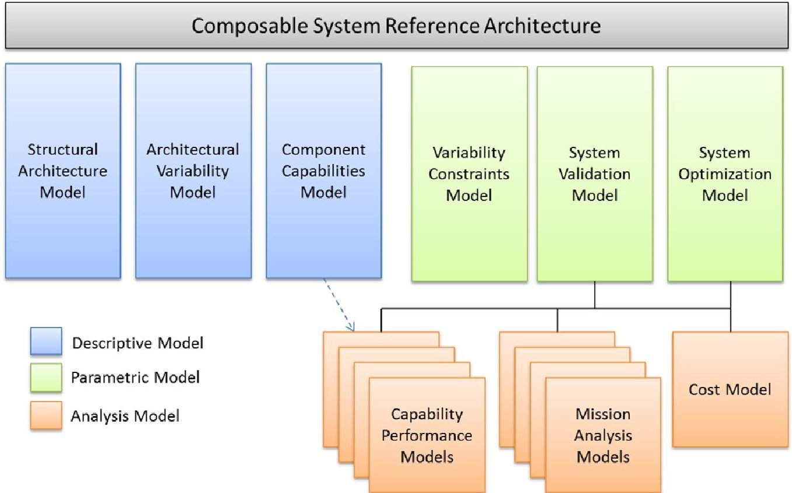
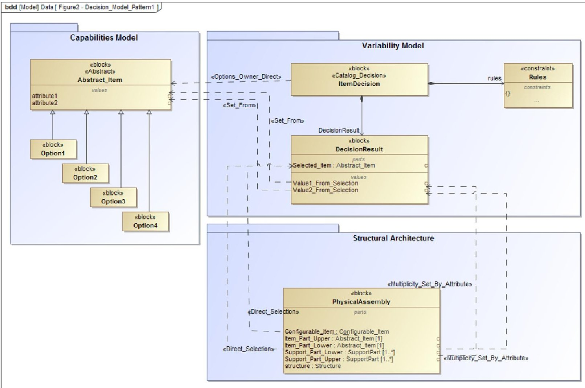
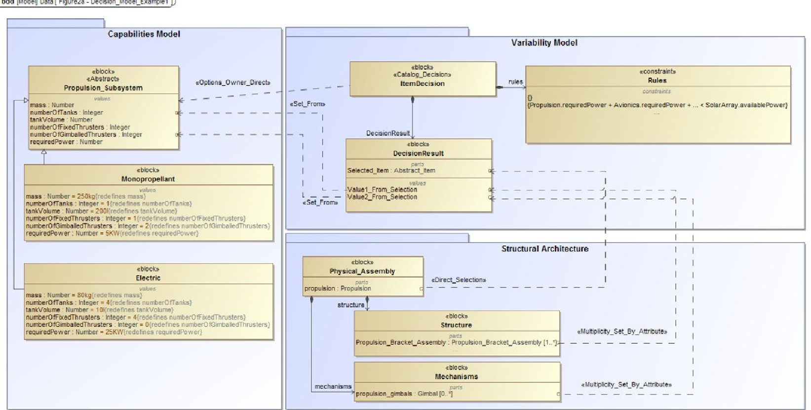
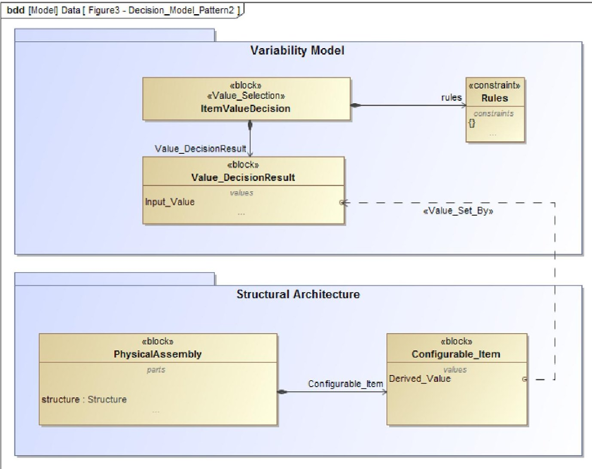
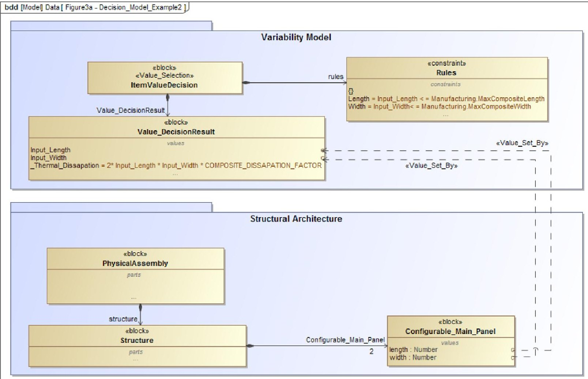
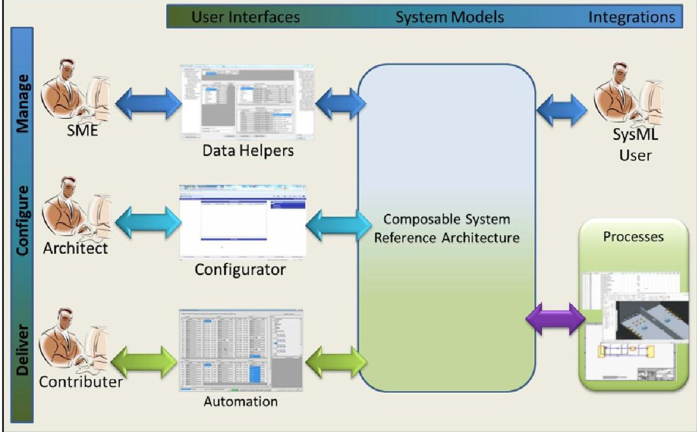
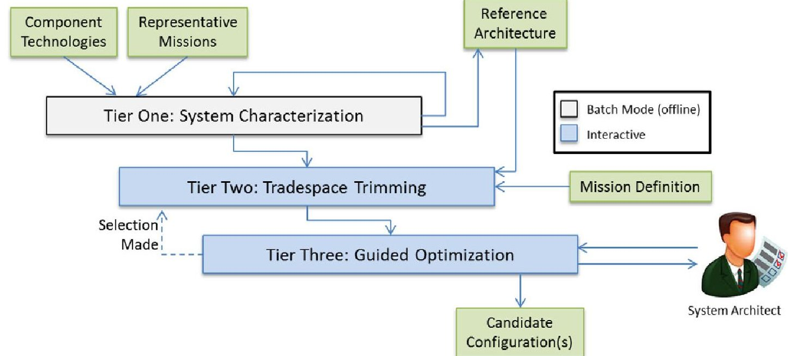

<!-- PDF_PAGE: 1 -->

# Applying Composable Architectures to the Design and Development of a Product Line of Complex Systems

Christopher Oster, $ ^{1}, $ $ ^{*} $ Michael Kaiser, $ ^{1} $ Jonathan Kruse, $ ^{1} $ Jon Wade, $ ^{2} $ and Rob Cloutier $ ^{3} $

$ ^{1} $Lockheed Martin Corporation, 3 Executive Campus, Cherry Hill, NJ 08002 $ ^{2} $Stevens Institute of Technology, 1 Castle Point Terrace, Hoboken, NJ 07030 $ ^{3} $University of South Alabama, 307 N. University Blvd., Mobile, AL 36608

Received 6 July 2015; Revised 29 July 2016; Accepted 22 January 2017, after one or more revisions Published online in Wiley Online Library (wileyonlinelibrary.com). DOI 10.1002/sys.21373

## ABSTRACT

This paper investigates a composable design methodology leveraging SysML to manage mission flexible product lines, and reviews the application of this methodology to a spacecraft product line. This methodology extends the SysML language with a mathematical and Boolean constraint language allowing for the capture of product line rules as an alternative to a more traditional variation tree. Finally, this paper reviews future work underway to extend this methodology. $ \textcircled{c} $ 2017 Wiley Periodicals, Inc. Syst Eng 19:522-534,2016

Key words: architectural design; decision analysis/management; model-based systems engineering (MBSE); system integration; government; defense and security

## 1. INTRODUCTION

Composable design is a systems architecture and development concept focusing on composing new systems from known components, designs, product lines, and reference architectures as opposed to focusing on "blank sheet" designs based on requirements decomposition alone (Oster and Wade, 2013). A composable architecture enables reuse of predeveloped and proven design and analysis components (at the mission, system, subsystem and component level) with associated design, interface, performance, behavior, and cost representations that can be easily integrated into new system architectures, with the resulting integration complying to any

prescribed design rules and constraints. Such a methodology is useful in defining product lines and systems of systems where mission requirements vary widely and predefining all valid variants is impractical.

Our approach for developing composable architectures applies a multiperspective reference architecture capturing overall system structure, design requirements and constraints, and integrated systems analysis to enable rapid development of valid system configurations aligned to a set of mission needs. Although there has been academic discourse on the development and application of reference architectures to support product family design, there has been limited research into how to leverage reference architectures to enable rapid design and composition of a system based on a set of design rules, patterns, and components. This ability to extend descriptive reference architectures such that they can be easily analyzed, reconfigured and executed is at the heart of a composable design approach.

<!-- PDF_PAGE: 2 -->

This paper investigates applying composable design to the development of a product line in the aerospace and defense market. We address the business case for composable design in this market, present a model-based systems engineering methodology for building and exploiting composable designs, illustrate the development of a composable constraint language extending SysML use to express valid system variants, and discuss the lessons learned from the application of this methodology on a real product line.

## 1.1. Prior Work

Capturing the multiple required aspects of a system product family requires a common and integrated language and modeling infrastructure. Recent advances in model-based systems engineering (MBSE) techniques provide a starting point for capturing these composable artifacts, with readily available constructs for managing interfaces, specification, and behavior using SysML. Multiple projects have leveraged UML to capture product family information for software systems [Mannion and Kaindl, 2008; Ripon, 2012; Vranic and Zelinka, 2013]. However, with SysML and MBSE being relatively new to industry, there are few published examples of managing cyber-physical product families at the systems level using a standard language. Although Mitchell [2013] discusses the management of the configuration of a family of submarines using model-based approaches, the management program discussed is focused on leveraging SysML to manage the configuration of multiple vehicles through an operations and sustainment phase, and does not explicitly address the creation of new systems leveraging those capabilities.

In addition, prior work on reference architectures and product lines architectures discussed by Cloutier et al. [2009], Heidera et al. [2010], and Bosch [2009, 2006] provide methodological inspiration for the development of a composable architecture. Cloutier et al. [2009] identify successful reference architectures as providing a "common lexicon and taxonomy for an organization, a common architectural vision and modularization of the context," which is certainly required for a composable architecture. Research on reference architectures ranges from identifying and capturing common structural and behavioral design [Cloutier et al., 2009] to capturing architecture and interoperability rules [Zhu et al., 2008]. In each case, a common goal of developing reference architectures is to support the deployment of a product line. Product line architectures are intended to capitalize on commonality across similar products offered by an organization by providing a common architecture and variant management capability [Heidera et al., 2010]. A common reference architecture is often considered a requirement for achieving a successful product line architecture [Cloutier et al., 2009].

van Ommering and Bosch [2002] provide further methodological guidance in their discussion of applying both variation and composition to manage software product lines. van Ommering identifies the shortcomings of defining a variant free architecture with predefined variation points for product lines with significant breadth and offers a composition approach teamed with variation management to support broader product lines. As van Ommering states, "Variation can be

used to implement diversity known ahead of time, while composition can be used for open-ended diversity." This same challenge is evident in the aerospace domain and is a primary driver for our methodological foundation. We begin with a similar approach supporting the definition of both hardware and software components, and add a constraint mechanism to define the allowable variation to further support diversity.

There has been a focus—primarily driven by industry on development methods supporting variant and feature management, but less focus on rules constrained product families. The common variability language (CVL) [OMG Common Variability Language Website; Haugen, 2013] presents one such approach to managing variation in a product line, providing a construct for managing variants (the CVL Variability Specification [V-Spec]), and binding that V-Spec to architectural features. This can provide a starting point for a composable design language. However, to support products without premanaged variants, or those made up of many variable subsystems with multiple interrelationships, a flexible interoperability rules modeling framework must be available in the language as well.

## 1.2. Why Composable Architecture?

The defense market has been characterized by the development of specialized, mission specific solutions, and as has been discussed previously by Oster and Wade [2013], whereas successful examples of product line and composable designs exist in that market, they have been limited in scope. The most prevalent methodology for systems and software product line management is to manage a variant or feature tree which allows an engineer to select a leaf node on the tree and automatically configure the architecture to the new system requirements [OMG Common Variability Language Website; Haugen, 2013; Haugen et al., 2008]. This works well in a problem space where you can predefine the variants of your system and discretely map them to a set of system features, but becomes challenging when trying to manage a missionflexible product line. Consider the market for satellites; the market for spacecraft is generally limited, and upfront investment to develop a product line is large, therefore it is critical to be able to address a large, potentially unknown market space with the developed product line. In addition, spacecraft product lines must last decades; therefore it is highly unlikely that all potential variants that will be offered could be characterized at the time the product line architecture was being developed. This type of market and product family requires an alternate mechanism for capturing system capabilities, integration constraints, valid system variants and guided system reintegration. As was presented by Oster and Wade [2013], there must be a synergy between the market need and the underlying engineering methodology.

Although it is unlikely that each unique mission to which a spacecraft product line may be adapted will be known during the initial design of the product line architecture, it is clear that there is value in driving commonality into the design of specific mission variants in order to drive down the total system cost, whether that be by limiting the amount of new engineering required, achieving economies of scale across a

<!-- PDF_PAGE: 3 -->

Figure 1. Architectural views in a composable system reference architecture.

common product set, driving down the cost of test and production for each unique system, or reducing the level of risk to the mission by leveraging proven technologies and designs to the greatest possible extent. An enterprise can also benefit from a composable approach as part of its engineering ecosystem as recommended by Oster and Wade [2013], which employs standardized processes and tools while leveraging commonality in skills, facilities, tools, and business practices across a set of product variants where the specifics of each variant may be unknown prior to specific implementation. The enterprise can manage and evolve the product line incrementally at any level across the enterprise without overhauling the entire ecosystem or having to create product line branches to accommodate unanticipated variation.

As the satellite market is both low volume and has a wide variation of unique missions, there is little value in defining preconfigured variants for the spacecraft product line. This type of product line requires a rule-based approach for defining and constraining the product line for efficient development and management. Architectural rules specify what variations are possible and valid by defining relationships and constraints between various architectural choices. These rules, defined through an overarching reference architecture, mathematical constraints and relationships, and a set of capabilities defined at the component, subsystem or feature level, support system level integration, validation, and optimization. This is the basis of the composable design methodology presented in the following section.

## 1.3. Composable Architecture Methodology

To manage the underlying constructs necessary for a composable design environment, multiple architectural perspectives are necessary. As presented in Figure 1, there are six key views of the product family that must be captured including the overall system structure, a definition of system variability, a set of swappable components, variability rules and constraints, a mission validation definition, and optimization and objective functions. The concept of segregated but bound models has been leveraged both in the creation of CVL [OMG Common Variability Language Website] as well as by Ripon [2012] who used the concept of feature oriented requirements managed through a product and variation model. In both cases, there are typically two bound models-one capturing the full product capability and the other capturing the allowed variations. In the proposed framework, however, a more comprehensive set of bound models are recommended. By including a constraints model, the framework can support product lines without predefined variants; and through the inclusion of an optimization model, enhanced product trades can be enabled, helping architects quickly identify an optimal product configuration.

Each of these models can be defined in a variety of languages, using various tools, to align to the implementing organization's strategy. We selected SysML [Object Management Group (OMG), 2009] as a core language to define many elements of the composable system reference architecture including the structural architecture model, architecture variability model and component capabilities model. We then extend SysML parametrics with a Boolean and mathematical constraints language to capture the variability constraints model and further extend SysML parametrics as presented by Kim et al. [2013] to support the system optimization model. We have investigated this methodology using both IBM Rhapsody $ ^{\circledR} $ and the No Magic Cameo Systems Modeler $ ^{\mathrm{TM}} $ tools. There are various other languages which could have

<!-- PDF_PAGE: 4 -->

Table I. Structural Architecture Stereotypes

<table border="1"><tr><td>Stereotype</td><td>Usage and Definition</td></tr><tr><td>solution_unique</td><td>Blocks with a solution_unique stereotype are placeholders for items expected to be developed specifically as custom for a given solution. Some basic features of these items may be predefined and subelements below this item may be populated from a product line catalog, but this item is expected to be specifically designed as custom for each solution. For instance, in the case of a communications satellite, the communications payload definition would be considered solution_unique. The payload design may be composed of common amplifiers, switches, and multiplexer, but the design of the payload itself is likely customized for the specific mission need. This is used to help express a complete architecture for the product line even in cases where customization is anticipated.</td></tr><tr><td>abstract_unit</td><td>Blocks with an abstract_unit stereotype are placeholders for generic capability types with a known set of specific implementations of that capability. In the model, these blocks are defined with a set of predefined specializations linked to the abstract_unit via the SysML generalization relationship. Upon selection of one of those predefined configurations, the specialized choice will replace the abstract_unit in the model, bringing with it any lower level construct, special relationships or functionality and retain the appropriate inheritance from the abstract. Both the definition of the abstract_units and any specializations are contained in the component capabilities model.</td></tr><tr><td>configurable_abstract_unit</td><td>Blocks with a configurable_abstract_unit are placeholders that do not have predefined configurations, but are defined by a subset of predefined and potentially bounded characteristics or attributes. An example would be the definition of a structural panel for a spacecraft. Defining a catalog of all possible variations for that one assembly would yield little value in the architecture, but the range of options can be easily expressed mathematically. In the case of a structural panel, options will be directly constrained by what can be built using existing tooling and processes in the available production facility, which would establish constraints on panel size, and by extension, mounting area.</td></tr></table>

been considered as a foundation for this methodology including various architectural description languages (ADLs) such as architecture analysis and design language (AADL), EASTADL, and ADLARS [Bashroush et al., 2005]. We found that SysML was a more appropriate choice for our methodology as most other architectural description languages have been created for use in software engineering and later adapted to a broader set of domains whereas SysML was designed explicitly for systems-level architecture capture. As such, many of the other ADLs have syntax which is easily adopted by software engineers but tends to present more challenges outside of the software domain (SysML suffers from this same limitation to some extent, but we found it to be a bit easier to adapt for non-software domains). Further, SysML has gained traction within our organization and the aerospace industry more generally, thereby aligning to our organization's training plan. Finally, recent advances in engineering tool support such as presented by Kim et al. [2013] provide opportunities to readily integrate analysis and optimization with SysML minimizing the amount of custom tooling needing to be developed.

## 1.4. Structural Architecture Model

The structural architecture model effectively acts as a solution template and overall architecture framework for any system built from the captured composable architecture. As the composable architecture methodology is executed and the system variations are refined to decisions through a guided architectural synthesis approach, this reference structural architecture is "completed" for each instantiation of a solution

architecture. Effectively, the composable architecture process ends when all architectural decisions have been made and no unknowns remain in this structural model. Further, this standard model structure allows tools and processes to be built around a common view of the product line, allowing standardization at the enterprise level able to support the development of specific variants refining this model. In the case of our spacecraft, we build one structural architecture model representing any spacecraft which can be built within this product line, regardless of the variations the final spacecraft may leverage. This view of the system provides the definition of commonality expressed in all solutions derived from this product line.

We implement this structural architecture model in SysML, extending the base language with a custom profile including new stereotypes including "solution_unique," "abstract_unit," and "configurable_abstract_unit" (defined in Table I). These new stereotypes are used to instrument the structural reference architecture such that custom tooling, extending the SysML modeling environment, can more readily navigate the model to support the synthesis process for new designs. This structural model contains a full product definition, leveraging the "abstract_unit" type definition which identifies items within the architecture that are specialized within the product line component catalog. Within this model, each block and relationship must either be defined as having some range of variability (for instance a multiplicity of [0..1] or [0..n]), or be specifically designated as a particular block or relationship that will always exist. When defining a new solution within the defined product line, this structural model is copied and iteratively refined through the design process.

<!-- PDF_PAGE: 5 -->

Table II. Variability Model Block Stereotypes

<table border="1"><tr><td>Stereotype</td><td>Usage and Definition</td></tr><tr><td>catalog decision</td><td>Blocks with a catalog decision stereotype represent a decision in the variability model where all available options are fully defined and captured within the capabilities model. For example, if you have a spacecraft product line with four possible fuel tank sizes, each tank would be a fully defined choice which can be selected to address this catalog selection decision.</td></tr><tr><td>value selection</td><td>Blocks with a value selection stereotype represent an decision in the variability model where not all valid options will be modeled-rather one or more attributes for a given abstract type will be allowed to be set(potentially with restricted values).This is useful for cases where modeling all potential decision options would be of limited value.</td></tr></table>

## Table III. Variability Model Relationship Stereotypes

<table border="1"><tr><td>Stereotype</td><td>Usage and Definition</td></tr><tr><td>options_owner_direct</td><td>The options_owner_direct stereotype is used on a dependency relationship to link a decision block to the primary portion of the architecture impacted by this decision. In many cases, this will be a link to an abstract_unit which can be replaced with an item in the catalog.</td></tr><tr><td>direct_selection</td><td>The direct_selection stereotype is used to indicate that a given part in the structural architectural model should be substituted directly for an item selected from the catalog. This allows for the product line to be defined in more generic terms and dynamically configured using object-oriented principles.</td></tr><tr><td>multiplicity_set_by_attribute</td><td>The multiplicity_set_by_attribute stereotype allows variability represented by a range of valid multiplicities to be dynamically configured based on attributes in the decision model.</td></tr><tr><td>value_set_by</td><td>The value_set_by stereotype allows for attribute values to be set by the results of architectural decision selections. This stereotype also adds a tag to allow for basic mathematical operations to be applied to this transformation.</td></tr></table>

Table IV. Primary Structure Constraint Example

<table border="1"><tr><td>Constraint ID</td><td>Definition</td><td>Description</td></tr><tr><td>Structure-c1</td><td>(Structure.height+MIN(SecondaryStructure.height)+MIN(Antenna.deckHeight))< LaunchVehicle.innerHeight</td><td>Specifies that the total height of the spacecraft must be less than the innerHeight of the launch vehicle for a valid configuration.</td></tr><tr><td>Structure-c2</td><td>Structure.innerVolume≥ MIN(Propulsion.volume)</td><td>Specifies that the inner volume of the structure must be greater than or equal to the volume of the smallest valid propulsion system.</td></tr><tr><td>Structure-c3</td><td>Structure.supportedMass≥ MIN(SecondaryStructure.mass)+ MIN(Payload.mass)+ MIN(Antenna.deckMass))</td><td>Specifies that the primary structure must be able to support the mass of the secondary structure, payload and deck antenna.</td></tr></table>

## 1.5. Component Capabilities Model

The component capabilities model is established as a controlled model repository, providing a single source for all potentially reused "elements" and a mechanism for allowing each integrated product team within the program to manage their own information, effectively forming a multilayered capability "catalog." The elements within this catalog are defined at the level appropriate to the item being cataloged. For example, the propellant tank might be cataloged at the tank component level if the next higher level of usage is variable. However, if there is no variability at the next higher level of usage (e.g., a subassembly including the propellant tank

and additional propulsion hardware), then the catalog can be defined at the higher level.

In some cases, the catalog is not a part, but rather a set of conceptual choices with some attributes about a part, or set of parts which when interpreted will help define the final configuration. This provides flexibility in the development of a product family, but does additionally require a more robust modeling practice to drive commonality.

Elements in a composable model represent valid options within the product line architecture and must be organized and defined consistently with respect to the function they perform or capability they provide. For example, two propellant tanks, when defined in the capabilities model, may be

<!-- PDF_PAGE: 6 -->

specializations of an abstract unit "Propellant tank." The tanks are defined with sufficiently detailed attributes to capture both the properties of those individual tanks, but importantly, how they differ and how they must be utilized in an architecture. These individual capabilities are captured with the goals of modularity and low coupling to other capabilities, specifically focusing on clearly defining the interfaces and attributes required for reintegration into the architecture. References across capabilities are captured as part of the variability constraints model, and support the evolution of the product line with minimal impact to the overarching reference architecture.

This model, as part of the overall composable architecture, does not explicitly add any new stereotypes, but does require that elements in the capabilities model extend via generalization relationship blocks of type solution_unique abstract_unit, or configurable_abstract_unit as defined above. The capabilities model define what can be considered architectural "plugins" with each plugin satisfying a set of interfaces and providing a well understood behavior. An example of this view can be found in Figure 3.

## 1.6. Architecture Variability Model

The architecture variability model, which we often refer to as the decision model, captures the conceptual "decisions" that an architect would make. This model is not intended to replace the architect, but to quickly help narrow the design tradespace based on input from the architect and the predefined "rules" in the composable architecture. Decisions are modeled for every choice required to complete an architecture with parametric rules defined between decisions (in the variability constraint model). As such, building this model requires domain expertise in order to appropriately capture the right set of decisions to construct a system architecture. This modeling construct allows the abstraction of "architectural" level decisions with defined rules enforcing the viability of the available choices. Decisions are modeled as blocks with an associated constraint property holding all rules related to the selection inputs required to influence that particular decision. In addition, each decision is related to a single "element" in the structural architecture model. A parametric diagram is used to document the relationships among decisions across the system definition. Practically the decision model is captured as a wide, flat tree structure, but the captured relationships make this into an executable decision graph.

To capture this decision model in SysML, we leverage the existing variation point stereotype to indicate a given block represents an architectural decision and we added two stereotypes to differentiate the types of decisions being represented in the variability model.

A large part of the value of the decision model is the capture of relationships and rules between decisions in the overall architecture. Cataloging valid options for a given element or subsystem has inherent value, but providing a reuse context and analyzable constraint architecture to strategically govern reuse helps support the design of the progression of this capability from an information management tool to one which can support system optimization. We have added four stereotypes for use on relationships to define the interactions between

decisions in the variability model and the system structural model.

There are a small number of basic patterns (illustrated using a meta model) used to capture these rules as shown in Figures 2 and 4. These diagrams show elements from and relationships across the various models discussed so far. Figures 3 and 5 provide examples of those patterns as they could be applied to the architecture of a spacecraft. Of note, the "Rules" block shown on each figure holds the variability constraints which are discussed in the following section.

The first pattern, shown in Figure 2 and demonstrated in Figure 3, illustrates the modeling structure used to select a specific known configuration to replace an abstract element within the structural reference architecture. This could represent a selection of a fully defined component such as a specific battery or sensor on a system. This selection impacts the structural architecture both directly as the new selection replaces the abstract block in the model, and can have additional indirect updates to the architecture as are represented by the Multiplicity_set_by_Attribute relationships between the selected option and the structural architecture. In this example, by selecting item_n, we can update variable multiplicities within the architecture in addition to more fully specifying the abstract object tied to this decision. For instance, if this selection represented the selection of a specific battery, there may be secondary impacts to the mounting hardware, harness and other related components within the structural architecture. As such, we would see that the abstract battery within the architecture would be replaced with the selected battery, and we may see a number of other rippling effects through the architecture including the setting of attributes and multiplicities for secondary hardware related to this decision. This is illustrated in Figure 3 with an example implementation exploring the propulsion subsystem. In this case, the architecture is composable at the subsystem level, therefore the selection of a specific implementation of Propulsion_Subsystem will change the typing of a part at the top level physical assembly and will have secondary impacts to mounting hardware and the mechanisms subsystem. A single composition rule highlighting the power requirements for a selected propulsion option is shown, illustrating the cross-cutting impact of decisions across subsystems.

This pattern can also be used to represent more abstract concepts tied to an architectural decision, which may not directly link to one specific component in the architecture. For instance, if there are a few top-level major variants that represent a collection of choices within the architecture (such as a high power variant and a low power variant of the spacecraft), this pattern would be appropriate. Rather than define capabilities extending an abstract unit, valid selections can be defined as specializations of the decision block itself. Using this approach, one can model options as viable answers to a specific design question and can propagate the impacts throughout the structural architecture. The primary modeling difference from that shown in Figure 2 is that there would be no Selected Item or Direct Selections tied to physical parts in the Physical Assembly.

The second pattern, illustrated in Figure 4 and demonstrated in Figure 5, allows for capturing variants based not on discrete choices, but by defining a component template

<!-- PDF_PAGE: 7 -->

Figure 2. Pattern: discrete and abstract assemblies.

and constraints on the attributes defining valid configurations. This modeling method provides a flexible approach for designing components which can flex within a set of boundaries without major impacts to system cost or capability. For instance, as illustrated in Figure 5, in order to define structural panels on a spacecraft, it is likely not worth the time or effort to predict every panel variant that can be created, however the size and shape of the panel will be constrained by the tooling available to manufacture those panels. Those constraints can be captured using this pattern, allowing the design to float more freely while still acknowledging the constraints to the design.

This set of model extensions coupled with these modeling patterns make it possible to represent architectural decisions which can be reasonably constrained as a selection of a choices or selection of a set of attribute values given some set of reasonable bounds, but does not directly support more open ended design approaches where unique mission capability is being developed. In order to support incorporation of custom design elements (as would be common in the design of a spacecraft payload even within the context of a product line) we use the stereotype solution_unique within the structural model to indicate an area of the architecture which is anticipated to be designed specifically to the mission and we capture key design information (such as payload mass and power) as attributes so that they can be integrated into the variability model.

## 1.7. Variability Constraints Model

Although the architecture variability model provides a mechanism for defining decision points in the architecture, the variability constraints model captures the rules of use and interactions between decisions which are required for an architecture to be considered valid while complying with the product line reference architecture. In Figure 2, the "Rules" blocks shown linked to each Decision_Object represent a more detailed constraint block capturing these rules.

The rules are defined as mathematical and/or Boolean relationships between the architectural decisions in the architecture variation model. These rules are at the heart of building a flat yet constrained product family. Validity of solutions is defined through the assessment and execution of these architectural rules. These rules are captured as extensions to the SysML constraint type, refined with a custom set of stereotypes to define a composable constraint language which can be processed by scripts that run against the architecture model. Ultimately, these rules have one main function—to remove invalid options from the full set of variations for a given architectural decision. These rules are defined in terms of constraint parameters which can be linked to attributes in the structural architecture or to constraint parameters on other decisions in the architecture variation model using binding connectors. A set of simple constraints is used to build up a potentially complex set of relationships

<!-- PDF_PAGE: 8 -->

Figure 3. Discrete and abstract assemblies example.

across the architecture. These rules are iteratively checked against all remaining decision options each time an architectural selection is made by an architect, ensuring only valid solutions can be synthesized from the architecture.

Each individual rule is captured as a SysML constraint type contained within a ConstraintBlock. ConstraintParameters are defined on the ConstraintBlock and provide the set of valid variables for the design constraints. As these rules are used to neck down the available set of valid selections given prior architectural decisions, the processing for each rule can be thought of as list operations. For each incoming variable used in a constraint all potential values must be considered. Similarly, each potential outcome for the decision block being assessed given the remaining input values must be computed and measured. Our constraint engine supports rules combining arithmetic operations, min and max checks and Boolean comparisons. When a ConstraintParameter represents a complex type, attribute values can be identified using a "dot" notation common in object oriented software development, or can be implemented using linked model elements using SysML tags linked to the ConstraintParameter and to the source attribute. All variations which can produce a valid architecture given the currently selected decisions remain as available options, whereas those items which fail one or more constraint checks are removed from the valid architectural set. These rules are coupled with a reasoning engine developed to interpret the model structure and rules to determine which variants are valid given current architectural inputs.

If we consider an example of selecting the size of the primary structure of the spacecraft, we need to consider many factors to determine if a given variant would be valid including the maximum height supported by the launch vehicle, the total mass of the spacecraft, the size of the propulsion system,

and the size of the payload. If we assume there are five incoming ConstraintParameters (LaunchVehicle, SecondaryStructure, Payload, Antenna, and Propulsion), and primary structure selections are represented by a variable called Structure our constraints would take the following form.

## 1.8. System Validation Model

The variability constraints model can ensure a solution is valid in the context of the product line architecture; however it is also critical to ensure that the proposed architectural variant meets the mission requirements the system is intended to satisfy. This model effectively integrates both solution specific requirements and an overarching mission analysis model to check variants against not just the architectural rules, but also for minimal compliance to mission needs. Development of this model can be challenging depending on the specifics of the mission requirements. Often simplified models (for instance a stochastic model) are appropriate for this level of validation, but higher fidelity models may be feasible for product lines with a long anticipated lifespan.

The implementation of this system validation model relies on the analytical model-integration approach presented by Kim et. Al. [2013], integrating model-based architectures in SysML with analytical models through a process integration and design optimization framework. This capability supports the linkage of requirements to model attributes, and propagates that information into an analytical environment, which enables a range of options for assessing the system capability in a mission context. And while this approach is primarily focused on the integration of analytical models to support system validation, it can also support a wide range of assessment

<!-- PDF_PAGE: 9 -->

Figure 4. Configurable abstract option.

approaches including the use of various forms of simulation and Monte Carlo runs.

The analytical portion of a validation model will be domain and product specific, and the fidelity of the model can vary based on the needs of the organization implementing the solution. In the case of a spacecraft, this model may be as simple as an assessment of the mass and volume of the spacecraft against the launch vehicle capabilities, and the numerical assessment of power, propulsion and reliability against required mission life. Conversely this could be realized as a much more extensive set of models leveraging tools such as AGI System Tool Kit $ ^{[\mathrm{Analytical Graphics}2015]} $ . In our case study, we focused on the assessment of vehicle power and mission life against mission requirements, and began investigating approaches for increasing the fidelity of the models representing the vehicle's mission to support more detailed validation.

## 1.9. Analysis models

Ultimately, to provide an assessment of the quality of the architecture against the mission and generally to assist the architect in selecting the best valid architectural variant, a suite of analysis models are required. These models can be associated to a single component capability, a family of component capabilities, an architectural decision, or a set of system attributes captured in the structural architecture model. Similar to the implementation of the system validation model, Kim et al.'s model integration approach [Kim et al., 2013] is used to link analysis models into SysML via constraint blocks. These analysis models can then be further composed into analysis workflows appropriate for the assessment of solution capabilities. These analyses can take the form of Excel spreadsheets, Matlab scripts, Commercial off the Shelf (COTS) modeling tools, or home grown analysis codes and may provide more detailed representations of performance, cost or behavior.

Varied analysis models are typically leveraged to assess different qualities of the product line and may often be used in unison to determine the highest value solution for a given set of input requirements. At the system level, these individual analyses are typically fed into one or more utility functions which in turn are combined to a system level value metric. Each utility function can serve to establish the impact of specific system qualities to the overall solution value. Further, linked analysis models can be configured to act as complex architectural constraint rules as part of the architectural constraint model. In this scenario, a constraint block is created to represent this analysis model, and is placed between two or more decision blocks defined in the variability model. As dependencies must be resolved prior to executing the model

<!-- PDF_PAGE: 10 -->

Figure 5. Configurable abstract example.

constraints, this analysis model will be executed in the decision assessment loop, providing a mechanism to express product line constraints which would be difficult to express as a set of individual mathematical and Boolean constraints.

## 2. SYSTEM OPTIMIZATION MODEL

The system optimization model is an optional portion of the reference architecture, albeit a potentially valuable extension. Without the system optimization model this approach can still be used to allow an architect to navigate the product line and compose a new system solution to meet mission needs. This additional view provides an assessment of the quality of an architecture variant relative to other variants in its ability to satisfy the mission and other relevant objectives. Miano presents two approaches considered to extend such a reference architecture for optimization [Miano, 2015], focusing on a method of enumerating all valid configurations of a composable architecture, building out a tradespace for multiple objectives and populating a database with the results. This database can then be assessed to allow for rapid optimization for a new set of mission requirements. This approach works well for fairly small composable architectures, but does not scale well for larger scale problems. As such, refining the system optimization model is our primary focus for future research.

## 2.1.1. Case Study: Application to a Spacecraft Product Family

This methodology was developed and validated on the design and configuration of an evolving communications spacecraft product line at Lockheed Martin Space Systems. Specifically, we were investigating this modeling in support of the development of the next generation of a long lived product line which had been the basis for more than 100 satellites. This platform both provided an opportunity to investigate the applicability of composable design to the development of a cyber-physical system and provided a mechanism to assess the economics of managing a mission-flexible product line with a model-based composable design methodology. The collection of design information and the capture of true design assumptions and constraints alone proved valuable in the design of the system and subsystem architectures, and capturing the design constraints provided a direct value for configuring the product line in response to a customer request for proposal and for managing the evolution of the system architecture to align to emerging mission needs.

The data capture used to establish the baseline models helped for us to assess the level of up front effort required to create a composable design architecture based on a real world problem. It was quickly identified as the modeling team worked with various subject matter experts (SMEs) that data collection required either that SMEs become familiar with

<!-- PDF_PAGE: 11 -->

Figure 6. User interface extensions.

Figure 7. A tiered architectural analysis and optimization approach.

system modeling or that a modeler be teamed with the SME to support both data capture and management of information throughout the product line's life. As neither were particularly appealing as long term solutions, it became evident that new user interfaces supporting the creation of catalog options, updating key attribute values and defining usage constraints aligned to key users were required to ensure the various models were kept up to date as the product line evolved. The various interface types developed in support of this effort are shown in Figure 6.

This initial data capture activity was also beneficial in formalizing the product line offering as prior work to define

a product catalog did not provide sufficient detail to truly understand the variability supported by the product line, nor in many cases did it adequately describe the rationale for each option in the product line. This was primarily driven by technical detail residing within the SMEs and not being formally captured in a consistent way across teams. By capturing the system design elements, constraints and architectural decisions in a model-based architecture, it then became feasible to implement a model-execution framework and an associated architecture configuration dashboard to support the navigation of the product line architecture and the implementation of new point designs aligned to specific mission needs.

<!-- PDF_PAGE: 12 -->

Further, this architectural model provided a robust collection of design information which can be used in the development of detailed design materials for the system. For instance, a solution generated through the composable methodology provided sufficient definition of subsystems and components to allow for a model-based development of data interfaces, and command and telemetry management. There is a tradeoff for the development team as to how detailed to make the composable design models. A less detailed model may be sufficient for responding to requests for proposal and selecting the right major variant of the architecture, but in the case of spacecraft design, there will be some amount of non-recurring work on every program such as a custom payload and custom command and telemetry for controlling the system. Our use of the composable design captured enough design detail such that the resulting architectural model was sufficient for a preliminary design review for multiple subsystems. This detail comes at a cost, but with use of the architecture across multiple designs that cost can be amortized and teams can realize a decrease in system cost due to the method.

In this pilot we modeled major architectural decisions for the spacecraft Structure, Propulsion, Power, Command & Data Handling, Antenna, and Solar Array subsystems resulting in approximately three dozen user driven decisions (with more than 100 derived subdecisions in all) in our initial model. These represent the major architectural decisions for the system, and cover a range of decision types which exercise our methodology. The structural architecture model of the spacecraft included all major subsystems to the abstract component level, and we established a catalog of options aligned to the variation points defined by the three dozen decisions. Specific subsystems such as C&DH were more thoroughly defined to support detailed configuration and optimization of that subsystem. The resulting model had thousands of blocks representing physical components, thousands of blocks representing command and telemetry interfaces, and tens of thousands of pins representing electrical connectors and their associated pin-outs. This resulted in a significantly large model requiring subdivision into multiple model packages which could be loaded dynamically as needed by the users.

The effort to put together this methodology, toolset, and also capture the system design information into the model took approximately three man years (spread over two calendar years). This effort does not include time for accessing SMEs for each subsystem, but as we were building out the next generation of this system, these experts were available at level of effort. This was approximately spread as one head for modeling and one half head for tool development over two years. The effort required year over year decreases as the system model becomes more complete. We anticipate that the organization will see a direct return on the investment required to realize this product architecture in three uses.

The effort proved valuable to Lockheed Martin Space Systems to date, and the potential impact is expected to grow as new products are developed from this product line definition. The initial learning curve was steep for the team, however the helper tools and user interfaces that were developed have helped to mitigate the learning curve for new users. Of notable value was the logical separation of specific components and capabilities from the overarching product line architecture.

This allowed for the product line to evolve more readily as new components can be added, updated and modified without requiring manual propagation of information to impacted teams.

This effort identified various strengths and weaknesses of this methodology. This method provided a formalized approach for managing product line knowledge that by itself would be valuable for the implementing organization. Additionally, this methodology has proven valuable for propagating initial design intent into the design phase of an effort as the models can be supplemented with various levels of design detail and information valuable for preliminary and detailed design such as mass properties, electrical pinout schematics, command and telemetry requirements or assembly instructions. Further, the capture of the design rationale and architectural constraints and assumptions in a formal model helped to communicate information between system architects, new business engineers and subsystem design leads. Once captured, this information became a data rich backbone supporting various automation routines lowering the level of effort to compose new design solutions while ensuring designs comply with the product line architecture. Of course, this impact is not free; perhaps the major drawback of this approach is the level of effort required up front to realize value from the modeling effort. This investment must align to the product line's use and market. In addition, the tools are not yet to a level of maturity to easily allow the rich level of interaction between the engineering and business development teams for seamless proposal support. Further, the greater amount of custom work anticipated for each new solution within the product line, the lower the potential impact of this approach. In our system, only one subsystem is anticipated to have significant redesign with each spacecraft (i.e., the spacecraft payload), and a small number of other subsystems are likely to see significant customization within the boundary of the product line. This allows us to see significant value from the modeling from system to system.

## 3. FUTURE WORK

The pilot use of this methodology has shown that for mission flexible product lines, where predefinition of all viable variants is infeasible or ineffective, a model-based composable design methodology is both feasible and valuable. This paper has primarily shared the modeling methodology at the heart of this work; additional detail on the experience of the pilot was also shared by Kaiser and Oster [2015]. Data capture, data management and architecture variability and constraint development for product line designs brings rigor to the product line management approach while also allowing for the support of a potentially widely varying mission set. Moving forward, we believe the next big step is the integration of the underlying architectural framework with a system architecture optimization capability to help the architect quickly identify not only valid architectural solutions, but optimal value solutions for the mission need.

As indicated previously, Miano has developed a limited optimization capability integrated with a composable architecture [Miano, 2015]. We have also begun work on a

<!-- PDF_PAGE: 13 -->

multi-tier architecture analysis and optimization method building from the composable design models. This approach will not rely on an enumeration of the valid variants of the product line, rather it will support architect guided optimization, allowing computational methods to help the architect make near optimal decisions. The approach is tiered as it is anticipated, based on past work [Miano, 2015], that the resultant valid tradespace is potentially quite large and traditional optimization methods may not readily scale to support an interactive design process. As is illustrated in Figure 7, this approach first applies a batch mode analysis of the architecture to attempt to characterize relationships between likely mission needs and the value of specific component technologies. This tier effectively builds a set of sensitivity curves between various technologies and mission characteristics. This is later used to determine both which architectural decisions should be made first provided a given mission profile, and are used to generate design vectors for subsequent optimization. Once a specific set of mission requirements are determined, interactive optimization (tiers two and three) are begun. In tier two we apply the mathematical constraints discussed previously with a single-decision optimization performed interactively with the architect using a greedy optimization algorithm (i.e. making locally optimal decisions with a goal of a globally optimal solution driven by order of selections). The overall goal is to help guide the architectural decision process rather than to determine the ultimate best answer strictly through algorithmic optimization.

## REFERENCES

C. Oster and J. Wade, Ecosystem requirements for composability and reuse: An investigation into ecosystem factors that support adoption of composable practices for engineering design. Syst Eng 16 (2013), 439-452.

M. Mannion and H. Kaindl, Using parameters and discriminants for product line requirements. Syst Eng 11(1) (2008), 61- 80.

S. Ripon, A unified tabular method for modeling variants of software product lines. ACM Sigsoft 37(3) (2012), 1-7.

V. Vranic and L. Zelinka, A configurable use case modeling metamodel with superimposed variants. Innovat Syst Softw Eng 9 (2013), 163-177.

S. Mitchell, Transitioning the SWFTS program combat system product family from traditional document-centric to modelbased systems engineering. Syst Eng 17(3) (2013), 313-329. Doi:10.1002/sys.21271.

R. Cloutier, G. Muller, D. Verma, R. Nilchiani, E. Hole, and M. Bone, The concept of reference architectures. Syst Eng 13 (2009), 14-27.

W. Heidera, R. Froschauer, P. Grünbacher, R. Rabiser, and D. Dhungana, Simulating evolution in model-based product line engineering. Inform Softw Technol 52 (2010), 758-769.

J. Bosch, From software product lines to software ecosystem. Software Product Line Conference (SPLC 2009), Springer-Verlag San Francisco, California, 2009, 111-119.

J. Bosch, The challenges of broadening the scope of software product families. Commun ACM 49-12 (2006), 41-44.

L. Zhu, M. Staples, and V. Tosic, On creating industry-wide reference architectures. Proceedings of the 12th International IEEE Enterprise Distributed Object Computing Conference, Beijing China, 2008.

R. van Ommering and J. Bosch. Widening the scope of software product lines: from variation to composition. In Software product lines, Springer, Berlin, Heidelberg, 2002, pp. 328-347.

OMG Common Variability Language Website, http://www. omgwiki.org/variability/doku.php, accessed September 14, 2013.

O. Haugen, CVL: Common variability language or chaos, vanity and limitations? Proceedings of the 7th International Workshop on variability modelling of software-intensive systems, Pisa, Italy, 2013.

$ \varnothing $ . Haugen, B. Møller-Pedersen, J. Oldevik, G.K. Olsen, and A. Svendsen, Adding standardized variability to domain specific languages. Proceedings of the 12th International Software Product Line Conference, Limerick, Ireland, 2008, pp. 139-148.

Object Management Group (OMG), Systems modeling language specification, 2009. http://www.omg.org/spec/SysML/1.2/PDF accessed December 28, 2015.

H. Kim, D. Fried, P. Menegay, C. Oster, and G. Soremekun, Application of integrated modeling and analysis to development of complex systems. Conference on systems engineering research. Procedia Comput Sci, 16 (2013), 98-107.

R.T.J.B. Bashroush, I. Spence, and P. Kilpatrick. ADLARS: an architecture description language for software product lines. Software Engineering Workshop, 29th Annual IEEE/NASA, Beijing China, 2005.

Analytical Graphics. System tool kit. http://www.agi.com/products/stk/, accessed July 5, 2015.

A. Madni. Adaptable platform-based engineering: key enablers and outlook for the future. Syst Eng 15(1) (2012), 95-107.

C. Miano, Using optimization to exploit a composable satellite product line architecture. AIAA SPACE 2015 conference and exposition, Pasadena, California, 2015.

M. Kaiser and C. Oster. Managing a satellite product line utilizing composable architecture modeling. AIAA SPACE 2015 conference and exposition, Pasadena, California, 2015.