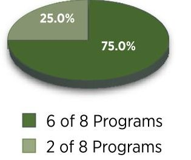
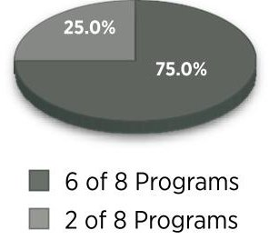
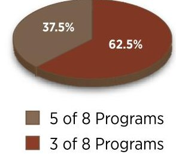
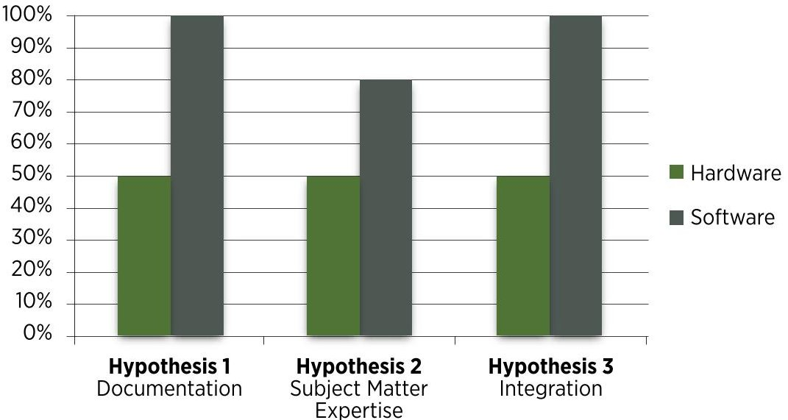
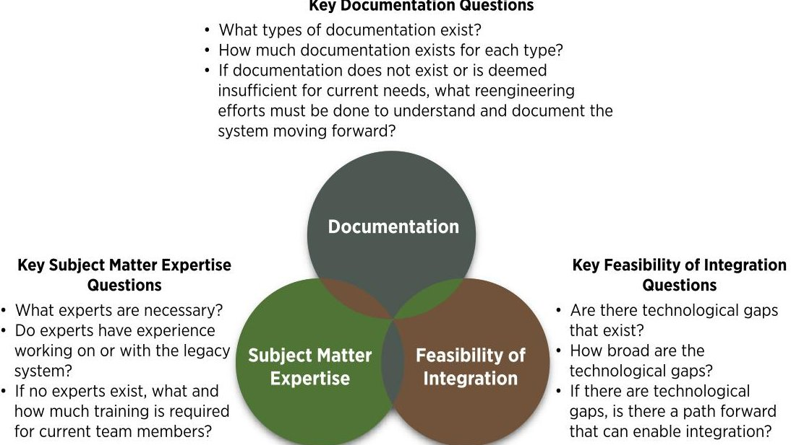

<!-- PDF_PAGE: 1 -->

Keywords: Reuse, Legacy, Reuse Framework, Evaluating DoD Legacy Systems

Reusing DoD Legacy Systems: Making the Right Choice

Meredith Eiband, Timothy J. Eveleigh, Thomas H. Holzer, and Shahryar Sarkani

Department of Defense (DoD) programs often experience cost overruns and technical difficulties due to reuse of legacy systems. With today's fiscal climate of resource-constrained DoD budgets, reuse of legacy systems is frequently touted as the solution to cost, efficiency, and time-to-delivery problems; however, cost overruns and technical difficulties can significantly diminish any perceived benefits. Through evaluation of eight diverse DoD programs, this research shows that the state of a legacy system's documentation, availability of subject matter expertise, and complexity/feasibility of integration are key factors that must be analyzed. Based on these three key factors, the authors propose a framework to aid both the DoD and defense contractors in the evaluation of legacy systems for potential efficient and effective reuse.

<!-- PDF_PAGE: 2 -->

<!-- PDF_PAGE: 3 -->

Within the DoD, there is an increasing need to deliver products that are both technologically cutting-edge and affordable. Currently, the DoD budget is facing sequestration and planned reductions, cost overruns of DoD acquisition programs over a 7-year period were approximately $919 billion (Defense Business Board, 2010). At the same time, a survey of all DoD programs shows that the DoD acquisition life cycle, which begins at the identification of needs, goals, and objectives and completes at the disposal of the system was on average 11 years (Tomczykowski, 2001). One potential solution to the issues of cost overruns and prolonged acquisition timeframes is to reuse DoD legacy systems. While this may seem like an ideal solution due to the legacy system being complete, tested and even operational, reusing legacy systems can lead to unforeseen technical complications and financially prohibitive difficulties when integrating with newer technologies. A prime example of this is the potential to have a technological gap between the legacy system and the newly created system. In this instance, additional cost is frequently incurred when developing the solution for the systems to work in unison.

Interestingly, even the terms "reuse" and "legacy" have multiple definitions depending on their source. In the software engineering domain, the term reuse may imply that a software product was designed as a reusable building block. For this study, it was imperative to derive a definition from established sources that did not limit the study or exclude other forms of reuse that are common within the DoD. Similarly, definitions of legacy systems abound, and often the term is used to simply describe a system that is considered old. However, within the DoD, the term legacy system has a much more specific meaning. In the DoD context, a legacy system's age does not distinguish it as legacy, but merely denotes that the system is one in which DoD has a substantial investment of both time and money (Defense Acquisition University [DAU], 2009). To investigate this topic, the authors used the following taxonomy of terms:

- Reuse - the integration of an already developed part (e.g., engine), product (e.g., inventory database), or legacy system (e.g., telemetry processing system) into another context or component.

- Legacy System - "a system or application in which an organization has already invested considerable time and money" (DAU,2009).

<!-- PDF_PAGE: 4 -->

Despite the challenges involved in the reuse of legacy systems, defense contractors, whether required by contract or by design, are regularly agreeing to do so as a cost and schedule mitigation strategy without either the U.S. Government or the defense contractor fully analyzing what the effect of reuse may actually be on the cost, schedule, risk, and performance of the product life cycle (General Accounting Office [GAO], 1993). In some cases, reuse of a legacy system provides an affordable and efficient alternative to a newly developed system, as in the KC-135 Stratotanker. In this case, the original fleet has been updated, retrofitted, and modified over 12 times in the last 50 years, each time saving the DoD the estimated $40 billion cost of developing a new aircraft for a similar purpose (GAO, 2004; Clark, 2010). On the other hand, the Navy Marine Corps Intranet (NMCI) contract was grossly underestimated by both the prime contractor and the U.S. Government, and as of 2007, the prime contractor had lost $3 billion (Jordan, 2007). One of the many continuing struggles on the NMCI program is the incorporation of tens of thousands of different legacy software versions and applications into a common operating environment (Jordan, 2007). Given the valuable lessons observed (and maybe learned) from these and many other programs, what factors are critical to consider before deciding to reuse a legacy system?

## Reusing legacy systems can lead to unforeseen

## technical complications and financially prohibitive

difficulties when integrating with newer technologies.

Research into the application of software reuse is plentiful, and generally falls into three common themes: theoretical work, cost impacts, and software tools used to aid in the reuse process. In the area of theoretical work, researchers have developed software legacy and reuse-based acquisition life-cycle frameworks (Ahrens & Prywes, 1995), described the causes of technological uncertainty (Fleming, 2001), discussed implementing design reuse (Gil & Beckman, 2007), formalized reuse processes (Redwine & Riddle, 1989), defined strategies for reuse (Frakes & Terry, 1996), and created a better reuse design based on knowledge management techniques (Hicks, Culley, Allen, & Mullineux, 2002). The literature surrounding the cost and economic impacts of reuse include works tying cost to software development (Wang, Valerdi, & Fortune, 2010), updating software cost models for current issues (Boehm et al.,

<!-- PDF_PAGE: 5 -->

2000) , and evaluating the impacts of the cost of software reuse (Boehm, 1981; Gaffney & Durek, 1989). Perhaps the most expansive studies in reuse are derived from the creation of software tools and applications. Examinations in this area include work in evaluating reuse through a total system approach (Kim & Stohr, 1998; Mili, Mili, & Mili, 1995; Isoda, 1995) and exploring reuse abstraction (Freeman, 1983).

Regardless of all of the theoretical work, tools, and cost models available, one key area remains inadequately researched: how program managers should determine whether or not they will efficiently and effectively reuse hardware and software legacy systems based on cost, schedule, risk, operations and maintenance (O&M), and performance. To investigate this, an interpretive case study approach was used to evaluate a group of DoD programs to accomplish three objectives:

- Identify the key factors decision makers need to consider when determining whether or not to reuse legacy systems.

- Determine how often the key factors have an impact on studied programs and what preventative measures could be applied to diminish unsuccessful reuse of legacy systems.

- Create a framework of imperative questions and quantifiable answers that can improve the decision maker's ability to pinpoint which legacy system opportunities for reuse stand the greatest chance of success.

<!-- PDF_PAGE: 6 -->

## Identifying Key Factors in Reusing Legacy Systems

Eight existing DoD programs spanning the areas of aircraft, information technology, systems of systems, communications, satellites, and facilities were used as a sample of DoD program domains where reuse of legacy systems exists. Programs were delineated by their capacity to successfully reuse DoD legacy systems. For this study, successful reuse was based on each program's capacity to reuse a legacy system within the projected cost, schedule, risk, and performance baselines. Data—including GAO reports; program-specific lessons observed; and independent third-party analyses that explored cost, schedule, risk, performance, and O&M impacts—were used to determine the success or failure of legacy system reuse. Additionally, data were analyzed to ascertain the fundamental reasons that cost, schedule, or risk increased on the program.

To substantiate the findings of this study, the collected data were then validated by experts in the field of systems engineering who were familiar with the programs selected. Data were also controlled for factors that were outside the control of either the DoD or the defense contractors. For example, six of the programs studied have acquisition life cycles of 10 years or more, and thus were more susceptible to volatility in their budgets. Since budget fluctuations are often out of the control of both the DoD as a whole and defense contractors in particular, any results that were directly influenced by these types of external causes were not included in the final analysis.

Upon initial review of the eight programs, three recurring factors were found when programs were unsuccessful in reusing legacy systems:

- Substandard, inadequate, or nonexistent systems engineering documentation including: requirements, architectures, statements of work, work breakdown structures, concept of operations, test documentation, and standard operating procedures.

- Insufficient subject matter expertise including: inadequate identification of current users of the legacy system, little or no accounting for training existing employees on the system,

<!-- PDF_PAGE: 7 -->

and assuming experts within a specific field should be able to operate the system simply because of the interrelationship between the newer system and the older legacy system.

- Inadequate analysis of the cost, schedule, and risk of integrating a legacy system including: incompatible technologies, inadequate security postures of the legacy systems against the current security landscape, substandard processing of data after integration, and creation of additional systems or functions to connect the new pieces of the system to the legacy system.

Conversely, for the programs that successfully reused legacy systems, these factors were either addressed early in the program life cycle or accounted for in the reengineering work associated with the program. To fully validate the dominance of these key factors, the eight programs and their software and hardware projects were evaluated against the following three hypotheses:

- Hypothesis 1: Decision makers overestimate the quantity and quality of legacy system documentation available.

- Hypothesis 2: Decision makers underestimate the criticality of legacy system subject matter expertise.

- Hypothesis 3: Decision makers underestimate the time, cost, and feasibility of the integration phase.

## Frequency of Factors

Of the eight programs analyzed, six of the programs overestimated the quantity and quality of legacy system documentation (Figure 1). When unsuccessful programs did have documentation, the quality of the documentation did not meet the industry or military standard, and thus required additional effort to meet these standards. Similarly, a different set of six of the programs also overestimated the cost and time to delivery of integrating new technology with the applicable legacy systems, while another set of five program decision makers underestimated the criticality of legacy system subject matter expertise. Unsuccessful program teams that did not understand the importance of subject matter expertise often employed personnel who were experts in a specific field

<!-- PDF_PAGE: 8 -->

related to the legacy system, but who had never worked on that system specifically. In this situation, all five of the program managers quickly exhausted the budget and schedule resources allocated for training their staffs, and even then fell short in the area of system knowledge.

FIGURE 1. FREQUENCY OF KEY FACTORS

Number of Programs that Overestimate the Quality and Quantity of Documentation

Number of Programs that Underestimate Subject Matter Expertise

Number of Programs that Underestimate the Cost of Integration

## Quality and Quantity of Documentation

Data analysis shows that decision makers overestimate the quantity and quality of on-hand legacy hardware and software system documentation 72.7 percent of the time. In fact, three of the programs studied had little to no requirements, architecture, statement of work, or work breakdown structure artifacts for the legacy systems involved. Due to ever-evolving military and industry standards for documentation within the systems and software engineering fields, gaps often exist in quality and quantity of requirements, operational concepts, and legacy architecture documentation, which must be understood prior to beginning the program life cycle. These artifacts frequently must be redocumented to current standards during the initial phase of the program to satisfy contractual deliverables. If the level of redocumentation is not bid into the contract, the unscoped efforts directly impact program planning, resources, and performance. This leads to higher risk, additional costs for either the DoD or defense contractor depending on the contract vehicle type, and the possibility of schedule impacts, thus having a negative impact on successful legacy system reuse.

This conclusion held true for 100 percent of programs that reused legacy software systems, but it only held true for 50 percent of programs that reused hardware components (Figure 2). Since the relative age of the software engineering field is less than that of the hardware engineering field, these results are not entirely surprising. The software engineering

<!-- PDF_PAGE: 9 -->

field is still maturing in the frameworks used to apply it, which includes how systems are documented and to what degree. The initial results indicate that while reviewing and obtaining documentation is a challenge for the vast majority of programs regardless of the hardware or software system being built, added diligence is warranted when reusing DoD legacy systems. Based on these findings, the hypothesis that decision makers overestimate the quality and quantity of legacy documentation is supportable.

FIGURE 2. COMPARISON OF HARDWARE AND SOFTWARE PROJECTS

## Subject Matter Expertise

The analysis illustrates that decision makers do in fact underestimate the importance of having the correct subject matter expert at the right time for the program 62.5 percent of the time on both software and hardware projects. When proper subject matter experts are not engaged, knowledge recovery becomes a critical endeavor in understanding the legacy system. In particular, knowledge recovery activities included legacy system training, additional documentation of system operating procedures, and specialized use cases. During the planning phase, four of the programs studied had unquantified knowledge recovery efforts. Data show this added time to schedules and raised the cost of the program while inexperienced employees were brought up to speed. Programs on which underestimation of subject matter expertise occurred shared the common problem of hiring experts in a field of study that includes the legacy system, while assuming that the experts could immediately begin working on that system. The field subject matter experts were often

<!-- PDF_PAGE: 10 -->

very knowledgeable, but did not have the specific knowledge that comes from working directly on or with the legacy system, which increased the learning curve and, subsequently, program cost and schedule. Similarly, hiring additional manpower after these realities were established typically occurred too late to effectively mitigate their impacts.

When obtaining experts for hardware and software components, a common problem is the complex and unique nature of the DoD application of a given capability. The DoD regularly pushes the bounds of common hardware and software tools by using commercial equipment that is often designed for smaller and less intricate applications. In these cases, expertise is imperative, as even the experts in the field are challenged by the application of a legacy system. To lessen the effects of inexperienced staff, the DoD and defense contractors should determine the complexity of the legacy system and what, if any, legacy experts should be employed on the program to ensure successful delivery.

Of the programs that reused legacy software systems, 80 percent underestimated the importance of this factor, while this was only true of 50 percent of hardware programs (Figure 2). This result emphasizes the importance of subject matter expertise to both hardware and particularly software programs. Since legacy DoD software can be unique, special attention should be paid to hiring staff with particular expertise for the given legacy system. These results show that underestimation in this area can significantly degrade the success of reuse.

## Feasibility of Integration

Data show that decision makers on the programs in the analysis underestimated the time and cost of integrating with legacy systems 72.7 percent of the time. For example, on one program in the study, the original bid included an assumption that the outdated software code could be converted and ported to new hardware to reduce the cost of purchasing or developing completely new software. Despite careful analysis and hiring subcontractors specializing in performing this task, the integration failed. Further, the schedule was impacted, and the subcontractor was still performing work to create a usable system at the time the data were collected. With work still being performed on this system, the benefit of reusing the legacy software cannot be calculated, but it is likely that this rework activity will add to the schedule, cost, and risk of the program. In the previous example and others like it, the program risk profile will be increased, and the probability of impacts to

<!-- PDF_PAGE: 11 -->

both cost and schedule is greater without active risk mitigation strategies in place (Bennett, 1995). As identified by Orrego and Mundy (2007), there is little research into the level of risk impact when reusing systems. Because of this, an opportunity exists for future research in this area to further refine the decision-making process for reuse and develop risk mitigation techniques that program managers can leverage to better manage reuse-related technical risks.

Security implications must also be considered in any analysis of a legacy system's integration potential. The rapid pace of change in today's security environment will likely necessitate significant penetration testing, security scanning, and hardening to identify vulnerabilities and retrofit any legacy system to meet current DoD and industry standards. Additionally, the cost and risk of reusing hardware or software in a classified environment can increase the complexity of integration. Intensive systems engineering and security architecture analysis will likely be required to ensure that classified data security is not put at risk due to latent vulnerabilities that may be exposed when integrating with a legacy system. As observed on one of the programs studied, underestimation of these efforts at the beginning of a project drives significant unplanned investments later in legacy system reuse projects-even if only to navigate the complex government processes required to pursue waivers or deviations for any vulnerabilities that cannot be overcome without prohibitively high additional costs (Jordan, 2007).

## Legacy System Reuse Framework

Documentation, subject matter expertise, and feasibility of integration were all found to impact legacy reuse success individually, but they were consistently found to overlap with compounding effects (Figure 3). On programs with little documentation, 87.5 percent of the programs underestimated the criticality of obtaining the correct experts at the proper time, and this directly impacted the time and cost required for integration. An additional finding shows that there may be a relationship between the age of a legacy system and the feasibility of its reuse due to a confluence of the factors discussed here. Data show that programs that reuse increasingly older legacy systems had not only larger documentation gaps, but also difficulty bridging the technological divide between the new and old parts of the system. All five of the software programs had documentation gaps, but of those systems, the two attempting to use software systems older than 10 years had virtually no requirements, architecture, or operational concept documentation to leverage. Given

<!-- PDF_PAGE: 12 -->

the clear impact that this has on subject matter expertise retention and integration facilitation, this demonstrates that there may, in fact, be a tipping point at which a legacy system's age directly determines the feasibility, or lack thereof, of reusing that system.

## FIGURE 3. KEY FACTORS IN REUSE

## Key Documentation Questions

In these cases, by the time problems are identified, efforts must be made to provide proof of why the legacy system is not suitable, thereby adding yet more cost to the effort. At the point that a subsequent judgment on suitability is rendered, pursuit of a more optimal solution may no longer be an option. Due to the investment and development already done on a reuse-based system, creation of an optimal, new solution may be outside of the acceptable cost for the final product. Interrelation of these factors necessitates their consideration individually and collectively to properly assess areas of compounding risk.

Within each of the key reuse factors shown in Figure 3, imperative questions should be answered prior to the decision point of determining whether to reuse a legacy system (Table). These questions were developed by isolating the problem areas identified from the research that contributed to cost and schedule impacts on each program. Similarly, programs that were successful were analyzed for mitigation strategies applied. Based on this analysis, a question-based framework was developed, and standard quantification methods were applied to each area. Program decision makers employing this methodology will need

<!-- PDF_PAGE: 13 -->

TABLE. REUSE EVALUATION FRAMEWORK

<table border="1"><tr><td>Reuse Factors</td><td>Key Questions for Analysis</td><td>Quantification Method</td></tr><tr><td>Documentation</td><td>What types of documentation exist?

Operational Concept

- Use cases

Requirements

Architecture

- Functional Flow Diagrams

- Activity Diagrams

- Block Definition Diagrams

Work Breakdown Structure

Design

- Software Design Documents

- Hardware Design Documents

- Interface Control Documents

Test

- System Acceptance Test Plans/Results

- System Integration Test Plans/Results

- Security Test and Evaluation Plans/Results

Security Analysis

- System Security Plan

System Operations and Maintenance Procedures

Industry or Military Standards

How much documentation exists for each type?

If documentation does not exist or is deemed insufficient for current needs, what reengineering efforts must be done to understand and document the system moving forward?

What are the contract line item deliverables?

Are there documents that are necessary, but not listed in the contract line item deliverables?</td><td>Cost- based on prior documentation or redocumentation efforts

Schedule- based on prior basis of estimates for length of documentation activities

Risk- based on risk assessment of documentation availability</td></tr></table>

<!-- PDF_PAGE: 14 -->

<table border="1"><tr><td>Reuse Factors</td><td>Key Questions for Analysis</td><td>Quantification Method</td></tr><tr><td>Subject Matter Expertise</td><td>What experts are necessary to understand the legacy system?
Are there experts within the DoD or within industry?
Will the contractor need assistance in locating experts if they reside within the DoD?
Do they have experience working on or with the legacy system?
If no experts exist, what training and how much training is required for current team members?
Is there a similar system where experts may have overlapping skills?</td><td>Cost-based on training and personnel hours
Schedule-based on training efforts and transition period
Risk-based on risk assessment of subject matter expertise availability</td></tr><tr><td>Feasibility of Integration</td><td>Are there technological gaps that exist?
Compatibility of legacy software and/or hardware with the new system
Data transfers and protocol
Performance requirements in the new environment
Platform differences
Security standards and accreditation
How broad are the technological gaps?
Would a technical solution be more difficult to implement than selecting nonlegacy hardware or software?
If there are technological gaps, is there a path forward that can enable integration?
Is there a common technical solution, how often is it used, and with what results?</td><td>Cost-if the legacy technology can be integrated
Schedule-if the legacy technology can be integrated
Risk-based on risk assessment of technological gaps and cost and schedule flexibility</td></tr></table>

<!-- PDF_PAGE: 15 -->

to collect and apply their own program-specific data to feed the framework. In turn, a determination on a legacy system's candidacy for reuse success may be more easily obtained. The framework can be used to augment these and other traditional analysis methods, thereby allowing decision makers to bring the frequently overlooked or underestimated legacy system factors into the decision-making process.

Based on the answers to the questions outlined in the framework, the decision maker can associate cost, schedule, and risk with any redocumentation effort. These quantification methods should be based on historical data collected and applied for analogous proposal activities. Similarly, cost, schedule, and risk can be associated with subject matter expertise. Feasibility of integration can be linked with risk, cost, and schedule; and if there are technological gaps that can be solved, the program can associate cost and schedule impacts. If a technological gap cannot be reasonably overcome, the program manager should not reuse the legacy system and instead begin work to identify alternative solutions. By utilizing these measurements, program managers can make an informed and grounded estimation of the costs, schedule, risk, performance, and O&M needed to successfully reuse the legacy system.

## Conclusions

Reuse of DoD legacy systems is a tempting enterprise for both the DoD and defense contractors, but the perceived value of reusing a legacy system is often outweighed by the very real technical difficulties and costs associated with doing so.

With improved upfront analysis, a smarter application of reuse can play an important role in diminishing time to market and affordability initiatives. However, early analysis is rarely done. Despite the fact that two of the programs within this study were able to successfully reuse legacy systems, the overall findings suggest that the decision to do so is not being assessed properly on these programs, particularly since no reuse analysis was performed prior to the decision to go forward. In fact, all five of the program managers who reused software in this study overestimated the quality and quantity of documentation needed as well as the feasibility of integration; and 80 percent of the program managers who reused software underestimated the criticality of legacy system subject matter expertise. While legacy hardware reuse was more successful, 50 percent of these programs also succumbed to improper

<!-- PDF_PAGE: 16 -->

estimation of the key factors outlined here. With so many unaccounted activities, program managers—not surprisingly—will see overruns in cost and schedule on programs where legacy system reuse is attempted.

Reuse of DoD legacy systems is a tempting

enterprise for both the DoD and defense contractors,

but the perceived value of reusing a legacy system

is often outweighed by the very real technical

difficulties and costs associated with doing so.

These findings underscore the necessity of utilizing a framework to quantitatively evaluate legacy systems prior to the decision to reuse them. Both the DoD and defense contractors can benefit from application of this framework. Contractors can use it to justify the inclusion of reuse in a proposed solution, or alternatively to justify higher initial costs to perform ground-up development and avoid reuse altogether. The DoD can additionally leverage this framework to perform an independent analysis of contractor bids and ensure that reuse feasibility was adequately evaluated by each contractor. All too frequently, proposals including reuse in the solution space are enticing because of their lower cost estimates and other perceived benefits, but when these benefits fail to materialize, the damage is already done. Since no two programs are alike, applying this framework in conjunction with developing a comprehensive risk profile and performing a cost-benefit analysis will provide a more complete examination of reuse potential. A combination of these techniques to perform such analyses could also be a valuable subject for future research.

Of importance to note is that even if the cost of reusing a legacy system is more than what was budgeted, reusing the legacy system may still be a more efficient and effective alternative in terms of cost, schedule, performance, and risk than building an entirely new system. In this instance, the framework should be used to aid in better cost estimation during the discovery and contracts phase of the acquisition life cycle. The results of such rigor would benefit both the DoD and defense contractors alike. Unless an analysis is performed, the implications of reusing a legacy system are entirely unknown.

<!-- PDF_PAGE: 17 -->

Author Biographies

Dr. Meredith Eiband is a systems engineer at Lockheed Martin. Her career includes extensive experience working with the United States Army, Navy, Air Force, Missile Defense Agency, and DoD on a variety of technical projects. She holds two U.S. patents; a BA in Business Administration from Trinity University in San Antonio, Texas; and an MS and a PhD in Systems Engineering from The George Washington University (GWU).

(E-mail address: meredith.eiband@imco.com)

Dr. Timothy J. Eveleigh is an adjunct professor at GWU and an International Council on Systems Engineering (INCOSE) Certified Systems Engineering Professional. Dr. Eveleigh has over 30 years' industry experience working in such diverse areas as DoD and intelligence community information technology (IT) acquisition challenges, research and development, enterprise architecting, and IT governance. Dr. Eveleigh holds a DSc in Systems Engineering from GWU and an MS in Remote Sensing/Physical Geography from the University of Delaware.

(E-mail address: eveleigh@gwu.edu)

<!-- PDF_PAGE: 18 -->

Dr. Thomas H. Holzer is an adjunct professor at GWU. He is the former director, Engineering Management Office, Enterprise Operations Directorate, National Geospatial Intelligence Agency. He has over 35 years' experience in life-cycle systems engineering leading large-scale IT programs and process improvement initiatives. Dr. Holzer holds a DSc and an MS in Engineering Management from GWU, and a BS in Mechanical Engineering from the University of Cincinnati.

(E-mail address: holzert@gwu.edu)

Dr.Shahryar Sarkani is an adjunct professor in the Department of Engineering Management and Systems Engineering at GWU. He has over 20 years of experience in the field of software engineering, focusing on architecture and design. Dr. Sarkani holds a DSc in Systems Engineering from GWU, an MS in Mathematics from University of New Orleans, and a BS in Electrical Engineering from Louisiana State University.

(E-mail address: emseor2003@yahoo.com)

<!-- PDF_PAGE: 19 -->

## References

Ahrens, J. D., & Prywes, N. S. (1995). Transition to a legacy- and reuse-based software life cycle. Computer, 28(10), 27-36. doi: 10.1109/2.467576

Bennett, K. (1995). Legacy systems: Coping with success. IEEE Software, 12(10), 19-23.

Boehm, B. W. (1981). Software engineering economics. Upper Saddle River NJ: Prentice-Hall.

Boehm, B., Abts, C., Brown, A. W., Chulani, S., Clark, B., Horowitz, E., ... Steece, B. (2000). Software cost estimation with COCOMO II. Upper Saddle River, NJ: Prentice-Hall.

Clark, C. (2010, July 9). Boeing touts KC-X cost, jobs. DoD Buzz [Online journal]. Retrieved from http://www.dodbuzz.com/2010/07/09/boeing-touts-kc-x-cost-jobs/

Defense Acquisition University. (2009, April 21). Legacy systems [Online forum comment]. Defense Acquisition University "Ask A Professor" Web site. Retrieved from https://dap.dau.mil/aap/pages/qdetails.aspx?cgiSub objectAreaID=1&cgiQuestionID=28188

Defense Business Board. (2010). Best business practices for fixed-price contracting (Report No. FY10-03). Washington, DC: Author.

Fleming, L. (2001). Recombinant uncertainty in technological search. Management Science, 47(1), 117-132.

Frakes, W., & Terry, C. (1996). Software reuse: Metrics and models. Computing Surveys (CSUR), 28(2), 415-435.

Freeman, P. (1983). Reusable software engineering: Concepts and research directions. ITT Proceedings of the Workshop on Reusability in Programming (pp. 129-137). New York, NY: ITT Programming.

Gaffney, J. E., & Durek, T. A. (1989). Software reuse—Key to enhanced productivity: Some quantitative models. Information and Software Technology, 31(5), 258-267.

General Accounting Office. (1993). Software reuse: Major issues need to be resolved before benefits can be achieved (Report No. GAO/ IMTEC-93-16). Washington, DC: Author.

General Accounting Office. (2004). Military aircraft: DoD needs to determine its aerial refueling aircraft requirements (Report No. GAO-04-349). Washington, DC: Author.

Gil, N., & Beckman, S. (2007). Design reuse and buffers in high-tech infrastructure development: A stakeholder perspective. IEEE Transaction Engineering Management, 54(3), 484-497.

Hicks, B. J., Culley, S. J., Allen, R. D., & Mullineux, G. (2002). A framework for the requirements of capturing, storing and reusing information and knowledge in engineering design. International Journal of Information Management, 22(4), 263-280.

Isoda, S. (1995). Experiences of a software reuse project. Journal of Systems and Software, 30(3), 171-186.

Jordan, K. (2007). The NMCI experience and lessons learned: The consolidation of networks by outsourcing. Washington, DC: Center for Technology and National Security Policy.

<!-- PDF_PAGE: 20 -->

Kim, Y., & Stohr, E. A. (1998). Software reuse: Survey and research directions. Journal of Management Information Systems, 14(4), 612-623.

Mili, A., Mili, F., & Mili, H. (1995). Reusing software: Issues and research directions. IEEE Transactions of Software Engineering, 21(6), 528-562.

Orrego, A. S., & Mundy, G. E. (2007). A study of software reuse in NASA legacy systems. Innovations in Systems and Software Engineering, 3(3), 167-180. doi: 10.1007/s11334-007-0027-y

Redwine, S. S., & Riddle, W. E. (1989). Software reuse processes. Proceedings from ISPW '88: 4th International Software Process Workshop on Representing and Enacting the Software Process (pp. 133-135). doi: 10.1145/75111.75135

Tomczykowski, W. (2001). DMSMS acquisition guidelines: Implementing parts obsolescence management contractual requirements (Rev. 3.0). Sacramento, CA: Defense Microelectronics Activity.

Wang, G., Valerdi, R., & Fortune, J. (2010). Reuse in systems engineering. IEEE Systems Journal, 4(3), 376-384. doi: 10.1109/JSYST.2010.2051748

