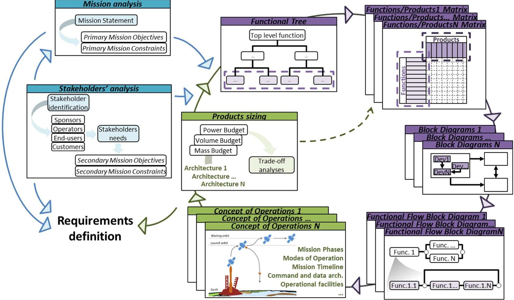
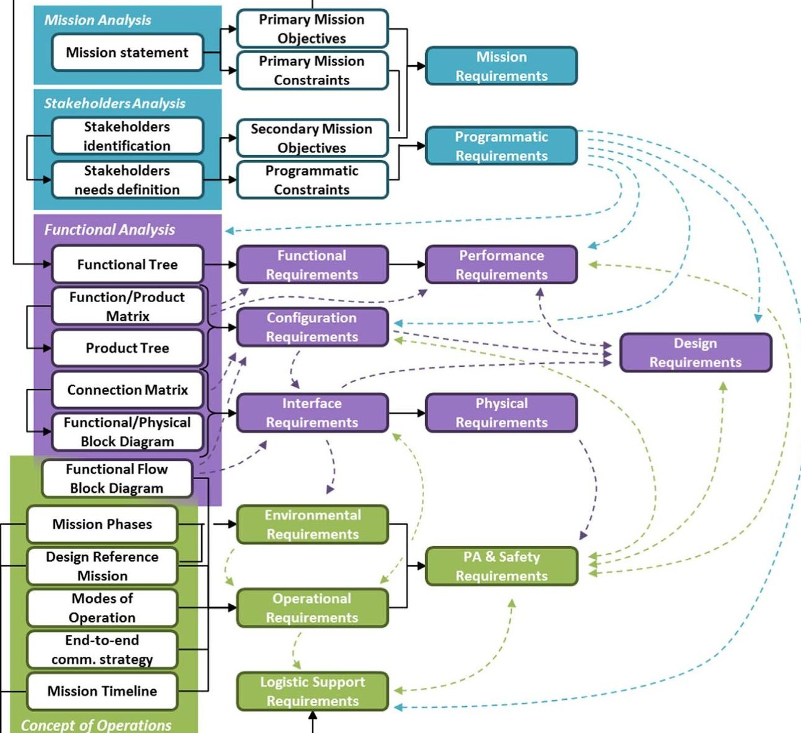
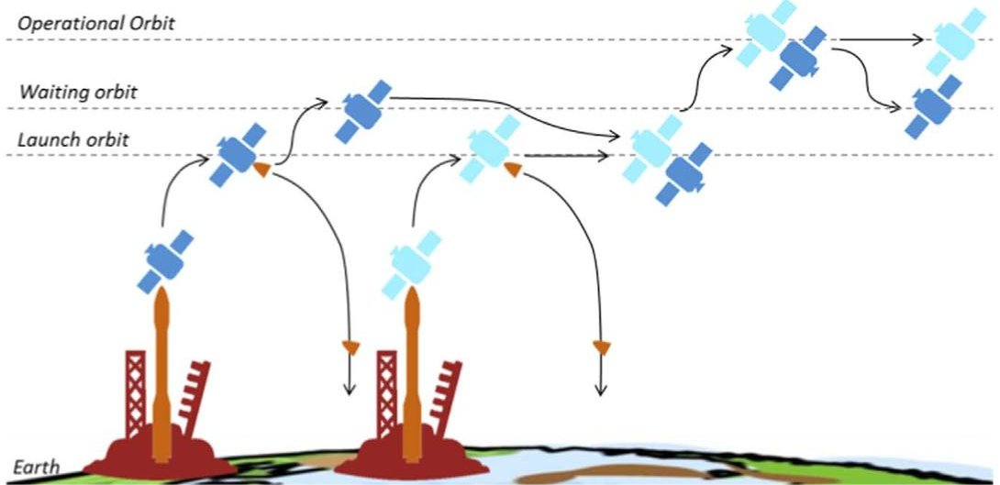
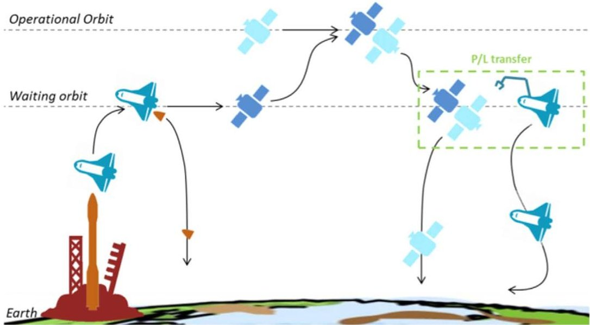
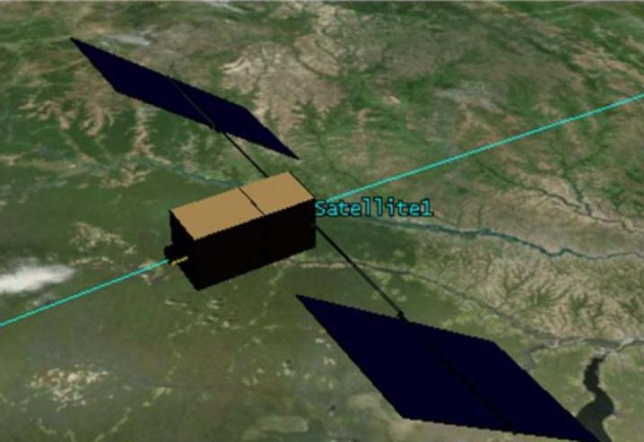

<!-- PDF_PAGE: 1 -->

# Reusable space tug concept and mission

Sara Cresto Aleina $ ^{a,*} $ , Nicole Viola $ ^{a} $ , Fabrizio Stesina $ ^{a} $ , Maria Antonietta Viscio $ ^{b} $ Simona Ferraris $ ^{c} $

$ ^{a} $ Politecnico di Torino, Corso Duca degli Abruzzi 24, Torino 10129, Italy

$ ^{b} $ Thales Alenia Space Italy, Via Saccomuro, 24, Roma 00131, Italy

$ ^{c} $ Thales Alenia Space Italy, Strada Antica di Collegno 253, Torino 10146, Italy

## ARTICLE INFO

Article history:

Received 7 January 2016

Accepted 4 July 2016

Available online 5 July 2016

Keywords:

Conceptual design

Space Tug

Functional Analysis

Concept of Operations

## ABSTRACT

The paper deals with the conceptual design of a space tug to be used in support to Earth satellites transfer manoeuvres. Usually Earth satellites are released in a non-definitive low orbit, depending on the adopted launcher, and they need to be equipped with an adequate propulsion system able to perform the transfer to their final operational location. In order to reduce the mass at launch of the satellite system, an element pre-deployed on orbit, i.e. the space tug, can be exploited to perform the transfer manoeuvres; this allows simplifying the propulsion requirements for the satellite, with a consequent decrease of mass and volume, in favour of larger payloads. The space tug here presented is conceived to be used for the transfer of a few satellites from low to high orbits, and vice versa, if needed. To support these manoeuvres, dedicated refuelling operations are envisaged. The paper starts from on overview of the mission scenario, the concept of operations and the related architecture elements. Then it focuses on the detailed definition of the space tug, from the requirements' assessment up to the budgets' development, through an iterative and recursive design process. The overall mission scenario has been derived from a set of trade-off analyses that have been performed to choose the mission architecture and operations that better satisfy stakeholder expectations: the most important features of these analyses and their results are described within the paper. Eventually, in the last part of the work main conclusions are drawn on the selected mission scenario and space tug and further utilizations of this innovative system in the frame of future space exploration are discussed. Specifically, an enhanced version of the space tug that has been described in the paper could be used to support on orbit assembly of large spacecraft for distant and long exploration missions. The Space Tug development is an activity carried on in the frame of the SAPERE project (Space Advanced Project Excellence in Research and Enterprise), supported by Italian Ministry of Research and University (MIUR), and specifically in its STRONG sub-project (Systems Technology and Research National Global Operations) and related to the theme of space exploration and access to space.

$ \textcircled{2} $ 2016 IAA. Published by Elsevier Ltd. All rights reserved.

* Corresponding author.

<!-- PDF_PAGE: 2 -->

## 1. Introduction

In recent years, international roadmaps show an increasing interest in a new space system concept: the space tug. A space tug is a particular spacecraft that can be used to transfer satellites from Low Earth Orbit (LEO) to higher operational orbits; this would allow reducing the platform mass (mainly due to less performing propulsion subsystem), in favour of larger payload mass. The interest of space agencies and companies in this type of system is not only related to orbital payloads transfer, but it is also due to several other applications.

For example, an important aspect to be considered is that space is becoming more and more crowded, and in this perspective the use of an on-orbit system developed for generic applications and adaptable to a specific critical situation would give the opportunity to face maintenance and refuelling problems without of the need of additional dedicated systems. In addition, a similar system can be exploited also to retrieve or remove space debris. Finally, a Space Tug system is an important building block in missions related to space exploration: issues regarding the assembly of large spacecraft can be solved using this on-orbit system, providing a solution to one of the most challenging aspects related to space exploration in the future [1,2]. An additional application can be related not only to large space systems but also to smaller ones: indeed, it is possible to consider the use of small launcher combined to a Space Tug to deliver in higher orbits also CubeSats or other Small Satellites for interplanetary missions, so designed to operate in orbit not easily reachable by small launchers [3]. In this framework, the development of a new element like a Space Tug is desirable [4].

Usually, Earth satellites are released in a non-definitive low orbit, depending on the adopted launcher: in this case, the payload has to be designed with a propulsion system able to perform the final transfer. The use of a reusable tug system with an adequate propulsion system would be a way to increase the payload mass, giving the opportunity to exploit the Italian VEGA launcher at a larger extent. Indeed, relying on the support of a pre-deployed system such as a reusable space tug in charge of performing the transfer of the satellite platform from a lower orbit to the target orbit, allows minimising the propulsion on the satellite and, therefore, maximising the payload mass capability.

A space tug design is one of the outputs of SAPERE project and specifically of its STRONG sub-project. STRONG is related to the theme of space exploration and access to space and is the frame in which this activity is performed. This project has the objectives both to improve the national space operability in terms of access to space and to increase the Italian industrial capability to realise a Space Tug. In particular, the space tug discussed in this paper is an unmanned system with the main purpose to support satellites deployment on orbit. In addition, another mission scenario to face with is the possibility to retrieve on Earth significant payload samples by means of an operative reusable vehicle, such as for example an evolution of IXV (Intermediate eXperimental Vehicle), PRIDE. In order to better describe the design activity performed on this kind of system, the paper starts with the description of the methodology applied in the design of the space tug and the STRONG system (Section 2), before applying it to the case study. In Section 3 the space tug conceptual design is described. The main outputs of this section are the tug configuration, in terms of subsystems composing it, the mission scenario and mass budget. Eventually, main conclusions are drawn (Section 4).

## 2. Design methodology

The objective of the space tug presented in this paper is to improve the national space operability in terms of access to

space by providing a transportation system capable to transfer satellites platforms from low orbits, where they are released by launcher, to higher operational orbits and back, if needed. This objective may need a particular un-manned pre-deployed system, the Space Tug. This system has to be correctly designed in order to fulfil all the needs and the objectives of STRONG project. In particular, the design process here presented is the typical conceptual design process in Systems Engineering. In this process the main output to be obtained is the definition of the main requirements definition, taking into account all main activities that such a system has to perform to be compliant with stakeholders' needs, regulations and other imposed constraints as, for example, the environment. The core element of the design process here proposed is the Functional Analysis, used to define activities and products able to perform them, according to a System Design Methodology [5-8] (Fig. 1). In particular, at the end of the Functional Analysis the system architecture and the main requirements that drive the system design itself are fully described and listed [9]. To this purpose, the basic tools of the Functional Analysis can be used to derive the requirements that will drive the systems design. The requirements that can be derived are many and can be grouped in specific categories, as shown in Fig. 2. For example, the main category of top-level requirements, i.e. mission requirements, directly stem out from the mission statement and mission objectives and constraints, which are a description of the crucial issue of this paper study and of the major limitations in the systems design. In addition, other top-level requirements, for example programmatic requirements, or constraints are imposed from the analysis of all the actors involved in this project (defined as Stakeholder [10]). However, these two first analyses are able only to define data in a high level of detail, identifying the main purpose to be performed, constraints of the design and impositions. To increase the detail of the design and define a list of all the activities and the products that are required, the Functional Analysis should be introduced.

The requirements definition process is important, considering that requirements represent the basis of the whole system design. For this reason, their derivation has to be part of a rational and logical process, in order not to forget drivers or constraints in the design that could eventually lead to unsuccessful choices. Also for this reason a requirements categorisation is necessary: having all the requirements divided into categories can reduce possible repetitions and helping their verification. For this reason and as already explained, requirements have been subdivided into many categories as shown in Fig. 2 [6,10,11].

In more detail, the first activity to perform, before writing down the requirements, is the definition of the main objectives of the project. As already explained and as suggested in [10], they can derive directly from the Mission Statement and the stakeholders' analysis. In particular, primary Mission Objectives are directly derived from the Mission Statement. This is an important phase in the design of a system, considering that Mission Statement and Primary Mission Objectives represent mission foundation and, for this reason, they cannot be modified during the definition process. Another analysis that can create important constraints and objectives is the Stakeholders' Analysis. The main purpose of Stakeholders' Analysis is to define needs and expectations of the main stakeholders. Certainty, the first activity to be performed before the stakeholders needs determination is the identification of the stakeholders, i.e. of all the actors involved. Consequently, secondary objectives can be derived. A categorisation of stakeholders that can drive their identification process is proposed in [11]. Indeed, the stakeholders can be categorized as sponsors (i.e. those associations or private who establish mission statement and fix bounds on schedule and funds availability), operators (i.e. those

<!-- PDF_PAGE: 3 -->

Fig.1. Applied methodology overview.

Mission Requirement The STRONG system shall use Italian space assets

Programmatic Requirement The STRONG system shall perform satellites/payloads taxi between LEO and the operational orbit

Functional Requirement The Space Segment shall perform satellites transfer from Low Earth Orbit to operational orbit

Performance Requirement The Space Tug shall reach at least a GEO caring a satellite

Configuration Requirement The Space Segment shall use a P/L platform

Interface Requirement The Space Tug shall allow a mechanical interface with P/L platform

Environmental Requirement Space Tug shall be compatible with the launch environment defined by the VEGA User Manuals

Operational Requirement Space Tug shall enter autonomously in Stand-by Mode in the orbiting phases of the mission

Fig. 2. Requirements definition process and examples.

<!-- PDF_PAGE: 4 -->

people in charge of controlling and maintaining the main systems analysed), end-users (i.e. those people that receive and use products and capabilities) and customers (i.e. users who pay fees to utilise a specific space mission's product).

From the objectives and constraints list is based the requirement derivation process. For this purpose, the typical Functional Analysis tools can be employed. Examples of tool that can be involved in this analysis are Functional Tree, Functions/Products Matrix, Product Tree, Block Diagrams and Functional Flow Block Diagram (FFDB). All these tools are applied in an iterative and recursive process: they shall be repeated starting from the highest level to lower levels, i.e. segment level, system level, sub-system level, device level. The reference level for this preliminary study will be the system level.

The main tool employed in the Functional Analysis is the Functional Tree. Indeed, through this tool it is possible to define the basic functions that the system shall be able to perform. Also the Functional Tree is obtained in an iterative process, in which, in order to split the higher level functions into lower level ones, designers ask themselves "how" these functions can be performed. Also the opposite process is possible, asking the question "why". The functions listed in this way have to be mapped onto the elements able to perform them. This process can be performed with to the Functions/Products Matrix. Checked cells of the matrix are used to identify connections between functions and products, drawing the Product Tree.

Another important aspect to be addressed is how the products are organised and interfaced among them. This information can be obtained with the Functional/Physical Block Diagram that depicts a graphical representation of the connections among all the products at each level of studied detail. In addition, this tool shows also the direction and the type of required interfaces between products (e.g. data exchange, mechanical connection ...).

Finally, FFDBs are a particular kind of tool that gives further information about the functions listed before [6]. Specifically, the time and the logical sequence of functional events are shown with FFDBs. Being related to functions and not to products, this kind of tool is able to show what has to happen in the system without referring to physical solutions. On the contrary, a way to show the physical solutions that can be applied to solve the Mission Statement is the Concept of Operations (ConOps). For this reason, it can be said that FFBDs are a preliminary study for the definition of the ConOps.

The definition of the ConOps should consider all the aspects of the mission to perform, including integration, test, launch and disposal. Typical ConOps information are [6]: Mission Phases, Modes of Operation, Mission Timeline, Design Reference Mission

(DRM) and/or Operational Scenarios, End-to-end communication strategy and/or Command and data architecture, Operational facilities (e.g., mission control, science data centre), Integrated logistic support (resupply, maintenance and assembly) and Critical events.

Usually, in preliminary phases of the design process is common to have one or more operational scenarios and architectures, but only one is the optimal solution of the design. Trade-off analyses have to be performed in order to demonstrate which is the optimal solution, considering the mission statement, the stakeholders' needs and the requirements.

The entire process is iterative and recursive and has to be repeated until the desired level of detail. In each stage of the design process it is possible to define different type of requirements with different influences over the design. A scheme of the requirement definition and the connections between the tools before described is provided in Fig. 2.

## 3. Space tug conceptual design

## 3.1. Mission and stakeholders' analysis

According to the typical conceptual design process in Systems Engineering, the mission statement and the stakeholders' analysis have been firstly established. In this phase of the design, it has to be performed the definition of the main objectives and constraints that will drive the design. Firstly, the stakeholders' analysis starts with the stakeholders' identification. The main stakeholders, considering the STRONG project are the following ones [11]:

1. Sponsors: MIUR;

2. Operators: engineers from ELV (Vega), Ground Segment operators and engineers (Altec), engineers from TAS-I, CIRA and Selex ES (systems design);

3. End-users: engineers from the operators companies, researcher from university (PoliTo, PoliMi, UniPa, La Sapienza), scientists (specific experiments);

4. Customers: those people that will pay for the services offered by the final System (e.g. space agencies, Universities or private users).

Table 1 provides a short description of the main involved stakeholders categorized as Sponsors and Operator, specifying their main objectives and application fields.

After the stakeholders' identification, their needs can be derived and analysed. In this phase every stakeholder has to be

## Table 1

Description of the Sponsors and Operators related to Italian industrial, research and political bodies.

<table border="1"><tr><td>Stakeholder</td><td>Description</td><td>Headquarter</td></tr><tr><td>MIUR</td><td>The MIUR is the ministry of the Italian government for the national education system,the Italian universities and research.Contemporary it is responsible for education in public and private schools of all levels and it oversees the Italian research through appropriate structures.</td><td>Rome(Italy)</td></tr><tr><td>ELV</td><td>ELV is an Italian company established in 2000 by Avio and ASI(Italian Space Agency)and selected by ESA(European Space Agency),to serve as prime contractor in the activities related to the development of VEGA and of other small launchers.</td><td>Rome(Italy)</td></tr><tr><td>Altec</td><td>Altec operates in the field of space activities form 2003 and its mission is to provide high-tech services in support of space agencies, institutional bodies,industrial operators,scientific and academic communities.It is responsible for the management and operations of the Multi-Functional Space Centre(CMFS).</td><td>Turin(Italy)</td></tr><tr><td>TAS</td><td>Thales Alenia Space is a French-Italian joint venture born in 2007 that operates in space,defence,science and security markets.Today,Thales Alenia Space is one of the main suppliers to the International Space Station,and in space systems related to Space Exploration.</td><td>Cannes(France)</td></tr><tr><td>CIRA</td><td>CIRA from 1984 is a public-private company,with the participation of research institutions,local governments and aerospace industries.This cooperation has allowed the creation of test facilities and aeronautical and space flying laboratories.The main areas of activity are aerodynamics,aerospace propulsion,vibration and other specific branches of aerodynamics.</td><td>Capua(Italy)</td></tr><tr><td>Selex ES</td><td>Selex ES is from 2013 a subsidiary of Leonardo-Finmeccanica,active in the electronics and information technology business.Selex ES&#x27;s activities have been organised in three Divisions within the sector:Airborne &amp; Space Systems,Land and Naval Defence Electronics and Security and Information Systems.</td><td>Rome(Italy)</td></tr></table>

<!-- PDF_PAGE: 5 -->

analysed in order to detail peculiar needs. In particular, these needs can be considered Secondary Mission Objectives:

- To explore new mission concepts for future space exploration (MIUR);

- To validate critical technologies enabling this operative scenario (MIUR, universities);

- To enhance the cooperation between industries and universities (MIUR);

- To enhance reusability (TAS-I);

- To interface with international space facilities (TAS-I);

- To enhance modularity in interface segments (TAS-I);

- To increase the Vega usage (ELV);

- To have standardized interfaces (ELV);

- To receive data and transmit commands from/to ground (Altec);

- To exploit existing Ground facilities (Altec).

These objectives lead us to some preliminary considerations. As already explained, the main purpose of the Space Tug designed for STRONG project is to improve the national space operability in terms of access to space. This particular improvement is gained providing a transportation system capable to transfer satellites platforms from a generic LEO (where they are released by a small launcher), to higher operational orbit, or back (i.e. from the operational orbit to a designed LEO orbit) after their operative life cycle, when it is required to retrieve payload on Earth. In addition, the use of such a system can simplify the platform propulsion system thus limiting their overall mass and volume, in favour of larger payloads. An important constraint to face with in the design of STRONG system Space Tug is to rely as much as possible on Italian space assets: according to this, VEGA is considered as baseline launcher. This consideration will impose remarkable constraints on the system design, for example limiting the over volumes, mass and dimensions available for platform launch.

Another important feature required for the Space Tug system is reusability. According to [12] reusability is an important feature that has to be pursued to enhance in-space transportation systems performances. A system can be defined as "reusable" if it has the ability to perform multiple missions without replacements at subsystem or equipment level, a part from the replenishment of consumable commodities (e.g. propellant) [12]. As a matter of fact, a high level of reusability is one of the typical features in a space tug, since it is designed to perform many orbital transfers and servicing operations along its operational life. In addition, being in this particular case study asked by the stakeholders to design a reusable system, many different mission concepts have to be considered, even if this system will be designed for the more constraining mission concept for simplicity. Indeed, the same system can be used both to deliver in higher orbits also CubeSats or other Small Satellites for interplanetary missions [3] and to simplify the assembly of large spacecraft on-orbit for deep-space exploration purposes [13,14]: these type of mission concepts are related to different payload to transfer and to different needs for mission length in term of time and so will lead to different consumptions. Therefore, to enhance the tug reusability and perform the highest possible number of missions and to not be limited by the type of missions to perform, periodical refuelling operations are foreseen. Indeed, a periodical refuelling can limit the fuel carried on-board the tug system to the amount of fuel required to perform a single mission, reducing the consumption and the thrust employed to reach the final orbit. A refuelling system adaptable to the mission scenario and to the stakeholders' requirements has to be considered.

In order to allow performing multiple satellites delivery missions, a survey has been performed to select the most promising solution for the propulsive sub-system In the international space

roadmaps the main propulsive systems are analysed and the main trends, the average fuel consumption and the costs of many kind of propulsion systems available on the market or in development are shown. Analysing these data, electrical propulsion has been chosen for the space tug. This particular choice has been driven by the advantages that the electrical propulsion shows: indeed, it uses less propellant and it provides a better reliability and simplicity than chemical systems. On the other hand, it offers only low thrust and, consequently, longer transfers times, but this is not an issue considering the particular application of this work (i.e. an unmanned spacecraft).

Having analysed all the stakeholders' needs and the main constraints in the STRONG system design and in order to define the main requirements, the mission has to be taken into account, firstly specifying the mission statement. For the analysed case study and the imposed hypothesis and constraints, the Mission Statement is the following:

To improve the national space operability in terms of access to space by providing a transportation system capable to transfer satellites platforms from Low Earth Orbits to operational orbits and back, relying on Italian space assets.

From this statement, a Primary Mission Objective (i.e. to perform satellites taxi between LEO and the operational orbit) and a Constraint can be derived (i.e.to use Italian space assets). Also in the mission concept has been underlined the necessity to rely on Italian space assets. This particular part of the mission statement is influenced by the stakeholders' analysis and will drive the systems configurations and design. In addition, considering stakeholders' analysis, VEGA launcher is considered as baseline and is one of the main constraints for the systems design.

## 3.2. Requirements

Thanks to mission and stakeholders' analysis, the main objectives and constraints of the project have been derived. At this point of the STRONG system design, the requirement derivation process should start. Indeed, in order to proceed with the sizing of the system the top-level requirements had to be assessed. Starting from objectives and constraints different types of requirements can be derived: objectives are related to mission requirements, while constraints are more connected with programmatic requirements. Indeed, while a mission requirements is a particular kind of requirement that is related to a task, a function or an action performed by a product that yields a specified and observable result, a programmatic requirement is set by a stakeholder and may include strategic scientific and exploration requirements, system performance requirements, and schedule, cost, and similar nontechnical constraints.

Other type of requirements can be directly derived from the functional analysis. The typical functional analysis tools can be usefully employed in this process (Fig. 2). The functional analysis starts with the definition of the Functional Tree and particularly from top-level functions derived from the Mission Statement (i.e. to perform satellites/payloads transfer between LEO and the operational orbit). Proceeding from this function to lower levels of detail in an iterative process, a list of activities, that the involved devices have to perform, can be obtained. In this iterative process, every high level function is analysed and further expanded, up to the desired level of detail. At the end of this process, a list of functions to be performed is clearly defined and it is possible to list the main actors of STRONG system and their interfaces. In addition, a final group of requirements can be derived from the Concept of Operations (ConOps). Indeed, the ConOps analysis allows obtaining requirements more related to the operations and the

<!-- PDF_PAGE: 6 -->

mission environment. Also the definition of the ConOps is an iterative process that has to be performed till the desired level of detail. The main output of the ConOps definition is the final system architecture, determined with trade-off studies in order to be the optimal solution to meet all the requirements and the constraints.

For simplicity, all the functional analysis and the performed iterations are here only described in theory and are not reported in this paper. The next sections will report the main results obtained from the Functional Analysis and the ConOps. Particularly, see Section 3.3 for the main systems derived from the Functional Analysis and the Functions/Products Matrix obtained at system level. In addition, Section 3.4 summarizes the optimal mission scenario obtained from the analyses, describing the ConOps. In Fig. 2, some examples of requirements are reported.

## 3.3. STRONG system of system configuration

In the previous sections the main methodology applied to the design process to explore new concepts and define their architectures has been explained. The definition of the system architecture is mainly based on the Functional Analysis and the ConOps. In particular, through the Functional Analysis, the main functions and the main actors of STRONG system are clearly defined, characterizing their interfaces. In particular this analysis has been performed not only to define the functional requirements, but also to map the system functions to the physical components, to guarantee that all necessary components are listed and that no unnecessary component is considered and, finally, to understand the relationships among the new products' components [7]. The main tool applied to obtain the list of useful physical components from the list of functions to be performed is the so-called Functions/Products Matrix (Figs. 3 and 4). The Functions/Products Matrix has therefore been used to map functions to physical components or systems.

The elements of the overall scenario of STRONG project to be explored include then the VEGA launcher, every launch facility connected with the use of VEGA launcher, a payload (P/L) platform, the Space Tug, a system for on-orbit refuelling (i.e. an orbital tank), the pre-operational vehicle PRIDE (Programme for Reusable In-orbit Demonstrator for Europe), a Mission Control Centre (MCC) and a Mission Support Centre (MSC).

In this mission scenario, the VEGA launcher will bring the maximum possible payload mass in a low orbit. The payload is then docked to a Space Tug, minimising the propulsion on the platform and maximising the payload mass. In addition, considering this system architecture, the STRONG system will also give the opportunity to return on Earth significant payload samples. In this case the PRIDE pre-operative reusable vehicle can be exploited: indeed in this case, the two systems (i.e. the Space Tug and PRIDE vehicle) would rendezvous in a defined orbit in order to move the payload sample from the space tug to the PRIDE vehicle and return it back to Earth. At the end of both cases, a refuelling method is then required to extend the Space Tug reusability.

The here presented option for refuelling has been analysed and it has been set as the optimal solution considering the various possibilities available in the international space scenario [15]. As a result of a trade-off analysis among different refuelling architectures, the optimal configuration is composed of an Orbital Tank to which the Space Tug has to dock for refuelling. In order to reduce the Space Tug mass during every performed mission, a refuelling is supposed after each mission. Additional details about this refuelling configuration will be provided and explained in the next section. Indeed, even if this paper deals with the design of a Space Tug able to answer to the STRONG project needs, a preliminary design of the Orbital Tank has to be considered and in support of this part of the analysis, some considerations have to be

done to provide data on the preliminary figures for the mission elements that are more affected: the on-orbit refuelling system and the Space Tug.

The Space Tug is not only the core element of this paper, but also an important element in the STRONG system and in the proposed scenario. In the mission scenario identified through design analysis performed till this step, the Space Tug main function is to transfer the P/L Platform into the required operational orbit. Considering this eventuality, the Space Tug is supposed to actively perform the rendezvous and docking with both the P/L platform and the refuelling system. The second function to be performed is to bring back from the operational orbit a payload or a sample of it, transfer it into a LEO where the payload can be moved on PRIDE vehicle and be returned on Earth. In this specific case, the Space Tug is supposed to actively perform rendezvous with PRIDE. PRIDE vehicle after being docked to the Space Tug, is supposed to move on-board the payload (or some sensitive parts, some samples of it) using a robotic arm located in PRIDE vehicle, before returning on Earth. In both the presented cases, one of the main constraints in the Space Tug configuration is to be compatible in mass and volume with VEGA launcher capabilities (i.e. maximum diameter 2.6 m and maximum length 7.8 m). As already explained, this constraint will have a significant influence on the choice and the design of the Space Tug sub-systems.

Finally, analysing the functions at system level and iterating the process to obtain the sub-system level, it is then possible to have a list of sub-system that, composing the Space Tug system, may allow the tug to fulfil all the required functions. In particular, the Space Tug will be equipped with a certain number of sub-systems, including Propulsion Sub-system, Electrical Power Sub-system (EPS), Thermal Control Sub-system (TCS), Attitude and Orbit Control Sub-system (AOCS), Data Management Sub-system (DMS), Telemetry Tracking and Control Sub-systems (TT&C), Structures Sub-system, Harness Sub-system. The Propulsion Sub-system includes the main thruster (electric) and the reaction control system. In addition, the propellants tanks are part of the propulsion subsystem, with all the interface and feeding systems needed to provide propellant to the thrusters. Another important sub-system is the EPS, in charge of providing, storing and distributing power to the other sub-systems. In this specific case, this is a very impacting sub-system, since electric thrusters require high power levels to function. EPS mainly includes solar arrays and batteries. The main purpose of TCS is to maintain all spacecraft and payload components and subsystems within their required temperature limits for each mission phase. The main function of AOCS is to stabilise the vehicle and orient it in desired directions during the mission despite the external disturbance torques acting on it; the attitude control is particularly critical for the rendezvous and docking manoeuvres with the satellite platform. Moreover accurate attitude maintenance will be necessary for the refuelling operations. Another sub-system considered is the DMS, which receives, validates, decodes, and distributes commands to other spacecraft systems and gathers, processes, and formats spacecraft housekeeping and mission data for downlink. In combination to this sub-system, a TT&C sub-system is foreseen, which provides the interface between the spacecraft and the ground systems, transmitting mission and spacecraft housekeeping data. A structure sub-system supports all other spacecraft sub-systems and includes the attachment interfaces with the launcher and the ground support equipment interfaces. Moreover, it includes the rendezvous and docking mechanism to dock with the P/L platform and the refuelling interface with the nozzle tool (which is the tool allowing the transfer of propellant from the refuelling depot attached to the Orbital Tank to the space tug tank). Finally, harness sub-system includes satellite wiring, electronics backplane, and electrical interface boards. As already explained, an Orbital Tank

<!-- PDF_PAGE: 7 -->

<table border="1"><tr><td rowspan="2" colspan="2"></td><td rowspan="2"></td><td colspan="3">MSC</td><td rowspan="2">VEGA</td><td rowspan="2">Facilities</td><td rowspan="2">Space Tug</td><td rowspan="2">P/L platform</td><td rowspan="2">PRIDE vehicle</td><td rowspan="2">Refuelling sys.</td></tr><tr><td>MCC</td><td></td></tr><tr><td rowspan="36">FUNCTIONS</td><td rowspan="4">To reach the LEO</td><td>To support launch</td><td></td><td></td><td></td><td>X</td><td></td><td></td><td></td><td></td><td></td></tr><tr><td>To perform launch</td><td></td><td></td><td>X</td><td></td><td></td><td></td><td></td><td></td><td></td></tr><tr><td>To transfer requested objects on LEO</td><td></td><td></td><td>X</td><td></td><td></td><td></td><td></td><td></td><td></td></tr><tr><td>To release objects on LEO</td><td></td><td></td><td>X</td><td></td><td></td><td></td><td></td><td></td><td></td></tr><tr><td>To communicate with ground</td><td></td><td></td><td>X</td><td></td><td></td><td></td><td></td><td></td><td></td><td></td></tr><tr><td rowspan="10">To perform satellites transfer from Low Earth Orbit to operational orbit</td><td>To perform RvD on LEO</td><td></td><td></td><td></td><td>X</td><td></td><td></td><td></td><td></td><td></td></tr><tr><td>To withstand RvD on LEO</td><td></td><td></td><td></td><td></td><td></td><td>X</td><td></td><td></td><td></td></tr><tr><td>To transfer the object on the operational orbit</td><td></td><td></td><td></td><td>X</td><td></td><td></td><td></td><td></td><td></td></tr><tr><td>To perform un-docking once on the operational orbit</td><td></td><td></td><td></td><td>X</td><td></td><td></td><td></td><td></td><td></td></tr><tr><td>To withstand un-docking on the operational orbit</td><td></td><td></td><td></td><td></td><td></td><td>X</td><td></td><td></td><td></td></tr><tr><td>To perform payload operation once on the operational orbit</td><td></td><td></td><td></td><td></td><td></td><td>X</td><td></td><td></td><td></td></tr><tr><td>To return on LEO from the operational orbit</td><td></td><td></td><td></td><td>X</td><td></td><td></td><td></td><td></td><td></td></tr><tr><td>To wait on LEO for the next object</td><td></td><td></td><td></td><td>X</td><td></td><td></td><td></td><td></td><td></td></tr><tr><td>To ensure communication on orbit</td><td></td><td></td><td></td><td></td><td></td><td>X</td><td></td><td></td><td></td></tr><tr><td>To maintain communication with ground</td><td></td><td></td><td></td><td>X</td><td></td><td></td><td></td><td></td><td></td></tr><tr><td rowspan="9">To retrieve satellites from operational orbit to Low Earth Orbits</td><td>To move from LEO to the operational orbit</td><td></td><td></td><td></td><td>X</td><td></td><td></td><td></td><td></td><td></td></tr><tr><td>To perform RvD on the operational orbit</td><td></td><td></td><td></td><td>X</td><td></td><td></td><td></td><td></td><td></td></tr><tr><td>To withstand RvD on the operational orbit</td><td></td><td></td><td></td><td></td><td></td><td>X</td><td></td><td></td><td></td></tr><tr><td>To transfer the object on LEO</td><td></td><td></td><td></td><td>X</td><td></td><td></td><td></td><td></td><td></td></tr><tr><td>To un-dock the object once on LEO</td><td></td><td></td><td></td><td>X</td><td></td><td></td><td></td><td></td><td></td></tr><tr><td>To withstand un-docking on LEO</td><td></td><td></td><td></td><td></td><td></td><td>X</td><td></td><td></td><td></td></tr><tr><td>To wait on LEO for the next object</td><td></td><td></td><td></td><td>X</td><td></td><td></td><td></td><td></td><td></td></tr><tr><td>To re-enter in atmosphere</td><td></td><td></td><td></td><td></td><td></td><td>X</td><td></td><td></td><td></td></tr><tr><td>To maintain communication</td><td></td><td></td><td></td><td>X</td><td></td><td></td><td></td><td></td><td></td></tr><tr><td rowspan="16">To re-enter on Earth payloads loaded on board satellites once completed their operative cycle</td><td>To move from LEO to operational orbit</td><td></td><td></td><td></td><td>X</td><td></td><td></td><td></td><td></td><td></td></tr><tr><td>To perform RvD on the operational orbit</td><td></td><td></td><td></td><td>X</td><td></td><td></td><td></td><td></td><td></td></tr><tr><td>To withstand RvD on the operational orbit</td><td></td><td></td><td></td><td></td><td></td><td>X</td><td></td><td></td><td></td></tr><tr><td>To transfer the object on LEO</td><td></td><td></td><td></td><td>X</td><td></td><td></td><td></td><td></td><td></td></tr><tr><td>To move on LEO</td><td></td><td></td><td></td><td></td><td></td><td></td><td>X</td><td></td><td></td></tr><tr><td>To perform RvD on LEO</td><td></td><td></td><td></td><td>X</td><td></td><td></td><td></td><td></td><td></td></tr><tr><td>To withstand RvD on LEO</td><td></td><td></td><td></td><td></td><td></td><td></td><td>X</td><td></td><td></td></tr><tr><td>To prepare the payload for the return phase</td><td></td><td></td><td></td><td></td><td></td><td></td><td>X</td><td></td><td></td></tr><tr><td>To help the preparation of the payload for the return phase</td><td></td><td></td><td></td><td></td><td></td><td></td><td>X</td><td></td><td></td></tr><tr><td>To return the payload on Earth</td><td></td><td></td><td></td><td></td><td></td><td></td><td></td><td>X</td><td></td></tr><tr><td>To perform un-docking on LEO</td><td></td><td></td><td></td><td>X</td><td></td><td></td><td></td><td></td><td></td></tr><tr><td>To withstand un-docking on LEO</td><td></td><td></td><td></td><td></td><td></td><td>X</td><td></td><td></td><td></td></tr><tr><td>To re-enter in atmosphere</td><td></td><td></td><td></td><td></td><td></td><td>X</td><td></td><td></td><td></td></tr><tr><td>To wait on LEO for the next object</td><td></td><td></td><td></td><td>X</td><td></td><td></td><td></td><td></td><td></td></tr><tr><td>To maintain communication during the transfer</td><td></td><td></td><td></td><td>X</td><td></td><td></td><td></td><td></td><td></td></tr><tr><td>To ensure communication during the re-entry</td><td></td><td></td><td></td><td></td><td></td><td></td><td></td><td>X</td><td></td></tr><tr><td rowspan="8">To perform refuelling on orbit</td><td>To perform RvD on LEO</td><td></td><td></td><td></td><td>X</td><td></td><td></td><td></td><td></td><td></td></tr><tr><td>To withstand RvD on LEO</td><td></td><td></td><td></td><td></td><td></td><td></td><td></td><td>X</td><td></td></tr><tr><td>To manage the power transmission</td><td></td><td></td><td></td><td></td><td></td><td></td><td></td><td>X</td><td></td></tr><tr><td>To manage the power collection</td><td></td><td></td><td></td><td></td><td></td><td>X</td><td></td><td></td><td></td></tr><tr><td>To perform un-docking</td><td></td><td></td><td></td><td></td><td></td><td>X</td><td></td><td></td><td></td></tr><tr><td>To withstand un-docking</td><td></td><td></td><td></td><td></td><td></td><td></td><td></td><td>X</td><td></td></tr><tr><td>To maintain LEO orbit</td><td></td><td></td><td></td><td></td><td></td><td></td><td></td><td>X</td><td></td></tr><tr><td>To ensure communication</td><td></td><td></td><td></td><td></td><td></td><td></td><td></td><td>X</td><td></td></tr><tr><td>To maintain the communication with ground</td><td></td><td></td><td></td><td></td><td></td><td>X</td><td></td><td></td><td></td></tr><tr><td rowspan="2">To support mission execution</td><td>To provide systems control</td><td></td><td>X</td><td></td><td></td><td></td><td></td><td></td><td></td><td></td></tr><tr><td>To support mission operations</td><td>X</td><td></td><td></td><td></td><td></td><td></td><td></td><td></td><td></td></tr><tr><td>To process telemetry data</td><td></td><td>X</td><td></td><td></td><td></td><td></td><td></td><td></td><td></td><td></td></tr></table>

Fig. 3. Functions/Products Matrix obtained at segment and system level.

<!-- PDF_PAGE: 8 -->

<table border="1"><tr><td colspan="2"></td><td colspan="6">Structure S/S</td><td colspan="4">EPS</td><td colspan="4">TCS</td><td colspan="4">DMS</td><td colspan="4">TT&amp;C sub-</td><td colspan="4">AOCS</td><td colspan="4">Propulsion</td><td colspan="2">Harne</td></tr><tr><td rowspan="2">SYSTEM LEVEL</td><td rowspan="2">SUB-SYSTEM LEVEL</td><td>Radiation shielding</td><td>MDPS panels</td><td>Primary structure</td><td>Secondary structure</td><td>Docking I/F</td><td>Refuelling I/F</td><td>Solar arrays</td><td>Batteries</td><td>Power distribution unit</td><td>Converters</td><td>Radiators</td><td>Heaters</td><td>MLI</td><td>Piping</td><td>TCS SW</td><td>Command&amp;Acquisition unit</td><td>On-board computer</td><td>Mass Memory Unit</td><td>Antenna</td><td>Receiver</td><td>Transmitter</td><td>Auto-tracking equipment</td><td>Orbit sensors</td><td>Attitude sensors</td><td>Attitude Actuators</td><td>GNC SW</td><td>Main Engine</td><td>RCS thrusters</td><td>Propellant tanks</td><td>Feeding system</td><td>Databus</td><td>Electric power harness</td></tr><tr><td></td><td>x</td><td></td><td>

Fig. 4. Functions/Products Matrix obtained at sub-system and device level.

can be exploited for refuelling operations. In the chosen configuration, the Orbital Tank is supposed to stay autonomously in orbit for the time required by the Space Tug to perform a defined number of missions. The tank is supposed to maintain the orbit and its attitude and to send information on its status to the space tug and to Earth. A Soyuz flight is envisioned in order to maximise the fuel stored, considering also a preliminary mission scenario dimensioning (see Section 3.4).

## 3.4. Concept of operations

The main outputs obtained from the Functional Analysis and the top-level analyses performed are a list of top-level requirements and constraints, together with a list of activities to be performed and the systems that are able to perform them. Finally, all the products interfaces and the logics under the activities identified are fully known. At this stage of the design, the system operations have to be defined.

<!-- PDF_PAGE: 9 -->

The overall reference mission scenario mainly includes the following phases: Space Tug deployment, Satellite platform deployment, Space Tug refuelling (Fig. 5). In particular, an Orbital Tank can be exploited for refuelling and other logistics and preparatory activities have been neglected for simplicity.

In detail, considering this particular scenario as reference and the listed system to be used, the first missions set starts with the launch of the space tug, which then remains in its waiting orbit till the launch of the first satellite platform. Launch orbit and waiting orbit are supposed to be different. Once the tug has docked with the satellite platform at the launch orbit, the transfer towards the payload final operational orbit begins. After the satellite release, the tug moves to the refuelling orbit to perform the first refuelling. In this particular scenario, the refuelling orbit (i.e. the Orbital Tank orbit) and the waiting orbit are supposed to be the same. After refuelling operations have been completed, a second mission can start. In particular, the number of missions supposed before a new Orbital Tank has to be provided, is constrained and will be provided after a mission performances analysis. Indeed, this particular value is constrained mainly by the launcher dimensions and the tank dry mass.

As already explained, the refuelling is carried out at the Space Tug waiting orbit. This particular orbit is considered in order to be easily reachable after every mission (i.e. at an inclination of $ 5^{\circ} $ and an altitude of 500 km), minimising drag effects. The waiting orbit is imposed to be different from the launch orbit where the VEGA

launcher releases every payload. This choice has been made to increase the tug reusability, increasing the payload mass that the launcher is able to transfer in orbit (i.e. at an inclination of $ 5^{\circ} $ and an altitude of 350 km). Indeed, VEGA performances have been considered to find the maximum payload capability in the scenario fixing the reference orbits [16]. For the reference launch orbit 2100 kg payloads capability has been assumed having 350 km altitude and $ 5^{\circ} $ inclination. An evaluation of the propellant available for this first mission will be performed at the end of this section, considering VEGA capabilities and the space tug launch mass.

In addition to this mission scenario, an objective for the space tug can be to support the retrieval of payloads to be re-entered on Earth (Fig. 6). Being this particular scenario complex for the number of elements involved and not different from the previous one considering the orbits that the tug has to reach in a single mission, the payload retrieval scenario is not used for the mission and the tug sizing.

At this point of the design, it is necessary to have a clear view of the scenario and the required performance to select the best concept of operations [17]. To evaluate the mission scenario a Matlab $ ^{\textcircled{2}} $ script has been built and computations have been carried out to estimate the total amount of propellant required to accomplish the satellites delivery missions and the transfer for refuelling to the waiting orbit. This evaluation has to be performed considering the constraint to use electric propulsion (i.e. low thrust orbital transfers). Assuming a transfer between two circular

Fig. 5. Nominal electric space tug mission concept, the refuelling phase is not reported for simplicity.

Fig. 6. Nominal electric space tug mission concept.

<!-- PDF_PAGE: 10 -->

Table 2

Mission phases' budgets, in the first missions set is assumed a small payload transfer (150 kg) transferred at 10,000 km at an inclination of 0.

<table border="1"><tr><td>Phase</td><td></td><td>Initial mass[kg]</td><td>Final mass[kg]</td><td>Propellant mass[kg]</td><td>Transfer time[days]</td></tr><tr><td rowspan="4">First missions set(small P/L)</td><td>Parking LEO-Waiting LEO</td><td>2051</td><td>2044</td><td>7</td><td>4</td></tr><tr><td>Waiting LEO-Parking LEO</td><td>2044</td><td>2037</td><td>7</td><td>4</td></tr><tr><td>Parking LEO-GEO</td><td>2187</td><td>1944</td><td>243</td><td>144</td></tr><tr><td>GEO-waiting LEO</td><td>1794</td><td>1600</td><td>194</td><td>115</td></tr><tr><td rowspan="12">Second missions set</td><td>Waiting LEO-Parking LEO</td><td>2554</td><td>2545</td><td>9</td><td>5</td></tr><tr><td>Parking LEO-GEO</td><td>3545</td><td>2930</td><td>616</td><td>365</td></tr><tr><td>GEO-waiting LEO</td><td>1930</td><td>1600</td><td>330</td><td>195</td></tr><tr><td>Waiting LEO-Parking LEO</td><td>2554</td><td>2545</td><td>9</td><td>5</td></tr><tr><td>Parking LEO-GEO</td><td>3545</td><td>2930</td><td>616</td><td>365</td></tr><tr><td>GEO-waiting LEO</td><td>1930</td><td>1600</td><td>330</td><td>195</td></tr><tr><td>Waiting LEO-Parking LEO</td><td>2554</td><td>2545</td><td>9</td><td>5</td></tr><tr><td>Parking LEO-GEO</td><td>3545</td><td>2930</td><td>616</td><td>365</td></tr><tr><td>GEO-waiting LEO</td><td>1930</td><td>1600</td><td>330</td><td>195</td></tr><tr><td>Waiting LEO-Parking LEO</td><td>2554</td><td>2545</td><td>9</td><td>5</td></tr><tr><td>Parking LEO-GEO</td><td>3545</td><td>2930</td><td>616</td><td>365</td></tr><tr><td>GEO-waiting LEO</td><td>1930</td><td>1600</td><td>330</td><td>195</td></tr></table>

orbits, in a low-thrust orbit transfer the total velocity change is given by [18]:

$$
\Delta V = V _ {0} \cos \beta_ {0} - \frac {V _ {0} \sin \beta_ {0}}{\tan \left(\pi / 2 \Delta i + \beta_ {0}\right)}
$$

where $ V_{0} $ is the initial orbit velocity, $ \beta_{0} $ is the initial thrust vector yaw angle and $ \Delta i $ is the total desired inclination change. The initial mass in the parking orbit is related to the total required velocity through the Tsiolkovsky rocket equation:

$$
\Delta V = v _ {e} \ln m _ {0} / m _ {f}
$$

where $ \nu_{e} $ is the effective exhaust velocity (i.e. $ \nu_{e}=Isp\cdot g_{0} $ , in which Isp is the specific impulse and $ g_{0} $ is standard gravity), $ m_{0} $ is the initial total mass, including propellant, and $ m_{f} $ is the final total mass. Consequently, the transfer time is known:

$$
t _ {f} = \Delta V / f
$$

where f indicates the low-thrust acceleration, which for this computation is assumed constant during the orbit transfer and has been obtained as the ratio between thrust (constant thrust is considered) and the average between final and initial mass.

This procedure can be applied to the reference mission scenario, considering that at the end of each mission the final mass at the waiting orbit has to be the dry mass of the Space Tug, prior to refuelling. In addition, it is worth noticing that the STRONG system for the entire operational scenario periodically repeats a single mission, from the payload retrieval to the refuelling.

According to the scenario just described and using the developed Matlab $ ^{\textcircled{r}} $ tool, the masses of propellant and the transfer times required to accomplish the various payload transfers have been evaluated. The computations have been carried out considering the following assumption:

- parking orbit: 350 km, $ 5^{\circ} $;

- waiting orbit: 500 km, $ 5^{\circ} $;

- final operational orbit (GEO is considered, i.e. the worst condition): 36,000 km, $ 0^{\circ} $;

- refuelling orbit: 500 km, $ 5^{\circ} $ (same as the waiting orbit);

- propulsion system: constant thrust equal to 480 mN and a Isp of 2500 s;

- satellite platform mass: 1000 kg (maximum value from stakeholders analysis).

The results are summarised in Table 2. In all this preliminary

analysis, an estimation of the tug dry mass is required and it has been assumed equal to 1600 kg. This value is very close to the final one: the computations explained in this section and the space tug mass budget evaluation are not two separate processes, but are part of an iterative and recursive process set to merge to an optimal solution. A more detailed evaluation of the Space Tug dry mass will be provided in the next section. Finally, the total propellant mass needed to accomplish a single missions set is about 954 kg.

In addition, some considerations can be made about the Orbital Tank. Some additional constraints have to be considered, not only in the number of mission set to be performed before a change or a refuelling in the tank is required, but also considering safety margins and regulations. Indeed, the Orbital Tank is assumed to be launched with Soyuz flight to maximise the fuel stored. In the Orbital Tank a minimum amount of 954 kg of propellant has to be stored (single mission). Considering Soyuz launcher for the tank transfer in the waiting orbit, the maximum value of propellant to be considered in the orbital tank is limited. Indeed, a Soyuz based Orbital Tank is supposed to have a maximum mass of about 6000 kg, considering Soyuz capabilities for a standard launch at the waiting orbit [19,20]. Another important constraint is to be considered is the tank dry mass. Considering this value to be really near the Space Tug dry mass or higher considering facing with a higher amount of propellant to be stored and managed, the preliminary tank dry mass is assumed at about 2000 kg $ ^{1} $ . Consequently, a fuel mass of 4000 kg is available on the Orbital Tank and 4 missions can be performed before a new tank has to be considered (4 missions will require 3816 kg of propellant).

It is worth underlining that this ConOps represents a conservative case. Indeed, it could be necessary to deliver the satellites in lower and less requiring orbits than GEO. In this case, more than two delivery missions could be accomplished before refuelling is needed.

## 3.5. Main system mass breakdown

A preliminary mass budget has been performed to obtain a mass breakdown for the Space Tug, based on the analyses performed in the previous sections. The mass budget has been obtained mainly taking as reference the more common physical system available on the market or considering the latest

<!-- PDF_PAGE: 11 -->

technological achievements. As reference for the analysis, Dawn mission has been considered as it is actually relying on electric propulsion [21]. In particular this mission is important, considering that is a real mission implementing an electric propulsion system. For this reason this mission has been considered as one of the main references. The Space Tug dry mass has been computed starting from the sizing of the propulsion and the power subsystems, which are the most impacting subsystems for this type of vehicle [17].

Generally, the propulsion sub-system can be considered composed of the thrusters (including the power-conditioning unit) and the propellant (including the tanks and propellant management unit). In the analysed case, the propulsion sub-system specific mass is supposed to include only the mass of the thruster and power processor (i.e. the masses of the propellant subsystem, gimbals, and other mission specifics are not included). In addition, Hall Effect Thrusters are assumed as reference. Considering all the assumptions described, the following values are imposed: a specific impulse (Isp) of 2500 s, a power ratio (R) of 50 mN/kW and a specific mass (SM) of 5 kg/kW. From these values, assuming a certain thrust (T) to be guaranteed, the power (P) required to obtain it can be computed (i.e. P=T/R). Consequently, also the mass (M) is known (i.e. M=SM·P). Particularly, considering a thrust of 480 mN, the required power is about 9.6 kW and a single thruster mass is about 50 kg. Considering Space Tug fuel tanks mass and all the supporting equipment for safe fuel storage and assuming to use 3 thrusters of this kind, the total mass of the propulsion system is about 520 kg already considering a system margin of 10%.

Another important sub-system to be sized is the EPS. This system includes deployable solar panels for power generation and batteries for energy storage. In the EPS sizing it is assumed that propulsion is constantly guaranteed both in daylight and eclipse condition. The reference orbit for the solar arrays sizing is the waiting orbit, because it represents the worst case (i.e. having the longest eclipse time). Finally, the solar arrays area has to be computed according to [10]:

$$
A _ {S A} = P _ {S A} / P _ {E O L}
$$

In (4) the $ P_{SA} $ is the power that solar arrays must provide during daylight to power the spacecraft for the entire orbit. This value is given by:

$$
P _ {S A} = \frac {\left(\left(P _ {e} T _ {e}\right) / x _ {e} + \left(P _ {d} T _ {d}\right) / x _ {d}\right)}{T _ {d}}
$$

where $ P_{e} $ and $ P_{d} $ are the power requirements during eclipse and daylight respectively, $ T_{e} $ and $ T_{d} $ are the length of these periods, $ x_{e} $ and $ x_{d} $ the efficiencies of the paths from the solar arrays through the batteries to the individual loads and the path directly from the arrays to the loads, respectively. The total solar panels power to be provided amounts to about 19.2 kW, including power for batteries recharge and other sub-systems required power.

The $ P_{EOL} $ , that is the array power per unit area at the end of life, is obtained from the power per unit area at the beginning of life:

$$
P _ {E O L} = P _ {B O L} L _ {d}
$$

$$
L _ {d} = \left(1 - \text {d e g r a d a t i o n} / y r\right) ^ {\text {o p e r a t i v e l i f e}}
$$

$$
P _ {B O L} = \phi_ {S u n} \eta I _ {d} \cos \theta
$$

where $ \phi_{Sun} $ is the Sun flux, $ \eta $ is the conversion efficiency, $ I_{d} $ is the inherent degradation, which accounts for the design and assembly losses and $ \theta $ is the Sun incidence angle. Considering triple

junctions cells with 30% efficiency, the required solar panels area is about $ 6 2 \mathrm{~ m}^{2} $ . Finally, assuming that the blanket mass is 55% of the total array mass [11], a 15% of safety margin and to employ AZUR 3G30 solar cells, the solar arrays mass is about 330 kg.

During eclipse, the power has to be provided to the Space Tug through batteries, allowing continuous propulsion. Li-ion secondary batteries are supposed and have to be sized. In particular, the following equation has been used to compute the total batteries capacity:

$$
C _ {r} = P _ {e} T _ {e} / \left(D O D\right) x _ {e} + s e l f - d i s c h a r g e
$$

The obtained required batteries total capacity is 9 kWh and the total battery mass is about 50 kg, assuming a specific energy of 175 W h/kg. In addition, the power control and distribution unit mass has been obtained as the 40% of the overall EPS mass. Therefore, the total EPS mass is about 90 kg, considering a safety margin of 15%.

Starting from the sizing of the most critical sub-systems, the total dry mass has been computed referring to the more common physical system available on the market and considering the latest technological achievements. In our computations, the propulsion and the electrical power sub-systems constitute about the 70% of the total dry mass. This value has been obtained considering not only the physical systems that our configuration has to use, but also the functional analysis results and the imposed requirements. In addition, considering the complexity of the mission scenarios here proposed, a larger percentage has been assumed since the power requirement and the quantity of propellant needed for the missions are higher. With this particular percentage, the Space Tug dry mass is about 1350 kg. The obtained mass breakdown is reported in Table 3 with the mass fractions used for the preliminary assessment of the other sub-systems masses. In addition, two kinds of system margins have been introduced. Firstly, a specific margin is added to every sub-system, taking into account local uncertainties in the single sub-systems sizing. Secondly, a system margin of 20% has been included to the final dry mass, to account for the uncertainties typical of this design phase. Accordingly, the resulting dry mass is 1620 kg.

As forecasted, the launch mass of the tug is about 1620 kg and is lower than the VEGA launcher limit (i.e. 2100 kg in 350 km, $ 5^{\circ} $ LEO). Therefore additional propellant can be loaded and then exploited in the following missions or for a larger first small payload transfer. In particular, the Space Tug would be able to carry 480 kg of propellant at launch. Considering a first small satellite transfer, the first mission can be exploited to transfer 150 kg of P/L, for example to about 10,000 km in about 144 days assuming $ 0^{\circ} $ of inclination or to about 12,000 km in about 153 days assuming $ 5^{\circ} $ of inclination, before the first refuelling. In addition, a change in the tanks has to be performed after about 6 years, after the transfer of 4150 kg of payload.

Table 3 Space Tug mass breakdown.

<table border="1"><tr><td>Sub-system</td><td>Mass Fraction [%]</td><td>Safety margin [%]</td><td>Mass [kg]</td></tr><tr><td>Propulsion</td><td>40</td><td>10</td><td>520</td></tr><tr><td>EPS</td><td>30</td><td>15</td><td>420</td></tr><tr><td>TCS</td><td>4</td><td>20</td><td>50</td></tr><tr><td>AOCS</td><td>5</td><td>5</td><td>60</td></tr><tr><td>DMS</td><td>2</td><td>20</td><td>30</td></tr><tr><td>TT&amp;C</td><td>1</td><td>15</td><td>20</td></tr><tr><td>Structures</td><td>15</td><td>20</td><td>200</td></tr><tr><td>Harness</td><td>3</td><td>20</td><td>50</td></tr><tr><td>TOTAL(w/o margin)</td><td>-</td><td>-</td><td>1350</td></tr><tr><td>System margin</td><td>-</td><td>-</td><td>20%</td></tr><tr><td>TOTAL(w margin)</td><td>-</td><td>-</td><td>1620</td></tr></table>

<!-- PDF_PAGE: 12 -->

Fig. 7. Space Tug depiction in a simulation environment (AGI STK $ ^{\textcircled{R}} $ ).

Surely, the analysis performed is referred to a preliminary design phase of a space tug system able to answer to the mission statement and the stakeholders' needs. All the design has to be repeated iteratively, till the definition of an optimised solution after more detailed budgets evaluations also through simulations (Fig. 7).

## 4. Conclusions

The paper focuses on the description of a reusable and versatile electric space tug for Earth satellites servicing. The interest in the development of this kind of system derives from several applications that a space tug would have, considering not only satellite servicing, but also debris removal or large spacecraft assembly. In particular, the main mission scenario in which the here presented space tug is employed is to support the transfer of satellites from a generic low orbit, where the launchers release them, to their final operational orbits. Indeed, one of the main benefits of this particular mission scenario is to avoid the need of a dedicated propulsion system in the satellite, in favour of a larger amount of mass available for the payload.

Generally, tug systems are characterised by a high cost-effectiveness and reusability. This features are true also in the Space Tug here designed and are improved by the forecast of periodic refuelling operations in order to perform many missions during its operational lifetime. According to the typical conceptual design process in Systems Engineering, a reference scenario has been identified also for the refuelling, i.e. exploiting an orbital fuel tank. In addition, through a conceptual design process applied to the space tug system, a preliminary sizing of the space tug has been performed according to this reference scenario and to the constraints defined. In particular, one of the more compelling constraints in the space tug design is in the use of the VEGA launcher. Finally, the total amount of propellant needed to accomplish the reference set of missions has been derived.

capability which is not compatible to VEGA dimension and a larger launcher has to be foreseeing (e.g. the Soyuz). These constraints will require a more detailed analysis of costs and of the influences that these choices have on the architecture of the whole system. This analysis can be a future development of this work. Future works will also focus on the space tug detailed design, with specific sizing of the subsystems not yet analysed.

Considering the designed system architecture and mission scenario, it has to be said that the development of an orbital fuel tank means to design and create a very new system and an additional element permanently parked in orbit. This choice will not only increase the whole system complexity, but also its final costs. In addition, the orbital tank requires a propellant storage

## References

[1] M.A. Viscio, E. Gargioli, J.A. Hoffman, P. Maggiore, A. Messidoro, N. Viola, A methodology to support strategic decisions in future human space exploration: from scenario definition to building blocks assessment, Acta Astronaut. 91 (2013) 198-217, http://dx.doi.org/10.1016/j.actaastro.2013.06.015.

[2] M.A. Viscio, E. Gargioli, J.A. Hoffman, P. Maggiore, A. Messidoro, N. Viola, Future space exploration: from reference scenario definition to key technologies roadmaps, in: Proceedings of the International Astronautical Congress, IAC, vol. 11,2012, pp. 9131-9145.

[3] F. Stesina, M.A. Viscio, N. Viola, S. Corpino, S. Fineschi, F. Fumenti, C. Circi, Interplanetary CubeSats system for space weather evaluations and technology demonstration, Acta Astronautica Elsevier Ltd., 104(2), United Kingdom, 2014 November, pp. 516-525. ISSN: 0094-5765, doi: 10.1016/j. actaastro.2014.06.005.

[4] K. Galabova, G. Bounovay, O. de Weckz, D. Hastings, Architecting A Family Of Space Tugs Based On Orbital Transfer Mission Scenarios, AIAA, Space, Long Beach, California, 2003.

[5] INCOSE Systems Engineering Handbook, International Council on Systems Engineering.

[6] NASA Systems Engineering Handbook, NASA/SP-2007-6105 Rev1, National Aeronautics and Space Administration, NASA Headquarters Washington, D.C. 20546, December 2007.

[7] N. Viola, S. Corpino, M. Fioriti, F. Stesina, Functional Analysis in Systems Engineering: methodology and applications in "Systems Engineering - Practice and Theory", Prof. Dr. Boris Cogan, InTech, (p. 26), pp. 71-96, ISBN: 9789535103226, 2012.

[8] M.A. Viscio, N. Viola, E. Gargioli, E. Vallerani, Conceptual design of a habitation module for a deep space exploration mission, in: Proceedings of the Institution of Mechanical Engineers, Part G: Journal of Aerospace Engineering, 227 (9), 2013, pp. 1389-1411.

[9] M.A Viscio, N. Viola, R. Fusaro, V. Basso, Methodology for requirements definition of complex space missions and systems, Acta Astronaut. <http://dx.doi.org/10.1016/j.actaastro.2015.04.018>.

[10] W.J. Larson, J.R. Wertz, Space mission analysis and design, Third ed., Space Technology Library, 2005.

[11] W.J. Larson, L.K. Pranke, Human Spaceflight: Mission Analysis and Design, Space Technology Series.

[12] S.A. Jefferies, C.M. McCleskey, B. Nufer, R.A. Lepsch, R.G. Merrill, D. North, J. Martin, D. R. Komar, Viability of a Reusable In-Space Transportation System, in: Proceedings of the AIAA SPACE 2015 Conference and Exposition, SPACE Conferences and Exposition, Pasadena, California <http://dx.doi.org/10.2514/6.2015-4580>, 2015.

[13] M.A. Viscio, N. Viola, E. Gargioli, E. Vallerani, Habitable module for a deep space exploration mission, in: Proceedings of the 62nd International Astronautical Congress IAC 2011, vol. 9, 2011, pp. 7874-7888.

[14] M.A. Viscio, D. Cardile, N. Viola, V. Basso, E. Gargioli, Scenario assessment for the demonstration of enabling technologies for space exploration, in: Proceedings of the International Astronautical Congress, IAC, 12, pp. 9087-9095.

[15] S. Cresto Aleina, N. Viola, S. Ferraris, M.A. Viscio, Design Of A Reusable Space Tug, in: Proceedings of the 23rd Conference of the Italian Association of Aeronautics and Astronautics (AIDAA), Politecnico di Torino, 17-19 November 2015.

[16] VEGA User's Manual, Issue 3/ Revision 0, March 2006.

[17] M.A. Viscio, N. Viola, E. Gargioli, A space tug for Earth satellites servicing, in: Proceedings of the Italian Association of Aeronautics and Astronautics XXII Conference, Naples, Italy, September 2013.

[18] V.A. Chobotov, Optimal Low-Thrust Orbit Transfer in Orbital Mechanics Third Edition, AIAA Education Series.

[19] Soyuz CSG User Manual, June 2006.

[20] Soyuz User's Manual ST-GTD-SUM-01, April 2001.

[21] M.D. Raymana, T.C. Fraschettia, C.A. Raymonda, C.T. Russell, Dawn: a mission in development for exploration of main belt asteroids Vesta and Ceres, Acta Astronaut. 58 (2006) 605-616.