<!-- PDF_PAGE: 1 -->

# A Modular Electrical Power System Architecture for Small Spacecraft

TIMOTHY M. LIM Member, IEEE

AARON M. CRAMER , Senior Member, IEEE

JAMES E. LUMPP JR., Member, IEEE

University of Kentucky, Lexington, KY 40506 USA

SAMIR A. RAWASHDEH, Member, IEEE

University of Michigan-Dearborn, Dearborn, MI 48128 USA

An electrical power system for low-Earth-orbit satellites, which can be reused for a variety of mission requirements with minimal redesign, is proposed. The goals of the proposed power system are achieved by modularizing the subsystems of a small spacecraft and designing them to allow any number of each module to be connected simultaneously. The modularized subsystems include solar energy generation and energy storage. The overall objectives will be accomplished without compromising efficiency or power system stability. The purpose of this paper is to describe the proposed power system and detail the experimental results. The generalized system can be used as a one-size-fits-all solution that only requires basic power systems knowledge to configure and operate.

Manuscript received February 26, 2017; revised August 27, 2017 and November 12, 2017; released for publication December 6, 2017. Date of publication February 12, 2018; date of current version August 7, 2018.

## 1. INTRODUCTION

Authors' addresses: T. M. Lim, A. M. Cramer, and J. E. Lumpp, Jr., are with the University of Kentucky, Lexington, KY 40506 USA, E-mail: (timothy.lim@uky.edu; aaron.cramer@uky.edu; jel@uky.edu); S. A. Rawashdeh is with the University of Michigan-Dearborn, Dearborn, MI 48128 USA, E-mail: (sar@ieee.org). (Corresponding author: Timothy M. Lim.)

Small satellites and CubeSats specifically, are becoming more popular for space missions due to the form factor's lower cost to manufacture [1] and deploy compared to larger spacecraft [2]. Typical subsystems used in small satellites include the command and data handling system, the attitude determination and control system, radio communications, and the electrical power system (EPS). These systems are either purchased from a small satellite manufacturer or developed in-house. The focus of this paper is on the EPS, which handles energy generation, energy storage, and energy distribution to all other subsystems in a satellite [3]. Whether the EPS is a custom design or a commercialoff-the-shelf (COTS) design, the typical EPS architecture is centralized [4], as shown in Fig.1, where solar panels, batteries, and satellite payloads all tie into a single circuit board. Specific voltage rails are supplied to each subsystem that requires a given voltage.

This type of EPS architecture is prevalent in small satellites due to the simplicity of its design [4], its physical space efficiency [4], and the availability of COTS designs [5] [7]. However, there is a disadvantage to the centralized architecture, the lack of reusability. Major design changes may need to be made before a previous EPS design can be used again for another mission [5]. As the required subsystems for a mission change, the original EPS could be rendered completely unusable for the new mission [4]. For groups developing a simple small satellite, centralized power system architecture is acceptable. However, in more complex small satellite designs the centralized architecture is not always practical due to the architecture's lack of customization.

This paper first describes the distributed power system topology, which is reusable and can be customized as needed. Then, a reference power system implementation is presented that is based on the distributed power system principles. Finally, experimental results from the reference implementation are detailed to provide verification that the distributed EPS is a viable alternative to the traditional centralized EPS for small satellites.

## II. DISTRIBUTED TOPOLOGY

The distributed power system topology is commonly used on more complicated systems, such as medium/large satellites and aircraft [8], [9]. The typical characteristic of a distributed power system is a high-voltage bus supplied throughout the system [10], where subsystems that require power connect to the bus and then condition and regulate energy for themselves [8].

In aircraft, typical distributed bus voltages have progressed from 28 to 270 V dc [9]. In the case of the International Space Station, a 120 V dc bus is used [8]. Supplying a higher voltage and a lower current throughout the system minimizes the energy loss due to the distribution of the energy itself, as a higher current at a lower voltage would incur more loss through the resistance of the connections.

The benefits of the distributed topology are scalability and reusability [9]. Scalability is enabled by the distributed

<!-- PDF_PAGE: 2 -->

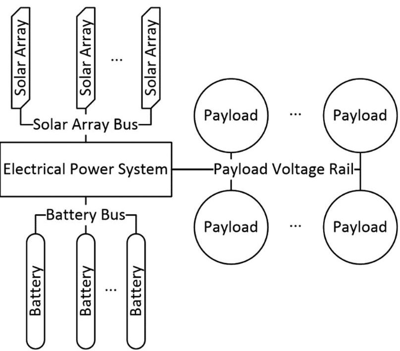

Fig.1. Diagram of a centralized architecture.

bus. A subsystem needing energy from the bus simply needs an interface engineered between the subsystem and the bus. The only limitation on the number of subsystems is the total power available from the bus rather than the total power available from a regulator in the case of a centralized EPS. A single distributed topology is suitable for a wide variety of missions.

Reusability is related to scalability. If the subsystem interface is properly engineered, the subsystem and its interface can be used in any system that matches the distributed bus for which it was designed. The interface only needs to be redesigned if the distributed bus has changed; otherwise, no modifications are necessary. Subsystems used in previous missions can be used in any combination as needed for future missions.

## III. LITERATURE REVIEW

In terms of power efficiency, the centralized and distributed architectures are approximately equal. Because the power requirements of payloads throughout a mission can vary, spending a large amount of time tuning the regulators for optimal efficiency would probably result in diminishing returns. Radiation effects could also cause higher current draws, which is difficult to account for during initial power calculations.

The current EPS literature concludes that the distributed topology is the best power system design approach because of its efficiency and ability to be used in multiple classes of satellites [4] [11]. One distributed power system implementation has switching regulators as the interface between the batteries and the common bus so that the bus voltage can be held constant [12]. Other EPS implementations use elements of a distributed topology. For the ESTCube-1 nanosatellite, an EPS was developed that used maximum power point tracking (MPPT), a main power bus, and supplied multiple output voltages [13]. Electric double layer capacitors have been used in EPS units with direct energy

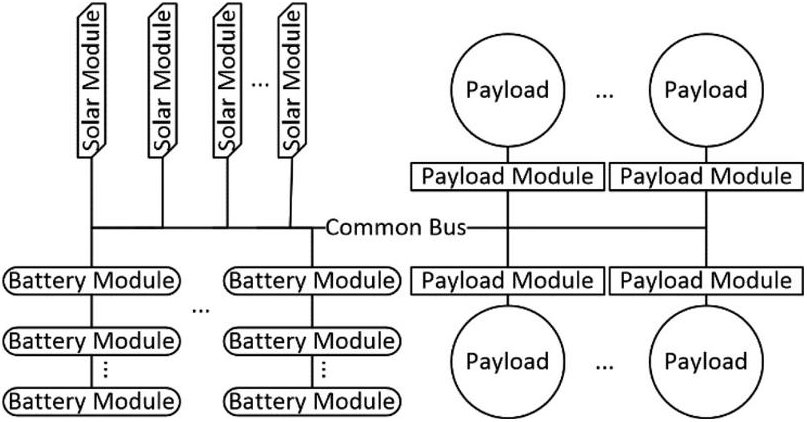

Fig. 2. Diagram of a distributed architecture.

transfer (DET) and boost converters [14]. Hybrid EPS units combine super capacitors with a lithium-based battery system as well as single-ended primary-inductor converters for output regulation [15]. These implementations are welldesigned and are shown to be usable and reliable.

The novelty of the proposed EPS is that it is easily configurable to be used in a variety of missions. While other EPS implementations contain a common bus, there is no guarantee that all the components are compatible in parallel at a larger scale. Also, many of the custom implementations only had single energy storage units in parallel with one another [13], [16] -[18]; this does not take advantage of increasing overall efficiency through a high-voltage/lowcurrent common bus. For the energy generation units of the other EPS implementations, the number of solar cells used in series is usually fixed. If more solar cells are needed to take advantage of a larger satellite surface area, the maximum output voltage of the expanded solar array may exceed the absolute maximum voltage of the designed circuitry. The proposed EPS is designed to handle a wide range of input and output voltages so that it can be used on a variety of missions.

## IV. PROPOSED EPS DESIGN

In the EPS design described herein, distributed topology concepts are applied to the design of a small satellite power system. This is realized by supplying an unregulated voltage bus throughout the power system. The various subsystems of the satellite are connected to the unregulated bus. Solar cells and secondary batteries are attached to the bus as well. The distributed architecture used for the proposed EPS is shown in Fig. 2.

The proposed EPS is separated into three types of modules: 1) the solar module (SM), 2) the battery module (BM), and 3) the payload module (PM). The SM is responsible for energy generation and transfer to the common bus. The BM is responsible for energy storage and supply. The PM is responsible for energy regulation and usage.

Modularizing the subsystems allows for scalability if the modules are correctly designed. The three module types can be attached to the common bus in any quantity as dictated by the mission requirements. The BMs can even be placed in series with one another to increase the common bus voltage without losing any functionality.

<!-- PDF_PAGE: 3 -->

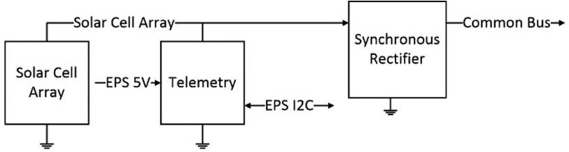

Fig. 3. SM block diagram.

The standard modules allow for reusability because the design of each module remains nearly the same across missions. The SM and BM are always the same from mission to mission. The PM is the only unit that would require modifications, but only if the common bus voltage changes. Standardization also reduces the chance that the modules are incompatible with each other when connected to the common bus.

The three modules are engineered for maximum efficiency as well. For instance, components used for the SM are selected so that minimal energy is lost when energy is transferred from the solar cell to the common bus. Also, the voltage regulator on the PM can be a switching regulator, which is very efficient. More energy can be dedicated toward powering subsystems, which is critical for a small satellite's power budget.

Sections V, VI, and VII describe the three module types in more detail.

## V. SOLAR MODULE

The SM is responsible for energy generation and transfer in the distributed EPS. The block diagram in Fig. 3 details the major components in the module.

Solar cells attached to the SM generate energy to be used by the rest of the EPS. The generated energy from the solar cells then needs to be transferred to the rest of the EPS through the unregulated bus. This should be done efficiently because energy is sparse in a satellite environment.

There are two methods generally used for the energy transfer from the solar cell array, MPPT, and DET. MPPT uses a switching converter to manipulate the operating point of the solar array so that the solar array always sees an ideal load, making the energy transfer very efficient. The isolation between solar arrays provided by the MPPT interface allows multiple solar arrays to be connected to a single bus. MPPT is used in some COTS EPS units and also in custom EPS units for various CubeSats as well [19]. In contrast, DET uses a diode as the interface between the solar array and its load. The load then directly determines the operating point of the solar array, which may or may not be at the optimal point for maximum power transfer. The interface diode allows multiple solar arrays to be connected to a single bus similarly to MPPT.

In previous work at the University of Kentucky Space Systems Laboratory, it was found that a DET solar array interface with a synchronous rectifier is more efficient, more reliable in a radiation environment, and is not affected by the rotation dynamics of the spacecraft, which hinder MPPT [20].

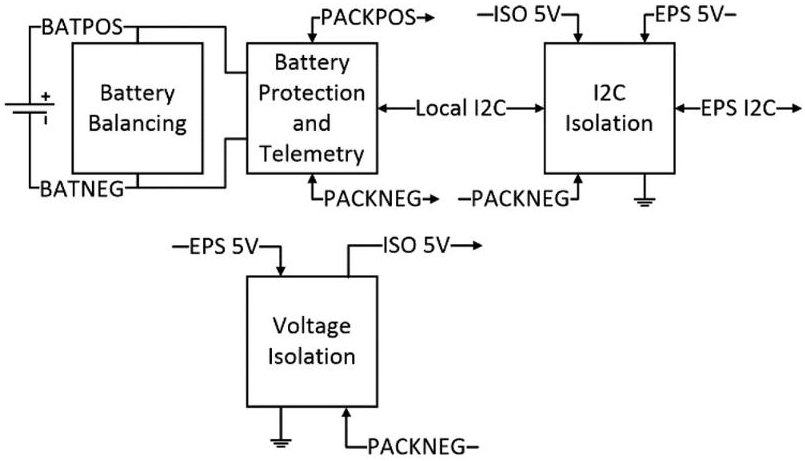

Fig.4. BM block diagram.

However, if mission requirements consider MPPT necessary, the distributed architecture allows for MPPT to be implemented as well. DET was used in the reference implementation for its ease of use but could easily have been MPPT if desired. A battery charge/discharge module may also be needed at the battery interface if MPPT is used. For more simplicity, MPPT does not have to be digitally controlled, as there are existing implementations using analog circuitry [21].

In the reference implementation of the distributed EPS, telemetry can be gathered through a quad input analog-to-digital converter (ADC) integrated circuit (IC). One differential input is dedicated to measuring the voltage of the solar array and another differential input is dedicated to measuring the voltage across a current sense resistor in series with the solar array. The remaining two inputs are unused, allowing a sun sensor or a temperature sensor to be attached to the ADC. This extra data could be useful to the operators of the satellite. For example, the solar panels themselves could also be used as a sun sensor.

The ADC communicates through inter-integrated circuit (I2C), a communication protocol popular for embedded systems. I2C is a bidirectional open-drain protocol that is advantageous for modular system design.

The telemetry circuits do require an external voltage rail to operate, because the telemetry circuits need a reference voltage to determine the amplitude of the signal they are sampling. This allows the SM to have the ability to report telemetry even when sunlight does not shine on the solar array.

## VI. BATTERY MODULE

The BM is responsible for energy storage and energy supply when the solar arrays are not in sunlight (an eclipse situation). The block diagram in Fig. 4 details the major components in the BM.

Four battery chemistries were considered for the EPS: nickel cadmium, nickel metal hydride, lithium ion, and lithium polymer. Table I summarizes the characteristics of all four battery chemistries [22]. The lithium polymer chemistry was selected for the BM. This is because of the chemistry's high energy density [23], resistance to the memory effect, high nominal voltage, and prismatic form factor

<!-- PDF_PAGE: 4 -->

TABLE I Battery Chemistry Comparison

<table border="1"><tr><td>Battery Chemistry</td><td>Energy Density(Wh/kg)</td><td>Cycle Life</td><td>Nominal Cell Voltage(V)</td><td>Memory Effect?</td><td>Form Factor</td></tr><tr><td>Nickel-Cadmium</td><td>45-80</td><td>1500</td><td>1.25</td><td>Yes</td><td>Cylindrical</td></tr><tr><td>Nickel Metal Hydride</td><td>60-120</td><td>400</td><td>1.25</td><td>Yes</td><td>Cylindrical</td></tr><tr><td>Lithium Ion</td><td>110-160</td><td>400-750</td><td>3.6</td><td>No</td><td>Cylindrical</td></tr><tr><td>Lithium Polymer</td><td>100-130</td><td>400</td><td>3.6</td><td>No</td><td>Prismatic</td></tr></table>

[24]. Some drawbacks are the chemistry's low cycle life and volatility if overcharged or overdischarged.

Lithium polymer batteries require strict protection because they are very volatile when stressed outside their limits. The protection circuit used in the BM handles overvoltage protection, undervoltage protection, and overcurrent protection (charge and discharge). When the battery is in an overvoltage condition, the charge current path is blocked, only allowing a discharge current from the battery. When the battery is in an undervoltage condition, the discharge current path is blocked, only allowing a charge current into the battery. When the battery is in a charge overcurrent condition, both the charge and the discharge current paths are blocked. The protection circuit then delays for a specific amount of time before checking if the battery's voltage is greater than the voltage supplied to the battery. If so, both of the current paths are re-established. When the battery is in a discharge overcurrent condition, the discharge current path is blocked. The protection circuit then delays for an amount of time before checking if the battery's voltage is less than the voltage supplied to the battery. If so, the current path is re-established.

To achieve scalability, the BMs must be able to be placed in any series or parallel combination. This presents two challenges that must be overcome: 1) cell balancing and 2) telemetry gathering.

When batteries are placed in a series string, variances in manufacturing and inherent battery characteristics mean that the batteries could be charging and discharging at different rates, even though their specifications are the same. This could result in eventual battery protection lockouts because one battery in a string could be in an overvoltage condition and another battery in an undervoltage condition. In this situation, a charge current to the string is not possible because of the overvoltage battery. Conversely, a discharge current from the string is not possible because of the undervoltage battery. The string would be locked out from use by the EPS until the overvoltage battery slowly self-discharges.

To avoid this situation, a cell balancing circuit can be placed on the BMs. The simplest circuit consists of a Zener diode and a resistor placed parallel to the battery. This is used in the reference implementation. However, in a low-temperature environment, the Zener diode's characteristics may change and could discharge the battery well before the battery approaches overvoltage. Instead, a comparator-based circuit could be used, where the battery's voltage is checked against a reference voltage. If the battery's voltage

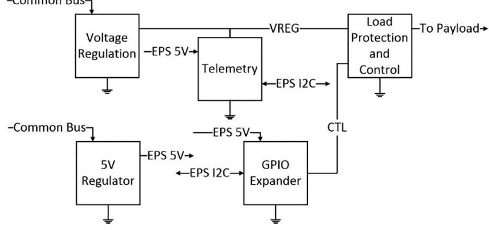

Fig. 5. PM block diagram.

is too high, a shunt resistor can be activated so the excess energy is dissipated from the battery in overvoltage. This balancing current is limited by the balancing resistor.

The balancing circuit attempts to regulate all BMs to the reference voltage. If one battery charges much faster than the others in its string, some of the charging current will be shunted away, slowing down the overvoltage battery's charging rate. This allows the other batteries in the string to catch up to its state of charge.

The overall efficiency of the BMs is then reduced, as some energy is diverted to balance the batteries. However, additional losses are only realized when the battery is approaching an overcharge condition and not during normal operation.

Telemetry is useful for operators of the satellite to determine the state of charge of the battery bank and to decide what actions to take based on that information. The protection circuit in the reference design provides telemetry through an I2C interface; however, if BMs are placed in series, the I2C voltage levels are not referenced to ground potential. Instead, the levels are referenced to the negative leg of its local battery. The I2C signals need to be level shifted (both logic high and logic low) so that communication can be established no matter, where the BM is positioned in a string. A galvanic isolation IC was connected to each BM to perform the required I2C level shifting.

## VII. PAYLOAD MODULE

The PM is responsible for regulating the energy to the other subsystems in the satellite. The block diagram in Fig. 5 details the major components of the PM.

The main component in the PM is the voltage regulator. The voltage regulator converts energy from the unregulated bus to the attached payload and directly affects the

<!-- PDF_PAGE: 5 -->

efficiency of the PM itself. Without the regulator, the payload will not operate.

There are two methods commonly used for voltage regulation. The first is linear regulation, where a higher voltage is regulated to a lower voltage. This is done by dissipating the difference in voltage across the regulator itself. Linear regulators are very stable and typically have a noise free output voltage. The main disadvantage to linear regulators is that they can be very inefficient; a linear regulator's efficiency is proportional to the ratio of the output and input voltages. For example, regulation from 24 to 12 V would mean an efficiency of 50%. Linear regulators are commonly used for subsystems that do not require much energy because the potentially low efficiency of the regulator connected to a less demanding load would have a small impact on the overall power budget.

The second method used for voltage regulation is called a switched mode power supply, or a switching regulator. Switching regulators can be used to regulate a higher voltage to a lower voltage (step-down regulator) or regulate a lower voltage to a higher voltage (step-up regulator). This is done by rapidly switching the voltage across an inductor, with the components in different configurations depending on the desired result. Not much energy is wasted to perform the conversion, so switching regulators are very efficient. Typical efficiency values for switching regulators range from 80% to 95%. However, due to the presence of a high-frequency switch signal, the output voltage from switching regulators tends to be electrically noisy. The switching regulator circuit is also typically more complex than linear regulators. Switching regulators are commonly used for subsystems that demand more power because a low-efficiency regulator would waste too much energy on voltage regulation, which could be detrimental to the overall power budget.

The PM also handles payload protection in the form of overvoltage protection, undervoltage protection, and overcurrent protection. If the regulator provides a higher or lower voltage than specified by the payload, the protection circuit will cut off the power supply to the payload to avoid accidental damage to the payload. If the payload starts to draw more current than expected, then the protection will cut off the power supply to the payload and allow the payload to reset. The protection circuit also allows for an external source to control the power supply to the payload, so satellite subsystems can be individually powered ON and OFF. This is useful for energy management of the satellite or performing hard resets of subsystems.

The PM also provides telemetry to determine the status of the payload. The voltage provided to the payload and the current draw of the payload can be obtained through the telemetry circuits. Like the other two modules, the telemetry circuits in the PM use I2C for communication in the reference designs.

In the reference implementation, a general-purpose input/output expander is used for payload control. The expander also uses I2C for communication.

The telemetry circuits and the expander require an external voltage rail to operate. This means telemetry can be gathered and the payload can be commanded as long as the PM can draw energy from the common bus.

The PMs can be placed in parallel to attach more satellite subsystems to the EPS. If a subsystem is used again in a future mission, the PM designed for it can be reused without modification if the unregulated bus is within the PM's specification.

## VIII. REFERENCE IMPLEMENTATION

Prototypes were created for the three types of modules by designing and assembling printed circuit boards for each module. These prototypes were then subjected to an array of tests for functionality.

## A. Limitations and Constraints

While the distributed power system offers many advantages when compared to a centralized topology, there are some factors that need to be considered before committing to the design.

1) Distributed Topology: One disadvantage to the distributed power topology is that the topology needs extra circuitry to interface subsystems to the distributed bus. The additional circuitry is required to perform the individual subsystem power conditioning and regulation. More components typically introduce more points of failure in an electronic system. In a small satellite, the extra circuitry takes up more physical volume, which can result in a shortage of space for other satellite subsystems. Another disadvantage is due to the nature of switching regulators. These regulators look like negative impedances to the distributed bus because they are a constant power load. This may cause instability in the bus [25] [26]. Finally, a distributed power system requires more customization, since each subsystem interface is unique. The time required to properly design a distributed power system may not be available to all small satellite developers.

2) Reference Implementation: The overall reference implementation design was loosely based on the EPS for the CubeSat KySat-2 so that the prototypes could be tested with the spare hardware. Some limitations and constraints of the reference implementation are due to operating voltage limits of the hardware chosen. In the SM, there is an upper solar input voltage limit of 20 V due to the synchronous rectifier circuit. For the solar cells chosen, a series string length is then limited to seven based on the upper solar voltage limit.

The solar cell string length limit has an effect on the BM. For the batteries chosen, a battery pack in series is limited to four so the batteries can still be charged if a full solar cell series string length is used.

The PM has a wide input voltage range so that it operates regardless of the size of the solar cell string or the battery pack.

In theory, an unlimited number of modules can be placed in parallel on a common bus. However, in practice, the

<!-- PDF_PAGE: 6 -->

number of modules is limited by physical space and current carrying capacity of the bus. For the reference implementation, physical space was not an issue, but in a small satellite, there is very limited space for hardware, so modules must be prioritized based on the mission requirements.

In the reference implementation, the current carrying capacity of the common bus was high due to the thick wires available for use. In this case, if more current was needed, more wire could be added to the common bus to reduce power loss. If a single board implementation of the distributed power system were necessary, the trace width and copper thickness of the common bus would determine the number of modules that could be connected simultaneously. In this case, more layers may need to be added to the circuit board or thicker copper layers would be required to achieve the necessary number of concurrent modules.

Sections VII-B, C, and D detail the three module prototypes and their circuitry.

## B. Solar Module

The reference implementation of the SM prototype consists of the solar cells, the synchronous rectifier circuit, and the telemetry circuit.

1) Solar Cells: Solar cells convert solar energy into energy usable by the satellite. The solar cells used in the reference implementation are supplied from TrisolX. The solar cell chemistry is GaAs with an open circuit voltage of 2.62 V, maximum power voltage of 2.33 V, maximum power current of 14.6 mA, and an efficiency of 28% [27]. These cells are made from the cutoffs of larger space rated solar cells, so many of them are needed in parallel to produce enough current to supply a satellite.

The maximum solar string length is set to seven cells, which results in a maximum open circuit voltage of 18.34 V and a maximum power voltage of 16.31 V. This limit was set because the reference implementation was designed to be similar to the EPS used on KySat-2. A larger solar string is possible, but other components further down the circuit would need to be changed.

The TrisolX cells cannot produce the same current as the cells used on KySat-2 on their own, but five sets of TrisolX solar cells in parallel are a good approximation. This results in a maximum power current of 73 mA. Each solar array produces 1.19 W of power, so a CubeSat with four solar arrays produces 4.76 W in ideal conditions. More than likely, only two arrays will be in sunlight at a given time, so the expected production is 2.38 W.

2) Telemetry: Telemetry is used on the SM to provide the status of the solar arrays to the EPS. The telemetry circuit is based on an ADC. The MCP3428 from Microchip Technology, Inc., was chosen as the SM's ADC. The ADC circuit is shown in Fig. 6.

total number of SMs connected to the bus is unknown, it is best to choose the ADC that can handle the maximum number of modules without address interference.

The first criteria when selecting an ADC to use was its communication method. The distributed EPS uses an I2C bus, so the ADC must be compatible with the I2C standard. The next criteria is the number of I2C addresses the ADC can support and the address range of the ADC. Because the

The MCP3428 contains four differential input pairs. The inputs can be sampled with a resolution up to 16 b with a minimum of fifteen samples per second. The MCP3428 can also be placed in one-shot conversion mode, where the ADC sleeps after taking a measurement. This reduces the energy draw of the IC. The MCP3428 has an onboard voltage reference of 2.048 V. The input voltage range of the IC is 2.7 V to 5.5 V. The MCP3428 has nine different usable I2C addresses [28].

In the reference implementation, the MCP3428 is powered from an external 5-V rail because the telemetry should be active as long as the EPS is active. The other option is to have the ADC powered from the solar array itself, but that would mean when the solar cells are shaded, the telemetry IC would not receive any power. In this case, the IC would not respond to an EPS request for telemetry, so the solar string status would be unknown. In the current implementation, the solar string voltage is always known to the EPS whether the cells are in sunlight or in shade.

The voltage measurement is connected to Channel 1 of the ADC. It is a single ended measurement with the negative pin of the differential input connected to ground (GND). The voltage range of the solar string varies from 0 to 20 V, which is greater than the voltage reference and the maximum input voltage of the MCP3428. A voltage divider is used to bring the solar voltage down to a measurable level. The divider made from a 20 k $ \Omega $ resistor and a 2 k $ \Omega $ resistor divides the solar voltage by eleven. The voltage range seen by Channel 1 is now 0 to 1.818 V, well within the ADC input voltage limits. The voltage divider resistors are extremely accurate at 0.01% tolerance so that variance in resistance minimally affects the accuracy of the measurement. The ADC can sample a measurement with 16 b of accuracy, making the ADC accurate to 0.687 mV after accounting for the voltage divider. For the voltage measurement, the gain remains at the default setting of one.

The current measurement is connected to Channel 2 of the ADC. It is a differential measurement, with the positive pin of the differential input on the solar voltage side and the negative pin of the differential input on the bus voltage side. Voltage dividers used for the voltage measurement are used again for the current measurement to bring the voltage range down to a measurable level. The estimated accuracy of the current measurement is 3.43 mA at a resolution of sixteen bits and a gain of eight.

The voltage supplied to the Adr pins on the IC determines the I2C address of the MCP3428. The Adr pins can be connected to Vdd, Vss, or left floating. This results in nine possible I2C addresses for the MCP3428.

3) Synchronous Rectifier: The synchronous rectifier is used to efficiently transfer energy from the solar cells to the unregulated bus. The synchronous rectifier used in the reference implementation is based on the LTC4412HV IC from Linear Technology. The synchronous rectifier circuit is shown in Fig. 7.

<!-- PDF_PAGE: 7 -->

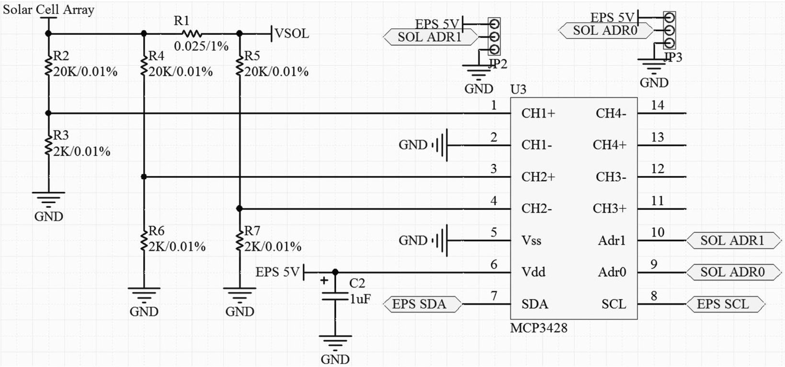

Fig. 6. SM telemetry circuit.

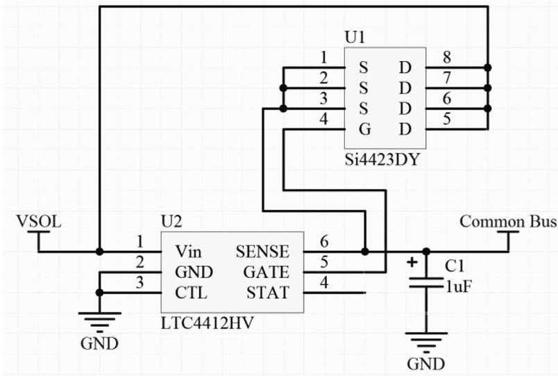

Fig. 7. SM synchronous rectifier circuit.

The main criteria when selecting the synchronous rectifier was the input voltage range. The solar string can range from 0 to 20 V, so the synchronous rectifier circuit must be able to accept all voltages within that range. On the common bus side, a maximum series string of batteries is four, which corresponds to a maximum voltage of about 17.4 V. This is still within the voltage range of the synchronous rectifier.

The LTC4412HV has an absolute voltage rating from -14 to 40 V, which covers the voltage range of the solar string [29]. The MOSFET used for the energy transfer is the Si4423DY from Vishay Siliconix. The MOSFET is ptype with a maximum $ V_{ds} $ of -20 V and a maximum drain current of -10 A [30], which covers the expected voltage and current ranges of the solar cells. The turn on voltage is at most -0.9 V and the expected on-state resistance is no greater than 0.0115 $ \Omega $ at a $ V_{gs} $ of -1.8 V.

## C. Battery Module

The reference implementation of the BM prototype consists of the battery, battery protection circuit, I2C isolator, the voltage isolator, and the battery balancing circuit.

1) Battery: The battery stores excess solar energy from the solar cells and supplies energy to the satellite when the solar arrays are shaded. The main criteria when selecting the battery is the battery capacity and the physical dimensions of the cell. One of the design goals is to have the ability to place two batteries side by side inside the satellite, so a single cell must be smaller than $ 1 0 0 \mathrm{m m} \times 5 0 \mathrm{m m} $ in length and width. The battery selected for the reference implementation is the Lithium polymer PL544792-2C from BatterySpace.

The PL544792-2C has a nominal voltage of 3.7 V, capacity of 2500 mAh, and dimensions of 92.5 mm $ \times $ 47 mm $ \times $ 5.4 mm [31]. Its cycle life is greater than 500, with charge rate of 0.5 C and discharge rate of 2.0 C. The mass of the battery is 51 g. The Lithium-polymer's prismatic form factor helps reduce the amount of physical space the batteries fill in the satellite, so more room can be made for other hardware.

2) Battery Protection: The Lithium polymer battery chemistry chosen for the reference implementation is very volatile when the cell is overcharged or overdischarged. A dedicated battery protection circuit is needed for each cell to make sure the batteries remain within the bounds of normal operation. Therefore, the battery protection circuit must disable the battery when overcharged, disable the battery when overdischarged, and only monitor one cell per circuit. The single cell per circuit criteria is driven by the scalability of the distributed EPS; if more voltage is needed on the unregulated bus then BMs need to be easily added in series with each other without modification to the circuit. Finally, the battery protection circuit needs to provide

<!-- PDF_PAGE: 8 -->

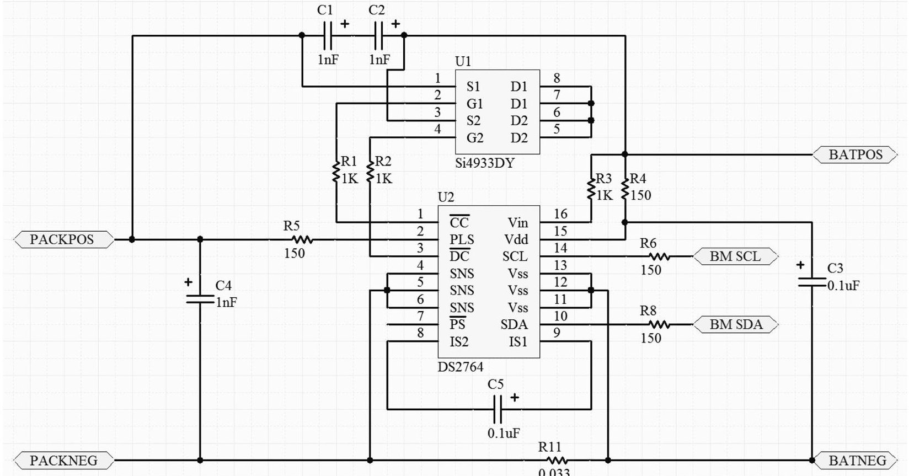

Fig. 8. BM protection circuit.

telemetry for data such as the battery voltage and battery current. An all-in-one IC means there are fewer parts to assemble on the circuit board and fewer components that could fail in the space environment. The telemetry would need to be accessed through I2C, so the option of multiple I2C addresses is necessary as well.

The battery protection circuit chosen for the reference implementation is based on the DS2764 from Maxim Semiconductor. The battery protection circuit is shown in Fig. 8.

The DS2764 protects the battery from overvoltage, undervoltage, and overcurrent/short circuits [32]. The IC provides telemetry in the form of battery voltage, battery current, and temperature through an I2C interface. The DS2764 only monitors a single battery cell, so multiple ICs can be placed in series as needed.

The battery is disabled in the event of a fault through the Si4933DY dual MOSFET IC. The Si4933DY has two p-channel MOSFETs on the IC, with a maximum $ V_{ds} $ of $ -12 \mathrm{~V} $ and a continuous current rating of $ -5.9 \mathrm{~A} $ [33]. Its gate threshold voltage is at most $ -1 \mathrm{~V} $ with maximum onstate resistance of 0.022 $ \Omega $ at a $ V_{gs} $ of $ -1.8 \mathrm{~V}. $ The DS2764 turns the MOSFETs on or off depending on the fault condition detected.

The overvoltage limit is always set to 4.35 V, and the undervoltage limit is always set to 2.6 V. The DS2764 uses an external current sense resistor for the overcurrent/short circuit protection. When the IC sees a voltage difference of 47.5 mV across the sense resistor, the overcurrent protection kicks in. At the sense resistor value of 0.038 $ \Omega $ , the overcurrent limit is 1.25 A, corresponding to a 0.5 C charge rate of the battery chosen for the reference implementation. Overcurrent can be triggered during both charging and discharging, making the 0.5 C charge rate the limiting factor.

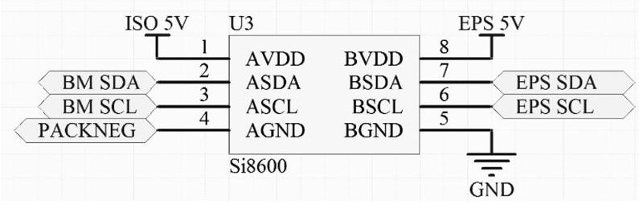

Fig. 9. BM I2C isolation circuit.

The I2C address of the DS2764 is user controlled through the I2C bus. There are no address limitations, so the DS2764 has 127 possible addresses.

3) I2C Isolation: The I2C telemetry from the battery protection circuit has its voltage levels based on the battery voltage of the battery the DS2764 protects. When BMs are placed in series with one another to increase the unregulated bus voltage, the telemetry from each DS2764 is on its own set of logic levels. This necessitates the use of an I2C isolator to shift the various logic levels back down to a single level so that the EPS can correctly receive telemetry from each battery protection circuit.

The I2C isolator circuit chosen for the reference implementation is based on the Si8600 from Silicon Laboratories. The I2C isolator circuit is shown in Fig. 9.

The Si8600 has independent, bidirectional SDA and SCL isolation channels [34]. The isolation is tolerant of up to 5000 Vrms. Its operating supply voltage is 3 to 5.5 V. The Si8600 uses galvanic isolators to isolate the I2C

<!-- PDF_PAGE: 9 -->

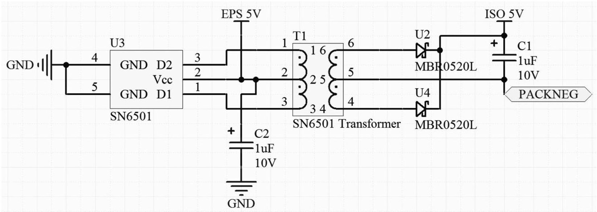

Fig. 10. BM voltage isolation circuit.

communication signals from each other. Side A connects to the DS2764 I2C lines, while side B connects to the EPS I2C lines. Side B is powered by an external voltage supply provided by the EPS. Side A is powered from a voltage isolator using that same external supply. The voltage isolator is detailed in the next section.

4) Voltage Isolation: A voltage isolator is not necessary to operate the I2C isolator, but makes telemetry gathering more available during EPS operation. The alternative power source for the I2C isolator is directly from the battery connected to the module's DS2764. However, because the Si8600's minimum operating supply voltage is 3 V and the battery undervoltage limit is 2.6 V, the battery voltage could dip below 3 V but still be above 2.6 V. In this case, the EPS would still continue to operate, but the battery telemetry would be inaccessible due to the I2C isolator browning out. An external voltage supply is already being provided to the Si8600 on the EPS side, so a voltage isolator is a simple method to allow that voltage supply to be used on the DS2764 side of the I2C isolator.

The voltage isolator chosen for the reference implementation is based on the SN6501 from Texas Instruments. The voltage isolation circuit is shown in Fig. 10.

The SN6501 uses an external transformer and a rectifying circuit to isolate a given voltage [35]. The overall circuit converts a dc voltage to ac voltage, applies the ac voltage to a transformer, and then rectifies the transformed ac voltage back to dc voltage at a new reference potential. Even if a battery is discharged below 3 V, the I2C isolators will still operate, providing telemetry throughout the full battery voltage range.

The MBR0520L Schottky diode was used as the rectifying diode. The MBR0520L has a forward voltage of less than 0.385 V [36]. This is beneficial because less energy is lost during the rectifying process as compared to a typical diode's forward voltage of 0.7 V. The EPS should draw only enough energy as needed to operate so that more energy can be given to the rest of the systems on the satellite. The transformer's coil ratio is tuned so that the

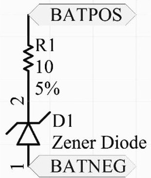

Fig.11. BM balancing circuit.

rectified output can be immediately used to power the I2C isolator.

5) Battery Balancing: The battery balancing circuit chosen for the reference implementation consists of a Zener diode and a resistor. However, Zener diodes are greatly affected by temperature. This means that the circuit is very unreliable for a real mission, but acceptable for testing. The battery balancing circuit used in the reference implementation is shown in Fig. 11.

The Zener diode is chosen so that the diode is in breakdown mode before the overvoltage limit is reached, at 4.35 V. In the reference implementation, the Zener diode chosen is the KDZTR3.9 B, with a minimum Zener voltage of 3.9 V and a maximum Zener voltage of 4.4 V. If the Zener voltage is too low, then the balancing circuit activates early and reduces the overall BM efficiency, but if the Zener voltage is too high, the balancing circuit activates too late and could result in the batteries deviating from the balanced state much faster. The KDZTR3.9B typically has a Zener voltage of about 4.15 V, which is suitable for the reference implementation.

The series resistor is used as a current limit, so the maximum balancing current is 17.5 mA. This is much larger compared to a lithium polymer self-discharge rate of 5% a month, or about 0.173 mA with a battery capacity of 2500 mAh. The battery balancing circuit may not prevent

<!-- PDF_PAGE: 10 -->

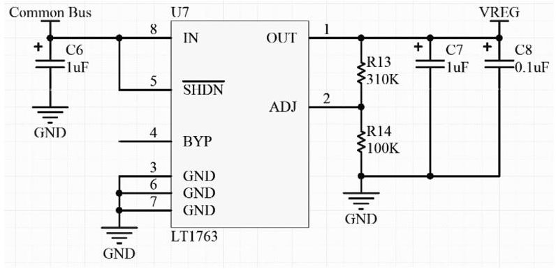

Fig.12. PM linear regulator circuit.

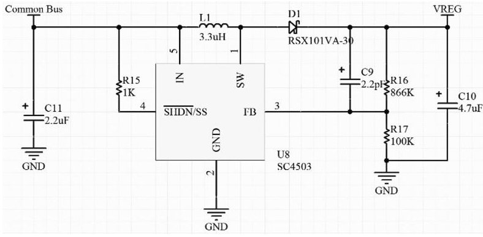

Fig. 13. PM step-up converter circuit.

battery deadlock situations, but if they do occur, the balancing circuit should bring the pack out of deadlock much faster than it would be if the EPS had to wait for the batteries to self-discharge.

## D. Payload Module

The reference implementation of the PM prototype consists of the voltage regulator, telemetry circuit, load protection and control circuit, and the GPIO expander.

1) Voltage Regulator: The voltage regulator is used to supply usable energy to the payload connected to the module. For the reference implementation, three voltage regulators were chosen: 1) one linear regulator, 2) one step-up converter, and 3) one step-down converter. The regulators must be adjustable and able to handle an output current of 0.5 A for the linear regulator and 1 A for the switching regulators. Their input voltage range must also accept up to 20 V, the maximum output voltage from the solar arrays. This also covers the maximum battery voltage, 17.4 V.

The linear regulator chosen for the reference implementation is the LT1763 from Linear Technology. The LT1763 circuit is shown in Fig. 12.

The LT1763 can supply 500 mA of current and has a dropout voltage of 300 mV. Its input voltage range is from 1.8 to 20 V [37]. It is an adjustable regulator so the feedback resistors can be changed to manipulate the output voltage. The output voltage will adjust until the voltage seen on the ADJ pin is 1.22 V.

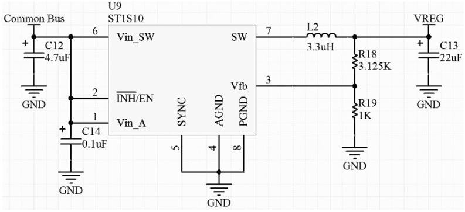

The step-up converter chosen for the reference implementation is the SC4503 from Semtech Corporation. The step-up converter circuit is shown in Fig. 13.

Fig. 14. PM step-down converter circuit.

The SC4503 can supply 1.4 A and has a constant switching frequency of 1.3 MHz [38]. Its input voltage range is 2.5 to 20 V. The maximum output voltage is 27 V. The output voltage will be adjusted until 1.25 V is seen on the FB pin.

The RSX101VA-30 is a Schottky diode used as a rectifying diode. Its forward voltage is 0.43 V and can handle a reverse voltage of up to 30 V [39]. The diode has a maximum average rectified forward current of 1 A.

The step-down converter chosen for the reference implementation is the ST1S10 from STMicroelectronics. The step-down converter circuit is shown in Fig. 14.

The ST1S10 can supply 3 A and has a synchronizable switching frequency from 400 up to 1.2 MHz [40]. Its input voltage minimum is 2.5 V, with its absolute maximum 20 V. The output voltage range is 0.8 V to its input voltage multiplied by 0.85. The output voltage will be adjusted until 0.8 V is seen on the Vfb pin.

2) Telemetry: The payload telemetry circuit gives status information about the payload to the EPS. The features required for the telemetry circuit are the ability to gather voltage and current telemetry, an I2C interface, and a selectable I2C address. The telemetry circuit chosen for use on the reference implementation is the PAC1710 from SMSC. The telemetry circuit is shown in Fig. 15.

The PAC1710 is an IC designed to measure voltage and current. The IC can measure voltage and current up to a resolution of eleven bits [41]. The input power supply range is from 3 to 5.5 V. The PAC1710 can measure a voltage ranging from 0 to 40 V. The differential voltage between the SENSE pins can range from -80 to 80 mV allowing the IC to also report the direction of current flow.

The I2C address is user-selectable through the ADDR_ SEL pin. The address is determined by the resistor value connected to the pin. The PAC1710 can be set to one of sixteen possible addresses.

The PAC1710 is powered from an external power supply. With a fairly standard input power supply range it is very likely the PAC1710 can piggyback off of a voltage regulator used for a payload. KySat-2 contained a 3.3-V rail and a 5-V rail, both of which would be compatible with the PAC1710.

3) Load Protection and Control: Load protection is necessary to turn OFF the payload when a fault condition occurs. Fault conditions include overvoltage, undervoltage, and overcurrent. The load protection circuit for the

<!-- PDF_PAGE: 11 -->

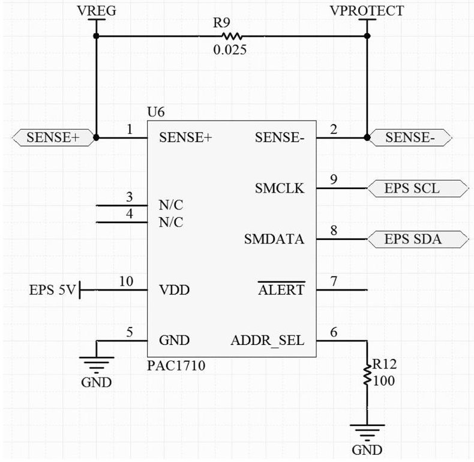

Fig.15. PM telemetry circuit.

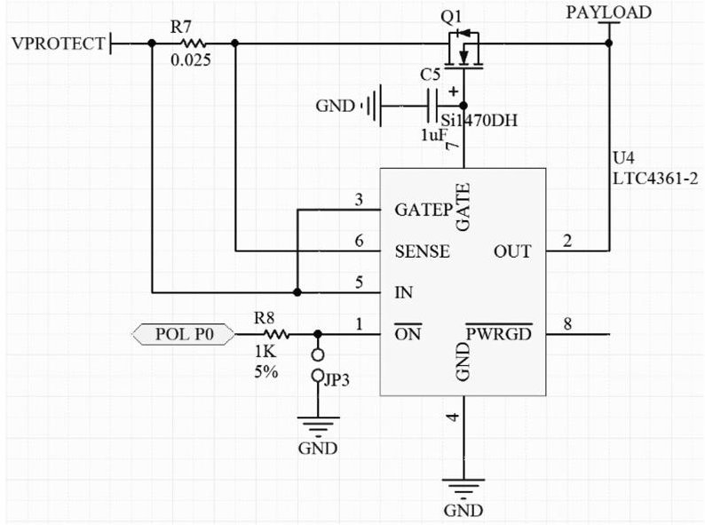

Fig. 16. PM load protection and control circuit.

reference implementation is based on the LTC4361 from Linear Technology. The load protection circuit is shown in Fig.16.

The LTC4361 provides protection for payloads with a voltage range of 2.5-5.5 V [42]. If the IC detects a transient in the input power supply the LTC4361 will remove the payload from the power supply until the transient passes. The LTC4361 protects the payload from a transient up to 80 V. The undervoltage lockout is set to 2.1 V and the overvoltage lockout is set to 5.8 V.

The limited power supply range is acceptable in the reference implementation because it was designed to protect payloads similar to the ones in KySat-2. The payloads in KySat-2 used either a 3.3-V power supply or a 5-V power supply, both within the protection range of the LTC4361.

A capacitor was added to the GATE pin so that the inrush current to the payload is limited when the payload is turned ON.

The current sense resistor is used so that the LTC4361 can detect an overcurrent condition. A 0.025- $ \Omega $ resistor is used so that the effect of the current sense resistor on the payload's power supply is minimized. Once the LTC4361 detects a voltage difference of 50 mV between the IN and SENSE pins, the MOSFET is turned OFF and the power supply disconnected from the payload. At the given sense resistor value, the current limit is 2 A.

After a fault condition, the LTC4361 will automatically restart the payload after a 130-ms delay. There is another version of the LTC4361 that will keep the payload OFF after a fault condition if that is the desired behavior for the mission.

The LTC4361 also features an enable pin so the payload can be externally controlled. This is useful during EPS bootup because payloads can be individually turned on rather than all at once, allowing critical subsystems to be powered first.

The MOSFET used in the payload protection circuit is the Si1470DH. The Si1470DH is an N-channel MOSFET that connects or disconnects the payload to its power supply. It has a maximum drain-source voltage of 30 V and a current rating of 4 A [43]. Its threshold voltage is no greater than 1.6 V, with a maximum on-state resistance of 0.095 $ \Omega $ at a $ V_{gs} $ of 2.5 V.

For a payload outside of the LTC4361's protection range, an alternative circuit must be used. The alternative payload protection and control circuit is based on the LTC4365 from Linear Technology and the FPF2700 from Fairchild Semiconductor. The alternative payload protection circuit is shown in Fig. 17.

The alternative circuit functions similarly to the LTC4361 circuit but has an adjustable protection voltage range.

The first half of the protection circuit is the LTC4365. The LTC4365 handles overvoltage and undervoltage protection for the payload. The IC controls a pair of N-channel MOSFETs to connect the payload to its power supply. The LTC4365 has an operating voltage supply range of 2.5- 34 V, with overvoltage protection up to 60 V [44]. An external resistor divider is used to set the overvoltage and undervoltage limits.

When the UV pin sees a voltage below 0.5 V, the IC will disconnect the payload from its power supply. Once the voltage on UV rises above 0.525 V and 36 ms have passed, the payload will be reconnected with the power supply.

When the OV pin sees a voltage above 0.5 V, the IC will disconnect the payload from its power supply. Once the voltage on OV falls below 0.475 V and 36 ms have passed, the payload will be reconnected with the power supply.

The LTC4365 contains a SHDN pin that can be used to remove the payload from the power supply by an external controller.

The Si4946 is the dual N-channel MOSFET IC used with the LTC4365. It has a maximum $ V_{ds} $ of 60 V with a continuous current rating of 5.5 A [45]. Its threshold voltage is typically 2.4 V and has a maximum on-state resistance of 0.052 $ \Omega $ at a $ V_{gs} $ of 4.5 V.

<!-- PDF_PAGE: 12 -->

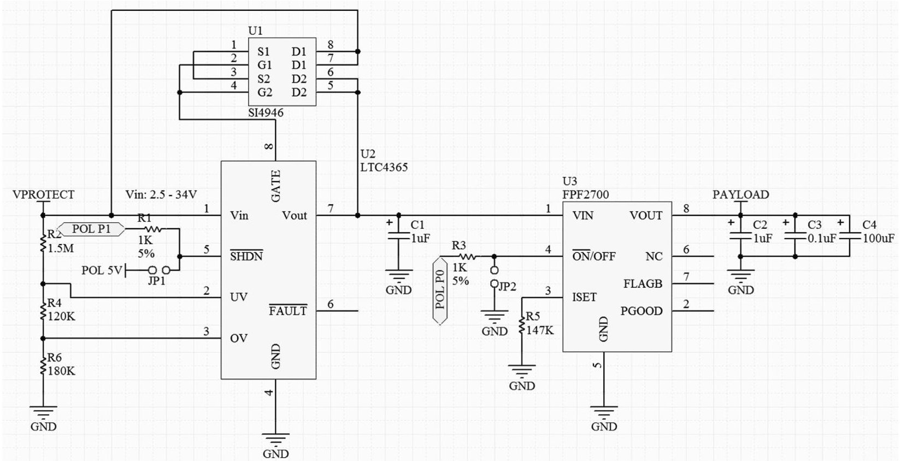

Fig. 17. PM alternative load protection and control circuit.

The other half of the protection circuit is the FPF2700. The FPF2700 handles overcurrent protection for the payload. The IC contains an internal N-channel MOSFET to connect the payload to its power supply. The FPF2700 has an input voltage range of 2.8-36 V [46], which is very similar to the voltage range of the LTC4365. An external resistor is used to set the current limit. The minimum current limit can range from 0.4 A to 2 A. The 20% current limit tolerance sets the maximum current limit to 3 A.

In an overcurrent condition, the FPF2700 clamps the load current so that it cannot rise above the current limit set by the external resistor. If the condition lasts for longer than the FPF2700's blanking period, the payload is disconnected from its power supply. The FPF2700 will wait 127.5 ms before reconnecting the payload to the power source. The FPF2700 also has a thermal shutdown feature if the circuit overheats.

The FPF2700 contains an ON pin that can be used to control the payload from an external device. The FPF2700 combined with the LTC4365 has virtually the same functionality as the LTC4361, but with a larger input voltage range and more components. The majority of CubeSat payloads can be protected with at least one of the two circuits.

4) GPIO Expander: The GPIO expander is used to control the payload protection circuit. Instead of directly connecting a GPIO pin from the EPS microcontroller to the protection circuit, the microcontroller can just send a command to the GPIO expander to control the payload. The GPIO expander chosen for use in the reference implementation is the PCA9672 from NXP Semiconductors. The GPIO expander circuit is shown in Fig. 18.

The GPIO expander must be able to communicate through I2C and have user-selectable addresses. It also

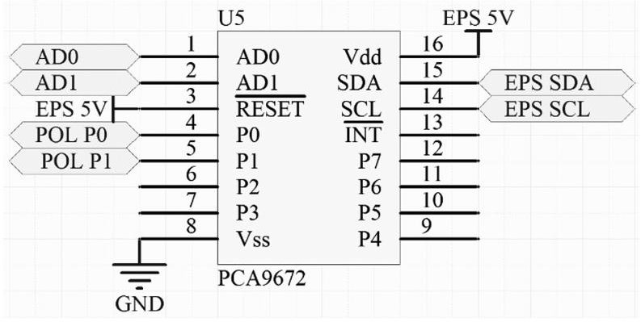

Fig.18. PM GPIO expander circuit.

needs to have at least four GPIO pins. This requirement was made because the reference implementation is based on KySat-2's EPS, which had four controllable payloads on the satellite.

The PCA9672 contains eight GPIO pins that can sink up to 25 mA of current [47]. The IC can be assigned one of 16 different I2C addresses. Its operating supply voltage range is from 2.3 to 5.5 V.

Like the payload telemetry circuit, the GPIO expander is powered by an external power supply. The PCA9672 has a fairly standard input power supply range, so it can probably piggyback off of a payload's voltage regulator. KySat-2 contained a 3.3-V rail and a 5-V rail, both of which would be compatible with the PCA9672.

## IX. EXPERIMENTAL RESULTS

The experimental testing results are summarized in Table II. SM designates a test that used a solar module, BM designates a test that used a battery module, and PM designates a test that used a payload module. A plus sign indicates

<!-- PDF_PAGE: 13 -->

TABLE II Prototype Testing Results

<table border="1"><tr><td>Module Type</td><td>Test</td><td>Measurement</td><td>Expectation</td><td>Actual</td><td>Notes</td></tr><tr><td>SM</td><td>Normal Operation</td><td>Load Voltage</td><td>3.2V</td><td>3.171V</td><td>3.2V0.06A input,51n load</td></tr><tr><td>SM</td><td>Normal Operation</td><td>Load Voltage</td><td>10V</td><td>9.95V</td><td>10V0.19A input,51n load</td></tr><tr><td>SM</td><td>Reverse Solar Cell Protection</td><td>Load Voltage</td><td>0V</td><td>0.013mV</td><td>3V input,51n load</td></tr><tr><td>SM</td><td>Reverse Solar Cell Protection</td><td>Load Voltage</td><td>0V</td><td>0.013mV</td><td>10V input,51n load</td></tr><tr><td>SM</td><td>Reverse Solar Cell Protection</td><td>Load Voltage</td><td>0V</td><td>0.013mV</td><td>20V input,51n load</td></tr><tr><td>SM</td><td>Voltage Telemetry</td><td>Input Voltage</td><td>4V</td><td>3.943V</td><td>4V0.08A input,51n load</td></tr><tr><td>SM</td><td>Current Telemetry</td><td>Input Current</td><td>0.08A</td><td>0.085A</td><td>4V0.08A input,51n load</td></tr><tr><td>BM</td><td>Voltage Telemetry</td><td>Battery Voltage</td><td>3.95V</td><td>3.923V</td><td></td></tr><tr><td>BM</td><td>Current Telemetry</td><td>Battery Charge Current</td><td>0.6A</td><td>0.66A</td><td>4.3V input,0.6A input</td></tr><tr><td>BM</td><td>Undervoltage Protection</td><td>Voltage Limit</td><td>2.6V</td><td>2.58V</td><td>3.9V initial voltage,0.05A discharge current</td></tr><tr><td>BM</td><td>Overvoltage Protection</td><td>Voltage Limit</td><td>4.35V</td><td>4.37V</td><td>3.5V initial voltage,5V input,1A charge current</td></tr><tr><td>BM</td><td>Discharge Overcurrent Protection</td><td>Current Limit</td><td>1.45A</td><td>1.23A</td><td>1A initial discharge current</td></tr><tr><td>BM</td><td>Charge Overcurrent Protection</td><td>Current Limit</td><td>1.45A</td><td>1.34A</td><td>1A initial charge current</td></tr><tr><td>BM</td><td>Charge Balancing</td><td>Battery Voltage</td><td>4.1V</td><td>3.8V</td><td>4.15V initial voltage,30 minute runtime</td></tr><tr><td>PM</td><td>Normal Operation</td><td>Load Voltage</td><td>5V</td><td>4.95V</td><td>7V0.1A input,51n load</td></tr><tr><td>PM</td><td>Load Control</td><td>Load Voltage</td><td>5V</td><td>4.95V</td><td>7V0.1A input,51n load</td></tr><tr><td>PM</td><td>Voltage Telemetry</td><td>Load Voltage</td><td>5V</td><td>4.953V</td><td>7V0.1A input,51n load</td></tr><tr><td>PM</td><td>Current Telemetry</td><td>Load Current</td><td>0.1A</td><td>0.0984A</td><td>7V0.1A input,51n load</td></tr><tr><td>PM</td><td>Normal Operation</td><td>Load Voltage</td><td>3.3V</td><td>3.13V</td><td>12V0.13A input,8.1n electronic load</td></tr><tr><td>PM</td><td>Load Control</td><td>Load Voltage</td><td>3.3V</td><td>3.13V</td><td>12V0.13A input,8.1n electronic load</td></tr><tr><td>PM</td><td>Voltage Telemetry</td><td>Load Voltage</td><td>3.3V</td><td>3.315V</td><td>12V0.13A input,27.7n electronic load</td></tr><tr><td>PM</td><td>Current Telemetry</td><td>Load Current</td><td>0.119A</td><td>0.118A</td><td>12V0.13A input,27.7n electronic load</td></tr><tr><td>SM,PM</td><td>Normal Operation</td><td>Load Current</td><td>0.4A</td><td>0.399A</td><td>9V1A input,0.4A electronic load</td></tr><tr><td>BM+BM,PM</td><td>Normal Operation</td><td>Load Current</td><td>0.4A</td><td>0.398A</td><td>0.4A electronic load</td></tr><tr><td>BM+BM,PM</td><td>Undervoltage Protection</td><td>Verification</td><td>Y</td><td>Y</td><td>0.4A electronic load,test ran until0A load current</td></tr><tr><td>SM,BM+BM</td><td>Normal Operation</td><td>Battery Charge Current</td><td>1.0A</td><td>1.0A</td><td>9V1A input</td></tr><tr><td>SM,BM+BM</td><td>Charge Balancing</td><td>Battery Voltage</td><td>8.2V</td><td>8.24V</td><td>8.3V initial voltage,5 minute runtime</td></tr><tr><td>SM,BM+BM</td><td>Overvoltage Protection</td><td>Verification</td><td>Y</td><td>Y</td><td>9V1A input,test ran until0A input current</td></tr><tr><td>SM,BM+BM,PM</td><td>Normal Operation</td><td>Battery Charge Current</td><td>0.6A</td><td>0.6A</td><td>9V1A input,0.4A electronic load</td></tr><tr><td>SM,BM+BM,PM</td><td>Normal Operation</td><td>Battery Discharge Current</td><td>0.2A</td><td>0.2A</td><td>9V0.2A input,0.4A electronic load</td></tr><tr><td>SM,BM+BM,PM</td><td>Telemetry</td><td>Verification</td><td>Y</td><td>Y</td><td>Communication was possible with all modules in the system</td></tr></table>

a module used in series with another module, and a comma indicates a test that used multiple module types connected in parallel.

Various tests were performed on the SMs including normal operation, reverse solar cell protection, and a telemetry test. Two SMs were placed in parallel and tested for correct operation.

## A. Solar Module

## B. Battery Module

The tests for the BM focused on the battery protection circuit which includes overvoltage protection, undervoltage protection, overcharge current protection, and overdischarge current protection. Other tests performed include verifying the charge balancing circuit and telemetry. Two sets of BMs were then placed in series with one another with the two sets in parallel to test for correct operation.

<!-- PDF_PAGE: 14 -->

## C. Payload Module

The tests for the PM include normal operation, load control, and a telemetry test. These tests were performed for a PM with a 5-V voltage regulator and a PM with a 3.3-V voltage regulator. Two PMs were connected in parallel to test for correct operation.

## D. Solar Module, Payload Module

The main test for the SM and payload module in parallel was for normal operation.

## E. Battery Module + Battery Module, Payload Module

The two tests performed on the two BMs in series with a PM in parallel were for normal operation and undervoltage protection.

## F. Solar Module, Battery Module + Battery Module

The tests performed on the SM in parallel with two BMs in series were normal operation, charge balancing, and overvoltage protection.

G. Solar Module, Battery Module + Battery Module, Payload Module

The tests performed on a SM in parallel with two BMs in series and a PM were normal operation while the batteries were charging, normal operation while the batteries were discharging, and a telemetry test.

## X. DISCUSSION

## A. Solar Module

The experimental results for the SM prototype indicate that the SM correctly transfers energy from the solar cells while minimizing power loss due to the transfer. The voltage drop from the synchronous rectifier was measured to be 0.05 V for the higher input current. The synchronous rectifier efficiency is critical in small satellite applications, where energy consumption must be minimized.

The tests for reverse solar cell protection and telemetry were successful as well, meaning that the SM performed as expected.

The SMs tested in parallel worked as expected with the synchronous rectifier circuit preventing voltage backfeed from damaging the solar array. Telemetry was received from each module as well.

The efficiency of the SM prototype is 99.5% ,which is slightly less than the expected efficiency, 99.82% .A potential cause of the efficiency discrepancy is the telemetry circuit, where the sampling frequency is higher than necessary.

## B. Battery Module

The experimental results for the BM indicate that the BM correctly protects its battery from overvoltage, undervoltage, charging overcurrent, and discharging overcurrent.

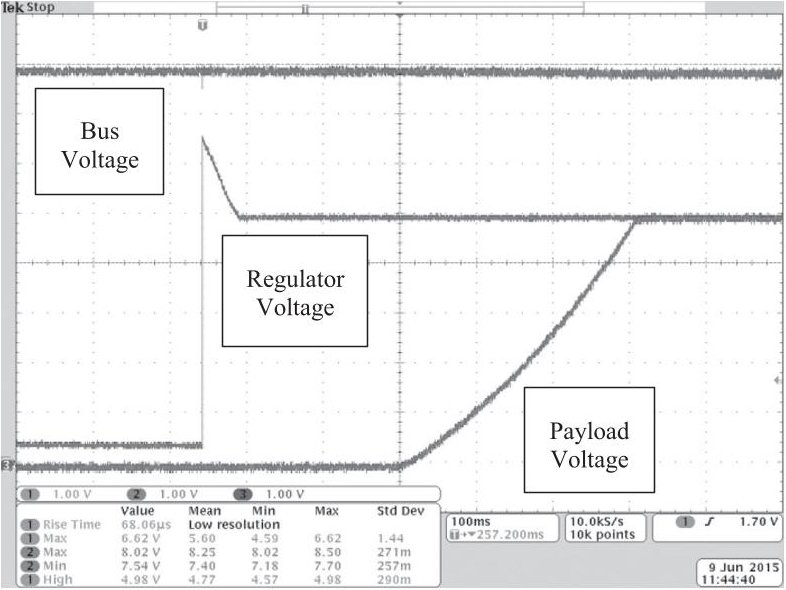

Fig.19. PM 5-V startup.

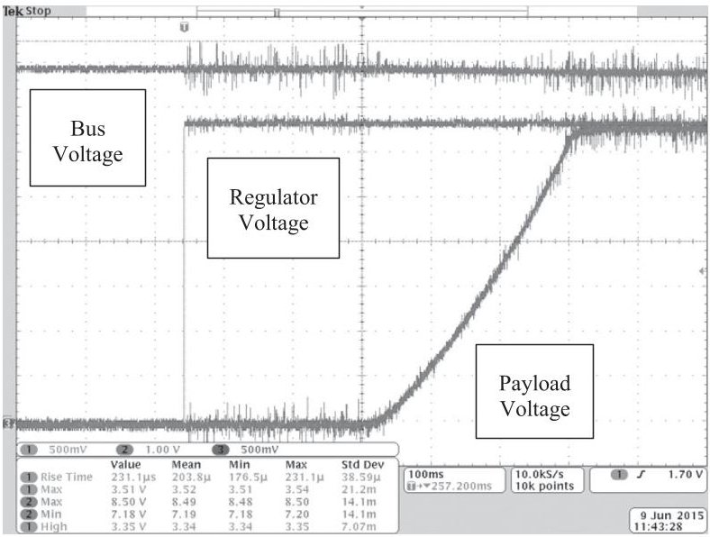

Fig. 20. PM 3.3-V startup.

Also, charge balancing and the telemetry circuits were verified to be operational.

The measured current limits for current protection seemed to deviate somewhat from the programmed current limit values. This may be due to the inaccuracy of the current sense resistors. The variances in resistance could be affecting the overcurrent protection limit. Another possibility is the resistance of the traces on the printed circuit board (PCB) affecting the voltage measured by the protection IC.

The efficiency of the BM prototype is 83.08% which is less than the expected efficiency, 88.73% .The difference could be attributed to the nonideal characteristics of the battery protection circuit because of the losses through the components that connect the battery to the common bus.

The sets of batteries in series then placed in parallel were confirmed to protect each individual cell from overvoltage, undervoltage, overcharge current, and overdischarge current. The charge balancing circuits were operational no matter the cell's position in the pack and telemetry was responsive even when cells were located above other cells in series.

<!-- PDF_PAGE: 15 -->

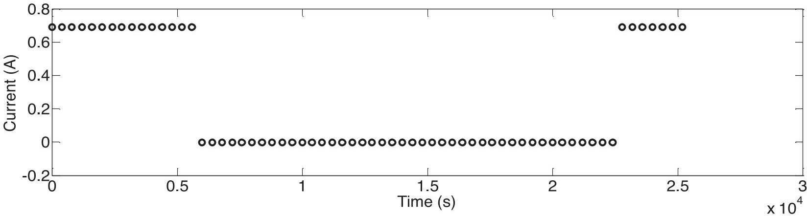

Fig. 21. Solar input current for system testing.

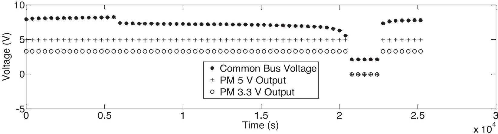

Fig. 22. Common bus voltage and PM outputs for system testing.

## C. Payload Module

The experimental results for the PM indicate that the PM correctly regulates energy for its load, that it has the ability to control the energy path to the load, and that its telemetry circuits are operational.

The efficiency of the PM prototype with a linear regulator is 63.94% which is slightly less than the expected efficiency, 66.76%.

The efficiency of the PM prototype with a switching regulator is 82.3% which is slightly less than the expected efficiency, 84.69%

As expected, there is a correlation between voltage regulator efficiency and PM efficiency, because the supporting circuits in the PM draw much less power than the regulator does. Therefore, the efficiency equation for the PM is dominated by the voltage regulators.

The two PMs in parallel operated correctly. Voltage was regulated to the proper levels for each PM without any instability seen. Telemetry was received from each module.

More information about the 5 V PM startup sequence is shown in Fig. 19. This figure shows the voltage on the common bus and the output of the voltage regulator when the module is starting up. As the PM is turned ON, the common bus voltage does not change. A voltage transient is seen on the output of the voltage regulator, where the voltage starts at 6.5 V before settling down to 5 V. Approximately 150 ms after the PM is turned ON, the payload's voltage begins to increase. This is due to the payload protection

circuit, the LTC4361. The LTC4361 has a typical startup delay of 130 ms before the circuit allows the payload to turn ON.

The circuit has a relatively slow turn-on time due to the capacitance on the gate of the control MOSFET. This capacitance was added to decrease the dV/dt on the payload. At the end of the waveform, the payload's voltage settles at the same voltage that the regulator supplies. At this point the payload is fully activated and is operating normally.

Similar information about the 3.3 V PM startup sequence is shown in Fig. 20. This figure shows the voltage on the common bus and the output of the voltage regulator when the module is starting up. The results from the 3.3-V PM test are comparable to the 5 V-PM. The main differences between the two test results are the voltage spike seen on the regulator voltage when the 5-V PM started up and the expected switching noise seen on the bus voltage, regulator voltage, and payload voltage on the 3.3 V PM.

## D. System Testing

The final test involved one SM, two BMs in series, and two PMs connected together on a common bus. The input current, common bus voltage, output voltage of the 5 V PM, and the output voltage of the 3.3-V PM was logged and graphed in Figs. 21 and 22.

For 5000 s, the system was supplied current from the power supply connected to the SM. At 5000 s, the power

<!-- PDF_PAGE: 16 -->

supply was turned OFF. The voltage immediately dropped, due to the difference in charge and discharge curves of the batteries. The batteries discharge until 22000 s. The power supply was turned ON at this time and the BMs immediately started charging.

During the 17 000 s of discharging, the BMs experienced an undervoltage condition. This was triggered when the common bus voltage reached 5.4 V, which corresponds to approximately 2.7-V per battery. The expected undervoltage limit is 2.6 V [32]. However, the maximum undervoltage detection limit is 2.7 V, which agrees with the testing results.

The only time that the PMs were not supplying energy to their payloads was during the undervoltage condition. At all other times, the PMs kept their payloads operating correctly. The experimental results for the three module types on a common bus indicate that the three module types are compatible when connected in parallel. Each module performed as expected in the system configurations tested. There do not seem to be any conflicts between modules even when modules are disconnecting and reconnecting to the common bus. The telemetry isolation circuits on the BM were confirmed to be operating correctly because communication was possible with the BM on top of the pack.

Even though the 3.3-V PM looks like a negative impedance to the bus due to its switching regulator, no bus instability was observed.

## E. System Efficiency

Calculations were performed to determine an overall system efficiency using payload performance values from the CubeSat KySat-2. This CubeSat contained two high current switching regulators and two linear regulators, with one 5 V and one 3.3 V output for each regulator type. Three lithium polymer batteries were used in the calculations. The final assumption was that four solar arrays would be used.

If all of the payloads used in KySat-2 were active at the same time and connected to the distributed EPS implementation, the calculated overall system efficiency would be 71.07% . In comparison, for the CubeSat MinXSS-1 in Science mode, where all systems were on and operational, its efficiency was 64.93% [48].

## XI. CONCLUSION

A modular, scalable, and easy to reuse EPS for small satellites has been detailed in this paper. The described EPS achieves modularity by dividing the EPS into three distinct units: 1) the SM, 2) the BM, and 3) the PM. The EPS achieves scalability due to the ability of the individual modules to be connected as needed in parallel, in the case of the solar and PMs, or connected as needed in series and parallel, in the case of the BM. Many different mission requirements can be met using different combinations of the same three basic modules, reducing development time dedicated to EPS design.

The SM uses DET to simplify the interface between the solar cells and the unregulated bus. A synchronous rectifier is used as the DET interface to reduce losses due to the energy transfer and to prevent voltage backfeed from the unregulated bus. The module is designed so that telemetry can be obtained from the solar cells, providing information about the voltage and current supplied by the solar array.

The BM includes battery protection in the form of overvoltage protection, undervoltage protection, and overcurrent protection. Charge balancing is also provided, which reduces the chance of battery lockout conditions. Telemetry can be obtained from the module, which can provide information about the voltage and current supplied to or from the battery.

The PM includes load protection in the form of overvoltage protection, undervoltage protection, and overcurrent protection. Payload control is also provided to allow for power cycling of the payload. Telemetry can be gathered from the module that would detail the voltage and current drawn by the payload.

Reference implementations of these modules were designed, prototyped, and tested. From the testing performed, it is apparent that the described EPS is stable throughout various module configurations. The measured efficiency generally agrees with the theoretical efficiency of the three modules. The results indicate that the described EPS has potential for use in a small satellite mission.

## REFERENCES

[1] E. Caday-Eames Small box, big potential Boeing Frontiers, vol. V, p. 20, Oct. 2006.

[2] F. Ince A role for cubesats in responsive space In Proc. 2nd Int. Conf. Recent Adv. Space Technol., 2005, pp. 106-108.

[3] M. Patel Spacecraft Power Systems, Boca Raton, FL, USA: CRC Press, 2005.

[4] R. Burt Distributed Electrical Power Systems in Cubesat Applications Logan, Utah: Utah State Univ., 2001.

[5] S. Notani Development of distributed, scalable, and a flexible electrical power system module for CubeSat and small satellites M.S. thesis, Dept. Elect. Eng., North Carolina State Univ., Raleigh, NC, USA, 2011.

[6] CubeSat Kit Linear EPS 2012, [Online]. Available: http://www.cubesatkit.com/docs datasheet/DS_CSK_Linear_EPS_711-00338-D.pdf. Accessed on: 2012.

[7] A. Strain User manual: CubeSat 1U electronic power system and batteries 2010 [Online]. Available: http://www.clyde-space.com/documents/ 1819

[8] F. Belloni, P. G. Maranesi, and M. Riva DC/DC converter for the international space station IEEE Trans. Aerosp. Electron. Syst., vol. 46, no. 2, pp. 623-634 Apr. 2010.

[9] Z. Chen, Z. Wang, C. Wang, and M. Chen Input ripple current characteristics of aviation static inverter IEEE Trans. Aerosp. Electron. Syst., vol. 49, no. 3, pp. 1667- 1676, Jul. 2013.

<!-- PDF_PAGE: 17 -->

[10] O. Garcia et al. Comparison of boost-based MPPT topologies for space applications IEEE Trans. Aerosp. Electron. Syst., vol. 49, no. 2, pp. 1091- 1107, Apr. 2013.

[11] A. A. M. Abaker and A. B. A. A. Mustafa Analysis of cube-sat electrical power system architecture Sci. Technol. Innov. J., vol. 1, no. 1, pp. 1-5, 2017.

[12] A. Ramamurthy Flexible digital electrical power system design and modeling for small satellites M.S. thesis, Dept. Elect. Eng., North Carolina State Univ., Raleigh, NC, USA, 2009.

[13] M. Pajusalu et al. Design and pre-flight testing of the electrical power system for the ESTCube-1 nanosatellite Proc. Estonian Acad. Sci., vol. 63, pp. 232-241, 2014.

[14] M. Alkali, M. Y. Edries, M. Cho, and A. Khan Laboratory verification of electric double layer capacitor based power system for a simple CubeSat mission Int.J.Elect.Energy, vol.3, no.3, pp.122-129, 2015.

[15] B. Lynch and C. Wallace CubeSat electronic power system M.S. thesis, Dept. Elect. Eng., , Santa Clara Univ., Santa Clara CA, USA, 2014.

[16] T. A. Rouk, S. Kim, and M. Cho Design and implementation of electrical double layer capacitor (EDLC) based 1U CubeSat electrical power system (EPS) In Proc. 36th ISAS Space Energy Symp., 2017, pp. 1-11.

[17] S. Chaeib, M. Wegerson, J. Straub, R. Marsh, and D. Whalen Design of an electrical power system for the OpenOrbiter CubeSat Dept. Electr. Eng., Univ. North Dakota, Grand Forks, ND, USA, 2015.

[18] J. S. O. Alvarado, J. S. R. Mora, and L. E. A. Pico Designs and implementations for CubeSat colombia 1 satellite power module Int. J. Appl. Eng. Res., vol. 12, no. 18, pp. 7360-7371, 2017.

[19] D. Del Corso, C. Passerone, L. Reyneri, C. Sansoe, S. Speretta, and M. Tranchero Design of a university nano-satellite: The PiCPoT Case IEEE Trans. Aerosp. Electron. Syst., vol. 47, no. 3, pp. 19852007, Jul. 2011.

[20] D. Erb Evaluating the Effectiveness of Peak Power Tracking Technologies for Solar Arrays on Small Spacecraft. Lexington, KY, USA: Univ. Kentucky, 2011.

[21] J. Bester, B. Groenewald, and R. Wilkinson Electrical power system for a 3U CubeSat nanosatellite incorporating peak power tracking with dual redundant control PRZEGLAD ELEKTROTECHNICZNY, vol. 88, pp. 300-304, 2012.

[22] M. Uno and K. Tanaka Spacecraft electrical power system using lithium-ion capacitors IEEE Trans. Aerosp. Electron. Syst., vol. 49, no. 1, pp. 175-188 Jan. 2013.

[23] C. Day The design and testing of an efficient, elegant, and cubic picosatellite electronics system M.S. thesis, , Dept. Elect. Eng., California Polytech. State Univ., San Luis Obispo, CA, USA, 2004.

[24] T. Jeppesen and M. Thomsen Power supply for DTU's Cubesat 2001.

[25] S. D. Sudhoff, S. F. Glover, P. T. Lamm, D. H. Schmucker, and D. E. Delisle Admittance space stability analysis of power electronic systems IEEE Trans. Aerosp. Electron. Syst., vol. 36, no. 3, pp. 965-973, Jul. 2000.

[26] A. Griffo and J. Wang Large signal stability analysis of 'more electric' aircraft power systems with constant power loads IEEE Trans. Aerosp. Electron. Syst., vol. 48, no. 1, pp. 477-489 Jan. 2012.

[27] TrisolX Solar wing data sheet [Online]. Available: http://www.trisolx.com/wp-content/uploads/2015/03/TrisolX-Solar-Wing-Data-Sheet1.pdf. Accessed on: Jun.19, 2016.

[28] Microchip Technol., Inc. MCP3426/7/8 [Online]. Available: http://ww1.microchip.com/downloads/en/ DeviceDoc/22226a.pdf. Accessed on: Jun. 19, 2016.

[29] Linear Technol. LTC4412HV [Online]. Available: http://cds.linear.com/docs/en/datasheet/ 4412hvfs.pdf. Accessed on: Jun.19, 2016.

[30] Vishay Siliconix Si4423DY [Online]. Available: http://www.vishay.com/docs/72085/si4423 dy.pdf. Accessed on: Jun. 19, 2016.

[31] Product specification: Model PL-703562-2C 2008, [Online]. Available: http://www.batteryspace.com/prodspecs/4312.pdf

[32] Maxim Semicond. DS2764 datasheet 2006, [Online]. Available: http://datasheets.maximintegrated. com/en/ds/DS2764.pdf. Accessed on: Jan. 1, 2016.

[33] Vishay Siliconix Si4933DY [Online]. Available: http://www.vishay.com/docs/71980/ 71980.pdf. Accessed on: Jun. 19, 2016.

[34] Silicon Labs Si860x [Online]. Available: https://www.silabs.com/Support%20Documents/TechnicalDocs/Si860x. pdf. Accessed on: Jun. 19, 2016.

[35] Texas Instruments SN6501 [Online]. Available: http://www.ti.com/lit/ds/symlink/sn6501. pdf. Accessed on: Jun. 19, 2016.

[36] Fairchild Semicond. MBR0520L [Online]. Available: https://www.fairchildsemi.com/datasheets/ MB/MBR0520L.pdf. Accessed on: Jun. 19, 2016.

[37] Linear Technol. LT1763 [Online]. Available: http://cds.linear.com/docs/en/datasheet/ 1763fh.pdf. Accessed on: Jun. 19, 2016.

[38] Semtech SC4503 [Online]. Available: http://www.semtech.com/images datasheet/sc4503.pdf. Accessed on: Jun.19, 2016.

[39] Rohm Semicond. RSX101VA-30 [Online]. Available: http://rohmfs.rohm.com/en/products databook/datasheet/discrete/diode/schottky_barrier/rsx101va 30.pdf. Accessed on: Jun. 19, 2016.

[40] ST Microelectron. ST1S10 [Online]. Available: http://www.st.com/content/ccc/resource/ technical/document/datasheet/fb/03/25/5a/eb/45/46/33/CD001 69322.pdf/files/CD00169322.pdf/jcr:content/translations/en. CD00169322.pdf. Accessed on: Jun. 19, 2016.

[41] Microchip Technol, Inc. PAC1710/20 [Online]. Available: http://ww1.microchip.com/downloads/en/ DeviceDoc/20005386B.pdf. Accessed on: Jun.19, 2016.

[42] Linear Technol. LTC4361-1/LTC4361-2 [Online]. Available: http://cds.linear.com/docs/en/datasheet/ 436112fb.pdf. Accessed on: Jun. 19, 2016.

[43] Vishay Siliconix Si1470DH [Online]. Available: http://www.vishay.com/docs/74277/SI147 0DH.pdf. Accessed on: Jun. 19, 2016.

[44] Linear Technol. LTC4365 [Online]. Available: http://cds.linear.com/docs/en/datasheet/ 4365fa.pdf. Accessed on: Jun.19, 2016.

[45] Vishay Siliconix Si4946BEY [Online]. Available: http://www.vishay.com/docs/73411/si4946 be.pdf. Accessed on: Jun. 19, 2016.

[46] Fairchild Semicond. FPF2700/FPF2701/FPF2702 [Online]. Available: https://www.fairchildsemi.com/datasheets/ FP/FPF2702.pdf. Accessed on: Jun.19, 2016.

<!-- PDF_PAGE: 18 -->

[48] J. P. Mason et al. MinXSS-1 cubesat on-orbit pointing and power performance: The First Flight of the Blue Canyon Technologies XACT 3-axis Attitude Determination and Control System Journal of Small Satellites vol. 6, no. 3, pp. 651-662, 2017.

Timothy M. Lim (M'15) received the B.S.E.E. degree from the University of Kentucky, Lexington, KY, USA, in 2013.

He is currently a graduate student in electrical engineering and a Research Assistant with the Space Systems Laboratory, University of Kentucky. He joined the University of Kentucky Space Systems Laboratory in 2012 and took part in the design of the Command and Data Handling System of the CubeSat KySat-2. His research interests include the development of embedded systems and electronic hardware design.

Aaron M. Cramer (S'02-M'07-SM'13) received the B.S. degree (summa cum laude) in electrical engineering from the University of Kentucky, Lexington, KY, USA, in 2003 and the Ph.D. degree in electrical and computer engineering from Purdue University, West Lafayette, IN, USA, in 2007.

From 2007 to 2010, he was a Senior Engineer with PC Krause and Associates, West Lafayette, IN, USA. From 2010 to 2016, he was an Assistant Professor with the University of Kentucky, Lexington, KY, USA, where he is currently an Associate Professor. His research interests include modeling, simulation, and control of power and energy systems.

Dr. Cramer was a recipient of the ONR Young Investigator Program Award in 2015. He is an Editor for the IEEE TRANSACTIONS ON ENERGY CONVERSION.

Samir A. Rawashdeh (M'05) received the B.S.E.E. degree from the University of Jordan, Amman, Jordan, in 2007, and the M.S.E.E. and Ph.D. degrees from the Department of Electrical and Computer Engineering, University of Kentucky, Lexington, KY, USA, in 2010 and 2013, respectively, working with the Space Systems Laboratory.

He is currently an Assistant Professor in electrical and computer engineering with the University of Michigan-Dearborn, Dearborn, MI, USA. Before joining the University of Michigan, his prior appointments include lecturing in Embedded Systems with the University of Kentucky, Postdoctoral Research with the Space Systems Laboratory, and a visiting position with SSBV Space and Ground Systems in U.K. His research interests include unmanned vehicles, small spacecraft, machine vision, and wearable technology.

James E. Lumpp, Jr., (M'88) received the B.S.E.E. and M.S.E.E. degrees from the School of Electrical Engineering, Purdue University, West Lafayette, IN, USA, in 1988 and 1989, respectively, and the Ph.D. degree from the Department of Electrical and Computer Engineering, University of Iowa, Iowa City, IA, USA, in 1993.

In 1993, he joined the faculty of University of Kentucky, Lexington, KY, USA, where he is an Professor with the Department of Electrical and Computer Engineering. He was a Visiting Scientist or Intern with AT&T Bell Labs, Rockwell International, Northrop Defense Systems Division, and Oak Ridge National Laboratory. His research interests include distributed embedded systems, safety critical systems, and high-performance distributed computing.