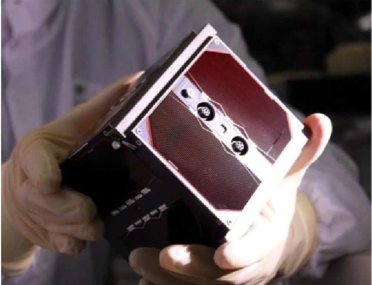
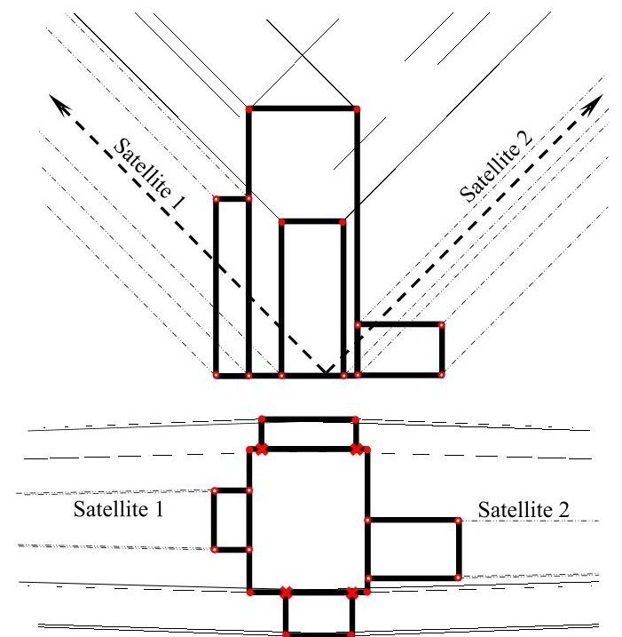
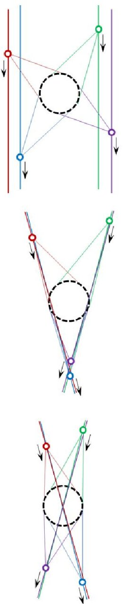
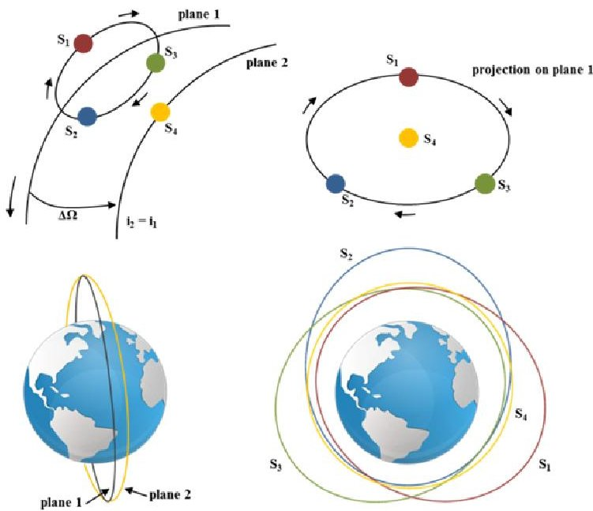

<!-- PDF_PAGE: 1 -->

IAC-15-D1.4.2

# NETSAT: A FOUR PICO/NANO-SATELLITE MISSION FOR DEMONSTRATION OF AUTONOMOUS FORMATION FLYING

Klaus Schilling, Philip Bangert, Stephan Busch, Slavi Dombrovski, Andreas Freimann, Alexander Kleinschrodt, Alexander Kramer, Tiago Nogueira, Dmitry Ris, Julian Scharnagl, Tristan Tzschichholz Zentrum für Telematik e.V., Germany, klaus.schilling@telematik-zentrum.de

Genaro Islas, Liang Zhou University of Wurzburg, Germany

Missions based on distributed spacecraft systems require a high level of on-board autonomy and inter-satellite coordination. Such missions may take advantage of small satellite formations to provide high temporal or spatial coverage and resolution at reasonable costs. In this context, the Networked Pico-Satellite Distributed System Control (NetSat) mission conducted at the Zentrum fur Telematik e.V. (ZfT) will demonstrate in orbit the autonomous control of a formation of four pico/nano-satellites. NetSat prepares contributions in the areas of on-board autonomy, distributed formation control, relative navigation, inter-satellite communication and protocols, as well as miniaturised attitude and orbit determination and control systems for future satellite formation flying missions.

With tentative launch in the period 2017/18, NetSat leverages on previous work in the areas of pico-satellite technologies and distributed systems. Key technologies in the area of communications, attitude determination and control as well as robust on-board data handling have already been demonstrated in orbit in the scope of the University Wurzburg Experimental (UWE) satellite program with UWE-1, UWE-2 and UWE-3. UWE-4 is currently in preparation and will test a miniaturised electrical propulsion system in-orbit.

This contribution introduces the NetSat mission, describes two potential mission concepts and introduces approaches to meet the challenges of formations with pico-satellites.

## I. INTRODUCTION

The in-orbit cooperation of several satellites in a formation will open new perspectives for a broad spectrum of applications and related theoretical background has been elaborated for years. Nowadays very small satellites offer the opportunity for realization at an affordable cost frame. Typical applications are Earth observation, navigation and communication. For joint observations several satellites need to be pointed at the same target from different directions. Therefore position and attitude of the satellites need to be measured with high accuracy in relation to the partner satellites. This information can then be used as basis for implementing cooperative control approaches.

In the past multi-satellite systems were mainly established in form of constellations (with each satellite individually controlled from ground) to increase coverage of Earth surface, such as GPS or GLONASS. Nowadays a paradigm change is evolving, aiming to use groups of very small satellites instead of single large satellites. The advantages are lower cost, better scalability and higher reliability. In a formation the satellites form a network to control in closed loop in orbit position and attitude of the distributed satellite system. Thereby new perspectives for a broad spectrum of applications open up, such as monitoring Earth surface [1] or deep space, as well as measuring physical fields of the Earth. Within this field of application,

networked distributed pico-satellite systems are considered as most promising [2].

In the past years many activities concerning research and development of small satellites with a size of a few tens of cm and a mass of only a few kg (see [3]), were carried out. This enables to decrease launch cost, by mounting several of them on a single launcher. But the limitations of such pico-satellites cause severe constraints for potential sensors and actuators as well.

This contribution starts with a short overview of past formation flying missions. The NetSat implementation roadmap, building on the successful development and in-flight operations of the UWE pico-satellite missions, is then presented. Finally, the NetSat-SPG and the NetSat-4G mission concepts are described.

## II. FORMATION FLYING AT THE PICO- SATELLITE SCALE

II.I Satellite Formation Flying

Few formation flying missions, consisting of only two satellites, have already been realized. A well-known formation flying mission is the TerraSAR-X/TanDEM-X mission [4] of the German Aerospace Centre (DLR), which has carried out autonomous attitude and position control in-orbit. TanDEM-X uses an inter-satellite link (ISL), which is a one way communication link from TerraSAR-X to TanDEM-X, to send formation flying information, for instance attitude and position data, to

<!-- PDF_PAGE: 2 -->

TanDEM-X. TanDEM-X then tries to keep the formation by following TerraSAR-X. Other formation flying missions were the GRACE [5] or the PRISMA mission [6]. GRACE is a geodetic mission that was initiated to carry out measurements providing data about Earth's gravity field, while the PRISMA conducted guidance, navigation and control (GNC) experiments, and demonstrated a new propulsion technology.

Already in 2003 on board of the ISS a formation flying testbed was established including three (200 mm) miniaturized satellites, called SPHERES (Synchronized Position Hold, Engage, Reorient Experimental Satellites) [7]. The "satellites" can control their relative positions and orientations.

Currently further pico- and nanosatellite missions are discussed [8]. The CanX-4&5 mission [9] was successfully launched in 2014 and demonstrated first small satellite formation flying.

## II.II Roadmap for Formation Flying at the Pico-Satellite Scale

Starting with the UWE-1 launch in 2005, the University Wurzburg Experimental (UWE) picosatellite program has seen so far three successful launches: UWE-1, UWE-2 and UWE-3.

UWE-1, the first German pico-satellite, demonstrated in orbit the use of Internet protocols for space-ground communications, optimizing specific parameters for the space environment [10]. Following in 2009, UWE-2 extended the internet in space experiments and emphasized technologies required for autonomous attitude and orbit determination [11]. Since 2013 UWE-3 demonstrates autonomous real-time attitude determination and control. UWE-3 introduced a significant redesign of the spacecraft bus, with focus on modularity, flexibility and extensibility, constituting the reference architecture and design for the following missions [12].

Currently under development, and with launch planned for 2016, UWE-4, will demonstrate in-orbit active orbit control. For this purpose a miniaturised propulsion systems is addressed. Due to the inherent mass and volume constraints of pico-satellites, an electric propulsion system is the optimal candidate. However, only a few propulsion systems have been miniaturised to pico-satellite level yet. Vacuum arc thrusters, field-emission electric propulsion and pulsed plasma thrusters are some attractive candidates. The different possibilities are analysed and compared in [13]. Subsequently the NetSat-0 mission will demonstrate autonomous relative navigation.

In parallel, efforts in the area of distributed computing are being undertaken to enable and facilitate the implementation of fully distributed autonomous formation controllers. In order to implement a fully distributed controller, information on the state and

sensor measurements of each of the satellites must be distributed among all the satellites in the formation. This task will be achieved by including a Tinytus script interpreter on every satellite [14]. Tinytus is a very compact sandbox byte-code interpreter with deterministic memory consumption. It allows replacing parts of the on-board software without the need to uplink and flash the entire software image. The code execution is performed in a sandbox with a dedicated stack and can be paused and continued at any time. Currently a new advanced Tiny 2 successor which introduced TinyThreads is in progress. With Tiny 2 parts of the code executed by one physical machine can automatically be distributed among remotely located nodes. The results of the remotely computed TinyThreads are fetched back to the original machine and can then be used for further calculation. Using this technique the formation control algorithm can be designed entirely for one satellite only, being the code portions for acquisition of remote sensor data labelled as remote TinyThreads. Tinytus has been successfully tested on-board the UWE-3 satellite for different On-Board Data Handling (OBDH) tasks, and for performing various Attitude Determination and Control (ADCS) experiments.

The already flown UWE-1, UWE-2 and UWE-3, together with the upcoming UWE-4 and the planned NetSat-0, are the stepping stones that develop and demonstrate the required technologies to realise the NetSat vision of demonstrating in-orbit the autonomous formation flying of four pico-satellites [15] [16].

Figure 1: The UWE-3 flight model (2013).

## III. NETSAT-SPG: PICO/NANO-SATELLITES FOR STEREOPHOTOGRAMETRY

The NetSat-SPG (NetSat-StereoPhotoGrammetry) mission is an attempt to use a satellite formation consisting of four pico-satellites to obtain 3D pictures of the Earth surface in the visible and thermal-IR range for

<!-- PDF_PAGE: 3 -->

further processing by stereophotogrammetric methods. Stereophotogrammetry measures the spatial position, shape and size of objects on a stereo pair of photographs. The final goal is the definition of the position and size of any objects on the surface of the Earth using a mix of four pictures of the same section of the Earth's surface, obtained from four different perspectives. In practice, this technology can be used for example in the following fields:

- Volcanology: detection of new volcanoes or forecasting of volcanic eruptions;

- Geology: tracking changes in the landscape, coastline, glaciers, including icebergs or changing river beds;

- Cartography: both creation of simple 2D maps and creation and refinement of 3D maps for civil aviation needs;

- Constructions: monitoring of the position and shape of the main elements of large industrial buildings (high-rise buildings, bridges, heating and gas mains, ports, railways, dams);

- Meteorology: determination of the height of clouds occurrence or studies of rare natural phenomena such as tornadoes;

- Monitoring of natural disasters and prediction of their propagations, for example monitoring of floods, large landslides, clouds of volcanic emissions, among others.

## III.I Formation Geometry

For the purposes of the NetSat-SPG mission a minimum of two satellites on the same orbital plane is required. The satellites are spaced by a certain distance and photograph concurrently one and the same area on the Earth's surface. A stereo pair of photographs is well suited for the creation of 3D images of not strongly tilted and relatively flat surfaces, such as the water surface, flat terrain and terrain with a lack of sudden changes in altitude. To create a 3D model of a complex object, such as a high-rise building with a complex shape, rocky terrain, high steep coast- or glacial line or a gully, using only a pair of photos from two satellites will likely lead to the absence of important key "common points". This situation is shown in Figure 2, where the key points absent from both images are marked with a cross. The Figure shows a schematic view of the side of a tall building and its key points. Segments of line indicate the direction of rays of light for each of the observing satellites. The angle between the optical axes of the telescope of satellites is assumed to be $ 9 0^{\circ} $ , as this angle gives the smallest error of measurement of the spatial position of the key points.

To overcome these limitations one can either increase the number of satellites simultaneously observing the same surface area, or one must reorient the satellites such as to observe the same area from

different directions. Either way, the angle between the local vertical and the optical axis of the satellite's telescope should be reduced. Both ways have advantages and disadvantages.

## Legend:

- Common points, visible from both satellites (spatial position can be calculated by stereophotogrammetric method)

Points, visible from one of satellites (spatial position can be calculated approximately by indirect methods or with low accuracy by photogrammetric methods)

Point is absent in both photographs (spatial position cannot be calculated)

Optical axis of the telescope of the satellite

Beam direction from common points to both satellites

Beam direction from the point to one of satellites

Figure 2: Stereo imaging of a complex structure using two satellites. Side view (top), top view (bottom).

Advantages of the tracking reorientation strategy:

- The number of satellites is limited to two. Disadvantages:

- Complexity of the attitude control algorithm;

- More stringent requirements for the ADCS. in particular for the reaction wheels;

- There is no guarantee that this approach will completely eliminate the problem;

- The problem can be found only after treatment with a stereo pair, when it is already too late to reorient of satellites;

- The measurement error of the spatial coordinates of target points on the stereo pair of images will grow as the distance from the

<!-- PDF_PAGE: 4 -->

satellite to the target object increases, and the angle between axes of sight directed to the object decreases;

- To create a 3D model of the object may take several overflights of the formation with a preelaborated algorithm to change the satellites' orientation.

A

B

C

Legend:

A The best arrangement of four satellites providing the smallest measurement error of the spatial position of the key points of objects in the observed area (dotted circle in the centre). Objects are observed from four sides.

B/C The worst arrangement of four satellites, leading to increased errors in the measurement of spatial position of "unsuccessful located" key points of objects with complex shapes.

Figure 3: Different possible arrangements for a formation of four satellites (figures not to scale).

The second way of solving the problem involves increasing the number of satellites to 4, which eliminates the need for reorientation of the entire formation, while ensuring the creation of a complex 3D model of objects. In this case, the formation of satellites will look as shown in Figure 3.

This formation does not require the tracking reorientation in order to monitor the area located on the ground under the geometric centre of the formation. Of course, tracking reorientation of the formation by preplanned trajectory is also possible, but it will reduce the accuracy of the measurements of spatial coordinates of points of the object.

## III.II Mission Requirements

Different applications impose different requirements on the measurement's accuracy. The most stringent requirements are imposed by cartography and constructions applications, for which errors should not exceed 3-5 m. Less challenging requirements, are imposed by volcanology and geology applications. However, apart from the measurement accuracy of the spatial position of the observed object in the geocentric coordinate system, i.e., relative to other objects (global accuracy), it is also necessary to consider the accuracy of measurements of size and shape of objects that fall entirely within one stereo image (local accuracy). This accuracy must be higher than the global accuracy, since the main task of stereophotogrammetry consist in determining the size, shape and relative positions of objects that fall entirely within one stereo image. The most stringent requirements for the local accuracy are imposed by constructions (0.8-1 m), cartography ( $ \approx1 $ m) and volcanology (1-3 m).

To maintain the required relative orientation throughout the complete orbit (with period $ T_{orb} $), the attitude must be controlled both in the in-plane and out-of-plane directions. The angle between the telescope field of view and nadir in the out-of-plane direction varies between $ \pm 1 5^{\circ} $ over one orbit. For an orbital period $ T_{orb} $ of about 90 minutes at 390 km, the ADCS must be capable of providing an angular velocity for reorientation of 0.0170 $ ^{\circ} / \mathrm{s} \approx 1 \ ' / \mathrm{s} $ . Attitude control accuracy must be such that pictures obtained from each of the four satellites overlap by least 90%. Therefore, attitude control errors must not exceed 10% of the telescope's field of view angle. For example, for a field of view of the satellite's telescope of about $ 1^{\circ} $ , the ADCS must maintain the desired orientation with an accuracy of at least $ 0.1^{\circ} $ or $ 6^{\prime} $ .

The accuracy with which the location of the key points can be determined is further limited by, for example, the attitude determination accuracy and the selected CCD-matrix. For a CCD-matrix with resolution of 2048x1536 pixels and a field of view of $ 1^{\circ} $ , the angular size of a pixel is about 1.76".

<!-- PDF_PAGE: 5 -->

For an orbital altitude of 390 km, the inter-satellite along-track distance must be maintained at approximately 102 km. Orbit control accuracy is not as tight as for attitude control, as changing inter-satellite distances in range $ \pm 1 $ km will only affect the measurement accuracy of the spatial coordinates of points on images by approximately 1%. At the same time maintaining a predetermined position of satellites relative to each other is more important than maintaining a predetermined position of the whole formation in the geocentric coordinate system.

The orbit determination accuracy of each individual satellite in a geocentric coordinate system must be better than the required global accuracy of measured coordinates of objects on the ground (e.g. 3 m for cartography applications). The relative orbit determination accuracy between the satellites in the formation must be better than the required local accuracy (e.g. <1 m for cartography applications).

<table border="1"><tr><td>Variables</td><td>Performance RMS</td></tr><tr><td>Attitude determination</td><td>&lt;1.7&quot;</td></tr><tr><td>Attitude control</td><td>&lt;6&#x27;</td></tr><tr><td>Absolute orbit determination</td><td>&lt;3m</td></tr><tr><td>Relative orbit determination</td><td>&lt;0.8m</td></tr><tr><td>Absolute orbit control accuracy</td><td>&lt;500m</td></tr><tr><td>Relative orbit control accuracy</td><td>&lt;100m</td></tr><tr><td>Out-of-plane maximum attitude rate</td><td>&gt;0.0170°/s</td></tr></table>

Table 1: Summary of the NetSat-SPG attitude and orbit determination and control requirements.

## III. NETSAT-4G: NANO-SATELLITES FOR GEOMAGNETIC GRADIOMETRY

The NetSat-4G concept, first introduced in [17], proposes a nano-satellite mission for Global GeomaGnetic Gradiometry (4G). The NetSat-4G mission consists of four nano-satellites flying in a Cartwheel-Helix formation at low altitude and carrying vector magnetometers. The use of four satellites makes possible the realisation of a full gradiometry mission, by simultaneously measuring the geomagnetic gradients in all three directions: east-west, north-south and radial. Knowledge of the full gradient tensor has shown to improve, when compared to having only measurements of the field components, the determination of the small-scale lithospheric magnetic field and the high-degree secular variation [17].

## III.I Formation Geometry

The four satellites are deployed in a near-polar orbit at a mean altitude of 400 km where [17]:

- Three satellites $ ( S_{1}, S_{2} $ and $ S_{3} $ ）are placed in a Cartwheel configuration, having all three the same eccentricity and the arguments of perigee separated by 120 deg;

- The fourth satellite $ ( S_{4} ) $ is placed in an orbit with the same inclination as the first three but with an offset in right ascension of the ascending node (RAAN) and a smaller eccentricity, as depicted in Figure 4.

Figure 4: NetSat-4G Cartwheel-Helix formation (orbits not to scale) [17].

The inter-satellite distances accounting for the radial and north-south gradients can be modified by adjusting the eccentricity of $ S_{1} $ $ S_{2} $ and $ S_{3} $ . The inter-satellite distances accounting for the east-west gradient can be equally modified by adjusting the offset in RAAN between $ S_{4} $ and the plane defined by $ S_{1} $ $ S_{2} $ and $ S_{3} $

End-to-end simulations, described in [17], have shown that even in the presence of attitude and positioning errors, solutions obtained from gradient measurements lead to better results when compared with solutions relying on vector measurements only.

## III.II Mission Requirements

The performance of the NetSat-4G science mission is mainly driven by errors in position and attitude determination, magnetometer measurements, and is sensitive to changes in the formation geometry [17]. Requirements on formation control are relatively loose, and are mainly driven by the need to maintain the target geometry. These are summarised in Table 2 below.

<!-- PDF_PAGE: 6 -->

<table border="1"><tr><td>Variables</td><td>Performance RMS</td></tr><tr><td>Cross-track relative orbit control</td><td>&lt;10km</td></tr><tr><td>Along-track relative orbit control</td><td>&lt;10km</td></tr><tr><td>Absolute orbit determination</td><td>&lt;100m</td></tr><tr><td>Absolute attitude determination</td><td>&lt;10&#x27;&#x27;</td></tr></table>

Table 2: Summary of the NetSat-4G formation control requirements.

## IV. CONCLUSIONS

Increased capabilities of pico-satellites prepare a paradigm shift from traditional multi-functional large satellites to distributed networked pico-satellite systems. During the past 10 years in the UWE-program relevant technologies for pico-satellite formation flying have been prepared, forming the basis for the NetSat-mission composed of 4 pico-satellites. Two scientific candidate mission scenarios in the areas of stereophotogrammetry and geomagnetic gradiometry emphasise the application potential in the context of Earth observation. Further innovation potential of pico-satellite networks in low Earth orbits concerns communication, addressing internet from space. Thus there seems to be good evidence that pico-satellite formations might have the potential for disruptive technology changes in the spacecraft design context.

This work is supported by the European Research Council (ERC) Advanced Grant "NetSat" under the Grant Agreement No. 320377.

## ACKNOWLEDGEMENTS

## REFERENCES

[1] S. Nag, "Design and Analysis of Distributed Nano-satellite systems for Multi-angular, Multispectral Earth Observation," Proceedings of the 64th International Astronautical Congress, 2013.

[2] D. Selva and D. Krejci, "A survey and assessment of the capabilities of Cubesats for Earth observation," Acta Astronautica, 2012.

[3] R. Munakata, "CubeSat Design Specification," The CubeSat Program, California Polytechnic State University, 2015.

[4] J.-S. Ardaens, S. D'Amico, D. Ulrich and D. Fischer, "TanDEM-X Autonomous Formation Flying System," 3rd International Symposium on Formation Flying, Missions and Technology, 2008.

[5] K. Michael, M. Franz-Heinrich and M. Steinhoff, "Grace," Distributed Space Missions for Earth System Monitoring., pp. 547-574, 2013.

[6] S. DAmico, J. Ardaens and M. O., "Navigation of

Formation Flying Spacecraft," 22nd International Technical Meeting of The Satellite Division of the Institute of Navigation, 2009.

[7] A. Saenz-Otero and D. Miller, "The SPHERES ISS Laboratory for Rendezvous and Formation Flight," European Space Agency Publications - ESA SP, 2003.

[8] J. Bouwmeester and J. Guo, "Survey of worldwide pico- and nanosatellite missions, distributions and subsystem technology," Acta Astronautica, 2010.

[9] G. Bonin, N. Roth, S. Armitage, J. Newman, B. Risi and R. E. Zee, "CanX--4 and CanX--5 Precision Formation Flight: Mission Accomplished!," 2015.

[10] R. Barza, Y. Aoki and K. Schilling, "CubeSat UWE-1 Technology Tests and In-Orbit Results," in 57th International Astronautical Congress, Valencia, Spain, 2006.

[11] M. Schmidt, K. Ravandoor, K. Kurz, S. Busch and K. Schilling, "Attitude Determination for the PicoSatellite UWE-2," in Proceedings IFAC World Congress, Seoul, South Korea, 2008.

[12] S. Busch, P. Bangert and K. Schilling, "Attitude Control Demonstration for Pico-Satellite Formation Flying by UWE-3," in 4S-Symposium, Mallorca, Spain, 2014.

[13] A. Kramer and P. Bangert, "Integration and Testing of Vacuum Arc Thrusters for the Picosatellite UWE-4," in 66th International Astronautical Congress, Jerusalem, Israel, 2015.

[14] S. Dombrovski and P. Bangert, "Introduction of a New Sandbox Interpreter Approach for Advanced Satellite Operations and Safe On-Board Code Execution," in 66th International Astronautical Congress, Jerusalem, Israel, 2015.

[15] K. Schilling, M. Schmidt and S. Busch, "Crucial Technologies for Distributed Systems of PicoSatellites," in 63rd International Astronautical Congress, Naples, Italy, 2012.

[16] M. Schmidt and K. Schilling, "Formation Flying Techniques for Pico-Satellites," in 6th International Workshop on Satellite Constellation and Formation Flying, Taipei, Taiwan, 2010.

[17] T. Nogueira, J. Scharnagl, S. Kotsiaros and K. Schilling, "NetSat-4G - A Four Nano-Satellite Formation for Global Geomagnetic Gradiometry," in 10th IAA Symposium on Small Satellites for Earth Observation, Berlin, Germany, 2015.