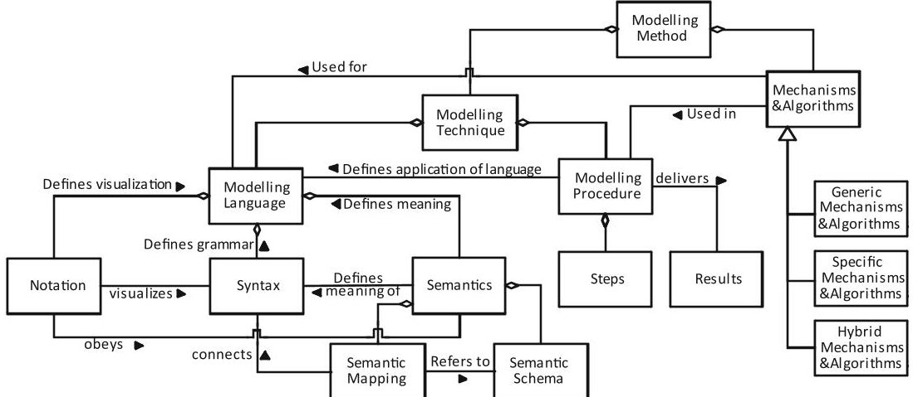
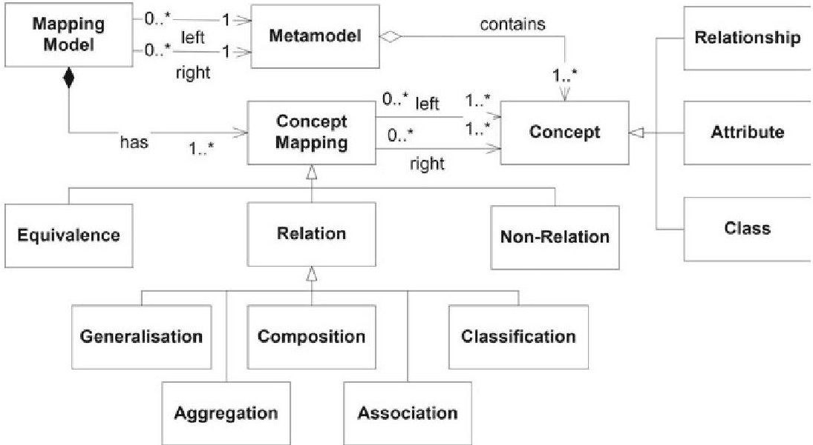
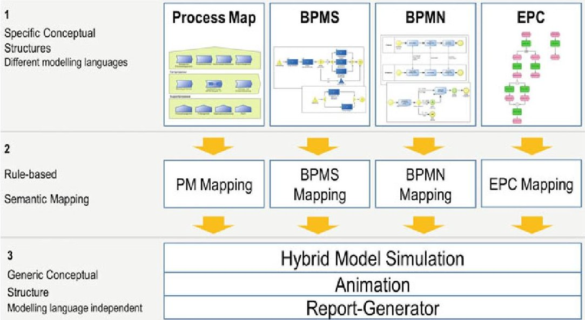
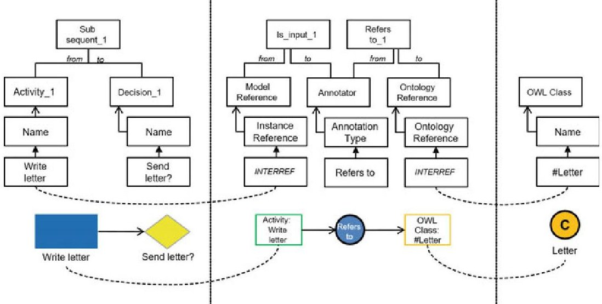
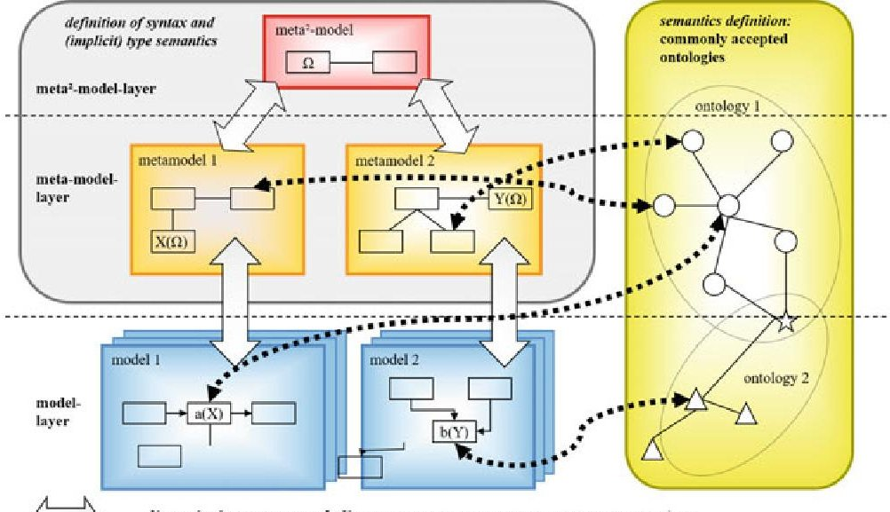
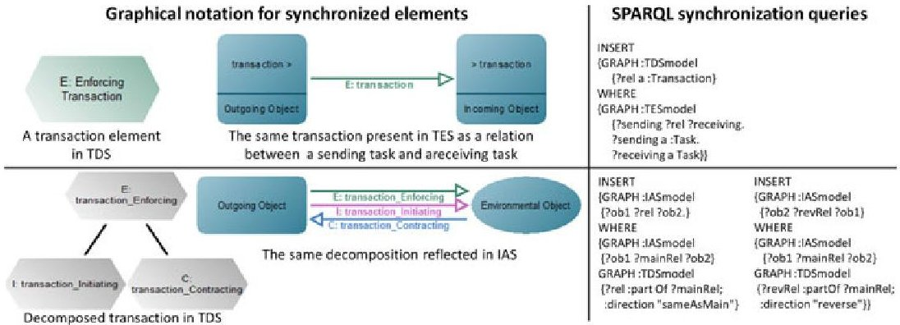
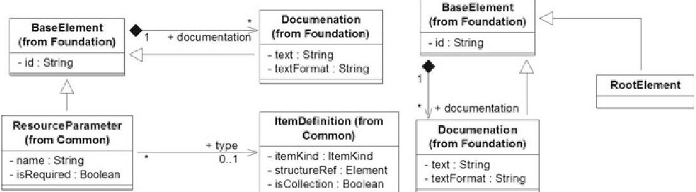
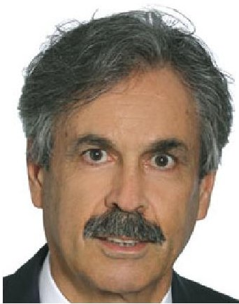
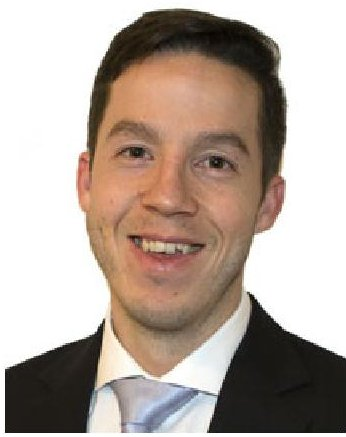

<!-- PDF_PAGE: 1 -->

# Metamodels as a Conceptual Structure: Some Semantical and Syntactical Operations

Dimitris Karagiannis, Dominik Bork and Wilfrid Utz

## 1 Metamodels and Conceptual Structures

In conceptual modelling, abstraction is applied to reduce complexity for a specific purpose. For example, abstraction can be used for "developing model-driven methods and tools for the full-scale automated generation of implementation-ready IS" as stressed in (Becker, Brocke, Heddier, & Seidel, 2015). The created models provide values of different quantity and quality: at least, conceptual models serve the purpose of documentation and understanding by human beings (Mylopoulus, 1992); to a wider extent, however, such models can also act as a formalized knowledge base that enables further processing. Karagiannis et al. (2017) elaborate on the possibilities of supporting knowledge management by conceptual modelling means. This broader notion is visualized in Fig. 1. Accordingly, a modelling method is composed of a modelling language, a modelling procedure, and mechanisms & algorithms. A modelling language is then further composed of notation, i.e., the graphical representation, syntax, i.e., the available language concepts, and semantics, i.e., the meaning of the concepts.

In order to leverage this broader notion of modelling methods, a co-creation metaphor, similar to value co-creation and service co-creation (Becker, Beverungen, Breuker, Hanns-Alexander, & Rauer, 2013a; Becker et al., 2013b), needs to be employed. Co-creation involves both, the development of a new metamodel by the method engineer as well as their application by the modeller. The method engineer develops a metamodel as a response to evolving needs and requirements from a spe-

<!-- PDF_PAGE: 2 -->

Fig.1 Components of modelling methods (Karagiannis & Kühn, 2002)

cific domain. While designing this conceptual structure, design decisions determine utility, capabilities, and expressiveness of the conceptual modelling language—and indirectly, the value of the created models (Bork, 2018). The modeller is then responsible for designing model artefacts, therefore having a direct influence on the model value.

When considering the purpose of a modelling language, domain-specific modelling languages (Karagiannis, Mayr, & Mylopoulus, 2016) can be distinguished from general-purpose ones like the Business Process Modeling and Notation (BPMN) and the Unified Modeling Language (UML). Whereas languages of the latter category evolve slowly and new languages emerge only scarcely, modelling languages designed to address domain-specific requirements emerge and evolve more frequently.

Due to this fluctuation, developing mechanisms and algorithms on a language-specific layer is inefficient. Moreover, scenarios build on heterogeneous modelling languages (Becker, Delfmann, Eggert, & Schwittay, 2012) require for alignment or even integration of metamodels. This paper amplifies the notion of metamodel from the formalized specification of a modelling language's syntax (Bork & Fill, 2014) towards the notion of "metamodel as a conceptual structure".

According to Jackendoff (1987), a conceptual structure relates to syntactic, phonological structure, and non-linguistic levels of representation. Our mapping of the conceptual structure theory to metamodeling is as follows: decompositional—because it decomposes relevant domain aspects in terms of metamodel concepts (e.g., modeltypes, classes, relations); conceptualist—because domain semantics are identified with metamodel concepts, and localistic—the geographical structuring in metamodels. Based on the characteristics and the utilization scenario, different types of conceptual structures can be differentiated: syntactic conceptual structures focus on the localistic aspect by specifying structural aspects like inheritance and composition on metamodel concepts; semantic conceptual structures focus on conceptualist aspects

<!-- PDF_PAGE: 3 -->

by precisely specifying the domain semantics, and hybrid conceptual structures provide a structure that integrates both, localistic and conceptualist aspects.

This broader notion treats metamodels as first-class citizens, enabling semantical and syntactical operations (see Sect. 2) that are language-agnostic but allow parameterization for specific languages. Specified on structural aspects of a metamodel, such operations can be used for any specific metamodel. Due to limited space, this paper sketches recent works and points interested readers to the relevant literature.

## 2 Operations on Metamodels

## 2.1 Modelling Language Mapping

When multiple modelling languages need to be aligned, e.g., in case of multi-view modelling (Bork, Buchmann, & Karagiannis, 2015), metamodels as a conceptual structure can serve as a basis for the specification of mappings and rules that determine the alignment. Zivkovic, Kuhn, and Karagiannis (2007) propose a conceptual structure that targets this research challenge by means of a metamodel mapping language as visualized in Fig. 2.

Zivkovic et al. (2007) identify the following set of mapping structures attached with cardinalities: (1) mapping structure: class-to-class (C2C), attribute-to-attribute (A2A), relationship-to-relationship (R2R), attribute-to-class (A2C), attribute-to-relationship (A2R), relationship-to-class (R2C), and (2) mapping cardinality: one-to-one (1-1), one-to-many (1-N), many-to-many (M-N). A recent work by Awadid,

Fig. 2 A conceptual structure for mapping modelling languages (Zivkovic et al., 2007)

<!-- PDF_PAGE: 4 -->

Bork, Karagiannis, and Nurcan (2018) further developed these mapping types toward patterns of metamodel relationships with an emphasis on multi-view consistency. These mappings and patterns contribute the design and analysis of new modelling methods comprising multiple metamodels.

## 2.2 Reference Alignment

A different way of integrating two or more metamodels is by incorporating an additional, language-agnostic metamodel that acts as the bridge between those other metamodels. Reference alignment is defined as aligning several metamodels to a common semantic backbone provided by a reference metamodel. Thus, reference alignment utilizes a mapping between multiple specific conceptual structures and a generic one which realizes modelling language independent functionality.

Reference alignment uses a generic conceptual structure as referencing structure. Common semantics can then be defined for the generic concepts—thus, this structure is domain- and/or purpose-specific. Moreover, model processing functionality can be realized on the generic structure and then utilized, by rule-based mappings, by all specific conceptual structures. Some possible options for referencing of concepts are: a concept that captures merged meaning (union of attribute sets); or a concept that captures the overlapping meaning (intersection of attribute sets).

A full-stack example, showing the possible strengths of the reference alignment approach is documented in (Prackwieser, Buchmann, Grossmann, & Karagiannis 2013) and visualized in Fig. 3. Here, a hybrid modelling and process simulation algorithm is realized on the generic conceptual structure, enabling its utilization for arbitrary referencing metamodels (i.e., specific conceptual structures). The example is based on a generic conceptual structure for process-related modelling languages. Thereafter, four modelling languages, i.e., Process Maps, Business Process Management Systems (BPMS), BPMN, and EPC reference to this generic conceptual structure. As a result, models of all four languages can be simulated in a hybrid manner, e.g. a subprocess of the BPMN is detailed in an EPC model. The hybrid simulation algorithm is capable of traversing multiple models of different modelling languages due to its generic implementation.

In order to equip an additional modelling language with the hybrid simulation capability, a method engineer only needs to map the new specific conceptual structure to the process simulation concepts of the generic conceptual structure. This generic conceptual structure comprises e.g., (cf. Prackwieser et al., 2013, p. 151 for a description): Activity, Sub Process, Start, End, XOR, AND, Merge, Event, and Neutral.

<!-- PDF_PAGE: 5 -->

Fig. 3 Alignment between specific and generic conceptual structure

## 2.3 Semantic Lifting

A different approach, using a hybrid conceptual structure, targets the integration of ontological aspects in metamodels—semantic lifting. Semantic lifting refers to the process of associating syntactic conceptual structure items with suitable semantic conceptual structure items as metadata to create semantic knowledge resources. In the context of metamodelling, semantic lifting refers to the integration of formalized semantics as an extension of metamodels (c.f. Fill, 2011; Hrgovcic, Karagiannis, & Woitsch, 2013). The authors in (Woitsch, 2013) report on the conceptualization and ADOxx-based implementation of five different types of semantic lifting:

- Non supported direct linkage requires no changes in the metamodels, the user needs to manually enter the linkage in an existing suitable attribute;

- Supported direct linkage, can be realized by an AdoScript that accesses the other modelling tool and enables the selection of an object;

- Indirect linkage can be realized using a so-called transit model type where concepts of the corresponding other metamodel are included. Hence user-friendly mechanisms to reference model objects can be used.

- Loose coupling is a special form of indirect linkage, as the concepts that are referenced are not the target concepts but a reference ontology, which is referenced by the source and the target concept;

- Direct and indirect linkage is a combination of supported and non-supported linkage, by supporting a fixed core set of concepts but permit the flexibility to also allow agile evolving concepts.

Figure 4 exemplifies the indirect linkage semantic lifting type. Three different model types are necessary for this type of semantic lifting: (i) original model (in this case

<!-- PDF_PAGE: 6 -->

Fig. 4 Semantic lifting based on an indirect linkage conceptual structure (Fill, 2011)

a process model on the left side); (ii) ontology model (in this case based on OWL on the right side); and (iii) annotation model (visualized in the centre). The annotation model type acts as a conceptual structure referencing both, the elements of the process modelling language and the ontology model. It also permits to specify the annotation type—shown in Fig. 3 by the example of the Refers-to annotation type.

One strength of this approach is its flexibility and easy customizability for arbitrary modelling languages (left side of Fig. 4) and ontologies (right side of Fig. 4). The original modelling language only requires minor extensions by means of references to the annotation model type. In contrast to the related approach referred to in the literature as model weaving (Del Fabro & Valduriez, 2007), this semantic lifting approach employs visual means of specifying annotations.

## 2.4 Semantic Interoperability

In complex scenarios, e.g., enterprise modelling, all requirements cannot be covered in a single metamodel or a single ontology. The question arises of how to combine metamodels and ontologies in a coherent way that yields an integrated and comprehensive enterprise specification. Höfferer (2007) propose an integrated way of achieving interoperability by combining syntactic conceptual structure information with semantic conceptual structure information. Thus, this is an example utilizing a hybrid conceptual structure. Figure 5 visualizes the architecture for semantic interoperability. Linguistic metamodelling, i.e., the conventional meta-hierarchy as employed in conceptual modelling by meta $ ^{2} $ model, metamodel, and model (c.f. Karagiannis & Kühn, 2002, pp. 3f.) is separated from ontological metamodelling, i.e., the semantic definition of the relevant aspects of the domain by means of ontologies.

<!-- PDF_PAGE: 7 -->

x(y) ... model element x conforms to model element y of the superios metamodel

Fig. 5 A conceptual structure architecture for semantic interoperability (Hofferer, 2007)

"The basis for semantic interoperability is provided via linking model elements of arbitrary layers of the metamodel hierarchy with ontology concepts." (Höfferer, 2007; p. 1626) The approach further differentiates two layers where the integration of the ontologies and metamodels yield interoperability. On the upper two layers, linking meta $ ^{2} $ model or metamodel concepts to ontological concepts enables the formal specification of type semantics—contributing to modelling language interoperability (e.g., the identification of semantic similarities between different meta $ ^{2} $ models and metamodels). On the model layer, the semantics of the instantiated model elements can be specified by linking to concepts of the ontologies. This latter form is referred to as inherent semantics—contributing to model interoperability (e.g., the identification of semantic similarities in conceptual models).

## 2.5 Model Synchronization

A paramount requirement in complex modelling scenarios refers to the consistency among different models that jointly describe the system under study. It is common sense to refer to multi-view modelling approaches when aiming for a comprehensive specification of e.g., an enterprise, comprising structural, behavioural, and information perspectives. In Karagiannis, Buchmann, and Bork (2016) a consistency management approach is proposed that relies in semantic queries applied to a structured RDF serialization of metamodels and models. Consequently, this approach is one example building on a hybrid conceptual structure.

<!-- PDF_PAGE: 8 -->

Fig. 6 Synchronization queries based on conceptual structures (Karagiannis et al., 2016)

Based on a generic RDF serialization proposed by Karagiannis and Buchmann (2016), the approach introduces two ways of managing consistency between multiple views: (i) semantic queries as view synchronization rules, and (ii) semantic queries for passive view consistency checks. Figure 6 visualizes an example of consistency management for the Semantic Object Model (SOM) method (Ferstl & Sinz, 2013), realized in a modelling tool (Ferstl, Sinz, & Bork, 2016) by means of SPARQL queries that perform synchronizations on the RDF graph base. In the upper example, an enforcing transaction of the Transaction Decomposition Schema (TDS) of SOM needs to be synchronized with the corresponding relation in the Task-Event Schema, connected by a sending and a receiving task. The lower example covers the SOM decomposition rule no. 6 (see Ferstl & Sinz, 2013, p. 210). Accordingly, any business transaction can be decomposed into three sequential transactions (initiating, contracting, and enforcing). This information needs to be synchronized between the TDS and the Interaction Schema (IAS).

The semantic queries approach, as visualized in the right column of Fig. 6, utilizes SPARQL queries on RDF as an additional structure to bridge conceptual modelling with Semantic Web technologies. It thereby applies "knowledge engineering techniques in support of knowledge management concerns—that is, in support of managing the inherent complexity of knowledge externalized as multi-view enterprise models" (Karagiannis et al., 2016). Thus, modellers can concentrate on the correct representation of domain semantics by means of a conceptual model whereas the semantic queries, running in the background RDF structure of the metamodels and models manage consistency.

## 3 How to Structure Metamodels?

Recently, two research streams were initiated that target the question of how to structure relevant domain-specific aspects in metamodels. An attempt to assess the status-quo of domain-specific metamodels was published in Bork (2018). The paper

<!-- PDF_PAGE: 9 -->

Fig. 7 Slicing metamodel specification technique in BPMN (Bork et al., 2018)

reports on the application of metrics to 40 domain-specific metamodels realized with the ADOxx metamodeling platform (ADOxx.org, 2018; Efendioglu, Woitsch, & Utz, 2016; Karagiannis & Fill, 2013). The paper compares the results with metrics on Ecore-based metamodels found in the literature. The lessons learned indicate points of interest in identifying metamodelling patterns and how such patterns can contribute to increasing the quality of metamodels.

A second recent research stream investigates how standardization consortia specify widely adopted industry modelling languages standards like BPMN, DMN, and UML. Bork, Karagiannis, and Pittl (2018) identify six different techniques that were applied in 11 investigated modelling language standards: Slicing Metamodel, Referencing Metamodel, Generic Metamodel, Notation- aware Metamodel, Matrix Metamodel, Table Metamodel. Thus, although some institutions like OMG are responsible for multiple investigated standards, no coherent way of specifying modelling language metamodels was found.

Figure 7 visualizes an example of the slicing metamodel specification technique as used by BPMN. The two metamodel slices redundantly specify the concepts Base Element, Documentation, and the relationship between those two. Such a specification technique enables structuring large metamodels by decomposing them into redundant slices. The redundant concepts foster comprehension and show, how the slices need to be assembled in order to derive the overarching metamodel. At the same time, these redundant concepts also increase the risk of inconsistent specifications as changes on concept and relationship level possibly need to be performed at multiple slices.

## 4 Concluding Remarks

This paper provides a brief overview on recent works in the field of metamodeling with an emphasis on amplifying the notion of metamodels toward "metamodels as a conceptual structure". This extended notion spans not only pure formal specification of a modelling language's syntax, but treats metamodels as a conceptual structure that enables further processing. A differentiation between syntactical, semantical,

<!-- PDF_PAGE: 10 -->

and hybrid conceptual structures has been considered, and example operations been illustrated, including modelling language mappings, hybrid simulation, and model synchronization.

Albeit the undisputable role of metamodels, it is surprising that, up until now, there exists no common standard for the metamodel specification itself (see Sect. 3). Not only the standardization institutions like OMG and the OpenGroup use different techniques to specify metamodels, also the research community uses a heterogeneous and uncontrolled set of techniques when introducing new metamodels. It is therefore one of our future research objectives to propose a specification technique that, when applied on a broader basis, enables easier comprehension and comparison of metamodels. We plan to deploy a first version of this specification technique in our Open Models Laboratory (OMiLAB) (Götzinger, Miron, & Staffel, 2016) community to gain feedback and agilely revise the technique accordingly.

## References

ADOxx.org. (2018). ADOxx metamodeling platform.

Awadid, A., Bork, D., Karagiannis, D., & Nurcan, S. (2018). Toward generic consistency patterns in multi-view enterprise modelling. In European Conference on Information Systems. Portsmouth, UK.

Becker, J., Beverungen, D., Breuker, D., Hanns-Alexander, D., & Rauer, H. P. (2013a). Performance benchmarking for designing interaction routines-managing trade-offs in service co-creation with the data envelopment analysis. In ECIS 2013 Proceedings (p. 185).

Becker, J., Beverungen, D., Knackstedt, R., Matzner, M., Müller, O., & Poppelbuß, J. (2013b). Designing interaction routines in service networks: A modularity and social construction-based approach. Scandinavian Journal of Information Systems, 25(1), 37-68.

Becker, J., vom Brocke, J., Heddier, M., & Seidel, S. (2015). In search of information systems (grand) challenges. Business & Information Systems Engineering, 57(6), 337-390.

Becker, J., Delfmann, P., Eggert, M., & Schwittay, S. (2012). Generalizability and applicability of model-based business process compliance-checking approaches—A state-of-the-art analysis and research roadmap. Business Research, 5(2), 221-247.

Bork, D. (2018). Metamodel-based analysis of domain-specific conceptual modeling methods. In 11th IFIP WG 8.1 Working Conference on the Practice of Enterprise Modelling (pp. 172-187). Springer.

Bork, D., Buchmann, R., & Karagiannis, D. (2015). Preserving multi-view consistency in diagrammatic knowledge representation. In International Conference on Knowledge Science, Engineering and Management (pp. 177-182). Springer.

Bork, D., & Fill, H. G. (2014). Formal aspects of enterprise modeling methods: A comparison framework. In Proceedings of the Annual Hawaii International Conference on System Sciences (pp. 3400-3409).

Bork, D., Karagiannis, D., & Pittl, B. (2018). How are metamodels specified in practice? Empirical insights and recommendations. In 24th Americas Conference on Information Systems (pp. 1-11). New Orleans, USA.

Del Fabro, M. D., & Valduriez, P. (2007). Semi-automatic model integration using matching transformations and weaving models. In Proceedings of the 2007 ACM symposium on Applied computing (pp. 963-970).

<!-- PDF_PAGE: 11 -->

Efendioglu, N., Woitsch, R., & Utz, W. (2016). A toolbox supporting agile modelling method engineering: ADOxx. org modelling method conceptualization environment. In IFIP Working Conference on The Practice of Enterprise Modeling (pp. 317-325). Cham: Springer.

Ferstl, O. K., & Sinz, E. J. (2013). Grundlagen der Wirtschaftsinformatik. Walter der Gruyter.

Ferstl, O. K., Sinz, E. J., & Bork, D. (2016). Tool support for the semantic object model. Domain specific conceptual modeling (pp. 291-310). Cham: Springer.

Fill, H. G. (2011). On the conceptualization of a modeling language for semantic model annotations. In International Conference on Advanced Information Systems Engineering Workshops (pp. 134-148). Berlin: Springer.

Götzinger, D., Miron, E.-T., & Staffel, F. (2016). OMiLAB: An open collaborative environment for modeling method engineering. In Domain-Specific Conceptual Modeling (pp. 55-76). Springer.

Höfferer, P. (2007). Achieving business process model interoperability using metamodels and ontologies. In European Conference on Information Systems (pp. 1620-1631).

Hrgovcic, V., Karagiannis, D., & Woitsch, R. (2013). Conceptual modeling of the organisational aspects for distributed applications: The semantic lifting approach. In IEEE 37th Annual of Computer Software and Applications Conference Workshops (pp. 145-150).

Jackendoff, R. (1987). The status of thematic relations in linguistic theory. Linguistic Inquiry, 18(3), 369-411. https://doi.org/10.2307/4178548.

Karagiannis, D., & Buchmann, R. A. (2016). Linked open models: Extending linked open data with conceptual model information. Information Systems, 56, 174-197.

Karagiannis, D., Buchmann, R. A., & Walch, M. (2017). How can diagrammatic conceptual modelling support knowledge management? In European Conference on Information Systems (pp. 1568-1583).

Karagiannis, D., Buchmann, R., & Bork, D. (2016). Managing consistency in multi-view enterprise models: An approach based on semantic queries. In 24th European Conference on Information Systems.

Karagiannis, D., & Fill, H. G. (2013). On the conceptualisation of modelling methods using the ADOxx meta modelling platform. Enterprise Modelling and Information Systems Architectures, 8(1), 4-25.

Karagiannis, D., & Kühn, H. (2002). Metamodelling platforms. In Proceedings of the Third International Conference EC-Web, 2455 (p. 182).

Karagiannis, D., Mayr, H. C., & Mylopoulus, J. (2016). Domain-specific conceptual modeling. Springer International Publishing.

Mylopoulus, J. (1992). Conceptual modelling and telos. Conceptual modelling, databases, and CASE: An integrated view of information system development. Wiley.

Prackwieser, C., Buchmann, R., Grossmann, W., & Karagiannis, D. (2013). Towards a generic hybrid simulation algorithm based on a semantic mapping and rule evaluation approach. In International Conference on Knowledge Science, Engineering and Management (pp. 147-160). Springer.

Woitsch, R. (2013). Hybrid modelling with ADOxx: Virtual enterprise interoperability using meta models. In International Conference on Advanced Information Systems Engineering Workshops (pp. 298-303). Berlin: Springer. https://doi.org/10.1007/978-3-642-38490-5_28.

Zivkovic, S., Kuhn, H., & Karagiannis, D. (2007). Facilitate modelling using method integration: An approach using mappings and integration rules. In European Conference on Information Systems (pp. 2038-2049).

<!-- PDF_PAGE: 12 -->

Dimitris Karagiannis is a tenured professor for Business Informatics at the University of Vienna, where he heads the Knowledge Engineering Research Group since 1993. In 2011, he was awarded an honorary professorship (Prof. h.c.) from the University Babes-Bolyai Cluj Napoca in Romania. Moreover, he was a guest researcher at the Berkley University of California (USA), Kyoto University (Japan) and University of Technology Sydney (Australia). In 1995, Dimitris Karagiannis established and subsequently managed the European focused software- and consulting company BOC [www.boc-group.com] until 2010, when he became its chairman of the supervisory board, a position he holds to day. 2012 he started the Open Models Laboratory [www.omilab.org] an open international non-profit network of communities of practice aiming to further the development of conceptual modelling in the Digital Transformation Age. His publications focus mainly on meta-modelling, artificial intelligence, conceptual modelling and semantic technologies.

Dominik Bork is a post-doctoral researcher at the Research Group Knowledge Engineering of the University of Vienna. He holds a Ph.D. and diploma in Information Science from the University of Bamberg where he started his research from 2009 until 2013. His research interests cover meta modelling enterprise architecture management, and the conceptualization of modelling methods. He is an elected expert advisor of the GI special interest group of Modeling Business Information Systems. During his post-doctoral position, Dr. Bork was visiting researcher at the University of Technology, Sydney (UTS), the Instituto Tecnologico Autonomo de Mexico (ITAM), and the University of Pretoria. Dr. Bork's scientific papers have been presented at international conferences like AMCIS, ECIS, KSEM, HICSS, RCIS, or published in international journals like Enterprise Modeling and Information Systems Architectures, Interaction Design & Architectures.

Wilfrid Utz is a Ph.D. student at the Research Group Knowledge Engineering at the University of Vienna. He holds a M.Sc. in International Business Administration (major: Business Informatics, master thesis on business process management in eGovernment) from the University of Vienna. He has been involved in numerous international research and innovation projects and gained experience in the field of modelling method conceptualization, metamodel design and implementation of modelling tools. In his Ph.D. project he addresses the challenge to perceive metamodels as knowledge representations using conceptual structures. During the project he is investigating whether and to what extend conceptual structures can be utilized in the design phase of metamodels and what means, and design techniques can be proposed.