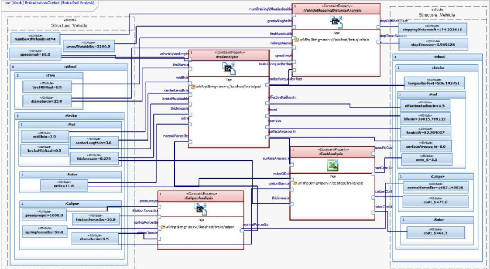
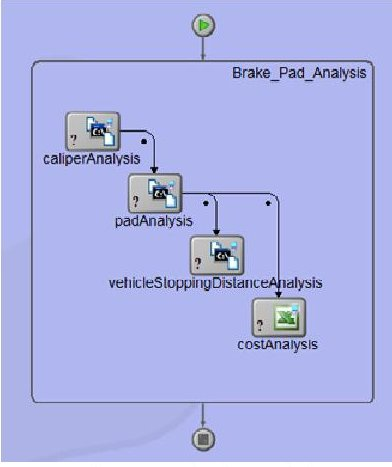
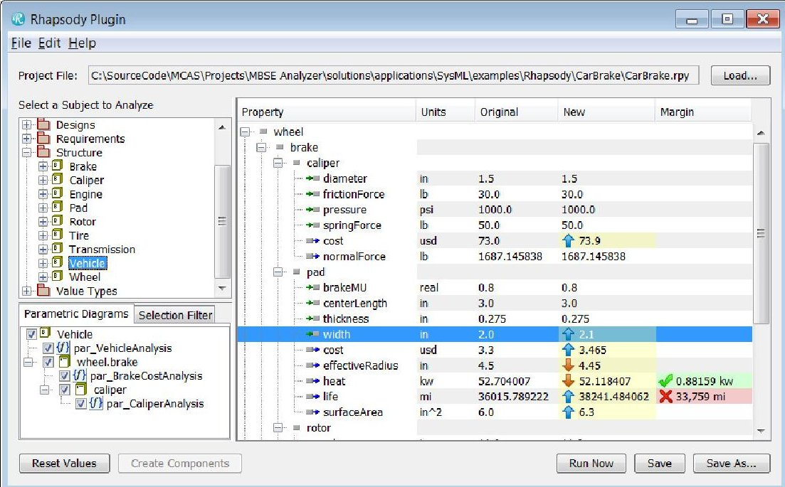
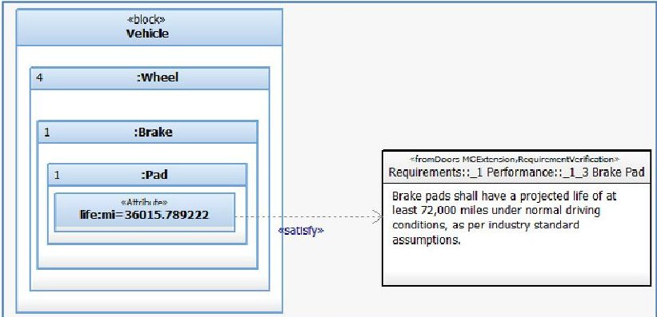
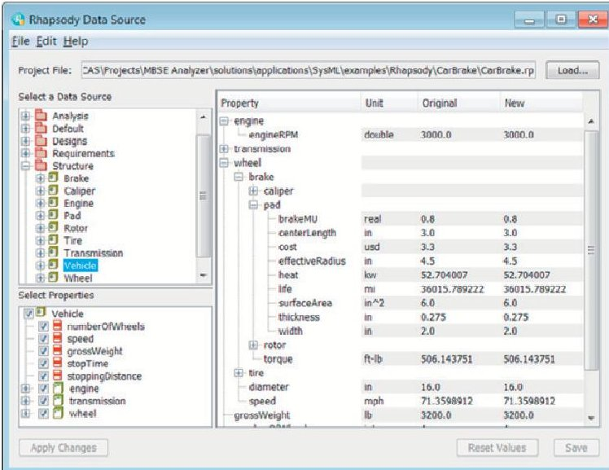
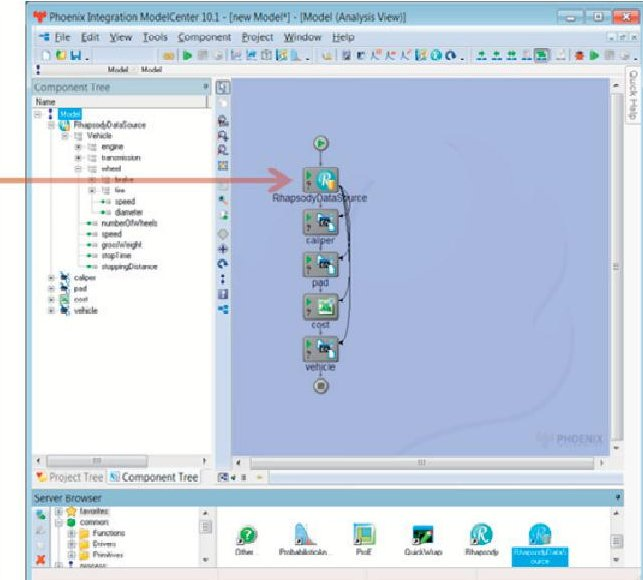
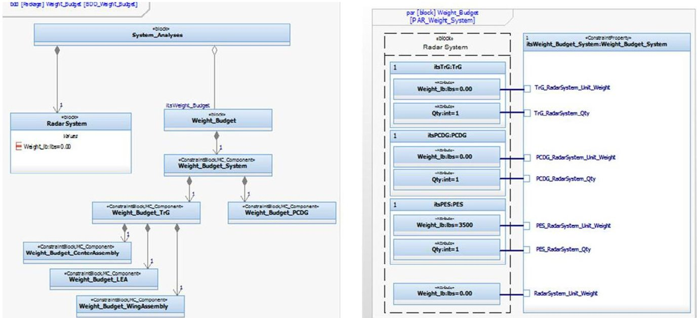
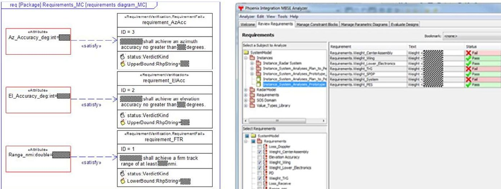

<!-- PDF_PAGE: 1 -->

Conference on Systems Engineering Research (CSER'13) Eds.: C.J.J. Paredis, C. Bishop, D. Bodner, Georgia Institute of Technology, Atlanta, GA, March 19-22, 2013.

# Application of integrated modeling and analysis to development of complex systems

Hongman Kim $ ^{a} $ $ ^{*} $ , David Fried $ ^{a} $ , Peter Menegay $ ^{a} $ , Grant Soremekun $ ^{a} $ , Christopher Oster $ ^{b} $

$ ^{a} $Phoenix Integration, 1715 Pratt Dr., Blacksburg, Virginia 24060 $ ^{b} $Lockheed Martin, P. O. Box 61511, King of Prussia, Pennsylvania 19406

## Abstract

Model-based systems engineering (MBSE) is an approach to improve traditional document-based systems engineering approach through the use of a system model. In the current practice of system developments, there exists a large gap between systems engineering activities and engineering analyses, because systems engineers and engineering analysts are using different models, tools and terminology. The gap results in inefficiencies and quality issues that can be very expensive to fix. An integrated modeling and analysis capability was developed that bridges the gap. The technical approach is based on integrating SysML modeling tools with a process integration and design optimization framework. A capability was developed to automatically generate analysis models from a system model and then execute the analytical models. The integrated toolset enables engineers to quickly evaluate system configurations using realistic analysis models and automatically check requirements compliance. The capability was applied to a number of system development projects in industry, including a ground-based radar system. The integrated approach allowed the design teams to perform continuous design, analysis, and trade studies throughout the design process, and respond quickly to changes in requirements and design configurations.

$ \textcircled{c} $ 2013 The Authors. Published by Elsevier B.V. Selection and/or peer-review under responsibility of Georgia Institute of Technology

Keywords: Model-based system development, Model-based systems engineering (MBSE), SysML, integrated analysis, requirements

## 1. Introduction

In the development of large and complex systems, systems engineering approaches are used to manage system complexity and to ensure that the delivered system will meet all requirements. Model-based systems engineering (MBSE) is an approach to improve the traditional document-based systems engineering approach through the use of

<!-- PDF_PAGE: 2 -->

a system model [1]. System Modeling Language (SysML) [2], [3] is a graphical modeling language that was created as an international standard to support MBSE. To achieve the full benefit of MBSE, there is a critical need to create links between systems engineering and disciplinary/domain engineering. Systems engineering models defined in SysML are descriptive in nature and do not directly produce analytical results. Because systems engineers and engineering analysts are using different models, tools, approaches, and terminology, they have to rely on ad-hoc communications and manual translation of design specifications and data. The gap between systems engineering and engineering analysis results in inefficiencies and quality issues that can be very expensive to fix. Hence, there is a critical need to connect SysML models with analytical models.

Currently, system level analysis from within the SysML modeling tools is generally limited to the evaluation of simple parametric equations. This means that while SysML models are capable of describing a given system configuration with a high degree of detail, it is difficult to properly evaluate how well the design meets the requirements or to perform important trade-offs between performance, cost, and risk. The lack of an easily accessible analytical capability makes it difficult for systems engineers to quickly understand consequences of inevitable changes in requirements and system configuration and take necessary actions.

On the other hand, domain/disciplinary engineers (structural, thermal, electrical, software, cost, etc.) routinely use a wide variety of sophisticated analysis tools to analyze and design the system. Because these tools are not connected to the system model, it is difficult to use the system model to setup an analysis problem or to update the system model using analysis results. If this gap can be bridged, domain/disciplinary engineers would be able to use the MBSE data repository to obtain the design information needed to create their analytical models, and conduct analyses in the support of system development [4]. Using this capability, domain/disciplinary engineers can reduce common errors and rework in their disciplinary modeling and analysis activities that are incurred due to manual data translation and use of outdated information.

An integrated modeling and analysis capability was developed that bridges the gap [5], [6]. The technical approach was based on integrating SysML modeling tools with process integration and design optimization (PIDO) framework such as ModelCenter $ ^{\circledR} $ [7]. This approach has the advantage of using the common interface provided by the PIDO framework to connect SysML with various engineering analysis tools such as CAD/CAE, legacy codes, mathematical solvers, and spreadsheets. The integrated toolset has been developed under close collaborations with engineers in industry, and it supports both of the distinct perspectives of systems engineers and domain/disciplinary analysts.

When the closely integrated model-based approach is applied to system developments in industry, opportunities emerge for faster and highly integrated analysis, and evaluations of alternative solutions. By enabling faster and more integrated analysis, critical interactions between subsystems and impacts across domain specific analyses can be determined and explored early in the product lifecycle. Given the work involved in transforming system design information to engineering analysis models, the labor required in re-executing each model as the system design matures becomes a bottle neck for continually analyzing system performance. By implementing a highly integrated analysis capability, tightly linked to system architecture, rapid analysis can be performed frequently as systems evolve, providing continuous insight into how the system could adapt and support fluctuating requirements, mission needs and environmental conditions.

In the following sections, the technical approaches and the developed toolset will be discussed along with examples. In section 2, related works are discussed. In section 3, SysML modeling approaches that were employed to describe engineering analyses are discussed and the capabilities that connect analytical models to SysML models are presented. Section 4 discusses experiences of applying the integrated modeling and analysis approach to a number of system development projects in industry. Section 5 offers concluding remarks.

## 2. Related work

The needs of connecting systems engineering models (such as SysML models) with analytical/executable simulation were recognized early on in the development of MBSE approaches. The creation of the parametric diagram for the SysML standard was motivated by such needs. SysML parametric diagrams are used to define parametric relationships among system properties. Some of the SysML modeling tools such as Rhapsody $ ^{\circledR} $ and MagicDraw $ ^{\circledR} $ provide analytical capabilities that solve the parametric diagram [8], [9]. Since the parametric relationships are solved as a system of equations, the analytical model is limited to simple equations. To be able to

<!-- PDF_PAGE: 3 -->

use more sophisticated engineering analyses, external analysis tools need to be connected to SysML models. An ongoing effort is developing a standard on the integration between SysML and the Modelica modeling language [10]. This allows simulating dynamic behavior of the SysML model through the Modelica simulation environment.

In another work [11], [12], SysML parametric diagrams were solved using external mathematical solvers, and functionalities were developed to use CAD/CAE models as analysis blocks in parametric diagrams. In a more recent work, it was suggested to use SysML models as a hub that evolves with associated domain specific models [13], [14]. Although it is useful to be able to execute individual analysis tools from SysML, this approach requires creating new conversion functionality for each analysis tool. To overcome this challenge, an approach was suggested that integrates SysML with PIDO frameworks [15], where it was demonstrated converting SysML parametric diagrams to a format that ModelCenter PIDO framework can understand and performing design space exploration. Since a PIDO framework can interface with diverse engineering analysis tools, this approach greatly simplifies the development of the conversion functionality from SysML to analytical models.

Authors took a similar approach of integrating SysML modeling tools with ModelCenter framework to connect SysML models and analytical capabilities [5], [6]. The work aimed at developing integrated modeling and analysis capabilities that will support distinct perspectives of systems engineers and domain/disciplinary engineers. Systems engineers are mainly concerned with system architecture and system level trade-offs, and are not necessarily interested in the details of engineering analyses. On the other hand, domain/disciplinary engineers are responsible for creating engineering analysis models that accurately represent the current design but do not necessarily understand details of the SysML model. The integrated toolset used a common graphical user interface that could be launched either from a SysML tool (for systems engineers) or from a PIDO framework (for domain/disciplinary engineers), allowing engineers to work with tools and environment that are familiar to them.

## 3. Technical approach

The integrated modeling and analysis capability is based on a few general principles. First, the capability needs to support models of different levels of abstraction. SysML provides a number of modeling constructs to support model abstraction, but model abstraction needs to encompass analysis models, as well. Second, a right balance needs to be sought between generic systems engineering models and domain specific models, because they have their own strengths and weaknesses. While SysML is very useful in defining system architecture and relationships, there are many specialized modeling and analysis tools for specific domains. Compared to generic SysML models, domain specific models can be more effective to accurately describe particular aspects of a system. Third, engineering analyses need to be better related to the context of overall system development. It is easy to lose track of the big picture when performing analyses in the development of a complex system. Fourth, both top-down and bottom-up approaches are needed in the creation of models. SysML models are typically created using a top-down approach, evolving from high level abstractions to more details. But SysML models may need to be updated based on inputs from domain/disciplinary engineers who are responsible for creating analysis models.

In this section, the technical approach is discussed in detail. So far, Rhapsody and MagicDraw SysML tools have been connected with the PIDO framework. A common graphical user interface was created that is shared by the different SysML tools, providing the same user experience. In this work, the technical approach is explained using the Rhapsody integration.

## 3.1. Definition of engineering analysis in SysML

SysML was extended to accurately model analysis components that will be run in the PIDO framework. Several new stereotypes were defined and they were packaged into a profile. MC_Component stereotype was defined to specify the location of an executable analysis model for a constraint block (e.g., analysis block). MC_Variable stereotype was defined to create mapping between SysML ports (e.g., parameters) and variables in analysis models. InOut enumeration is used to specify causality (input or output) of parameters that are stereotyped by MC_Variable. In this work, engineering analyses are used to automatically check requirements conformance. RequirementVerification stereotype can be applied to requirement blocks for that purpose. The stereotypes and their usage will be discussed in more detail in following sections.

SysML parametric diagrams are used to specify quantitative relationships among system properties. A parametric

<!-- PDF_PAGE: 4 -->

diagram uses analysis blocks (called constraint blocks) that represent physical or logical relationships between system properties in the model. However, the out-of-the-box capability of constraint block is limited to algebraic equations. To overcome this limitation, SysML constraint blocks are extended so that they point to black box analyses that can be scripts, spreadsheets, CAD/CAE tools, or legacy analysis codes. In this work, analysis models are hosted by Analysis Server $ ^{\circled{r}} $ , which is capable of sharing engineering analyses and running them remotely. Each black box analysis hosted by Analysis Server is identified by a URL (Uniform Resource Locator). The MC_Component stereotype was used to associate the URL with constraint blocks.

Figure 1 (a) is a parametric diagram created for a brake pad example [5]. The diagram uses four constraint blocks including a cost analysis based on an Excel spreadsheet, and analyses for pad, caliper, and stop distance that were based on C++ programs. Each constraint block was specialized by the MC_Component stereotype and was marked with an icon (e.g., Excel) that indicates the type of the analysis model behind the constraint block.

(a) Parametric diagram for a brake pad analysis.

Figure 1: Parametric diagram is automatically translated to analytical model.

(b) Analysis model

Binding connectors in parametric diagrams represent equality relationships between system properties. In principle, the equality relationships are non-causal and binding connectors do not make distinction between input and output parameters. To solve a parametric diagram with non-causal relationships, a system of equations needs to be solved. However, this approach is limited to the use of simple equations and is not easily applicable when black box engineering analyses are used. Back-solving for inputs from outputs is not a trivial task for many engineering analyses. In this work, therefore, each parameter of a constraint block is explicitly defined as an input or an output according to how the parameter is used in the black box analysis.

## 3.2. Automatic generation of analysis models

The parametric diagram defined in Figure 1(a) has necessary information to create an analysis model that can be executed through the PIDO framework. Constraint blocks are translated to analysis components and binding connectors are translated to links among variables of analysis components. A capability was developed that automatically creates an analysis model from a parametric diagram. The capability was developed as a SysML plug-in to the PIDO framework. The translation is performed using APIs of SysML tools and the PIDO framework without relying on a formal model transformation. The SysML plug-in allows selecting a parametric diagram and automatically generates an analysis model. Figure 1(b) shows the analysis model generated from the parametric diagram. When a corresponding analysis model is created, the plug-in lists system properties used in the parametric diagram (Figure 2). Users can change input values and run the analysis to compute performance and cost metrics for different system configurations.

<!-- PDF_PAGE: 5 -->

It should be noted that the automatically generated model is connected to the SysML model. This approach allows using the SysML model as an authoritative source of design information for engineering analyses. Input parameter values are initialized from the values defined in the SysML model. This allows domain/disciplinary engineers to set up their analysis models quickly, avoiding potential errors in manual data translation. The SysML plug-in also provides a capability to update the SysML model using new values computed from the analysis model. Another advantage of this approach is that trade study tools available in the PIDO tool can be used to evaluate many design alternatives. For example, design of experiments technique can be used to generate many design candidates and trade space visualization techniques can be used to identify promising designs. Single objective or multiobjective optimization techniques can be used as well, to search for best designs in an automated fashion. When a new design is found that satisfies requirements and design targets, the plug-in allows updating the current design in the SysML model using the new design.

Figure 2: SysML plug-in executes the analysis model that was automatically generated from a parametric diagram.

Figure 3: Satisfy relationships are used to relate system properties to requirements.

## 3.3. Requirements modeling

One objective of this work was to develop techniques to use engineering analyses to check requirements compliance. A challenge is that requirements are typically defined in textual formats that require human interpretation before they can be verified in an automated fashion. This work took an approach of manually interpreting requirements and attaching lower/upper bounds to each requirement. Consider a textual requirement: "The brake pad shall have a projected life of at least 72,000 miles under normal driving conditions." When it is

<!-- PDF_PAGE: 6 -->

interpreted, a lower bound of 72,000 miles can be attached to the requirement. Then, the requirement can be verified by comparing the lower bound with the pad life computed by an engineering analysis.

SysML tags were used to attach lower/upper bounds to requirements. Figure 3 shows the example of the brake pad life requirement, for which a LowerBound tag was created. The requirement is related to the life property of the pad through a satisfy relationship. Since the value of the life property is smaller than the lower bound, the requirement is not satisfied. A capability was created that automatically checks compliance status of requirements. If a requirement is not satisfied, it is automatically highlighted with a red "X" icon as seen in Figure 2.

## 3.4. Evaluating designs from SysML modeling tool environment

The SysML plug-in is suited to the needs of engineering analysts, who may prefer accessing SysML models from the PIDO environment. On the other hand, systems engineers may want to work within SysML tools. To support the latter, a custom tool called MBSE Analyzer was created for SysML tools to execute parametric diagrams directly from the SysML environment. Using the tool that is launched from Rhapsody or MagicDraw, users can browse and select a parametric diagram for evaluation. When the selected parametric diagram is evaluated, the tool will create an integrated analysis model behind the scenes, execute it, and report analysis results. The analysis results can be used to update the SysML model when desired.

MBSE Analyzer also has a capability to evaluate a set of related parametric diagrams, according to an object oriented modeling approach called composable objects [11]. A parametric diagram defines analytical relationships among the properties of a block. In this work, parametric diagrams are considered as a part of the definition of a block. SysML blocks become reusable objects that contain not only properties, but also analytical relationships. When the block is used as a part of another block, the analytical relationships (or the parametric diagram) automatically apply to the part. This provides a natural way of relating analysis models to a physical entity. A capability was created to evaluate a set of related parametric diagrams simultaneously for a block.

## 3.5. Using SysML models as data source for engineering analyses

The main focus of the current work is on using SysML parametric diagrams to connect to engineering analyses. This requires someone to set up parametric diagrams. For domain/disciplinary engineers who are not familiar with SysML, creation of parametric diagrams can be a challenge. Therefore, there is a need to lower the barrier for engineers who want to utilize SysML models. One approach was to import existing engineering analysis models into SysML and automatically create parametric diagrams [5]. Another approach would be using a SysML block or an instance specification as a data source to set up engineering analyses. This does not require creation of parametric diagrams; it is up to engineers how to set up analytical models starting from the imported SysML data.

Figure 4: SysML data source plug-in translates a SysML block to a database component in ModelCenter.

<!-- PDF_PAGE: 7 -->

To support this use case, a new SysML plug-in was created for ModelCenter, where a SysML model can be used as a database of system information. Figure 4 shows an example of the SysML data source plug-in. In the example, the Vehicle block was selected as a data source. The lower left tree shows parts and properties of the selected block and the user can select properties to import. The table displays a list of the SysML properties that are selected, along with their current values. The selected SysML properties will be translated to variables of the SysML component in ModelCenter. The SysML property values will be linked to downstream analysis components as shown in the right hand side of Figure 4. The user can perform what-if studies by changing SysML property values and run the analysis model. When desired, new property values can be published back to the SysML model. The SysML data source plug-in provides a simpler way for engineering analysts to access systems architecture models. Combined with the formal approach of using parametric diagrams, the toolset provides a greater flexibility in deploying the integrated model framework in diverse engineering teams.

## 4. Application to industry pilot programs

In order to evaluate the value of a coupling between a system architecture model and detailed cost and performance analysis models, Lockheed Martin partnered with Phoenix Integration to pilot the technique on multiple pilot programs including unmanned underwater vehicles, radar systems, IT networks and armored ground vehicles.

## 4.1. Use Cases of the Integrated Model Framework

Being centered on integrating varied analytical models with an underlying systems architecture model, the pilot projects applied the technology for a number of use cases. The first use case leveraged the integrated model framework to support rapid trades and analyses of a system for conceptual design. The second use case leveraged the model framework to investigate compliance of a given architecture to the system requirements baseline. The third use case applied the framework to support traceability from requirements to design and to parametric assessment of key performance metrics. The last use case leveraged the framework for change impact assessment at the systems architecture level.

Traditionally, engineering analyses to support these use cases would be done independently by subject matter experts within each domain. For example, cost analysis can be performed using parametric cost modeling tools such as SEER or PRICE, but such analysis is not fully integrated with physics-based performance analysis tools or with the underlying systems architecture. Through these pilots, the teams developed an enhanced architecture assessment and optimization methodology centering on the integration between SysML-based systems architectures captured in Rhapsody and analysis models in ModelCenter. Analytical tools integrated into the environment varied among the pilots given different needs per use case and problem domain, and they included cost modeling tools such as SEER, mechanical design and analysis tools such as CREO and ANSYS, as well as more general purpose tools such as Excel, Matlab, Simulink and STK.

A goal of the first use case was to enable very rapid design trades of realistic mission scenarios, leveraging the depth of design experience available in Lockheed Martin. The pilot team assessing this use case began by developing a common reference architecture defining the major architectural elements, attribute relationships and design constraints of their system along with a library of reusable architectural elements. This reference architecture served as a basis for design alternative generation, constraining the design trade space and ensuring design elements were kept synchronized during the design assessment. Additionally, the pilot team captured appropriate mission scenarios within the SysML environment leveraging activity diagrams such that all performance assessments were made in the context of a given mission need. This underlying architecture model, integrated with ModelCenter, provided the backbone for a very rapid design exploration capability, ultimately allowing the engineering team to analyze thousands of architecture variants in the same time period previously allocated for less than ten variants. This enabled the team to pinpoint optimized solutions for specific key parameters such as cost, performance or reliability, or a best-value solution (i.e., multi-objective optimization) given the customer's mission need.

For the rest of the use cases, the pilot teams were specifically interested in the application of this technology beyond conceptual design, supporting efforts from preliminary design through operational sustainment. This led to the use of both single threaded analysis (i.e., evaluation of a SysML parametric diagram linked to one or more

<!-- PDF_PAGE: 8 -->

requirements in support of early verification), and architecture configuration optimization. In the single threaded analysis approach, an assessment can be performed as a systems engineer or an architect is building out system design specifications, or on a mature model baseline that is undergoing changes in requirements, mission, or system architecture. This method seemed to present the most common case for our design engineers through a program lifecycle, whereas the use of design optimization would be most useful in early phases while the initial technical baseline is being determined given a set of mission and performance constraints. This integrated analysis enabled better data consistency across multiple teams since the systems architecture model provided the ground truth for the system design and analysis models were more readily reused. This resulted in clear savings in terms of labor hours.

The ability to rapidly analyze a system design space is critical to achieving affordability goals demanded by today's contracting climate, both in initial conceptual design to ensure the best value architecture is selected, and also in support of change impact assessments. Central to a model-based systems development approach is the support for requirements traceability through the architecture into component level design, which can be used to quickly assess what is impacted due to a change in requirements. Integrating this rapid assessment framework can additionally provide insight into how much of an impact the change will have. Coupling rapid analysis with the strengths of model-based systems development has opened new doors for engineers to make fully informed decisions in the design trade space.

## 4.2. Application to a Radar System

This section describes application of the integrated model framework to a ground-based radar system. This pilot demonstrated evolution of a systems engineering model and systems analysis models by tightly integrating system level cost and performance analyses with a holistic systems architecture model. Use of a formal architecture centric approach to system analysis enabled the team to truly begin moving verification "to the left" in the system development lifecycle. Additionally, the integration approach provided by ModelCenter enabled the team to reuse many existing analysis tools already in use across the enterprise. Each of the four use cases described above were investigated as part of this pilot, providing an assessment of the technology for concept development and trade-off studies, initial systems design and assessment, and system change impact assessment.

The pilot began with two concurrent thrusts. First, an existing systems architecture model, defined in SysML, was extended to include the viewpoint of systems analysts as described by parametric diagrams. Second, radar systems analyses were integrated into the systems engineering ecosystem. The analyses included common radar performance analyses such as Blake charts and lightening charts, budget tracking spreadsheets, and a high fidelity home grown radar performance assessment tool. The Excel based budget spreadsheets racked up cost, weight, power, system noise, temperature and loss.

Figure 5: Weight budget analysis was defined using parametric diagrams and analysis contexts.

<!-- PDF_PAGE: 9 -->

For each analysis, an analysis context block was created as a container for all parts to be used in the analysis, and analysis contexts were organized using SysML packages. Figure 5 shows an example of the weight budget analysis of the radar system. Parametric diagrams are used to link system properties to SysML constraint properties representing executable analyses in ModelCenter. At each level of decomposition, a certain performance value can be allocated to a part of the system. Then, the engineer who is responsible for the part can execute the corresponding parametric diagram, using the allocated performance value and lower-level inputs that are under his or her control. The cycle then repeats, with the further allocation down to the next level of decomposition. The SysML model provides a graphical representation of the rigorous decomposition approach that ensures all system performance parameters are properly decomposed and computed. At any appropriate level, the owner of the given level of decomposition can manually vary the inputs to the analysis, re-run the analysis, and push the resulting changes back to the SysML model. This allows rapid what-if analysis, supporting change impact assessments.

The pilot team connected system requirements to both the system design and system analysis. Requirements captured in DOORS were loaded into the SysML model. Using the techniques discussed in section 3.3, requirements were extended by specifying lower or upper bounds and linked through satisfy relationships to system properties. When the properties are referenced in parametric diagrams, the related requirements are automatically identified. This traceability allows users to quickly assess requirements compliance status of the design as illustrated in Figure 6, where textual requirements are used as quantifiable and measurable data sets.

Figure 6: Requirements compliance analysis was performed by executing parametric diagrams (Note: proprietary data is masked in the image).

## 5. Concluding Remarks

Techniques and tools were developed that bridge the gap between systems engineering models and engineering analysis. This was accomplished by connecting descriptive SysML models with engineering analysis models that can be executed through a PIDO framework. The key element of the technology was automatically generating analysis models from a SysML model. By specifying engineering analyses in a SysML model along with their traceability to system properties, the SysML model provides a complete picture of the relationship between the system model and engineering analyses. The capability supports distinct perspectives of systems engineers who need to evaluate system architecture and domain/disciplinary engineers who are performing subsystem analysis in the support of system development. The integrated capability was used to automatically check requirements compliance status using realistic analysis models.

The integrated modeling and analysis technology was applied to a number of pilot projects including unmanned underwater vehicles, radar systems, IT networks and armored ground vehicles. While centered on integrating analytical models with an underlying systems architecture model, the pilots applied the technology for different use cases. The use cases represented varied needs at different stages in system developments, from rapid trades of conceptual designs, requirements compliance analysis of a given architecture to the system requirements baseline, to rapid assessment of impacts of requirements/design changes. This integrated analysis enabled better data

<!-- PDF_PAGE: 10 -->

consistency across multiple teams and more reuse of analysis models, which resulted in savings in terms of labor hours. Another benefit of the approach was to enable requirements traceability analysis, complete with not only what is impacted but also how much is impacted.

## Acknowledgements

Work of the authors associated with Phoenix Integration was funded by the DoD DARPA SBIR Program under contracts of W31P4Q-11-C-0008 and W31P4Q-12-C-0049.

## References

[1] Fisher, J., "Model-Based Systems Engineering: A New Paradigm," INCOSE Insight, Vol. 1 (3), pp. 3-4, 1998.

[2] OMG System Modeling Language, See http://www.omgsysml.org.

[3] Friedenthal, S., Moore, A., and Steiner, R., A Practical Guide to SysML - The System Modeling Language, Elsevier Inc., 2009, ISBN 978-0-12-378607-4.

[4] Mosier, G., "Parametric Design and Analysis to Support Model-Based Systems Engineering Using SysML," NASA Tech Briefs, October, 2010, p. 80.

[5] Kim, H. Fried, D., Menegay, P., and Soremekun, G., "Integrated Modeling and Analysis to Support Model-Based Systems Engineering," Proceedings of the ASME 2012 11th Biennial Conference on Engineering Systems Design and Analysis, ESDA-2012- 83017, Nantes, France, July 2-4, 2012.

[6] Kim, H., Fried, D., and Menegay, P., "Connecting SysML Models with Engineering Analyses to Support Multidisciplinary System Development," 14th AIAA/ISSMO Multidisciplinary Analysis and Optimization Conference, AIAA-2012-5632, Indianapolis, IN, September 17-19, 2012.

[7] Phoenix Integration, Inc., "Improving the Engineering Process with Software Integration," a white paper, 2002, See also http://www.phoenix-int.com.

[8] Bleakley, G., Lapping, A., and Whitfield, A., "Determining the Right Solution Using SysML and Model Based Systems Engineering (MBSE) for Trade Studies," INCOSE International Symposium, Denver, CO, June, 2011.

[9] NoMagic, MagicDraw UML/SysML, See also http://www.magicdraw.com

[10] Paredis, C. J., Bernard, Y., Burkhart, R. M., Koning, H. D., Friedenthal, S., Fritzson, P., Rouquette, N. F., and Schamai, W., "An Overview of the SysML-Modelica Transformation Specification," INCOSE International Symposium, Chicago, IL, July, 2010.

[11] Peak, R. S., Burkhart, R. M., Friedenthal, S. A., Wilson, M. W., Bajaj, M., and Kim, I., "Simulation-Based Design Using SysML - Part 1: A Parametrics Primer," INCOSE International Symposium, San Diego, CA, 2007.

[12] Peak, R. S., Burkhart, R. M., Friedenthal, S. A., Wilson, M. W., Bajaj, M., and Kim, I., "Simulation-Based Design Using SysML - Part 2: Celebrating Diversity by Example," INCOSE International Symposium, San Diego, CA, 2007.

[13] Bajaj, M., Zwemer, D., Peak, R., Phung, A., Scott, A., and Wilson, M., "Satellites to Supply Chains, Energy to Finance - SLIM for Model-Based Systems Engineering - Part 1: Motivation and Concept of SLIM," INCOSE International Symposium, Denver, CO, June 20-23, 2011.

[14] Bajaj, M., Zwemer, D., Peak, R., Phung, A., Scott, A., and Wilson, M., "Satellites to Supply Chains, Energy to Finance - SLIM for Model-Based Systems Engineering - Part 2: Applications of SLIM," INCOSE International Symposium, Denver, CO, June 20-23, 2011.

[15] Min, B. I., Kerzhner, A. A., and Paredis, C. J., "Process Integration and Design Optimization for Model-Based Systems Engineering with SysML," Proceedings of the ASME 2011 International Design Engineering Technical Conferences & Computers and Information in Engineering Conference, DETC2011-48453, Washington DC, Aug., 2011.