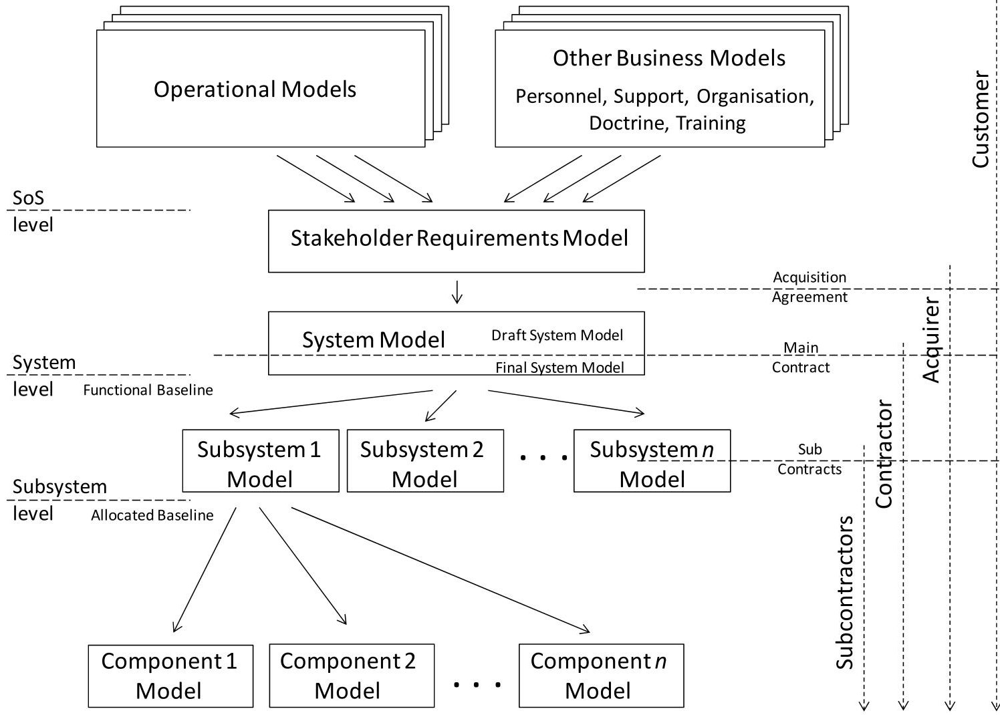

<!-- PDF_PAGE: 1 -->

2013

# Application of MBSE to requirements engineering - Research challenges

Mike Ryan

University of New South Wales

Stephen Cook

University of South Australia

William R. Scott

University of Wollongong, wscott@uow.edu.au

Follow this and additional works at: https://ro.uow.edu.au/eispapers

Part of the Engineering Commons, and the Science and Technology Studies Commons

<!-- PDF_PAGE: 2 -->

# Application of MBSE to requirements engineering - Research challenges

## Abstract

Models and simulations have always played an important role in engineering and systems engineering. Physical scale models, full-sized models, and computer models are commonly used in all forms of engineering and design. In recent times, interest in modelling has increased to span the full system lifecycle and there has been a significant focus on Model-based Systems Engineering (MBSE). The extension of formal modelling into all phases, and particularly the conceptual design phase, of a system development is a significant step and proponents of MBSE suggest that it will provide considerable benefits. The application of modelling requires considerable care, however. A model, by its nature, is only an abstraction of a real-world domain in which certain parameters have been chosen by the modeller for implementation in the model. Since it is not possible to model all of the parameters of the real world, a model is therefore always an abstraction (deliberately or not) of a real-world domain. The specific nature and level of abstraction mean that a model is only able to serve the purpose for which it is designed- application of the model outside those constraints can be misleading at best and potentially dangerous. In this paper we focus on the use of MBSE to support requirements engineering. We first describe a suitable framework within which to consider the utility of MBSE to support requirements engineering. We then outline the principal activities undertaken as part of requirement engineering and identify the ability of MBSE to support each of those activities. We conclude by identifying a range of challenges that must be addressed before MBSE can be applied usefully to requirements engineering.

## Keywords

## Disciplines

research, -, engineering, challenges, requirements, application, mbse

Engineering | Science and Technology Studies

## Publication Details

Ryan, M., Cook, S. & Scott, W. (2013). Application of MBSE to requirements engineering - Research challenges. Systems Engineering/Test and Evaluation Conference (pp. 1-11). Australia: Sapro.

<!-- PDF_PAGE: 3 -->

To share, promote and advance the best of Systems Engineering

# Application of MBSE to Requirements Engineering Research Challenges

Michael Ryan

School of Engineering and IT

Stephen Cook

University of New South Wales

William Scott

Defence and Systems Institute

Defence and Systems Institute

Canberra ACT 2600

m.ryan@adfa.edu.au

University of South Australia

University of South Australia

Mawson Lakes SA 5095

Mawson Lakes SA 5095

Stephen.Cook@unisa.edu.au

William.Scott@unisa.edu.au

Abstract. Models and simulations have always played an important role in engineering and systems engineering. Physical scale models, full-sized models, and computer models are commonly used in all forms of engineering and design. In recent times, interest in modelling has increased to span the full system lifecycle and there has been a significant focus on Model-based Systems Engineering (MBSE). The extension of formal modelling into all phases, and particularly the conceptual design phase, of a system development is a significant step and proponents of MBSE suggest that it will provide considerable benefits.

The application of modelling requires considerable care, however. A model, by its nature, is only an abstraction of a real-world domain in which certain parameters have been chosen by the modeller for implementation in the model. Since it is not possible to model all of the parameters of the real world, a model is therefore always an abstraction (deliberately or not) of a real-world domain. The specific nature and level of abstraction mean that a model is only able to serve the purpose for which it is designed—application of the model outside those constraints can be misleading at best and potentially dangerous.

In this paper we focus on the use of MBSE to support requirements engineering. We first describe a suitable framework within which to consider the utility of MBSE to support requirements engineering. We then outline the principal activities undertaken as part of requirement engineering and identify the ability of MBSE to support each of those activities. We conclude by identifying a range of challenges that must be addressed before MBSE can be applied usefully to requirements engineering.

## INTRODUCTION

Models and simulations have always played an important role in engineering and systems engineering. For example, in the development of a land vehicle, wind tunnels are used to investigate the aerodynamic performance of vehicles, first with scale models and then with full-sized models. Latterly, with increases in processing power at affordable prices, computer models can be used to create virtual vehicles in virtual wind tunnels. These virtual approaches have the advantages of not having to build expensive physical models and facilities, as well as providing new design opportunities that arise as recursive algorithms can be developed to vary the vehicle shape until the desired aerodynamic properties are achieved. At lower levels, inside the system, this pattern repeats with physical modelling being commonly augmented with computer-aided design, modelling simulation, and computer-aided manufacturing.

For software systems, the Unified Modeling Language $ ^{\mathrm{TM}} $ (UML $ ^{\circledR} $ ), for example, defines "... a

<!-- PDF_PAGE: 4 -->

graphical language for visualizing, specifying, constructing, and documenting the artefacts of distributed object systems" (OMG UML). At a higher level of system abstraction, the OMG Systems Modeling Language (OMG SysML $ ^{\mathrm{TM}} $ ) provides "... a general-purpose graphical modeling language for specifying, analyzing, designing, and verifying complex systems that may include hardware, software, information, personnel, procedures, and facilities" (OMG SML).

In recent times, interest in modelling has increased to span the full system lifecycle and there has been a significant focus on Model-based Systems Engineering (MBSE), which the International Council on Systems Engineering (INCOSE) defines as "... the formalized application of modeling to support systems requirements, design, analysis, verification, and validation activities beginning in the conceptual design phase and continuing throughout development and later lifecycle phases." (INCOSE 2007)

The extension of formal modelling into all phases, and particularly the conceptual design phase, of a system development is a significant step. Projects have long been plagued by poor requirements elicitation/generation, poor requirements management, poor configuration management, poor communications during transition between responsible parties, and many other issues. Proponents suggest that MBSE will provide the following benefits (Friedenthal et al 2007):

- Improved communications facilitated by models that can be evaluated for consistency, completeness, correctness.

- Improved ability to cope with complexity in systems and to analyse change impacts.

- Improved system quality.

- Improved knowledge capture and reuse leading to reduced cycle time and lower maintenance costs.

- Improved capacity to teach and learn SE, to integrate new team members, to minimize loss of knowledge as team members leave, to establish shared mental models.

While these benefits, and potentially many more, are promised by MBSE, the application of modelling requires considerable care. A model, by its nature, is an abstraction of a real-world domain in which certain parameters have been chosen by the modeller for implementation in the model. The particular parameters of the model are chosen by the modeller in order to focus on a specific aspect of the domain. It is not possible to model all of the parameters of a real-world domain for two main reasons: it is generally not possible to identify, to the necessary level of resolution, all of the pertinent parameters; and the complex interaction between parameters is not always known (or even knowable). A model is therefore only ever an abstraction (deliberately or not) of a real-world domain. The nature and level of abstraction will depend on the purpose for which the model is built. Some models are focused on a specific aspect of the domain; some focus on the whole domain using a set of abstracted parameters that have been chosen to filter out the detail of the domain; and some may focus on a combination of upper-level abstraction and a certain detail for selected aspects.

When a model is executable (often with respect to time), the result is a simulation. The caution associated with models is repeated for simulations with the additional concern that, while modelling real-world parameters is difficult, managing time-based parameters (and their quantization) is even more complex.

So, despite the great potential of modelling and simulation to support systems engineering, a cautionary note must be offered all models are wrong but some are useful (Box 1987). A model is defined by its fitness-for-purpose and is only able to serve the purpose for which it is designed application of the model outside those constraints can be misleading at best and potentially dangerous. Additionally, the development of models and simulations is often as a result of complex projects in their own rights we must be careful to avoid trying to solve the complexity of system development by implementing a model-based process that is just as complex as the problem it proposes to solve.

As part of an MBSE endeavour, models can be used to address a wide range of systems engineering processes. In this paper we examine the ability of MBSE to support requirements engineering. We

<!-- PDF_PAGE: 5 -->

first describe a suitable framework within which to consider the utility of MBSE in support of requirements engineering. We outline the principal activities undertaken as part of requirement engineering and identify the ability of MBSE to support each of those activities. We then identify a range of challenges that must be addressed before MBSE can be applied usefully to requirements engineering.

## APPLICATION OF MBSE TO REQUIREMENTS ENGINEERING

In this paper we investigate requirements engineering in MBSE through consideration of the simple framework for system development illustrated in Figure 1. Within that framework, the stakeholder requirements are elicited/generated bounded by the context of the system-of-systems of which the system-of-interest is an element, taking into account the operational environment as well as the other business inputs such as personnel, organisations, training, doctrine and facilities. At the system level, the stakeholder requirements model is used to facilitate the capture of requirements and then their visualisation and validation. The system model articulates the system requirements—the draft system model forms the basis for tender; the final system model is synthesised by the tender negotiation process. The functional baseline containing the system model (which, in Defence projects in particular, may be further divided into a mission system model and a support system model) is then translated into the allocated baseline containing the subsystem models, which are then further broken down into component models (there will invariably be intervening models for assemblies and subassemblies, but only three levels of system decomposition are shown here for ease of consideration).

Figure 1. A simple system development framework for consideration of MBSE support.

Figure 1 illustrates that the customer is normally responsible for the operational models and the other business models. The customer is also normally responsible for the development of the stakeholder requirements model as well as the draft system specification that is the centrepiece of the statement of

<!-- PDF_PAGE: 6 -->

work that forms the basis for a tender. The final system model is normally synthesised through the tendering process, either at contract negotiation time, or shortly after. Responsibility then transfers to the contractor who is responsible for the functional-to-physical translation that translates the system model in the functional baseline into a number of subsystem models in the allocated baseline. The contractor (or most likely, various subcontractors) then develops the assembly, subassembly and component models that complete the system design.

## MBSE Support for Requirements Engineering

A useful requirements engineering process comprises a set of activities intended to establish, validate, and maintain a set of system requirements. There is no standard, universally agreed, requirements engineering process—in fact, few organizations have mature, explicitly defined, standardized processes for requirements development. However, requirements engineering activities are generally considered to include: requirements elicitation and generation, requirements analysis and negotiation, requirements allocation, requirements validation, and requirements maintenance (Kotonya & Sommerville 1998). These activities are used in the following sections to examine the potential of MBSE to support requirements engineering.

## MBSE Support for Requirements Elicitation/Generation

Requirements elicitation and generation activities involve working with customers and end users to investigate the problem to be solved, to identify the functional requirements, non-functional requirements, the required performance of the system, and any constraints that may apply. MBSE has the ability to support requirements elicitation/generation in the following ways:

- Support for capturing requirements in an appropriate format.

- Support for generation, investigation, and validation of use cases (operational scenarios).

- Support for various requirements elicitation methods (such as workshops and interviews).

- Support for simulation and visualisation of the stakeholders' operational environment.

- Support for functional allocation and grouping.

- Support for feasibility analyses and trade studies.

- Support for abstraction of system information at any level.

## MBSE Support for Requirements Analysis and Negotiation

Requirements collected from users must be analysed to obtain an adequate understanding of the requirements, and they need to be negotiated so that the stakeholders agree to a set of well structured requirements. Requirements Analysis should aim to uncover requirements that are overlapping inconsistent, infeasible, or unreasonably expensive to implement (or if relaxed a little could lead to a far better overall system solution). MBSE is able to support requirements analysis and negotiation in the following ways:

- Support for understanding how well the system should perform in quantitative measurable terms.

- Support for understanding the system in the context of the environment in which it will operate.

- Support for derivation of human/system interface requirements and aesthetic characteristics.

- Support for functional elaboration (decomposition and derivation) from higher-level requirements to lower-level—requirements flowdown.

- Support for tagging of requirements with additional information such as a unique identifier, short title, priority, criticality, feasibility, risk, source, type, rationale, history, and interrelationships.

- Support for analysis of subsets of requirements in order to determine areas that require further investigation and negotiation with stakeholders.

<!-- PDF_PAGE: 7 -->

- Support for trade studies.

- Support for derivation of constraints on the design.

The literature indicates that all computer-aided requirements analysis and validation tools rely on model-based strategies that are underpinned by formal knowledge representation and artificial reasoning (Reubenstein & Waters 1991, Rich & Waters 1998, Pohl et al 1994, HCI 2005, Sutcliffe et al 1998, James 2000, Maiden 1998, Scott & Cook 2008).

## MBSE Support for Requirements Allocation

Based on functional and system analysis, requirements must be allocated to functional groupings in the functional architecture and then physical groupings in the physical architecture. MBSE is able to support requirements allocation in the following ways:

- Support to investigations into comparisons of candidate system functional architectures (candidate functional groupings) to meet stakeholder requirements.

- Support to investigations into comparisons of candidate physical architectures (candidate functional-to-physical translations).

- Support for tender evaluation (if synthesis is undertaken through tendering).

## MBSE Support for Requirements Validation

Requirements must be validated to be complete, consistent and unambiguous in order to certify that the requirements represent an acceptable description of the desired system. MBSE can support requirements validation in the following ways:

- Support for the validation of individual requirements.

- Support for the validation of the set of requirements.

## MBSE Support for Requirements Management (Configuration Management)

- Support for DT&E, AT&E, and OT&E test planning and conduct.

Requirements must be managed and maintained throughout the system life cycle in order to ensure that each requirement can be justified and that changes to the requirements can be managed. MBSE is able to support requirements management in the following ways:

- Support for compliance with specified requirements engineering processes.

- Enforcement of requirements structure, syntax and semantics.

- Support for reviews (ability to provide baselines, for example).

- Support for backwards and forwards traceability between baselines.

- Support for change management (change identification, analysis, approval and implementation).

- Support for report generation.

## APPLICATION OF MBSE TO SUPPORT REQUIREMENTS ENGINEERING OPEN ISSUES

In order to achieve its great potential, the application of MBSE to system development processes requires consideration of a number of issues that will require further research. The INCOSE Systems Engineering Vision 2020 recognises a small number of inhibitors to MBSE (INCOSE 2007):

- Inherent difficulty integrating models across organizational, lifecycle, and other boundaries.

- Limitation of model/data exchange capabilities within the modelling tools.

- Limited MBSE skills.

These are, however, perhaps the least of the concerns that might be expressed with regard to the

<!-- PDF_PAGE: 8 -->

widespread use of MBSE - there are many more issues that must be resolved before MBSE can be considered to be useful on the scale anticipated by many in the systems engineering community. The following sections consider each of these issues in outline. The intention here is not to solve difficulties, nor necessarily to describe them exhaustively - rather the purpose of the paper is to note that most endeavours in MBSE are relatively naive in their consideration of the many underlying issues that currently prevent MBSE from achieving the vision set out for it by INCOSE.

## Modelling Considerations

The stakeholders' real world must be able to be represented precisely and unambiguously in the model, which has two major problems:

- The first issue is the traditional modelling problem of how to be able to 'model' the real world (particularly the soft variables) sufficiently. For example, system dynamics modelling has been available for application since the 1970s but such models have only been adopted in a very small number of environments (and even then, mostly with limited scope) despite the utility of the paradigm. More powerful modelling approaches such as agent-based modelling are gaining popularity yet they still face the issue that few stakeholders appreciate the capabilities of enterprise modelling and the benefits that ensue. This issue will need to be mitigated to enable the broader adoption of MBSE.

- The second difficulty is in how a wide range of stakeholder views can be merged in a single model to create a valid representation of the system which accommodates all of those perspectives. Although stakeholders tend to fall into a relatively small number of groups, there is still some difficulty in merging their views into a single model. There are few methodologies that would facilitate the collection, interpretation, negotiation, and management of such a collective view it should be noted that this is not merely a challenge for MBSE per se, but an enduring challenge for systems engineering and requirements engineering, particularly at the enterprise level. For example, the defence architecture frameworks comprise over sixty views to be developed each of which requires substantial investment to populate and massive overall effort to co-ordinate. Additional views are being proposed by discipline communities and there is a sense that holism is being lost as the volume of information becomes intractable. Contemporary wisdom has begun to question the benefits of investments in development of comprehensive sets of architecture views given their modest track record in influencing systems of systems development outcomes (Dahmann and Baldwin 2011).

## Data Administration

Considerable data administration effort is required if there is to be any hope of integration (horizontally and vertically) of models. MBSE endeavours will founder unless there are:

- standard schema;

- common data structures;

- standard data definitions (dictionary); and

- agreed data translations (thesaurus).

These issues have long plagued all forms of software development. While the mechanisms for solving such difficulties are relatively straightforward, few organisations have strong mechanisms that address even simple issues such as data administration. For example, if a model is to contain elements such as "operator" or "maintainer" that element must be explicitly defined in terms of skill set, training, and so on. Additionally, if models are to be shared across and among organisations, such definitions must be standard, or there must at least be a shared thesaurus that allows translation between various data elements. Even if we address one single model element such as "pilot", the vast array of differences in the nature and employment of pilots would require significant resources just to ensure a common data dictionary that contains all of the categories of pilot that would be required in order to model adequately that single small aspect of the real world.

<!-- PDF_PAGE: 9 -->

While the solution is simply one of definition and subscription, few organisations have the resources to devote to data administration, and few projects feel obliged to subscribe to a standard definition. Once multiple organisations are involved, the issues of common standards is raised—and then the issue of how to standardise standards among the various standards organisations.

## Security Issues

Classification of information must be taken into account in the system design as well as its operation as multiple levels of security, or at least privacy, are required.

- The system must support access rights to facilitate traceability—for example, someone must define the right that a subcontractor (at the lowest level of design) has to information in the parent system model, the stakeholder requirement model, or even perhaps, the operational and other business models in the customer domain. It is very doubtful that subcontractors would have any native right to view all information in the operational domain, so views must be able to be customised. Even if someone has the appropriate clearance to view any or all models, there is still the simple need-to-know.

- It is actually very doubtful that there would ever be one single person who would have sufficient rights (or indeed the need to know) to access all of the data. There must be mechanisms therefore to 'sanitise' data in different ways and export that subset of data to different users—this also has significant configuration management issues, as discussed later.

- The ability to support various levels of access (and the ability to subset data) means that data must be tagged in a variety of ways in order to facilitate the implementation of a range of business rules. The end result is a very complicated database and a set of models that must support difficult aspects such as the classification of diagrams. Additionally, models, diagrams, paragraphs, sections must be classified in terms of the highest level of classification of constituent elements, and then there must be the rules for aggregation—few organisations would be comfortable with models of their business processes being readily available to competitors.

- Again, standards are required to ensure that there are common views of access rights agreed among nations, contractors and customers.

## Legal Framework

The current legal paradigm utilises documents as the medium for legal agreements. Thus models of systems need to be rendered into a document form to satisfy the paradigm and there are good illustrations of how this can be achieved (Robinson et al 2011). In order to realise the full potential of MBSE, there needs to be a framework for legally recognising baselined models in contractuallybinding agreements. For this to be achieved, the issues on data administration, security, data ownership, and change and access management need to be resolved with standardised solutions; this is some way off.

## Data Ownership

MBSE endeavours will also founder unless appropriate mechanisms are developed to handle IP and to address the complex issues of ownership of the data, the models and the tools. For the MBSE vision to be achieved, each customer would have to have the exclusive right to use, and to pass on to any future contractor/subcontractor, any model developed as part of any contract—this has not traditionally occurred as contractors are not likely to agree to allow models of their proprietary systems to be made freely available to their competitors. As a corollary, few customers are willing to allow anyone to make use of their proprietary models. These commercial considerations are not likely to change in the future (Do et al 2012).

## Change Management

The process illustrated in Figure 1 is very dynamic - it could be safely assumed in the modern world that one or more elements of the models (operational, business, stakeholder requirements, and so on) will change on any given day. Those changes must be considered carefully. In some cases, the change

<!-- PDF_PAGE: 10 -->

is required to flow through from, for example, a change in a personnel model to the subsystem model accommodating that aspect of the system. If there are a number of fixed-price contracts between the business model owner and the subsystem model owner, considerable configuration management is required to ensure that changes are made in a controlled manner and are synchronised with other efforts such as contract administration. The process must also accommodate the inability of a project to fund the change which would result in a discrepancy between the subsystem model and the real world (and any other models that may or may not have been updated).

Change management issues include:

- Any change to any model and data (and perhaps even tools) must be controlled, such that an element of the model can only be changed if permission is granted by the change control board.

- A model element cannot be saved with changes with the same name - a new instantiation of the element must be saved - this in effect creates a new baseline which must be numbered (named) and managed (the database must be able to be rolled forward and back to investigate the effect of changes, as well as to undo them if necessary).

- The owner of the model element or data must be recorded so that their permission is obtained if a change affects their data.

- Some elements of the model must be locked so that only certain parties can effect a change for example, the contractor is not likely to be allowed to change the customer's operational model.

- The effects of changes must be simply and easily visualised, if only so that they can be communicated to non-technical stakeholders for their approval.

- Configuration management must support informal "what if" investigations as well as formal change management.

- Mechanisms must exist so that customer changes to an operational model during the contract either have to flow down into the contract (with subsequent contract amendment processes), or the change management process must retain the version number of the original model against which the delivered system will be tested.

## Other Issues

There are many other issues, for which there is not sufficient space to discuss in detail here:

- Utility. There must be commonality of models and tools within organisations as well as amongst organisations, platforms and operating systems.

- Management. Ability to manage not only baselines but contractual boundaries, plus the ability to allocate (partition) portions of models to lower-level models while maintaining version control.

- Stakeholder Visualisation. Stakeholders must be able to visualise readily their business in any model. There must therefore be standard visual interfaces so that stakeholders don't have to relearn every tool and every modelling system. Business owners cannot be expected to wade through masses of complex (and currently very naively presented diagrams) in order to agree to a model's representation of their business-there is a need for abstraction visualisations, as well as export to other forms (such as text-based and web-based).

- Flexibility. Any useful model set must allow for a mixture of tools and models, not just computer-based versions, in order to incorporate legacy tools and models, as well as paper-based requirement sets (particularly business models such as organisations, standard operating procedures, regulations, personnel plans, etc). This is particularly important to support transition to MBSE - to allow the system to be described, at least for some time, in a manner that is part paper-based, part model-based.

- Trust. In order to be useful, and used, models must be trusted and there must be a mechanism

<!-- PDF_PAGE: 11 -->

by which it can be assured that the data, models, and tools have not been tampered with.

- Validation. In one sense, trust can be considered to be a result of continuous validation. Any useful MBSE tool must continuously validate each of the constituent elements of the models as well as the complete model and any interfaces - one small error in a model early on could be catastrophic as it flows down into lower models. Validation is exacerbated by security and intellectual property considerations as the tool may not have sufficient rights to complete validation.

- Interfaces with Other Models and Tools. If the MBSE vision is to be achieved, there must be the ability to interface between models within the system-of-interest; between the model of the system-of-interest and other systems within the designated system-of-systems; and with related systems such as project management tools and databases. Additionally, an SE model is of little use if it cannot be seamlessly integrated into the project management tool employed by a project - but for that matter it must also be seamlessly integrated into models from business development, manufacturing, etc.

- Effectiveness. For MBSE to be widely adopted, its use would need to be cost effective and demonstrably improve project outcomes. While there is a great deal of evidence to support the effectiveness of systems engineering and the use of SE tools, the case for integrated MBSE will need to be built over time as the issues above are resolved; the tools become more sophisticated and widely used; and the evidence of the effectiveness of MBSE becomes available.

## CONCLUSION

The extension of formal modelling into all phases, and particularly the conceptual design phase, of a system development promises significant benefits. However, the application of MBSE requires considerable care as there are a considerable number of underlying issues that must be addressed before such potential can be realised. Even if we leave aside the considerable doubt that modelling the real world will be sufficiently useful, there are a number of issues associated with MBSE that, despite being relatively easy to identify and even straightforward to solve, are significant inhibitors to the widespread adoption of model-based approaches. For example, it is relatively easy to imagine a Utopian world in which data and models are readily shared by all parties - the commercial reality is, however, that such idealistic visions will be difficult to achieve. Further, even if we are to put those commercial realities to one side, few organisations have invested the resources in the data administration required to ensure standard data definitions. Then, there are very few standards by which data is to be represented, and models are to be implemented and visualised.

The intention here has not been to solve the issues, nor necessarily to describe them exhaustively rather the purpose of the paper is to note that most endeavours in MBSE are relatively naive in their consideration of the many underlying issues that currently prevent MBSE achieving the vision set out for it by INCOSE. Considerable research is required, not just in the tools and modelling associated with MBSE itself, but also in the much more difficult areas such as data administration, configuration management, intellectual property, data ownership, and multi-level security.

## REFERENCES

Box, G.E.P, and Draper, N.R., Empirical Model-building and Response Surfaces, Wiley, 1987.

Dahmann J. and Baldwin K. "Implications of Systems of Systems on Systems Design and Engineering", Proceedings of the 2011 6th International Conference on Systems of Systems Engineering, Albuquerque, New Mexico, 2011.

Do Q, Cook S, Campbell P, Scott W, Robinson K, Power W, & Tramoundanis D. "Requirements for a Metamodel to Facilitate Knowledge Sharing between Project Stakeholders", Proceedings of the 10th Annual Conference on Systems Engineering 2012.

Friedenthal, S., Griego, R., and Sampson, M., "INCOSE Model based Systems Engineering Initiative", presentation to $ 1 7^{\mathrm{th}} $ Annual INCOSE International Symposium, San Diego, 2007. Quoted

<!-- PDF_PAGE: 12 -->

in C. Haskins, "A Historical Perspective of MBSE with a View to the Future", INCOSE International Symposium, Denver, 2011.

HCI, 2005, "Co-operative Requirements Engineering With Scenarios (CREWS)" http://www.co.umist.ac.uk/hci design/crews.htm [Accessed on 13 April 2005]

International Council on Systems Engineering (INCOSE), Systems Engineering Vision 2020, Version 2.03, TP-2004-004-02, September 2007.

James, L. 2000, "Providing Pragmatic Advice On How Good Your Requirements Are - The Precept Requirements Counselor Utility", Proceedings of the 2000 INCOSE Symposium.

Kotonya G. and Sommerville I., Requirements Engineering: Processes and Techniques, Wiley, 1998.

Maiden N.A.M., "CREWS-SAVRE: Scenarios for Acquiring and Validating Requirements", Journal of Automated Software Engineering, 1998.

Object Management Group (OMG), Unified Modeling Language $ ^{\mathrm{TM}} $ (UML $ ^{\mathrm{R}} $ ), http://www.omg.org/ technology/documents/modeling spec catalog.htm.

Object Management Group (OMG), OMG Systems Modeling Language (OMG SySML $ ^{\mathrm{TM}} $) http://www.omg.org/technology/documents/modeling_spec_catalog.htm.

Pohl, K., Assenova P., Doemges R., Johannesson P., Maiden, P., Plihon, V., Schmitt, J.R. and Spanoudakis G., "Applying AI Techniques to Requirements Engineering: The NATURE Prototype", ICSE - Workshop on Research Issues in the Intersection Between Software Engineering and Artificial Intelligence, Sorrento, Italy, May 1994.

Reubenstein, H.B. and Waters, R.C., "The Requirements Apprentice: Automated Assistance for Requirements Acquisition", IEEE Transactions On Software Engineering, Vol 17, No. 3, March 1991 pp. 226-240. 1991.

Rich C. and Waters R. C. "The Programmer's Apprentice", IEEE Computer Journal, November, 1988.

Robinson, K., T. Tramoundanis T., Harvey D., Jones M. and Wilson S., "Demonstrating Model-Based Systems Engineering for Specifying Complex Capability", Systems Engineering and Test and Evaluation Conference (SETE11), Canberra, Australia, SESA, 2011.

Scott, W and Cook, S.C., "Automated Requirements Quality Analysis through Requirements Comparisons", Proceedings of 18th Annual International INCOSE Symposium, Jaarbeurs Congress Centre, Utrecht, The Netherlands, 15-19 June 2008.

Sutcliffe, A.G., Maiden N.A.M, Minocha S., and Manuel D., "Supporting Scenario-based

Requirements Engineering", IEEE Transactions on Software Engineering: Special Issue on Scenario Management, Vol. 24 No 12 1998.

## BIOGRAPHY

Dr Mike Ryan is a Senior Lecturer with the School of Information Technology and Electrical Engineering, University of New South Wales, at the Australian Defence Force Academy (UNSW@ADFA). He holds Bachelor, Masters, and Doctor of Philosophy degrees in electrical engineering as well as a Graduate Diploma in Management Studies. He lectures in a range of subjects including communications and information systems, systems engineering, requirements engineering, and project management. He regularly consults in the fields of communications and information systems, project management, systems engineering, requirements engineering, and technology management. He is the author or co-author of nine books, three book chapters, and over a hundred technical papers.

Professor Stephen Cook is the Director of the Defence and Systems Institute and the Technical Director - Systems Engineering of the Defence Systems Innovation Centre. He has had a varied career that commenced with over ten years engineering experience in the telecommunications and

<!-- PDF_PAGE: 13 -->

aerospace industry after which he joined the Defence Science and Technology Organisation (DSTO) rising to Research Leader Military Information Networks in 1994. Since 1997 he has been with the University of South Australia as the foundation DSTO Professor of Systems Engineering. He has a wide span of research interests including systems modelling, systems engineering of C2 systems, systems approaches for defence capability development, acquisition modernisation, and theoretical frameworks to support the coherent teaching of systems engineering. Prof Cook is a Past President of the Systems Engineering Society of Australia.

Dr William Scott is a researcher at the Defence and Systems Institute within the University of South Australia. In 2008, he received his PhD with his thesis "A Requirements Elicitation and Automated Assessment System" that combined artificial intelligence and natural language processing to enhance requirements management tools. Since then he has been involved in the use of modelling and simulation to inform project decisions and is involved in research that aims to enhance MBSE through the inclusion of concepts initially aimed at traditional Systems Engineering.