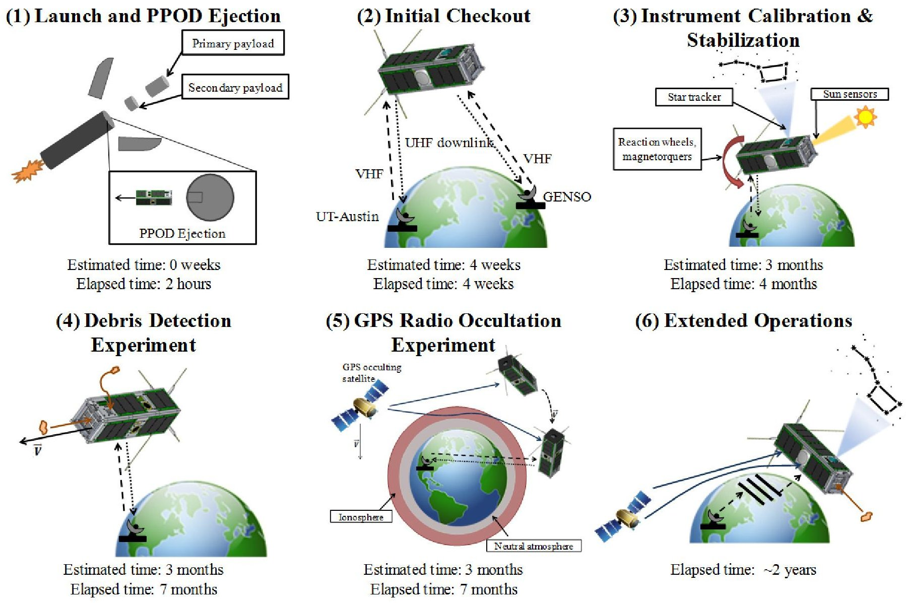
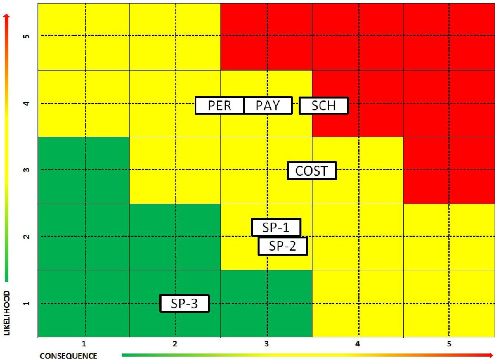
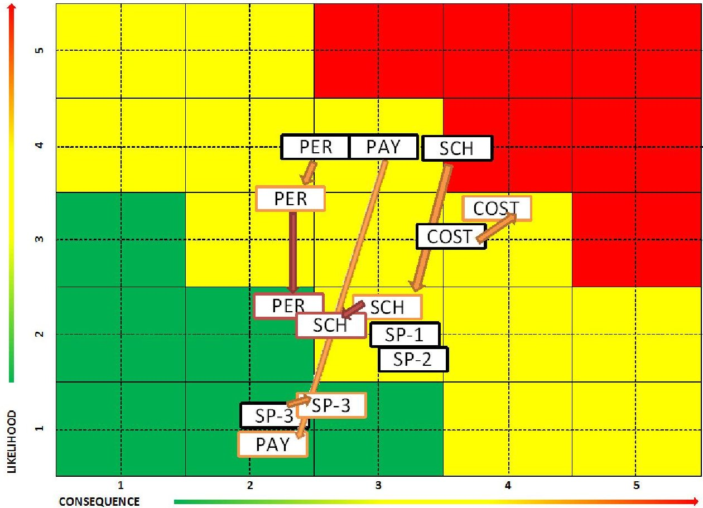

<!-- PDF_PAGE: 1 -->

# Application of Risk Management to University CubeSat Missions

Katharine M. Brumbaugh and E. Glenn Lightsey

Department of Aerospace Engineering and Engineering Mechanics The University of Texas at Austin, Austin, TX, USA

## Abstract

Risk management is a crucial step for any spacecraft design, to ensure system functionality and mission success. Unfortunately, risk management plans are typically high level descriptions of risk philosophies, or are too detailed for use on a student-built or otherwise low-budget spacecraft design. This article outlines a risk management plan for CubeSats by following standard industry methods of identifying risks, determining mitigation techniques, and tracking the risk progression between design milestones. The paper demonstrates the application of a level appropriate, detailed risk analysis and each step of the risk management plan to a 3-unit CubeSat built by a student team at the University of Texas at Austin.

## 1. Introduction

According to the NASA Risk Management Procedural Requirements, "risk is the potential for performance shortfalls, which may be realized in the future with respect to achieving explicitly established and stated performance requirements" (NASA, 2008). These potential pitfalls range from lack of the needed institutional support for the mission, to the areas of safety, technical, cost and schedule of the project itself. Based on these guiding statements, risk management is the process of risk identification, analysis, mitigation planning, and tracking of the root cause of problems and their ultimate consequences. Risk management

plans make the mission more successful by identifying potential failures early, and planning methods to circumvent any issues. However, to date, risk management plans have typically only been used for larger, more expensive, satellites, and have rarely been applied to satellites with a mass of less than 10 kg, known as nano-satellites. These larger-scale risk management plans need to be adapted to the smaller platforms of pico- and nano-satellites, which are of increasing interest to the aerospace industry. A new set of practices is needed that is appropriate to the schedule, budget, and risk tolerance of this new class of satellites. Defining a method for applying risk management to nano- and pico-satellite projects will result in more informed

<!-- PDF_PAGE: 2 -->

decision making, ultimately producing more successful spacecraft missions. It is timely to perform this research now, as this satellite class range continues to grow in use and importance.

California Polytechnic State University (Cal Poly) has established a standard launch mechanism for nanosatellites, called the Poly-Picosatellite Orbital Deployer (P-POD). The P-POD is flown as a secondary payload on unmanned launch vehicles, making it easier for small satellites that use the system to obtain launches. In order to use the P-POD, the spacecraft must be built in the shape of 10 cm cubes - called CubeSats. One CubeSat volume is called a 1-Unit (1U), and has a mass of approximately 1 kg. Multiple CubeSat volumes may be combined to form various size configurations of Units, such as 1U, 2U, and 3U. The standard P-POD secondary launcher has a 3U size capacity. The P-POD and CubeSat standard were first demonstrated together in June 2003, with the launch of two P-POD devices and a total of six 1U CubeSats (Nugent et al., 2008).

Founded in 2003, the Texas Spacecraft Laboratory (TSL) at the University of Texas at Austin (UT-Austin) has an established research program of designing building, launching, and operating student-built satellites. The lab has successfully launched two nano-satellites (~25 kg each) and one pico-satellite (~1 kg) within the past 3 years. In the TSL, student teams are currently designing three 3U CubeSats (~4 kg) for launch in 2014 and 2015. Having multiple missions under development provides a unique perspective to study design practices, including risk identification and mitigation, for 3U CubeSats across separate platforms. The TSL has learned lessons throughout previous mission life cycles, such as the usefulness of documentation and quality control standards in the mitigation of mission risks. Now, the TSL is applying these lessons and risk identification and mitigation techniques to the development of the current missions in order to improve their chances of mission success.

Analysis of reliability and risk is a vital tool in the life cycle of a spacecraft, and yet no process exists for missions of the CubeSat class. While others have completed statistical analyses of spacecraft reliability according to mass categories, previous research classifies a "small spacecraft" in the mass range of 0-500 kg (Du-

bos et.al, 2010, Monas et.al, 2012). Currently, typical CubeSat missions have an allocated mass of 1-12 kg, depending on the form factor. Risks associated with larger (500 kg) class missions do not necessarily reflect risks associated with CubeSat missions. Furthermore, prior research does not indicate the root causes of mission failures or provide a detailed risk management method that is applicable to CubeSat missions. The approach of this paper, and its recommendations, provides a first published method of managing risks for CubeSat missions.

For CubeSat missions, particularly of the university class, more detailed methods of risk analysis, such as Failure Modes and Effects Analysis (FMEA) and Probabilistic Risk Assessment (PRA), are unfeasible. While FMEA and PRA are used throughout the aerospace industry, such as for the International Space Station, they typically require large amounts of labor hours in order to complete the analysis pertaining to a given system (NASA, 2009). Additionally, these analysis tools usually require access to mission database information and software tools, which may be restricted. CubeSat missions typically do not have the required budget, schedule, or personnel resources necessary to conduct a full FMEA and PRA analysis (NASA, 2011).

This work describes the process of creating a low cost risk management plan for a university CubeSat or similar low budget space mission. The process described may be completed by students and professionals alike, thus using whatever personnel resources are available. Additionally, assuming no export-sensitive risks are introduced, this risk management plan is not restricted by nationality. Using only knowledge of the spacecraft, its mission, and software accessible via most computers, this risk management plan offers a low cost approach to risk analysis. Because of its ability to be used by anyone, and its low cost nature, the risk management plan described in this paper offers a novel and innovative method for capturing, mitigating, and tracking CubeSat mission risks. The first section details each step in a descriptive manner, so that a systems engineer or mission planner may develop their own risk management plan uniquely suited for their mission. The second section presents a demonstrative case study of these steps as applied to the ARMADILLO 3U

<!-- PDF_PAGE: 3 -->

CubeSat mission, which is currently in development at The University of Texas at Austin. The work concludes with recommendations to improve the effectiveness of future CubeSat mission risk management plans.

## 2. Low Cost Approach to Risk Management

A risk management plan entails three major steps, each consisting of sub-steps, as detailed in Table 1. The three major steps are to identify the mission risks, determine the appropriate mitigation techniques, and closely monitor the progress of the risks (Department of Defense, 2006). By identifying, mitigating, and tracking the risks, it is believed that the mission will have a higher chance of success. These low cost risk management methods are of particular interest to CubeSat missions. Because of the limited resources and short program life cycle of CubeSat missions, it is desirable to avoid the more expensive and detailed methods of risk analysis such as Probabilistic Risk Assessment (PRA), by employing analytical methods of identifying and tracking mission risks using common, low-cost software tools. The following sections describe how costconscious missions may apply the risk management methodology from Table 1 to the CubeSat platform.

Table 1. Steps of a Risk Management Plan

<table border="1"><tr><td>Main Step</td><td>Sub-steps</td></tr><tr><td>A. Risk identification</td><td>1. Review the mission concept of operations
2. Identify root causes
3. Classify priority of risk
4. Name responsible person
5. Rank likelihood (L) and consequence (C) of root cause
6. Describe rationale for ranking
7. Compute mission risk likelihood and consequence values
8. Plot mission risks on L-C chart</td></tr><tr><td>B. Determine mitigation techniques</td><td>Choices consist of:
1. Avoid the risk by eliminating root cause and/or consequence
2. Control the cause or consequence
3. Transfer the risk to a different person or project
4. Assume the risk and continue in development</td></tr><tr><td>C. Track progress</td><td>Plot the mission risk values on an L-C chart at key life cycle or design milestones to see progress.</td></tr></table>

## 2.1 Risk Identification

## 2.1.1 Review Mission Concept of Operations

To determine the risks that could potentially cause mission failure, it is useful to start with the mission concept of operations and the primary payloads. Often, launch and checkout are the first steps of the concept of operations. With this approach in mind, what mission-specific actions would cause launch and checkout to fail? The spacecraft design and integration team cannot control launch failures, but they can control spacecraft delivery delays. Moving along in the concept of operations to the primary mission phase, consider what could cause the mission payloads to not function properly.

Mission risks are higher-level failures. Component and system-level failures are the root causes of mission risks, as discussed in the next section. All risks should be analyzed in terms of hardware, software and programmatic issues (Blanchard and Fabrycky, 2006). Table 2 lists typical sources of mission risk according to the DoD Risk Management guide (Department of Defense, 2006).

Table 2. Sources of Mission Risk

<table border="1"><tr><td>Hardware/Software</td><td>Programmatic</td></tr><tr><td>Requirements</td><td>Logistics</td></tr><tr><td>Technical baselines</td><td>Concurrency</td></tr><tr><td>Test and Evaluation</td><td>Cost</td></tr><tr><td>Modeling and simulation</td><td>Management</td></tr><tr><td>Technology</td><td>Schedule</td></tr><tr><td>Production/Facilities</td><td>External factors</td></tr><tr><td>Industrial capabilities</td><td>Budget</td></tr></table>

## 2.1.2 Identify Root Causes For Each Risk

The next step in assessing the potential risks to a spacecraft mission is to analyze the root causes of such a risk. Starting with the risks identified from section 2.1.1, determine what hardware, software or programmatic issues would eventually lead to the harmful event's occurrence. While the mission risks may be very similar between different university and industry

<!-- PDF_PAGE: 4 -->

missions, the root causes may differ greatly, based upon the engineering practices in place in each environment. For instance, student teams may experience different personnel risk root causes than industry spacecraft projects which have career engineers as part of the team. Additionally, university projects tend to have smaller budgets leading to a higher cost risk. With each mission risk, it is encouraged to examine the requirements verification matrix, project schedule, budget and mission overview documents to determine what root causes may contribute to the specified mission risk.

## 2.1.3 Assign Responsible Person

While the systems engineer and program manager are ultimately responsible for the risk analysis and management of the entire spacecraft and mission, respectively, the entire team should be held responsible for the mitigation of mission risk root causes. Thus, it is important to identify a responsible person for each root cause. This person should be the most knowledgeable about the root cause and to whom all questions regarding its status will be directed. Most likely, the subsystem or task leads are the responsible persons, but this may not always be the case.

## 2.1.4 Rank Likelihood and Consequence Of Root Cause

After having first identified the mission risks, their root causes, and named a responsible person for every root cause, each risk must then be ranked according to its likelihood and consequence (L-C). Both of these rankings are based upon a 1-5 scale where a value of "1" is viewed as the least severe, while "5" is most critical. These scales, however, vary greatly in the descriptions of each value based upon the source. The most detailed set of the two scales found, which is used in this analysis, is from the DoD Guide to Acquisition shown in Tables 3 and 4 (Department of Defense, 2006). The decision of the root cause L-C value should be made by consensus of the subsystem lead, systems engineer, and program manager.

While the likelihood criteria of Table 3 may be similar across many sources of L-C ranking scales,

the DoD has identified three methods of assessing the consequence of a root cause occurring in terms of the technical, schedule and cost implications to the mission. Table 4 quantifies the schedule and cost of each consequence level. Note that the values of the two columns labeled "...application to CubeSats" in Table 4 have been added by the authors and are specifically tailored for a 3U CubeSat mission with a budget of $1.5 million (including personnel costs), and a timeline of three years from design to launch with design reviews every six months. However, these schedule and cost values can easily be modified to reflect a different scale mission.

Table 3. DoD Likelihood Criteria for Risk Ranking

<table border="1"><tr><td>Level</td><td>Likelihood</td><td>Probability of occurrence</td></tr><tr><td>1</td><td>Not Likely</td><td>~10%</td></tr><tr><td>2</td><td>Low Likelihood</td><td>~30%</td></tr><tr><td>3</td><td>Likely</td><td>~50%</td></tr><tr><td>4</td><td>Highly Likely</td><td>~70%</td></tr><tr><td>5</td><td>Near Certainty</td><td>~90%</td></tr></table>

## 2.1.5 Describe Rationale for L-C Ranking

During the likelihood and consequence ranking of each root cause, it is important to also include a rationale for the choice of the value made. This communicates the current status and issues surrounding each root cause to other team members and program evaluators. Additionally, if the root cause L-C values are tracked over time, the rationales can include updates for increasing or decreasing the L-C values.

## 2.1.6 Classify Risk Priorities

With likelihood and consequence values assigned to each root cause event, the priority that should be given to assigning labor and financial resources to a given root cause can be objectively quantified. First determine the L-C product by multiplying the likelihood and consequence values together for a given root cause. Next, sort the root causes by highest to lowest L-C product, and assign a numerical priority of "1" to the root cause with the highest product. Assign a "2" to the next highest L-C product, and so on. It should be

<!-- PDF_PAGE: 5 -->

Table 4. DoD Consequence Criteria for Risk Ranking

<table border="1"><tr><td>Level</td><td>Technical</td><td>Schedule</td><td>Schedule application to CubeSats</td><td>Cost</td><td>Cost application to CubeSats</td></tr><tr><td>1</td><td>Minimal or no consequence to technical performance</td><td>Minimal or no impact</td><td>No change</td><td>Minimal or no impact</td><td>No change</td></tr><tr><td>2</td><td>Minor reduction in technical performance or supportability, can be tolerated with little or no impact on program</td><td>Able to meet key dates.</td><td>Slip&lt;1 month</td><td>Budget increase or unit production cost increases(1% of budget)</td><td>Increase&lt;$10K</td></tr><tr><td>3</td><td>Moderate reduction in technical performance or supportability with limited impact on program objectives</td><td>Minor schedule slip.Able to meet key milestones with no schedule float.</td><td>Slip&lt;3 months.</td><td>Budget increase or unit production cost increases(5% of budget)</td><td>Increase&lt;$50K</td></tr><tr><td>4</td><td>Significant degradation in technical performance or major shortfall in supportability; may jeopardize program success</td><td>Program critical path affected.</td><td>Slip&lt;6 months.</td><td>Budget increase or unit production increase(10% budget)</td><td>Increase&lt;$100K</td></tr><tr><td>5</td><td>Severe degradation in technical performance; cannot meet key technical/supportability threshold; will jeopardize program success</td><td>Cannot meet key program milestones.</td><td>Slip&gt;6 months</td><td>Exceeds budget threshold(10% of budget)</td><td>Increase&gt;$100K</td></tr></table>

noted that with this method there may be multiple root causes with a given priority level. This product-based method of assigning L-C priorities is one of potentially many methods. The algorithm for assigning priorities can be adjusted if a different method is preferred.

## 2.1.7 Determine Mission Risk L-C Values

After identifying the mission risks and their associated root causes and deciding upon an L-C value for each root cause, each mission risk L-C value is calculated based on a weighted average of all its root cause L-C values. Many weighting methods exist; the algorithm used here for assigning weights is based on historical practice. The weight associated with each root cause in this analysis is determined by a rank reciprocal method, given by $ w_{i}=\frac{1 / R_{i}}{\sum_{j=1}^{N}1 / R_{j}} $ (Stillwell et.al, 1981).

In the above equation, $ R_{i} $ corresponds to the priority ranking of root cause i, and N is the total number of root causes for a given mission risk. When compared to a rank sum or uniform weight methodology, the rank reciprocal method was chosen because it placed larger weight values on the higher ranked root causes. Future analysis is recommended to determine an optimal ranking method. Using this rank reciprocal methodology, each root cause is given a weighting factor between 0 and 1. The total mission risk L-C value is then calculated by multiplying the root cause likelihood or consequence value by its weighting factor and summing over all the root causes. This algorithm for determining L-C values can be modified, if an alternate method is preferred.

## 2.1.8 Plot Mission Risks on L-C Chart

Each of the mission risks first identified in section 2.1.1 and developed with more detail through section 2.1.7 is plotted on a Likelihood-Consequence (L-C) chart to provide a graphical representation of the project risk status. This chart is comprised of a 5x5 grid, on which the horizontal axis is the consequence axis, while the vertical axis displays the likelihood of the risk occurring. The upper right portion of the grid is colored red to signify that risks which are placed in this area should cause serious concern and redistribution of resources. The lower left portion of the plot is commonly colored green to indicate these risks are not currently jeopardizing the potential to successfully complete the project. The region between the red and green areas is colored yellow to show the risks which are being managed, and thus are not an imminent threat to

<!-- PDF_PAGE: 6 -->

mission success. Mitigation techniques are discussed in the next section.

## 2.2 Determine Mitigation Techniques

After identifying the risks and their root causes, the risk management plan is not complete until a mitigation strategy is determined. According to the DoD, risk mitigation is the selection of the option that best provides the balance between performance and cost (Department of Defense, 2006). This can be accomplished in four possible ways—avoid, control, transfer, or assume:

1. Avoid risk by eliminating the root cause and/or consequence;

2. Control the cause or consequence;

3. Transfer the risk to a different person or project;

4. Assume the risk and continue in development.

For each of the risks and their identified root causes, at least one mitigation strategy should be adopted. Having multiple methods of mitigation decreases the risk likelihood and consequence upon the mission. As the design status matures, these mitigation strategies also mature. The choice of mitigation technique is dependent upon the project resources available, and may also be dependent upon the type of the program-i.e., whether it is a university, industry, or government project.

## 2.3 Track Progress

To monitor the progress of the mission risks via the mitigation strategies described in the previous section, re-evaluate the L-C values at key life cycle or design milestones, such as design reviews. The program manager and systems engineer should consult with subsystem or task leads as identified in the "responsible person" column of the risk assessment, to obtain the most recent status of each root cause when completing the re-evaluation. Ideally, both of the L-C values will decrease with each successive re-evaluation. However, if the mission risk increases in either likelihood or consequence, this re-evaluation will capture the change. For

visualizing the change in mission risk L-C values, plot the previous and new mission risk coordinates on an L-C chart with arrows showing the L-C value movement.

## 3. Case Study: ARMADILLO 3U CubeSat Mission

This section applies the steps of a risk management plan, as identified in Table 1 and detailed in the preceding section, to an example mission. The ARMADILLO (Atmosphere Related Measurements and Detection of submILLimeter Objects) 3U CubeSat is an actual university mission currently under development at UT-Austin, with a planned launch in 2015.

## 3.1 Risk Identification

## 3.1.1 Review Mission Concept of Operations

The ARMADILLO 3U CubeSat Concept of Operations is shown graphically in Figure 1. ARMADILLO has a primary science mission to measure sub-millimeter space debris particles with an instrument called the Piezo-electric Dust Detector (PDD) (Brumbaugh et al., 2012). The secondary science mission uses a Fast, Orbital, TEC, Observables, and Navigation (FOTON) dual-frequency, software-defined Global Positioning System receiver, capable of accurate orbit determination, to gather radio occultation measurements to observe space weather effects, especially in the ionosphere (Joplin et al., 2012).

The ARMADILLO CubeSat has many critical systems on board, but mission success is dependent upon the ability of the spacecraft to gather scientific and spacecraft health data, and to communicate these data to the ground station. Spacecraft risks are identified by examining the Requirements Verification Matrix and the simulation, modeling, and testing processes needed to verify that each requirement is being met. With the spacecraft risks, it was determined that there were too many mission risks for one main spacecraft risk, so these risks were split into three sub-categories- communications, ability to gather data, and compliance with industry standard (e.g., CubeSat) requirements. Cost risks are identified by evaluating the

<!-- PDF_PAGE: 7 -->

Figure 1. ARMADILLO Concept of Operations

current satellite budget, which outlines the cost of each component within its respective subsystem, as well as personnel costs to the project. Schedule risks are determined by examining the integration and testing schedule for potential schedule slips. Personnel risks are recognized by management experience over the course of the spacecraft design cycle. The identified mission risks are combined to encompass the seven broadly categorized mission risks that could jeopardize completing the ARMADILLO mission. Each risk is given a unique call sign, based on the name of the risk category, which identifies it on the L-C chart presented later. The seven ARMADILLO risks are listed in Table 5.

Table 5. ARMADILLO Mission Risks

<table border="1"><tr><td>Risk Category</td><td>Call sign</td><td>Mission Risk</td></tr><tr><td>Schedule</td><td>SCH</td><td>Failure to deliver Engineering Design Unit(EDU) to the FCR</td></tr><tr><td>Payload</td><td>PAY</td><td>Failure to gather science mission data in orbit</td></tr><tr><td>Spacecraft</td><td>SP-1</td><td>Being unable to communicate with spacecraft</td></tr><tr><td>Spacecraft</td><td>SP-2</td><td>Unable to gather data from spacecraft</td></tr><tr><td>Spacecraft</td><td>SP-3</td><td>Inability to meet industry standard requirements</td></tr><tr><td>Personnel</td><td>PER</td><td>Loss of human knowledge and experience</td></tr><tr><td>Cost</td><td>COST</td><td>Mission cost too overwhelming to continue</td></tr></table>

<!-- PDF_PAGE: 8 -->

Note that the Schedule (SCH) risk of Table 5 refers to the Flight Competition Review (FCR) during which ARMADILLO was evaluated in January 2013. ARMADILLO is a participant in the University Nanosatellite Program (UNP) competition, and a mission down select occurs when one or more university missions are selected for flight at the FCR. Thus, the FCR acts as a key delivery point in the mission schedule.

## 3.1.2 Identify Root Causes for Each Risk

While the ARMADILLO mission risks are shown in Table 5, the SCH risk is further analyzed in Table 6 by displaying the top seven root causes to this risk at the time of the Critical Design Review (CDR) in spring 2012. The responsible parties are discussed in the next section. The root causes were identified by examining the project schedule and status, hardware trade studies, and utilizing lessons learned during previous satellite design missions at UT-Austin, such as underestimating the difficulty of software interfacing between hardware and the spacecraft flight computer. Note that the root causes shown in Table 6 are descriptive and specific to the ARMADILLO concept of operations and scientific payloads. It is beneficial to be as descriptive as possible when developing the Risk Management Plan.

Table 6. Partial List of ARMADILLO SCH Mission Risk (Failure to Deliver Spacecraft EDU to FCR) Detailed to Root Cause and Responsible Party at Critical Design Review in Spring 2012

<table border="1"><tr><td>Root cause</td><td>Responsible person</td></tr><tr><td>Software interfacing with PDD delayed</td><td>Command and Data Handling(CDH)Lead</td></tr><tr><td>PDD instrument team does not provide documentation needed for ARMA-DILLO design to continue in timely manner</td><td>Student Program Manager(PM)</td></tr><tr><td>Hardware interfaces between spacecraft and PDD not properly monitored causing inability to properly fit PDD on ARMADILLO</td><td>Integration Lead(INT)</td></tr><tr><td>PDD instrument team does not provide an Engineering Design Unit causing ARMADILLO&#x27;s inability to accommodate and test payload</td><td>PM</td></tr><tr><td>Software integration delays due to individual subsystems not being ready to be integrated with the entire spacecraft.</td><td>CDH Lead</td></tr></table>

<table border="1"><tr><td>Mechanical EDU structure delay due to the delay in sending out CAD drawings to the machine shop.</td><td>Structure Lead (STR)</td></tr><tr><td>Software integration delays due to the flight computer not being ready to integrate with subsystems</td><td>CDH Lead</td></tr></table>

## 3.1.3 Assign Responsible Person

For the SCH risk of the ARMADILLO mission, described in detail in Table 6, the responsible parties are identified as the persons currently working on the root cause tasks. For example, all correspondence with the payload providers of the ARMADILLO mission is conducted by the Student Program Manager. She is therefore listed as the responsible person for root causes such as "PDD instrument does not provide documentation needed..." As additional examples, the Integration (INT) lead has been conducting the hardware integration and interface definition, while the Command and Data Handling (CDH) lead has been managing the software integration effort, so they are each listed for their respective tasks. By naming a responsible person, the systems engineer monitoring the risk management plan has a point of contact for each root cause and can request updates at any point in time.

## 3.1.4 Rank Likelihood and Consequence of Root Cause

For the ARMADILLO SCH risk at CDR, Table 7 outlines the top seven priority root causes with the likelihood and consequence values defined according to Tables 3 and 4. The values are representative of the spacecraft design status at CDR, as indicated in Table 6. As with any important spacecraft design milestone, it is desired for the mission risks to score as low as possible on the likelihood and consequence criteria at this time.

When the risk management plan was first created for the ARMADILLO mission, the systems engineer and responsible persons together decided on valid likelihood and consequence values for each associated root cause, based upon the criteria outlined in Tables 3 and 4. For the CDR status, the systems engineer took the current status of the root causes into consideration when updating these values. However, because assign-

<!-- PDF_PAGE: 9 -->

ing the likelihood and consequence values is a subjective process, it is recommended that a more objective L-C ranking method be developed in the future, informed by historical data from previous CubeSat missions.

## 3.1.5 Describe Rationales for L-C Rankings

The rationales for updating the L-C values of the ARMADILLO SCH mission risk root causes based on the CDR spacecraft status are included in Table 7 along with the chosen values based upon the criteria listed in Tables 3 and 4. Note that the root cause and responsible person are the same as those from Table 6.

## 3.1.6 Classify Risk Priorities

According to the L-C product priority classification scheme detailed in section 2.1.6, at the CDR milestone in spring 2012, the top two SCH risk root causes had equal priority, as shown in Table 7. The first of these was delayed software interfacing with the primary payload, the PDD. At the time, this risk was highly rated because the team did not have enough personnel resources allocated to mitigating the root cause as needed; additionally, while having received the EDU PDD unit, no software interfacing had occurred because the flight-like quality circuit board hardware had not been designed. At CDR, lack of sufficient documentation

Table 7. Partial List of ARMADILLO SCH Mission Risk (Failure to Deliver EDU to FCR) Identified with Root Cause, Priority, Responsible Party, L-C Values, and Rationales at CDR Status in Spring 2012

<table border="1"><tr><td>Root cause</td><td>Responsible person</td><td>Likelihood</td><td>Consequence</td><td>Priority</td><td>Rationale</td></tr><tr><td>Software interfacing with PDD delayed</td><td>Command and Data Handling(CDH)Lead</td><td>5</td><td>4</td><td>1</td><td>Little is known about the PDD software at this point; ICD has been exchanged, but need to consistently monitor progress</td></tr><tr><td>PDD instrument team does not provide documentation needed for ARMADILLO design to continue in timely manner</td><td>Student Program Manager(PM)</td><td>5</td><td>4</td><td>1</td><td>Already addressed missing information; contingency plans have been created</td></tr><tr><td>Hardware interfaces between spacecraft and PDD not properly monitored causing inability to properly fit PDD on ARMADILLO</td><td>Integration Lead(INT)</td><td>4</td><td>4</td><td>2</td><td>Instrument team is designing with s/c requirements/specifications in mind; however, need to follow-up to ensure they are meeting these requirements</td></tr><tr><td>PDD instrument team does not provide an Engineering Design Unit causing ARMADILLO&#x27;s inability to accommodate and test</td><td>PM</td><td>4</td><td>4</td><td>2</td><td>Doubt exists about whether or not they can deliver the unit; schedule slip would occur but not more than 6 months</td></tr><tr><td>Software integration delays due to individual subsystems not being ready to be integrated with the entire spacecraft.</td><td>CDH Lead</td><td>4</td><td>3</td><td>3</td><td>Inevitable but continuously monitored</td></tr><tr><td>Mechanical EDU structure delay due to the delay in sending out CAD drawings to the machine shop.</td><td>Structure Lead(STR)</td><td>5</td><td>2</td><td>4</td><td>Already experiencing delays in getting drawings finished; but delays would be less than 6 months</td></tr><tr><td>Software integration delays due to the flight computer not being ready to integrate with subsystems</td><td>CDH Lead</td><td>2</td><td>3</td><td>5</td><td>Software lags behind hardware design maturity; continued software development will occur after FCR</td></tr><tr><td>Weighted overall value of root causes for SCH mission risk</td><td></td><td>3.98</td><td>3.59</td><td></td><td>Includes additional root causes with lower L-C values not shown</td></tr></table>

<!-- PDF_PAGE: 10 -->

from the instrument team on the PDD requirements and interfaces was also a major issue. This problem is common in missions with multiple institutions, where information exchange is more formalized and therefore can be delayed.

## 3.1.7 Determine Mission Risk L-C Values

Table 7 outlines the top seven root causes that would elicit a schedule risk entitled "Failure to deliver EDU to the FCR". This means that any combination of the root causes occurring could potentially endanger the delivery of a flight-like ARMADILLO Engineering Design Unit (EDU) to the Flight Competition Review (FCR), where the selection of a mission for flight is based upon the current hardware and software status. If ARMADILLO did not deliver a completed EDU at FCR, it would have severely jeopardized the possibility of being selected for flight, and therefore jeopardized the mission itself.

The weighted average, according to the methodology outlined in section 2.1.7, of the full set of root causes for the SCH mission risk is used, to determine the overall likelihood and consequence of this event occurring. Each of the other six mission risks identified in Table 8 has its own set of root causes, which determines the overall likelihood and consequence of the mission risk occurring. These overall L-C values for each of the seven ARMADILLO mission risks when the project was at CDR status in spring 2012 are shown in Table 8.

## 3.1.8 Plot Mission Risks on L-C Chart

Once all the mission risks have had their root causes defined and overall L-C values determined in Table 8, the seven identified risks of the ARMADILLO mission at CDR with their L-C values given are plotted on the 5x5 L-C chart shown in Figure 2. Note that the SCH risk is ranked highest and is within the red zone, requiring immediate attention. Table 7 details the ARMADILLO SCH risk at CDR. The L-C chart is useful for assessing which mission risks should be of immediate concern and justifying the allocation of project resources to reduce the risk. For the ARMA-DILLO team, after completing this preliminary risk assessment, a conscious effort was made to decrease the likelihood and consequence of the SCH, PAY, COST, and PER risks. Some of these mitigation techniques are discussed in the next section. It should be noted that depending on the project and responsible institution, it may be difficult to formally reduce the risk likelihood and consequence, due to requirements placed on the system.

Table 8. ARMADILLO Mission Risks Likelihood (L) and Consequence (C) Values at CDR Status (5 Equals Most Likely and Most Severe)

<table border="1"><tr><td>Risk Type</td><td>Call sign</td><td>Risk</td><td>L</td><td>C</td></tr><tr><td>Schedule</td><td>SCH</td><td>Failure to deliver EDU to the FCR</td><td>3.98</td><td>3.59</td></tr><tr><td>Payload</td><td>PAY</td><td>Failure to gather science mission data in orbit</td><td>4.00</td><td>3.00</td></tr><tr><td>Spacecraft</td><td>SP-1</td><td>Being unable to communicate with spacecraft</td><td>2.19</td><td>3.07</td></tr><tr><td>Spacecraft</td><td>SP-2</td><td>Unable to gather data from spacecraft</td><td>2.05</td><td>3.14</td></tr><tr><td>Spacecraft</td><td>SP-3</td><td>Inability to meet industry standard requirements</td><td>1.09</td><td>2.09</td></tr><tr><td>Personnel</td><td>PER</td><td>Loss of mission human knowledge</td><td>3.95</td><td>2.56</td></tr><tr><td>Cost</td><td>COST</td><td>Mission cost too overwhelming to continue</td><td>3.00</td><td>3.50</td></tr></table>

## 3.2 Determine Mitigation Techniques

Based on the initial analysis of the mission risks at CDR, a number of mitigation techniques were adopted to manage the most significant of them. The primary mitigation techniques used for the SCH mission risk were to control the risk by working and communicating more frequently with the payload and subsystem providers and emphasizing delivery deadlines. Additionally, the SCH risk L-C values were decreased by shifting personnel resources to necessary tasks, such as mechanical drawings, and software and hardware interfacing. Further details about how the SCH mission risk was successfully mitigated are presented in the next section.

Because the ARMADILLO COST mission risk was also deemed to be one of the highest in likelihood and consequence, as described in the previous section, its mitigation strategies are considered here as an

<!-- PDF_PAGE: 11 -->

Figure 2. ARMADILLO Mission Risk L-C Chart at CDR (Spring 2012).

example. Table 9 lists the three root causes associated with the COST risk: "Mission cost too overwhelming to continue." Note that each of the root causes has at least one mitigation technique documented; additional methods may be added when they are developed. While cost is a difficult factor to predict for spacecraft integration, work has been completed to detail the

current cost of the development and integration of a 3U CubeSat with the capabilities of the ARMADILLO and Bevo-2 missions (Brumbaugh, 2012). In this manner, ARMADILLO considers the documentation of all hardware, personnel, and travel costs as a mitigation technique, as illustrated in Table 9, as one of the best ways to both avoid and control a budget overrun issue.

Table 9. Mitigation Techniques for the ARMADILLO COST Risk.

<table border="1"><tr><td colspan="2">Root cause</td><td colspan="3">Mitigation techniques</td></tr><tr><td></td><td>Avoid</td><td>Control</td><td>Transfer</td><td>Assume</td></tr><tr><td>Unsuccessful understanding of all mission costs associated with spacecraft causes a misrepresentation of the total mission cost</td><td>Document all costs - hardware, personnel, travel to ensure proper budget knowledge</td><td></td><td></td><td>With proper budget documentation, there should be contingency money to allow for price increases</td></tr><tr><td>COTS parts prices increase causing an increase to the mission budget beyond control</td><td></td><td>Maintain relationships with manufacturers to negotiate prices; Have updated trade studies of other potential vendors</td><td></td><td>With proper budget documentation, there should be contingency money to allow for price increases</td></tr><tr><td>Inability to obtain sufficient research funding causes program to be put on hold until more money can be found</td><td>Apply for as many grants as possible; maintain relationships with industry who may be able to help.</td><td></td><td></td><td>In some cases, this is unavoidable. Work on tasks that can be done while waiting for the financial situation to improve.</td></tr></table>

<!-- PDF_PAGE: 12 -->

Figure 3. ARMADILLO Mission Risk L-C Chart Showing Migration of Risks from CDR (Black Outline) to PQR (Orange Outline) to FCR (Red Outline).

Additionally, the ARMADILLO student team has limited control over the cost of Commercial Off The Shelf (COTS) parts. However, it is possible to help control and assume these risks by maintaining important relationships with hardware suppliers to be able to negotiate prices.

## 3.3 Track Progress

The mission risk L-C values in Table 8 were determined when the spacecraft was at CDR. It is necessary to monitor the changes in risk at subsequent key design milestones, as well. Having applied the risk identification method to the ARMADILLO mission, the systems engineer saw at the CDR milestone that the SCH risk could cause a major problem to the overall project, so more members of the team were trained to create and check the project drawings. Because of this personnel shift, the drawings of another spacecraft were simultaneously finished, checked, and sent to the machine shop without delaying the ARMADILLO project schedule. While these drawings were specific to a different mission, the ARMADILLO schedule mission risk was also mitigated, because now the team understood the time and process associated with completing a quality job on the mechanical drawings prior to sending them to the machine shop for fabrication. Additionally, since the 3U CubeSat spacecraft designs were similar, only small changes to the other spacecraft drawings were needed to complete the ARMADILLO drawings (Brumbaugh, 2012). Thus, the root cause priority decreased in the six months between CDR and Proto-Qualification Review (PQR), after having identified the mechanical drawings as a top priority root cause for a schedule slip mission risk and allocating the appropriate resources to address the issue. PQR represents the final design review prior to the Flight Competition Review (FCR) of the University Nanosatellite Program (UNP). By actively managing the SCH mission risk, most of the root cause L-C values for this mission risk decreased during the six months between CDR and PQR.

The ARMADILLO mission risks were tracked between the CDR, PQR, and FCR design reviews, and are plotted in Figure 3. Note that the mission risks that

<!-- PDF_PAGE: 13 -->

moved are indicated by arrows connecting the sets of mission risks between design reviews. The black boxes indicate the original L-C values determined at CDR. The orange arrows leading to orange boxes show the progression from CDR to PQR. Similarly, the red arrows leading to red boxes show the progression from PQR to FCR. The SCH, PAY, and PER risks all decreased their likelihood and/or consequence values. However, at FCR, the COST mission risk is now the greatest threat to the mission in both likelihood and consequence. As a university spacecraft mission, this mission risk is not unexpected. Since the FCR, steps have been taken to both control and avoid the COST mission risk by managing the program costs and applying for additional resources.

## 4. Recommendations

Through the process of applying this risk management plan to the CubeSat missions in development at UT-Austin, the authors have identified the need for a more objective risk analysis for CubeSats. While full FMEA and PRA methods are unfeasible for CubeSat applications, the concepts of a risk database and statistical likelihood and consequence analysis would provide greater insight and perspective into the common causes of CubeSat mission failures. Improved historical data could lead to better risk management plans and more successful missions.

Currently, a detailed archival mission risk database on CubeSats flown within the past 10 years does not exist. The CubeSat community needs to collect information regarding the mission issues experienced and the resolutions that were employed. It is recommended to create a database of these mission risks and their associated mitigation techniques. Based on these database results gathered from current and past CubeSat missions, likelihood and consequence scales can be analytically derived to rate mission risks. Because this data will be based specifically on CubeSat missions, it is better suited to reflect CubeSat mission risks than the DoD likelihood and severity definitions given in Tables 3 and 4.

Once mission data is collected, the results will help future CubeSat missions identify potential weaknesses

in their designs at an earlier stage in project life cycle. Identifying the mission risks during the beginning phases of a mission is a difficult task, and it would be extremely useful to have a reference database of historical mission risks. This data will also help mitigate the risks faced by future missions, by documenting discoveries made through the integration, delivery and operations phases of previously delivered missions.

## 5. Conclusion

This research details the development and application of risk management methods to pico- and nano-satellites, including CubeSats, a class of spacecraft growing in importance and popularity. Each step of the detailed risk management plan presented in this work is described, using the steps necessary to accomplish the task. The management plan also includes risk acceptance and mitigation methods, and the entire methodology provides a model for future pico- and nanosatellite missions. The ARMADILLO 3U CubeSat, currently being developed at The University of Texas at Austin Texas Spacecraft Lab, is used as an example to demonstrate the process.

The need for a historical database of CubeSat missions within the past decade is motivated by the current subjectivity of assigning likelihood and consequence values to various mission risks. While the collection and analysis of a historical database may be difficult, creating such a database will ultimately be of value to CubeSat mission designers during spacecraft design, testing, and operations mission phases.

## Acknowledgments

The authors wish to acknowledge the students at the UT-Austin Texas Spacecraft Laboratory for their efforts in the design, development and fabrication of the Bevo-2 and ARMADILLO spacecraft. Without these hardworking students, this paper would not have been possible. Additionally, the authors gratefully acknowledge the support of the NASA Johnson Space Center (contract NNX09AM51A) and the University Nano-

<!-- PDF_PAGE: 14 -->

satellite Program administered through the Air Force Research Laboratory (contract FA9550-11-1-0040), which have sponsored the Bevo-2 and ARMADILLO spacecraft, respectively.

## References

Blanchard, B. S. and Fabrycky, W. J. (2006): Systems Engineering and Analysis, 4th ed. New Jersey: Prentice Hall, pp. 710-712.

Brumbaugh, K. (2012): the metrics of spacecraft design reusability and cost analysis as applied to cubesats, Master's Thesis, Dept. Aerospace Eng., Univ. Texas, Austin.

Brumbaugh, K., et al. (2012): "In-situ sub-millimeter space debris detection using cubesats." 2012 American Astronautical Society GN&C Conference, Breckenridge, CO, February 3-8, 2012 Paper AAS 12-001.

Department of Defense. (2006): "Risk management guide for dod acquisition," 6th ed.

Dubos, Gregory F., et al. (2010): Statistical reliability analysis of satellites by mass category: Does spacecraft size matter?, Acta Astronautica, vol. 67, 584-595.

Joplin, A., et al. (2012): Development and testing of a miniaturized, dual-frequency gps receiver for space applications, presented at the Institute of Navigation International Technical Meeting, Newport Beach, CA, January 2012.

Monas L., et al. (2012): Small satellite reliability modeling: a statistical analysis, presented at the Small Satellites Systems and Services - 4S Symposium 2012, Portoroz, Slovenia, 4-8 June 2012.

NASA. (2008): "Agency risk management procedural requirements," NASA Procedural Requirements, NPR 8000.4A.

NASA. (2009): "ISS risk management plan," SSP 50175, Revision C, National Aeronautics and Space Administration, International Space Station Program, Johnson Space Center, Houston, Texas.

NASA. (2011): "Probabilistic risk assessment procedures guide for nasa managers and practitioners," NASA/ SP-2011-3421 (2nd ed.), National Aeronautics and

Space Administration, Headquarters, Washington D.C.

Nugent, R., et al. (2008): The cubesat: the picosatellite standard for research and education, AIAA Space 2008 Conference, San Diego, California, September 8-11, 2008, Paper AIAA 2008-7734.

Shultz, David, et al. (2010): Colony: a new business model for research and development, 24th Annual AIAA/USU Conference on Small Satellites, Logan, Utah, August 2010, Paper SSC10-IV-2.

Stillwell, William G., et al. (1981): A comparison of weight approximation techniques in multiattribute utility decision making. Org. Behavior and Human Perf., vol. 28, 62-77.